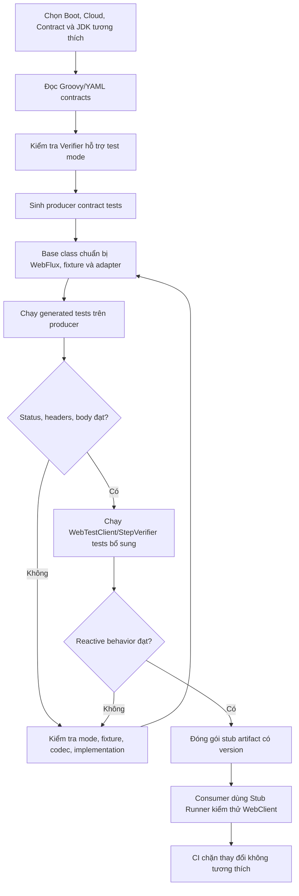

# Tích hợp WebTestClient theo khả năng Contract Verifier hỗ trợ

**Spring Cloud WebFlux** dùng mô hình xử lý bất đồng bộ, không chặn luồng, với các kiểu dữ liệu như `Mono<T>` và `Flux<T>`. Khi một producer triển khai API bằng WebFlux, nhóm vẫn muốn bảo vệ hợp đồng với consumer: request phải có method, path, header và body phù hợp; response phải có status, header và JSON đúng cam kết. Vấn đề là **công cụ thực thi generated tests phải tương thích với nền tảng reactive**.

Trong lộ trình **SPRING_CLOUD_CONTRACT**, Spring Cloud Contract Verifier đọc hợp đồng **Groovy/YAML DSL**, sinh producer tests và stub để consumer dùng **Stub Runner**. **WebTestClient** là HTTP test client thuộc hệ sinh thái Spring WebFlux, hỗ trợ gọi ứng dụng theo cách reactive. Tuy nhiên, **không nên mặc định mọi phiên bản Spring Cloud Contract đều sinh WebTestClient tests theo cùng một cách**. Khả năng hỗ trợ, tên test mode, mã sinh, dependency và cách chuẩn bị base class phải được đối chiếu với **phiên bản Contract Verifier đang dùng**.

Bài học thuộc chương **Kiểm thử reactive**. Mục tiêu là hiểu cách WebTestClient liên quan tới generated producer tests, kiểm tra hỗ trợ theo phiên bản, chuẩn bị base test cho WebFlux, thiết kế contract cho `Mono`/`Flux` và phân biệt kiểm thử HTTP contract với kiểm thử tính chất reactive như streaming, timeout, cancellation hay backpressure.

## 1. Reactive producer vẫn phải tuân thủ giao diện HTTP

Giả sử producer **Pricing Service** viết bằng Spring WebFlux cung cấp API cho consumer **Checkout**:

```http
GET /api/prices/SKU-42
Accept: application/json

HTTP/1.1 200 OK
Content-Type: application/json

{
  "sku": "SKU-42",
  "currency": "VND",
  "amount": 125000
}
```

Controller có thể trả `Mono<PriceResponse>` thay vì một DTO trực tiếp:

```java
import org.springframework.http.HttpStatus;
import org.springframework.http.MediaType;
import org.springframework.web.bind.annotation.GetMapping;
import org.springframework.web.bind.annotation.PathVariable;
import org.springframework.web.bind.annotation.RestController;
import org.springframework.web.server.ResponseStatusException;
import reactor.core.publisher.Mono;

@RestController
class PricingController {

    private final PricingService pricingService;

    PricingController(PricingService pricingService) {
        this.pricingService = pricingService;
    }

    @GetMapping(
        value = "/api/prices/{sku}",
        produces = MediaType.APPLICATION_JSON_VALUE
    )
    Mono<PriceResponse> getPrice(@PathVariable String sku) {
        return pricingService.findBySku(sku)
            .switchIfEmpty(Mono.error(
                new ResponseStatusException(HttpStatus.NOT_FOUND)
            ));
    }
}
```

`PricingService`, `PriceResponse` và test fixtures là các thành phần **do dự án tự định nghĩa**; ví dụ cho thấy cấu trúc reactive, chưa phải ứng dụng hoàn chỉnh.

Đối với consumer gọi HTTP, việc producer dùng `Mono` hay DTO trực tiếp thường **không hiển thị trên wire**. Consumer quan sát status `200`, content type, JSON và độ trễ. Vì vậy cùng một contract HTTP có thể bảo vệ cả implementation MVC và WebFlux, miễn cách chạy producer verification phù hợp.

### 1.1. Phân biệt ba lớp kiểm tra

| Lớp | Cần xác minh | Công cụ phù hợp |
|---|---|---|
| **Hợp đồng HTTP** | `GET`, URL, header, `200/404`, schema và matcher body | Spring Cloud Contract DSL + generated producer tests |
| **Tích hợp WebFlux** | Routing, filter, codec, exception handler, HTTP response của implementation | WebTestClient với application context hoặc server |
| **Hành vi reactive** | Hoàn thành luồng, số sự kiện, lỗi publisher, cancellation, timeout, backpressure | Reactor Test/`StepVerifier` và các bài integration phù hợp |

Không nên khẳng định chỉ cần WebTestClient là đã kiểm tra backpressure hoặc không chặn event loop. WebTestClient kiểm tra **hành vi HTTP**; các tính chất reactive chuyên sâu cần kỹ thuật bổ sung.

## 2. WebTestClient khác MockMvc và RestAssured như thế nào?

| Công cụ | Đặc điểm | Dùng khi |
|---|---|---|
| **WebTestClient** | HTTP client test dùng reactive WebClient infrastructure; có thể bind vào controller/context hoặc server thật | Kiểm thử Spring WebFlux và các HTTP service |
| **MockMvc** | Test infrastructure cho Spring MVC servlet stack | Producer MVC; không mặc định thích hợp cho ứng dụng chỉ dùng WebFlux |
| **RestAssured** | HTTP client kiểm thử, thường gọi server qua cổng thật | Producer MVC/WebFlux khi test mode gửi HTTP thực |
| **RestAssuredMockMvc** | Adapter cho Spring MVC MockMvc | Không tự nhiên thay thế WebTestClient khi producer chỉ dùng reactive stack |
| **StepVerifier** | Kiểm tra tín hiệu từ `Publisher`: `onNext`, `onComplete`, `onError`, thời gian ảo | Unit/integration test cho `Mono`/`Flux` |

Cần phân biệt **WebTestClient do một JUnit test viết tay sử dụng** và **WebTestClient được mã sinh của Spring Cloud Contract Verifier sử dụng**. Bài test viết tay có thể hoạt động dù plugin Contract Verifier phiên bản đang dùng không có chế độ generate tương ứng.

### 2.1. Các cách WebTestClient kết nối ứng dụng

WebTestClient có thể được tạo theo các chiến lược:

1. **Bind to controller:** chỉ dựng một số controller, thuận tiện cho slice/unit test nhưng có thể bỏ qua một số filter và cấu hình toàn ứng dụng.
2. **Bind to application context:** sử dụng WebFlux handler infrastructure từ Spring context, không cần mở cổng TCP.
3. **Bind to live server:** gọi server HTTP thực, chẳng hạn Spring Boot test chạy cổng ngẫu nhiên.

Những cách này kiểm tra các mức tích hợp khác nhau. Khi tạo producer contract tests, chọn mode **phù hợp với hành vi cần bảo vệ** và khả năng sinh mã của plugin, không chỉ chọn cách chạy nhanh nhất.

## 3. Kiểm tra khả năng WebTestClient của Contract Verifier theo phiên bản

Câu hỏi đúng không phải “Spring Cloud Contract có hỗ trợ reactive không?”, mà là:

> **Phiên bản Spring Cloud Contract Verifier đang ghim trong producer có hỗ trợ sinh generated tests với WebTestClient cho loại contract và test mode chúng ta dùng hay không?**

Một số dòng phiên bản cung cấp **test mode `WEBTESTCLIENT`**. Tuy nhiên, không nên copy cấu hình ở một phiên bản khác rồi tin rằng mọi plugin đều nhận cùng giá trị hoặc sinh cùng code.

Checklist cần xác nhận:

1. **Spring Boot version** và reactive stack: ứng dụng đang chạy Spring WebFlux hay MVC? Nếu cả hai starter có mặt, phải kiểm tra loại web application thực tế.
2. **Spring Cloud release train** tương thích với Boot.
3. **Spring Cloud Contract Verifier/plugin version** và dependency quản lý theo BOM/plugin management.
4. **JDK, Maven/Gradle Wrapper** được dùng để build; generated test phải biên dịch với toolchain đó.
5. **Các test mode được tài liệu của phiên bản đó hỗ trợ:** có `WEBTESTCLIENT` hay không, cấu hình chính xác như thế nào, mã sinh cần base class/field nào.
6. **JUnit version và test dependencies:** `spring-boot-starter-test`, `spring-test`, `reactor-test` hoặc các dependency được plugin yêu cầu.
7. **Thử một contract nhỏ:** sinh test, đọc generated source, chạy test trên producer WebFlux và kiểm tra mapping stub.

Nếu không tìm thấy chế độ WebTestClient hoặc build báo tên test mode không hợp lệ, đó là **vấn đề hỗ trợ/cấu hình**, không phải lý do sửa contract HTTP cho khác nghiệp vụ.

### 3.1. Bảng quyết định

| Tình trạng thực tế | Hướng xử lý |
|---|---|
| Plugin/version **có** WebTestClient generation | Cấu hình test mode được hỗ trợ; base class theo generated code |
| Plugin không có chế độ WebTestClient nhưng hỗ trợ **HTTP thực** | Chạy producer contract tests qua test mode HTTP server phù hợp (thường gọi là `EXPLICIT` trong các phiên bản có hỗ trợ), thêm WebTestClient integration tests riêng |
| Chỉ có thiết lập `MOCKMVC` nhưng producer là WebFlux | Không giả định MockMvc sẽ chạy trên reactive stack; đổi sang mode được hỗ trợ |
| Test WebTestClient viết tay chạy nhưng generated tests lỗi | Kiểm tra plugin/test mode/base class, không coi test viết tay là bằng chứng generated contract tests đạt |
| Plugin thiếu tính năng bắt buộc | Cân nhắc nâng cấp theo ma trận Boot–Cloud–Contract hoặc dùng đường producer verification khác được kiểm chứng |

Điểm quan trọng là **chứng minh bằng generated test thực tế**. Một thông báo “BUILD SUCCESSFUL” mà không có generated tests vẫn chưa xác minh được hợp đồng.

## 4. Contract Groovy DSL cho API WebFlux

Giả sử Pricing Service có fixture `SKU-42` và trả giá cố định. Một HTTP contract cho Checkout:

```groovy
import org.springframework.cloud.contract.spec.Contract

Contract.make {
    name 'checkout_get_price_found_200'
    description 'Checkout lấy giá SKU đã tồn tại từ Pricing Service'

    request {
        method GET()
        url '/api/prices/SKU-42'
        headers {
            header 'Accept', 'application/json'
        }
    }

    response {
        status OK()
        headers {
            contentType(applicationJson())
        }
        body(
            sku: 'SKU-42',
            currency: 'VND',
            amount: 125000
        )
    }
}
```

Không có `Mono` hay `Flux` trong DSL vì **contract này mô tả HTTP request/response quan sát được**, không mô tả chữ ký Java của controller. Plugin tạo test dựa trên HTTP contract, rồi test adapter gửi request vào implementation.

### 4.1. YAML DSL cho trường hợp không có SKU

```yaml
name: checkout_get_price_missing_404
description: Pricing Service trả 404 khi SKU không tồn tại
request:
  method: GET
  url: /api/prices/SKU-MISSING
  headers:
    Accept: application/json
response:
  status: 404
  headers:
    Content-Type: application/json
  body:
    code: PRICE_NOT_FOUND
```

Ví dụ giả định producer có exception handler tạo JSON body `code=PRICE_NOT_FOUND`. Nếu controller ném `ResponseStatusException` nhưng application không có cấu hình trả JSON như trên, generated test có thể thất bại; khi ấy phải xem **hợp đồng đã thống nhất** và response thật, không mặc định exception của framework luôn trả đúng body ví dụ.

**Fixture cần bảo đảm** `SKU-42` tồn tại với `amount=125000` và `SKU-MISSING` không tồn tại. Không phụ thuộc dữ liệu còn sót trong database của người chạy trước.

### 4.2. Cùng thư mục có cả Groovy và YAML được không?

Có, khi plugin hỗ trợ các định dạng tương ứng. Hai contract trên mô tả **hai kịch bản khác nhau** (`200` với SKU tồn tại và `404` với SKU không tồn tại). Không cần viết lại cùng một kịch bản `200` ở cả hai định dạng, vì có thể sinh generated tests hoặc stub mappings trùng nhau.

## 5. WebTestClient test viết tay: mốc tham chiếu để kiểm tra producer

Trước khi tích hợp generated tests, nên kiểm tra WebFlux application bằng một bài **WebTestClient integration test** thông thường. Cách này giúp tách lỗi ở lớp HTTP/repository khỏi lỗi do Contract Verifier plugin.

Ví dụ Spring Boot WebFlux dùng JUnit Jupiter:

```java
import org.junit.jupiter.api.Test;
import org.springframework.beans.factory.annotation.Autowired;
import org.springframework.boot.test.context.SpringBootTest;
import org.springframework.boot.test.autoconfigure.web.reactive.AutoConfigureWebTestClient;
import org.springframework.http.MediaType;
import org.springframework.test.web.reactive.server.WebTestClient;

@SpringBootTest(
    webEnvironment = SpringBootTest.WebEnvironment.RANDOM_PORT
)
@AutoConfigureWebTestClient
class PricingWebTestClientTest {

    @Autowired
    WebTestClient webTestClient;

    @Test
    void readsKnownPrice() {
        webTestClient.get()
            .uri("/api/prices/SKU-42")
            .accept(MediaType.APPLICATION_JSON)
            .exchange()
            .expectStatus().isOk()
            .expectHeader()
                .contentTypeCompatibleWith(MediaType.APPLICATION_JSON)
            .expectBody()
            .jsonPath("$.sku").isEqualTo("SKU-42")
            .jsonPath("$.currency").isEqualTo("VND")
            .jsonPath("$.amount").isEqualTo(125000);
    }
}
```

Ví dụ giả định:

- Ứng dụng có `PricingController`, fixture `SKU-42`, Spring WebFlux và Spring Boot Test.
- Cấu hình `@AutoConfigureWebTestClient` và package import phù hợp **phiên bản Spring Boot**; API/package có thể thay đổi khi nâng dòng lớn.
- Test context thực sự chạy một ứng dụng reactive trên **cổng ngẫu nhiên** hoặc có cấu hình WebTestClient tương ứng.
- Phương thức `exchange()` phát request; `expectStatus/expectHeader/expectBody` kiểm tra phản hồi HTTP.
- Đây là **bài test viết tay**, chưa phải generated producer test.

### 5.1. Vì sao dùng cổng ngẫu nhiên?

`RANDOM_PORT` giúp tránh xung đột khi nhiều CI jobs cùng chạy trên máy. Khi WebTestClient được Spring Boot test infrastructure cấu hình theo server đang chạy, không cần hard-code `localhost:8080`.

Đừng gán cứng port ở base class trong khi plugin lại chạy WebTestClient bind-to-context. Hai mode có cách khởi tạo khác nhau; phải xem mã sinh và tài liệu tương ứng.

### 5.2. WebTestClient có thể kiểm tra `404`

```java
@Test
void returnsNotFoundForMissingSku() {
    webTestClient.get()
        .uri("/api/prices/SKU-MISSING")
        .accept(MediaType.APPLICATION_JSON)
        .exchange()
        .expectStatus().isNotFound()
        .expectBody()
        .jsonPath("$.code").isEqualTo("PRICE_NOT_FOUND");
}
```

Đoạn này nằm bên trong test class có WebTestClient được inject và chỉ chạy đúng khi producer thực sự trả JSON lỗi với field `code`. Nó giúp xác nhận hành vi `404` trước khi điều tra phát sinh từ generated Contract Verifier test.

## 6. Base test class cho producer WebFlux

Spring Cloud Contract generated tests thường cần một **base class** để đặt annotation test, cấu hình HTTP adapter, fixture và các hook dùng chung. Với WebFlux, base class không nên sao chép máy móc setup `RestAssuredMockMvc` của Spring MVC.

Mẫu nền dùng WebTestClient trong Spring Boot:

```java
import org.junit.jupiter.api.BeforeEach;
import org.springframework.beans.factory.annotation.Autowired;
import org.springframework.boot.test.context.SpringBootTest;
import org.springframework.boot.test.autoconfigure.web.reactive.AutoConfigureWebTestClient;
import org.springframework.test.web.reactive.server.WebTestClient;

@SpringBootTest(
    webEnvironment = SpringBootTest.WebEnvironment.RANDOM_PORT
)
@AutoConfigureWebTestClient
public abstract class ReactiveContractTestBase {

    @Autowired
    protected WebTestClient webTestClient;

    @Autowired
    private PriceContractFixtures fixtures;

    @BeforeEach
    protected void prepareContractState() {
        fixtures.resetPriceCatalog();
        fixtures.insertPrice("SKU-42", "VND", 125000);
        fixtures.ensureSkuAbsent("SKU-MISSING");
    }
}
```

**Đây là mẫu base class theo kiến trúc**, không phải bảo đảm rằng mọi generated test ở mọi phiên bản sẽ sử dụng đúng tên field `webTestClient` hoặc cùng kiểu khởi tạo. Khi Contract Verifier ở phiên bản dự án sinh WebTestClient tests:

1. Xem generated test có sử dụng `WebTestClient` **được inject**, gọi phương thức của base class hay tự tạo client.
2. Xác nhận tên field/method và khả năng truy cập mà generated test mong đợi.
3. Điều chỉnh base class **theo hợp đồng của mã sinh phiên bản đó**, không sửa generated code thủ công.
4. Nếu generated code cần bind-to-context thay vì chạy server thật, chọn một kiểu setup tương ứng.
5. Nếu plugin không hỗ trợ sinh WebTestClient test, dùng mode khác được hỗ trợ để producer verification vẫn chạy, đồng thời giữ WebTestClient integration tests riêng.

`PriceContractFixtures` là helper **do dự án tự hiện thực**. Base class không tự tạo dữ liệu chỉ vì DSL nói tới `SKU-42`.

### 6.1. Bind to application context thay vì server thật

Với một số cấu hình WebFlux test, có thể dùng:

```java
import org.springframework.context.ApplicationContext;
import org.springframework.test.web.reactive.server.WebTestClient;

WebTestClient client =
    WebTestClient.bindToApplicationContext(applicationContext)
        .configureClient()
        .build();
```

`applicationContext` là một `ApplicationContext` đã được inject từ Spring test context. Dạng này không nhất thiết mở socket HTTP, nhưng vẫn sử dụng WebFlux handler infrastructure trong context. Nếu cần kiểm tra layer HTTP server/network, dùng live server test thay thế.

**Đừng giả định** generated tests tự nhận biến `client` này. Chỉ tích hợp vào base class khi phiên bản Contract Verifier thực sự sinh mã gọi field/method đó hoặc có hook được tài liệu hỗ trợ.

### 6.2. Không chặn event-loop trong fixture

Trong reactive test, việc chuẩn bị dữ liệu qua JDBC/JPA hoặc helper đồng bộ có thể hợp lý **ở lifecycle của test thread** nếu được thực hiện tách biệt. Nhưng **không gọi `block()` trong reactive event-loop** hoặc trong controller/service đang chạy trên non-blocking scheduler mà không có thiết kế phù hợp.

Nếu fixture dùng R2DBC/reactive repository, có thể cần đợi quá trình seed **hoàn thành trước khi generated request chạy**. Ví dụ một helper setup có thể điều phối publisher và chờ tại **test setup thread**, nhưng giới hạn blocking phải rõ ràng. Nếu setup hoàn tất bất đồng bộ mà không chờ, generated test có thể gọi API trước khi bản ghi được tạo, sinh lỗi `404` ngẫu nhiên.

## 7. Cấu hình Contract Verifier: chỉ bật WEBTESTCLIENT khi bản đang dùng hỗ trợ

Trong những phiên bản Spring Cloud Contract có test mode `WEBTESTCLIENT`, build plugin có thể cho phép chọn chế độ này để sinh test dùng WebTestClient. **Đây là cấu hình phụ thuộc phiên bản**, không phải chỉ thị áp dụng cho tất cả các bản.

### 7.1. Maven plugin — mẫu có điều kiện

```xml
<!-- Mẫu minh họa, cần xác nhận theo phiên bản Contract Verifier. -->
<plugin>
    <groupId>org.springframework.cloud</groupId>
    <artifactId>spring-cloud-contract-maven-plugin</artifactId>
    <version>VERSION_PHU_HOP</version>
    <extensions>true</extensions>
    <configuration>
        <testMode>WEBTESTCLIENT</testMode>
        <baseClassForTests>
            com.example.pricing.contract.ReactiveContractTestBase
        </baseClassForTests>
    </configuration>
</plugin>
```

Chỉ dùng `<testMode>WEBTESTCLIENT</testMode>` nếu **Maven plugin phiên bản đó thực sự nhận giá trị này**. `VERSION_PHU_HOP` là placeholder; không được để nguyên khi chạy build. Dự án có thể quản lý version qua Maven property hoặc plugin management; kiểm tra effective POM để xác nhận.

Ví dụ lệnh chạy trên dự án đã cấu hình:

```bash
./mvnw -version
./mvnw clean test
```

Trên Windows PowerShell:

```powershell
.\mvnw.cmd -version
.\mvnw.cmd clean test
```

Nếu build báo test mode không hợp lệ, không tự sửa generated code. Đối chiếu plugin/version, cấu hình enum/giá trị hợp lệ trong tài liệu và chế độ dự phòng được hỗ trợ.

### 7.2. Gradle plugin — mẫu có điều kiện

Ví dụ Groovy DSL trong `build.gradle`:

```groovy
// Chỉ dùng nếu Spring Cloud Contract Gradle plugin phiên bản này hỗ trợ.
contracts {
    testMode = 'WEBTESTCLIENT'
    baseClassForTests =
        'com.example.pricing.contract.ReactiveContractTestBase'
}
```

Đây là **mẫu định hướng**, không phải file `build.gradle` đầy đủ. Khi dùng `build.gradle.kts`, cú pháp Gradle Kotlin DSL có thể khác. Chưa có plugin/dependency, source directory hoặc version tương thích thì đoạn trên không đủ để chạy.

```bash
./gradlew --version
./gradlew clean test
```

Khi build plugin có task `generateContractTests` hoặc cơ chế tương đương, hãy kiểm tra task đó được thực thi và generated tests thực sự nối vào test task.

### 7.3. Cách kiểm tra sau khi bật chế độ

Sau khi chạy generate:

1. Tìm generated test của `checkout_get_price_found_200` và `checkout_get_price_missing_404`.
2. Xác minh lớp test kế thừa `ReactiveContractTestBase` hoặc setup được plugin cấu hình.
3. Xem mã sinh **thực sự dùng WebTestClient** nếu build đang chọn mode đó.
4. Xem client bind vào application context, live server hay một cơ chế khác.
5. Kiểm tra các method/status/header/body assertions và matcher đã được sinh đầy đủ.
6. Chạy generated tests và xác nhận fixture đã sẵn sàng trước khi HTTP request được gửi.
7. Xem report: số test đúng với số contract dự kiến, không bị skip.
8. Kiểm tra stub mappings sau generate trước khi phát hành.

**Tiêu chí quan trọng:** tên test mode trong cấu hình không thay thế bằng chứng **mã sinh và test chạy thật**.

## 8. Khi phiên bản không có WebTestClient generation

Một dự án WebFlux vẫn có thể xác minh hợp đồng HTTP qua **server thật**, nếu Contract Verifier cung cấp test mode HTTP client phù hợp với phiên bản ấy. Trong các bản có hỗ trợ `EXPLICIT`, generated tests có thể gọi ứng dụng qua HTTP thực, chẳng hạn dùng RestAssured và server port test.

Đây là hướng dự phòng hợp lý:

```text
Hợp đồng Groovy/YAML
       |
       v
Contract Verifier sinh HTTP producer tests
       |
       v
Test mode gọi WebFlux server thật
       |
       v
Producer verification (status/header/JSON)
       |
       +--> WebTestClient integration tests bổ sung
       |
       v
Đóng gói stub đã được kiểm chứng
```

Điều cần tránh là **thay producer verification bằng một số WebTestClient tests viết tay không tương ứng với DSL rồi vẫn công bố rằng generated contract tests đã đạt**.

### 8.1. Điều kiện để chọn fallback HTTP server

- Plugin/version có mode thích hợp; kiểm tra tài liệu chính thức.
- Spring Boot WebFlux chạy trên cổng test có thể xác định (`RANDOM_PORT` được ưu tiên khi CI song song).
- Generated client biết base URI và port của server, theo code sinh thực tế.
- Fixture producer được seed trước request.
- Tests chạy được và report ghi nhận kịch bản contract.
- Consumer tiếp tục dùng stub artifact sinh từ hợp đồng như bình thường.

Khi một tính năng reactive phức tạp không thể biểu diễn chính xác bằng DSL, hãy giữ **contract HTTP hiện có** cho tương tác được cam kết và thêm **WebTestClient/StepVerifier tests** cho ngữ nghĩa còn thiếu; nêu rõ giới hạn thay vì giả định mọi tính năng đều được Verifier kiểm chứng.

## 9. Mono và Flux: hợp đồng bảo vệ cái gì?

### 9.1. `Mono<T>` — một kết quả hoặc không có kết quả

Với API trả `Mono<PriceResponse>`:

- Nếu SKU tồn tại, publisher phát một value rồi hoàn tất → HTTP thường trả `200` và JSON.
- Nếu SKU không tồn tại, publisher có thể hoàn tất rỗng; controller phải ánh xạ tình huống thành HTTP response đúng chính sách, ví dụ `404`.
- Nếu publisher phát lỗi, exception handler quyết định HTTP status/body.

**`Mono.empty()` tự thân không đồng nghĩa với một status HTTP cụ thể.** Cách controller, framework hoặc exception handler xử lý nó mới quyết định response quan sát được.

Contract cần tập trung vào **status và payload cuối cùng**. Đừng mô tả một `Mono` ở DSL rồi nghĩ nó tự đảm bảo status `404`.

### 9.2. `Flux<T>` — nhiều phần tử

Với endpoint trả danh sách giá dạng JSON array:

```json
[
  {"sku":"SKU-42","amount":125000},
  {"sku":"SKU-43","amount":140000}
]
```

Nếu API cam kết response **JSON array hữu hạn**, hợp đồng có thể mô tả status, content type, các trường quan trọng và matcher cho các phần tử. Với producer trả `Flux<PriceResponse>`, Spring WebFlux có thể serialize các phần tử thành array hoàn chỉnh tùy content negotiation và media type.

Nhưng với **SSE** hoặc **NDJSON streaming**, response không giống một JSON array hữu hạn. Một contract HTTP thông thường có body JSON mẫu **không tự kiểm tra đầy đủ** thứ tự dòng sự kiện, thời gian phát, yêu cầu backpressure hay cancellation.

| API reactive | Kiểm thử contract hợp lý | Test bổ sung nên có |
|---|---|---|
| `Mono<DTO>` trả JSON | Status, header, body, matcher JSON | Logic reactive/error mapping |
| `Flux<DTO>` trả JSON array hữu hạn | Status, array schema, count/order nếu cam kết | Sequence và completion khi cần |
| `Flux<ServerSentEvent<?>>` | Media type SSE, các tương tác có thể biểu diễn theo khả năng DSL | WebTestClient streaming + StepVerifier |
| `Flux<DTO>` NDJSON | Content type và schema từng item nếu được công cụ hỗ trợ | Decode stream, số item, framing, timeout |
| Publisher không bao giờ hoàn thành | Những phần HTTP quan sát được | Cancellation, lifetime, bounded receive, resource cleanup |

**Đừng buộc generated contract test phải chờ vô hạn để so khớp toàn bộ body streaming.** Với stream dài hoặc không có điểm kết thúc, kiểm tra **một số sự kiện có giới hạn** và dùng timeout/cancellation phù hợp trong bài test chuyên biệt.

## 10. StepVerifier: kiểm tra tín hiệu reactive mà HTTP contract chưa bao phủ

`StepVerifier` thuộc `reactor-test`, thường dùng để kiểm tra publisher theo tín hiệu, thay vì chỉ so sánh JSON HTTP response.

Ví dụ unit test cho một service trả hai sự kiện:

```java
import java.time.Duration;
import org.junit.jupiter.api.Test;
import reactor.core.publisher.Flux;
import reactor.test.StepVerifier;

import static org.junit.jupiter.api.Assertions.assertEquals;

class PricingEventServiceTest {

    @Test
    void emitsTwoPriceEventsAndCompletes() {
        Flux<PriceEvent> events = pricingEventService
            .watchTestPrices("SKU-42");

        StepVerifier.create(events.take(2))
            .assertNext(e -> assertEquals("SKU-42", e.sku()))
            .assertNext(e -> assertEquals("SKU-42", e.sku()))
            .verifyComplete();
    }
}
```

Đây là **mẫu logic**, không phải lớp chạy độc lập: `pricingEventService` và `PriceEvent` là thành phần do dự án định nghĩa, cần khởi tạo/inject; phải bảo đảm fixture phát ít nhất hai event. Nên thêm timeout khi nguồn có thể chờ dữ liệu lâu, chẳng hạn dùng các overload/biện pháp xác minh có giới hạn của StepVerifier.

### 10.1. Virtual time không tự áp dụng cho HTTP network

`StepVerifier.withVirtualTime(...)` hữu ích khi producer dùng scheduler có thể điều khiển và publisher được **tạo sau khi kích hoạt virtual scheduler** theo quy tắc Reactor Test. Nhưng nó không mặc nhiên khiến socket, database, HTTP client hoặc broker thật chạy theo đồng hồ ảo.

Nếu muốn kiểm tra delay/retry/backoff:

- Unit test reactive operator với virtual time khi phù hợp.
- Integration test HTTP với timeout và dữ liệu test có thể kiểm soát.
- Contract test cho **kết quả HTTP mà consumer cần**, không ép DSL chịu trách nhiệm kiểm tra toàn bộ scheduler internals.

## 11. WebTestClient và streaming endpoint

Giả sử Pricing Service cung cấp stream giá:

```http
GET /api/prices/updates
Accept: text/event-stream
```

Một WebTestClient test có thể yêu cầu media type và nhận response body dưới dạng publisher để kiểm tra các sự kiện đầu tiên rồi hủy subscription. Ví dụ **định hướng**, cần điều chỉnh decoder và kiểu event theo media type:

```java
var result = webTestClient.get()
    .uri("/api/prices/updates")
    .accept(MediaType.TEXT_EVENT_STREAM)
    .exchange()
    .expectStatus().isOk()
    .returnResult(String.class);

StepVerifier.create(result.getResponseBody().take(2))
    .expectNextCount(2)
    .verifyComplete();
```

Đoạn này giả định client có decoder biến event stream thành `String` theo cấu hình, server sẽ phát ít nhất hai item và test có `reactor-test`. Với SSE có cấu trúc, có thể sử dụng kiểu `ServerSentEvent<T>` và `ParameterizedTypeReference` phù hợp để kiểm tra `id`, `event` và `data`.

**Cần timeout và cleanup** để tránh test treo nếu stream không phát sự kiện. `take(2)` hủy upstream sau hai item nhưng test phải có chiến lược giới hạn thời gian thực thi. Nếu API cam kết không có duplicate hoặc giữ thứ tự, thêm assertion theo event/correlation key, không chỉ `expectNextCount`.

Một generated contract test sinh từ body JSON thông thường có thể **không thực hiện** các kiểm tra tín hiệu/cancellation này. Do đó, kiểm thử reactive streaming thường yêu cầu **bộ test bổ sung**, không được gộp tất cả yêu cầu vào một HTTP stub JSON mẫu.

## 12. Request và response matcher trong reactive producer

Spring Cloud Contract DSL có thể kiểm tra:

- HTTP method/path/query/header.
- Request JSON body và matcher.
- Response status và header.
- JSON response body với giá trị cố định, kiểu dữ liệu, regex hoặc các matcher được phiên bản hỗ trợ.
- Một số hành vi message với trigger và payload.

Điều đó vẫn đúng về mặt mục tiêu khi producer dùng WebFlux. Tuy nhiên, generated assertions phải được kiểm tra vì các mode khác nhau có thể dùng công cụ/decoder khác nhau.

### 12.1. Dữ liệu động cần matcher và fixture

Giả sử phản hồi có:

```json
{
  "sku": "SKU-42",
  "requestId": "req-9aa1",
  "generatedAt": "2026-01-15T09:30:00Z"
}
```

Nếu `requestId` được sinh mới mỗi lần, không nên gắn cứng toàn bộ ID trừ khi test dùng ID generator có thể kiểm soát. Một contract có thể mô tả matcher phù hợp, còn base class tiêm `Clock.fixed(...)` để giữ thời gian ổn định khi cần.

Nhớ phân biệt **giá trị stub trả cho consumer** và **điều kiện dùng để kiểm chứng response thật từ producer**. Một matcher quá rộng có thể khiến producer test xanh dù trả sai kiểu/trạng thái, làm mất khả năng phát hiện thay đổi API không tương thích.

### 12.2. Reactive error mapping

Một luồng `Mono.error(...)` có thể tạo `404`, `400`, `409` hoặc `500` tùy exception handler. Contract cần mô tả **status và error schema** mà consumer thực sự sử dụng.

Nếu API được bảo vệ bằng Spring Security WebFlux, cần test cả `401` và `403` trong những tình huống consumer phụ thuộc. Một WebTestClient bind-to-controller setup đơn giản có thể **không tải toàn bộ WebFilter security chain**; không coi test xanh là bằng chứng đã xác minh authentication/authorization thật.

## 13. Base test và trạng thái async: tránh lỗi không lặp lại được

Reactive code dễ làm lộ ra những lỗi setup bất đồng bộ:

| Triệu chứng | Nguyên nhân nghi ngờ | Cách xử lý |
|---|---|---|
| `200` đôi khi thành `404` | Fixture reactive `save(...)` chưa hoàn tất trước request | Chờ seed hoàn tất trong test setup thread |
| `404` lúc đúng lúc sai | Test khác tạo SKU dự kiến vắng mặt | Isolate DB/namespace |
| Response timestamp khác | `Instant.now()` hoặc timezone thay đổi | Clock có kiểm soát hoặc matcher phù hợp |
| Stream test treo | Publisher không phát item/không hoàn tất | Bounded receive, timeout, cancellation |
| Đổi thứ tự list | Data source không cam kết sort | Định nghĩa thứ tự nếu consumer cần |
| Tests chỉ lỗi khi chạy song song | Data/cache/port/broker chia sẻ | Cô lập resources |
| `401` bất ngờ | Token test hết hạn hoặc thiếu WebFilter config | Kiểm tra test identity/security chain |
| Generated test không compile | Sai mode/plugin/API/base class | Đọc generated code và version compatibility |
| Stub trả kết quả khác WebFlux server | Artifact/version hoặc matcher không đúng | So sánh generated mapping và response thật |

### 13.1. Tại sao `block()` vừa có thể hữu ích vừa nguy hiểm?

Trong **bài kiểm thử** (ở thread do JUnit điều khiển), chờ một `Mono<Void>` seed fixture hoàn tất có thể làm trạng thái trở nên xác định. Nhưng trong **reactive request processing** (event-loop), sử dụng `block()` có thể gây lỗi, nghẽn hoặc làm mất lợi ích non-blocking.

Cần phân biệt ranh giới:

- **Test setup:** được phép chờ có kiểm soát nếu test infrastructure và scheduler cho phép.
- **Controller/service reactive:** ưu tiên composition bằng `flatMap`/`then`, tránh blocking ngoài thiết kế.
- **Generated contract test:** không tự sửa mã sinh để thêm `block()` tùy ý; chỉnh base fixture hoặc test mode nếu cần.

## 14. Stub Runner ở phía consumer của ứng dụng reactive

Consumer Checkout cũng có thể viết bằng WebFlux và dùng `WebClient`. Stub Runner cung cấp HTTP stub server theo mapping contract để Checkout gọi qua mạng mà không cần producer chạy thật.

Ví dụ cấu hình test phía consumer:

```java
import org.springframework.boot.test.context.SpringBootTest;
import org.springframework.cloud.contract.stubrunner.spring.AutoConfigureStubRunner;
import org.springframework.cloud.contract.stubrunner.spring.StubRunnerProperties;

@SpringBootTest
@AutoConfigureStubRunner(
    ids = "com.example:pricing-service:1.2.0:stubs:8085",
    stubsMode = StubRunnerProperties.StubsMode.LOCAL
)
class CheckoutPricingClientTest {
    // Cấu hình WebClient của Checkout trỏ tới Stub Runner.
    // Thêm @Test để gọi client thật và assert dữ liệu.
}
```

Đây chỉ là **mẫu cấu hình**, giả định stub artifact có sẵn trong Maven local repository và port 8085 chưa bị chiếm. Dự án cần dependency Stub Runner phù hợp, Spring test context, cấu hình base URL thực sự và `@Test`.

Một consumer test có thể dùng Reactor Test với WebClient client thật:

```java
Mono<PriceResponse> result = checkoutPricingClient.getPrice("SKU-42");

StepVerifier.create(result)
    .assertNext(price -> {
        assertEquals("SKU-42", price.sku());
        assertEquals(125000, price.amount());
    })
    .verifyComplete();
```

`checkoutPricingClient` cần được inject/khởi tạo và trỏ đến stub server; `PriceResponse` và getter/record accessor phải khớp project. Đừng chỉ dùng một HTTP client bất kỳ gọi thẳng stub nếu mục tiêu là kiểm tra **WebClient adapter** thực tế mà Checkout sử dụng.

**Phân biệt vai trò:** consumer test xanh với Stub Runner chứng minh client xử lý **mô phỏng** từ contract; chỉ **generated producer contract tests trên implementation WebFlux** mới chứng minh producer đáp ứng cam kết.

## 15. CI cho WebFlux producer và consumer

Một pipeline phù hợp:



Các điều kiện nên bắt buộc:

1. **Toolchain đúng phiên bản**: Java, Spring Boot/Cloud/Contract, Gradle/Maven và plugin verifier phù hợp.
2. **Generated tests tồn tại và thực thi**: không chỉ build xanh vì chưa tìm thấy DSL.
3. **Test mode được xác minh**: có thể là `WEBTESTCLIENT` nếu hỗ trợ, hoặc HTTP mode tương thích; log/report cho biết mode đã chọn.
4. **Base class đúng adapter**: không dùng MockMvc dành cho MVC trong WebFlux-only producer.
5. **Fixture hoàn tất trước request**: đặc biệt khi seed bằng reactive repository.
6. **Timeout có giới hạn** cho streaming/retry tests; không đợi vô hạn.
7. **Bảo mật được kiểm tra ở đúng lớp**: WebFilter/security setup cần thiết.
8. **Stub artifact có version rõ ràng**, được phát hành sau producer verification.
9. **Consumer dùng client thật** qua Stub Runner, không chỉ gọi thẳng stub.
10. **Report có thể truy vết**: contract name, generated test, status/body mismatch, dependency và artifact version.

Khi triển khai cùng một module lên CI runner khác, nếu test lúc xanh lúc đỏ, phải kiểm tra data races, scheduler/timeouts, ports, database, broker, timezone và network trước khi kết luận contract không đúng.

## 16. Chẩn đoán lỗi WebTestClient/Contract Verifier

| Triệu chứng | Điều cần kiểm tra |
|---|---|
| Plugin báo `WEBTESTCLIENT` không hợp lệ | Phiên bản plugin có hỗ trợ test mode này không? |
| Generated tests vẫn gọi RestAssured | Mode trong plugin effective config có được áp dụng? |
| `NoSuchBeanDefinitionException: WebTestClient` | Spring Boot test config/reactive web context và dependency |
| Base class có field nhưng generated tests không thấy | FQN, visibility, tên field/hook mà generator phiên bản này sử dụng |
| `404` dù fixture đã seed | Seed reactive chưa hoàn tất, SKU sai hoặc repository không cùng DB |
| `200` nhưng JSON khác | Codec/serialization và DTO, matcher quá chặt hoặc API đổi |
| `401/403` bất thường | Security WebFilter, identity fixture, test request header |
| Test SSE treo | Chưa phát sự kiện, không có timeout hoặc publisher không hoàn tất |
| `Flux` order thay đổi | Luồng không cam kết thứ tự, concurrency `flatMap` |
| Chạy riêng đạt, chạy suite lỗi | Resource/fixture/cache/stub scenario chia sẻ |
| Consumer nhận `404` từ Stub Runner | Request không khớp mapping, không tự coi là `404` nghiệp vụ |
| Consumer test xanh nhưng producer test fail | Stub mô phỏng độc lập, implementation chưa đạt contract |
| Build xanh nhưng không có generated test | Source directory/plugin/task lifecycle sai hoặc test bị skip |

### 16.1. Quy trình điều tra

1. Ghi rõ phiên bản plugin và test mode.
2. Kiểm tra plugin đã đọc đúng file Groovy/YAML.
3. Xem generated source: class kế thừa ai, dùng client nào, gọi URI nào?
4. Kiểm tra test context: WebFlux hay MVC, cổng thật hay bind-to-context?
5. Xác nhận fixture đã hoàn tất trước request.
6. Chạy WebTestClient test viết tay cho cùng endpoint để cô lập lỗi runtime.
7. So sánh response và matcher, kiểm tra exception handler/codec.
8. Chạy lại generated producer tests; kiểm tra stub mappings trước khi publish.
9. Cho consumer test với Stub Runner dùng đúng artifact/version.

**Không sửa trực tiếp generated tests** chỉ để vượt qua lỗi phiên bản. Chúng sẽ bị tạo lại; cần sửa plugin config/base class hoặc nâng version có kiểm soát.

## 17. Bài thực hành: Pricing Service với WebFlux

Bài tập gồm producer `pricing-service` viết bằng Spring WebFlux, consumer `checkout-service` dùng WebClient và một phiên bản Spring Cloud Contract được dự án chọn.

### Phần A — chuẩn bị môi trường

1. Xác nhận JDK, Spring Boot, Spring Cloud release train, Spring Cloud Contract Verifier và Maven/Gradle Wrapper.
2. Tra tài liệu của **đúng bản Verifier** để xem có test mode `WEBTESTCLIENT` hay không.
3. Chuẩn bị fixture `SKU-42` với `currency=VND`, `amount=125000`; `SKU-MISSING` không tồn tại.
4. Khởi động một WebTestClient test viết tay; xác nhận `200` và `404` theo schema đã thống nhất.

### Phần B — viết contract và base class

1. Viết Groovy contract `checkout_get_price_found_200`.
2. Viết YAML contract `checkout_get_price_missing_404`.
3. Tạo `ReactiveContractTestBase` với Spring WebFlux context và fixture helper.
4. Nếu Verifier hỗ trợ WebTestClient generation, bật đúng test mode và đảm bảo base class cung cấp client/setup mà mã sinh kỳ vọng.
5. Nếu không hỗ trợ, dùng mode HTTP producer verification hợp lệ và giữ WebTestClient tests bổ sung.

### Phần C — xác minh producer

1. Sinh producer contract tests; **mở generated source** xem HTTP adapter và base class.
2. Chạy từng generated test riêng rồi cả suite.
3. Thử xóa fixture `SKU-42`: bài `200` phải thất bại vì không đáp ứng hợp đồng.
4. Thử thay `amount` từ số nguyên thành chuỗi: bài kiểm tra JSON cần phát hiện thay đổi kiểu nếu contract đã bảo vệ điều đó.
5. Kiểm tra log không cho thấy các test bị skip.

### Phần D — kiểm tra reactive bổ sung

1. Nếu có `Flux`, viết test `StepVerifier` cho completion/error và dữ liệu cần cam kết.
2. Nếu có SSE/NDJSON, dùng WebTestClient nhận một số item giới hạn và thiết lập timeout.
3. Kiểm tra các test không block event loop một cách tùy tiện.
4. Nếu API có security, kiểm tra WebFilter và authentication/authorization theo đúng cấu hình.

### Phần E — stub và CI

1. Chỉ đóng gói stub đã được producer verification xác minh.
2. Cho Checkout dùng Stub Runner với artifact/version cố định.
3. Cấu hình WebClient thật của Checkout gọi URL stub.
4. Sử dụng StepVerifier hoặc các assertions thích hợp để kiểm tra dữ liệu client nhận.
5. Đưa producer generated tests, WebTestClient/StepVerifier tests bổ sung, packaging và consumer tests vào CI.

**Tiêu chí hoàn thành:** dự án có bằng chứng plugin đã sinh và chạy producer tests trên implementation WebFlux bằng test mode thực sự được hỗ trợ; các hành vi reactive cần thiết được kiểm tra riêng; Stub Runner phục vụ đúng contract cho WebClient consumer; CI phát hiện thay đổi API không tương thích.

## 18. Câu hỏi tự kiểm tra

1. **WebFlux producer có bắt buộc contract DSL chứa `Mono`/`Flux` không?** Không. HTTP contract thường mô tả request/response quan sát được.
2. **Có WebTestClient test viết tay thì đã chứng minh Verifier sinh WebTestClient tests được chưa?** Chưa. Phải xác minh test mode và generated source.
3. **Khi nào nên dùng `WEBTESTCLIENT`?** Chỉ khi phiên bản Spring Cloud Contract Verifier/plugin đang dùng hỗ trợ và cấu hình đúng.
4. **Nếu Verifier không sinh WebTestClient tests, có thể kiểm tra WebFlux producer bằng cách nào?** Dùng producer verification qua mode HTTP server được plugin hỗ trợ, đồng thời bổ sung WebTestClient integration tests.
5. **MockMvc có tự dùng được cho WebFlux-only application không?** Không nên giả định; MockMvc dành cho MVC servlet stack.
6. **WebTestClient bind-to-context và live-server khác gì?** Một cách dùng handler infrastructure trong context, cách kia gửi HTTP qua server/cổng thật.
7. **Tại sao `Mono.empty()` không tự đảm bảo `404`?** HTTP status phụ thuộc controller/exception handling, không chỉ Publisher trống.
8. **Contract JSON array hữu hạn có kiểm tra được backpressure của Flux không?** Không. Cần reactive tests như StepVerifier khi điều đó quan trọng.
9. **Vì sao generated test đôi khi trả `404` dù code controller đúng?** Fixture có thể chưa seed hoặc reactive setup chưa hoàn tất.
10. **Vì sao không chờ toàn bộ SSE stream hoàn tất trong test?** Stream có thể không bao giờ hoàn tất; cần bounded receive/timeout/cancellation.
11. **Stub Runner xanh có chứng minh implementation producer phản hồi đúng không?** Không. Cần producer contract tests trên implementation thật.
12. **Base class có được giả định field tên `webTestClient` trong mọi version không?** Không. Phải xem mã sinh và cấu hình của phiên bản đang dùng.
13. **Khi nào cần StepVerifier?** Khi phải kiểm tra tín hiệu publisher, completion/error, stream và một số tính chất reactive vượt khỏi HTTP body contract.
14. **Nếu plugin sinh test nhưng không thực thi, CI đã xác minh hợp đồng chưa?** Chưa. Phải kiểm tra test report/lifecycle.
15. **Điều kiện để phát hành stub được coi là đã xác minh?** Producer generated contract tests đạt với fixture đúng, test mode hợp lệ và artifact có thể truy vết.

## Kết luận

**WebTestClient là công cụ phù hợp để kiểm tra HTTP behavior của ứng dụng Spring WebFlux**, nhưng khả năng **Spring Cloud Contract Verifier sinh WebTestClient producer tests** phải được xác minh theo **phiên bản plugin và test mode thực tế**, không suy đoán từ việc dự án dùng reactive. Hãy giữ Groovy/YAML contract tập trung vào **cam kết request–response**, cấu hình base class/fixture đúng reactive stack, kiểm tra generated tests và bổ sung **WebTestClient/StepVerifier** cho những hành vi streaming hoặc tín hiệu không nằm trọn trong DSL. Khi producer verification được chạy thật và stub phát hành có version rõ ràng, consumer dùng **Stub Runner** có thể phát hiện thay đổi API không tương thích một cách đáng tin cậy trong CI.
