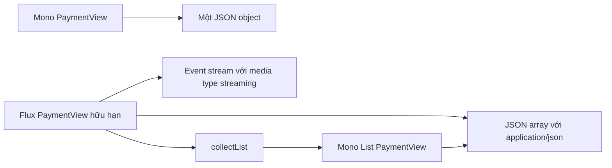
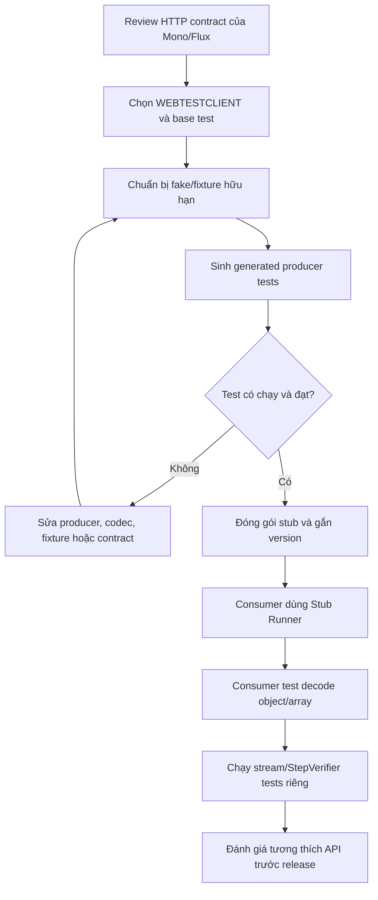

# Kiểm chứng Mono, Flux và dữ liệu phản hồi được tổng hợp

## 1. Vì sao phản hồi reactive cần cách kiểm thử riêng?

Giả sử `checkout-service` (consumer) gọi `payment-service` (producer) để tra cứu giao dịch và lấy danh sách thanh toán của một đơn hàng. Producer được viết bằng **Spring WebFlux**, nên các endpoint có thể trả `Mono<PaymentView>` hoặc `Flux<PaymentView>` thay vì trực tiếp trả một đối tượng Java hay một danh sách.

**Spring Cloud Contract** cho phép mô tả hành vi HTTP hoặc thông điệp bằng **Groovy/YAML DSL**, sinh producer verification test, phát hành stub để consumer sử dụng qua **Stub Runner**, và chạy chúng trong CI để nhận diện thay đổi API không tương thích. Trong WebFlux, một thách thức là xác định **cái gì thực sự được cam kết**: kiểu `Mono`/`Flux` nội bộ, hay HTTP status, headers và **dữ liệu mà client thực tế nhìn thấy**?

Câu trả lời là: **HTTP contract kiểm tra hành vi quan sát được qua giao thức**. Consumer ở một ngôn ngữ khác không cần biết producer dùng `Mono`, `Flux` hay một implementation blocking. Consumer cần biết HTTP response là JSON object, JSON array, không có nội dung, hay một luồng SSE/NDJSON; nó cần biết trạng thái và quy tắc dữ liệu.

Ví dụ hai endpoint:

```text
GET /api/payments/PAY-1001
    -> HTTP 200 + một JSON object

GET /api/orders/ORD-2001/payments
    -> HTTP 200 + JSON array gồm hai payment
```

Endpoint đầu có thể trả `Mono<PaymentView>`; endpoint sau có thể trả `Flux<PaymentView>`. Nhưng nếu HTTP response là `application/json` dạng mảng, producer verification cần xác minh **JSON array đã hoàn chỉnh**, không cố bắt client nhận từng phần tử Reactor như một object độc lập.

**Mục tiêu bài học:** phân biệt Mono và Flux, hiểu phản hồi tổng hợp hữu hạn với JSON array/JSON envelope, thiết lập Spring Cloud Contract `WEBTESTCLIENT`, kiểm thử bằng `WebTestClient` và `StepVerifier`, nhận diện giới hạn với luồng vô hạn, rồi tích hợp producer tests và Stub Runner vào CI.

## 2. Mono, Flux và tín hiệu reactive

Project Reactor có hai kiểu phổ biến:

| Kiểu | Tín hiệu dữ liệu | Ví dụ nghiệp vụ |
| --- | --- | --- |
| `Mono<T>` | Phát **tối đa một** phần tử, rồi hoàn tất hoặc phát lỗi; cũng có thể hoàn tất mà không phát phần tử. | Tra cứu một giao dịch, kết quả tạo thanh toán, báo hoàn tất. |
| `Flux<T>` | Phát **0 đến nhiều** phần tử, có thể hữu hạn hoặc vô hạn, rồi hoàn tất hoặc phát lỗi. | Danh sách giao dịch, thay đổi trạng thái theo thời gian, event feed. |
| `Mono<List<T>>` | Phát một **List** duy nhất đã được tổng hợp từ nhiều giá trị. | Response JSON có danh sách đầy đủ để tính `count`, `total` hoặc phân trang. |
| `Mono<Void>` | Không phát đối tượng dữ liệu; việc hoàn tất thường đại diện kết thúc một thao tác. | Xóa/hủy tài nguyên; status HTTP cần được thiết kế riêng. |

`Mono.empty()` nghĩa là một Publisher kết thúc **không có giá trị**, không tự động có nghĩa trả HTTP `404` hay JSON literal `null`. Tương tự, `Flux.empty()` nghĩa là không có phần tử; khi mã hóa một collection JSON, response có thể là `[]`. Status và body cuối cùng còn phụ thuộc controller, codec và HTTP media type đã chọn.

Một cách nhìn đơn giản:



**Quan trọng:** `Flux<T>` không luôn có nghĩa HTTP streaming. Cách WebFlux mã hóa nó phụ thuộc **content negotiation** và `Content-Type`. HTTP `application/json` thông thường là một tài liệu JSON; `text/event-stream` và `application/x-ndjson` diễn đạt dòng phần tử được truyền theo thời gian.

## 3. “Phản hồi được tổng hợp” có thể mang ba ý khác nhau

Từ *tổng hợp* (aggregation) dễ gây nhầm. Trong bài này cần tách:

1. **Tổng hợp về cấu trúc HTTP:** nhiều `PaymentView` được trình bày thành **một JSON array** hoàn chỉnh, ví dụ `[{"paymentId":"PAY-1001"}, {"paymentId":"PAY-1002"}]`. Đây là điều HTTP contract quan sát.
2. **Tổng hợp ở tầng Reactor:** controller gọi `flux.collectList()` để chuyển thành `Mono<List<PaymentView>>`, có thể tính thêm `count` hoặc dựng response envelope. Bước này có thể giữ tất cả phần tử trong bộ nhớ nên chỉ thích hợp với tập hữu hạn, có giới hạn.
3. **Tổng hợp ở phía test client:** `WebTestClient.expectBodyList(PaymentView.class)` đọc và giải mã **toàn bộ response hữu hạn** thành một danh sách để assert. Đây là hành vi test, **không chứng minh** controller đã gọi `collectList()`.

Vì vậy đừng viết: “mọi `Flux` được WebFlux bắt buộc `collectList()` vào RAM rồi mới trả HTTP”. Các phiên bản encoder có thể ghi các giá trị dần vào response trong khi vẫn duy trì **hình dạng JSON array hoàn chỉnh**. Điều contract cần bảo vệ là **media type, dữ liệu, thứ tự nếu được cam kết, và điều kiện hoàn tất**, không phải thuật toán ghi buffer nội bộ.

### Chọn dạng HTTP theo nghiệp vụ

| Đầu ra ứng dụng | Media type | Response client thấy | Cách kiểm tra chính |
| --- | --- | --- | --- |
| `Mono<PaymentView>` | `application/json` | Một JSON object | Status, header, field JSON. |
| `Flux<PaymentView>` hữu hạn | `application/json` | Một JSON array | Status, số phần tử, field/tập dữ liệu, thứ tự nếu API bảo đảm. |
| `Mono<List<PaymentView>>` | `application/json` | Một JSON array | Như trên; tầng server đã tổng hợp List. |
| `Mono<PaymentSummary>` | `application/json` | Object có `payments` và `count` | Cấu trúc object, tính nhất quán của `count` và danh sách. |
| `Flux<PaymentEvent>` | `text/event-stream` | Server-Sent Events theo thời gian | Nhận sự kiện, hủy đăng ký, timeout; không chờ body vô hạn hoàn tất. |
| `Flux<PaymentEvent>` | `application/x-ndjson` | Các JSON object phân tách bằng dòng mới | Từng phần tử, framing, điều kiện kết thúc/cancel. |

Nếu producer trả `Flux<String>`, đừng mặc định nó được mã hóa như `Flux<DTO>` thành JSON array; Spring WebFlux có xử lý riêng cho chuỗi. Khi API hứa JSON array string, nên kiểm tra codec cụ thể hoặc chuyển thành `Mono<List<String>>` có chủ đích và viết HTTP test xác nhận byte body cuối cùng.

## 4. Thiết kế ví dụ Payment với WebFlux

Ta dùng hai bản ghi tổng hợp cố định:

| paymentId | orderId | status | amount | currency |
| --- | --- | --- | ---: | --- |
| `PAY-1001` | `ORD-2001` | `PAID` | `250000` | `VND` |
| `PAY-1002` | `ORD-2001` | `PENDING` | `99000` | `VND` |

Hai bản ghi thuộc cùng một đơn nhưng có trạng thái khác nhau, giúp consumer kiểm tra rằng một giao dịch `PENDING` không được coi là `PAID`. Số tiền trong ví dụ là số nguyên theo quy ước API và đi kèm tiền tệ; không dùng dữ liệu khách hàng thật.

### 4.1. DTO và cổng truy vấn reactive

Phác thảo Java dùng record (yêu cầu JDK hỗ trợ records):

```java
public record PaymentView(
    String paymentId,
    String orderId,
    String status,
    long amount,
    String currency
) {}

public interface PaymentQuery {
    Mono<PaymentView> findById(String paymentId);
    Flux<PaymentView> findByOrderId(String orderId);
}

public record PaymentSummary(
    String orderId,
    int count,
    List<PaymentView> payments
) {}
```

Ở mã thật cần các import `reactor.core.publisher.Mono`, `Flux` và `java.util.List`; mỗi kiểu public thường nằm trong file Java thích hợp. `PaymentQuery` là ranh giới có thể được triển khai bằng R2DBC/reactive repository trong production và fake trong test.

### 4.2. Controller cho Mono, Flux và summary

```java
@RestController
@RequestMapping("/api")
class PaymentController {
    private final PaymentQuery query;

    PaymentController(PaymentQuery query) {
        this.query = query;
    }

    @GetMapping(
        value = "/payments/{id}",
        produces = MediaType.APPLICATION_JSON_VALUE
    )
    Mono<PaymentView> getPayment(@PathVariable String id) {
        return query.findById(id)
            .switchIfEmpty(Mono.error(
                new ResponseStatusException(HttpStatus.NOT_FOUND)
            ));
    }

    @GetMapping(
        value = "/orders/{orderId}/payments",
        produces = MediaType.APPLICATION_JSON_VALUE
    )
    Flux<PaymentView> listPayments(@PathVariable String orderId) {
        return query.findByOrderId(orderId);
    }

    @GetMapping(
        value = "/orders/{orderId}/payment-summary",
        produces = MediaType.APPLICATION_JSON_VALUE
    )
    Mono<PaymentSummary> getPaymentSummary(
            @PathVariable String orderId) {
        return query.findByOrderId(orderId)
            .collectList()
            .map(items -> new PaymentSummary(
                orderId, items.size(), items
            ));
    }
}
```

Đoạn mã minh họa cần import Spring WebFlux, Reactor và các kiểu ứng dụng ở trên; package/quyền truy cập cần được điều chỉnh khi đưa vào dự án.

Những quyết định quan trọng:

- `getPayment` trả `Mono<PaymentView>`. Nếu không tìm thấy, `switchIfEmpty` **chủ động ánh xạ** trường hợp rỗng sang `404`; bản thân `Mono.empty()` không làm việc đó tự động.
- `listPayments` trả `Flux<PaymentView>` hữu hạn; với `application/json`, consumer kỳ vọng **một JSON array**.
- `getPaymentSummary` dùng `collectList()` để có một danh sách và tính `count`. Đây là aggregation thực sự trong pipeline, có thể không phù hợp nếu `Flux` vô hạn hoặc trả hàng triệu bản ghi.
- Một `ResponseStatusException` tạo status `404`, nhưng **không đảm bảo error JSON có schema nghiệp vụ cụ thể**. Nếu cần field `code=PAYMENT_NOT_FOUND`, phải thiết kế exception handler/response thích hợp và có contract riêng.

## 5. Contract cho Mono trả một JSON object

Ví dụ Groovy DSL:

```groovy
import org.springframework.cloud.contract.spec.Contract

Contract.make {
    name 'get_paid_payment_reactive'
    description 'Tra cứu một thanh toán theo mã'

    request {
        method 'GET'
        urlPath '/api/payments/PAY-1001'
        headers {
            header 'Accept': 'application/json'
        }
    }

    response {
        status 200
        headers {
            contentType(applicationJson())
        }
        body([
            paymentId: 'PAY-1001',
            orderId: 'ORD-2001',
            status: 'PAID',
            amount: 250000,
            currency: 'VND'
        ])
    }
}
```

**Contract này không nhắc đến `Mono`.** Nó yêu cầu producer nhận `GET` với path đã thỏa thuận và trả HTTP response đúng status/header/body. Cùng contract có thể được một producer reactive hoặc blocking thực hiện mà consumer không cần thay đổi.

### YAML DSL tương đương

```yaml
description: Tra cứu một thanh toán theo mã
name: get_paid_payment_reactive
request:
  method: GET
  urlPath: /api/payments/PAY-1001
  headers:
    Accept: application/json
response:
  status: 200
  headers:
    Content-Type: application/json
  body:
    paymentId: PAY-1001
    orderId: ORD-2001
    status: PAID
    amount: 250000
    currency: VND
```

Trong repository thật, nên chọn **một bản Groovy hoặc YAML** làm contract nguồn cho kịch bản, tránh tạo hai bài test trùng nhau.

## 6. Contract cho Flux hữu hạn trả JSON array

Với endpoint `GET /api/orders/ORD-2001/payments`, consumer cần một **danh sách hoàn chỉnh**, không phải luồng sự kiện sống mãi.

Ví dụ response:

```http
HTTP/1.1 200 OK
Content-Type: application/json

[
  {
    "paymentId": "PAY-1001",
    "orderId": "ORD-2001",
    "status": "PAID",
    "amount": 250000,
    "currency": "VND"
  },
  {
    "paymentId": "PAY-1002",
    "orderId": "ORD-2001",
    "status": "PENDING",
    "amount": 99000,
    "currency": "VND"
  }
]
```

### 6.1. Groovy DSL

```groovy
import org.springframework.cloud.contract.spec.Contract

Contract.make {
    name 'list_payments_as_json_array'
    description 'Liệt kê các thanh toán của đơn ORD-2001'

    request {
        method 'GET'
        urlPath '/api/orders/ORD-2001/payments'
        headers {
            header 'Accept': 'application/json'
        }
    }

    response {
        status 200
        headers {
            contentType(applicationJson())
        }
        body([
            [
                paymentId: 'PAY-1001',
                orderId: 'ORD-2001',
                status: 'PAID',
                amount: 250000,
                currency: 'VND'
            ],
            [
                paymentId: 'PAY-1002',
                orderId: 'ORD-2001',
                status: 'PENDING',
                amount: 99000,
                currency: 'VND'
            ]
        ])
    }
}
```

`body([...])` ở đây là một **Groovy List chứa hai Map**; kết quả HTTP kỳ vọng là JSON array, không phải hai HTTP response riêng. Contract bảo vệ trạng thái và số tiền thuộc đúng từng payment. Nếu client phụ thuộc thứ tự, hãy ghi rõ quy tắc sắp xếp của API và thiết lập fixture trả đúng thứ tự. Nếu API không cam kết thứ tự, tránh biến thứ tự fixture thành quy tắc API ngoài ý muốn; chọn matcher/kiểm thử so sánh theo ID phù hợp.

### 6.2. YAML DSL

```yaml
description: Liệt kê các thanh toán của đơn ORD-2001
name: list_payments_as_json_array
request:
  method: GET
  urlPath: /api/orders/ORD-2001/payments
  headers:
    Accept: application/json
response:
  status: 200
  headers:
    Content-Type: application/json
  body:
    - paymentId: PAY-1001
      orderId: ORD-2001
      status: PAID
      amount: 250000
      currency: VND
    - paymentId: PAY-1002
      orderId: ORD-2001
      status: PENDING
      amount: 99000
      currency: VND
```

Một lần nữa, YAML và Groovy ở đây chỉ là **hai biểu diễn thay thế**, không cần lưu cả hai cho một hành vi.

### 6.3. Flux rỗng và Mono rỗng không đồng nghĩa

Giả sử đơn `ORD-EMPTY` chưa có payment. Với một endpoint khai báo `application/json` và mã hóa danh sách, contract có thể hứa:

```groovy
Contract.make {
    name 'list_payments_empty'
    request {
        method 'GET'
        urlPath '/api/orders/ORD-EMPTY/payments'
    }
    response {
        status 200
        headers {
            contentType(applicationJson())
        }
        body([])
    }
}
```

Ở đây `[]` là **JSON array rỗng**, có hai ký tự; nó không phải body có độ dài 0 hoặc JSON `null`. Khi controller trả `Flux.empty()`, hãy xem response HTTP thật dưới cấu hình codec và media type của dự án để chắc có `[]` theo cam kết.

Với `Mono.empty()`, ứng dụng phải **quyết định chủ động**: trả `404`, `204` hay `200` với body rỗng theo nghiệp vụ. Không viết contract ngầm giả định `Mono.empty()` sẽ tự chuyển thành `404`.

## 7. Aggregate thành Mono<List<T>> hoặc Mono<Summary>

Khi cần trả cùng lúc số lượng giao dịch và danh sách, controller có thể chuyển `Flux<PaymentView>` thành `Mono<PaymentSummary>`:

```java
Mono<PaymentSummary> summary = query
    .findByOrderId("ORD-2001")
    .collectList()
    .map(items -> new PaymentSummary(
        "ORD-2001", items.size(), items
    ));
```

Giá trị JSON mà consumer nhìn thấy:

```json
{
  "orderId": "ORD-2001",
  "count": 2,
  "payments": [
    {"paymentId":"PAY-1001","status":"PAID","amount":250000,"currency":"VND"},
    {"paymentId":"PAY-1002","status":"PENDING","amount":99000,"currency":"VND"}
  ]
}
```

Đây là **JSON object có một thuộc tính array**, khác với JSON array ở cấp gốc trong phần 6. Consumer phụ thuộc vào `count` thì contract nên kiểm tra **giá trị và tính nhất quán** của nó, chứ không chỉ matcher `count` là number.

Groovy contract minh họa:

```groovy
import org.springframework.cloud.contract.spec.Contract

Contract.make {
    name 'get_payment_summary'

    request {
        method 'GET'
        urlPath '/api/orders/ORD-2001/payment-summary'
    }

    response {
        status 200
        headers {
            contentType(applicationJson())
        }
        body([
            orderId: 'ORD-2001',
            count: 2,
            payments: [
                [
                    paymentId: 'PAY-1001',
                    status: 'PAID',
                    amount: 250000,
                    currency: 'VND'
                ],
                [
                    paymentId: 'PAY-1002',
                    status: 'PENDING',
                    amount: 99000,
                    currency: 'VND'
                ]
            ]
        ])
    }
}
```

Để producer test có thể lặp lại, fixture phải tạo đúng hai thanh toán. Không phụ thuộc một database staging mà dữ liệu thay đổi ngoài ý muốn.

### Giới hạn hiệu năng của collectList()

`collectList()` cần chờ `Flux` **hoàn tất**, rồi mới phát List. Nếu `Flux` vô hạn, nó không kết thúc theo cách mong đợi; nếu dữ liệu rất lớn, việc tích lũy có thể tốn RAM. Đối với API nhiều bản ghi, nên có phân trang/giới hạn số phần tử hoặc một thuật toán tổng hợp không cần lưu tất cả. Đừng thêm `collectList()` chỉ để làm một HTTP contract test xanh nếu API thực sự được thiết kế cho streaming.

## 8. Cấu hình Contract Verifier cho WebFlux

Tài liệu Spring Cloud Contract có **`testMode = WEBTESTCLIENT`** để sinh producer verification tests dùng WebTestClient/RestAssuredWebTestClient thay cho MockMvc. Đây là lựa chọn thường phù hợp với ứng dụng WebFlux và **không cần khởi động web server trên cổng TCP thật**.

### Maven: đoạn plugin minh họa

```xml
<plugin>
    <groupId>org.springframework.cloud</groupId>
    <artifactId>spring-cloud-contract-maven-plugin</artifactId>
    <version>REPLACE_WITH_COMPATIBLE_SCC_VERSION</version>
    <extensions>true</extensions>
    <configuration>
        <testFramework>JUNIT5</testFramework>
        <testMode>WEBTESTCLIENT</testMode>
        <baseClassForTests>
            com.example.payment.contract.ReactiveContractBase
        </baseClassForTests>
    </configuration>
</plugin>
```

Đây là **mảnh cấu hình** cần đặt trong POM dự án, không phải POM đầy đủ. Dự án phải bổ sung dependency Spring WebFlux, `spring-cloud-starter-contract-verifier` trong test scope, `spring-boot-starter-test` hoặc những thư viện test tương thích, và module RestAssuredWebTestClient được phiên bản plugin dùng. Quản lý version bằng BOM/parent tương thích với Spring Boot/JDK.

### Gradle: phần cấu hình tương ứng

```groovy
contracts {
    testFramework = 'JUNIT5'
    testMode = 'WEBTESTCLIENT'
    baseClassForTests =
        'com.example.payment.contract.ReactiveContractBase'
}

tasks.withType(Test).configureEach {
    useJUnitPlatform()
}
```

Đây là phần cấu hình của một project đã cài plugin `org.springframework.cloud.contract` và khai báo các dependencies thích hợp. Vị trí file contract của Maven và Gradle có thể khác; kiểm tra `contractsDslDir`, source set và cấu hình phiên bản plugin đang dùng.

**Đừng nhầm:**

- `testFramework=JUNIT5` chọn **JUnit Jupiter** cho test được sinh.
- `testMode=WEBTESTCLIENT` chọn **cơ chế HTTP test**.
- Groovy/YAML chỉ chọn **ngôn ngữ mô tả contract**, không quyết định JUnit/Spock.
- `EXPLICIT` là lựa chọn khác khi muốn gửi HTTP qua socket thật tới ứng dụng WebFlux chạy trên cổng, chẳng hạn `RANDOM_PORT`.

## 9. Base class RestAssuredWebTestClient với fixture độc lập

Một phương án đơn giản để test WebFlux controller mà không cần database hay server TCP thật là khởi tạo controller với một fake `PaymentQuery` trong mỗi test:

```java
package com.example.payment.contract;

import io.restassured.module.webtestclient.RestAssuredWebTestClient;
import org.junit.jupiter.api.BeforeEach;
import reactor.core.publisher.Flux;
import reactor.core.publisher.Mono;

public abstract class ReactiveContractBase {

    @BeforeEach
    void setUp() {
        PaymentView paid = new PaymentView(
            "PAY-1001", "ORD-2001", "PAID", 250000L, "VND");
        PaymentView pending = new PaymentView(
            "PAY-1002", "ORD-2001", "PENDING", 99000L, "VND");

        PaymentQuery query = new PaymentQuery() {
            @Override
            public Mono<PaymentView> findById(String id) {
                return Flux.just(paid, pending)
                    .filter(p -> p.paymentId().equals(id))
                    .next();
            }

            @Override
            public Flux<PaymentView> findByOrderId(String orderId) {
                if ("ORD-2001".equals(orderId)) {
                    return Flux.just(paid, pending);
                }
                return Flux.empty();
            }
        };

        RestAssuredWebTestClient.standaloneSetup(
            new PaymentController(query)
        );
    }
}
```

Lớp này giả định `PaymentView`, `PaymentQuery` và `PaymentController` được định nghĩa như ví dụ phần 4, có package/constructor truy cập được; cần thêm import hoặc cấu trúc module phù hợp trong dự án thật. Nếu source bị tách sang package khác với controller package-private, hãy dùng quyền truy cập hợp lệ hoặc chuyển base class vào package tương ứng.

`RestAssuredWebTestClient.standaloneSetup(...)` dựng hạ tầng WebTestClient quanh controller mà không khởi động TCP listener. Với generated tests ở mode `WEBTESTCLIENT`, đây là cách cung cấp endpoint để test gửi HTTP request theo contract.

**Ranh giới cần biết:**

1. Controller và việc chuyển `Mono/Flux` thành HTTP response là phần đang được kiểm tra.
2. Fake query không kiểm tra R2DBC, giao dịch hay dữ liệu database thật; cần integration test riêng.
3. Setup chỉ với controller có thể **không bao gồm toàn bộ Spring Security filters, exception handlers và custom codecs** của ứng dụng thực tế. Nếu contract phụ thuộc những thành phần này, cần một test `ApplicationContext` đầy đủ và bind WebTestClient vào context thay vì chỉ standalone controller.
4. Các cấu hình tĩnh của RestAssuredWebTestClient có thể tương tác khi nhiều lớp test chạy song song; cô lập context/client hoặc điều chỉnh mức parallel khi cần.

## 10. Kiểm thử HTTP body thực tế với WebTestClient

Ngoài generated producer tests, bạn nên có một số bài kiểm thử WebFlux viết tay để khẳng định dữ liệu được tổng hợp và xử lý đúng. `WebTestClient` có thể bind trực tiếp vào controller, application context hoặc một server thật.

### 10.1. Mono trả một object

```java
WebTestClient client =
    WebTestClient.bindToController(new PaymentController(query))
        .build();

client.get()
    .uri("/api/payments/PAY-1001")
    .accept(MediaType.APPLICATION_JSON)
    .exchange()
    .expectStatus().isOk()
    .expectHeader()
        .contentTypeCompatibleWith(MediaType.APPLICATION_JSON)
    .expectBody()
        .jsonPath("$.paymentId").isEqualTo("PAY-1001")
        .jsonPath("$.orderId").isEqualTo("ORD-2001")
        .jsonPath("$.status").isEqualTo("PAID");
```

Giả định `query` là fake phù hợp và `MediaType/WebTestClient` đã được import. Đoạn mã minh họa **đầu ra HTTP**, không gọi `Mono.block()` trực tiếp trong controller.

### 10.2. Flux trả JSON array

```java
client.get()
    .uri("/api/orders/ORD-2001/payments")
    .accept(MediaType.APPLICATION_JSON)
    .exchange()
    .expectStatus().isOk()
    .expectHeader()
        .contentTypeCompatibleWith(MediaType.APPLICATION_JSON)
    .expectBody()
        .jsonPath("$").isArray()
        .jsonPath("$[0].paymentId").isEqualTo("PAY-1001")
        .jsonPath("$[1].paymentId").isEqualTo("PAY-1002")
        .jsonPath("$[1].status").isEqualTo("PENDING");
```

Hoặc kiểm tra kết quả đã được decode thành List:

```java
client.get()
    .uri("/api/orders/ORD-2001/payments")
    .accept(MediaType.APPLICATION_JSON)
    .exchange()
    .expectStatus().isOk()
    .expectBodyList(PaymentView.class)
    .hasSize(2);
```

`expectBodyList(...)` phù hợp cho **response hữu hạn**. Nếu thứ tự **không được API cam kết**, tránh khẳng định `$[0]` phải là `PAY-1001`; dùng cách lấy danh sách rồi so sánh theo ID/tập phần tử. Nếu API cam kết sắp xếp, hãy nêu rõ quy tắc (ví dụ `createdAt` tăng dần) và xác minh đúng thứ tự đó.

### 10.3. Kiểm tra summary

```java
client.get()
    .uri("/api/orders/ORD-2001/payment-summary")
    .accept(MediaType.APPLICATION_JSON)
    .exchange()
    .expectStatus().isOk()
    .expectBody()
        .jsonPath("$.orderId").isEqualTo("ORD-2001")
        .jsonPath("$.count").isEqualTo(2)
        .jsonPath("$.payments.length()").isEqualTo(2);
```

Đừng chỉ kiểm tra `count` là một số nguyên; nếu producer lỡ trả `count=3` nhưng chỉ có hai payment thì consumer vẫn nhận dữ liệu không nhất quán. Kiểm tra quan hệ cần thiết bằng cách decode body và tính lại số phần tử khi matcher JSONPath không đủ diễn đạt.

## 11. StepVerifier dành cho tín hiệu Reactor, không thay HTTP contract

`StepVerifier` thuộc `reactor-test`, dùng để kiểm tra **chuỗi tín hiệu Publisher** (onNext, onComplete, onError, cancel). Nó đặc biệt hữu ích cho test service và pipeline reactive.

### Kiểm tra một Mono thành công

```java
StepVerifier.create(query.findById("PAY-1001"))
    .assertNext(payment -> {
        assertThat(payment.paymentId()).isEqualTo("PAY-1001");
        assertThat(payment.status()).isEqualTo("PAID");
    })
    .verifyComplete();
```

### Kiểm tra một Flux hữu hạn

```java
StepVerifier.create(query.findByOrderId("ORD-2001"))
    .expectNextMatches(p -> p.paymentId().equals("PAY-1001"))
    .expectNextMatches(p -> p.paymentId().equals("PAY-1002"))
    .verifyComplete();
```

### Kiểm tra Mono/Flux rỗng và lỗi

```java
StepVerifier.create(query.findById("PAY-9999"))
    .verifyComplete(); // Mono.empty(): không có onNext.

StepVerifier.create(query.findByOrderId("ORD-EMPTY"))
    .verifyComplete(); // Flux.empty(): không có onNext.

StepVerifier.create(Mono.<PaymentView>error(
        new IllegalStateException("query unavailable")))
    .expectError(IllegalStateException.class)
    .verify();
```

**Giới hạn:** StepVerifier test `Mono.empty()` không chứng minh API trả HTTP `404`; đó là quyết định của controller/exception mapping. StepVerifier trên service cũng không xác minh header `Content-Type`, JSON serialization, request path hoặc security filter. Vì vậy **StepVerifier bổ sung cho Spring Cloud Contract**, chứ không thay producer verification qua HTTP.

Nếu Publisher sử dụng timer/delay, có thể dùng `StepVerifier.withVirtualTime(...)` cho unit test phù hợp để tránh chờ thời gian thật; kỹ thuật này cần kiểm soát scheduler và thời điểm tạo Publisher. Không áp dụng tùy tiện virtual time cho toàn bộ integration test HTTP có nhiều thành phần thật.

## 12. Flux streaming: SSE và NDJSON là hợp đồng khác

Một endpoint có thể trả các thay đổi trạng thái liên tục:

```java
@GetMapping(
    value = "/api/payments/events",
    produces = MediaType.TEXT_EVENT_STREAM_VALUE
)
Flux<PaymentEvent> events() {
    return paymentEventSource.events();
}
```

Đây là **SSE**. Body không phải một JSON array hoàn chỉnh; server gửi từng event theo thời gian. Với NDJSON, `Content-Type` có thể là `application/x-ndjson` và mỗi phần tử JSON được phân tách bằng dòng mới. Không lấy một contract JSON array từ phần 6 rồi dùng nó để chứng minh SSE/NDJSON hoạt động đúng.

### WebTestClient + StepVerifier cho stream

```java
FluxExchangeResult<PaymentEvent> result = client.get()
    .uri("/api/payments/events")
    .accept(MediaType.TEXT_EVENT_STREAM)
    .exchange()
    .expectStatus().isOk()
    .expectHeader()
        .contentTypeCompatibleWith(MediaType.TEXT_EVENT_STREAM)
    .returnResult(PaymentEvent.class);

StepVerifier.create(result.getResponseBody())
    .assertNext(event -> {
        assertThat(event.eventType()).isEqualTo("PaymentCaptured");
    })
    .thenCancel()
    .verify(Duration.ofSeconds(3));
```

Ví dụ giả định `PaymentEvent` là DTO/record có `eventType()`, nguồn event tạo phần tử đầu tiên một cách xác định, và đã import `FluxExchangeResult`, `StepVerifier`, `Duration` và các matcher. Dùng `thenCancel()` để **không chờ stream vô hạn hoàn tất**. Timeout kiểm thử cần phù hợp môi trường và không nên phụ thuộc thời gian thực/ngẫu nhiên nếu có thể.

Các thuộc tính thường phải kiểm tra riêng cho stream:

- Media type và event framing có đúng như API công bố không?
- Event ID, sequence, correlation ID, thời điểm có đúng format và liên kết đúng tài nguyên không?
- Có giới hạn retry/reconnect và quy tắc nhận trùng sự kiện không?
- Việc hủy đăng ký có giải phóng tài nguyên không?
- Nếu thứ tự được cam kết, các event được phát đúng thứ tự không?

**Giới hạn của stub tĩnh:** stub HTTP thường trả một body cố định; việc consumer nhận được một JSON array hoặc một mẫu SSE từ stub **không chứng minh** backpressure, lịch phát event, reconnect, vô hạn hay cancel hoạt động đúng trong runtime thật. Các yêu cầu ấy cần reactive/integration test chuyên biệt.

## 13. Error và completion sau khi response đã được gửi

Một Publisher có thể phát vài phần tử rồi `onError`. Đối với luồng đã bắt đầu gửi dữ liệu, HTTP headers/status có thể **đã được commit**. Khi đó producer không phải lúc nào cũng có thể chuyển response sang `500` với một JSON error body hợp lệ.

Ví dụ:

```text
Flux phát PAY-1001 -> HTTP response bắt đầu ghi
Flux phát PAY-1002 -> tiếp tục ghi
Flux phát onError -> kết nối bị gián đoạn hoặc body JSON không hoàn chỉnh
```

Đây là lý do không nên nhầm:

- `Mono.error(...)` **trước khi HTTP response commit**: error handler còn có thể trả status/body lỗi theo quy tắc API.
- `Flux` lỗi **sau khi body đã được ghi một phần**: response có thể bị cắt ngang, client không nhận được JSON hợp lệ; không thể luôn đổi status.
- `Flux.empty()`: một chuỗi hoàn tất không có phần tử, có thể biểu diễn một collection rỗng khi JSON codec trả array.

Với endpoint tổng hợp có giới hạn, `collectList()` trước khi tạo response có thể dời việc phát response đến sau khi lấy đủ dữ liệu, giúp xử lý lỗi **trước khi commit**; nhưng đổi lại là chi phí bộ nhớ và độ trễ. Không áp dụng cho stream vô hạn.

Contract cho response HTTP ổn định nên bao phủ các lỗi có thể quan sát rõ (ví dụ `404 PAYMENT_NOT_FOUND` hoặc `503` đã được producer cam kết). Fault injection cho stream lỗi giữa chừng, mất kết nối và timeout là tầng kiểm thử khác.

## 14. Dữ liệu thử phải hữu hạn và có thể tái hiện

Producer verification từ contract đòi hỏi fixture làm cho request có kết quả đã thỏa thuận. Với Reactive:

| Nguồn biến động | Lỗi thường thấy | Cách sửa |
| --- | --- | --- |
| `Flux` không kết thúc | Test cố chờ toàn bộ body rồi timeout. | Dùng Flux hữu hạn cho API JSON array; test stream riêng với cancel. |
| ID sinh ngẫu nhiên | Contract bắt đúng `PAY-1001` nhưng producer tạo ID khác. | Fixture cố định hoặc matcher định dạng có ràng buộc. |
| Danh sách phát không có thứ tự | Assert `$[0]` lúc xanh lúc đỏ. | Chỉ kiểm tra thứ tự nếu API hứa; nếu có, sắp xếp rõ trong producer. |
| R2DBC/database dùng chung | PAY-1001 bị sửa bởi test khác. | Mock/fake repository hoặc database test riêng, seed/reset có kiểm soát. |
| Thời gian phát event động | Test dùng `sleep` cố định và thất bại ngẫu nhiên. | Virtual time ở unit test, fixture/scheduler kiểm soát được, timeout giới hạn. |
| Codec thay đổi content type | Flux thành NDJSON/SSE thay cho JSON array. | Assert `Content-Type` và raw body/format. |
| Test chỉ dùng StepVerifier | Pipeline phát đúng phần tử nhưng endpoint trả status hoặc JSON sai. | Bổ sung Spring Cloud Contract/WebTestClient HTTP assertion. |

Một bộ dữ liệu ngắn, khác nhau về trạng thái `PAID/PENDING` sẽ có giá trị hơn một `Flux.range(1, 1000000)` không có ý nghĩa. Contract testing kiểm tra **cam kết giao tiếp**, không phải stress test cho một triệu phần tử.

## 15. Producer verification và Stub Runner trong CI

Luồng khuyến nghị:



### Consumer test với stub có version

Ví dụ (rút gọn) để Checkout gọi Payment qua stub:

```java
@SpringBootTest(properties = {
    "payment.base-url=http://localhost:6565"
})
@AutoConfigureStubRunner(
    ids = "com.example:payment-service:1.4.2:stubs:6565",
    stubsMode = StubRunnerProperties.StubsMode.LOCAL
)
class CheckoutPaymentClientTest {

    @Autowired
    PaymentClient paymentClient;

    @Test
    void getsPaymentsAsAnArray() {
        StepVerifier.create(
                paymentClient.listByOrder("ORD-2001").collectList())
            .assertNext(payments -> {
                assertThat(payments).hasSize(2);
                assertThat(payments)
                    .extracting(PaymentView::paymentId)
                    .contains("PAY-1001", "PAY-1002");
            })
            .verifyComplete();
    }
}
```

Đoạn mã giả định `PaymentClient` là **HTTP WebClient adapter thật** cấu hình trỏ tới `payment.base-url`, `listByOrder` trả `Flux<PaymentView>` và test dependencies đầy đủ. Không mock luôn `PaymentClient` nếu mục tiêu là chứng minh consumer tương thích stub. `LOCAL` dùng artifact trong local Maven repository; trong CI có thể dùng chế độ repository từ xa đã cấu hình. Pin version giúp kết quả lặp lại được.

**Lưu ý:** Stub Runner chủ yếu mô phỏng request/response HTTP đã khai báo. Nếu một producer dùng Flux để trả **một JSON array hữu hạn**, stub body JSON array có thể giúp consumer kiểm tra cách decode và xử lý danh sách. Nhưng stub không chứng minh producer dùng Reactor đúng scheduler, quản lý backpressure hoặc xử lý cancel tốt; đó là công việc của StepVerifier và integration tests riêng.

### Những điều phải xác minh trong CI

1. Có source contract và generated producer tests; không chấp nhận build xanh với **0 test thực thi**.
2. Test mode là `WEBTESTCLIENT` khi dự án muốn kiểm tra WebFlux mà không mở server TCP; base class đã setup RestAssuredWebTestClient đúng.
3. Contract `Mono` trả một object đúng; contract `Flux` hữu hạn trả JSON array đúng, kể cả trường hợp rỗng.
4. Header `Content-Type` không vô tình đổi `application/json` thành `text/event-stream` hoặc NDJSON.
5. Fixture không phụ thuộc database hoặc dịch vụ ngoài dùng chung; test có thể chạy lại.
6. Stub được sinh và phát hành **sau khi producer verification đạt**, cùng version/commit của contract.
7. Consumer lấy đúng stub và kiểm tra logic thật; stream dài/vô hạn có **test riêng** với giới hạn thời gian và cancel.

## 16. Bài tập thực hành: từ Flux đến response tổng hợp

Một dịch vụ `inventory-service` dùng WebFlux có ba API:

```text
GET /api/items/SKU-001
GET /api/warehouses/HN01/items
GET /api/warehouses/HN01/item-summary
```

Quy tắc đã thống nhất:

- `GET /api/items/SKU-001` trả một JSON object từ `Mono<ItemView>`, với `sku=SKU-001`, `available=true`, `quantity=12`.
- `GET /api/warehouses/HN01/items` trả JSON array hai phần tử từ `Flux<ItemView>`, có các `sku` lần lượt `SKU-001` và `SKU-002` **nếu** API cam kết thứ tự này.
- `GET /api/warehouses/HN01/item-summary` trả object tổng hợp gồm `warehouse=HN01`, `count=2` và `items` là mảng hai phần tử.
- Khi một kho không có hàng, endpoint danh sách trả `200` với `[]`, không phải JSON null.

**Nhiệm vụ:**

1. Viết một `ItemQuery` interface trả `Mono<ItemView>` cho tra cứu đơn và `Flux<ItemView>` cho danh sách kho.
2. Viết WebFlux controller cho hai endpoint đầu, quyết định cách trả `404` nếu mã SKU không tồn tại; giải thích vì sao `Mono.empty()` không tự thành `404`.
3. Viết Groovy hoặc YAML contract cho object `SKU-001` và một contract khác cho JSON array hai phần tử.
4. Viết endpoint summary bằng `collectList()` rồi trả `Mono<ItemSummary>`. Giải thích giới hạn bộ nhớ khi số phần tử lớn.
5. Cấu hình `testMode=WEBTESTCLIENT`, `testFramework=JUNIT5` và base class dùng `RestAssuredWebTestClient.standaloneSetup(...)` với fake query.
6. Tạo WebTestClient test: object đúng, array có 2 phần tử và summary có `count=2` bằng kích thước mảng.
7. Tạo một test `StepVerifier` cho Flux hữu hạn và một test cho `Flux.empty()`; phân biệt những gì chúng kiểm tra với HTTP contract.
8. Giả sử API mới chuyển từ `application/json` sang `text/event-stream`. Vì sao không thể chỉ giữ nguyên contract JSON array? Đề xuất test `FluxExchangeResult`/`StepVerifier` có `thenCancel()` cho một stream dài.
9. Trong CI, chạy producer verification, phát hành stub có version và kiểm tra consumer WebClient decode danh sách từ stub.

**Tự đánh giá:** bài làm tốt xác minh **hình dạng HTTP body được cam kết**, giữ fixture nhất quán, không giả định `Flux` luôn là streaming SSE và không dùng `collectList()` cho luồng vô hạn.

## 17. Ghi nhớ

- `Mono<T>` phát tối đa một phần tử; `Flux<T>` phát nhiều phần tử. **Contract bảo vệ HTTP response**, không bảo vệ tên kiểu Reactor của controller.
- Với `application/json` và `Flux<DTO>` hữu hạn, consumer thường nhìn thấy **một JSON array**; `Mono<DTO>` thường tương ứng một JSON object.
- `collectList()` thực sự chuyển `Flux<T>` thành `Mono<List<T>>`, cần chờ completion và có chi phí lưu trữ; khác với việc test client decode một JSON array hoàn chỉnh.
- Dùng `testMode=WEBTESTCLIENT` và `RestAssuredWebTestClient` để producer verification WebFlux không cần socket thật; `EXPLICIT` là lựa chọn khác cho HTTP qua server thực.
- `WebTestClient.expectBodyList(...)` phù hợp với phản hồi hữu hạn; `StepVerifier` kiểm tra tín hiệu reactive, đặc biệt hữu ích với stream và logic xử lý.
- `text/event-stream` hoặc `application/x-ndjson` **khác** JSON array; với stream dài/vô hạn, dùng `returnResult(...)` và `thenCancel()` thay vì cố chờ toàn bộ body.
- Một test xanh với Stub Runner chứng minh consumer xử lý **stub đã khai báo**; phải có producer verification và kiểm thử reactive/integration phù hợp mới đánh giá được hệ thống.

### Tài liệu tham khảo

- [Spring Cloud Contract — WebFlux with WebTestClient](https://docs.spring.io/spring-cloud-contract/reference/project-features-flows/feature-webflux.html): cấu hình `WEBTESTCLIENT` và base class RestAssuredWebTestClient.
- [Spring Cloud Contract — WebFlux with Explicit Mode](https://docs.spring.io/spring-cloud-contract/reference/project-features-flows/feature-webflux-explicit.html): lựa chọn HTTP server thật.
- [Spring Framework — WebTestClient](https://docs.spring.io/spring-framework/reference/testing/webtestclient.html): `expectBodyList`, JSONPath, `FluxExchangeResult` và StepVerifier cho streaming.
- [Spring WebFlux — Controller Return Values](https://docs.spring.io/spring-framework/reference/web/webflux/controller/ann-methods/return-types.html): kiểu reactive, cách ghi response và các hệ quả khi stream lỗi.
- [Spring Cloud Contract — HTTP Contracts](https://docs.spring.io/spring-cloud-contract/reference/project-features-contract/http.html): định nghĩa HTTP request/response Groovy/YAML.
- [Reactor — Testing](https://projectreactor.io/docs/core/release/reference/testing.html): StepVerifier và virtual time.
