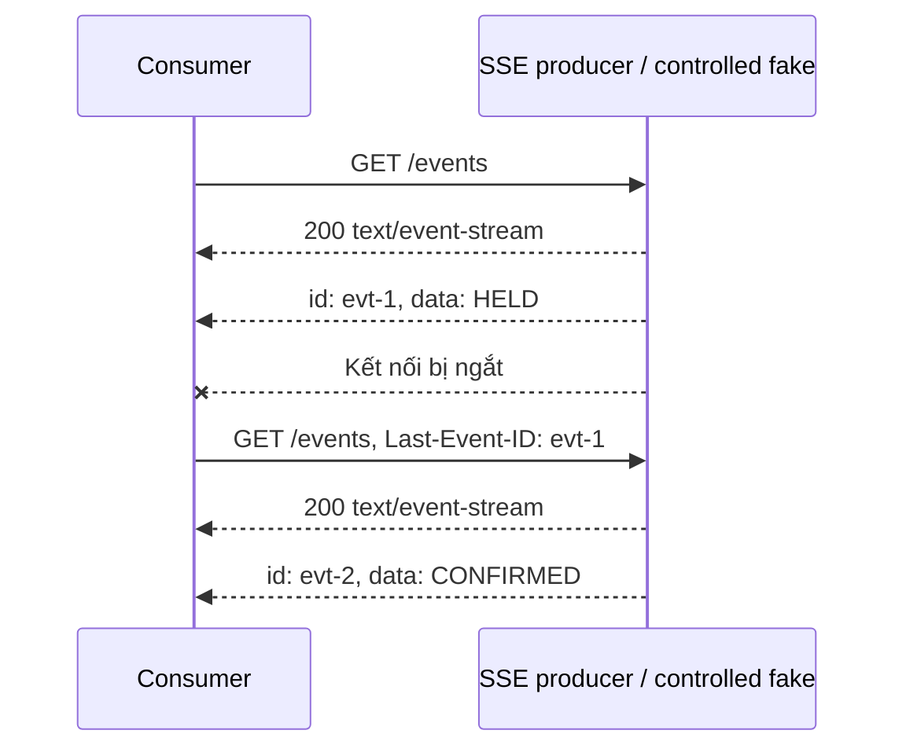
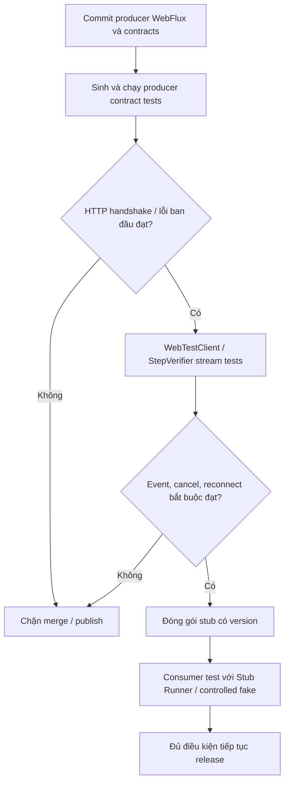

# Streaming, SSE và giới hạn mô tả bằng hợp đồng

Một HTTP API thông thường trả về một kết quả có điểm kết thúc rõ ràng: client gửi `GET /api/v1/reservations/RES-100`, server trả `200` với một JSON object rồi hoàn tất response. Nhưng với ứng dụng **reactive**, endpoint có thể trả **nhiều phần tử theo thời gian**. Chẳng hạn, sau khi đặt giữ hàng, `OrderService` cần liên tục nhận trạng thái `HELD`, `CONFIRMED` hoặc `EXPIRED` từ `InventoryService` qua **Server-Sent Events (SSE)**.

Trong hoàn cảnh đó, kiểm `status 200` và `Content-Type: text/event-stream` chưa chứng minh consumer nhận đủ sự kiện, đúng thứ tự, đúng định dạng hay xử lý được ngắt kết nối. Ngược lại, nếu bắt một generated test gom toàn bộ stream vô hạn vào một JSON body, test có thể **treo hoặc buffer quá nhiều dữ liệu**. Vì thế, cần tách **điều khoản HTTP** khỏi **hành vi của luồng liên tục**.

Bài này thuộc chương **Kiểm thử reactive** của module **Spring Cloud Contract**. Ta sẽ dùng hợp đồng **Groovy/YAML DSL**, **Contract Verifier**, **WebTestClient**, **Project Reactor** và **Stub Runner** để bảo vệ những cam kết producer–consumer thực sự phụ thuộc, đồng thời hiểu giới hạn của từng kiểu test. Mục tiêu là phát hiện thay đổi API không tương thích trong CI mà không đánh đồng một stub trả đúng mẫu với bằng chứng streaming hoạt động đúng trong production.

Sau bài học, bạn có thể:

- Phân biệt JSON response hữu hạn, NDJSON và SSE.
- Đọc cú pháp SSE gồm `id`, `event`, `data`, `retry` và ranh giới event.
- Viết contract bảo vệ HTTP status, headers và lỗi ban đầu của SSE endpoint.
- Giải thích vì sao generated contract test chưa chắc kiểm được luồng vô hạn, nhịp phát hoặc reconnect.
- Dùng `WebTestClient` và `StepVerifier` kiểm nội dung, thứ tự và việc hoàn thành/hủy luồng.
- Thiết kế test cho `Last-Event-ID`, replay, ngắt kết nối, heartbeat và backpressure.
- Xây dựng cổng CI với producer verification, stream integration tests và consumer tests qua stub.

## 1. Streaming reactive khác HTTP response thông thường thế nào?

Với WebFlux, một controller có thể trả `Mono<T>` cho một kết quả hoặc `Flux<T>` cho nhiều kết quả. Tuy nhiên, **kiểu Java reactive không tự xác định dạng dữ liệu qua HTTP**; cách truyền còn phụ thuộc `Content-Type` và codec.

| Hình thức | Media type thường gặp | Wire format | Cách kiểm |
| --- | --- | --- | --- |
| JSON thông thường | `application/json` | Một JSON document hoàn chỉnh | Status, header, matcher body |
| NDJSON | `application/x-ndjson` | Nhiều object JSON, thường mỗi object trên một dòng | Parse từng phần tử, thứ tự và kết thúc |
| SSE | `text/event-stream` | Nhiều SSE events gồm các dòng `id/event/data` | Handshake HTTP, framing, loại event, data, reconnect |

Ví dụ JSON một kết quả:

```http
HTTP/1.1 200 OK
Content-Type: application/json

{"reservationId":"RES-100","status":"HELD"}
```

Ví dụ NDJSON:

```http
HTTP/1.1 200 OK
Content-Type: application/x-ndjson

{"reservationId":"RES-100","status":"HELD"}
{"reservationId":"RES-100","status":"CONFIRMED"}
```

Ví dụ SSE:

```http
HTTP/1.1 200 OK
Content-Type: text/event-stream

id: evt-1
event: reservation-status
data: {"reservationId":"RES-100","status":"HELD"}

id: evt-2
event: reservation-status
data: {"reservationId":"RES-100","status":"CONFIRMED"}

```

**SSE không phải WebSocket.** SSE dùng HTTP response một chiều từ server tới client; WebSocket là cơ chế khác cho trao đổi hai chiều. Cũng không phải cứ trả `Flux` thì endpoint sẽ tự thành SSE: producer phải chọn media type và serialization phù hợp.

## 2. Cấu trúc SSE có gì đáng đưa vào hợp đồng?

Một SSE event có thể được viết:

```text
id: evt-105
event: reservation-status
retry: 3000
data: {"reservationId":"RES-100","status":"HELD"}

```

Các trường cần hiểu:

- `id`: định danh sự kiện để client ghi nhớ; có thể hỗ trợ resume sau reconnect.
- `event`: tên loại event, ví dụ `reservation-status`. Consumer có thể đăng ký handler theo đúng tên này.
- `data`: nội dung event; nếu là JSON, client phải parse riêng phần data.
- `retry`: chỉ dẫn khoảng reconnect, đơn vị mili giây. Hành vi thực tế còn tùy client và mạng.
- **Dòng trống**: phân định một event hoàn chỉnh.

Một số chi tiết của wire format quan trọng trong thực tế:

1. Nhiều dòng `data:` trong cùng event được ghép thành **dữ liệu của một event**, không phải nhiều event.
2. Dòng bắt đầu bằng `:` là comment, có thể làm heartbeat; nó không tự trở thành business event cho listener.
3. Một HTTP/TCP chunk **không tương đương một SSE event**. Chunk có thể chia giữa dòng hoặc gộp nhiều event.
4. Stream có thể kéo dài vô hạn; không có một dấu đóng JSON document cho toàn bộ luồng.
5. Browser `EventSource` có cơ chế reconnect; WebClient hoặc client khác có thể cần xử lý riêng.

### Ma trận điều consumer thực sự cần

| Thành phần | Cam kết ví dụ | Nơi kiểm chủ yếu |
| --- | --- | --- |
| HTTP status | `200 OK` khi được phép đăng ký | Contract HTTP / WebTestClient |
| Media type | `text/event-stream` | Contract HTTP / WebTestClient |
| Event type | `reservation-status` | Stream test |
| Event ID | Định dạng phù hợp và có thể dùng làm cursor | Stream/reconnect test |
| Payload | `reservationId`, `status` đúng schema | Stream test + JSON assertion |
| Thứ tự | Trong kịch bản, `HELD` trước `CONFIRMED` | Test nhiều sự kiện |
| Hủy stream | Server dừng các nguồn liên quan sau cancel | Reactive cancellation/integration test |
| Mạng chậm/reconnect | Theo chính sách timeout, replay và deduplication | Network / end-to-end test |

Không cần đưa mọi thứ vào một contract. Hãy chỉ rõ **mức độ bảo đảm** mà mỗi kiểu test thật sự có thể chứng minh.

## 3. Contract HTTP khi mở SSE stream

Giả sử `OrderService` gửi:

```http
GET /api/v1/reservations/RES-100/events HTTP/1.1
Accept: text/event-stream
```

Với reservation tồn tại và đủ quyền, producer trả `200` với media type SSE. Một contract Groovy có thể tập trung vào **phản hồi HTTP ban đầu**:

```groovy
import org.springframework.cloud.contract.spec.Contract

Contract.make {
    name 'reservation_status_stream_opened'
    description '''
        OrderService đăng ký theo dõi trạng thái lượt giữ hàng.
        Status và media type là cam kết HTTP; nội dung các event
        và reconnect được kiểm qua stream tests riêng.
    '''

    request {
        method 'GET'
        url '/api/v1/reservations/RES-100/events'
        headers {
            header('Accept', 'text/event-stream')
        }
    }

    response {
        status 200
        headers {
            contentType('text/event-stream')
        }
    }
}
```

Contract **không khai báo body JSON**. Nó mô tả việc producer chấp nhận một HTTP request mở stream; không hứa nội dung hay sự kết thúc của toàn bộ luồng vô hạn.

**Lưu ý về công cụ:** không được mặc định mọi phiên bản Contract Verifier đều sinh generated test có thể xác minh response SSE không bao giờ kết thúc. Một số chế độ client/generator có thể chờ xử lý body hoặc response hoàn tất. Cần **xem test được sinh và thử chạy** với endpoint WebFlux đang dùng. Nếu generator không xử lý được handshake stream vô hạn một cách độc lập, hãy đưa phép kiểm handshake vào `WebTestClient` chuyên biệt, thay vì tuyên bố contract đã kiểm thành công toàn bộ stream.

### Cùng ý tưởng ở YAML DSL

```yaml
name: reservation_status_stream_opened
description: OrderService mở SSE stream theo dõi reservation
request:
  method: GET
  url: /api/v1/reservations/RES-100/events
  headers:
    Accept: text/event-stream
response:
  status: 200
  headers:
    Content-Type: text/event-stream
```

Hai ví dụ Groovy và YAML **thay thế nhau**. Nếu để cả hai trong nguồn plugin đọc, có thể tạo generated tests/stub mappings lặp. Hãy chọn một DSL hoặc quy ước tổ chức không chồng chéo.

SSE là một **HTTP streaming response**. Không nên tự dùng `outputMessage` của messaging DSL cho Kafka/RabbitMQ để thay thế SSE; chúng có cách vận chuyển, framing và vòng đời khác nhau.

## 4. Kiểm những lỗi xảy ra trước khi stream mở

Một request có thể bị từ chối **trước khi HTTP response được commit** vì ID không tồn tại, không có quyền hoặc sai media type. Khi đó, có thể viết các contract lỗi thông thường.

Ví dụ reservation không tồn tại:

```groovy
import org.springframework.cloud.contract.spec.Contract

Contract.make {
    name 'reservation_sse_not_found'
    description 'Không mở SSE cho reservation không tồn tại'

    request {
        method 'GET'
        url '/api/v1/reservations/RES-MISSING/events'
        headers {
            header('Accept', 'text/event-stream')
        }
    }

    response {
        status 404
        headers {
            contentType(applicationJson())
        }
        body([
            code: 'RESERVATION_NOT_FOUND'
        ])
    }
}
```

Mã status và error code trên là **quy ước API của ví dụ**, không phải giá trị Spring Cloud Contract áp đặt.

| Tiền điều kiện | Phản hồi có thể thỏa thuận | Ý nghĩa với consumer |
| --- | --- | --- |
| Reservation không tồn tại | `404`, JSON error | Không retry mù quáng cùng ID |
| Thiếu thông tin xác thực | `401` | Đăng nhập hoặc lấy lại token |
| Không đủ quyền | `403` hoặc `404` theo chính sách | Tránh truy cập trái phép |
| Media type không được hỗ trợ | `406` tùy content negotiation | Điều chỉnh header `Accept` |
| Producer chưa sẵn sàng | `503` theo chính sách | Backoff/retry có kiểm soát |

**Cẩn thận stub matching:** một mapping `200` có matcher URL quá rộng có thể nhận cả `RES-MISSING`, làm consumer test nhận SSE thay vì `404`. Đặt điều kiện request cụ thể và kiểm tra mappings sau khi sinh artifact.

## 5. Khi lỗi xảy ra sau khi stream đã mở

Giả sử producer đã gửi:

```http
HTTP/1.1 200 OK
Content-Type: text/event-stream

id: evt-1
event: reservation-status
data: HELD

```

Sau sự kiện đầu, upstream event store bị lỗi. HTTP response đã bắt đầu, nên producer **thường không thể đổi status ban đầu từ `200` sang `500`** giữa chừng. Cần thống nhất một hành vi ở **mức stream**:

- Phát một **business event** như `event: reservation-error` với JSON chứa mã lỗi.
- Kết thúc hoặc ngắt kết nối để client quyết định reconnect.
- Giữ kết nối và phát heartbeat nếu nguồn chỉ tạm thời chưa có event.
- Sử dụng endpoint khác để consumer lấy snapshot khi không thể replay.

Các phương án này **không tương đương**. `event: reservation-error` là dữ liệu ứng dụng tự thiết kế; nó khác với sự kiện lỗi kết nối của đối tượng `EventSource` trong trình duyệt.

Một contract `response { status 500 }` cho request chưa bắt đầu stream **không kiểm được** tình huống “client đã nhận `HELD` rồi stream lỗi”. Đây là chuỗi tương tác theo thời gian cần kiểm bằng reactive stream test hoặc integration test.

## 6. Controller WebFlux mẫu phát hai SSE event hữu hạn

Để kiểm việc parse và thứ tự sự kiện một cách xác định, ta bắt đầu với `Flux.just(...)` chứa hai event:

```java
package com.example.inventory;

import org.springframework.http.MediaType;
import org.springframework.http.codec.ServerSentEvent;
import org.springframework.web.bind.annotation.GetMapping;
import org.springframework.web.bind.annotation.PathVariable;
import org.springframework.web.bind.annotation.RequestMapping;
import org.springframework.web.bind.annotation.RestController;
import reactor.core.publisher.Flux;

@RestController
@RequestMapping("/api/v1/reservations")
class ReservationEventController {

    @GetMapping(value = "/{reservationId}/events",
                produces = MediaType.TEXT_EVENT_STREAM_VALUE)
    Flux<ServerSentEvent<String>> events(
            @PathVariable String reservationId) {
        // Bản học tập: không tra DB hoặc kiểm quyền.
        return Flux.just(
            ServerSentEvent.<String>builder("HELD")
                .event("reservation-status")
                .id("evt-1")
                .build(),
            ServerSentEvent.<String>builder("CONFIRMED")
                .event("reservation-status")
                .id("evt-2")
                .build()
        );
    }
}
```

Ứng dụng thật phải dùng `reservationId` để tìm dữ liệu, kiểm quyền và phát event đúng trạng thái. Mẫu này cố ý đơn giản hóa nghiệp vụ để tập trung vào **SSE serialization và stream test**.

Luồng dự kiến:

```text
GET /api/v1/reservations/RES-100/events
  -> 200, text/event-stream
  -> event: reservation-status, id: evt-1, data: HELD
  -> event: reservation-status, id: evt-2, data: CONFIRMED
  -> complete
```

Trong production, nhiều stream được giữ mở rất lâu. Test `onComplete` chỉ phù hợp với trường hợp producer thực sự có **luồng hữu hạn** như mẫu trên.

## 7. Dùng WebTestClient và StepVerifier để kiểm sự kiện

`WebTestClient` có thể liên kết với `ApplicationContext` của Spring WebFlux để thực hiện request ở tầng HTTP mà không mở network socket thật. `StepVerifier` từ `reactor-test` nhận `Flux` và kiểm từng phần tử theo thứ tự.

Ví dụ test JUnit 5:

```java
package com.example.inventory;

import java.time.Duration;
import org.junit.jupiter.api.BeforeEach;
import org.junit.jupiter.api.Test;
import org.springframework.beans.factory.annotation.Autowired;
import org.springframework.boot.test.context.SpringBootTest;
import org.springframework.context.ApplicationContext;
import org.springframework.core.ParameterizedTypeReference;
import org.springframework.http.MediaType;
import org.springframework.http.codec.ServerSentEvent;
import org.springframework.test.web.reactive.server.FluxExchangeResult;
import org.springframework.test.web.reactive.server.WebTestClient;
import reactor.test.StepVerifier;

import static org.assertj.core.api.Assertions.assertThat;

@SpringBootTest
class ReservationEventsSseTest {

    @Autowired
    ApplicationContext context;

    WebTestClient client;

    @BeforeEach
    void setup() {
        client = WebTestClient.bindToApplicationContext(context)
                .configureClient()
                .responseTimeout(Duration.ofSeconds(5))
                .build();
    }

    @Test
    void streamsTwoStatusEvents() {
        FluxExchangeResult<ServerSentEvent<String>> result = client.get()
                .uri("/api/v1/reservations/RES-100/events")
                .accept(MediaType.TEXT_EVENT_STREAM)
                .exchange()
                .expectStatus().isOk()
                .expectHeader()
                .contentTypeCompatibleWith(MediaType.TEXT_EVENT_STREAM)
                .returnResult(
                    new ParameterizedTypeReference<ServerSentEvent<String>>() {}
                );

        StepVerifier.create(result.getResponseBody())
                .assertNext(event -> {
                    assertThat(event.event()).isEqualTo("reservation-status");
                    assertThat(event.id()).isEqualTo("evt-1");
                    assertThat(event.data()).isEqualTo("HELD");
                })
                .assertNext(event -> {
                    assertThat(event.event()).isEqualTo("reservation-status");
                    assertThat(event.id()).isEqualTo("evt-2");
                    assertThat(event.data()).isEqualTo("CONFIRMED");
                })
                .verifyComplete();
    }
}
```

Đây là **test viết tay bổ sung**, không phải mã mà Contract Verifier bắt buộc sinh ra. Nó giả định dự án có Spring WebFlux, Spring Test/WebTestClient, JUnit 5 và `reactor-test`.

**Vì sao `returnResult(...)` thay vì `expectBody()`?** `expectBody()` phù hợp với response hữu hạn mà công cụ có thể gom và so sánh toàn bộ. Với SSE vô hạn, cách gom body có thể chờ tới timeout hoặc tăng bộ nhớ liên tục. `returnResult(...)` giúp nhận một `Flux` và kiểm từng event.

Với hai event hữu hạn trên, `verifyComplete()` chứng minh stream phát đúng hai phần tử theo thứ tự **rồi kết thúc**. Nó không phù hợp khi luồng được thiết kế mở liên tục.

## 8. Luồng không kết thúc: nhận một đoạn rồi cancel

Khi endpoint có thể phát sự kiện trong nhiều giờ, không nên đợi `onComplete`. Test thường chỉ cần nhận vài event quan trọng rồi hủy đăng ký.

Ví dụ **mảnh code trong test đã khởi tạo `client`**:

```java
FluxExchangeResult<ServerSentEvent<String>> result = client.get()
    .uri("/api/v1/reservations/RES-100/events")
    .accept(MediaType.TEXT_EVENT_STREAM)
    .exchange()
    .expectStatus().isOk()
    .returnResult(
        new ParameterizedTypeReference<ServerSentEvent<String>>() {}
    );

StepVerifier.create(result.getResponseBody())
    .assertNext(event -> {
        assertThat(event.event()).isEqualTo("reservation-status");
        assertThat(event.data()).isEqualTo("HELD");
    })
    .thenCancel()
    .verify(Duration.ofSeconds(5));
```

Để mảnh test này ổn định, fixture phải bảo đảm `HELD` được phát trong khoảng timeout. Nếu nghiệp vụ không phát event đầu ngay khi đăng ký, hãy kiểm snapshot trước hoặc cung cấp dữ liệu event có kiểm soát thay vì dựa vào thời điểm bất định.

**Hai giới hạn:**

1. Cancel ở client **không tự chứng minh server đã giải phóng** subscription tới broker hoặc tài nguyên ngoài. Hãy bổ sung test server-side cho signal `cancel`/`doFinally` và các tài nguyên liên quan.
2. Timeout phải hữu hạn và đủ thực tế. Chọn timeout quá ngắn có thể gây test flaky trên CI; không đặt timeout vô hạn để che lỗi không phát event.

`StepVerifier.withVirtualTime(...)` có thể hỗ trợ test scheduler Reactor thuần nếu publisher được tạo đúng trong bối cảnh virtual scheduler. Nó **không** làm thời gian của socket, reverse proxy hay broker thật chạy nhanh hơn.

## 9. Khi `data` chứa JSON: kiểm từng event thay vì cả HTTP body

Một event SSE trong thực tế thường có `data` chứa JSON:

```text
id: evt-42
event: reservation-status
data: {"reservationId":"RES-100","status":"HELD","version":3}

```

Đây là một **SSE event với phần data chứa JSON**, không phải toàn bộ body HTTP là một JSON document. Client cần đọc event, rồi giải mã nội dung `data` nếu muốn dùng các field JSON.

Với `ServerSentEvent<String>`, có thể dùng Jackson `ObjectMapper` và assertion theo từng field:

```java
// Mảnh code bên trong một StepVerifier.assertNext(...).
// Giả sử có ObjectMapper objectMapper và JUnit 5.
.assertNext(event -> {
    assertThat(event.event()).isEqualTo("reservation-status");
    assertThat(event.id()).isEqualTo("evt-42");

    JsonNode payload = assertDoesNotThrow(
        () -> objectMapper.readTree(event.data())
    );
    assertThat(payload.path("reservationId").asText()).isEqualTo("RES-100");
    assertThat(payload.path("status").asText()).isEqualTo("HELD");
    assertThat(payload.path("version").isInt()).isTrue();
})
```

Đây là **đoạn nối vào test có sẵn**, cần import `JsonNode` và `assertDoesNotThrow` hoặc đưa vào helper test phù hợp. Các phiên bản codec khác có thể giải mã event `data` thành DTO thay vì `String`; khi đó hãy xác nhận kiểu dữ liệu thật được client nhận.

Một bảng định nghĩa assertion:

| Thuộc tính | Điều kiện gợi ý | Vì sao quan trọng? |
| --- | --- | --- |
| `event` | Bằng `reservation-status` | Listener của consumer gắn với tên sự kiện |
| `id` | Đúng format, có thể dùng làm cursor | Consumer cần cho reconnect |
| `reservationId` | Bằng ID đang subscribe hoặc có matcher + kiểm quan hệ | Không cập nhật nhầm reservation khác |
| `status` | Một trong các trạng thái được thỏa thuận | Consumer cần ra quyết định hợp lệ |
| `version` | JSON number nguyên, tăng khi có thay đổi nếu được cam kết | Chặn dữ liệu cũ ghi đè dữ liệu mới |

**Giới hạn:** matcher trên một `status` chỉ chứng minh một event có giá trị hợp lệ; nó không chứng minh hai event được phát đúng **thứ tự**. Nếu consumer cần `HELD` trước `CONFIRMED`, test phải kiểm ít nhất hai phần tử hoặc trạng thái qua các bước.

## 10. Reconnect và header `Last-Event-ID`

SSE client có thể mất kết nối do mạng, server restart, proxy timeout hoặc người dùng chuyển môi trường. Browser `EventSource` có cơ chế reconnect; một event ID đã nhận có thể được gửi lại qua header `Last-Event-ID`.

Một request reconnect minh họa:

```http
GET /api/v1/reservations/RES-100/events HTTP/1.1
Accept: text/event-stream
Last-Event-ID: evt-42
```

Producer **có thể** dùng cursor này để gửi các event sau `evt-42` nếu có event log đủ bền vững. Nhưng chỉ thêm `id` vào SSE không tự biến producer thành event store có khả năng replay. Chính sách resume phải được thiết kế riêng và thống nhất với consumer.

### Những câu hỏi nên có câu trả lời

1. ID sự kiện có **duy nhất và ổn định** trong phạm vi một reservation hay toàn hệ thống không?
2. Producer giữ event history trong bao lâu; cursor hết hạn được xử lý ra sao?
3. Sau reconnect, producer trả lại event cuối hay chỉ những event sau cursor?
4. Consumer có loại trùng được event khi kết nối lại hoặc khi nhận message giao lại không?
5. Thứ tự có được bảo đảm qua nhiều partition/instance hay chỉ trong một stream?
6. Client có nhận một **snapshot trạng thái mới nhất** nếu lịch sử đã bị dọn không?

### Contract có thể mô tả request có cursor

```groovy
import org.springframework.cloud.contract.spec.Contract

Contract.make {
    name 'reservation_sse_reconnect_handshake'
    description 'OrderService đăng ký lại từ event ID đã lưu'

    request {
        method 'GET'
        url '/api/v1/reservations/RES-100/events'
        headers {
            header('Accept', 'text/event-stream')
            header('Last-Event-ID', 'evt-42')
        }
    }

    response {
        status 200
        headers {
            contentType('text/event-stream')
        }
    }
}
```

Contract này xác định một kịch bản request/HTTP response. Nó **chưa chứng minh** producer phát lại đúng các event còn thiếu sau cursor. Muốn bảo vệ replay, cần fixture có event log và stream test kiểm **ID, số lượng, thứ tự** các event được nhận.

**Cẩn thận mapping trùng:** nếu contract mở stream bình thường chỉ kiểm method/URL/`Accept`, nó cũng có thể nhận request có thêm `Last-Event-ID`. Khi hai kịch bản cần các phản hồi khác nhau, phải thiết kế matcher có điều kiện phân biệt hoặc test trên fake stateful; không thể chỉ đổi `name` contract để stub biết lịch sử.

## 11. Backpressure: điều Reactor biết và điều SSE browser không biết

**Reactive Streams** định nghĩa việc subscriber gửi tín hiệu `request(n)` để điều tiết số phần tử publisher phát. Reactor `Flux` có thể dùng các operator và chiến lược backpressure để kiểm soát dòng dữ liệu giữa các thành phần trong tiến trình.

Nhưng SSE chạy trên một **HTTP response streaming**, còn API `EventSource` của browser **không đưa trực tiếp `request(n)` của Reactor cho JavaScript**. Giữa producer và người dùng còn có TCP buffers, server, proxy, browser và event loop.

Vì vậy:

- Một `StepVerifier` kiểm backpressure của operator **không chứng minh** browser sẽ phản hồi demand tương tự về tận broker.
- Contract có `text/event-stream` **không chứng minh** producer không tăng bộ nhớ khi nhiều client đọc chậm.
- Stub trả hai SSE event đúng nội dung **không mô phỏng** network flush, proxy buffering, việc client ngắt giữa chừng hoặc tải thực tế.

| Vấn đề | Cách kiểm phù hợp |
| --- | --- |
| Operator Reactor tôn trọng demand | Unit test `StepVerifier`/`TestPublisher` |
| Cancel subscription giải phóng tài nguyên | Reactive/integration test + kiểm signal `doFinally` |
| SSE đi qua proxy lâu dài | Deployment test với ingress/proxy thật |
| Client đọc chậm, nhiều kết nối | Load/soak test, queue/buffer metrics |
| Browser tự reconnect và khử trùng | Browser/E2E test |
| Consumer đọc đúng event/schema | WebTestClient, consumer tests với stub/fake |

**Không nên coi throughput, latency hay backpressure là điều có thể chứng minh bằng một regex trên HTTP body.** Chúng thuộc kiểm thử vận hành và tài nguyên ở mức chuyên biệt.

## 12. Stub SSE tĩnh: mô phỏng tốt một phần của giao diện

Để kiểm parser và callback của consumer, có thể dùng một **WireMock mapping** trả body SSE hữu hạn:

```json
{
  "request": {
    "method": "GET",
    "url": "/api/v1/reservations/RES-100/events",
    "headers": {
      "Accept": { "contains": "text/event-stream" }
    }
  },
  "response": {
    "status": 200,
    "headers": {
      "Content-Type": "text/event-stream"
    },
    "body": "id: evt-1\nevent: reservation-status\ndata: HELD\n\nid: evt-2\nevent: reservation-status\ndata: CONFIRMED\n\n"
  }
}
```

Đây là **cấu hình JSON của WireMock**, **không phải Groovy/YAML DSL của Spring Cloud Contract**. Không được suy rằng contract handshake ở mục 3 tự sinh một stub SSE body như thế này. Để Stub Runner dùng được, dự án phải đóng gói mapping vào artifact theo cách tương thích với phiên bản plugin và WireMock, rồi kiểm tra artifact thực tế.

### Stub hữu hạn giúp kiểm gì?

- Consumer gọi đúng method, URL và `Accept`.
- Parser đọc được cú pháp `id/event/data`.
- Code consumer kích hoạt đúng handler `reservation-status`.
- Consumer cập nhật giao diện/trạng thái nội bộ khi nhận `HELD` và `CONFIRMED`.
- Consumer xử lý đúng stream hoàn tất trong kịch bản hữu hạn.

### Những gì stub đó không chứng minh

- Event sẽ thực sự đến sau khoảng thời gian giống production.
- Event được flush thành **hai network chunks** riêng thay vì một response body.
- Kết nối giữ mở hàng giờ mà không bị proxy cắt.
- Event replay đúng sau reconnect hoặc khi nhiều producer instance chạy song song.
- Producer thật có xử lý backpressure, cancellation, resource cleanup.
- Một request `GET` thật sẽ có đúng trạng thái tương ứng với dữ liệu DB lúc đó.

Một body tĩnh với hai event có thể được WireMock gửi nhanh rồi đóng response. Nếu cần mô phỏng chậm, ngắt ở giữa event hoặc giữ kết nối mở, phải dùng fake server hoặc integration test có điều khiển **đúng hành vi streaming**.

## 13. Mô phỏng reconnect bằng nhiều request

Một kịch bản thực tế gồm:

1. Consumer kết nối và nhận `evt-1`.
2. Kết nối bị ngắt.
3. Consumer kết nối lại với `Last-Event-ID: evt-1`.
4. Producer/fake phát `evt-2` và không để `evt-1` làm consumer cập nhật trạng thái sai.



Những cách kiểm có thể dùng:

- **Stub tĩnh phân theo header:** trả tập event khác nhau tùy `Last-Event-ID`.
- **WireMock Scenario:** giữ trạng thái giữa các request nếu cần mô phỏng một chuỗi có state; reset scenario giữa test.
- **Fake SSE server có logic:** phát từng event theo lịch, chủ động cắt kết nối, trả dữ liệu từ cursor.
- **Producer thật với event-store fixture:** kiểm replay, retention, deduplication và logic resume.

Đừng tự suy rằng reconnect bảo đảm **exactly-once**. Consumer thường cần xử lý event trùng hoặc đến muộn theo chính sách nghiệp vụ. Contract của một response riêng không thay thế phép kiểm toàn bộ chuỗi.

## 14. Heartbeat, thời gian và idle timeout

Một số SSE producer gửi comment heartbeat để giữ kết nối:

```text
: heartbeat

```

Dòng comment này **không nhất thiết được phân phối như business event** tới listener. Test chỉ đọc danh sách `ServerSentEvent` có thể bỏ qua heartbeat dù socket vẫn đang nhận byte.

Nếu tần suất heartbeat hoặc giới hạn idle là một cam kết:

- Xác định idle timeout tối đa và sai số được chấp nhận.
- Dùng test scheduler/virtual time khi chỉ thử logic Reactor.
- Kiểm qua HTTP server/proxy thật khi mục tiêu là **flush và timeout mạng**.
- Đặt timeout hữu hạn trong test, tránh giả định event sẽ xuất hiện ngay lập tức.
- Kiểm behavior sau khi client ngắt giữa hai heartbeat.

Virtual time không điều khiển đồng hồ của mọi hệ thống bên ngoài. Một phép kiểm `Flux.interval` chạy tốt trong unit test **không chứng minh** load balancer trong production giữ kết nối SSE hoạt động đúng.

## 15. Contract Verifier với Spring WebFlux: chọn test mode đúng

Với producer Spring WebFlux, `MOCKMVC` dành cho servlet-based Spring MVC thường không phải lựa chọn phù hợp. Spring Cloud Contract Verifier có chế độ hỗ trợ **WebTestClient** trong các phiên bản tương ứng, với cấu hình Maven minh họa:

```xml
<plugin>
    <groupId>org.springframework.cloud</groupId>
    <artifactId>spring-cloud-contract-maven-plugin</artifactId>
    <version>SCC_VERSION_DEFINED_IN_POM</version>
    <extensions>true</extensions>
    <configuration>
        <testFramework>JUNIT5</testFramework>
        <testMode>WEBTESTCLIENT</testMode>
        <baseClassForTests>
            com.example.inventory.ContractVerifierBase
        </baseClassForTests>
    </configuration>
</plugin>
```

Đây là **mảnh cấu hình**, không phải POM đầy đủ. `SCC_VERSION_DEFINED_IN_POM` là placeholder cần thay bằng phiên bản được dự án quản lý và tương thích với Spring Boot, Java, test runner. Cấu hình base class/bridge cho generated tests phải dựa trên **version và mã sinh thực tế**; không sao chép base class `RestAssuredMockMvc` của Spring MVC sang WebFlux.

### Những thứ bắt buộc phải xác minh

1. Plugin tìm đúng contract và có **generated producer tests**.
2. Generated tests dùng đúng test mode cho WebFlux và base class phù hợp.
3. Base class chuẩn bị đúng application context/client và fixture cần thiết.
4. Test **được biên dịch và chạy** — build không xanh giả với 0 generated tests.
5. Các kịch bản hữu hạn hoặc response lỗi thông thường chạy ổn định.
6. Stream dài/vô hạn có **WebTestClient/StepVerifier tests** riêng nếu generator không xác minh được một cách an toàn.

**Không khẳng định mọi phiên bản Contract Verifier đều có cùng hành vi đối với `Flux` vô hạn.** Đọc generated test, chạy thử trên endpoint cụ thể và kiểm giới hạn test client trước khi coi bước kiểm handshake là thành công.

## 16. Vai trò của Stub Runner ở phía consumer

Khi producer contract tests đạt, stub artifact được phát hành để consumer kiểm thử mà không phải khởi chạy producer thật. Với SSE, cần hỏi **consumer test này định chứng minh điều gì**:

| Mục tiêu consumer | Stub/fake cần cung cấp |
| --- | --- |
| Request mở stream đúng URL và media type | Mapping `200` + `text/event-stream` |
| Listener xử lý `HELD` | Body SSE có ít nhất một event `reservation-status` |
| Xử lý hai thay đổi trạng thái | Hai event có thứ tự và nội dung có thể parse |
| Reconnect dùng cursor | Fake/mapping phân biệt request có `Last-Event-ID` |
| Hủy sau khi mất quyền | Fake có logic đóng/ngắt hoặc lỗi theo kịch bản |
| Kiểm producer giải phóng tài nguyên | **Không** thể chứng minh chỉ từ stub; cần producer test |

Contract chỉ bảo vệ status/header có thể tạo stub **không có event body**. Consumer chờ event từ stub đó sẽ không nhận được gì; đây là **khoảng trống của dữ liệu mô phỏng**, không nhất thiết là lỗi Stub Runner.

Khi cần SSE body, phải cung cấp mapping/fake đủ nội dung và kiểm artifact đã được đóng gói chính xác. Nếu một fake có state được dùng chung giữa test, hãy reset state để kết quả không phụ thuộc thứ tự chạy.

## 17. Ma trận kiểm thử gợi ý cho một SSE API

| Kịch bản | Kỳ vọng | Lớp kiểm |
| --- | --- | --- |
| Đăng ký hợp lệ | `200`, `text/event-stream` | Contract HTTP / WebTestClient |
| ID không tồn tại | `404` và error JSON theo API | Contract HTTP |
| Không có quyền | `401/403/404` theo chính sách | Security/contract test |
| Event đầu | Đúng tên, ID và data | StepVerifier |
| Hai event liên tiếp | `HELD` trước `CONFIRMED` | Stream test |
| JSON data sai schema | Phát hiện sai định dạng/kiểu | JSON assertion trên từng event |
| Stream vô hạn | Nhận N event rồi cancel | StepVerifier + resource test |
| Lỗi sau khi mở | Error event hoặc close theo quy ước | Reactive/integration test |
| Reconnect có cursor | `Last-Event-ID` được dùng đúng | Fake/producer replay test |
| Sự kiện bị lặp | Consumer xử lý idempotent | Consumer integration test |
| Heartbeat và idle | Kết nối không bị cắt sai do buffering | Network/deployment test |
| Nhiều client đọc chậm | Không tăng tài nguyên vô hạn | Load/backpressure test |
| Ingress/proxy thực | Không phá framing/flush SSE | End-to-end test |

Không phải dự án nào cũng cần toàn bộ ma trận ngay từ đầu. Ưu tiên những thuộc tính mà consumer đang dựa vào: schema sự kiện, thứ tự, khôi phục sau mất kết nối và giới hạn trạng thái.

## 18. Những sai lầm phổ biến

| Sai lầm | Hệ quả | Cách khắc phục |
| --- | --- | --- |
| Coi SSE là một JSON document | Test buffer vô hạn hoặc parse sai | Parse từng event |
| Chỉ kiểm `200` rồi kết luận stream đúng | Producer có thể không phát event | Thêm stream tests |
| Coi `Flux` tự động là SSE | Sai media type hoặc codec | Phân biệt SSE, NDJSON và JSON |
| Nghĩ một network chunk là một event | Trình phân tích sai khi chia/gộp chunk | Parse theo framing SSE |
| Dùng `verifyComplete()` cho stream vô hạn | Test treo hoặc timeout | Nhận vài event rồi cancel |
| Không đặt timeout | CI có thể treo dài | Dùng thời hạn kiểm hữu hạn |
| Stub SSE tĩnh được coi là test reconnect | Không có cursor hoặc lịch sử thật | Dùng fake stateful/producer test |
| Đổi `200` sang `500` khi stream đã commit | Sai mô hình HTTP | Thiết kế error event hoặc kết thúc kết nối |
| Mapping `200` khớp mọi ID | Stub trả thành công cả trường hợp `404` | Thu hẹp matcher |
| Không thử `Last-Event-ID` | Mất event sau reconnect | Test resume và replay |
| Không reset fake state | Test phụ thuộc thứ tự | Cô lập fixture và scenario |
| Đồng nhất backpressure Reactor với browser | Bỏ qua proxy/buffer/memory | Load và network tests |
| Dùng `MOCKMVC` cho WebFlux-only producer | Test mode sai hoặc không phù hợp | Chọn WebTestClient tương thích |
| Phát hành stub khi generated tests bị skip | Consumer test xanh giả | Chặn phát hành và kiểm test discovery |

## 19. Đưa streaming verification vào CI

Một pipeline producer có thể kết hợp **contract tests** cho phần HTTP và **stream integration tests** cho nội dung/vòng đời SSE:



Với dự án Maven đã thiết lập Contract Verifier và test runner:

```bash
mvn -B -ntp clean verify
```

Sau build, cần xác minh:

1. Có generated contract tests và chúng **thực sự được chạy**.
2. Các test `WebTestClient`/`StepVerifier` thuộc bộ test được CI chạy, không bị loại bởi tên hoặc bộ lọc.
3. Test streaming có timeout hữu hạn và không đợi `onComplete` ở luồng vô hạn.
4. Test sử dụng fixture, clock và event source độc lập hoặc reset rõ ràng.
5. Các rủi ro của proxy, network và tải cao được kiểm ở bước tích hợp/deployment phù hợp.
6. Stub chỉ được publish từ producer version đã vượt qua cổng kiểm tra bắt buộc.
7. Consumer sử dụng đúng stub version để kiểm parsing event, xử lý nhánh lỗi và reconnect trong phạm vi giả lập.

Nếu một test kéo dài nhiều giờ, có thể đặt ở job tải/soak chuyên biệt. Nhưng các cam kết event schema, thứ tự và xử lý cancellation mà consumer phụ thuộc nên có test tự động phù hợp trước release.

## 20. Checklist thiết kế và xác minh SSE contract

- [ ] Đã phân biệt endpoint trả JSON hữu hạn, NDJSON hay SSE.
- [ ] Media type, method, URL và `Accept` phản ánh đúng tích hợp.
- [ ] HTTP status và lỗi **trước khi stream bắt đầu** có contract rõ ràng.
- [ ] Producer/consumer thống nhất `event`, `id`, `data` và schema payload.
- [ ] Không nhầm event lỗi của ứng dụng với HTTP error response sau khi commit.
- [ ] Với stream hữu hạn, kiểm số event, thứ tự và `onComplete`.
- [ ] Với stream vô hạn, kiểm đoạn cần thiết rồi cancel.
- [ ] Không cố buffer toàn bộ body của response liên tục.
- [ ] Có timeout và dữ liệu/clock được kiểm soát.
- [ ] Có test `Last-Event-ID`, replay hoặc deduplication nếu consumer phụ thuộc.
- [ ] Đã phân biệt comment heartbeat với business event.
- [ ] Không dùng contract HTTP để tuyên bố đã xác minh backpressure/network.
- [ ] Stub SSE có body đúng nếu consumer cần parse event; đã kiểm artifact thật.
- [ ] Test mode Verifier phù hợp Spring WebFlux và version plugin.
- [ ] Generated producer tests được sinh, biên dịch và chạy.
- [ ] CI chạy stream tests bắt buộc và chặn publish stub nếu fail.

### Bài tập thực hành

`OrderService` đăng ký theo dõi reservation `RES-100`:

```http
GET /api/v1/reservations/RES-100/events
Accept: text/event-stream
```

Producer dự kiến phát:

```text
id: evt-1
event: reservation-status
data: {"reservationId":"RES-100","status":"HELD"}

id: evt-2
event: reservation-status
data: {"reservationId":"RES-100","status":"CONFIRMED"}

```

Hãy thực hiện:

1. Viết Groovy contract bảo vệ `200` và `Content-Type: text/event-stream`; nêu giới hạn của contract handshake.
2. Viết YAML tương đương và tránh đặt cả hai bản vào cùng tập contract được generator đọc.
3. Viết contract `404` cho `RES-MISSING` và kiểm matcher không chồng với kịch bản `200`.
4. Tạo WebFlux controller phát hai event hữu hạn; dùng WebTestClient và StepVerifier kiểm event name, ID, data và thứ tự.
5. Đổi controller thành stream không kết thúc; sửa test để nhận event đầu rồi cancel với timeout hữu hạn.
6. Cho `data` chứa JSON, parse và kiểm `reservationId`, `status`; giải thích vì sao raw SSE không phải một JSON object.
7. Mô phỏng mất kết nối sau `evt-1`; reconnect với `Last-Event-ID: evt-1` và kiểm replay theo chính sách đã thống nhất.
8. Tạo một stub SSE tĩnh cho consumer, rồi nêu rõ điều nó **không** kiểm: flush timing, replay thực, backpressure.
9. Thiết kế test cho lỗi xảy ra sau khi stream đã gửi event đầu; so sánh với phản hồi `404` trước khi mở stream.
10. Kết nối Verifier, stream tests và Stub Runner vào CI; kiểm số tests chạy và điều kiện phát hành stub.

**Tiêu chí hoàn thành:** bạn chỉ ra được ranh giới giữa **HTTP contract mở stream**, **định dạng/nội dung/vòng đời của từng SSE event**, **kiểm thử reactive bằng WebTestClient và StepVerifier**, và **kiểm thử consumer/network** cần bổ sung. Khi một test pass, bạn biết chính xác nó chứng minh gì — và chưa chứng minh gì.

## Tài liệu tham khảo

- [Spring Cloud Contract Reference](https://docs.spring.io/spring-cloud-contract/reference/): Groovy/YAML DSL, Contract Verifier, test modes và stub.
- [Spring Framework — WebTestClient](https://docs.spring.io/spring-framework/reference/testing/webtestclient.html): kiểm reactive HTTP, đọc stream bằng `returnResult`.
- [Spring Framework — WebFlux](https://docs.spring.io/spring-framework/reference/web/webflux.html): WebFlux và xử lý HTTP reactive.
- [Project Reactor — Testing](https://projectreactor.io/docs/core/release/reference/testing.html): `StepVerifier`, virtual time và kiểm Publisher.
- [MDN — Using server-sent events](https://developer.mozilla.org/en-US/docs/Web/API/Server-sent_events/Using_server-sent_events): event framing, `EventSource` và reconnect.
