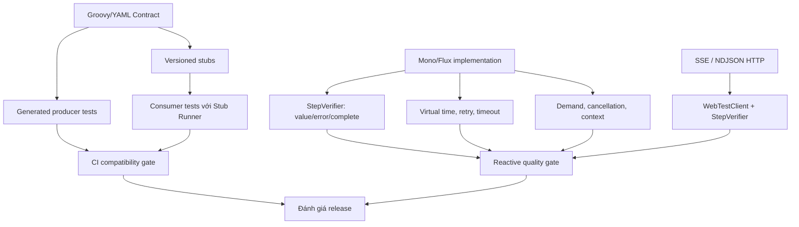
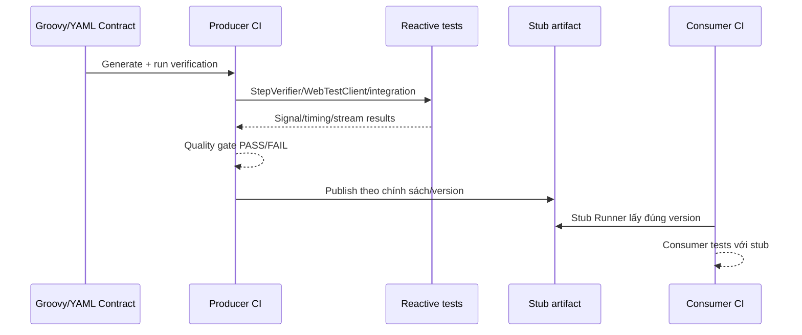

# Khi cần bổ sung kiểm thử reactive ngoài hợp đồng

## 1. Vì sao Spring Cloud Contract chưa đủ cho toàn bộ reactive?

Trong hệ thống nhiều dịch vụ, **producer** cung cấp HTTP API hoặc phát thông điệp, còn **consumer** gọi API hoặc nhận sự kiện. **Spring Cloud Contract (SCC)** giúp hai nhóm thống nhất tương tác qua **Groovy/YAML DSL**, sinh **producer verification tests**, đóng gói **stub** cho consumer dùng qua **Stub Runner** và chạy các bước trong CI để phát hiện thay đổi không tương thích.

Khi producer dùng **Spring WebFlux / Project Reactor**, giao diện có thể vẫn là HTTP `200` và JSON, nhưng implementation sử dụng `Mono<T>` và `Flux<T>`. Các Publisher này có ngữ nghĩa riêng về **subscription, dữ liệu được phát, lỗi, hoàn thành, backpressure, hủy subscription và thời gian**.

Ví dụ hợp đồng xác minh `GET /api/orders/42` trả JSON có `state: PAID`. Nó không tự chứng minh rằng:

- Pipeline chỉ chạy side effect khi có subscription.
- `Flux` phát sự kiện theo thứ tự và số lượng consumer cần.
- Consumer hủy stream thì producer dọn tài nguyên.
- Backpressure được xử lý đúng, không tạo bộ đệm vô hạn.
- Retry, timeout và delay xảy ra đúng số lần/thời điểm.
- Reactor Context truyền được thông tin correlation/security qua các operator.
- Ứng dụng không block event loop dưới tải.
- Luồng SSE/NDJSON được tiêu thụ theo thời gian, không treo khi chờ hoàn thành.

**Mục tiêu bài:** hiểu khi nào **bổ sung kiểm thử reactive ngoài hợp đồng**, lựa chọn `StepVerifier`, `WebTestClient`, virtual time, `TestPublisher`, `PublisherProbe`, integration/load tests đúng mục đích; đồng thời giữ nguyên vai trò của SCC trong producer/consumer contract testing.

> **Ranh giới:** Contract bảo vệ **hành vi giao tiếp đã thỏa thuận**. Kiểm thử reactive bổ sung bảo vệ **tín hiệu Publisher, thời gian, luồng và vòng đời tài nguyên**. Một số semantics streaming quan sát được cũng cần trở thành yêu cầu API, nhưng không nên mặc định generated contract tests đã bao phủ chúng.

## 2. Chọn công cụ theo điều cần chứng minh

| Câu hỏi cần trả lời | Công cụ phù hợp | Giới hạn |
|---|---|---|
| HTTP status, headers, JSON đúng? | SCC generated producer verification | Chỉ các tình huống contract đã khai báo |
| Consumer giải mã/ứng xử đúng với API mô phỏng? | Stub Runner + consumer tests | Không tự xác minh producer phiên bản mới |
| `Mono` phát đúng một value rồi complete? | Reactor `StepVerifier` | Không tự xác minh HTTP status |
| Service không có data hoặc phát lỗi ra sao? | StepVerifier | Chưa kiểm tra exception-to-HTTP mapping |
| `Flux` phát theo thứ tự và đủ số lượng? | StepVerifier | Không đo mạng và throughput |
| Demand `request(n)` được xử lý thế nào? | StepVerifier và TestPublisher | Không chứng minh backpressure toàn hệ thống |
| Hủy subscription có xảy ra không? | StepVerifier, PublisherProbe, lifecycle tests | Không tự chứng minh socket/database đã được giải phóng |
| Stream SSE/NDJSON phản hồi đúng? | WebTestClient + StepVerifier | Có thể vẫn cần integration/network tests |
| Retry và timeout có đúng chính sách? | StepVerifier.withVirtualTime | Không mô phỏng clock/network thật nếu ngoài scheduler ảo |
| Broker ack/nack, DB state, idempotency, tải? | Integration/load/chaos tests | Cần môi trường test cô lập, tài nguyên phù hợp |



## 3. Những tín hiệu Reactive Streams cần hiểu

- **`Mono<T>`** phát tối đa một phần tử, có thể hoàn thành rỗng hoặc phát lỗi.
- **`Flux<T>`** phát 0 đến nhiều phần tử; có thể hữu hạn hoặc không có điểm kết thúc theo thời gian chạy.
- **`onNext`** là tín hiệu dữ liệu; `onComplete` là hoàn thành; `onError` là lỗi kết thúc chuỗi.
- **`request(n)`** cho biết subscriber yêu cầu thêm tối đa `n` phần tử ở mức Reactive Streams.
- **`cancel()`** thông báo subscriber không muốn nhận thêm; các operator/resource cần phản ứng phù hợp.
- **`subscribe()`** kích hoạt Publisher dạng cold; nguồn hot có thể hoạt động độc lập subscriber.
- **Scheduler** quyết định nơi thực thi; **Reactor Context** gắn metadata với subscription, không phải chỉ là `ThreadLocal`.

**Phân biệt quan trọng:** `Mono.empty()` phát `onComplete` mà không có `onNext`. `Mono.error(exception)` phát `onError`. Controller có thể ánh xạ cả hai thành HTTP response khác nhau, nhưng đó là hành vi do code/exception handler quyết định, không phải SCC tự suy luận.

## 4. Ví dụ xuyên suốt: một endpoint WebFlux

Giả sử consumer cần tra cứu đơn và producer cam kết:

- `GET /api/orders/42` → `200 OK`, JSON `id: "42"`, `state: "PAID"`.
- `GET /api/orders/9999` → `404 Not Found` khi không có đơn.

Contract cho nhánh thành công:

```yaml
name: order_found
description: "Consumer tra cứu đơn đã thanh toán"
request:
  method: GET
  url: /api/orders/42
  headers:
    Accept: application/json
response:
  status: 200
  headers:
    Content-Type: application/json
  body:
    id: "42"
    state: "PAID"
```

Đây chỉ là **giao diện minh họa**; cần producer implementation và fixture bảo đảm đơn `42` tồn tại.

Một controller WebFlux có thể triển khai:

```java
@RestController
@RequestMapping("/api/orders")
class OrderController {
    private final OrderService service;

    OrderController(OrderService service) {
        this.service = service;
    }

    @GetMapping("/{id}")
    Mono<ResponseEntity<OrderDto>> getOrder(@PathVariable String id) {
        return service.findById(id)
            .map(ResponseEntity::ok)
            .defaultIfEmpty(ResponseEntity.notFound().build());
    }
}
```

`OrderService` và `OrderDto` là các kiểu **do dự án định nghĩa**; snippet thiếu imports/configuration để tập trung vào ý tưởng. Service có dữ liệu → `onNext` rồi `onComplete` → controller tạo response `200`. Service rỗng → `onComplete` không value → `404`. Nếu service `onError`, status phụ thuộc exception handling thực tế.

**Hai thứ khác nhau cần test:** tín hiệu của `service.findById` và phản hồi HTTP cuối sau ánh xạ của controller.

## 5. Spring Cloud Contract với WebFlux

Theo tài liệu SCC, producer WebFlux có thể dùng test mode **`WEBTESTCLIENT`**, bên cạnh **`EXPLICIT`** (request HTTP thật đến server đang lắng nghe). Ví dụ Maven plugin:

```xml
<plugin>
    <groupId>org.springframework.cloud</groupId>
    <artifactId>spring-cloud-contract-maven-plugin</artifactId>
    <version>REPLACE_WITH_COMPATIBLE_VERSION</version>
    <extensions>true</extensions>
    <configuration>
        <testMode>WEBTESTCLIENT</testMode>
        <testFramework>JUNIT5</testFramework>
        <baseClassForTests>
            com.example.orders.contract.WebFluxContractBase
        </baseClassForTests>
    </configuration>
</plugin>
```

Gradle Groovy DSL tương đương về ý nghĩa:

```groovy
contracts {
    testMode = 'WEBTESTCLIENT'
    testFramework = 'JUNIT5'
    baseClassForTests = 'com.example.orders.contract.WebFluxContractBase'
}
```

Đây là **các trích đoạn cấu hình**, không phải build file đầy đủ. Cần kiểm tra dependency, phiên bản Boot/Cloud/SCC và generated tests thực sự kế thừa đúng base class. Tài liệu mode `WEBTESTCLIENT` của SCC dùng **`RestAssuredWebTestClient`** trong base test, ví dụ `standaloneSetup(...)` cho controller. Không dùng `RestAssuredMockMvc` của Spring MVC cho WebFlux-only project rồi giả định đã cấu hình đúng.

```java
// Minh họa setup controller do test cung cấp.
@BeforeEach
void setUp() {
    RestAssuredWebTestClient.standaloneSetup(orderController);
}
```

Cách `standaloneSetup` chỉ bao phủ những thành phần được dựng trong test; các filter, codec, security và exception handler khác có thể không được thiết lập như application context thực. Nếu cần HTTP server thực, chọn `EXPLICIT` và tự cấu hình host/port/test server.

**SCC WEBTESTCLIENT không tự tạo StepVerifier cho mọi signal và timing.** Generated tests chủ yếu kiểm tra request/response đã mô tả trong contract.

## 6. Dependency dành riêng cho kiểm thử reactive

Một producer Spring WebFlux thường cần các dependency:

```xml
<dependencies>
    <dependency>
        <groupId>org.springframework.boot</groupId>
        <artifactId>spring-boot-starter-webflux</artifactId>
    </dependency>
    <dependency>
        <groupId>org.springframework.boot</groupId>
        <artifactId>spring-boot-starter-test</artifactId>
        <scope>test</scope>
    </dependency>
    <dependency>
        <groupId>org.springframework.cloud</groupId>
        <artifactId>spring-cloud-starter-contract-verifier</artifactId>
        <scope>test</scope>
    </dependency>
    <dependency>
        <groupId>io.projectreactor</groupId>
        <artifactId>reactor-test</artifactId>
        <scope>test</scope>
    </dependency>
</dependencies>
```

Gradle Groovy DSL:

```groovy
dependencies {
    implementation 'org.springframework.boot:spring-boot-starter-webflux'
    testImplementation 'org.springframework.boot:spring-boot-starter-test'
    testImplementation 'org.springframework.cloud:spring-cloud-starter-contract-verifier'
    testImplementation 'io.projectreactor:reactor-test'
}
```

- **SCC plugin** chạy ở build time để sinh tests/stubs.
- **Contract Verifier** và **reactor-test** phục vụ test runtime; không nên đưa vào production runtime chỉ để viết test.
- **spring-boot-starter-webflux** là production dependency nếu ứng dụng dùng WebFlux.
- Phiên bản Reactor nên được quản lý theo BOM tương thích; không ép một version tùy ý nếu chưa kiểm tra.
- Với Gradle plugin tạo `contractTest` task/source set riêng, phải kiểm tra classpath của **generated contract tests**, không chỉ `testRuntimeClasspath`.

## 7. StepVerifier cho `Mono`: value, empty và error

`StepVerifier` trong `reactor-test` subscribe Publisher và kiểm tra thứ tự tín hiệu.

Trường hợp phát một đơn rồi hoàn thành:

```java
StepVerifier.create(service.findById("42"))
    .assertNext(order -> {
        assertEquals("42", order.id());
        assertEquals("PAID", order.state());
    })
    .verifyComplete();
```

Ví dụ trên giả định `service`, `OrderDto`, fixture và imports đã có. Nó bảo vệ signal/value ở **service**, không tự bảo vệ HTTP `200` hay header.

Khi không tìm thấy, nếu thiết kế service **trả Mono rỗng**:

```java
StepVerifier.create(service.findById("9999"))
    .verifyComplete();
```

Nếu service được thiết kế **phát lỗi** thay vì hoàn thành rỗng, test phải khác:

```java
StepVerifier.create(service.findById("9999"))
    .expectError(OrderNotFoundException.class)
    .verify();
```

**Không thể coi cả hai là kỳ vọng đúng cho cùng implementation** nếu chưa quy định cụ thể. HTTP `404` được kiểm chứng bằng contract/controller test tương ứng; một `Mono.empty()` ở service chỉ thành `404` nếu controller map như vậy.

Kiểm tra mã lỗi ở service:

```java
StepVerifier.create(service.capture("PAY-LOCKED"))
    .expectErrorMatches(error ->
        error instanceof PaymentLockedException
            && "PAYMENT_LOCKED".equals(error.getMessage()))
    .verify();
```

Việc exception ấy được ánh xạ thành HTTP `409` và body `code: PAYMENT_LOCKED` cần test giao diện riêng. Với nguồn dễ treo, dùng timeout test có giới hạn như `verify(Duration.ofSeconds(5))`; mặc định một số kiểu `verify()` không có timeout.

## 8. StepVerifier cho `Flux`: thứ tự và completion

```java
Flux<String> states =
    Flux.just("CREATED", "PAID", "SHIPPED");

StepVerifier.create(states)
    .expectNext("CREATED")
    .expectNext("PAID")
    .expectNext("SHIPPED")
    .verifyComplete();
```

Test này xác minh ba `onNext` **theo thứ tự** và `onComplete`. Đừng tự ràng buộc thứ tự nếu API không hứa hẹn thứ tự. Nếu stream là vô hạn, không nên chờ complete: dùng `thenCancel()` sau khi nhận những phần tử cần kiểm tra.

Với `Flux` có dữ liệu trễ hoặc đến từ broker, test cần fixture/nguồn sự kiện có thể điều khiển, tránh chờ timing ngẫu nhiên. Hợp đồng JSON có thể bảo vệ cấu trúc phần tử, nhưng không tự chứng minh thứ tự phát signal hay stream termination.

## 9. Backpressure: `request(n)` và giới hạn kiểm chứng

Với Reactive Streams, subscriber yêu cầu dữ liệu bằng `request(n)`. Ví dụ StepVerifier bắt đầu với **0 demand**:

```java
StepVerifier.create(Flux.range(1, 3), 0)
    .expectSubscription()
    .thenRequest(1)
    .expectNext(1)
    .thenRequest(2)
    .expectNext(2, 3)
    .verifyComplete();
```

Test này cho thấy nguồn `Flux.range` phát dữ liệu khi subscriber yêu cầu. Nó **không chứng minh** toàn bộ network, broker, Netty buffer hoặc operator `flatMap`/`publishOn` tuân thủ giới hạn memory như ý định. Reactive operators có thể prefetch/buffer; cần kiểm thử tại chỗ và tải/metrics khi backpressure quan trọng.

### 9.1. TestPublisher điều khiển nguồn

`TestPublisher` có thể chủ động phát tín hiệu cho pipeline thử nghiệm:

```java
TestPublisher<String> upstream = TestPublisher.create();
Flux<String> upper = upstream.flux().map(String::toUpperCase);

StepVerifier.create(upper)
    .then(() -> upstream.next("ok"))
    .expectNext("OK")
    .then(upstream::complete)
    .verifyComplete();
```

`TestPublisher.createNonCompliant(...)` dùng để mô phỏng Publisher vi phạm giao thức khi cần test phòng vệ nâng cao, không phải để thay thế xác minh broker production. Điều khiển bằng TestPublisher giúp tạo các tình huống event/error khó tái hiện bằng data thật.


## 10. Cancellation: subscriber dừng thì resource ra sao?

Consumer có thể rời trang, đóng kết nối SSE hoặc hủy thao tác. Khi đó `cancel()` là tín hiệu quan trọng. Một test đơn giản:

```java
AtomicBoolean cancelled = new AtomicBoolean(false);

Flux<Integer> stream = Flux.range(1, 1000)
    .doOnCancel(() -> cancelled.set(true));

StepVerifier.create(stream, 0)
    .expectSubscription()
    .thenRequest(2)
    .expectNext(1, 2)
    .thenCancel()
    .verify();

assertTrue(cancelled.get());
```

Test chứng minh **callback cancellation** đã chạy ở pipeline ví dụ. Nó chưa chứng minh socket, database cursor hoặc downstream listener đã thật sự được giải phóng. Khi yêu cầu là resource cleanup, cần **integration/lifecycle test** và quan sát số lượng subscription, open connection, thread hoặc metrics trước/sau cancel.

Đừng dùng `verifyComplete()` cho stream được thiết kế chạy mãi. Hãy nhận đủ sự kiện cần kiểm tra, gọi `thenCancel()` và đặt timeout thực thi có giới hạn khi nguồn có yếu tố thời gian.

## 11. Virtual time: retry, delay và timeout không cần ngủ chờ

Các test dùng `Thread.sleep(...)` thường chậm và phụ thuộc timing của CI. Reactor cung cấp `StepVerifier.withVirtualTime` để thử các operator liên quan scheduler bằng đồng hồ ảo.

### 11.1. Phát sự kiện sau một khoảng trì hoãn

```java
StepVerifier.withVirtualTime(
        () -> Mono.delay(Duration.ofMinutes(5)))
    .expectSubscription()
    .expectNoEvent(Duration.ofMinutes(5))
    .expectNext(0L)
    .verifyComplete();
```

**Điều kiện quan trọng:** tạo Publisher có operator thời gian **bên trong Supplier**. Nếu tạo `Mono.delay` ngoài lambda và chỉ return nó trong Supplier, scheduler có thể đã được xác định trước khi đồng hồ ảo có hiệu lực. `expectNoEvent` cũng nhìn thấy subscription, nên cần `expectSubscription()` trước.

Virtual time chỉ thay thế những scheduler phù hợp; nó **không điều khiển thời gian thật** của socket, database, broker, thread sleep hoặc scheduler riêng nằm ngoài cấu hình ảo.

### 11.2. Retry hai lần trước khi thành công

```java
AtomicInteger attempts = new AtomicInteger();

StepVerifier.withVirtualTime(() ->
        Mono.defer(() -> attempts.incrementAndGet() < 3
                ? Mono.<String>error(
                    new IllegalStateException("temporary"))
                : Mono.just("OK"))
            .retryWhen(Retry.fixedDelay(
                2, Duration.ofSeconds(1))))
    .expectSubscription()
    .thenAwait(Duration.ofSeconds(2))
    .expectNext("OK")
    .verifyComplete();

assertEquals(3, attempts.get());
```

Ví dụ này kiểm tra **một attempt ban đầu và hai lần retry** với thời gian ảo. Không được suy ra retry an toàn cho mọi HTTP request. Nếu thao tác tạo thanh toán có side effect, cần **idempotency key, retry policy và integration test** để tránh tạo giao dịch trùng.

### 11.3. Timeout biểu diễn bằng onError

```java
StepVerifier.withVirtualTime(() ->
        Mono.<String>never()
            .timeout(Duration.ofSeconds(2)))
    .expectSubscription()
    .thenAwait(Duration.ofSeconds(2))
    .expectError(java.util.concurrent.TimeoutException.class)
    .verify();
```

Tại lớp service, timeout là **onError**. Ở HTTP boundary, việc đó trở thành `504`, `503` hoặc response khác tùy exception handling/gateway. **Contract HTTP** cần xác minh status/body mà consumer thực sự được hứa; StepVerifier không tự quyết định HTTP status.

Với test nguồn bất đồng bộ thật, nên có giới hạn thời gian để tránh job CI treo. Nếu `withVirtualTime` không điều khiển scheduler đang dùng, hãy xem lại pipeline và scheduler thay vì tăng sleep.

## 12. WebTestClient: kiểm tra HTTP WebFlux ở mức phù hợp

**WebTestClient** của Spring có thể kiểm tra status, header và body. Công cụ này hỗ trợ ba cách bind phổ biến:

| Cách dựng client | Phạm vi kiểm tra | Điều chưa được bảo đảm |
|---|---|---|
| `bindToController(controller)` | Controller và hạ tầng WebFlux tối thiểu | Có thể thiếu custom filter/security/config của app |
| `bindToApplicationContext(context)` | WebFlux configuration trong context test | Không đi qua TCP socket thật |
| `bindToServer().baseUrl(url)` | HTTP server thực đang chạy | Không tự qua gateway/load balancer nếu gọi thẳng producer |

### 12.1. HTTP JSON thông thường

Ví dụ test trong một Spring Boot WebFlux project có fixture cho đơn `42`:

```java
@SpringBootTest(
    webEnvironment = SpringBootTest.WebEnvironment.MOCK
)
@AutoConfigureWebTestClient
class OrderHttpTest {

    @Autowired
    WebTestClient webTestClient;

    @Test
    void order42IsReturned() {
        webTestClient.get()
            .uri("/api/orders/42")
            .accept(MediaType.APPLICATION_JSON)
            .exchange()
            .expectStatus().isOk()
            .expectHeader().contentType(MediaType.APPLICATION_JSON)
            .expectBody()
            .jsonPath("$.id").isEqualTo("42")
            .jsonPath("$.state").isEqualTo("PAID");
    }
}
```

Đây là **khung test** cần application context, imports và fixture phù hợp; `@AutoConfigureWebTestClient` là hỗ trợ của Spring Boot test và package import có thể thay đổi theo version. Test kiểm tra **HTTP response cuối**, không kiểm tra demand hay cancellation.

Nếu muốn kiểm tra exception mapping/security thực, hãy đảm bảo context/binding chứa đúng components; một mock controller test quá tối giản có thể bỏ qua filter hoặc codec production. Đừng đồng nhất WebTestClient với việc **luôn** gửi HTTP qua socket.

## 13. SSE và NDJSON: nơi stream test quan trọng hơn một body tĩnh

Với HTTP **Server-Sent Events (SSE)** hoặc **NDJSON**, consumer có thể phụ thuộc vào:

- Media type `text/event-stream` hoặc `application/x-ndjson`.
- Schema của từng event/JSON object.
- Thứ tự sự kiện, event ID hoặc sequence nếu API cam kết.
- Thời gian nhận event đầu tiên.
- Khả năng hủy stream, giải phóng resource.
- Reconnect/deduplication/idempotency khi mạng bị gián đoạn.

Một hợp đồng SCC mô tả một response mẫu không tự bảo đảm **framing, stream vô hạn, backpressure, reconnect và cancellation**. Bổ sung WebTestClient + StepVerifier để tiêu thụ stream thật trong test.

### 13.1. Ví dụ kiểm tra sự kiện đầu rồi cancel

```java
FluxExchangeResult<TrackingEvent> result =
    webTestClient.get()
        .uri("/api/tracking/42/events")
        .accept(MediaType.TEXT_EVENT_STREAM)
        .exchange()
        .expectStatus().isOk()
        .expectHeader()
            .contentTypeCompatibleWith(MediaType.TEXT_EVENT_STREAM)
        .returnResult(TrackingEvent.class);

StepVerifier.create(result.getResponseBody())
    .assertNext(event ->
        assertEquals("CREATED", event.state()))
    .thenCancel()
    .verify(Duration.ofSeconds(5));
```

**Giả định:** producer có fixture phát được event đầu, WebTestClient đã bind đúng server/context, decoder có thể giải mã `TrackingEvent`, và DTO có method `state()`. Nếu dùng `ServerSentEvent<TrackingEvent>` cần kiểu decoder và assertion phù hợp.

Đặt timeout `5 giây` là **cấu hình kiểm thử minh họa**, không phải SLA của dịch vụ. Nếu stream được thiết kế vô hạn, việc đợi complete là sai. Ngược lại, nếu API là finite stream, hãy kiểm tra `onComplete` khi đó là cam kết.

### 13.2. Test thứ tự và mất kết nối

Nếu consumer cần event `CREATED` trước `IN_TRANSIT`, có thể kiểm tra hai `onNext` theo thứ tự và hủy. Nhưng nếu API không cam kết thứ tự (ví dụ fan-out từ broker), đừng viết assertion quá chặt không có căn cứ. Test duplicate và reconnect thường cần **integration tests với network/broker**; `withVirtualTime` không mô phỏng một kết nối HTTP thật.

## 14. PublisherProbe: xác minh nhánh dự phòng có thực sự chạy

Một `Mono<Void>` hoàn thành rỗng đôi khi không cho biết nhánh fallback nào đã được sử dụng. Reactor có `PublisherProbe` để kiểm tra subscribe/request/cancel.

```java
PublisherProbe<String> fallback =
    PublisherProbe.of(Mono.just("fallback"));

Mono<String> result = Mono.<String>empty()
    .switchIfEmpty(fallback.mono());

StepVerifier.create(result)
    .expectNext("fallback")
    .verifyComplete();

fallback.assertWasSubscribed();
fallback.assertWasRequested();
fallback.assertWasNotCancelled();
```

Ví dụ này chứng minh fallback **được subscribe** khi nguồn chính rỗng. Nó không chứng minh HTTP error mapping, side effect của database hay fallback trong production không tạo vòng lặp vô hạn. Test thêm lớp giao tiếp/độ bền nếu consumer phụ thuộc.

## 15. Reactor Context, scheduling và blocking

**Reactor Context** là metadata theo subscription, khác `ThreadLocal` gắn với một thread cụ thể. Nó có thể dùng cho correlation ID, tracing hoặc dữ liệu logic gắn với request:

```java
Mono<String> correlation =
    Mono.deferContextual(ctx ->
        Mono.just(ctx.get("correlationId")));

StepVerifier.create(
        correlation.contextWrite(
            reactor.util.context.Context.of(
                "correlationId", "req-42")))
    .expectNext("req-42")
    .verifyComplete();
```

Test chỉ xác nhận luồng ví dụ đọc context. Không tự chứng minh MDC, security, transaction hoặc client downstream vẫn truyền context khi đổi scheduler. Nếu yêu cầu đó quan trọng, viết test cho **pipeline thực tế**, có `publishOn`/`subscribeOn` hoặc tích hợp framework đúng phiên bản.

### Blocking trên event loop

WebFlux có thể mất hiệu năng nghiêm trọng nếu handler dùng `Thread.sleep`, JDBC đồng bộ, file I/O chặn hoặc `block()` trên event-loop. Contract test với một request nhỏ có thể vẫn xanh. Có thể bổ sung:

- Test operator/lịch scheduler có chủ đích.
- Blocking detection như **BlockHound** khi tương thích với runtime và được cấu hình cho test.
- Integration/load tests và quan sát thread, latency, throughput.
- Test lỗi overload, queue/buffer và hủy subscription.

Không nói `StepVerifier` tự chứng minh producer **non-blocking ở tải thật**. Các nguồn dữ liệu, schedulers và runtime test phải đại diện cho rủi ro cần đo.

## 16. Reactive messaging: hợp đồng payload chưa đủ cho broker semantics

Với Kafka, RabbitMQ hoặc Cloud Stream, Spring Cloud Contract có thể mô tả **payload/header/destination**. Nhưng những thuộc tính sau thường cần kiểm thử bổ sung:

| Rủi ro | Kiểm thử bổ sung |
|---|---|
| Message trùng làm cập nhật hai lần | Integration test idempotency và database state |
| Ack/nack/retry sai, sự kiện bị mất | Test với broker/test container |
| Dead-letter queue không được dùng đúng | Integration test DLQ |
| Event bị reorder | Test consumer xử lý out-of-order nếu yêu cầu |
| Backpressure/buffering khi consumer chậm | Reactive tests + load/metrics |
| Hủy subscription nhưng listener vẫn sống | Lifecycle/cleanup tests |
| Transaction commit nhưng event không xuất bản | Outbox/integration consistency tests |
| Schema thay đổi gây lỗi deserialize | SCC message contract + consumer serialization tests |

**Không nhầm một contract payload được xác minh với bảo đảm exactly-once hoặc retry an toàn**. Hợp đồng, tín hiệu Reactive Streams và hành vi broker là những phạm vi khác nhau.

## 17. CI: kết hợp chứng cứ contract và reactive

Một pipeline có ích gồm:

1. **Review contract** với consumer: request, status, header/body, message schema và các nhánh lỗi quan trọng.
2. **Sinh và chạy producer verification tests** từ Groovy/YAML DSL bằng test mode phù hợp WebFlux (ví dụ `WEBTESTCLIENT` hoặc `EXPLICIT`).
3. **Chạy reactor-test unit tests**: StepVerifier cho value/empty/error/complete/demand/cancel và virtual time cho timeout/retry.
4. **Chạy WebTestClient tests** cho HTTP streaming, decoder/media type, security hoặc nhánh chi tiết ngoài generated test.
5. **Chạy integration tests** khi có database, broker, cancellation resource, idempotency hoặc network behavior.
6. **Đóng gói stub có version** theo CI gate; consumer dùng Stub Runner nạp đúng artifact.
7. **Chặn release khi test thất bại**; không coi chỉ generate source, chạy `0 tests` hoặc test dùng stub cũ là bằng chứng producer hiện tại tương thích.



### Ưu tiên theo loại API

| Loại API | Kiểm thử nên cân nhắc |
|---|---|
| Một JSON từ `Mono<OrderDto>` | SCC HTTP contract + test Mono empty/error nếu logic quan trọng |
| `Flux` danh sách hữu hạn | SCC schema/status + StepVerifier order/count nếu cam kết |
| SSE/NDJSON dài hạn | WebTestClient stream + StepVerifier cancel + integration/lifecycle |
| Retry downstream | Virtual time + idempotency/integration tests |
| Message consumer reactive | SCC message contract + tests signal và broker ack/dedupe |
| API chịu tải lớn | Backpressure tests + load/metrics/resource cleanup |
| API nhạy cảm security/tracing | HTTP contract + test context propagation/security |

## 18. Sai lầm thường gặp

| Sai lầm | Tác động | Hướng xử lý |
|---|---|---|
| Contract `200` xanh nên kết luận reactive đã an toàn | Không kiểm tra demand, cancellation, timeout | Thêm tests đúng rủi ro |
| Chỉ StepVerifier service rồi kết luận HTTP contract đúng | Có thể sai status/header/serializer | Giữ producer verification/HTTP tests |
| Dùng `block()` rồi chỉ assert object | Không thấy tín hiệu onError/onComplete/demand | Dùng StepVerifier ở lớp reactive |
| `verifyComplete()` trên SSE vô hạn | Test treo | Nhận đủ event rồi `thenCancel()` |
| Tạo Publisher trước `withVirtualTime` | Scheduler ảo có thể không áp dụng | Dùng Supplier khởi tạo pipeline |
| Test retry bằng `sleep` cố định | Chậm, flaky | Virtual time khi dùng scheduler hỗ trợ |
| Retry count đúng nên nghĩ không duplicate | Side effect có thể xảy ra nhiều lần | Test idempotency ở tầng tích hợp |
| Dùng một demand test đơn giản để kết luận cả hệ thống có backpressure | Quên prefetch, buffer và mạng | Test pipeline thực và đo tải |
| Test cancellation callback là đủ cho socket/database | Tài nguyên có thể vẫn rò | Lifecycle/integration test |
| WebTestClient bind controller rồi suy ra TLS/gateway hoạt động | Không đi qua network thật | Test bindToServer/deployment phù hợp |
| Chỉ dùng Stub Runner ở consumer | Producer có thể trả khác stub | Generated producer tests trên đúng build |
| Mocks/fixture bị rò giữa các test | CI thất bại ngẫu nhiên | Cô lập dữ liệu, clock, scheduler, cleanup |

## 19. Bài tập: hợp đồng HTTP và sự kiện vận đơn

### Bối cảnh

Producer `shipping-service` cung cấp:

- `GET /api/shipments/TRK-123` → `200`, `trackingCode: TRK-123` và `state: IN_TRANSIT`.
- `GET /api/shipments/TRK-999` → `404`, body lỗi `SHIPMENT_NOT_FOUND`.
- `GET /api/shipments/TRK-123/events` → SSE với các sự kiện có `state`.

Tầng service dùng `Mono<ShipmentDto>` để tra cứu và `Flux<TrackingEvent>` để phát sự kiện.

### Nhiệm vụ

1. Viết **hai YAML HTTP contracts** cho nhánh `200` và `404`; mô tả fixture producer cần tạo.
2. Chọn `WEBTESTCLIENT` cho SCC và nêu base test cần có.
3. Viết StepVerifier cho trường hợp service có dữ liệu và `Mono.empty()`.
4. Viết WebTestClient + StepVerifier đọc event đầu của SSE rồi `thenCancel()`, có timeout.
5. Nếu stream retry tối đa hai lần khi downstream transient error, viết virtual-time test đếm số attempts.
6. Nêu integration test chứng minh hủy stream thực sự giải phóng listener/downstream.
7. Thiết kế CI có producer verification, reactive tests, Stub Runner consumer tests và versioning.

### Gợi ý YAML nhánh thành công

```yaml
name: shipment_found
description: "Tra cứu vận đơn đang được vận chuyển"
request:
  method: GET
  url: /api/shipments/TRK-123
response:
  status: 200
  headers:
    Content-Type: application/json
  body:
    trackingCode: "TRK-123"
    state: "IN_TRANSIT"
```

### Gợi ý test luồng hữu hạn

```java
Flux<String> events = Flux.just("CREATED", "IN_TRANSIT");

StepVerifier.create(events)
    .expectNext("CREATED", "IN_TRANSIT")
    .verifyComplete();
```

**Giới hạn của gợi ý:** Test `Flux.just` chỉ kiểm tra signal trong một Publisher tự tạo, không chứng minh SSE HTTP hay broker thật. Bài giải tốt phải xác định **lớp test** và **bằng chứng** của từng yêu cầu, không đưa tất cả assertions vào một contract JSON tĩnh.

## 20. Checklist trước khi đưa vào CI

- [ ] Producer contract tests bảo vệ HTTP status, headers, body/message schema và nhánh lỗi quan trọng.
- [ ] Consumer tests với Stub Runner dùng đúng stub version.
- [ ] Các trường hợp `Mono` empty/error/success có test khi logic xử lý khác nhau.
- [ ] `Flux` order/count/completion được kiểm tra nếu consumer phụ thuộc.
- [ ] Với stream dài, test có cancellation và timeout, không chờ complete mãi.
- [ ] Backpressure/demand/buffer có kiểm thử và metrics khi quan trọng.
- [ ] Các operator `delay/timeout/retry` có virtual-time test phù hợp.
- [ ] Retry có side effect được bảo vệ bằng idempotency/integration tests.
- [ ] WebTestClient binding đúng phạm vi (controller/context/server).
- [ ] SSE/NDJSON được kiểm tra media type, event, decoder và lifecycle.
- [ ] Context/security/tracing/blocking được kiểm thử khi là yêu cầu.
- [ ] Broker/DB có integration tests cho ack, duplicate, transaction/outbox nếu cần.
- [ ] Generated tests và reactive tests được **sinh, tìm thấy và thực thi**, không bị skip.
- [ ] CI fail khi regression; có version traceability cho producer/contract/stub.
- [ ] Test data và schedulers được cô lập để tránh phụ thuộc thứ tự.

## 21. Ghi nhớ và tài liệu tham khảo

**Spring Cloud Contract bảo vệ “producer và consumer đã thỏa thuận giao diện gì”; reactive tests bảo vệ “Publisher vận hành và phát tín hiệu ra sao”.** Chúng bổ sung cho nhau:

- **Groovy/YAML DSL, generated producer verification, Stub Runner**: giao diện HTTP/message.
- **StepVerifier, virtual time, TestPublisher, PublisherProbe**: signal, demand, lỗi, cancellation, timing và control flow.
- **WebTestClient**: HTTP boundary và những luồng streaming mà body tĩnh chưa thể hiện đầy đủ.
- **Integration/load/security tests**: DB/broker, side effect, idempotency, context propagation, connection và hiệu năng.

Chỉ bổ sung reactive test khi có **rủi ro thực sự cần bảo vệ** như thứ tự event, hủy stream, backpressure, retry/timeout, context hoặc tải. Kết quả test chỉ có giá trị trên kịch bản, phiên bản, fixture và assertion đã thực thi; không tự chứng minh toàn bộ production luôn đúng.

Tài liệu chính thức để đối chiếu theo phiên bản:

- [Spring Cloud Contract — WebFlux with WebTestClient](https://docs.spring.io/spring-cloud-contract/reference/project-features-flows/feature-webflux.html).
- [Spring Cloud Contract — WebFlux with Explicit Mode](https://docs.spring.io/spring-cloud-contract/reference/project-features-flows/feature-webflux-explicit.html).
- [Spring Framework — WebTestClient và Streaming Responses](https://docs.spring.io/spring-framework/reference/testing/webtestclient.html).
- [Project Reactor — Testing: StepVerifier, Virtual Time, TestPublisher và PublisherProbe](https://projectreactor.io/docs/core/release/reference/testing.html).
- [Reactor Test API — StepVerifier](https://projectreactor.io/docs/test/release/api/reactor/test/StepVerifier.html).


