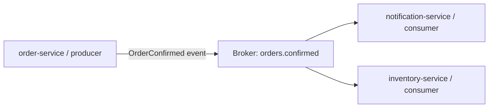
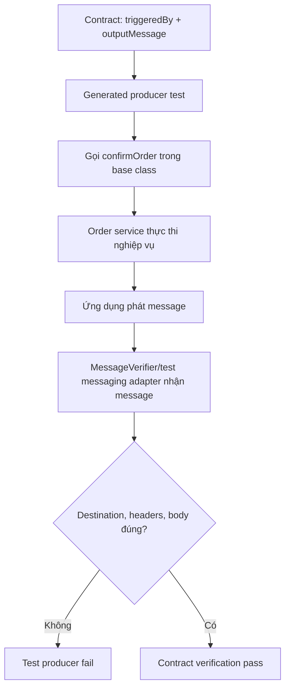
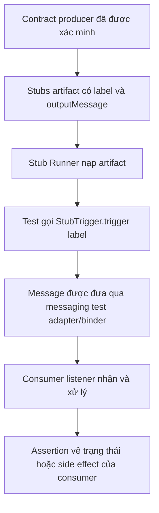
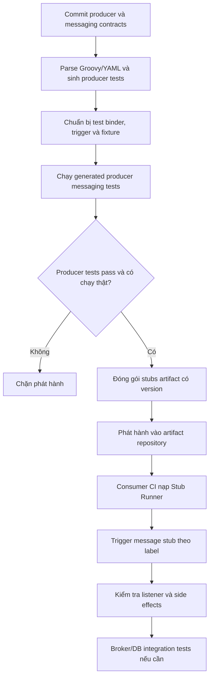

# Producer và consumer trong giao tiếp qua thông điệp

## 1. Vì sao giao tiếp qua thông điệp cần hợp đồng?

Trong **Spring Cloud Contract**, producer và consumer không chỉ trao đổi HTTP request/response. Hai dịch vụ còn có thể giao tiếp bất đồng bộ qua **message broker**, topic, queue hoặc channel, chẳng hạn Kafka hay RabbitMQ. Một dịch vụ phát sự kiện đơn hàng, dịch vụ khác nhận sự kiện để cập nhật thanh toán, gửi thông báo hoặc đồng bộ dữ liệu. Khi producer đổi tên trường, kiểu dữ liệu, header hoặc destination, consumer có thể hỏng dù không có HTTP API nào thay đổi.

Ví dụ:

- `order-service` xác nhận đơn hàng `ord-42` rồi phát sự kiện `OrderConfirmed`.
- `notification-service` lắng nghe sự kiện để gửi thông báo.
- `inventory-service` tiêu thụ cùng sự kiện để ghi nhận hàng đã được giữ.

Nếu producer đổi field `orderId` thành `id` mà consumer vẫn deserialize `orderId`, hệ thống có thể bỏ qua thông điệp hoặc xử lý sai. Nếu producer chuyển destination `orders.confirmed` thành `orders.events` mà không thông báo, consumer có thể **không nhận được thông điệp nào**, dù payload vẫn hợp lệ.

**Hợp đồng thông điệp** (*message contract*) mô tả hành vi producer cam kết: điều gì kích hoạt thông điệp, gửi đến đâu, có những header nào và payload có cấu trúc/giá trị gì. Spring Cloud Contract có thể dùng **Groovy/YAML DSL** để sinh kiểm thử producer và tạo stub phục vụ kiểm thử consumer, với điều kiện dự án đã cấu hình tích hợp messaging tương ứng.

Mục tiêu của bài:

1. Phân biệt producer, consumer và broker trong giao tiếp qua thông điệp.
2. Hiểu **hướng vào (input)**, **hướng ra (output)**, trigger, destination, header và payload trong contract.
3. Viết một kịch bản thông điệp điển hình, hiểu generated producer test kiểm chứng gì.
4. Dùng Stub Runner/trigger để thử logic consumer mà không phải chạy producer thật.
5. Phân biệt những bảo đảm của **contract** với delivery, ordering, retry và transaction của broker thật, từ đó thiết kế kiểm thử CI phù hợp.

## 2. Ba vai trò: producer, broker và consumer

| Thành phần | Chức năng | Quan tâm đến điều gì? |
| --- | --- | --- |
| **Message producer** | Tạo và phát thông điệp | Khi nào phát, destination nào, payload/header có đúng lời hứa không |
| **Broker / transport** | Nhận, lưu, định tuyến và chuyển thông điệp tùy công nghệ | Topic/queue, partition, routing key, acknowledgment, retention, delivery |
| **Message consumer** | Đăng ký nhận và xử lý thông điệp | Có đọc đúng event type/schema, xử lý được dữ liệu và lỗi không |



Một dịch vụ có thể **đồng thời là consumer và producer**. Ví dụ `billing-service` nhận lệnh thanh toán từ `orders.payments.commands` rồi phát `PaymentCompleted` sang `payments.completed`. Vì vậy tên gọi producer/consumer phải gắn với **từng luồng thông điệp**, không phải là nhãn cố định của một microservice.

Trong Spring Cloud Contract, khi nói **producer-side contract test**, ta thường muốn kiểm chứng **dịch vụ được hợp đồng mô tả có thực sự phát ra output message đúng cam kết hay không**. Còn consumer-side test cần xác minh ứng dụng nhận và xử lý được thông điệp mẫu. Chúng là hai góc nhìn của cùng giao diện, không nhất thiết cùng công nghệ runtime hoặc cùng repository.

### So với HTTP, điều gì thay đổi?

| HTTP contract | Message contract |
| --- | --- |
| Client gửi request đến một URL, server trả response | Producer gửi message đến destination; consumer nhận theo cơ chế bất đồng bộ |
| Method, path, query, status code là phần chính của giao diện | Destination, message headers, body, trigger/input và event type là phần chính |
| Lỗi thường biểu hiện bằng HTTP `4xx/5xx` | Lỗi có thể là retry, nack, dead-letter, timeout hoặc event lỗi riêng |
| Stub thường phục vụ HTTP qua WireMock | Stub messaging cần cơ chế trigger/phát message và tích hợp messaging phù hợp |
| Test thường có một request/response gần nhau về thời gian | Test phải tính đến thời điểm listener sẵn sàng, message đến trễ và trạng thái bất đồng bộ |

Không nên cố biến mọi message thành HTTP: một event `OrderConfirmed` không nhất thiết có “HTTP response” hoặc status code. Nếu hệ thống dùng cả REST và message, nên mô tả **cả hai giao diện** theo đúng phương thức giao tiếp.

## 3. Phân biệt event, command và notification

Các loại message có thể có ý nghĩa giao tiếp khác nhau:

| Loại | Ví dụ | Ý nghĩa đối với producer/consumer |
| --- | --- | --- |
| **Event** | `OrderConfirmed` | Một sự kiện **đã xảy ra**; nhiều consumer có thể quan tâm |
| **Command** | `ConfirmOrder` | Yêu cầu một bên **thực hiện hành động**; thường có nơi xử lý được chỉ định |
| **Notification** | `SendOrderEmail` | Thông báo hoặc yêu cầu gửi thông tin; có thể dùng như command tùy thiết kế |

Ví dụ `order-service` nhận command `ConfirmOrder` và phát event `OrderConfirmed` sau khi xử lý. Trong luồng command, nó là **consumer của input**; trong luồng event, nó là **producer của output**.

Đừng dùng tên event ở thì quá khứ nhưng thực tế chưa có thay đổi nghiệp vụ tương ứng. Nếu producer phát `OrderConfirmed` trước khi transaction xác nhận đơn hàng commit, consumer có thể nhận một lời hứa sai. **Contract test kiểm tra hình thức và điều kiện phát message trong môi trường test; tính đúng đắn của transaction/outbox cần kiểm thử riêng.**

### Topic, queue và destination không phải cùng một khái niệm

`sentTo('orders.confirmed')` trong contract mô tả **destination theo abstraction mà test/plugin đang dùng**. Nó có thể ánh xạ tới một channel, topic, queue hoặc binding name tùy tích hợp thực tế. Kafka topic, RabbitMQ exchange/routing key và Spring Integration channel có semantics khác nhau. Không suy rằng mọi chuỗi destination đều là tên topic vật lý trong broker production.

Những thông số như consumer group, partition, retention hoặc routing binding có thể nằm ngoài DSL contract cơ bản. Khi chúng là giao diện vận hành quan trọng, phải lưu thành cấu hình được version hóa và bổ sung integration test tương ứng.

## 4. Thành phần của một message contract

Một thông điệp mang sự kiện xác nhận đơn hàng có thể trông như sau:

```json
{
  "eventId": "evt-701",
  "orderId": "ord-42",
  "status": "CONFIRMED",
  "occurredAt": "2026-11-24T09:00:00Z"
}
```

Ngoài body, transport có thể chứa metadata:

```text
destination: orders.confirmed
headers:
  contentType: application/json
  eventType: OrderConfirmed
  schemaVersion: "1"
```

| Thành phần | Ý nghĩa | Rủi ro tương thích |
| --- | --- | --- |
| `destination` | Nơi message được gửi | Đổi destination khiến consumer không nhận event |
| `headers.eventType` | Loại sự kiện để consumer phân nhánh | Đổi tên/giá trị làm routing hoặc handler sai |
| `headers.contentType` | Kiểu serialize payload | Đổi JSON thành text/Avro mà consumer chưa hỗ trợ |
| `headers.schemaVersion` | Chỉ báo phiên bản schema nếu nhóm dùng | Thay đổi không được consumer xử lý |
| `body.orderId` | ID đơn hàng cần xử lý | Mất field hoặc đổi number/string làm deserialization thất bại |
| `body.status` | Trạng thái nghiệp vụ | Đổi `CONFIRMED` thành một giá trị chưa được định nghĩa |
| `body.eventId` | Định danh message phục vụ correlation/deduplication | Thiếu ID hoặc sai định dạng khi consumer dựa vào nó |
| `body.occurredAt` | Thời điểm sự kiện xảy ra | Sai format/timezone; cần phân biệt thời điểm sự kiện và thời điểm gửi |

**Phân biệt payload và message headers:** header có thể được broker, binder hoặc serializer truyền dưới dạng metadata ngoài body. Nếu consumer đọc `eventType` từ header, việc đưa nó vào JSON body nhưng bỏ header là một thay đổi giao diện, dù “thông tin vẫn còn”.

### Một contract tốt không khóa dữ liệu ngẫu nhiên

`eventId` và `occurredAt` có thể khác ở mỗi lần phát. Nếu consumer chỉ cần định dạng hợp lệ, producer test nên dùng matcher phù hợp. Ngược lại, `status = CONFIRMED` và `eventType = OrderConfirmed` có thể là **giá trị cố định có ý nghĩa**, cần kiểm tra chính xác. Hợp đồng tối thiểu hóa ràng buộc thừa nhưng phải giữ những gì consumer thực sự sử dụng.

## 5. Kịch bản một chiều: producer phát sự kiện sau một hành động

Giả sử `order-service` có một nghiệp vụ xác nhận đơn. Sau khi xử lý, nó phát `OrderConfirmed`. Để kiểm tra thông điệp **đầu ra** mà không phải định nghĩa message đầu vào, Spring Cloud Contract có thể dùng `input.triggeredBy(...)`: generated test gọi một method kích hoạt nghiệp vụ, rồi kiểm tra output message.

Ví dụ tệp `src/test/resources/contracts/messaging/order-confirmed.groovy`:

```groovy
import org.springframework.cloud.contract.spec.Contract

Contract.make {
    description 'Phát sự kiện OrderConfirmed sau khi xác nhận đơn'
    label 'order_confirmed'

    input {
        triggeredBy('confirmOrder()')
    }

    outputMessage {
        sentTo('orders.confirmed')
        headers {
            header('contentType', 'application/json')
            header('eventType', 'OrderConfirmed')
            header('schemaVersion', '1')
        }
        body([
            eventId: $(consumer('evt-701'),
                       producer(regex('evt-[0-9]+'))),
            orderId: 'ord-42',
            status: 'CONFIRMED'
        ])
    }
}
```

Đọc từng phần:

| Groovy DSL | Ý nghĩa |
| --- | --- |
| `label 'order_confirmed'` | Nhãn để định danh kịch bản, có thể dùng khi kích hoạt messaging stub |
| `input.triggeredBy('confirmOrder()')` | Phương thức/hành động mà producer verification test gọi để làm ứng dụng phát message |
| `outputMessage.sentTo('orders.confirmed')` | Destination logic mà output phải được quan sát |
| `headers { ... }` | Header consumer dựa vào, gồm content type, event type, schema version |
| `body.orderId = 'ord-42'` | ID đơn hàng mẫu của kịch bản |
| `body.status = 'CONFIRMED'` | Trạng thái phải đúng cam kết |
| `consumer('evt-701')` | Ví dụ ổn định cho stub phía consumer |
| `producer(regex('evt-[0-9]+'))` | Điều kiện producer test dùng để kiểm tra ID được tạo thật |

Đây là ví dụ DSL minh họa với cấu trúc phổ biến của Spring Cloud Contract. **Tính tương thích của plugin và bộ matcher phải được xác nhận theo phiên bản đang dùng**. Đặc biệt, destination `orders.confirmed` phải được ánh xạ đúng tới channel/binding hoặc broker destination trong test; nó không tự bảo đảm broker production tồn tại.

### Vì sao có `triggeredBy` mà không cần HTTP request?

Trong luồng HTTP, generated test thường gửi request cho producer và kiểm tra response. Trong ví dụ messaging, không có HTTP request bắt buộc: test cần một cách kích hoạt nghiệp vụ, chẳng hạn gọi service method xác nhận đơn hàng. Sau khi kích hoạt, test chờ và kiểm chứng một message đầu ra. **`triggeredBy` không phải một thông điệp do consumer gửi** và cũng không tự xác định quy trình nghiệp vụ; nó gọi logic mà ta cung cấp trong test base class.

Nếu producer cần nhận một **message đầu vào** mới phát sự kiện, nên sử dụng cấu trúc `messageFrom`/`messageBody` ở phần input, được trình bày ở mục 7, thay vì tùy tiện gọi một method không đại diện cho input thật.

## 6. Generated producer test chứng minh điều gì?

Contract Verifier có thể sinh kiểm thử producer từ hợp đồng ở mục 5. Về mặt ý nghĩa, luồng kiểm thử như sau:



### Base class cung cấp hành động kích hoạt

Một khung Java dành cho producer có thể tổ chức như sau:

```java
import org.springframework.beans.factory.annotation.Autowired;
import org.springframework.boot.test.context.SpringBootTest;

@SpringBootTest
public abstract class MessagingContractBase {

    @Autowired
    OrderApplicationService orderService;

    public void confirmOrder() {
        // Dữ liệu ord-42 phải ở trạng thái phù hợp trước test.
        orderService.confirmOrder("ord-42");
    }
}
```

`OrderApplicationService` là service ứng dụng **giả định** của ví dụ, không phải lớp do Spring Cloud Contract cung cấp. Để mã hoạt động, dự án cần implementation, fixture, test setup và cơ chế gửi/nhận message thật hoặc test adapter tương ứng. Phải cấu hình plugin để generated tests kế thừa đúng `MessagingContractBase` và dùng test framework phù hợp.

**Cần tránh false positive:** Nếu method `confirmOrder()` trong base class trực tiếp tạo một message mẫu và bơm vào test verifier, test có thể pass dù business code không phát event. Method kích hoạt nên gọi **đường đi ứng dụng được kiểm chứng**, còn việc quan sát message nên do adapter test thực hiện.

### Kết quả expected và actual

Một test producer đúng nghĩa cần phát hiện:

- Không có message sau trigger hoặc message đến sai destination theo abstraction đang kiểm tra.
- Thiếu `eventType` hoặc `contentType` đã cam kết.
- `orderId` thay bằng `orderNumber` hoặc đổi sang kiểu không phù hợp.
- `status` bị đổi từ `CONFIRMED` sang `PENDING` trong kịch bản đã xác nhận.
- `eventId` không thỏa regex đã định, chẳng hạn `invalid`.

Nếu producer phát `eventId = evt-999`, test **nên pass** theo matcher; stub không có nghĩa producer phải luôn phát đúng `evt-701`. Đồng thời, nếu test chỉ match regex event ID thì **chưa chứng minh event ID duy nhất** giữa nhiều message.

### Điều kiện của môi trường producer test

Phải có một cơ chế nhận output từ hệ messaging mà Spring Cloud Contract có thể kiểm chứng, thường là **Spring Cloud Stream**, **Spring Integration** hoặc adapter tương ứng tùy phiên bản và công nghệ. Hãy kiểm tra cơ chế `MessageVerifier`, test binder và cấu hình channel/destination của dự án. Không mặc định mọi tổ hợp Kafka/RabbitMQ/Spring Boot đã được cấu hình sẵn chỉ vì thêm dependency Contract Verifier.

Nếu test dùng in-memory channel hoặc test binder, nó kiểm tra **message mà ứng dụng xuất qua abstraction ấy**, không nhất thiết xác minh kết nối broker thật, partition, serialization trên dây hoặc acknowledgement. Những điều đó cần integration test phù hợp.

## 7. Kịch bản hai chiều: dịch vụ nhận command rồi phát event

Một ứng dụng có thể tiêu thụ command `ConfirmOrder` rồi phát event `OrderConfirmed`. Lúc này cùng một service vừa **là consumer của input** vừa **là producer của output**.

Trong Groovy DSL, một kịch bản phổ biến:

```groovy
import org.springframework.cloud.contract.spec.Contract

Contract.make {
    description 'Nhận lệnh xác nhận và phát sự kiện'
    label 'confirm_order_command'

    input {
        messageFrom('orders.commands')
        messageHeaders {
            header('contentType', 'application/json')
            header('commandType', 'ConfirmOrder')
        }
        messageBody([
            commandId: 'cmd-101',
            orderId: 'ord-42'
        ])
    }

    outputMessage {
        sentTo('orders.confirmed')
        headers {
            header('contentType', 'application/json')
            header('eventType', 'OrderConfirmed')
        }
        body([
            eventId: 'evt-701',
            orderId: 'ord-42',
            status: 'CONFIRMED'
        ])
    }
}
```

Đọc hướng giao tiếp:

```text
Producer verification test
    → gửi input message ConfirmOrder đến orders.commands
    → ứng dụng order-service nhận và xử lý
    → phát output message OrderConfirmed đến orders.confirmed
    → kiểm tra destination/headers/body của output
```

Đừng nhầm `input` với “response của consumer”. Input ở đây mô tả **message mà hệ thống đang được kiểm thử nhận**; output là **message mà hệ thống đó phải phát**. Với test consumer riêng của `notification-service`, ta lại tập trung vào event `OrderConfirmed` ở đầu vào của notification service.

**Hai cách kích hoạt khác nhau:** `triggeredBy('confirmOrder()')` phù hợp khi test chủ động gọi một method để tạo event; `messageFrom(...)` phù hợp khi chính một input message kích hoạt output. Không cần khai báo cả hai cho mọi contract và không mặc định chúng có cùng cơ chế thực thi ở tất cả phiên bản plugin.

### Bảo toàn correlation giữa input và output

Ở ví dụ, `orderId = ord-42` xuất hiện trong cả command và event. Nếu consumer dựa vào việc output tương ứng với đúng input, việc chỉ so hai giá trị mẫu cố định trong một test có thể chưa đủ để bảo vệ tương quan ở nhiều input khác nhau.

Một kiểm thử bổ sung có thể gửi các `orderId` khác nhau rồi xác minh từng event giữ đúng ID/correlation ID. Với luồng xử lý đa message, cần chú ý trạng thái dữ liệu, message ordering, retry và deduplication. Contract test một kịch bản không tự chứng minh tất cả những bất biến này.

## 8. Cùng ý tưởng dưới YAML DSL

Ngoài Groovy DSL, Spring Cloud Contract có thể dùng YAML để mô tả các trường hợp messaging theo khả năng của phiên bản plugin. Ví dụ một cách khai báo theo ý định của contract một chiều ở mục 5:

```yaml
description: Phát sự kiện OrderConfirmed sau khi xác nhận đơn
label: order_confirmed
input:
  triggeredBy: confirmOrder()
outputMessage:
  sentTo: orders.confirmed
  headers:
    contentType: application/json
    eventType: OrderConfirmed
    schemaVersion: "1"
  body:
    eventId: "evt-701"
    orderId: "ord-42"
    status: "CONFIRMED"
  matchers:
    body:
      - path: $.eventId
        type: by_regex
        value: 'evt-[0-9]+'
```

**Giới hạn quan trọng:** Đây là ví dụ mô tả cấu trúc YAML messaging và matcher theo ý nghĩa phổ biến. **Hãy kiểm tra YAML schema, tên trường và dạng matcher mà phiên bản Spring Cloud Contract trong dự án hỗ trợ** trước khi coi đó là cấu hình chạy được. Đặc biệt, plugin phải hiểu `triggeredBy`, `outputMessage`, message headers và matcher cho payload theo định dạng đó; việc YAML hợp lệ về thụt lề chưa chứng minh contract hợp lệ với plugin.

| Ý định cần giữ | Groovy DSL | YAML DSL |
| --- | --- | --- |
| Nhận dạng kịch bản | `label 'order_confirmed'` | `label: order_confirmed` |
| Kích hoạt từ producer test | `triggeredBy('confirmOrder()')` | `input.triggeredBy` |
| Điểm gửi | `sentTo('orders.confirmed')` | `outputMessage.sentTo` |
| Header event | `header('eventType', 'OrderConfirmed')` | `outputMessage.headers.eventType` |
| Event ID mẫu cho stub | `consumer('evt-701')` | `outputMessage.body.eventId` |
| Matcher producer | `producer(regex('evt-[0-9]+'))` | `outputMessage.matchers.body` theo schema tương ứng |

Khi chuyển đổi định dạng, hãy **chạy lại generated producer tests và kích hoạt stub consumer**, không chỉ so hai tệp về mặt văn bản. Nếu dùng cả hai tệp để biểu diễn cùng một tình huống trong nguồn plugin quét, có thể sinh trùng kịch bản; chỉ giữ một nguồn chính thức sau khi xác minh.

### Yêu cầu tối thiểu về kiểu dữ liệu

Trong YAML:

- `eventId: "evt-701"` và `orderId: "ord-42"` là **chuỗi**.
- `schemaVersion: "1"` là chuỗi nếu consumer coi đó là phiên bản text, khác với số `1`.
- `status: "CONFIRMED"` là giá trị chính xác của kịch bản.
- Timestamp nên có dấu nháy nếu payload yêu cầu chuỗi ISO 8601, tránh việc YAML loader suy luận thành timestamp.
- Mảng, object, boolean và `null` cần giữ đúng kiểu mà consumer deserialize.

Một message có nội dung JSON dạng string khác với một message được serializer gửi dưới dạng JSON object/bytes; ý nghĩa trên đường truyền phụ thuộc serializer và content type của binder. Hãy so **message payload thực tế mà consumer nhận**, không suy ra kiểu wire-level chỉ từ YAML.

## 9. Consumer test với Stub Runner và StubTrigger

Consumer cần kiểm tra code xử lý event mà không phải vận hành producer `order-service`. Trong các tích hợp messaging được Spring Cloud Contract hỗ trợ, **Stub Runner** có thể cung cấp message stub; **`StubTrigger`** cho phép chủ động phát thông điệp mô phỏng từ contract có `label`.

Luồng thử:



Khung test minh họa ở consumer Spring Boot:

```java
import org.junit.jupiter.api.Test;
import org.springframework.beans.factory.annotation.Autowired;
import org.springframework.boot.test.context.SpringBootTest;
import org.springframework.cloud.contract.stubrunner.StubRunnerProperties;
import org.springframework.cloud.contract.stubrunner.StubTrigger;
import org.springframework.cloud.contract.stubrunner.spring.AutoConfigureStubRunner;

@SpringBootTest
@AutoConfigureStubRunner(
    ids = "com.example:order-service:1.2.0:stubs",
    stubsMode = StubRunnerProperties.StubsMode.LOCAL
)
class OrderConfirmedConsumerTest {

    @Autowired
    StubTrigger stubTrigger;

    @Test
    void shouldHandleOrderConfirmedEvent() {
        stubTrigger.trigger("order_confirmed");

        // Đợi listener xử lý bất đồng bộ, rồi assert kết quả nghiệp vụ:
        // ví dụ notificationRepository đã có yêu cầu thông báo cho ord-42.
    }
}
```

Đoạn này là **khung minh họa, chưa phải một test hoàn chỉnh**. Dự án cần dependency Stub Runner, binding/test adapter để message được chuyển đến listener, cấu hình context phù hợp, kho artifact và assertion thực sự. `LOCAL` yêu cầu stubs artifact trong Maven local repository; trên CI có thể dùng repository từ xa cùng mode/cấu hình phù hợp.

`StubTrigger.trigger("order_confirmed")` là hành động **kích hoạt một message stub theo label**; nó không gọi API của producer và không tự tạo một Kafka topic thật. Việc listener nhận message hay không phụ thuộc tích hợp messaging, routing, consumer binding và trạng thái đăng ký của consumer. Không coi việc gọi `trigger` không ném lỗi là đủ bằng chứng xử lý đúng.

### Cần assertion nào ở consumer?

Giả sử `notification-service` nhận event:

```json
{
  "eventId": "evt-701",
  "orderId": "ord-42",
  "status": "CONFIRMED"
}
```

Consumer test có thể kiểm tra:

1. Listener đã được gọi với payload/header phù hợp.
2. `orderId` được đọc đúng và không bị nhầm với `eventId`.
3. Logic nghiệp vụ tạo đúng notification hoặc một side effect có thể quan sát.
4. Một event không liên quan có `eventType` khác không bị xử lý nhầm.
5. Với event trùng lặp, consumer có hành vi idempotent nếu đó là yêu cầu kiến trúc.

Nếu xử lý bất đồng bộ, nên **chờ theo điều kiện** với timeout hợp lý, ví dụ Awaitility, thay vì `Thread.sleep(...)` một khoảng ngẫu nhiên. Một test chỉ kiểm tra “listener không ném exception” chưa bảo đảm consumer cập nhật dữ liệu chính xác.

## 10. Producer test và consumer test là hai cổng độc lập

| Câu hỏi | Generated producer messaging test | Consumer với message stub |
| --- | --- | --- |
| Ứng dụng producer có phát output sau trigger/input không? | **Có thể xác minh** trong phạm vi test adapter | **Không** — không chạy producer thật |
| Destination/header/payload có đúng contract không? | **Có**, theo điều kiện mà verifier và adapter hỗ trợ | **Thấy mẫu hợp lệ**, không xác minh triển khai producer |
| Consumer có deserialize và xử lý event mẫu không? | Không phải mục tiêu chính | **Có**, nếu test assert logic listener |
| Broker production phân phối được message không? | Không nếu chỉ dùng test binder/in-memory | Không nếu chỉ phát vào test binder |
| Message có được xử lý đúng khi retry/duplicate/out-of-order không? | Không tự động | Chỉ nếu có các kịch bản bổ sung tương ứng |
| Producer có ghi DB và commit transaction trước khi phát event không? | Không tự động | Không |

Một hệ thống có thể có **consumer test xanh với stub cũ** nhưng producer hiện đã đổi tên header hoặc destination. Vì thế pipeline cần bảo đảm **producer verification pass với contract hiện tại**, stubs artifact phát hành **từ đúng revision** và consumer tải **đúng version artifact** đã thống nhất.

### Tại sao không dùng HTTP WireMock cho mọi message?

WireMock chủ yếu là HTTP stub server. **Messaging stubs** cần cơ chế phát message qua binding/adapter phù hợp; một HTTP mapping không đại diện cho Kafka record hoặc AMQP message có header, routing và acknowledgment. Nếu service vừa có API HTTP vừa có message contract, kiểm thử từng loại theo adapter tương ứng và phân biệt báo cáo của chúng.

### Vai trò của label trong messaging stub

`label` giúp nhận diện một sự kiện/kịch bản mà test có thể trigger. Đặt label ổn định và có ý nghĩa như `order_confirmed`, tránh dùng một label chung cho nhiều output khác nhau nếu consumer cần kiểm tra riêng. **Label của stub không phải eventType hay broker destination**: đổi label có thể làm test fixture consumer không tìm được stub nhưng không nhất thiết là thay đổi payload wire-level; đổi eventType hoặc destination có thể trực tiếp phá vỡ consumer production.

## 11. Bảo đảm delivery không tự phát sinh từ hợp đồng

Một trong những hiểu lầm phổ biến là “producer contract test pass tức là sự kiện sẽ luôn đến consumer đúng một lần”. Thực tế broker và hạ tầng messaging quyết định các thuộc tính vận hành.

| Khía cạnh | Contract DSL thường kiểm tra | Kiểm thử bổ sung cần có |
| --- | --- | --- |
| Schema/payload | Field, kiểu, matcher, giá trị cố định | Deserialize với serializer thực và schema registry nếu dùng |
| Destination logic | `sentTo` và channel/binding ở test | Topic/queue/exchange/routing thực tại broker |
| Delivery | Message xuất hiện trong kênh test | Broker integration, acknowledgment và reconnect |
| At-least-once | Không tự chứng minh | Inject duplicate/redelivery, kiểm thử idempotency |
| Ordering | Không tự chứng minh giữa nhiều event | Partition key/order, consumer ordering tests |
| Retry và dead-letter | Không tự chứng minh | Retry/backoff, DLQ, poison message tests |
| Transaction/outbox | Không tự chứng minh | DB + broker/outbox integration; xử lý commit/rollback |
| Concurrency | Không tự chứng minh | Nhiều consumer instances, partition và race tests |

Trong các kiến trúc **at-least-once delivery**, một message có thể được nhận hơn một lần. Consumer nên có chiến lược idempotency nếu nghiệp vụ yêu cầu, thường dựa vào `eventId` hoặc khóa nghiệp vụ. Nhưng việc producer cam kết trường `eventId` **không tự chứng minh ID là duy nhất**; đó là một bất biến cần kiểm thử riêng.

**Exactly-once** nếu có trong một sản phẩm/broker cụ thể thường đi kèm điều kiện và phạm vi kỹ thuật rất chặt; không nên khẳng định toàn bộ nghiệp vụ xuyên DB và nhiều dịch vụ được xử lý đúng một lần chỉ vì cấu hình broker có tính năng này.

### Eventual consistency và độ trễ

Sau khi producer phát event, consumer có thể cập nhật read model sau một khoảng trễ. Consumer test với stub phát một message ngay lập tức kiểm chứng một nhánh xử lý, **không đo được độ trễ hoặc bảo đảm nhận cuối cùng của production**. Nếu UI/API cần polling, timeout hoặc trạng thái `PENDING`, phải định nghĩa giao thức và test những kịch bản đó ở lớp thích hợp.

## 12. Quản lý thay đổi contract và tương thích giữa các consumer

Giả sử `notification-service` và `inventory-service` đều nhận `OrderConfirmed`. Producer muốn thêm field `sourceSystem` và đổi `orderId` thành `id`:

```json
{
  "eventId": "evt-701",
  "id": "ord-42",
  "status": "CONFIRMED",
  "sourceSystem": "checkout"
}
```

Phân tích từng thay đổi:

| Thay đổi | Có thể tương thích? | Điều kiện |
| --- | --- | --- |
| Thêm `sourceSystem` | **Có thể** | Consumer bỏ qua field chưa biết hoặc có fallback |
| Đổi tên `orderId` thành `id` | **Có nguy cơ phá vỡ** | Consumer cũ đang đọc `orderId` |
| Đổi `status` từ chuỗi sang số | **Có nguy cơ phá vỡ** | Deserializer/schema của consumer mong chuỗi |
| Đổi `eventType` header | **Có nguy cơ phá vỡ** | Consumer dùng header để chọn handler |
| Đổi `orders.confirmed` sang destination khác | **Có nguy cơ phá vỡ** | Consumer có thể không nhận được event |
| Thêm một event type mới | Phụ thuộc | Consumer có cách bỏ qua/fallback event lạ hay không |

Việc thêm field mới không **luôn** tương thích: một consumer dùng deserializer ở chế độ strict có thể từ chối unknown field. Vì thế cần hiểu cấu hình consumer thật, không chỉ áp dụng quy tắc “thêm field thì an toàn” một cách máy móc.

### Chiến lược tiến hóa không làm hỏng consumer cũ

Trong một giai đoạn chuyển đổi có thể giữ `orderId` và thêm `id` song song nếu thực sự cần, thông báo timeline ngừng hỗ trợ, rồi nâng cấp các consumer trước khi xóa field cũ. Với thay đổi lớn, có thể sử dụng version header, schema registry hoặc event type mới theo chính sách tương thích của tổ chức. Chọn giải pháp dựa trên **consumer còn được hỗ trợ**, không chỉ dựa vào code producer đã build thành công.

Contract review cần xem **những trường consumer thực sự dùng**. Với trường động như `eventId`, dùng matcher về dạng/kiểu thay vì khóa một giá trị mẫu. Nhưng với `eventType` và destination, giữ ràng buộc chặt nếu thay đổi chúng làm consumer mất sự kiện.

## 13. Lập pipeline CI từ producer tới consumer



Với producer Maven đã có cấu hình plugin và base class phù hợp:

```bash
./mvnw clean verify
./mvnw install
```

`verify` có ý nghĩa khi contract tests đã được gắn đúng vào lifecycle; `install` cài artifact cục bộ, bao gồm stubs JAR **chỉ nếu** plugin đã cấu hình và attach artifact đúng. Với Gradle, xem task thực tế và chạy workflow tương ứng:

```bash
./gradlew tasks --all
./gradlew clean check
```

Đừng mặc định `check` ở mọi phiên bản sẽ chạy tất cả messaging contract tests. Luôn kiểm tra task graph, generated test sources và báo cáo số test **được thực thi**, không chỉ nhìn `BUILD SUCCESS`. Việc đóng gói/phát hành stubs artifact với Gradle cần publication và repository phù hợp.

### Những điều kiện release nên bắt buộc

1. Contract nguồn được tìm thấy và parse đúng; không để file mới bị bỏ qua vì source root/filter sai.
2. Generated producer messaging tests **đã thực sự chạy** với trigger/input và verifier phù hợp, không phải 0 test.
3. Test bảo vệ đúng destination logic, headers, body và matcher của event đang cam kết.
4. Stubs artifact được sinh từ **cùng revision** contract đã kiểm tra; có group/artifact/version/classifier truy vết được.
5. Consumer CI tải đúng artifact, trigger đúng `label` và assert consumer listener/side effects.
6. Các yêu cầu riêng về broker delivery, serializer, schema registry, retry và DB/outbox có integration tests ở môi trường tương ứng.

### Quản lý dữ liệu thử để tránh flaky test

Message tests dễ phụ thuộc thứ tự và thời gian:

- Listener chưa đăng ký trước khi trigger; message bị bỏ qua hoặc timeout.
- Queue/topic cũ chứa event của bài test trước; assertion đọc nhầm message.
- Consumer group bị chia sẻ giữa test chạy song song; mỗi test nhận dữ liệu không xác định.
- Event ID hoặc timestamp ngẫu nhiên bị so đúng mẫu cố định.
- Một producer test phát nhiều message, nhưng assertion không phân biệt đúng event type/correlation ID.
- Retry của broker khiến cùng event xuất hiện lại.

Để tránh, nên seed fixture xác định, dọn state giữa test, dùng destination/consumer group test được cô lập khi cần, chờ theo điều kiện thay vì ngủ cố định và lưu message headers quan trọng trong log (đã ẩn dữ liệu nhạy cảm).

## 14. Chẩn đoán lỗi: từ contract nguồn tới broker và consumer

| Triệu chứng | Tầng cần điều tra | Bước đầu tiên |
| --- | --- | --- |
| Không có generated messaging tests | Contract discovery/plugin | Source root, DSL, task, bộ lọc |
| Generated test không gọi được trigger | Base class/test framework | Method `confirmOrder()` có tồn tại, truy cập được và được cấu hình đúng không |
| Trigger chạy nhưng không thấy output | Business code/test adapter | Publisher có được gọi? Binding/destination có đúng? |
| Nhận message nhưng matcher fail | Contract vs actual payload | So event type/header/JSONPath/kiểu dữ liệu |
| Test timeout ngẫu nhiên | Listener, timing hoặc shared state | Consumer readiness, cleanup, concurrency và test binder |
| Stub Trigger không tìm thấy label | Stub artifact/label | Contract có `label` không, artifact/version đúng không |
| `trigger(...)` chạy nhưng consumer không xử lý | Consumer binding hoặc listener | Routing/bean context/destination, assertion với timeout |
| Local pass, CI fail | Broker/profile/version | Cùng JDK, binder, serialization, repository, credentials? |
| Consumer lỗi khi thêm field | JSON deserializer/schema | Có chế độ strict unknown field hoặc schema không tương thích? |
| Broker có event nhưng consumer không nhận | Transport config | Consumer group, subscription, topic/queue, ACL, offset |
| Consumer xử lý một event hai lần | At-least-once/redelivery | Idempotency, ack, retry và duplicate handling |

### Phân biệt hai câu hỏi “không có message”

**Câu hỏi A — producer có phát không?** Trong producer verification, kiểm tra trigger/input đã chạy, business code có gọi publisher, test adapter lắng nghe đúng destination và message có thỏa contract.

**Câu hỏi B — consumer có nhận không?** Trong consumer test, kiểm tra stub artifact/label, integration binder, listener được đăng ký, routing và thời điểm trigger. Nếu dùng broker thật, kiểm tra topic/queue, quyền truy cập, subscription và offset.

Hai câu hỏi khác nhau. Một producer test pass qua in-memory test binder không chứng minh broker production có quyền publish. Một consumer test pass khi Stub Trigger inject message không chứng minh producer đã phát sự kiện đúng.

### Không biến lỗi thời gian thành matcher quá rộng

Nếu `occurredAt` luôn thay đổi, có thể dùng matcher ISO 8601 hoặc kiểu string phù hợp. Nhưng không dùng regex `.*` cho mọi field để tránh test fail. Cách đó sẽ cho phép producer phát body thiếu thông tin nghiệp vụ, ID sai định dạng hoặc event type không hợp lệ mà kiểm thử không phát hiện.

### Thu log có trách nhiệm

Trong messaging, headers hoặc payload đôi khi chứa token, email, số điện thoại hay dữ liệu định danh. Khi debug, chỉ lưu message type, schema version, destination logic, correlation ID không nhạy cảm và những field cần so expected/actual. Tránh ghi toàn bộ thông điệp chứa bí mật vào CI artifact công khai.

## 15. Bài tập: producer phát sự kiện thanh toán, consumer nhận thông báo

### Bối cảnh

`payment-service` thanh toán thành công cho đơn `ord-42` và phát `PaymentCompleted` đến destination `payments.completed`. `notification-service` nhận event và tạo một yêu cầu gửi thông báo. Hai dịch vụ triển khai độc lập; consumer không được gọi API producer thật trong bộ contract test của mình.

Giả sử payload mẫu:

```json
{
  "eventId": "payevt-501",
  "orderId": "ord-42",
  "paymentId": "pay-900",
  "status": "COMPLETED"
}
```

Headers cần có: `contentType = application/json`, `eventType = PaymentCompleted` và `schemaVersion = "1"`.

### Nhiệm vụ

1. **Xác định vai trò:** Trong luồng `payments.completed`, dịch vụ nào là message producer, dịch vụ nào là consumer và broker chịu trách nhiệm gì?
2. **Viết contract Groovy:** Dùng `label 'payment_completed'`, `input.triggeredBy('completePayment()')` và `outputMessage` gửi tới `payments.completed`; mô tả headers/body như đề bài.
3. **Chọn matcher:** Cho phép `eventId` thay đổi theo dạng `payevt-[0-9]+`, trong khi `status = COMPLETED`, `eventType = PaymentCompleted` và `orderId = ord-42` là các cam kết của tình huống.
4. **Chạy producer test:** Base class gọi nghiệp vụ hoàn tất thanh toán trên dữ liệu thử, generated test quan sát message và phát hiện sai destination/header/field.
5. **Chạy consumer test:** Stub Runner nạp artifact của `payment-service`, kích hoạt label `payment_completed` và kiểm tra listener tạo yêu cầu gửi thông báo đúng `orderId`.
6. **Thử breaking change:** Đổi `orderId` thành `id` hoặc `eventType` thành `PaymentSucceeded`; dự đoán producer/consumer test nào có khả năng fail.
7. **Thử duplicate:** Kích hoạt stub hai lần. Nếu consumer cần chống gửi thông báo trùng, viết assertion idempotency riêng. Giải thích vì sao việc có contract cho một event không tự chứng minh yêu cầu đó.

### Gợi ý Groovy DSL

```groovy
import org.springframework.cloud.contract.spec.Contract

Contract.make {
    description 'Phát PaymentCompleted sau thanh toán thành công'
    label 'payment_completed'

    input {
        triggeredBy('completePayment()')
    }

    outputMessage {
        sentTo('payments.completed')
        headers {
            header('contentType', 'application/json')
            header('eventType', 'PaymentCompleted')
            header('schemaVersion', '1')
        }
        body([
            eventId: $(consumer('payevt-501'),
                       producer(regex('payevt-[0-9]+'))),
            orderId: 'ord-42',
            paymentId: 'pay-900',
            status: 'COMPLETED'
        ])
    }
}
```

### Kết quả kỳ vọng

| Thay đổi hoặc thử nghiệm | Kỳ vọng |
| --- | --- |
| Event có ID `payevt-777`, đúng header/body còn lại | Producer test **nên pass** theo matcher |
| Event ID là `invalid` | Producer test phải phát hiện sai format |
| Producer đổi `orderId` thành `id` | Producer test phải fail nếu contract bảo vệ tên field |
| Producer đổi `eventType` | Producer test phải phát hiện header sai |
| Consumer nhận một message stub hợp lệ | Listener parse và tạo đúng một yêu cầu thông báo |
| Trigger hai lần cùng `eventId` | Kiểm thử idempotency phải xác minh xử lý không trùng **nếu nghiệp vụ yêu cầu** |
| Broker thật không có topic `payments.completed` | Contract test dùng in-memory binder có thể vẫn xanh; broker integration phải phát hiện |

**Câu hỏi tự đánh giá:** Nếu Stub Runner trigger thành công và `notification-service` gửi thông báo như kỳ vọng, ta có chứng minh `payment-service` đã thanh toán thật và phát event sau commit DB không? **Không.** Điều đó kiểm tra logic consumer trước một event mẫu. Để chứng minh nghiệp vụ producer và tính nhất quán transaction, cần producer contract verification và DB/broker integration tests.

## 16. Checklist trước khi hoàn thành một message contract

- [ ] Đã xác định đúng producer/consumer cho **từng luồng message**, kể cả dịch vụ vừa nhận command vừa phát event.
- [ ] Biết rõ kiểu message: event hay command; điều kiện nào kích hoạt đầu ra.
- [ ] Contract mô tả đúng input `triggeredBy` hoặc `messageFrom` theo ngữ cảnh và plugin hỗ trợ.
- [ ] `outputMessage` có destination, headers, body và matcher mà consumer thật cần.
- [ ] Giá trị động có matcher đủ chặt; giá trị cố định có ý nghĩa như event type vẫn được bảo vệ.
- [ ] Payload giữ đúng kiểu JSON, version, nullability và các field bắt buộc.
- [ ] Test base class thực sự kích hoạt logic producer, không tạo một message giả thay thế implementation.
- [ ] Messaging test adapter/binder nhận đúng output, generated producer tests **thực sự chạy** và pass.
- [ ] Stubs artifact có label, version và source revision truy vết được; consumer dùng Stub Trigger qua tích hợp messaging phù hợp.
- [ ] Consumer test có assertion về listener/side effect, chờ xử lý bất đồng bộ và dọn fixture giữa các bài.
- [ ] CI chặn phát hành nếu test chưa chạy hoặc không pass; producer và consumer dùng đúng version hợp đồng.
- [ ] Delivery, retry, idempotency, ordering, broker, schema registry và transaction được kiểm tra thêm ở lớp phù hợp nếu nghiệp vụ yêu cầu.

**Ghi nhớ:** Trong giao tiếp qua thông điệp, **producer chịu trách nhiệm phát một lời hứa có thể quan sát** — destination logic, headers và payload — còn **consumer chịu trách nhiệm đọc và xử lý đúng lời hứa đó**. Spring Cloud Contract giúp kiểm chứng đầu ra của producer và mô phỏng event cho consumer bằng contract/stub, nhưng không tự biến việc kiểm tra schema thành bảo đảm delivery hay tính đúng đắn của broker và transaction thật. Kết hợp producer verification, consumer Stub Runner tests và integration tests là cách bảo vệ thay đổi API/thông điệp không tương thích mà không đánh đồng các lớp kiểm thử.
