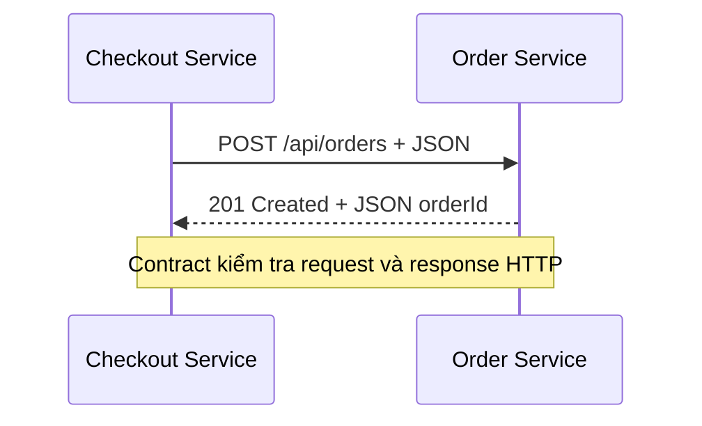
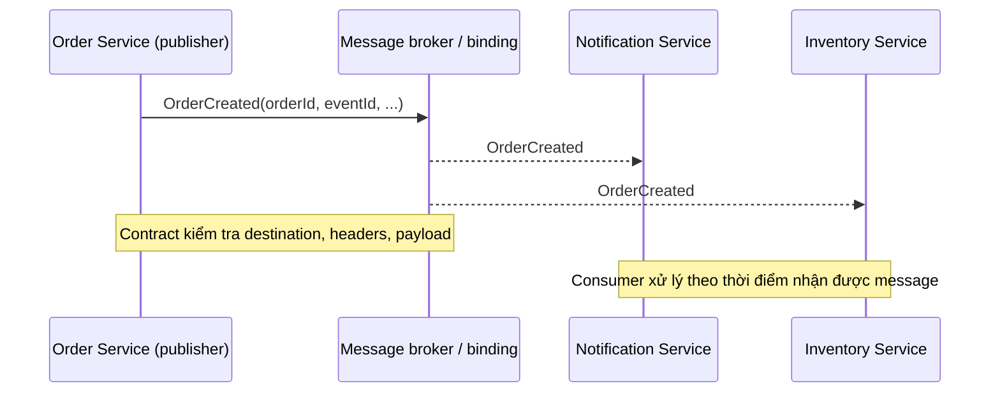
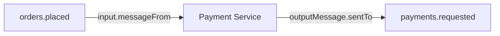
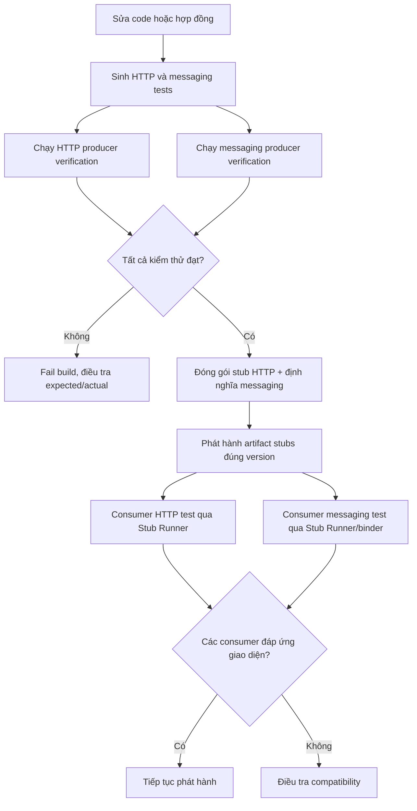

# Phân biệt hợp đồng thông điệp với hợp đồng HTTP

## 1. Bài toán: cùng một nghiệp vụ, hai cách giao tiếp

Trong hệ thống nhiều dịch vụ, một nghiệp vụ có thể bắt đầu bằng **HTTP request** và tiếp tục bằng **thông điệp (message)**. Ví dụ, khi người dùng tạo đơn hàng:

1. `Checkout Service` gọi HTTP `POST /api/orders` của `Order Service`.
2. `Order Service` trả về `201 Created` và mã đơn hàng.
3. Sau khi lưu đơn hàng thành công, `Order Service` phát sự kiện `OrderCreated` đến destination `orders.created`.
4. `Notification Service` hoặc `Inventory Service` nhận sự kiện để thực hiện phần việc riêng.

Hai bước giao tiếp này đều có **hợp đồng**, nhưng đối tượng và thời điểm cần kiểm tra khác nhau. Hợp đồng HTTP bảo vệ **request/response trên API**; hợp đồng thông điệp bảo vệ **dữ liệu được phát, nhận và cách định tuyến giữa các thành phần**.

**Spring Cloud Contract** hỗ trợ Groovy/YAML DSL để mô tả những tương tác đó, sinh kiểm thử phía producer, tạo stub cho consumer sử dụng qua **Stub Runner** và tích hợp vào CI nhằm phát hiện thay đổi không tương thích trước khi triển khai.

Sau bài học, bạn có thể:

1. Phân biệt hợp đồng HTTP và hợp đồng thông điệp qua **giao thức, cấu trúc DSL và kết quả kiểm thử**.
2. Hiểu các khối `request`, `response` so với `input`, `outputMessage`.
3. Viết hai dạng hợp đồng cho cùng nghiệp vụ bằng Groovy và YAML.
4. Giải thích `triggeredBy`, `messageFrom`, `sentTo`, `label`, headers và body.
5. Biết Stub Runner mô phỏng phản hồi HTTP khác với cách kích hoạt stub thông điệp.
6. Xác định những bảo đảm về retry, delivery, ordering và bảo mật mà contract test **không tự chứng minh**.

## 2. Bảng so sánh tổng quan

| Tiêu chí | Hợp đồng HTTP | Hợp đồng thông điệp |
| --- | --- | --- |
| Kiểu tương tác điển hình | Request–response | Phát sự kiện, command hoặc nhận message; thường bất đồng bộ |
| Điểm giao tiếp | HTTP endpoint: method + URL | Destination logic: topic, queue, channel hoặc binding |
| Khối DSL chính | `request` và `response` | `input` và `outputMessage` |
| Dữ liệu vào | Method, path, query, headers, request body | Method trigger hoặc message đến từ destination, body và headers |
| Dữ liệu ra | HTTP status, response headers, response body | Destination đầu ra, message headers và payload |
| Thành công/thất bại nhìn thấy | `2xx`, `4xx`, `5xx` cùng response đã định nghĩa | Message được phát/nhận đúng hợp đồng; không mặc nhiên có HTTP status |
| Kiểm thử producer | Gửi HTTP request, kiểm tra actual response | Kích hoạt nghiệp vụ hoặc gửi input message, quan sát output/điều kiện |
| Stub phía consumer | HTTP stub, thường qua WireMock | Stub messaging qua tích hợp messaging và các trigger/route |
| Vấn đề thời gian | Phản hồi của request HTTP | Thông điệp có thể đến sau, được xử lý độc lập hoặc theo lô |
| Rủi ro phổ biến | Sai status, URL, Content-Type, JSON field | Sai destination, event type, header, schema payload, phiên bản sự kiện |

**Đây là xu hướng thường gặp, không phải quy tắc tuyệt đối:** HTTP có thể trả `202 Accepted` và xử lý bất đồng bộ sau đó; hệ thống message cũng có thể triển khai mô hình request–reply với correlation ID. Sự khác biệt của **hợp đồng** là giao diện mà hai phía cam kết và cách Verifier/Stub Runner thực thi nó.

## 3. Đọc luồng đồng bộ và luồng sự kiện

### 3.1. HTTP: lời gọi và phản hồi trực tiếp



Consumer gửi request và nhận một HTTP response gắn với lời gọi đó. Nếu producer thay `201` thành `200`, xóa trường `orderId` hoặc đổi tên endpoint, hợp đồng HTTP có thể phát hiện khác biệt.

### 3.2. Messaging: phát sự kiện cho những consumer độc lập



Publisher không cần nhận ngay phản hồi nghiệp vụ từ từng subscriber. Việc broker chấp nhận message hoặc gửi **acknowledgement** ở tầng vận chuyển không đồng nghĩa subscriber đã xử lý nghiệp vụ thành công.

**Phân biệt:** `201 Created` là HTTP status của API tạo đơn; `OrderCreated` là **sự kiện nghiệp vụ**. Một producer có thể trả HTTP `201` đúng nhưng **không phát sự kiện** hoặc phát thiếu `orderId`. Vì vậy nếu cả hai giao diện đều quan trọng, cần **hai hợp đồng/nhóm kiểm thử** tương ứng.

## 4. Hợp đồng HTTP: `request` và `response`

Một hợp đồng Groovy DSL cho thao tác tạo đơn hàng:

```groovy
import org.springframework.cloud.contract.spec.Contract

Contract.make {
    description 'Tao don hang qua HTTP'

    request {
        method POST()
        url '/api/orders'
        headers {
            contentType(applicationJson())
        }
        body(
            customerId: 'C-7',
            items: [
                [sku: 'BOOK-01', quantity: 2]
            ]
        )
    }

    response {
        status CREATED()
        headers {
            contentType(applicationJson())
        }
        body(
            orderId: 42,
            status: 'CREATED'
        )
    }
}
```

Trong hợp đồng này:

- `request.method` và `request.url` mô tả cách consumer gọi API.
- `request.headers` và `request.body` mô tả đầu vào HTTP.
- `response.status`, `response.headers` và `response.body` mô tả phản hồi producer phải trả.

Khi chạy **producer verification**, test sinh ra gửi request vào ứng dụng thật và kiểm tra status, header, body. Khi chạy **consumer test**, HTTP stub trả response mẫu phù hợp với request được mô tả, thường qua WireMock trong Stub Runner.

Phiên bản YAML tương đương:

```yaml
description: Tao don hang qua HTTP
request:
  method: POST
  url: /api/orders
  headers:
    Content-Type: application/json
  body:
    customerId: "C-7"
    items:
      - sku: "BOOK-01"
        quantity: 2
response:
  status: 201
  headers:
    Content-Type: application/json
  body:
    orderId: 42
    status: "CREATED"
```

Đây là một tương tác ví dụ. Để test producer chạy được, ứng dụng test cần có dữ liệu/fixture phù hợp và plugin Spring Cloud Contract phải được cấu hình đúng phiên bản, test base class và test framework.

## 5. Hợp đồng thông điệp: `input` và `outputMessage`

Giả sử `Order Service` phát sự kiện khi đơn hàng `42` đã được tạo. Hợp đồng messaging Groovy DSL:

```groovy
import org.springframework.cloud.contract.spec.Contract

Contract.make {
    description 'Phat su kien OrderCreated sau khi luu don hang'
    label 'order_created'

    input {
        triggeredBy('createOrderAndPublish()')
    }

    outputMessage {
        sentTo('orders.created')
        body(
            eventType: 'OrderCreated',
            eventId: 'evt-42',
            orderId: 42,
            schemaVersion: 1
        )
        headers {
            header('eventType', 'OrderCreated')
        }
    }
}
```

Ý nghĩa:

| Thành phần DSL | Vai trò |
| --- | --- |
| `label 'order_created'` | Nhãn dùng để nhận diện/kích hoạt stub message trong những cấu hình Stub Runner phù hợp |
| `input.triggeredBy(...)` | Tên phương thức producer test gọi để kích hoạt nghiệp vụ phát message |
| `outputMessage.sentTo(...)` | Destination logic dự kiến nhận message đầu ra |
| `outputMessage.body(...)` | Payload được mong đợi: loại sự kiện, ID, dữ liệu nghiệp vụ, version |
| `outputMessage.headers { ... }` | Metadata của message được phát, ví dụ loại sự kiện hoặc correlation ID |

Hợp đồng trên không có `response.status`, vì **message không phải HTTP response**. Test producer sẽ gọi `createOrderAndPublish()`, rồi quan sát message được phát đến destination mà DSL mô tả.

### 5.1. YAML DSL cho trường hợp trigger bằng phương thức

Tương ứng với ví dụ trên, YAML có thể biểu diễn:

```yaml
description: Phat su kien OrderCreated sau khi luu don hang
label: order_created
input:
  triggeredBy: createOrderAndPublish()
outputMessage:
  sentTo: orders.created
  body:
    eventType: OrderCreated
    eventId: evt-42
    orderId: 42
    schemaVersion: 1
  headers:
    eventType: OrderCreated
```

Trong YAML, `input.triggeredBy`, `outputMessage.sentTo`, `outputMessage.body` và `outputMessage.headers` thể hiện đúng những khái niệm trên. Tương tự HTTP, YAML không thay thế được test base class, binder hoặc ứng dụng producer thực tế.

### 5.2. Sự khác biệt giữa `Content-Type` HTTP và message headers

Với HTTP, `Content-Type: application/json` nằm trong **HTTP request/response headers**.

Với messaging, `contentType` thường là **header của message** hoặc metadata của framework; broker hoặc binder có thể diễn giải khác nhau. Ví dụ:

```groovy
outputMessage {
    sentTo('orders.created')
    body(eventType: 'OrderCreated', orderId: 42)
    headers {
        messagingContentType(applicationJson())
        header('eventType', 'OrderCreated')
    }
}
```

Đây là một **đoạn bên trong hợp đồng**, không phải tệp Groovy đầy đủ. Một message có JSON payload vẫn không tự sinh ra HTTP status `200` hoặc `201`. Ngược lại, một HTTP response có header `Content-Type` không tự trở thành message trên broker.

## 6. Hai cách kích hoạt hợp đồng thông điệp

Khối `input` của messaging thường mô tả một trong hai dạng nguồn kích hoạt.

### 6.1. Phát message sau khi gọi một phương thức: `triggeredBy`

Các nghiệp vụ như scheduler, hoàn tất giao dịch hoặc ghi bản ghi vào database có thể kích hoạt phát message. Khi đó test có thể gọi một phương thức từ base test class:

```groovy
input {
    triggeredBy('createOrderAndPublish()')
}
```

`createOrderAndPublish()` **không phải tên endpoint hoặc queue**. Đây là phương thức Java/Groovy mà test phải gọi được để kích hoạt hành vi producer thực.

Một base test class minh họa:

```java
package com.example.order.contract;

import org.springframework.beans.factory.annotation.Autowired;
import org.springframework.boot.test.context.SpringBootTest;
import org.springframework.cloud.contract.verifier.messaging.boot.AutoConfigureMessageVerifier;

@SpringBootTest
@AutoConfigureMessageVerifier
public abstract class MessagingContractBase {

    @Autowired
    protected OrderApplicationService orderApplicationService;

    public void createOrderAndPublish() {
        orderApplicationService.createOrderAndPublish(42L);
    }
}
```

**Lưu ý:** `OrderApplicationService` và `createOrderAndPublish` là API minh họa, chưa tồn tại trong dự án trống. Base class thật cần chuẩn bị fixture và dependency phù hợp; phương thức không được để trống hoặc chỉ mock message cuối cùng nếu mục tiêu là xác minh publisher thực.

### 6.2. Phát message sau khi nhận một message khác: `messageFrom`

Ví dụ `Payment Service` nhận sự kiện `OrderPlaced` từ `orders.placed`, xử lý và phát `PaymentRequested` tới `payments.requested`:

```groovy
import org.springframework.cloud.contract.spec.Contract

Contract.make {
    description 'Xu ly message OrderPlaced va phat PaymentRequested'
    label 'payment_requested'

    input {
        messageFrom('orders.placed')
        messageBody(
            eventType: 'OrderPlaced',
            orderId: 42,
            amount: 125000
        )
        messageHeaders {
            header('eventType', 'OrderPlaced')
        }
    }

    outputMessage {
        sentTo('payments.requested')
        body(
            eventType: 'PaymentRequested',
            orderId: 42,
            amount: 125000
        )
        headers {
            header('eventType', 'PaymentRequested')
        }
    }
}
```

Trong trường hợp này, producer test cần **gửi message đầu vào** tới điểm tiếp nhận mà `messageFrom` mô tả, rồi quan sát **message đầu ra** theo `outputMessage`. Hệ thống test phải có listener và message transport/binder thích hợp.



**Phân biệt kỹ:**

- `messageFrom` là **đích đầu vào** mà test dùng để đưa một message vào ứng dụng.
- `messageBody` và `messageHeaders` là **dữ liệu của message nhận vào**.
- `sentTo` là **đích đầu ra** cần quan sát.
- `outputMessage.body` và `outputMessage.headers` là **dữ liệu message được phát ra**.

Trong các phiên bản Spring Cloud Contract, mức hỗ trợ chi tiết cho `messageFrom` và các thuộc tính input trong **YAML DSL** có thể khác nhau. Ví dụ `messageFrom` ở đây dùng Groovy DSL; nếu chuyển sang YAML, hãy kiểm tra YAML schema của phiên bản thư viện đã khóa trước khi áp dụng.

### 6.3. Một message đầu vào không nhất thiết tạo message đầu ra

Một consumer có thể nhận `OrderCreated` rồi cập nhật database mà **không** phát message tiếp. Trong trường hợp đó cần kiểm chứng **side effect** đã thỏa thuận. Spring Cloud Contract hỗ trợ cách gọi một assertion method như `assertThat` trong những dạng hợp đồng messaging; tuy nhiên phương thức cần được project triển khai và chỉ nên kiểm tra kết quả có thể quan sát được.

Không nên tạo một `outputMessage` giả chỉ để biến mọi hợp đồng messaging thành “request–response”. Nếu nghiệp vụ không phát ra message, hãy thiết kế kiểu assertion phù hợp và xem khả năng hỗ trợ của phiên bản DSL đang dùng.

## 7. Producer và consumer là ai trong mỗi kiểu giao tiếp?

### 7.1. Trong HTTP

- **Producer/provider:** dịch vụ sở hữu API, nhận request, tạo response (ví dụ `Order Service`).
- **Consumer/client:** dịch vụ gửi request tới API (ví dụ `Checkout Service`).

### 7.2. Trong messaging

- **Producer/publisher:** dịch vụ phát message `OrderCreated` (ví dụ `Order Service`).
- **Consumer/subscriber:** dịch vụ nhận message (ví dụ `Inventory Service`).

Với một hệ thống vừa **nhận message A** vừa **phát message B**, một dịch vụ có thể là consumer của A và producer của B. Hãy xác định vai trò **theo từng tương tác**, không gán cố định cho cả microservice.

Điều này đặc biệt quan trọng khi lập hợp đồng: ai sở hữu schema event? Ai chịu trách nhiệm phát đúng destination? Consumer nào cần các trường bắt buộc? Ai chạy verification? Trong kiểm thử phía publisher, producer thường phải chứng minh message thực thỏa cam kết; phía subscriber phải chứng minh ứng dụng xử lý được các dữ liệu hợp lệ từ stub.

## 8. Phân biệt đường dẫn HTTP với destination messaging

**HTTP URL** như `/api/orders/42` bao gồm đường dẫn cho resource; cùng HTTP method và các điều kiện khác để quyết định endpoint.

**Message destination** như `orders.created` là một **địa chỉ logic** để gửi/nhận thông điệp. Nó có thể được ánh xạ tới topic, queue, channel, binding hoặc thành phần integration. Tên mà `sentTo`/`messageFrom` tham chiếu phụ thuộc cơ chế messaging:

- Với **Spring Cloud Stream/Spring Integration**, framework có thể giải quyết tên destination hoặc channel.
- Với **Spring JMS**, đó có thể là queue hoặc topic theo cấu hình.
- Với **Apache Camel**, destination có thể là một endpoint URI như `jms:...`.

Vì vậy, đừng hiểu `sentTo('orders.created')` tự tạo một Kafka topic hoặc RabbitMQ queue ở mọi môi trường. Cần cấu hình ứng dụng, binder và test message verifier sao cho các tên tương ứng.

Một hợp đồng có destination đúng về mặt chuỗi nhưng ứng dụng được cấu hình phát ra binding khác vẫn phải bị phát hiện bởi producer verification. Nếu test chỉ mock `send(...)` rồi khẳng định nó được gọi, có thể không kiểm tra được mapping cuối cùng ra broker.

## 9. Payload và headers: cùng JSON nhưng khác ngữ nghĩa

Trong HTTP, status code và headers có thể chỉ rõ kết quả request và media type. Trong messaging, envelope và headers thường mang những thông tin như:

| Trường/header | Ví dụ | Lý do consumer cần |
| --- | --- | --- |
| `eventType` | `OrderCreated` | Chọn handler đúng |
| `schemaVersion` | `1` | Chọn cách diễn giải payload |
| `eventId` | `evt-42` | Nhận diện event, phục vụ idempotency |
| `orderId` | `42` | Liên kết đến đơn hàng |
| `occurredAt` | Chuỗi thời gian ISO-8601 | Hiểu thời điểm nghiệp vụ xảy ra |
| `correlationId` | `corr-77` | Theo dõi xuyên các bước xử lý |
| `contentType` | `application/json` | Giải mã payload theo đúng định dạng |

Ví dụ message:

```json
{
  "eventType": "OrderCreated",
  "schemaVersion": 1,
  "eventId": "evt-42",
  "orderId": 42,
  "customerId": "C-7",
  "items": [
    {"sku": "BOOK-01", "quantity": 2}
  ]
}
```

Một message có thể chứa JSON giống body HTTP, nhưng ý nghĩa khác nhau:

- HTTP response cho biết **kết quả của lời gọi hiện tại**.
- Event thông báo **một sự kiện đã xảy ra**, có thể được xử lý ở thời điểm khác và bởi nhiều subscriber.

Nếu một message đại diện cho **command** (`ReserveInventory`) chứ không phải event (`InventoryReserved`), tên và nội dung phải diễn đạt đúng hành động được yêu cầu so với sự kiện đã hoàn tất. Không đặt tên event ở thì quá khứ nếu hành động thực tế chưa xảy ra.

## 10. Kiểm thử producer được sinh khác nhau như thế nào?

### 10.1. Với HTTP

Spring Cloud Contract Verifier có thể sinh test (tùy mode) dùng MockMvc hoặc REST Assured:

1. Gửi `POST /api/orders` với request body cụ thể.
2. Nhận HTTP response từ controller/serializer thật.
3. Kiểm tra status `201`, `Content-Type` và các trường JSON.

### 10.2. Với messaging

Kiểm thử messaging được sinh cần:

1. Gọi phương thức `triggeredBy` **hoặc** gửi message theo `messageFrom`.
2. Theo dõi message producer phát ra, hoặc gọi assertion method được hợp đồng khai báo.
3. Kiểm tra `sentTo`, headers, payload và các matcher liên quan.

Hai dạng kiểm thử có thể dùng **test base class khác nhau**. HTTP base chuẩn bị MockMvc và fixture API; messaging base chuẩn bị `@AutoConfigureMessageVerifier`, message binder/test transport và phương thức trigger khi cần.

Ví dụ khai báo phần annotation của test base messaging:

```java
@SpringBootTest
@AutoConfigureMessageVerifier
public abstract class MessagingContractBase {
    // Trigger method, fixture và setup transport do dự án định nghĩa.
}
```

Đây là khung minh họa, chưa phải class chạy độc lập. Với Spring Cloud Stream, có thể cần `spring-cloud-stream-test-binder` ở test scope để kiểm tra message mà không cần broker thật, tùy phiên bản và cách tích hợp. Với các hệ thống khác (Spring Integration, Spring JMS, Camel), lựa chọn message verifier và transport khác nhau.

**Contract test messaging không tự tạo broker, queue hay topic.** Nếu ứng dụng test không có cơ chế nhận/phát/quan sát message, test sẽ thất bại hoặc không kiểm tra được đúng nội dung.

## 11. Stub Runner khác nhau giữa HTTP và messaging

### 11.1. HTTP stubs

Trong HTTP, stub thường là các mapping cho request và response. Consumer gọi HTTP client của mình tới Stub Runner/WireMock; stub khớp method, URL, headers, body và trả JSON/status mẫu.

### 11.2. Messaging stubs

Trong messaging, Stub Runner dùng định nghĩa hợp đồng cùng tích hợp transport thích hợp để thiết lập các tuyến stub và phát message. Với hợp đồng có `label`, consumer test có thể kích hoạt message bằng `StubTrigger` hoặc `StubFinder`.

Ví dụ ý tưởng trong consumer test:

```java
@Autowired
private StubTrigger stubTrigger;

@Test
void handlesOrderCreated() {
    boolean triggered = stubTrigger.trigger("order_created");
    assertThat(triggered).isTrue();

    // Sau đó chờ/quan sát consumer xử lý event trong thời hạn xác định.
    // Các assertion cụ thể phụ thuộc ứng dụng và test binder.
}
```

Mã trên là **trích đoạn minh họa**, cần cấu hình `@AutoConfigureStubRunner`, stub artifact có label tương ứng, framework messaging và assertion library. `trigger()` thành công cho biết stub đã được kích hoạt; chưa chứng minh consumer hoàn tất xử lý nếu chưa có assertion về hậu quả xử lý message.

**Điểm khác biệt quan trọng:** HTTP stub thường *trả một response cho lời gọi*; messaging stub có thể *phát một event vào binding để subscriber nhận*. Đừng cố dùng WireMock HTTP mapping như một message broker nếu producer/consumer thật giao tiếp qua messaging.

## 12. Xử lý bất đồng bộ và điều kiện thời gian

HTTP contract test có thể kiểm tra response ngay sau lời gọi. Messaging test thường cần chờ message được phát hoặc được consumer xử lý.

Điều này dẫn tới ba bẫy:

1. **Kiểm tra quá sớm:** assertion chạy trước khi listener xử lý message, gây test đỏ không ổn định.
2. **Chờ vô hạn:** test treo khi message sai destination hoặc subscriber không nhận được.
3. **Dùng thời gian ngủ cố định:** `Thread.sleep(...)` có thể quá ngắn trên CI chậm hoặc làm test chậm không cần thiết.

Nên có **timeout có giới hạn** và cơ chế chờ theo điều kiện, ví dụ dùng Awaitility ở test consumer:

```java
await()
    .atMost(Duration.ofSeconds(5))
    .untilAsserted(() ->
        assertThat(notificationRepository.existsForOrder(42L)).isTrue()
    );
```

Đoạn Java là phần của một test cần import/bean thích hợp; nó kiểm tra kết quả xử lý của consumer trong thời hạn 5 giây. Timeout là **ví dụ**, không phải giá trị bắt buộc của mọi broker hoặc mọi pipeline.

**Phải tách hai khái niệm:** producer *đã phát đúng message* và consumer *đã xử lý message*. Một test chỉ quan sát output của publisher không thay thế test hành vi của subscriber.

## 13. Những vấn đề messaging mà một hợp đồng payload không tự đảm bảo

| Vấn đề | Tại sao quan trọng? | Cần kiểm thử bổ sung |
| --- | --- | --- |
| **At-least-once delivery** | Message có thể được gửi/nhận lại | Consumer idempotency, duplicate event |
| **Ordering** | Nhiều event có thể đến lệch thứ tự | Logic version/sequence và partition semantics |
| **Retry/backoff** | Xử lý thất bại có thể được chạy lại | Retry policy, DLQ, poison message |
| **Durability** | Message cần tồn tại khi consumer tạm ngừng | Broker persistence, retention và recovery |
| **Transaction boundary** | DB commit và publish có thể lệch nhau | Outbox/transactional messaging test |
| **Security** | Broker ACL và topic access khác HTTP authentication | Integration test về quyền và cấu hình broker |
| **Schema evolution** | Consumer cũ vẫn phải hiểu event mới | Contract versioning và compatibility test |
| **Observability** | Khó theo dõi một event qua nhiều dịch vụ | Correlation ID, trace propagation và log |

Spring Cloud Contract giúp kiểm chứng **nội dung, header và tương tác được mô tả**, không mặc nhiên xác minh giao hàng **exactly-once**, phân vùng Kafka, thời gian retry hay broker cluster thật. Các bảo đảm này cần kiểm thử integration, failure injection hoặc E2E phù hợp.

### 13.1. Vì sao `eventId` và idempotency cần được quan tâm?

Trong hệ thống có at-least-once delivery, consumer có thể nhận hai bản sao của `OrderCreated`. Nếu mỗi lần nhận đều trừ tồn kho, đơn hàng có thể bị trừ hai lần. Event nên có định danh ổn định như `eventId`; consumer phải có cơ chế nhận diện event đã xử lý theo chính sách của mình.

Hợp đồng có thể yêu cầu `eventId` tồn tại và đúng định dạng, nhưng **không tự chứng minh** consumer đang chống xử lý trùng. Cần thêm test gửi cùng event hai lần và kiểm tra chỉ phát sinh tác động nghiệp vụ được phép.

### 13.2. Thời gian không phải lúc nào cũng là nghĩa vụ hợp đồng

`occurredAt` có thể là thời điểm nghiệp vụ xảy ra; `publishedAt` là thời điểm gửi message; `receivedAt` là thời điểm consumer nhận. Nếu chúng được sử dụng để tính SLA hoặc thứ tự nghiệp vụ, phải phân biệt. Đừng khóa cả ba vào một timestamp cố định khi producer có quyền sinh giá trị động theo format đã cam kết.

## 14. Thay đổi nào tương thích, thay đổi nào nguy hiểm?

### 14.1. HTTP

| Thay đổi | Tác động có thể xảy ra |
| --- | --- |
| Đổi `POST /api/orders` thành `POST /v2/orders` | Consumer cũ gọi URL cũ có thể lỗi |
| Xóa `response.body.orderId` | Consumer không còn đọc được ID |
| Đổi `201` thành `202` | Consumer có thể hiểu sai trạng thái hoàn thành |
| Thêm trường JSON mới | Thường an toàn nếu consumer bỏ qua field thừa |

### 14.2. Messaging

| Thay đổi | Tác động có thể xảy ra |
| --- | --- |
| Đổi destination `orders.created` thành `order.events` | Subscriber có thể không nhận event |
| Đổi `eventType` từ `OrderCreated` thành `OrderPlaced` | Consumer có thể không nhận diện handler |
| Đổi `orderId` từ number sang string | Consumer DTO/parser có thể lỗi |
| Xóa `eventId` | Consumer mất khả năng nhận diện duplicate |
| Thêm trường tùy chọn có default rõ ràng | Có thể tương thích nếu consumer cũ bỏ qua |
| Đổi ý nghĩa `occurredAt` nhưng giữ tên | Nguy hiểm vì lỗi ngữ nghĩa khó phát hiện bằng schema |

**Một thay đổi nhìn có vẻ không phá schema vẫn có thể phá nghiệp vụ.** Ví dụ cùng trường `status` nhưng từ “đơn đã được lưu” thành “đơn đã được thanh toán” là thay đổi ý nghĩa. Hợp đồng cần mô tả hành vi mà consumer thật sự phụ thuộc, còn những ràng buộc nghiệp vụ sâu hơn có thể được bổ sung bằng kiểm thử riêng.

## 15. Thiết kế version cho HTTP API và sự kiện

Đối với HTTP, nhóm có thể version trong URL, header hoặc media type tùy chính sách API. Khi thay đổi không tương thích, consumer cũ và mới có thể dùng những phiên bản riêng trong giai đoạn chuyển đổi.

Đối với messaging, cần cân nhắc:

- Version của **schema** event (ví dụ `schemaVersion: 1`) và version artifact/stub.
- Khả năng consumer cũ xử lý message có trường mới.
- Có cần topic/destination riêng cho sự kiện không tương thích hay giữ event type với version rõ ràng.
- Khả năng đọc lại event cũ từ broker hoặc event store.

**`schemaVersion` trong payload không thay thế version của thư viện Spring Cloud Contract, cũng không thay thế artifact version của producer.** Chúng phục vụ những mục đích khác nhau: phiên bản giao diện dữ liệu, phiên bản công cụ và phiên bản gói triển khai.

Khi dùng Avro, Protobuf hoặc JSON Schema, một hợp đồng message cần đi cùng chiến lược schema registry/compatibility nếu hệ thống áp dụng. Spring Cloud Contract không tự thay thế mọi kiểm tra tiến hóa schema do công cụ đó thực hiện.

## 16. Quy trình CI kết hợp HTTP và messaging

Một producer có cả hai giao diện nên tổ chức pipeline cho cả hai nhóm kiểm thử:



Checklist triển khai:

1. **Lưu hợp đồng theo nhóm rõ ràng**: HTTP endpoint và event/message; không trộn test base class vô tình.
2. **Dùng đúng plugin và dependency** tương thích với Spring Boot/Spring Cloud; cấu hình test base class và message verifier.
3. **Chuẩn bị fixture và binding test**: HTTP data fixture và message listener/publisher phù hợp.
4. **Chạy cả hai nhóm producer tests**: kiểm tra test thật sự được sinh/chạy, không bị skip.
5. **Phát hành stub sau khi producer verification pass**: không xem file stub được tạo là đủ bằng chứng.
6. **Consumer test bằng client/handler thực**: HTTP client gửi request, message subscriber nhận event.
7. **Kiểm tra thay đổi tương thích**: status/URL/body đối với HTTP; destination/event type/headers/payload đối với messaging.
8. **Giữ integration/E2E tests** cho broker thật, security, retry, DLQ, thứ tự và vận hành.

Đối với consumer messaging, có thể cần thêm dependency test như `spring-cloud-stream-test-binder` khi sử dụng Spring Cloud Stream. Việc mapping tên destination và cơ chế Stub Runner khác nhau theo framework/phiên bản, nên phải kiểm tra tài liệu và cấu hình thực tế của project.

## 17. Những lỗi thường gặp khi nhầm hai loại hợp đồng

| Triệu chứng | Nguyên nhân có thể | Cách xử lý |
| --- | --- | --- |
| Dùng `request/response` để kiểm tra event | Nhầm message với HTTP response | Viết `input/outputMessage` cho message |
| Tìm HTTP status `200` từ `outputMessage` | Message không mặc nhiên có HTTP status | Kiểm tra destination, header, payload, result xử lý |
| Producer HTTP test xanh nhưng subscriber không nhận event | Chỉ kiểm tra endpoint, chưa có messaging contract | Bổ sung test publisher và consumer message |
| `triggeredBy` không hoạt động | Thiếu phương thức trong base class hoặc không phát message thật | Triển khai trigger và kiểm tra application context |
| Message gửi sai đích | Binding/destination ánh xạ không đúng | Kiểm tra `sentTo`, binder và cấu hình định tuyến |
| Producer test không thấy message | Message verifier/binder thiếu hoặc listener chưa sẵn sàng | Cấu hình `@AutoConfigureMessageVerifier` và test transport |
| Stub Runner chạy nhưng không phát message | Thiếu label/tích hợp messaging hoặc dùng sai stub version | Kiểm tra `StubTrigger`, artifact, binder và mapping |
| JSON đúng nhưng event vẫn không được xử lý | Header `eventType`, routing key hoặc version khác | Kiểm tra cả headers và nội dung |
| Test messaging thỉnh thoảng fail trên CI | Race condition, timeout quá ngắn | Chờ theo điều kiện, có timeout hữu hạn |
| Consumer xử lý một event hai lần | Broker có thể gửi lại, consumer không idempotent | Test duplicate và cơ chế deduplication |

### 17.1. Trường hợp “đúng payload nhưng sai destination”

Một thông điệp có đầy đủ `orderId`, `eventId`, `eventType` vẫn vô dụng nếu bị phát tới destination khác nơi consumer đang subscribe. Vì vậy **`sentTo` cũng là một phần của giao diện**, không chỉ body JSON.

### 17.2. Trường hợp “producer test pass nhưng consumer fail”

Producer có thể phát message hợp lệ theo hợp đồng, nhưng subscriber deserialize sai, bỏ qua header hoặc không hiểu một trạng thái. Consumer test bằng message stub phải kiểm tra **logic thực của subscriber**, không chỉ rằng message được gửi vào một channel.

### 17.3. Trường hợp “consumer test pass nhưng producer không thực sự phát”

Stub có thể tự phát event `OrderCreated` khi test gọi `trigger('order_created')`, trong khi implementation `Order Service` đã vô tình bỏ lệnh publish. Chỉ **producer verification** trên code hiện tại mới trực tiếp kiểm tra nghĩa vụ phát event.

## 18. Bài thực hành: chọn đúng loại hợp đồng

Xét bốn yêu cầu:

**A.** `Checkout Service` gọi `POST /api/orders`, nhận HTTP `201` và `orderId`.

**B.** `Order Service` sau khi tạo đơn phát `OrderCreated` tới `orders.created`.

**C.** `Inventory Service` nhận `OrderCreated`, sau đó ghi một bản ghi giữ tồn kho vào database; không phát message khác.

**D.** `Payment Service` nhận `PaymentRequested` trên `payments.requested` và phát `PaymentAuthorized` tới `payments.authorized`.

### 18.1. Câu hỏi

1. Chọn loại hợp đồng cho A–D và giải thích vì sao.
2. Với B, viết khối `input` và `outputMessage`; producer test cần chuẩn bị gì?
3. Với C, vì sao không nên tạo một `response.status: 200` hoặc một `outputMessage` giả?
4. Với D, phân biệt `messageFrom`, `messageBody`, `messageHeaders`, `sentTo`.
5. Những điều gì xảy ra nếu B phát hai lần cùng event? Hợp đồng body đã đủ bảo vệ consumer chưa?
6. Nếu HTTP A trả `201` đúng nhưng event B thiếu `orderId`, pipeline nên hành động thế nào?

### 18.2. Gợi ý đáp án

| Tình huống | Loại hợp đồng phù hợp | Điều cần bảo vệ |
| --- | --- | --- |
| A | HTTP `request/response` | Method, URL, JSON request, `201`, body response |
| B | Messaging `input.triggeredBy/outputMessage` | Trigger thật, `orders.created`, payload và headers |
| C | Messaging input + assertion/kiểm thử side effect phù hợp | Message nhận vào và bản ghi được tạo; không giả lập output không tồn tại |
| D | Messaging `input.messageFrom/outputMessage` | Destination đầu vào/đầu ra và schema hai message |

Với B, base class phải có phương thức trigger gọi nghiệp vụ thực, cùng message verifier/binder. Với C, kiểm thử cần quan sát tác động nghiệp vụ theo cách framework và phiên bản hỗ trợ. Với D, input ghi **message nhận vào**, output ghi **message được phát**. Với câu 5, cần kiểm thử idempotency riêng vì hợp đồng payload không tự bảo đảm không xử lý trùng. Với câu 6, producer verification của nhóm messaging phải làm build thất bại hoặc chặn phát hành stub nếu event không đáp ứng hợp đồng.

## 19. Checklist trước khi review một message contract

- Hợp đồng đang mô tả **HTTP** hay **messaging**, và khối DSL đã chọn đúng?
- Nếu messaging, đã xác định ai là publisher, ai là subscriber và destination logic là gì?
- `input` dùng `triggeredBy` hay `messageFrom` theo đúng nguồn kích hoạt?
- `outputMessage.sentTo`, payload, `eventType` và headers đã phản ánh nhu cầu consumer?
- Có version/format dữ liệu rõ ràng và chiến lược xử lý trường tùy chọn hoặc trường mới?
- Test base có trigger thật, `@AutoConfigureMessageVerifier` và hạ tầng message cần thiết?
- Producer tests có kiểm tra message thực, consumer tests có xác minh subscriber xử lý đúng?
- Stub Runner có nhận đúng artifact, label và cấu hình transport/binder?
- Có thêm kiểm thử cho duplicate, retry, DLQ, ordering và broker security ngoài hợp đồng khi cần?
- CI có chạy cả HTTP và messaging verification trước khi phát hành stub?

**Tài liệu chính thức nên tham khảo theo phiên bản dự án:**

- [Spring Cloud Contract — HTTP Contracts](https://docs.spring.io/spring-cloud-contract/reference/project-features-contract/http.html).
- [Spring Cloud Contract — Messaging](https://docs.spring.io/spring-cloud-contract/reference/project-features-messaging.html).
- [Spring Cloud Contract — YAML Schema](https://docs.spring.io/spring-cloud-contract/reference/yml-schema.html).
- [Spring Cloud Contract — Stub Runner](https://docs.spring.io/spring-cloud-contract/reference/project-features-stubrunner.html).

**Ghi nhớ:** Hợp đồng HTTP mô tả **`request` → `response`** của một API; hợp đồng thông điệp mô tả **`input` → `outputMessage`** hoặc điều kiện xử lý message trong luồng sự kiện. Với Spring Cloud Contract, cả hai có thể được kiểm chứng ở phía producer và mô phỏng cho consumer, nhưng **không dùng chung cách kích hoạt, cách theo dõi kết quả hay bảo đảm delivery**. Một hệ thống tạo đơn qua HTTP rồi phát `OrderCreated` cần bảo vệ **cả hai giao diện** và bổ sung integration tests cho những tính chất vận hành mà contract testing không tự xác minh.
