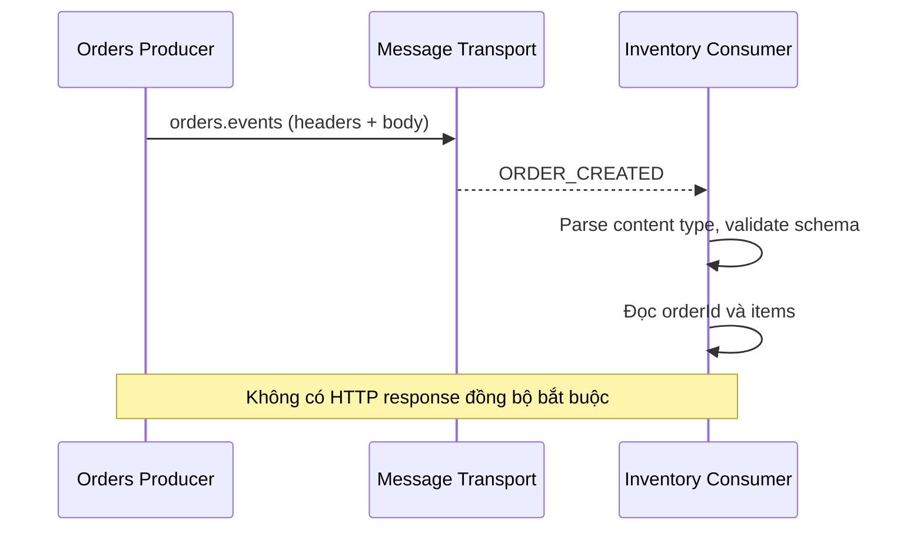
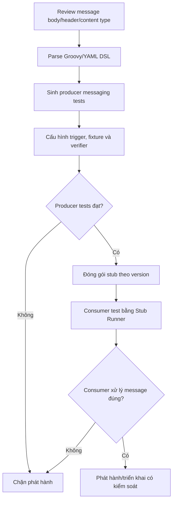

# Body, header và content type của thông điệp

## 1. Vì sao phải mô tả cả body, header và content type?

Trong **Spring Cloud Contract** (module `SPRING_CLOUD_CONTRACT`), hợp đồng là mô tả hành vi được thống nhất giữa **producer** và **consumer**. Ngoài hợp đồng HTTP, framework còn hỗ trợ **hợp đồng thông điệp (messaging contracts)** bằng **Groovy DSL** hoặc **YAML DSL**. Từ hợp đồng, Contract Verifier có thể sinh producer tests để quan sát message thật, tạo stub cho consumer dùng thông qua **Stub Runner**, và tích hợp vào CI nhằm phát hiện thay đổi không tương thích.

Với messaging, chỉ biết “có một message được gửi” chưa đủ. Consumer cần biết **nhận message ở đâu, diễn giải dữ liệu thế nào và dựa vào metadata nào**:

- **Body/payload**: dữ liệu nghiệp vụ, chẳng hạn `orderId`, `items`, `eventType`.
- **Header**: metadata gắn với message, chẳng hạn `correlationId`, `eventType` hoặc `schemaVersion` nếu được hệ thống quy định.
- **Content type**: định dạng được khai báo để công cụ chuyển đổi/consumer biết cách diễn giải body, ví dụ `application/json`.
- **Destination**: channel, topic, queue hoặc điểm đến mà message được phát tới; trong DSL thường nằm ở `sentTo(...)`.

Giả sử Orders Service gửi message sau khi tạo đơn:

```text
Destination: orders.events
Headers:
  contentType   = application/json
  eventType     = ORDER_CREATED
  correlationId = corr-1001
Body:
  {
    "orderId": "ord-1001",
    "items": [{"productId": "SKU-001", "quantity": 2}]
  }
```

Nếu producer đổi `orderId` thành `id`, consumer cũ có thể không tìm thấy đơn cần xử lý. Nếu bỏ `eventType`, consumer có thể không chọn được nhánh xử lý. Nếu body chứa JSON nhưng content type lại ghi `text/plain`, message converter có thể diễn giải payload khác mong đợi. **Ba phần này liên quan nhưng không thay thế nhau.**

Mục tiêu bài học là thiết kế và kiểm chứng body, header và content type cho cả **message đầu vào** lẫn **message đầu ra**, nhận diện các giới hạn của converter/broker, và xây dựng producer-consumer tests có thể chạy lặp lại trong CI.

## 2. So sánh message với HTTP request/response

Message trong Spring Cloud Contract không nhất thiết có “response” giống một HTTP request. Một message có thể được phát theo sự kiện, được broker chuyển tiếp và được consumer xử lý bất đồng bộ.

| Góc nhìn | HTTP contract | Messaging contract |
| --- | --- | --- |
| Đầu vào | `request.method`, `url`, `headers`, `body` | `input.triggeredBy` hoặc `input.messageFrom`, `messageBody`, `messageHeaders` |
| Đầu ra | `response.status`, `headers`, `body` | `outputMessage.sentTo`, `body`, `headers` |
| Mã trạng thái | `200`, `201`, `400`, `409`... | Không có HTTP status bắt buộc; kết quả có thể nằm trong payload hoặc message khác |
| Định dạng nội dung | HTTP `Content-Type` header | Message content type do ứng dụng/binder/converter xử lý |
| Kiểm thử producer | Gọi endpoint thật, assert HTTP response | Kích hoạt producer hoặc đưa message đầu vào rồi quan sát message đầu ra |
| Consumer stub | Stub HTTP trả response | Stub Runner kích hoạt/phát message qua messaging integration thích hợp |

Với HTTP, `response.status 200` là mã giao thức. Với messaging, trường `status: 'RESERVED'` trong JSON payload chỉ là **trạng thái nghiệp vụ**. Không nên viết `response.status` vào một hợp đồng event để mô tả kết quả xử lý message.

### 2.1. Luồng sự kiện mẫu



Sơ đồ mô tả luồng logic, không cam kết broker sẽ giao message **đúng một lần**, theo một thứ tự toàn cục hoặc trong thời gian cố định. Những tính chất đó thuộc thiết kế transport, retry và idempotency, cần kiểm thử riêng.

## 3. Cấu trúc Groovy DSL cho message được phát

Một message **đầu ra** do producer phát có thể được mô tả như sau:

```groovy
import org.springframework.cloud.contract.spec.Contract

Contract.make {
    name 'order_created_event'
    label 'order_created'
    description 'Phát sự kiện sau khi tạo đơn thành công'

    input {
        triggeredBy('publishOrderCreated()')
    }

    outputMessage {
        sentTo('orders.events')
        body([
            eventType: 'ORDER_CREATED',
            orderId  : 'ord-1001',
            items    : [
                [productId: 'SKU-001', quantity: 2]
            ]
        ])
        headers {
            header('eventType', 'ORDER_CREATED')
            header('correlationId', 'corr-1001')
            messagingContentType(applicationJson())
        }
    }
}
```

**Cách đọc từng khối:**

1. `name` nhận diện hợp đồng; `label` đặt tên kịch bản để consumer test có thể yêu cầu Stub Runner kích hoạt.
2. `input.triggeredBy('publishOrderCreated()')` yêu cầu producer test gọi phương thức kích hoạt do nhóm **tự hiện thực** trong test base.
3. `outputMessage.sentTo('orders.events')` xác định destination mà producer cần phát message tới.
4. `outputMessage.body([...])` mô tả payload nghiệp vụ.
5. `outputMessage.headers` ràng buộc các metadata mà consumer cần, trong đó `messagingContentType(applicationJson())` khai báo content type cho message.

**Lưu ý:** `publishOrderCreated()` không phải hàm có sẵn của Spring Cloud Contract. Test base phải gọi vào **logic producer thật** để phát event. Chỉ tạo thủ công một message đúng payload rồi đẩy thẳng vào bộ kiểm chứng có thể che giấu lỗi của producer.

Trong ví dụ, `eventType` được đặt ở cả **body** và **header** để minh họa hai vị trí. Ở một hệ thống thực, nhóm có thể chọn một vị trí làm nguồn sự thật, hoặc quy định cả hai phải tồn tại và đồng nhất. Không nên yêu cầu cùng một giá trị ở hai nơi nếu consumer không dùng và producer không công bố cam kết đó.

## 4. Cùng một hợp đồng bằng YAML DSL

Biểu diễn YAML tương ứng:

```yaml
name: order_created_event
description: Phát sự kiện sau khi tạo đơn thành công
label: order_created
input:
  triggeredBy: publishOrderCreated()
outputMessage:
  sentTo: orders.events
  body:
    eventType: ORDER_CREATED
    orderId: ord-1001
    items:
      - productId: SKU-001
        quantity: 2
  headers:
    eventType: ORDER_CREATED
    correlationId: corr-1001
    contentType: application/json
```

Trong **YAML DSL**, `outputMessage.headers.contentType: application/json` biểu diễn content type. Trong **Groovy DSL**, ví dụ trên sử dụng `messagingContentType(applicationJson())` nằm trong `outputMessage.headers`. Không nên thay nó bằng `response.headers.contentType(...)` của HTTP contract.

Hai ví dụ Groovy và YAML mô tả **cùng một kịch bản**. Khi đưa vào dự án, chọn một định dạng để tránh plugin quét cả hai và sinh những kiểm thử/stub trùng lặp.

### 4.1. Phân biệt metadata hợp đồng với message headers

| Tên trong DSL | Ví dụ | Vai trò |
| --- | --- | --- |
| `name` | `order_created_event` | Định danh case trong test/contract |
| `description` | Chuỗi giải thích hành vi | Tài liệu cho người đọc |
| `label` | `order_created` | Nhãn kích hoạt kịch bản stub khi được hỗ trợ |
| `sentTo` | `orders.events` | Destination đầu ra |
| `body.eventType` | `ORDER_CREATED` | Dữ liệu trong payload |
| `headers.eventType` | `ORDER_CREATED` | Header thực sự nằm trong message |
| `headers.contentType` | `application/json` | Metadata về định dạng payload |

Đổi `name` hoặc `label` không tự tạo ra header trong message thực tế. Tương tự, khai báo `eventType` trong body **không tự thêm header `eventType`**, trừ khi chính producer/converter được viết để thực hiện việc đó.

## 5. Body: cấu trúc dữ liệu mà consumer thật sự sử dụng

`outputMessage.body` là nội dung payload được producer phát ra. Với JSON, có thể mô tả body bằng cấu trúc map/list:

```groovy
body([
    orderId: 'ord-1001',
    customer: [
        id: 'customer-001'
    ],
    items: [
        [productId: 'SKU-001', quantity: 2],
        [productId: 'SKU-002', quantity: 1]
    ],
    totalAmount: 150000
])
```

Cách diễn đạt này giúp người đọc nhận ra:

- `orderId` và `customer.id` là chuỗi.
- `items` là danh sách object.
- `quantity` và `totalAmount` là các giá trị số.
- `customer` là object lồng nhau.

Consumer sẽ có rủi ro khi producer **xóa trường**, **đổi kiểu**, **đổi tên** hoặc **đổi ý nghĩa** mà consumer đang phụ thuộc.

### 5.1. Body dạng chuỗi JSON

Một hợp đồng cũng có thể biểu diễn body là chuỗi JSON:

```groovy
body('''{
  "eventType": "ORDER_CREATED",
  "orderId": "ord-1001",
  "items": [
    {"productId": "SKU-001", "quantity": 2}
  ]
}''')
```

Điều cần phân biệt:

1. **DSL body dạng map/list** là dữ liệu cấu trúc trong mô hình hợp đồng.
2. **DSL body dạng chuỗi JSON** là văn bản biểu diễn JSON.
3. **Message thật trên transport** có thể chứa `String`, `byte[]`, object, hoặc một kiểu payload do converter quản lý.

Không tự suy rằng một map trong DSL luôn được phát lên Kafka dưới dạng một chuỗi UTF-8 JSON cụ thể. Điều đó phụ thuộc **message converter/serializer** và cấu hình transport. Ngược lại, một chuỗi nhìn giống JSON chưa chắc được consumer deserialize như JSON nếu content type hoặc converter không phù hợp.

### 5.2. Chọn trường bắt buộc và trường tùy chọn

| Trường | Vai trò ví dụ | Tác động nếu thay đổi |
| --- | --- | --- |
| `orderId` | Khóa liên kết đến đơn hàng | Consumer không biết xử lý đơn nào |
| `eventType` | Xác định loại sự kiện | Không chọn đúng nhánh xử lý |
| `items[].productId` | Xác định sản phẩm | Không cập nhật đúng hàng |
| `items[].quantity` | Số lượng được yêu cầu | Có thể giữ/trừ kho sai |
| `occurredAt` | Thời điểm sự kiện | Phải xác định định dạng, múi giờ và nullability |
| `notes` | Ghi chú tùy chọn | Có thể thêm mà không phá consumer dung thứ trường lạ |

Một **trường tùy chọn** không có nghĩa được phép đổi ngữ nghĩa tùy tiện. Nếu consumer thực tế vẫn dựa vào `notes`, thay đổi kiểu dữ liệu có thể gây lỗi. Quyết định bắt buộc/tùy chọn cần được thống nhất ở schema và consumer expectations, không chỉ ở tên trường.

### 5.3. Ba trạng thái khác nhau: thiếu, null, rỗng

Ví dụ payload:

```json
{"orderId": "ord-1001"}
```

```json
{"orderId": "ord-1001", "notes": null}
```

```json
{"orderId": "ord-1001", "notes": ""}
```

Các trường hợp này có thể khiến consumer hoạt động khác nhau. Việc Spring Cloud Contract kiểm tra một ví dụ cụ thể không tự quyết định toàn bộ quy tắc nullability. Khi yêu cầu chặt về kiểu/trường bắt buộc, nên bổ sung JSON Schema, Avro/Protobuf schema validation hoặc consumer tests tương ứng.

## 6. Header: metadata dùng để định tuyến và xử lý

Message headers thường mang thông tin mà consumer hoặc middleware cần nhưng không nhất thiết thuộc dữ liệu nghiệp vụ chính:

| Header minh họa | Giá trị | Mục đích |
| --- | --- | --- |
| `contentType` | `application/json` | Gợi ý/chỉ định cách giải mã payload |
| `eventType` | `ORDER_CREATED` | Cho phép chọn handler hoặc filter sự kiện |
| `correlationId` | `corr-1001` | Truy vết một chuỗi xử lý |
| `schemaVersion` | `1` | Chọn quy tắc giải mã nếu đã thống nhất schema version |
| `tenantId` | `tenant-demo` | Xác định phạm vi dữ liệu trong hệ thống đa tenant, nếu đây là hợp đồng tích hợp |
| `messageId` | `msg-1001` | Định danh thông điệp khi middleware/app sử dụng |

Các tên trên là **quy ước minh họa**, không phải danh sách header mặc định của mọi broker. Một hệ thống có thể đặt event type trong payload, header hoặc cả hai. Khi viết hợp đồng phải phản ánh **những header mà producer thực sự cam kết và consumer thật sự đọc**.

### 6.1. Khai báo headers đầu ra trong Groovy

```groovy
outputMessage {
    sentTo('orders.events')
    body([orderId: 'ord-1001', eventType: 'ORDER_CREATED'])
    headers {
        header('eventType', 'ORDER_CREATED')
        header('correlationId', 'corr-1001')
        header('schemaVersion', '1')
        messagingContentType(applicationJson())
    }
}
```

Đây là **đoạn nằm trong `Contract.make`**, không phải file độc lập. Việc để `schemaVersion` là chuỗi `'1'` mang ý nghĩa hợp đồng khác với một header số nguyên. Ở một số transport, header thực tế có thể được chuyển thành `byte[]` hoặc kiểu metadata khác. Cần kiểm tra **giá trị/kiểu tại ranh giới mà generated test quan sát** và cách converter diễn giải chúng.

### 6.2. Tránh khẳng định sai kiểu header

Spring Messaging sử dụng `MessageHeaders` với các khóa và kiểu dữ liệu; broker/adapter có thể ánh xạ chúng sang metadata của Kafka, RabbitMQ, JMS hoặc transport khác. Vì vậy:

- `contentType` của Spring Messaging thường liên quan `MessageHeaders.CONTENT_TYPE`, không nhất thiết là tên header raw cuối cùng trên mọi broker.
- Không nên giả định header Java là `String` ở mọi bước. Một converter có thể dùng `MimeType` hoặc lớp kiểu dữ liệu riêng.
- Không nên thiết kế contract dựa vào thứ tự headers: thứ tự metadata không phải cam kết phổ quát.
- Không đưa bearer token hoặc dữ liệu nhạy cảm thật vào fixture message.

**Lỗi điển hình:** body chứa `eventType: ORDER_CREATED` nhưng consumer đọc `headers.eventType`. Nếu producer chỉ đặt giá trị trong body, consumer sẽ không thấy header. Contract phải chọn đúng ranh giới hoặc cập nhật consumer để đọc đúng nơi đã thống nhất.

## 7. Content type: chỉ dẫn giải mã, không phải trang trí

**Content type** mô tả định dạng của payload tại ranh giới nhắn tin. Ví dụ:

| Content type | Cách diễn giải dự kiến | Cần xác minh thêm |
| --- | --- | --- |
| `application/json` | JSON object/array/string/number theo JSON | Converter có thực sự tạo JSON hợp lệ và kiểu đúng không? |
| `text/plain` | Nội dung văn bản | Encoding và quy ước ngôn ngữ/ký tự |
| `application/xml` | XML document | Namespace, schema/encoding và parser |
| `application/octet-stream` | Dữ liệu nhị phân chung | Schema/định dạng riêng mà consumer hiểu |
| Media type có hậu tố `+json` | JSON theo schema/semantic của media type đó | Có được converter và client hỗ trợ không? |

Đây là những ví dụ phổ biến, **không phải danh sách định dạng mà mọi Spring Cloud Contract messaging integration đều tự hỗ trợ**. Với Avro, Protobuf hoặc định dạng tùy biến, phải có serializer/deserializer, schema và kiểm thử transport phù hợp.

### 7.1. Groovy DSL: `messagingContentType`

```groovy
outputMessage {
    sentTo('orders.events')
    body([
        eventType: 'ORDER_CREATED',
        orderId  : 'ord-1001'
    ])
    headers {
        messagingContentType(applicationJson())
    }
}
```

Helper `messagingContentType(applicationJson())` thuộc khối **message headers**, không phải `response.headers.contentType(applicationJson())` của HTTP DSL. Nó cho công cụ biết message được kỳ vọng mang content type JSON.

### 7.2. YAML DSL: header `contentType`

```yaml
outputMessage:
  sentTo: orders.events
  body:
    eventType: ORDER_CREATED
    orderId: ord-1001
  headers:
    contentType: application/json
```

Trong YAML, `contentType` là **tên khóa trong headers của outputMessage**. Không đặt ngang hàng với `sentTo` hoặc `body` như thể nó là thuộc tính cấu trúc toàn cục của hợp đồng.

### 7.3. Content type và body không được mâu thuẫn

Ví dụ phản trực giác:

```text
contentType: application/json
body: Đây là một dòng văn bản không có cú pháp JSON.
```

Nếu client/converter kỳ vọng JSON, dữ liệu này có thể không parse được như một JSON document. Một JSON string hợp lệ phải có dấu nháy thích hợp khi biểu diễn trên wire, hoặc được converter đóng gói/escape đúng.

**Kiểm tra cần có:** không chỉ khẳng định header `contentType = application/json` mà còn quan sát **payload thực tế** được producer phát và cách consumer giải mã. Test hợp đồng có thể xác minh những trường đã mô tả; integration test với message converter phù hợp giúp phát hiện cấu hình serializer sai.

### 7.4. Charset, schema version và content type là ba vấn đề khác nhau

`application/json` không tự chỉ ra:

- Payload dùng schema version nào.
- `orderId` là chuỗi hay số theo contract nghiệp vụ.
- Dữ liệu có được mã hóa/nén hay không.
- Bộ chuyển đổi đang dùng có tương thích với consumer nào.

Nếu schema được version hóa, `schemaVersion` có thể là header hoặc trường body riêng. Cần thống nhất quy tắc tiến hóa schema và không coi content type là một cơ chế quản lý version hoàn chỉnh.

## 8. Message đầu vào: `messageBody` và `messageHeaders`

Không phải producer nào cũng chỉ phát event sau một lời gọi trực tiếp. Một dịch vụ **Inventory** có thể nhận thông điệp `ORDER_CREATED` rồi phát kết quả giữ hàng.

Trong trường hợp này, hợp đồng có cả **input message** và **output message**:

```groovy
import org.springframework.cloud.contract.spec.Contract

Contract.make {
    name 'inventory_reservation_accepted'
    description 'Nhận đơn và phát kết quả giữ hàng thành công'

    input {
        messageFrom('orders.events')
        messageBody([
            orderId  : 'ord-1001',
            productId: 'SKU-001',
            quantity : 2
        ])
        messageHeaders {
            header('eventType', 'ORDER_CREATED')
            header('contentType', 'application/json')
        }
    }

    outputMessage {
        sentTo('inventory.reservations')
        body([
            orderId: 'ord-1001',
            result : 'RESERVED'
        ])
        headers {
            header('eventType', 'INVENTORY_RESERVED')
            messagingContentType(applicationJson())
        }
    }
}
```

Ở **`input`**:

- `messageFrom('orders.events')` chỉ nguồn message mà test gửi/nhận theo integration được cấu hình.
- `messageBody([...])` mô tả payload đầu vào.
- `messageHeaders { ... }` mô tả header đầu vào.

Ở **`outputMessage`**:

- `sentTo('inventory.reservations')` chỉ destination kết quả.
- `body([...])` mô tả payload đầu ra.
- `headers { ... }` mô tả header đầu ra, bao gồm content type.

Hai cặp tên **không được nhầm**: `input.messageBody`/`messageHeaders` khác `outputMessage.body`/`headers`.

### 8.1. YAML DSL cho message-in → message-out

```yaml
name: inventory_reservation_accepted
description: Nhận đơn và phát kết quả giữ hàng thành công
input:
  messageFrom: orders.events
  messageBody:
    orderId: ord-1001
    productId: SKU-001
    quantity: 2
  messageHeaders:
    eventType: ORDER_CREATED
    contentType: application/json
outputMessage:
  sentTo: inventory.reservations
  body:
    orderId: ord-1001
    result: RESERVED
  headers:
    eventType: INVENTORY_RESERVED
    contentType: application/json
```

Đoạn YAML thể hiện tương quan một message đầu vào và một output message theo hành vi giả định. Dự án thật cần xác định destination từ `messageFrom`/`sentTo` được message integration giải thích như channel, binder destination, queue/topic hay URI theo framework cụ thể. Không được suy rằng cùng một chuỗi tên sẽ hoạt động giống nhau với mọi broker.

### 8.2. Khi có nhánh từ chối

Nếu hàng không đủ, ứng dụng có thể phát:

```json
{
  "orderId": "ord-1001",
  "result": "REJECTED",
  "reason": "OUT_OF_STOCK"
}
```

Nên tạo **hợp đồng riêng** cho nhánh này với fixture stock = 0, cùng các header và content type đã cam kết. Một hợp đồng `RESERVED` không đủ để kiểm chứng consumer xử lý `REJECTED`. Không dùng việc “không quan sát được message” làm đại diện cho kết quả bị từ chối: sự vắng mặt cũng có thể do độ trễ, sai binding hoặc lỗi môi trường.

## 9. Đặt giá trị động trong body/header thế nào?

Nhiều message có `eventId`, `correlationId` hoặc `occurredAt` do producer tạo động. Nếu yêu cầu bằng một giá trị cố định trong producer test, test có thể thất bại không cần thiết. Trong **Groovy DSL**, Spring Cloud Contract hỗ trợ biểu diễn giá trị hai phía qua `$(consumer(...), producer(...))`.

Ví dụ một field ID động trong **outputMessage**:

```groovy
outputMessage {
    sentTo('orders.events')
    body([
        eventType: 'ORDER_CREATED',
        orderId  : 'ord-1001',
        eventId  : $(consumer('evt-100001'),
                     producer(regex('evt-[0-9]{6}')))
    ])
    headers {
        messagingContentType(applicationJson())
    }
}
```

Ý tưởng:

- **Stub message** cho consumer có `eventId = evt-100001`, một giá trị mẫu dễ dự đoán.
- **Producer verification** có thể chấp nhận ID thật như `evt-928374` khi nó khớp định dạng đã thỏa thuận.

Cần đọc **generated test và stub output** để xác minh matcher hoạt động theo đúng chiều trong phiên bản Spring Cloud Contract đang dùng; đừng mặc định mọi kiểu payload/header đều áp dụng matcher giống HTTP. Đối với kiểu message converter đặc biệt hoặc header binary, có thể cần kiểm thử tùy biến.

### 9.1. Không dùng matcher để che sai schema

Regex `.*` cho `eventId` hoặc `orderId` có thể chấp nhận cả chuỗi rỗng và nhiều giá trị không hợp lệ. Nếu consumer dựa vào ID để xử lý idempotency, hãy đặt yêu cầu chặt hơn về định dạng, độ dài và điều kiện rỗng.

Nếu `correlationId` trong header phải bằng một field trong body, hai matcher regex **độc lập** không chứng minh hai giá trị bằng nhau. Cần bổ sung assertion kiểm tra **quan hệ giữa các trường** trong producer test hoặc integration test phù hợp.

### 9.2. Cẩn thận timestamp

Trường:

```json
{"occurredAt": "2026-11-24T03:15:30Z"}
```

là một chuỗi JSON. Nếu consumer yêu cầu ISO 8601 UTC, cần xác định:

- Có cho phép offset khác `Z` không?
- Có hỗ trợ milliseconds/nanoseconds không?
- Có bắt buộc timezone không?
- Có cho phép null hoặc thiếu trường không?

Matcher chỉ kiểm tra **định dạng được mô tả**; không tự chứng minh timestamp phản ánh đúng lúc sự kiện nghiệp vụ xảy ra. Khi quan trọng, hãy dùng clock cố định và assert logic thời gian trong kiểm thử bổ sung.

## 10. Kiểm thử producer: xác minh payload, header và content type thật

Producer test từ hợp đồng messaging cần hai thành phần:

1. **Kích hoạt được hành vi producer** hoặc gửi đúng input message.
2. **Quan sát được message producer phát**, gồm destination, body và headers.

Tùy integration (Spring Cloud Stream, Spring Integration, Spring JMS, Apache Camel...), dự án cần cấu hình message verifier/test binder hoặc test transport phù hợp. Theo hướng dẫn Spring Cloud Contract, lớp nền cho generated messaging tests có thể dùng `@AutoConfigureMessageVerifier` để cấu hình cơ chế này. Test không thể hoạt động đúng chỉ nhờ DSL nếu môi trường message không sẵn sàng.

### 10.1. Test base có trigger là phương thức của ứng dụng

Skeleton minh họa:

```java
package com.example.orders.contract;

import org.springframework.beans.factory.annotation.Autowired;
import org.springframework.boot.test.context.SpringBootTest;
import org.springframework.cloud.contract.verifier.messaging.boot.AutoConfigureMessageVerifier;

@SpringBootTest
@AutoConfigureMessageVerifier
public abstract class OrdersMessagingContractBase {

    @Autowired
    private OrderEventTestDriver orderEventTestDriver;

    public void publishOrderCreated() {
        orderEventTestDriver.createOrderAndPublishEvent("ord-1001");
    }
}
```

`OrderEventTestDriver` và `createOrderAndPublishEvent(...)` **là lớp/phương thức giả định phải tự hiện thực trong dự án**. Nó phải chạy qua logic thực tạo/phát event, thay vì xây dựng sẵn một message giả giống hệt hợp đồng rồi gửi thẳng vào verifier. Import/cách cấu hình `@AutoConfigureMessageVerifier` và message binder cần khớp **phiên bản framework/test stack** sử dụng.

Đối với event `ORDER_CREATED`, test nên xác minh:

| Phần | Kết quả mong đợi | Rủi ro khi bỏ |
| --- | --- | --- |
| Destination | `orders.events` | Consumer không nhận message dù payload đúng |
| Body `orderId` | `ord-1001` | Consumer xử lý sai đơn |
| Body `items[]` | SKU và số lượng theo hợp đồng | Sai cập nhật tồn kho |
| Header `eventType` | `ORDER_CREATED` | Consumer định tuyến nhầm |
| Header `contentType` | `application/json` | Converter có thể giải mã sai |
| Header `correlationId` | Định dạng/giá trị đã thỏa thuận | Mất khả năng nối luồng nếu consumer dùng nó |

Đừng suy luận rằng test quan sát được **một message bất kỳ** nghĩa là **đúng message**. Hãy dùng destination và các assertions gắn với thông tin contract thực sự bảo vệ.

### 10.2. Khi input là message

Trong hợp đồng `messageFrom(...)`:

- Generated test cần gửi message đầu vào đúng `messageBody`/`messageHeaders`.
- Ứng dụng producer phải xử lý message đó.
- Test cần quan sát `outputMessage` phát ra và kiểm tra body/header/content type như cam kết.

Nếu application còn kết nối broker thật, cần tránh message từ bài test trước còn lưu trong queue. Với test binder, cần đảm bảo test channel được reset đúng và xử lý bất đồng bộ có khoảng chờ phù hợp; không dùng `Thread.sleep(...)` tùy tiện làm bằng chứng ổn định.

### 10.3. Content type đúng nhưng serialized bytes sai?

Một generated test có thể quan sát payload ở dạng **object sau khi converter đã xử lý**. Vì vậy, khi việc tương thích phụ thuộc trực tiếp vào **bytes trên wire** (ví dụ schema registry, serializer Avro/Protobuf, encoding đặc biệt), cần thêm integration test sử dụng transport/serializer thực. Chỉ assert `contentType = application/json` trong message model chưa chứng minh Kafka payload bytes đã serialize theo JSON mong đợi.

## 11. Consumer kiểm tra message stub qua Stub Runner

Sau producer verification, stub artifact có thể được công bố với classifier `stubs`, ví dụ:

```text
com.example:orders-producer:1.4.2:stubs
```

Với hợp đồng có `label 'order_created'`, consumer test có thể yêu cầu Stub Runner **kích hoạt kịch bản đó** thông qua `StubTrigger` khi message integration tương ứng được cấu hình.

Ví dụ minh họa JUnit 5:

```java
import org.junit.jupiter.api.Test;
import org.springframework.beans.factory.annotation.Autowired;
import org.springframework.boot.test.context.SpringBootTest;
import org.springframework.cloud.contract.stubrunner.StubTrigger;
import org.springframework.cloud.contract.stubrunner.StubRunnerProperties;
import org.springframework.cloud.contract.stubrunner.spring.AutoConfigureStubRunner;

import static org.assertj.core.api.Assertions.assertThat;

@SpringBootTest
@AutoConfigureStubRunner(
    ids = "com.example:orders-producer:1.4.2:stubs",
    stubsMode = StubRunnerProperties.StubsMode.LOCAL
)
class OrderCreatedConsumerTest {

    @Autowired
    private StubTrigger stubTrigger;

    @Autowired
    private ReceivedOrderTestProbe receivedOrderTestProbe;

    @Test
    void consumesOrderCreatedEvent() {
        assertThat(stubTrigger.trigger("order_created")).isTrue();

        // Dự án thật cần chờ consumer xử lý bất đồng bộ,
        // sau đó assert các dữ liệu mà handler đã lưu/quan sát.
        receivedOrderTestProbe.assertEventuallyReceived(
            "ord-1001", "SKU-001", 2
        );
    }
}
```

`ReceivedOrderTestProbe` và `assertEventuallyReceived(...)` là **helper minh họa do consumer test tự hiện thực**. `LOCAL` yêu cầu producer stub artifact đã được cài vào local Maven repository; trong CI có thể chọn `REMOTE` và cấu hình Maven repository có quyền truy cập. Cú pháp annotation, dependency và các mode phải phù hợp với phiên bản đang chạy.

**Điểm cần kiểm tra trong consumer test** không chỉ là `trigger(...)` trả `true` mà là consumer **đã giải mã đúng message và thực hiện hành vi mong đợi**:

- Header `contentType` có giúp converter chọn đúng định dạng không?
- Handler có đọc `orderId` và `items` chính xác không?
- Nếu `eventType` khác giá trị dự kiến, consumer có chọn đúng nhánh không?
- Nếu message bị giao trùng, hành vi idempotency có được bảo vệ bằng test riêng không?

Stub Runner chỉ phát message qua integration được hỗ trợ/cấu hình; **không tự tạo một broker Kafka/RabbitMQ/JMS hay thay thế hạ tầng mạng thực tế** trong mọi môi trường. Với JMS có thể cần broker chạy thật; với Stream có thể dùng test binder tùy thiết kế.

## 12. Quản lý schema và thay đổi hợp đồng

Payload và header thường phát triển theo thời gian. Một trường mới được thêm có thể tương thích với consumer này nhưng phá consumer khác do deserializer nghiêm ngặt, schema đóng hoặc logic chuyển đổi.

| Thay đổi | Rủi ro | Cách kiểm chứng |
| --- | --- | --- |
| Thêm `customerId` tùy chọn | Consumer cũ có thể từ chối field lạ | Consumer test với stub mới, đánh giá schema |
| Đổi `orderId` thành `id` | Consumer cũ không còn khóa cần dùng | Giữ field cũ trong giai đoạn chuyển tiếp hoặc version hóa |
| Đổi `quantity` số thành chuỗi | Deserializer/tính toán có thể lỗi | Schema test + consumer integration |
| Đổi `contentType` sang `text/plain` | Message converter chọn sai kiểu payload | Test converter/transport thật |
| Bỏ header `eventType` | Consumer định tuyến sai | Assert header trong producer và consumer test |
| Đổi `sentTo('orders.events')` sang topic khác | Consumer không nhận event | Kiểm tra binding và destination ở môi trường test |
| Đổi `schemaVersion` từ `1` sang `2` | Parser version cũ không hỗ trợ | Ma trận producer/consumer theo schema version |
| Thêm enum `PARTIALLY_RESERVED` | Consumer có thể thiếu nhánh xử lý | Consumer tests cho giá trị mới |

Không nên trộn **version artifact stub** với **schema version của message**:

| Khái niệm | Ví dụ | Mục đích |
| --- | --- | --- |
| Producer artifact version | `orders-producer:1.4.2` | Định danh bản producer/stub được phát hành |
| Schema version | Header `schemaVersion: '1'` | Định danh quy tắc payload nếu hệ thống dùng nó |
| Event type | `ORDER_CREATED` | Chỉ loại sự kiện và hành vi xử lý |
| Content type | `application/json` | Chỉ cách biểu diễn/giải mã payload |

Một thay đổi có thể làm tăng artifact version mà vẫn giữ schema version, hoặc ngược lại tùy chính sách của hệ thống. Quan trọng nhất là **consumer biết được schema nào có thể nhận** và pipeline có kiểm thử tương thích theo những phiên bản được hỗ trợ.

## 13. Các lỗi thường gặp khi kiểm thử body, header và content type

| Triệu chứng | Nguyên nhân thường gặp | Cách kiểm tra |
| --- | --- | --- |
| Generated test không nhận được output message | `sentTo` sai, trigger không phát, binder/verifier chưa cấu hình | Xem destination, base class và message transport |
| Payload đúng JSON nhưng consumer không parse | Content type thiếu/sai, converter không có hoặc schema không khớp | Đọc raw payload, header và converter config |
| Test fail vì thiếu `eventType` | Producer chỉ đặt eventType trong body, contract đòi header | Thống nhất vị trí dữ liệu giữa producer và consumer |
| Test fail với `contentType` dù nhìn giống nhau | Khác kiểu header/format media type hoặc converter | Đọc generated assertion và giá trị thực |
| Consumer nhận message nhưng bỏ qua | Route/filter theo header khác, event type không khớp | Kiểm tra subscription, header predicates và handler |
| Test pass nhưng wire format ở broker sai | Test sử dụng in-memory converter khác production | Bổ sung integration test với serializer/broker thực |
| Stub trigger trả false | Nhãn không tồn tại hoặc artifact stub chưa được nạp | Kiểm tra `label`, stub version, plugin mode |
| Input message được gửi nhưng không có output | Handler chưa chạy, fixture sai, async timeout hoặc binder lỗi | Xác minh `messageFrom`, fixture, consumer logic và thời gian chờ |
| Hai bài test ảnh hưởng lẫn nhau | Message còn trong queue, shared state hoặc test chạy song song | Dọn channel/queue và tách fixture |
| CI xanh nhưng 0 message tests chạy | Plugin không quét contract hoặc test runner bỏ qua generated tests | Xem danh sách contract/generated tests và report |

### 13.1. Chẩn đoán theo năm lớp

```text
1. Contract đọc được?
   -> 2. Input/trigger chạy đúng?
      -> 3. Message có được phát đến destination?
         -> 4. Headers và contentType có đúng?
            -> 5. Body và logic consumer có đúng?
```

Nếu message **không xuất hiện**, chưa nên sửa body matcher; trước hết kiểm tra trigger, binding và transport. Nếu message đã có nhưng **header sai**, kiểm tra producer tạo metadata ở đâu. Nếu header đúng nhưng consumer parse lỗi, xem **content type, serializer và schema**. Chỉ cập nhật hợp đồng khi hành vi mới được producer và consumer thống nhất, không chỉnh expected values tùy tiện để CI xanh.

## 14. Thiết kế pipeline CI cho messaging contracts

Một quy trình hoàn chỉnh có thể bao gồm:



**Producer CI** cần xác minh rằng generated tests kiểm tra cả destination, các header quan trọng, content type và payload mà consumer cần. **Consumer CI** phải chọn đúng stub version, kích hoạt message qua nhãn hoặc input phù hợp và assert logic xử lý của consumer.

Đối với các hệ thống dùng schema registry, serializer đặc thù, Kafka partition key, JMS selector hoặc broker routing quan trọng, cần bổ sung integration tests chạy với hạ tầng tương ứng. Contract tests không tự bảo đảm:

- Message được giao **đúng một lần**.
- Thứ tự giữa mọi message trên các partition/queue.
- Retry, dead-letter queue và idempotency.
- Quyền truy cập broker và hoạt động mạng thực.
- Mọi biến thể hợp lệ của schema đã được kiểm thử.

Tại thời điểm phát hành, nên **ghim phiên bản stub trong consumer CI** để có thể tái lập kết quả; không ghi đè artifact release dưới cùng tọa độ khi nội dung hợp đồng đã thay đổi.

## 15. Bài thực hành: message xác nhận thanh toán

### 15.1. Yêu cầu

Giả sử Payment Service phát sự kiện `PAYMENT_SUCCEEDED` khi giao dịch `pay-1001` hoàn thành.

| Thành phần | Giá trị hợp đồng |
| --- | --- |
| Destination | `payments.events` |
| Header `eventType` | `PAYMENT_SUCCEEDED` |
| Header `correlationId` | `corr-pay-1001` |
| Header `contentType` | `application/json` |
| Body `paymentId` | `pay-1001` |
| Body `orderId` | `ord-1001` |
| Body `amount` | `125000` |
| Body `currency` | `VND` |

Hãy:

1. Viết hợp đồng Groovy với `name`, `label`, `input.triggeredBy` và `outputMessage` đầy đủ body, header, content type.
2. Viết biểu diễn YAML tương đương mà **không** đăng ký cả hai file trùng nhau trong cùng build.
3. Giải thích vì sao `currency` nên có trong body nếu consumer dùng để tính toán, còn `contentType` là metadata về cách giải mã body.
4. Thiết lập producer test base kích hoạt **logic thanh toán thật** với fixture có thể tái lập, và quan sát message được phát.
5. Cho consumer test dùng Stub Runner kích hoạt `payment_succeeded`; kiểm tra consumer nhận đúng `paymentId` và số tiền.
6. Thêm nhánh `PAYMENT_FAILED` với `reason = DECLINED` và xác định body/header nào phải khác; tạo contract riêng.
7. Cố ý bỏ `contentType` khỏi producer hoặc đổi `amount` thành string; quan sát contract/consumer test nào phát hiện sự lệch và giải thích khi nào cần thêm integration/schema test.

### 15.2. Lời giải tham khảo: Groovy

```groovy
import org.springframework.cloud.contract.spec.Contract

Contract.make {
    name 'payment_succeeded_event'
    label 'payment_succeeded'

    input {
        triggeredBy('publishPaymentSucceeded()')
    }

    outputMessage {
        sentTo('payments.events')
        body([
            paymentId: 'pay-1001',
            orderId  : 'ord-1001',
            amount   : 125000,
            currency : 'VND'
        ])
        headers {
            header('eventType', 'PAYMENT_SUCCEEDED')
            header('correlationId', 'corr-pay-1001')
            messagingContentType(applicationJson())
        }
    }
}
```

`publishPaymentSucceeded()` là **phương thức minh họa do dự án tự hiện thực**, không phải API có sẵn. Trong bài test thật, cần chuẩn bị giao dịch hợp lệ và kích hoạt producer thực sự phát sự kiện. Nhánh `PAYMENT_FAILED` nên có hợp đồng riêng cho payload `reason = DECLINED` và các header cần thiết.

### 15.3. Lời giải tham khảo: YAML

```yaml
name: payment_succeeded_event
label: payment_succeeded
input:
  triggeredBy: publishPaymentSucceeded()
outputMessage:
  sentTo: payments.events
  body:
    paymentId: pay-1001
    orderId: ord-1001
    amount: 125000
    currency: VND
  headers:
    eventType: PAYMENT_SUCCEEDED
    correlationId: corr-pay-1001
    contentType: application/json
```

### 15.4. Câu hỏi tự kiểm tra

**Câu 1.** Có `body.eventType` thì có tự tạo `headers.eventType` không?

**Đáp án:** Không. Đây là hai vị trí dữ liệu khác nhau, chỉ có nếu producer/converter thực sự tạo.

**Câu 2.** `contentType = application/json` có đủ chứng minh payload thật là JSON hợp lệ trên broker không?

**Đáp án:** Không. Cần kiểm tra payload thực và serializer/converter; khi phụ thuộc wire format, cần integration test phù hợp.

**Câu 3.** Input message dùng `body` và `headers` hay `messageBody` và `messageHeaders`?

**Đáp án:** Trong `input` dùng `messageBody`/`messageHeaders`; trong `outputMessage` dùng `body`/`headers`.

**Câu 4.** Stub Runner có tự thực thi toàn bộ logic của producer khi gọi `trigger('payment_succeeded')` không?

**Đáp án:** Không. Nó kích hoạt message stub theo hợp đồng; producer verification riêng phải kiểm tra ứng dụng producer thật đã phát message đúng.

**Câu 5.** Vì sao việc thêm `schemaVersion` không thay thế quản lý artifact version?

**Đáp án:** Schema version mô tả định dạng/ngữ nghĩa message; artifact version xác định bản producer/stub đã phát hành. Chúng phục vụ hai mục đích khác nhau.

## 16. Checklist khi viết và kiểm chứng message contract

- [ ] Xác định đúng destination và vai trò producer/consumer.
- [ ] Biết hợp đồng được kích hoạt bởi `triggeredBy` hay bởi `messageFrom`.
- [ ] Body mô tả đúng những trường, kiểu, cấu trúc và giá trị nghiệp vụ quan trọng.
- [ ] Header quan trọng được khai báo đúng tên, giá trị và quy tắc kiểu dữ liệu.
- [ ] Content type phản ánh định dạng payload, tương thích message converter của dự án.
- [ ] Không nhầm `input.messageBody/messageHeaders` với `outputMessage.body/headers`.
- [ ] `label` được đặt rõ nếu consumer test cần trigger message stub.
- [ ] Dữ liệu động có matcher hợp lý; fixture không chứa bí mật hay dữ liệu thật.
- [ ] Producer test base có trigger/message verifier phù hợp và chạy qua logic producer thật.
- [ ] Consumer test dùng stub đúng phiên bản và kiểm tra **logic xử lý** sau khi nhận event.
- [ ] Có contract riêng cho các nhánh sự kiện thành công/thất bại nếu consumer cần xử lý khác nhau.
- [ ] Schema/serializer/broker được kiểm chứng bổ sung khi tính tương thích phụ thuộc wire format.
- [ ] CI xác nhận các hợp đồng được quét, generated tests thực sự chạy và artifact stub đã kiểm chứng.

### Tài liệu tham khảo

- [Spring Cloud Contract — Messaging](https://docs.spring.io/spring-cloud-contract/reference/project-features-messaging.html): các khối `input`/`outputMessage`, header, content type, producer verification và Stub Runner.
- [Spring Cloud Contract — Getting Started](https://docs.spring.io/spring-cloud-contract/reference/getting-started/first-application.html): giới thiệu vòng đời hợp đồng, generated tests và stub.

**Ghi nhớ:** **body** bảo vệ dữ liệu nghiệp vụ, **header** bảo vệ metadata mà consumer và middleware phụ thuộc, còn **content type** mô tả cách payload được diễn giải. Khi ba phần nhất quán với destination, producer verification và consumer test qua Stub Runner, Spring Cloud Contract giúp phát hiện thay đổi không tương thích sớm hơn; các bảo đảm về broker, serializer thực tế, retry và delivery vẫn phải được kiểm thử bằng công cụ thích hợp.
