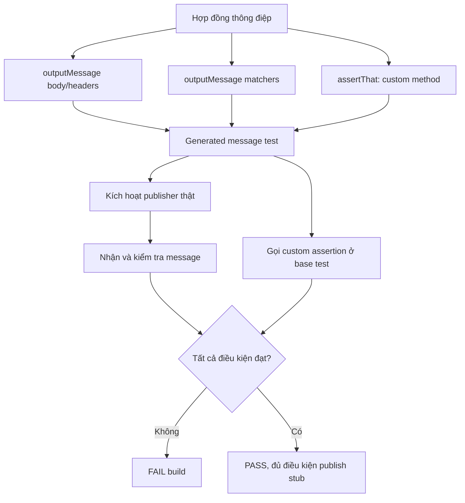
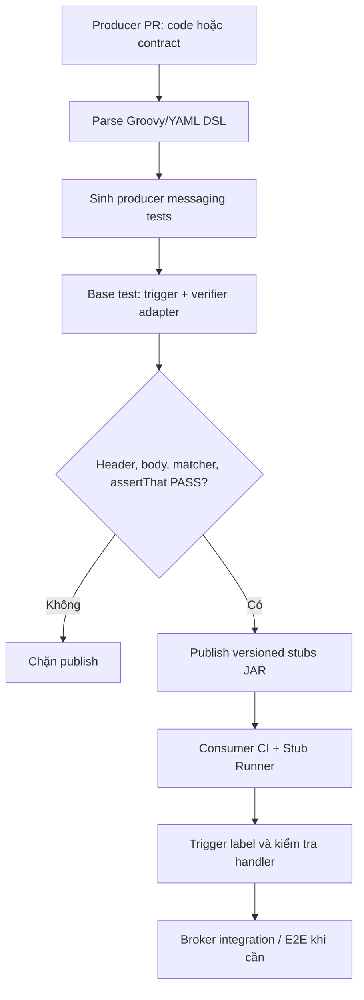

# Xác minh điều kiện bằng assertion trong hợp đồng

> **Chương:** Hợp đồng thông điệp  
> **Module:** Spring Cloud Contract (`SPRING_CLOUD_CONTRACT`) — học kiểm thử hợp đồng giữa producer và consumer, mô tả hành vi HTTP hoặc thông điệp bằng Groovy/YAML DSL, sinh test phía producer, phát hành stub, sử dụng Stub Runner và đưa các bước xác minh vào CI.

## Mục tiêu học tập

Sau bài này, bạn có thể:

1. Phân biệt **assertion trong hợp đồng thông điệp** với assertion viết tay trong unit/integration test.
2. Giải thích Spring Cloud Contract Verifier kiểm chứng **đích gửi, header, payload, giá trị cố định và giá trị động** của thông điệp như thế nào.
3. Dùng `bodyMatchers` (Groovy DSL) hoặc `outputMessage.matchers.body` (YAML DSL) để xác minh ID, thời gian và những trường biến động mà không bỏ mất bất biến nghiệp vụ.
4. Sử dụng `assertThat` trong `input` hoặc `outputMessage` để gọi **phương thức kiểm tra tùy biến** được định nghĩa ở base test/static import.
5. Thiết lập test producer với `@AutoConfigureMessageVerifier`, chuẩn bị trigger và kênh thông điệp, rồi đọc generated test để xác nhận phương thức assertion được gọi thật.
6. Phân biệt **producer messaging verification** với **consumer Stub Runner + StubTrigger** và hiểu giới hạn kiểm thử broker, delivery, retry, ordering.
7. Thiết kế CI chặn phát hành khi thông điệp thực tế vi phạm contract, kể cả khi UUID/timestamp động.

## 1. Vấn đề cần giải quyết

Một ứng dụng đặt hàng phát sự kiện `OrderAccepted` khi đơn được chấp nhận. Consumer (dịch vụ thanh toán hoặc gửi email) phụ thuộc vào cấu trúc sự kiện:

```json
{
  "eventType": "OrderAccepted",
  "eventId": "d4148738-a6a4-4335-a976-2b68d64c5383",
  "orderId": "ORD-1001",
  "occurredAt": "2026-11-24T09:15:30Z",
  "total": 240000,
  "currency": "VND"
}
```

Thông điệp được gửi đến destination `orders.events`, với các header như `contentType: application/json` và `eventType: OrderAccepted`.

Sự kiện này có hai nhóm điều kiện:

- **Biến động có kiểm soát:** `eventId` và `occurredAt` có thể khác nhau ở mỗi lần phát, nhưng vẫn phải có định dạng hợp lệ.
- **Bất biến nghiệp vụ:** `eventType` phải là `OrderAccepted`; `orderId` phải là mã đơn đã chấp nhận; `total` phải là số `240000` trong fixture; `currency` phải là `VND`.

Nếu test cố định toàn bộ JSON, nó dễ đỏ chỉ vì UUID và timestamp thay đổi. Nếu test chỉ kiểm tra "có một message", producer có thể đổi `eventType` thành `OrderRejected` hoặc `currency` thành `USD` mà CI vẫn xanh.

**Assertion trong contract** giúp xác minh đủ mạnh mà không phụ thuộc vào dữ liệu ngẫu nhiên.

### 1.1. So với HTTP contract

| HTTP contract | Messaging contract | Vai trò |
| --- | --- | --- |
| `request` | `input` | Điều kiện kích hoạt lời gọi hoặc thông điệp |
| `request.method`, `request.url` | `input.triggeredBy` hoặc `input.messageFrom` | Cách sinh hành vi trong test |
| `response.status` | Không có HTTP status cho message thuần | Thông điệp không dùng mã trạng thái HTTP |
| `response.headers` | `outputMessage.headers` | Header phải được phát |
| `response.body` | `outputMessage.body` | Payload đã cam kết |
| `response.matchers` | `outputMessage.matchers` | Điều kiện kiểm chứng đầu ra động |
| Test HTTP gửi request | Test messaging gọi trigger hoặc đưa message đầu vào | Kích hoạt producer thật |

Một contract messaging không tự tạo Kafka topic, RabbitMQ exchange hay đảm bảo consumer đã ACK. Nó mô tả hành vi có thể được **test infrastructure** kiểm chứng.

## 2. Hai tầng assertion cần phân biệt

Spring Cloud Contract hỗ trợ hai cách bổ sung cho nhau khi kiểm chứng thông điệp.

### Tầng A — assertion được sinh từ contract

Khi khai báo `outputMessage`, Verifier có thể sinh test kiểm tra:

- Producer thực sự phát thông điệp tới destination mà contract mô tả.
- Thông điệp không null và có header bắt buộc.
- Payload có các trường/giá trị cố định đã cam kết.
- Các trường động thỏa `bodyMatchers` / `matchers.body` thay vì bị ép bằng giá trị mẫu.

Đây là lựa chọn **mặc định** khi điều kiện có thể biểu diễn rõ bằng DSL.

### Tầng B — assertion tùy biến bằng assertThat

Trong `input` hoặc `outputMessage`, bạn có thể khai báo `assertThat` với **tên một phương thức Java/Groovy**. Generated test sẽ gọi phương thức ấy. Phương thức phải được cung cấp qua **base class của generated tests** hoặc static import/configuration tương ứng.

Ví dụ muốn kiểm tra một **audit record nội bộ** đã được lưu sau khi publisher phát sự kiện. Đây là điều kiện bổ sung không được thể hiện trực tiếp bằng một JSONPath matcher. Ta có thể dùng:

```groovy
outputMessage {
    sentTo('orders.events')
    // body và headers ...
    assertThat('assertAuditRecordPresent()')
}
```

**Quan trọng:** `assertThat` ở đây **không phải** biểu thức AssertJ/Groovy trả về boolean viết ngay trong contract. Đây là chỉ thị **gọi một phương thức** từ generated test; chính phương thức đó cần throw `AssertionError` (hoặc thất bại tương ứng) khi điều kiện không đúng.



Không thay **mọi** kiểm tra body/header bằng một method `assertThat` mơ hồ. Giữ phần contract dễ đọc, dùng custom assertion **chỉ cho quy tắc cần logic riêng**.

## 3. Ví dụ Groovy: contract phát OrderAccepted

Tạo `src/test/resources/contracts/order_accepted_event.groovy` ở producer:

```groovy
org.springframework.cloud.contract.spec.Contract.make {
    name 'order_accepted_event'
    description 'Order service phat su kien khi don duoc chap nhan'
    label 'order_accepted'

    input {
        triggeredBy('publishAcceptedOrder()')
    }

    outputMessage {
        sentTo('orders.events')

        headers {
            messagingContentType(applicationJson())
            header 'eventType': 'OrderAccepted'
        }

        body(
            eventType: 'OrderAccepted',
            eventId: 'd4148738-a6a4-4335-a976-2b68d64c5383',
            orderId: 'ORD-1001',
            occurredAt: '2026-11-24T09:15:30Z',
            total: 240000,
            currency: 'VND'
        )

        bodyMatchers {
            jsonPath('$.eventId', byRegex(
                '[0-9a-fA-F]{8}-[0-9a-fA-F]{4}-[0-9a-fA-F]{4}-[0-9a-fA-F]{4}-[0-9a-fA-F]{12}'
            ))
            jsonPath('$.occurredAt', byRegex(
                '[0-9]{4}-[0-9]{2}-[0-9]{2}T[0-9]{2}:[0-9]{2}:[0-9]{2}Z'
            ))
        }

        assertThat('assertAuditRecordPresent()')
    }
}
```

Cách đọc hợp đồng:

1. `label 'order_accepted'` đặt nhãn để consumer test có thể kích hoạt **message stub** qua Stub Runner.
2. `input.triggeredBy` bảo generated producer test gọi method `publishAcceptedOrder()`.
3. `outputMessage.sentTo` chỉ đích thông điệp phải được phát.
4. `outputMessage.headers` quy định loại nội dung và event type trong header.
5. `outputMessage.body` định nghĩa một payload mẫu, gồm những giá trị nghiệp vụ cố định.
6. `bodyMatchers` kiểm chứng các giá trị động trong message producer tạo.
7. `assertThat(...)` bổ sung một điều kiện tùy biến từ base test.

### 3.1. Tại sao dùng triggeredBy?

Không phải mọi producer đều phát message sau khi nhận một message khác. Có trường hợp sự kiện được phát từ HTTP handler, scheduler hoặc lệnh nghiệp vụ. `triggeredBy` cho phép **test producer chủ động gọi một phương thức** để tạo sự kiện mà không cần dựng toàn bộ workflow từ một consumer bên ngoài.

Khi ứng dụng nhận input message rồi phát output message, DSL có thể dùng `input.messageFrom`, `input.messageBody` và `input.messageHeaders`. Khi đó test dùng message infrastructure để đưa input vào. Hai mô hình được kiểm chứng khác nhau; **đừng khai báo cả hai như cùng một điều kiện nếu không có nghiệp vụ thật tương ứng**.

### 3.2. Vì sao timestamp phải khớp định dạng?

Regex của `occurredAt` đang xác minh **hình dạng** `YYYY-MM-DDTHH:mm:ssZ`. Nó không tự bảo đảm:

- Ngày là ngày lịch hợp lệ.
- Thời gian thật sự gần đồng hồ hiện tại.
- Hai event được phát đúng thứ tự.
- `occurredAt` lớn hơn thời gian nhận request.

Nếu consumer cần những bảo đảm ấy, bổ sung assertion bằng Java time parser/clock có thể điều khiển và test nghiệp vụ thích hợp. **Đừng cố giải quyết mọi quy tắc thời gian bằng một regex `.*`**.

## 4. Cùng tương tác bằng YAML DSL

YAML dùng `input`, `outputMessage` và `outputMessage.matchers`; không đặt trực tiếp các biểu thức Groovy `bodyMatchers { ... }` vào file YAML.

File `src/test/resources/contracts/order_accepted_event.yml`:

```yaml
name: order_accepted_event
description: "Order service phat su kien khi don duoc chap nhan"
label: order_accepted

input:
  triggeredBy: publishAcceptedOrder()

outputMessage:
  sentTo: orders.events
  headers:
    contentType: application/json
    eventType: OrderAccepted
  body:
    eventType: OrderAccepted
    eventId: d4148738-a6a4-4335-a976-2b68d64c5383
    orderId: ORD-1001
    occurredAt: "2026-11-24T09:15:30Z"
    total: 240000
    currency: VND
  matchers:
    body:
      - path: $.eventId
        type: by_regex
        predefined: uuid
      - path: $.occurredAt
        type: by_regex
        value: '[0-9]{4}-[0-9]{2}-[0-9]{2}T[0-9]{2}:[0-9]{2}:[0-9]{2}Z'
  assertThat: assertAuditRecordPresent()
```

YAML schema của Spring Cloud Contract có trường `assertThat` kiểu **string** trong `input` và `outputMessage`. Ở đây `assertThat: assertAuditRecordPresent()` tương đương về ý định với việc gọi method trong bản Groovy.

**Chỉ chọn một trong hai file Groovy hoặc YAML** cho cùng kịch bản ở một lượt build. Nếu lưu cả hai phiên bản vào thư mục contract, bạn có thể sinh test/stub trùng lặp.

### 4.1. Bảng quy đổi

| Mục đích | Groovy DSL | YAML DSL |
| --- | --- | --- |
| Nhãn sự kiện | `label 'order_accepted'` | `label: order_accepted` |
| Trigger | `triggeredBy('publishAcceptedOrder()')` | `input.triggeredBy: publishAcceptedOrder()` |
| Đích message | `sentTo('orders.events')` | `outputMessage.sentTo: orders.events` |
| Header | `header 'eventType': 'OrderAccepted'` | `outputMessage.headers.eventType: OrderAccepted` |
| Body | `body(eventType: 'OrderAccepted')` | `outputMessage.body.eventType: OrderAccepted` |
| JSONPath regex | `bodyMatchers { jsonPath(..., byRegex(...)) }` | `outputMessage.matchers.body` + `type: by_regex` |
| Custom check | `assertThat('assertAuditRecordPresent()')` | `outputMessage.assertThat: assertAuditRecordPresent()` |

Nhìn vào **trường nằm ở đâu** quan trọng hơn cách viết dấu ngoặc. Đặt matcher của message ở `response.matchers` (như HTTP) thay vì `outputMessage.matchers` là nhầm lẫn thường gặp.

### 4.2. Giá trị body mẫu vẫn quan trọng

`eventId` trong `body` là **UUID mẫu**. Nó giúp tạo stub ổn định để consumer đọc. Regex/`predefined: uuid` cho phép **producer test** chấp nhận UUID thật khác mẫu.

Điều này **không có nghĩa Stub Runner phải sinh UUID mới** cho mỗi lần trigger. Consumer test với stub được thiết kế để kiểm tra khả năng xử lý dữ liệu **theo hợp đồng**, không thay thế test uniqueness ở producer.

## 5. Assertion nào được sinh tự động?

Từ contract, test producer về mặt ý nghĩa sẽ thực hiện:

```text
1. Gọi phương thức publishAcceptedOrder() từ base test.
2. Chờ nhận một message ở destination orders.events.
3. Kiểm tra message tồn tại.
4. Kiểm tra header contentType và eventType.
5. Đọc/giải mã payload để kiểm tra eventType, orderId, total, currency.
6. Kiểm tra eventId là UUID, occurredAt khớp mẫu UTC ...Z.
7. Thực thi phương thức assertion tùy biến do contract chỉ định.
8. Fail khi một điều kiện kiểm chứng không đạt.
```

Đây là **mô hình hành vi**, không phải trích nguyên mã Java mà plugin sinh ra. Mã generated test phụ thuộc version, JUnit framework và messaging adapter. Khi xem generated test thật, hãy kiểm tra thứ tự gọi method thay vì suy đoán thứ tự trên chỉ từ sơ đồ.

### 5.1. Thử làm hỏng thông điệp

Trong publisher thật, hãy cố ý đổi:

```java
payload.put("eventType", "OrderRejected"); // phá hợp đồng
```

Giữ hợp đồng yêu cầu `OrderAccepted`. Generated test phải báo lỗi khi kiểm tra payload.

Các ví dụ sai khác:

| Producer thay đổi | Kết quả mong đợi | Vì sao |
| --- | --- | --- |
| UUID mới đúng format | **PASS** | Matcher cho phép `eventId` động |
| `eventId: "not-an-id"` | **FAIL** | Không phải UUID |
| `occurredAt: "tomorrow"` | **FAIL** | Không thỏa format UTC |
| `eventType: "OrderRejected"` | **FAIL** | Trái giá trị bất biến |
| `total: "240000"` | **FAIL** | Chuỗi thay vì JSON number |
| `currency: "USD"` | **FAIL** | Không bằng `VND` đã cam kết |
| Gửi sang destination khác | **FAIL/timeout** | Test chờ sai đích, không nhận message mong đợi |
| Audit record bị thiếu | **FAIL khi custom assertion đúng và được gọi** | Điều kiện bổ sung không còn đúng |
| Message vẫn đúng nhưng broker production ngừng hoạt động | **Có thể PASS** | Test dùng adapter/binder in-memory |

Không dùng matcher `.*` cho mọi string chỉ để CI xanh. Nó có thể khiến event type hoặc currency sai vẫn qua kiểm chứng.

## 6. assertThat: dùng khi cần kiểm tra điều kiện tùy biến

Spring Cloud Contract hỗ trợ `assertThat` ở **`input` hoặc `outputMessage`**. Giá trị là **lệnh gọi method**, không phải đoạn Java được thực thi như biểu thức tùy ý trong YAML.

### 6.1. Một ví dụ hợp lý: kiểm tra audit record

Yêu cầu của hệ thống: mỗi lần producer phát `OrderAccepted`, nó cũng ghi dấu vết nội bộ cho đơn `ORD-1001`. Việc kiểm tra payload bằng JSONPath không đủ để xác nhận dấu vết ấy.

Thêm vào contract:

```groovy
outputMessage {
    sentTo('orders.events')
    // ... headers, body, matchers ...
    assertThat('assertAuditRecordPresent()')
}
```

Hoặc YAML:

```yaml
outputMessage:
  sentTo: orders.events
  # ... headers, body, matchers ...
  assertThat: assertAuditRecordPresent()
```

**Hai đoạn là cú pháp rút gọn để giải thích vị trí trường**, không phải contract hoàn chỉnh để chạy. Khi triển khai, cần giữ `input`, `headers`, `body` và matcher như ví dụ ở mục 3–4.

Phương thức `assertAuditRecordPresent()` có thể đặt trong base test của generated tests:

```java
protected void assertAuditRecordPresent() {
    assertTrue(
        auditStore.contains("ORD-1001"),
        "Phải có audit record sau khi phát OrderAccepted"
    );
}
```

`auditStore` là dependency test có thể kiểm tra; nó phải phản ánh **side effect thật của publisher trong phạm vi test**, không phải giá trị mà base class tự ép thành `true` trước khi gọi publisher.

Khi `assertTrue` thất bại, generated test thất bại. Nếu method không tồn tại, sai visibility/import hoặc không biên dịch, test cũng không chạy được; đó là **lỗi cấu hình hoặc sinh mã**, không phải producer thỏa contract.

### 6.2. Phương thức assertion có nhận payload tự động không?

**Không nên giả định.** Khi viết `assertThat('assertAuditRecordPresent()')`, generated test gọi method được chỉ định. Nó **không tự động truyền toàn bộ event payload vào method** nếu chữ ký không khai báo tham số hoặc không có cơ chế được DSL hỗ trợ.

Nếu cần kiểm tra payload phức tạp, ưu tiên `bodyMatchers`, `by_command` khi phù hợp hoặc dùng test helper có nguồn dữ liệu rõ ràng. Với logic cần quan hệ giữa nhiều message, bạn có thể viết integration test riêng để giữ contract dễ bảo trì.

### 6.3. Không biến custom method thành cách bỏ qua matcher

Không nên chỉ viết:

```groovy
outputMessage {
    sentTo('orders.events')
    assertThat('someVagueCheck()')
}
```

rồi bỏ body/header trong khi consumer vẫn cần các trường đó. Một reviewer khác không biết `someVagueCheck()` đang bảo vệ những gì. Dùng DSL để diễn đạt **giao kèo công khai**, custom assertion để bổ sung **quy tắc khó diễn đạt**.

## 7. Base test cho producer messaging

Khác HTTP contract test dùng MockMvc, messaging contract test cần **message verifier infrastructure**. Với các tích hợp Spring được hỗ trợ, base class thường có:

- `@SpringBootTest` hoặc một test context phù hợp với publisher.
- `@AutoConfigureMessageVerifier` để cấu hình cơ chế gửi/nhận message cho generated tests.
- Method mà `input.triggeredBy` gọi, ví dụ `publishAcceptedOrder()`.
- Method custom assertion mà `assertThat` gọi, ví dụ `assertAuditRecordPresent()`.
- Test data và message destination/binder tương ứng.

Ví dụ lớp cơ sở **minh họa**:

```java
package com.example.orders;

import org.junit.jupiter.api.BeforeEach;
import org.springframework.beans.factory.annotation.Autowired;
import org.springframework.boot.test.context.SpringBootTest;
import org.springframework.cloud.contract.verifier.messaging.boot.AutoConfigureMessageVerifier;

import static org.junit.jupiter.api.Assertions.assertTrue;

@SpringBootTest
@AutoConfigureMessageVerifier
public abstract class ContractTestBase {

    @Autowired
    OrderEventPublisher publisher;

    @Autowired
    OrderAuditStore auditStore;

    @BeforeEach
    protected void resetFixture() {
        auditStore.clear();
    }

    protected void publishAcceptedOrder() {
        publisher.publishAccepted("ORD-1001", 240000L, "VND");
    }

    protected void assertAuditRecordPresent() {
        assertTrue(auditStore.contains("ORD-1001"));
    }
}
```

Đây là **mẫu thiết kế**, giả định ứng dụng có các lớp `OrderEventPublisher`, `OrderAuditStore` và dependency của Spring Cloud Contract messaging. Muốn chạy cần triển khai chúng và ánh xạ destination thực; không nên coi đoạn này là project hoàn chỉnh.

Trong producer thật, method `publishAccepted` cần:

1. Tạo message với body/headers hợp đồng.
2. Gửi message tới `orders.events` qua adapter messaging đã được cấu hình.
3. Cập nhật audit record theo nghiệp vụ (hoặc qua service đang được test).

Trong test, `auditStore.clear()` giúp tránh dữ liệu cũ khiến custom assertion xanh giả. Nếu cơ chế message dùng queue in-memory, còn cần **cô lập/drain message giữa test cases** để test không nhận event của lần chạy trước.

### 7.1. Tại sao bắt buộc có @AutoConfigureMessageVerifier?

Contract Verifier phải tìm được kênh/destination để quan sát thông điệp được phát. Tài liệu Spring Cloud Contract nhấn mạnh annotation `@AutoConfigureMessageVerifier` trong base test. Nếu bỏ annotation hoặc thiếu messaging integration phù hợp, generated test có thể không nhận được message ngay cả khi publisher đã gửi.

`sentTo('orders.events')` không tự tạo topic/broker. Với Spring Integration/Stream/Camel/JMS, tên destination được giải quyết theo **adapter** và cấu hình hiện có. Khi dùng Spring Cloud Stream test binder, phải bảo đảm test binder, bindings và destination khớp hợp đồng.

### 7.2. Ví dụ mô tả publisher và kênh

Với mô hình Spring Integration đơn giản, một `QueueChannel` có thể được đăng ký làm bean nhận message:

```java
@Configuration
public class OrderChannelConfig {

    @Bean(name = "orders.events")
    public PollableChannel ordersEvents() {
        return new QueueChannel();
    }
}
```

Publisher có thể gửi vào channel đó, chẳng hạn qua `MessageChannel.send(Message<?>)` với payload object/JSON và headers phù hợp. Việc gửi/nhận cùng channel sẽ giúp messaging verifier quan sát output trong test.

**Điều kiện để ví dụ chạy:** cần import từ Spring Integration/Spring Messaging, bean publisher được inject đúng channel, cấu hình message converter và thư viện verifier tương thích. Một map/object payload có thể được adapter chuyển đổi khác với chuỗi JSON; hãy kiểm tra payload mà generated test thực sự đọc.

Mục tiêu của ví dụ là giải thích **nơi assertion lấy dữ liệu**, không mô phỏng broker production. Một test dùng QueueChannel in-memory vẫn có thể bỏ sót vấn đề serializer, Kafka partition/offset hoặc kết nối broker thật.

## 8. Input assertion và output assertion khác nhau thế nào?

Ngoài `outputMessage.assertThat`, Spring Cloud Contract cho phép `input.assertThat`.

Với bài toán **message đến → message đi** (ví dụ hệ thống nhận `PaymentCaptured` rồi phát `OrderPaid`), `input` có thể mô tả destination, message body/headers và một phương thức kiểm tra tùy biến.

Ví dụ một phần Groovy DSL:

```groovy
input {
    messageFrom('payments.events')
    messageBody(
        eventType: 'PaymentCaptured',
        orderId: 'ORD-1001'
    )
    messageHeaders {
        messagingContentType(applicationJson())
    }
    assertThat('assertPaymentFixtureReady()')
}

outputMessage {
    sentTo('orders.events')
    body(
        eventType: 'OrderPaid',
        orderId: 'ORD-1001'
    )
}
```

Khi test được sinh, nó phải đưa input event vào message infrastructure và xác minh output theo contract. Tùy cách plugin dựng generated test, `assertThat` có thể phục vụ điều kiện bổ sung ở bên input hoặc output.

**Không nhầm:** `input.assertThat` không thay thế việc khai báo `messageBody`/`messageHeaders`; `outputMessage.assertThat` cũng không thay thế `sentTo`/`body`. Cần đọc generated test để xác minh **phương thức được gọi ở đúng giai đoạn** cho mục tiêu bạn đang kiểm tra.

### 8.1. Khi nào nên chọn custom assertion ở input?

Nó hợp lý khi phải kiểm tra một **điều kiện tiền đề hoặc phản ứng liên quan tới input** mà DSL cơ bản chưa mô tả đủ, ví dụ fixture phải sẵn sàng trước khi message được xử lý. Tuy nhiên, nếu đó chỉ là **setup**, có thể đặt trong `@BeforeEach` của base class để rõ ràng hơn.

Không nên nhồi setup và kiểm chứng vào cùng một `assertThat` khó đọc. Một assertion đúng nghĩa phải **thất bại khi điều kiện bị vi phạm**.

## 9. Matcher cho message payload động

Trong YAML, trường `outputMessage.matchers.body` cho phép chỉ định matcher theo JSONPath. Với event có UUID và thời gian:

```yaml
outputMessage:
  sentTo: orders.events
  headers:
    contentType: application/json
  body:
    eventType: OrderAccepted
    eventId: d4148738-a6a4-4335-a976-2b68d64c5383
    occurredAt: "2026-11-24T09:15:30Z"
    total: 240000
    currency: VND
  matchers:
    body:
      - path: $.eventId
        type: by_regex
        predefined: uuid
      - path: $.occurredAt
        type: by_regex
        value: '[0-9]{4}-[0-9]{2}-[0-9]{2}T[0-9]{2}:[0-9]{2}:[0-9]{2}Z'
```

Đây là **khối outputMessage thay thế** để minh họa, không phải một YAML document mới thêm vào cuối file gốc.

### 9.1. Loại matcher và ý nghĩa

| Matcher | Cần dùng khi | Điều chưa chứng minh |
| --- | --- | --- |
| `by_equality` | Trường phải bằng đúng giá trị cam kết | Không thể tự thay thế kiểm tra quan hệ liên trường |
| `by_regex` | ID, mã định dạng, timestamp string biến động | Regex chỉ kiểm tra pattern |
| `by_type` | Kiểu JSON phải ổn định, giá trị có thể khác | Number đúng kiểu có thể vẫn là số âm |
| `by_date` | Chuỗi ngày theo dạng được DSL hỗ trợ | Không tự kiểm tra ngày lớn hơn ngày khác |
| `by_time` | Chuỗi giờ theo dạng được DSL hỗ trợ | Không tự kiểm tra business SLA |
| `by_timestamp` | Timestamp đúng dạng được DSL hỗ trợ | Không mặc nhiên hỗ trợ mọi offset |
| `by_command` | Kiểm tra chuyên biệt qua helper khi được hỗ trợ | Cần method và cấu hình test đúng |

Giữ **equality** đối với `eventType` và `currency` nếu consumer phụ thuộc chúng. Nếu đơn hàng được tạo với số tiền cụ thể trong fixture, cũng nên giữ `total` bằng giá trị cam kết. Đừng nới `total` thành `by_type` rồi kết luận phép tính tiền đã đúng.

### 9.2. Kiểm tra tồn tại, null và collection

Matcher dùng JSONPath được chỉ định tới trường **đã có trong body mẫu**. Nếu `eventId` bị xóa khỏi payload thật, một matcher xác minh UUID phải thất bại khi không đọc được trường cần thiết.

Với collection, đừng mặc nhiên nghĩ matcher `$.items[0].sku` kiểm tra tất cả phần tử. Nếu consumer duyệt toàn bộ array, cần kiểm tra **mọi phần tử**, số lượng/kiểu phần tử và các bất biến như tổng tiền. Một matcher cho phần tử đầu không bảo vệ các phần tử còn lại.

Nếu cần xác minh quan hệ `total == sum(quantity * unitPrice)`, matcher đơn trường `by_type` không đủ; dùng custom assertion hoặc test nghiệp vụ riêng.

## 10. Có nên dùng by_command thay assertThat?

Hai cơ chế phục vụ những nhu cầu tương tự nhưng phạm vi khác:

| Cơ chế | Cách viết | Thích hợp khi |
| --- | --- | --- |
| **Body matcher** | `jsonPath('$.eventId', byRegex(...))` | Kiểm tra từng field theo mẫu |
| **Body matcher custom** | `byCommand('verifyAmount($it)')` | Kiểm tra giá trị trích ra từ một JSONPath |
| **Messaging assertThat** | `assertThat('assertAuditRecordPresent()')` | Kiểm tra điều kiện do test base cung cấp, không chỉ một field JSON |
| **Integration test riêng** | JUnit/AssertJ tùy chỉnh | Kiểm tra nhiều sự kiện, transaction, ordering hoặc broker |

`by_command` hướng đến **một giá trị do JSONPath trích xuất** và chuyển cho custom function theo cấu hình DSL, ví dụ `$it` đại diện giá trị đang xét. `assertThat` của messaging là **hook gọi method** từ contract. Đừng giả định hai thứ có cùng chữ ký hoặc có thể thay thế nhau mà không sửa generated tests.

Một ví dụ Groovy dùng `byCommand` ở `outputMessage.bodyMatchers` theo ý tưởng:

```groovy
bodyMatchers {
    jsonPath('$.total', byCommand('assertPositiveAmount($it)'))
}
```

Method `assertPositiveAmount` phải tồn tại và có kiểu tham số tương thích với dữ liệu JSONPath sinh ra. Đây là lựa chọn nâng cao; nếu business rule phức tạp, một test riêng có cấu trúc rõ đôi khi dễ bảo trì hơn.

Với `assertThat`, method có thể kiểm tra audit store, trạng thái dịch vụ hoặc kết quả lưu trữ sau khi phát sự kiện, miễn điều kiện đó thực sự là một phần mục tiêu test.

## 11. Kiểm tra một sự kiện không có nghĩa đã kiểm tra toàn bộ luồng

Một message contract dạng `OrderAccepted` thường không kiểm tra được những điều sau chỉ bằng một lần trigger và receive:

- **Exactly-once delivery:** message có thể bị gửi lặp khi retry.
- **Ordering:** hai sự kiện khác nhau có thể bị đảo thứ tự trên nhiều partition.
- **Durability:** message có được lưu bền vững qua broker restart hay không.
- **Consumer ACK/retry:** consumer có xác nhận, retry hoặc đưa lỗi vào DLQ đúng không.
- **Schema evolution ở mọi consumer:** không phải consumer nào cũng đã nâng version.
- **Kết nối broker thật:** test với binder in-memory không kiểm tra firewall, ACL, routing, TLS.
- **Idempotency:** consumer nhận lại cùng `eventId` có xử lý một lần hay không.

Chúng cần unit/integration/component/E2E test phù hợp. Có thể dùng Testcontainers hoặc broker thật trong test tích hợp nếu mục tiêu là cơ chế giao hàng qua Kafka/RabbitMQ, nhưng việc đó nằm ngoài **một producer message contract verification** tối thiểu.

### 11.1. Phân biệt PASS có ý nghĩa với PASS xanh giả

| Cấu hình test | Tín hiệu đáng tin? | Rủi ro |
| --- | --- | --- |
| Generated test nhận event từ publisher thật trên test channel | Có, trong phạm vi đã thiết lập | Chưa kiểm tra broker production |
| Test tự viết một event mẫu và tự assert lại chính mẫu đó | Thấp | Không kiểm tra publisher thật |
| Test chỉ gọi publisher mà không kiểm tra output | Không đủ | Producer có thể phát sai destination/body |
| Test có `assertThat` nhưng method rỗng | Không có giá trị | Custom hook luôn PASS |
| Test có UUID regex nhưng bỏ `eventType` | Không đủ | Consumer có thể nhận sai loại sự kiện |
| Test có message assertion nhưng skipped trong CI | Không có bằng chứng | Không kiểm tra compatibility |

## 12. Stub Runner và consumer test cho thông điệp

Ở HTTP, Stub Runner thường khởi chạy WireMock và consumer gọi endpoint giả. Với **messaging**, Stub Runner có thể tải contract đã đóng gói cùng stub artifact và thiết lập các route theo tích hợp messaging tương ứng. Consumer kích hoạt event mẫu theo `label`.

Ví dụ sau giả định producer đã phát hành stub:

```text
com.example:order-service:1.0.0:stubs
```

Trong consumer test có thể dùng `@AutoConfigureStubRunner` và `StubTrigger`:

```java
@SpringBootTest
@AutoConfigureStubRunner(
    ids = "com.example:order-service:1.0.0:stubs",
    stubsMode = StubRunnerProperties.StubsMode.LOCAL
)
class OrderEventConsumerContractTest {

    @Autowired
    StubTrigger stubTrigger;

    @Test
    void canReceiveOrderAccepted() {
        boolean triggered =
            stubTrigger.trigger("order_accepted");

        assertTrue(triggered);
        // Tiếp tục kiểm tra listener/handler thật của consumer
        // đã xử lý message trên test binder/channel.
    }
}
```

Đây là **đoạn test minh họa**: cần import, test binder/broker adapter, consumer listener và assertion xác nhận **handler thực sự xử lý message**. Chỉ `assertTrue(triggered)` chứng minh Stub Runner có thể trigger nhãn, **không chứng minh consumer logic đã xử lý đúng**.

Một số điểm riêng của messaging:

- `label` trong contract là khóa dùng để kích hoạt stub bằng `StubTrigger`.
- Destination `orders.events` phải khớp cấu hình binding/channel của consumer test.
- Với Spring Cloud Stream test binder, cần dependency test binder phù hợp (ví dụ `spring-cloud-stream-test-binder`).
- Nếu classpath có nhiều framework messaging, cấu hình Stub Runner để chọn integration cần dùng; không giả định mọi adapter đều tự hoạt động cùng lúc.
- `LOCAL` đòi hỏi stub artifact tồn tại trong Maven local repository. Với CI tách runner, dùng artifact repository hoặc chuyển file giữa job.

### 12.1. Vì sao vẫn phải có producer verification?

Consumer test với stub version cũ có thể xanh dù producer mới đã đổi `eventType` hoặc bỏ `currency`. Bởi vì Stub Runner dùng **contract/stub đã chọn**, không chạy code producer mới nhất.

Do đó phải **chạy test producer trước khi publish stubs**, và consumer CI phải biết version cụ thể đang được kiểm tra.

## 13. Đưa assertion messaging vào CI

Một pipeline tham khảo:



Với producer Maven đã cấu hình Spring Cloud Contract plugin:

```bash
mvn clean verify
```

Khi verification đạt, pipeline có thể đóng gói/cài hoặc publish stub:

```bash
mvn clean install
```

**Đừng dùng `-DskipTests` để coi stub đã được kiểm chứng.** Tên goal, thư mục generated tests và cách sinh stub có thể thay đổi theo phiên bản/cấu hình. CI phải xác nhận **test thật sự được sinh, thực thi và có báo cáo kết quả**.

### 13.1. Thử mutation để xác nhận assertion có tác dụng

Trên branch thử nghiệm, thay các thuộc tính của event rồi chạy lại producer verification:

1. Đổi `eventType` thành `OrderRejected`.
2. Đổi `total` thành `-1`.
3. Đổi `eventId` thành `bad-id`.
4. Ngừng ghi audit record mà vẫn phát message.
5. Gửi message sang destination khác.

Mỗi biến thể phải làm **một assertion liên quan thất bại**. Nếu generated test vẫn xanh:

- Có thể contract không bao gồm field cần bảo vệ.
- Có thể matcher quá rộng, ví dụ `.*`.
- Có thể method `assertThat` rỗng/không được gọi.
- Có thể test đang nhận message cũ từ queue.
- Có thể build bỏ qua generated tests.
- Có thể test publisher không phải implementation thật.

Đây là cách thực tế để đánh giá **chất lượng bằng chứng** thay vì chỉ nhìn `BUILD SUCCESS`.

## 14. Chẩn đoán lỗi

| Triệu chứng | Nguyên nhân có thể | Cách kiểm tra |
| --- | --- | --- |
| Không sinh messaging test | File sai thư mục, plugin/lifecycle không thu DSL | Kiểm tra contract path, log plugin, generated test sources |
| Generated test không compile | `publishAcceptedOrder()` hoặc `assertAuditRecordPresent()` chưa có trong base class | Kiểm tra tên/signature/visibility và cấu hình base class |
| Test không nhận message | Thiếu `@AutoConfigureMessageVerifier` hoặc adapter/binder | Xác nhận test messaging setup và destination |
| Timeout khi chờ output | Publisher gửi sai kênh hoặc message gửi trễ | Kiểm tra binding, channel và log |
| Header test fail | Sai `contentType` hoặc `eventType` | So headers được producer thực phát |
| UUID test fail | `eventId` không đúng mẫu hoặc bị bỏ | So payload với JSONPath matcher |
| Test fail dù UUID khác mẫu nhưng hợp lệ | Chưa dùng response matcher | Thêm `bodyMatchers` / `outputMessage.matchers.body` |
| Custom assertion luôn xanh | Method rỗng hoặc tự set điều kiện đúng trong test | Dùng trạng thái thật sau trigger; thử mutation |
| Test lúc xanh lúc đỏ | Queue còn message cũ hoặc fixture chia sẻ | Dọn queue, reset fixture, cô lập case |
| Consumer không thấy event | Chưa có binder/adapter hoặc label/binding sai | Kiểm tra StubTrigger, destination và listener |
| Producer test xanh nhưng Kafka thật không nhận | Test chỉ dùng kênh in-memory | Thêm broker integration test |
| CI có stub nhưng không có test report | Publish khi skip test hoặc plugin chưa chạy | Chặn publish và xác minh test count |

## 15. Các bài tập thực hành

**Bài 1 — Giữ bất biến khi có trường động.** Từ `order_accepted_event.yml`, thay `eventId` thành giá trị UUID mới ở producer. Test có nên thất bại không? Sau đó đổi `eventType` thành `OrderRejected`. Test nào phải đỏ và vì sao?

**Bài 2 — Viết assertion tùy biến.** Thêm `outputMessage.assertThat: assertAuditRecordPresent()` và định nghĩa method trong base class. Hãy nêu cách bảo đảm method kiểm tra **dữ liệu do publisher tạo**, không phải một fixture mà test tự set là đúng.

**Bài 3 — Chuyển DSL.** Chuyển contract Groovy ở mục 3 thành YAML, bao gồm `label`, `triggeredBy`, `sentTo`, `headers`, `body`, `matchers` và `assertThat`. Dùng schema kiểm tra vị trí các field.

**Bài 4 — Bắt lỗi định dạng.** Producer trả `occurredAt: "ngày mai"` và `total: "240000"`. Hãy chỉ ra matcher/assertion nào phải phát hiện từng lỗi. Vì sao `by_type` cho `total` chưa đủ để chứng minh đúng số tiền?

**Bài 5 — Input message.** Mô tả sự kiện `PaymentCaptured` từ `payments.events` khiến hệ thống phát `OrderPaid` sang `orders.events`. Viết phần `input.messageFrom`, `messageBody` và `outputMessage`, rồi xác định khi nào cần thêm `input.assertThat`.

**Bài 6 — Consumer StubTrigger.** Viết một test listener thật của consumer. Sau khi gọi `stubTrigger.trigger("order_accepted")`, kiểm tra một kết quả đã quan sát được (ví dụ đơn đã được đánh dấu sẵn sàng thanh toán). Vì sao chỉ kiểm tra return `true` là chưa đủ?

**Bài 7 — CI và broker.** Thiết kế pipeline gồm messaging contract verification, publish stub, consumer handler tests và một integration test với broker. Nêu việc gì do contract test bảo vệ và việc gì do broker integration test bảo vệ.

### Gợi ý đáp án

1. UUID hợp lệ mới vẫn phải PASS; event type sai phải FAIL vì trái điều kiện cố định.
2. Method phải assert side effect do code thật tạo sau trigger; reset dữ liệu trước test và cố ý phá side effect để thấy test đỏ.
3. Với YAML, matcher nằm dưới `outputMessage.matchers.body`, custom assertion nằm ở `outputMessage.assertThat`.
4. Timestamp sai regex phải FAIL; total là string thay vì number phải FAIL nếu body/kiểu được kiểm chứng. `by_type` chỉ kiểm tra kiểu, không kiểm tra công thức.
5. Input mô tả nơi nhận và payload, output mô tả nơi phát; assertion tùy biến dùng khi có một điều kiện ngoài những gì DSL sẵn có.
6. Test phải quan sát listener hoặc state thay đổi sau khi trigger, có xử lý bất đồng bộ phù hợp.
7. Contract test bảo vệ payload/header/đích và side effect testable; broker test bảo vệ routing, encoding, delivery, consumer connectivity thực tế.

## 16. Tổng kết

**Xác minh điều kiện bằng assertion trong hợp đồng thông điệp** có hai tầng. Tầng thường dùng là **header/body assertions và matchers** được Spring Cloud Contract Verifier sinh từ Groovy/YAML DSL: kiểm tra đúng destination, kiểu dữ liệu, ID/timestamp động và các bất biến như `eventType`, `orderId`, `total`, `currency`. Tầng mở rộng là **`assertThat`**, một hook gọi phương thức trong base class/static import để kiểm tra điều kiện đặc biệt như audit record hay side effect nội bộ.

Một contract tốt không biến mọi thứ thành `.*` hay chuyển tất cả logic vào một method tùy biến khó đọc. Nó **giữ rõ lời hứa dữ liệu**, chỉ nới trường thực sự động, chạy generated producer tests với `@AutoConfigureMessageVerifier`, phát hành stub sau khi verification PASS và cho consumer dùng Stub Runner/StubTrigger đúng phiên bản. Broker integration và E2E tests bổ sung cho những thuộc tính ngoài khả năng của một message contract test.

## Tài liệu tham khảo

- [Spring Cloud Contract — Messaging](https://docs.spring.io/spring-cloud-contract/reference/project-features-messaging.html) — `input`/`outputMessage`, `assertThat`, `@AutoConfigureMessageVerifier`, producer tests và stub triggering.
- [Spring Cloud Contract — Dynamic Properties](https://docs.spring.io/spring-cloud-contract/reference/project-features-contract/dsl-dynamic-properties.html) — `bodyMatchers`, `byRegex`, `byType`, `byCommand` và YAML matchers.
- [Spring Cloud Contract — YML Schema](https://docs.spring.io/spring-cloud-contract/reference/yml-schema.html) — các trường `outputMessage.assertThat` và `outputMessage.matchers`.
- [Spring Cloud Contract — Maven Project](https://docs.spring.io/spring-cloud-contract/reference/maven-project.html) — cách sinh và thực thi test producer.
- [Spring Cloud Contract — Stub Runner Core](https://docs.spring.io/spring-cloud-contract/reference/project-features-stubrunner/stub-runner-core.html) — phát hành và sử dụng stubs.
