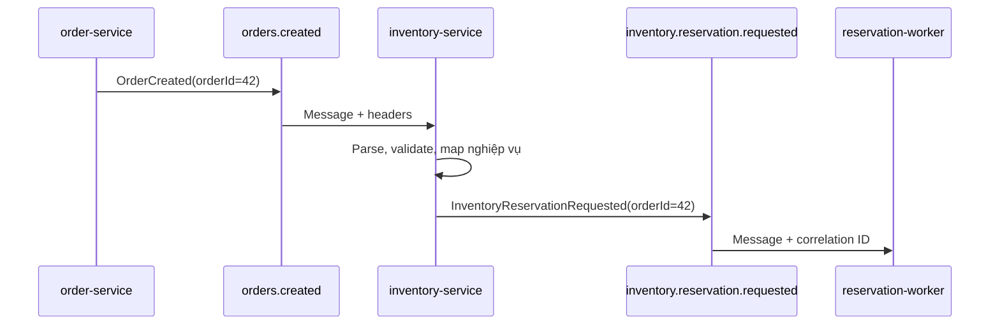
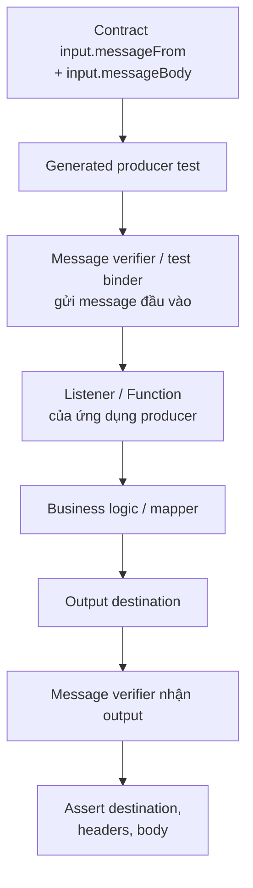
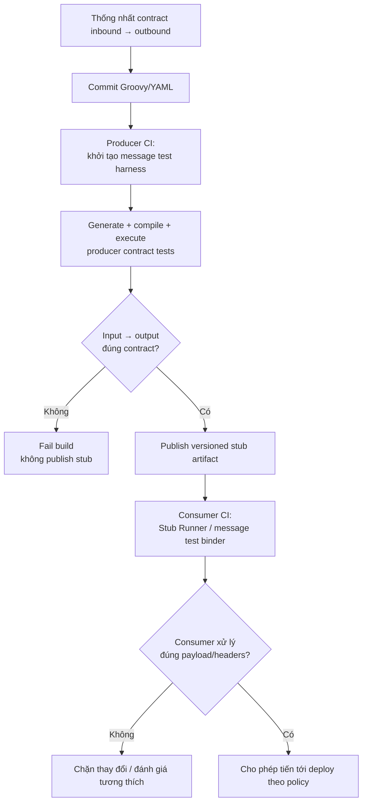

# Hợp đồng nhận một thông điệp và phát thông điệp khác

## 1. Bài toán: producer không chỉ nhận HTTP request

Trong hệ thống dùng **event-driven architecture**, một dịch vụ có thể **nhận thông điệp từ một kênh**, xử lý nghiệp vụ rồi **phát thông điệp mới sang kênh khác**. Ví dụ, `inventory-service` nhận sự kiện `OrderCreated` từ `orders.created`, kiểm tra dữ liệu đặt hàng và phát yêu cầu `InventoryReservationRequested` đến `inventory.reservation.requested`.

Đây cũng là một hợp đồng giữa các bên:

- **Producer của luồng xử lý** là dịch vụ nhận đầu vào và tạo thông điệp đầu ra.
- **Consumer đầu vào** hoặc upstream publisher là hệ thống gửi `OrderCreated`.
- **Consumer đầu ra** là hệ thống nhận `InventoryReservationRequested`.
- **Spring Cloud Contract** có thể biểu diễn kịch bản inbound → outbound bằng **Groovy DSL** hoặc **YAML DSL**, sinh test phía producer, sinh stub và hỗ trợ **Stub Runner** cho một số kiểu kiểm thử phía consumer.

Điểm quan trọng: dịch vụ trong ví dụ vừa là **consumer** của một loại thông điệp vừa là **producer** của loại thông điệp khác. Hai vai trò này phụ thuộc **hướng giao tiếp**, không nhất thiết ứng với hai ứng dụng cố định.

Mục tiêu của bài thuộc chương **Hợp đồng thông điệp** là hiểu rõ cách mô tả một message đầu vào, message đầu ra, headers, payload, tuyến đích; cách chuẩn bị môi trường để generated test thực sự chạy và xác minh; cũng như các giới hạn liên quan bất đồng bộ, retry, duplicate, thứ tự và CI.

## 2. Mô hình inbound → xử lý → outbound



Tại biên kiểm thử, Spring Cloud Contract cần biết:

1. **Nhận từ đâu?** — Tên nguồn/kênh đầu vào.
2. **Nhận gì?** — Body và các header đầu vào, cùng các giá trị cần khớp.
3. **Phát đi đâu?** — Destination/kênh của thông điệp đầu ra.
4. **Phát gì?** — Body, kiểu dữ liệu và header đầu ra.
5. **Quan hệ giữa hai message là gì?** — Các trường `orderId`, `sku`, `quantity` hoặc correlation ID phải được giữ/chuyển đổi thế nào.

Đối với message-based contract, **không có HTTP status `200` hay `201`** làm kết quả chính. Assertion cần tập trung vào **destination, headers và payload** của message thực sự phát. Nếu ứng dụng có cả HTTP endpoint và messaging, hai loại giao diện nên được kiểm thử theo các hợp đồng thích hợp.

### 2.1. Phân biệt hai kiểu kích hoạt

| Kiểu luồng | Nguồn kích hoạt | DSL tiêu biểu | Ví dụ |
|---|---|---|---|
| **Nhận thông điệp rồi phát thông điệp khác** | Một message inbound | `input { messageFrom(...); messageBody(...); messageHeaders { ... } }` | OrderCreated → InventoryReservationRequested |
| **Tự phát message do một hành động nội bộ** | Gọi phương thức trong generated test | `input { triggeredBy('...') }` | Batch job phát báo cáo tổng hợp |

Bài này tập trung vào **`messageFrom`**. Dùng `triggeredBy` cho kịch bản có **message đầu vào thực sự** có thể làm mất bước kiểm thử deserialization, routing hoặc listener mà consumer đang phụ thuộc.

## 3. Thiết kế hợp đồng nghiệp vụ trước khi viết DSL

Giả sử thông điệp inbound có cấu trúc:

```json
{
  "eventId": "EVT-42",
  "orderId": 42,
  "customerId": "CUS-7",
  "items": [
    {"sku": "BOOK-101", "quantity": 2}
  ]
}
```

Thông điệp outbound dự kiến:

```json
{
  "requestId": "RSV-4201",
  "orderId": 42,
  "reservationType": "INITIAL",
  "lines": [
    {"sku": "BOOK-101", "units": 2}
  ]
}
```

Headers minh họa:

```text
Inbound:
  eventType     = OrderCreated
  correlationId = CORR-42
  contentType   = application/json

Outbound:
  eventType     = InventoryReservationRequested
  correlationId = CORR-42
  contentType   = application/json
```

Các cam kết quan trọng cần thống nhất:

| Thành phần | Input | Output | Quy tắc nghiệp vụ |
|---|---|---|---|
| Destination | `orders.created` | `inventory.reservation.requested` | Không phát nhầm topic/channel |
| Mã đơn | `orderId: 42` | `orderId: 42` | Giữ định danh đơn |
| Mặt hàng | `items[0].sku` | `lines[0].sku` | Không thay SKU |
| Số lượng | `quantity: 2` | `units: 2` | Đổi tên trường, giữ giá trị số |
| Correlation | `CORR-42` | `CORR-42` | Cho phép trace luồng xử lý |
| Loại sự kiện | `OrderCreated` | `InventoryReservationRequested` | Khác nhau ở đầu vào/đầu ra |
| Request ID | Không có | `RSV-4201` trong mẫu | Có thể sinh động nếu API cho phép |

**Không đồng nhất tên header với chuẩn chung của mọi broker.** `eventType` và `correlationId` ở đây là **quy ước của ứng dụng minh họa**. Kafka, RabbitMQ, Spring Message và thư viện serializer có cách biểu diễn/chuẩn hóa header khác nhau; producer và consumer cần thống nhất ở giao diện public.

## 4. Groovy DSL: mô tả một message đầu vào và một message đầu ra

Đây là ví dụ hoàn chỉnh tập trung vào một kịch bản:

```groovy
import org.springframework.cloud.contract.spec.Contract

Contract.make {
    description 'Nhận OrderCreated và phát yêu cầu giữ tồn kho'
    label 'order_created_to_reservation_requested'

    input {
        messageFrom('orders.created')

        messageHeaders {
            header('eventType', 'OrderCreated')
            header('correlationId', 'CORR-42')
            header('contentType', 'application/json')
        }

        messageBody(
            eventId: 'EVT-42',
            orderId: 42,
            customerId: 'CUS-7',
            items: [
                [sku: 'BOOK-101', quantity: 2]
            ]
        )
    }

    outputMessage {
        sentTo('inventory.reservation.requested')

        headers {
            header('eventType', 'InventoryReservationRequested')
            header('correlationId', 'CORR-42')
            header('contentType', 'application/json')
        }

        body(
            requestId: 'RSV-4201',
            orderId: 42,
            reservationType: 'INITIAL',
            lines: [
                [sku: 'BOOK-101', units: 2]
            ]
        )
    }
}
```

### 4.1. Đọc DSL theo thứ tự

- `Contract.make { ... }` tạo đặc tả hợp đồng.
- `description` giải thích ý nghĩa kịch bản cho người đọc; `label` có thể được dùng để nhận diện/kích hoạt stub trong những luồng messaging hỗ trợ, **không thay thế generated producer test**.
- `input { messageFrom('orders.created') }` mô tả một thông điệp được nhận từ nguồn logic đã cho.
- `messageHeaders { ... }` là các **header của message đầu vào**.
- `messageBody(...)` là **payload của message đầu vào** được đưa vào luồng kiểm thử.
- `outputMessage { sentTo(...) }` mô tả **destination của thông điệp do ứng dụng phát ra**.
- `headers { ... }` và `body(...)` trong `outputMessage` là dữ liệu đầu ra mà verifier cần xác minh.

**Đừng nhầm `messageBody` với `body`**: trong kiểu hợp đồng này `messageBody` thuộc input, còn `body` thuộc output. Tương tự, `messageHeaders` thuộc input và `headers` thuộc output.

### 4.2. Hợp đồng nói gì và chưa nói gì?

Hợp đồng trên kiểm tra một **mẫu input cụ thể** và một **mẫu output được kỳ vọng**. Nó không tự khẳng định:

- Mọi đơn hàng trên production đều được xử lý đúng.
- Bất kỳ số phần tử `items` nào cũng được ánh xạ chính xác.
- Broker bảo đảm exactly-once delivery.
- Hệ thống có deduplication, retry, dead-letter queue hoặc outbox.
- Output luôn phát **đúng một lần** dưới mọi tình huống lỗi.
- Thông điệp được phát trong một khoảng thời gian tối đa cụ thể ngoài giới hạn đợi của test.

Các ràng buộc trên, nếu là cam kết nghiệp vụ, cần **kịch bản và kiểm thử bổ sung**. Không suy luận chúng chỉ từ việc có một `outputMessage`.

## 5. YAML DSL cho cùng kiểu tương tác

Spring Cloud Contract cũng hỗ trợ mô tả message contract bằng YAML DSL. Ví dụ:

```yaml
description: Nhận OrderCreated và phát yêu cầu giữ tồn kho
label: order_created_to_reservation_requested
input:
  messageFrom: orders.created
  messageHeaders:
    eventType: OrderCreated
    correlationId: CORR-42
    contentType: application/json
  messageBody:
    eventId: EVT-42
    orderId: 42
    customerId: CUS-7
    items:
      - sku: BOOK-101
        quantity: 2
outputMessage:
  sentTo: inventory.reservation.requested
  headers:
    eventType: InventoryReservationRequested
    correlationId: CORR-42
    contentType: application/json
  body:
    requestId: RSV-4201
    orderId: 42
    reservationType: INITIAL
    lines:
      - sku: BOOK-101
        units: 2
```

Lưu ý:

1. `input.messageBody` và `outputMessage.body` ở đây là YAML mapping có array con. Các trường như `orderId` và `quantity` không có dấu nháy nên được biểu diễn thành kiểu số theo quy tắc parser thông dụng.
2. Nếu định danh thực sự là chuỗi **`"0042"`**, hãy quote `'0042'` để giữ số 0 đầu và JSON string.
3. Tên field như `messageFrom`, `messageHeaders`, `messageBody` không phải bản dịch trực tiếp của mọi closure Groovy sang YAML theo bất kỳ thứ tự nào; cần xem khả năng hỗ trợ của **phiên bản Spring Cloud Contract** trong dự án.
4. Hai ví dụ Groovy/YAML là **hai cách biểu diễn cho một bài học**. Trong project thật, không cần đặt cả hai hợp đồng trùng kịch bản vào thư mục nguồn.

### 5.1. Khi nào chọn Groovy, khi nào chọn YAML?

| Tiêu chí | Groovy DSL | YAML DSL |
|---|---|---|
| Cách biểu đạt | Closure/hàm như `messageFrom(...)`, `body(...)` | Mapping/sequence có cấu trúc |
| Người đọc không dùng JVM | Cần quen cú pháp Groovy | Thường dễ đọc hơn với nhóm đa ngôn ngữ |
| Matcher/dữ liệu động | Nhiều helper DSL có cú pháp trực tiếp | Phải dùng cú pháp YAML matcher tương ứng |
| Escape | Phụ thuộc string literal của Groovy | Phụ thuộc plain/single/double quoted YAML scalar |
| Khả năng kiểm tra | Verifier sinh test/stub nếu plugin hỗ trợ đúng cấu hình | Tương tự, nhưng phải xác minh cú pháp đang dùng |

Chọn một DSL nhất quán cho nhóm. **Tính đúng đắn của contract nằm ở hành vi được kiểm chứng**, không nằm ở định dạng dễ đọc hơn.

## 6. Generated producer test thực sự làm gì?

Với hợp đồng **input message → output message**, test producer cần quan sát **ứng dụng xử lý một message thực tế**, rồi kiểm tra message đầu ra.

Một vòng đời tổng quát:



Spring Cloud Contract Verifier cần một **message verifier/transport integration** phù hợp để gửi đầu vào và lấy đầu ra trong test. Tùy phiên bản và hệ sinh thái, có thể tích hợp qua Spring Cloud Stream test binder, Spring Integration hoặc các cơ chế message transport được hỗ trợ. **Chỉ đặt hợp đồng vào thư mục resources không tự kết nối được Kafka/RabbitMQ/test binder.**

### 6.1. Vì sao base test vẫn cần thiết?

Base test có thể phải:

- Khởi động Spring application context chứa listener/function thật.
- Đảm bảo producer đã đăng ký handler cho kênh inbound.
- Cấu hình messaging test infrastructure và tên destination phù hợp.
- Seed database/mock service để phần xử lý có thể tạo output như hợp đồng.
- Dọn message cũ và reset queue/correlation state giữa các test.
- Cấu hình giới hạn đợi để generated test không fail ngẫu nhiên do xử lý bất đồng bộ.

Generated test chỉ có giá trị khi **được sinh, biên dịch, runner phát hiện, thực thi và đạt assertion**. `BUILD SUCCESS` với zero contract tests, hoặc chỉ tạo stub mappings mà không chạy test, **không chứng minh producer xử lý luồng inbound → outbound**.

### 6.2. Pseudocode mô tả ý tưởng generated test

```java
// PSEUDOCODE: không phải API cố định của Spring Cloud Contract.
void shouldMapOrderCreatedToReservationRequested() {
    sendMessage("orders.created", inputHeaders, inputPayload);

    Message<?> message = awaitOutputFrom(
        "inventory.reservation.requested");

    assertThat(message.getHeaders())
        .containsEntry("eventType", "InventoryReservationRequested");
    assertThat(message.getPayload())
        .contains("orderId", 42);
    assertThat(message.getPayload())
        .contains("reservationType", "INITIAL");
}
```

Đây là **minh họa logic**, không phải lời khuyên sao chép vào dự án nguyên dạng. Tên method, kiểu payload sau deserialize, API send/receive và cách đợi output phụ thuộc message verifier/adapter của phiên bản ứng dụng.

## 7. Ví dụ xử lý thực tế bằng Spring Cloud Stream function

Một cách hiện thực luồng trong Spring Cloud Stream là khai báo một **`Function`** nhận payload đầu vào và trả payload đầu ra. Ví dụ Java đơn giản sau **không phải toàn bộ ứng dụng chạy được**, nhưng cho thấy mapping nghiệp vụ mà contract kiểm tra:

```java
import java.util.List;
import java.util.function.Function;
import org.springframework.context.annotation.Bean;
import org.springframework.context.annotation.Configuration;

record OrderItem(String sku, int quantity) {}

record OrderCreated(
    String eventId,
    long orderId,
    String customerId,
    List<OrderItem> items
) {}

record ReservationLine(String sku, int units) {}

record InventoryReservationRequested(
    String requestId,
    long orderId,
    String reservationType,
    List<ReservationLine> lines
) {}

@Configuration
class InventoryFlowConfig {

    @Bean
    Function<OrderCreated, InventoryReservationRequested> reserve() {
        return order -> {
            List<ReservationLine> lines = order.items().stream()
                .map(item ->
                    new ReservationLine(item.sku(), item.quantity()))
                .toList();

            return new InventoryReservationRequested(
                "RSV-4201",
                order.orderId(),
                "INITIAL",
                lines
            );
        };
    }
}
```

Với Spring Cloud Stream functional binding convention, hàm `reserve` có thể được gán các binding logic `reserve-in-0` và `reserve-out-0`. Để ánh xạ đến các destination nghiệp vụ:

```yaml
spring:
  cloud:
    function:
      definition: reserve
    stream:
      bindings:
        reserve-in-0:
          destination: orders.created
          contentType: application/json
        reserve-out-0:
          destination: inventory.reservation.requested
          contentType: application/json
```

**Giới hạn quan trọng:** đoạn function minh họa chỉ ánh xạ **payload** và trả `requestId` cố định cho fixture học tập; nó **không chứng minh header `correlationId` được giữ nguyên**. Khi hợp đồng yêu cầu giữ header, implementation phải đọc/ghi header phù hợp, ví dụ dùng `Message`, `MessageBuilder` hoặc cơ chế header propagation đã được cấu hình và kiểm thử. Không nên làm test xanh bằng cách vô hiệu hóa assertion header.

Tương tự, `requestId` trong production có thể được sinh từ một service/sequence; khi đó dùng matcher cho giá trị động thay vì khóa một ID giả vào mọi request.

### 7.1. Payload contract không tự xác định broker serializer

Một Java `record` là kiểu Java nội bộ; payload qua Kafka/RabbitMQ có thể là JSON bytes, Avro, Protobuf hoặc một kiểu khác. Cần xác định:

- `contentType` và serializer/deserializer.
- Cách ánh xạ Java property sang JSON field.
- Hành vi với field thiếu, `null`, số/string và enum.
- Quy tắc headers khi chuyển qua broker hoặc converter.
- Ký hiệu destination logic thực tế của message verifier.

Contract nên bảo vệ **schema công khai sau serialization**, không chỉ kiểm tra object Java trước khi gửi.

## 8. Kiểm tra quan hệ giữa input và output

Thông điệp đầu vào và đầu ra không giống nhau hoàn toàn. Dịch vụ giữ `orderId`, đổi `items` thành `lines`, đổi `quantity` thành `units` và đổi `eventType`.

| Quan hệ | Input | Output | Kiểm tra nên có |
|---|---|---|---|
| Giữ nguyên | `orderId=42` | `orderId=42` | Giá trị output chính xác |
| Giữ nguyên | `sku=BOOK-101` | `sku=BOOK-101` | Đúng phần tử và danh sách |
| Đổi tên | `quantity=2` | `units=2` | JSON number, không phải string |
| Đổi loại | `eventType=OrderCreated` | `eventType=InventoryReservationRequested` | Header đầu ra đúng |
| Giữ correlation | `CORR-42` | `CORR-42` | Header được propagate |
| Sinh mới | Chưa có `requestId` | `RSV-4201` | Giá trị mẫu hoặc matcher đúng định dạng |

### 8.1. Một ví dụ với input cố định chưa chứng minh mọi input hợp lệ

Nếu input có `items` chỉ gồm một phần tử, contract chưa bảo vệ trường hợp:

- Có hai SKU và kết quả chứa hai `lines`.
- Danh sách rỗng.
- Số lượng bằng 0 hoặc âm.
- Hai dòng cùng SKU nhưng khác số lượng.
- SKU chứa ký tự Unicode hoặc các ký tự đặc biệt.

Hãy viết **kịch bản bổ sung** cho những quy tắc quan trọng mà consumer phụ thuộc; không cần liệt kê mọi tổ hợp nếu có integration/unit tests khác kiểm tra logic thuần Java. Contract test nên tập trung vào **giao diện liên dịch vụ** và những lỗi có nguy cơ phá vỡ consumer.

### 8.2. Dynamic value và matcher trong output message

Nếu `requestId` biến thiên nhưng có định dạng `RSV-` theo sau bởi chữ số, có thể mô tả giá trị mẫu cho stub và matcher phía producer:

```groovy
outputMessage {
    sentTo('inventory.reservation.requested')
    headers {
        header('eventType', 'InventoryReservationRequested')
    }
    body(
        requestId: $(
            consumer('RSV-4201'),
            producer(regex('RSV-[0-9]+'))
        ),
        orderId: 42,
        reservationType: 'INITIAL'
    )
}
```

Đây là **trích đoạn outputMessage** để minh họa matcher, không phải một contract độc lập. Về nguyên tắc của response/output, **phía consumer** cung cấp giá trị mẫu để stub có dữ liệu trả; **phía producer** quy định cách generated test xác minh output thực tế. Cần bảo đảm phiên bản DSL và message verifier của dự án hỗ trợ matcher đó ở vị trí payload.

**Không nới lỏng giá trị nghiệp vụ tùy tiện:** `orderId`, `reservationType` hay `eventType` thường cần equality trong kịch bản có dữ liệu xác định. Một regex `.*` trên `eventType` có thể để lọt việc phát nhầm loại sự kiện.

## 9. Headers: một phần của hợp đồng, không chỉ metadata để debug

Message headers có thể ảnh hưởng trực tiếp đến routing, schema selection, trace và xử lý lỗi. Các tên hay gặp:

| Header | Vai trò có thể có | Nguy cơ khi thay đổi |
|---|---|---|
| `contentType` | Cho consumer biết format payload | Không deserialize được message |
| `eventType` | Chọn handler hoặc event schema | Consumer bỏ qua hoặc xử lý sai |
| `correlationId` | Liên kết các bước của một workflow | Mất khả năng đối chiếu, trace |
| `schemaVersion` | Cho phép chọn schema tương thích | Parse sai version |
| `tenantId` | Phân vùng dữ liệu theo tenant | Xử lý sai ranh giới dữ liệu |

**Không mặc định mọi header ứng dụng đều đi xuyên binder nguyên dạng.** Một số header do transport tự thêm, một số bị lọc hoặc cần cấu hình. Nếu contract nói output phải có `correlationId=CORR-42`, generated test phải xác minh được đúng điều đó; nếu thực tế thiếu, hãy sửa logic/cấu hình propagation hoặc cập nhật contract khi đã thống nhất lại API.

Đồng thời, tránh kiểm tra những header nội bộ ngẫu nhiên như timestamp do broker tự sinh nếu consumer không có phụ thuộc. Những giá trị ấy khiến test giòn mà không tăng giá trị tương thích.

## 10. Bất đồng bộ: chờ đúng kết quả, không chờ theo cảm tính

Nhiều message flow được xử lý **không đồng bộ**. Generated test có thể gửi inbound message rồi phải đợi tới khi producer phát outbound message.

### 10.1. Các nguyên nhân test flakiness

- Listener/function chưa được bind đúng khi test bắt đầu.
- Output được phát sau khi verifier hết thời gian chờ.
- Message cũ còn trong queue làm test nhận nhầm event.
- Consumer group đã xử lý message hoặc offset không đúng.
- Retry/redelivery tạo nhiều bản sao của cùng message.
- Test khác dùng chung topic/destination, khiến message bị tranh chấp.

Không khắc phục bằng `Thread.sleep(5000)` tùy tiện. Cần cấu hình **thời gian chờ có giới hạn**, cơ chế await/poll tương thích với verifier, và bảo đảm output được chọn bằng destination/correlation ID đúng kịch bản.

### 10.2. Fixture cho từng generated test

Ví dụ điều kiện trước mỗi test:

```text
Input destination: orders.created
Output destination: inventory.reservation.requested
Correlation ID: CORR-42
Order 42: sẵn sàng xử lý, chưa có reservation
Queue/output capture: không còn message từ test trước
Test binder: listener/function đã được khởi tạo
```

Trong base test, cần quản lý dữ liệu test, application context và message verifier theo công nghệ đang dùng. Dọn state phải **an toàn khi test thất bại**, không xóa nhầm queue dùng chung hoặc làm ảnh hưởng đến job CI khác. Khi chạy song song, destination/namespace/consumer group riêng thường đáng tin hơn việc cùng dọn một topic chung.

### 10.3. Thời gian chờ không phải SLA của hệ thống

Nếu verifier đợi tối đa vài giây để lấy output, đó chủ yếu là **giới hạn vận hành của test**, không mặc nhiên là cam kết latency của hệ thống production. Nếu consumer có SLA cụ thể, phải có phép đo và test hiệu năng/contract bổ sung thích hợp. Contract body/headers chính xác cũng không chứng minh throughput hay độ bền broker.

## 11. Duplicate, ordering, idempotency và giao dịch

Một hợp đồng inbound → outbound có ví dụ **một message nhận** và **một message phát**, nhưng broker thật có thể cung cấp cơ chế **at-least-once** hoặc redelivery. Khi một input xuất hiện hai lần, producer có thể phát hai request giữ kho nếu không có deduplication.

Các chính sách cần thống nhất:

| Vấn đề | Câu hỏi nghiệp vụ | Cách kiểm tra bổ sung |
|---|---|---|
| Duplicate input | Cùng `eventId` nhận hai lần thì sao? | Gửi trùng và assert policy idempotency |
| Duplicate output | Có được phát hai `ReservationRequested` cho một order? | Kiểm tra số lần publish/correlation và state |
| Ordering | Hai event cùng order đến sai thứ tự thì xử lý sao? | Test sequence với fixture/snapshot hợp lệ |
| Transaction boundary | DB commit nhưng publish thất bại thì sao? | Integration test outbox hoặc retry policy |
| At-least-once | Message bị redeliver khi consumer fail | Test khả năng retry và dedup |
| Error routing | Payload hỏng sẽ đi DLQ hay bị từ chối? | Test theo binder/broker thực tế |

**Spring Cloud Contract không tự làm bảo đảm exactly-once.** Đó là một đặc tính của thiết kế ứng dụng, broker, consumer và transaction protocol. Khi cần bảo đảm này, không chỉ so sánh một output message và coi là đủ.

### 11.1. Kịch bản duplicate thường cần test ở cấp integration

Ví dụ có thể thử:

1. Gửi `OrderCreated(eventId=EVT-42)` một lần, xác minh có request giữ kho.
2. Gửi lại cùng `eventId=EVT-42`.
3. Kiểm tra không phát yêu cầu trùng, hoặc phát một sự kiện `DuplicateIgnored` theo chính sách.

Một số hành vi như **không phát thêm message** khó mô tả chỉ bằng một `outputMessage` dương. Khi đó cần bổ sung test tích hợp, kiểm tra message count, outbox state hoặc nghiệp vụ deduplication. Không suy luận từ một contract dương rằng **không có** output khác.

## 12. Khi input không hợp lệ hoặc xử lý thất bại

Luồng minh họa thành công không đủ bảo vệ cách xử lý lỗi. Với một thông điệp:

```json
{"eventId":"EVT-43","orderId":43,"items":[{"sku":"BOOK-101","quantity":0}]}
```

Producer có thể:

- Từ chối message và để broker retry.
- Gửi đến dead-letter queue sau số lần retry nhất định.
- Phát một message nghiệp vụ khác, ví dụ `InventoryReservationRejected`.
- Ghi trạng thái lỗi ở database/outbox.

**Đây là các lựa chọn thiết kế, không phải hành vi mặc định có thể suy ra từ DSL.**

Nếu ứng dụng cam kết **phát một error event**, có thể viết hợp đồng **riêng** cho input `quantity=0` với `outputMessage.sentTo('inventory.reservation.rejected')`, payload có `code=INVALID_QUANTITY` và `orderId=43`. Điều kiện trước test phải làm cho nhánh lỗi này xảy ra thật.

Nếu yêu cầu là **không publish message nào**, chỉ khai báo `input` mà thiếu `outputMessage` chưa chắc chứng minh được sự vắng mặt của output; cần test kiểm tra số lượng message hoặc trạng thái publisher theo chính sách và công cụ phù hợp.

### 12.1. Phân biệt validation với deserialize failure

Một input có `quantity=0` là dữ liệu JSON hợp lệ nhưng có thể sai quy tắc nghiệp vụ. Ngược lại, một message không parse được JSON, sai schema Avro/Protobuf hoặc thiếu content-type có thể lỗi **trước khi business handler được gọi**. Error handling của binder/broker có thể khác với handler Java trong service.

Hãy tách kịch bản:

1. **Payload parse được nhưng invalid**: kiểm tra kết quả nghiệp vụ đã cam kết.
2. **Payload không parse được**: kiểm tra error handling thực tế của transport.
3. **Dependency failure**: kiểm tra retry/backoff/DLQ/outbox ở cấp integration.

Đừng chỉ kiểm tra log có lỗi rồi kết luận consumer được bảo vệ. Consumer cần một thông điệp lỗi hoặc một trạng thái có thể quan sát được theo API đã công bố.

## 13. Stub Runner và consumer tests đối với message contract

Từ contract, Spring Cloud Contract có thể sinh stub để consumer kiểm tra khả năng xử lý **message đầu ra** mà không phải chạy toàn bộ producer. Cách kích hoạt/phát message stub phụ thuộc tích hợp messaging được hỗ trợ (ví dụ Spring Cloud Stream, Spring Integration hoặc cơ chế được cấu hình riêng).

### 13.1. Hai hướng consumer cần xem xét

| Consumer đang kiểm thử | Thứ họ cần | Kiểu kiểm thử thích hợp |
|---|---|---|
| **reservation-worker** nhận `InventoryReservationRequested` | Deserialize payload, đọc headers, áp dụng nghiệp vụ | Dùng stub/message trigger được hỗ trợ để đưa output message mẫu vào consumer |
| **order-service** phát `OrderCreated` | Biết input message có cấu trúc producer downstream chấp nhận | Có thể kiểm tra message nó phát so với schema/contract đầu vào; cách dùng stub phụ thuộc workflow |

**Không mặc định Stub Runner tự mở Kafka broker và điều khiển mọi loại message**. Khác với HTTP WireMock mapping, messaging stub cần adapter, test binder hoặc integration tương ứng. Nếu chưa có hỗ trợ trực tiếp cho transport, cần thiết kế consumer integration test với broker/test binder và dữ liệu mẫu xuất phát từ hợp đồng.

### 13.2. Ý nghĩa của `label`

`label` trong hợp đồng messaging có thể phục vụ việc **định danh và kích hoạt một message stub** trong những luồng hỗ trợ label-based triggering. Nó **không** phải địa chỉ broker, không tự tạo listener và không xác minh producer đã xử lý một input.

Ví dụ `order_created_to_reservation_requested` là tên rõ nghĩa, tránh đặt label chung chung như `test` khi có nhiều message. Consumer test cần cấu hình đúng artifact và trigger mechanism tương thích với thư viện đang dùng.

### 13.3. Consumer test phải kiểm tra hành vi ứng dụng thật

Một consumer test đáng tin cậy không chỉ xác minh “đã nhận được message”. Nó cần kiểm tra:

- Payload `orderId`, `lines[*].sku` và `units` deserialize đúng kiểu.
- Header `eventType` giúp chọn đúng handler.
- Correlation ID được lưu hoặc sử dụng theo quy tắc consumer.
- Hành động nghiệp vụ của consumer xảy ra, ví dụ reservation được tạo trong database test.
- Nhánh lỗi/duplicate được kiểm tra nếu consumer thực tế phụ thuộc.

Không dùng stub mới chỉ bằng cách tham chiếu phiên bản `LATEST` không kiểm soát trong CI. Pin version của stub artifact hoặc áp dụng chiến lược phiên bản có truy vết và kiểm chứng.

## 14. Kiểm chứng contract trên producer: không chỉ sinh mã

Với module Spring Cloud Contract Verifier, cần tách:

1. **Đọc Groovy/YAML thành công**: parser nhận contract.
2. **Sinh test thành công**: có generated test source.
3. **Biên dịch thành công**: test class có trên test classpath.
4. **Test runner phát hiện và chạy**: report chứa generated test thực sự, không skipped.
5. **Assertions đạt**: input được gửi và output thực tế đúng destination, headers, payload.

Ví dụ lệnh thường dùng trong dự án producer (minh họa, không phải build đã chạy):

```bash
# Maven, với plugin đã gắn vào lifecycle phù hợp
mvn clean verify

# Gradle wrapper, với plugin và các task cần thiết đã cấu hình
./gradlew clean test
```

Lệnh Gradle trên giả định task `test` được nối với bước sinh contract tests. Cần xem **task graph, report và cấu hình phiên bản thực tế**, không mặc định mọi project có tên task/output giống nhau.

Nếu Maven báo `BUILD SUCCESS` vì `-DskipTests`, hoặc Gradle `test` ở trạng thái `NO-SOURCE`, **không có bằng chứng producer contract đã được thực thi**. Tìm báo cáo của Surefire/Failsafe hoặc Gradle Test; xác nhận tên generated class/method, số test thực chạy lớn hơn 0 và không có failures/errors/skipped.

### 14.1. Các lý do khiến generated message test thất bại

| Triệu chứng | Nguyên nhân phổ biến | Kiểm tra |
|---|---|---|
| Không gửi được input | Sai tên `messageFrom`, binder/verifier chưa cấu hình | Source binding và test transport |
| Input đến nhưng không có output | Function/listener không được đăng ký hoặc xử lý lỗi | Application context, handler logs |
| Output đi sai destination | Sai binding `reserve-out-0` hoặc route | Mapping destination logic |
| JSON body không khớp | Mapping `quantity → units`, naming strategy, kiểu dữ liệu | Payload sau serialization |
| Header `correlationId` thiếu | Chưa propagate hoặc header bị lọc | Code publisher, binder header mapping |
| Test timeout | Output bất đồng bộ quá chậm, race condition | Cơ chế đợi có điều kiện, fixture |
| Test riêng xanh, chạy suite đỏ | Message cũ, shared queue, consumer group tranh chấp | Test isolation, destination riêng |
| Test xanh nhưng thiếu case duplicate | Chỉ có kịch bản dương | Viết integration test idempotency |
| Stub sinh được nhưng consumer không nhận | Chưa cấu hình messaging adapter/trigger | Stub Runner messaging integration |
| Mọi test bị skip | Build/test engine/filter | Test report, task/lifecycle |

## 15. CI và phát hành stub để phát hiện breaking change

Một quy trình hợp lý:



Các thay đổi có thể phá vỡ consumer:

- Đổi destination từ `inventory.reservation.requested` sang một topic khác.
- Đổi `units` kiểu number thành chuỗi `"2"`.
- Bỏ trường `orderId` hoặc đổi tên `lines`.
- Đổi `eventType` khiến downstream không nhận ra sự kiện.
- Làm mất `correlationId` khi consumer đang dựa vào nó.
- Đổi thứ tự hoặc cardinality của mảng nếu API có cam kết.
- Đổi từ một sự kiện thành nhiều sự kiện mà consumer không xử lý được.

**Không phải mọi thay đổi đều tương thích chỉ vì JSON vẫn parse được.** Nếu consumer hiện hữu dựa trên semantic của `reservationType` hoặc ID, cần đánh giá tác động trước khi cập nhật contract và phát hành stub.

### 15.1. Chọn tập kiểm thử cân bằng

| Tầng | Nội dung trọng tâm |
|---|---|
| **Unit test mapper** | Chuyển `items` sang `lines`, xử lý tập giá trị, validation |
| **Producer contract test** | Input message, output destination, payload, headers tại biên giao tiếp |
| **Messaging integration test** | Binder/broker, serialization, retry/DLQ, transaction/outbox |
| **Consumer test với stub** | Consumer deserialize và xử lý output message mẫu |
| **E2E test chọn lọc** | Luồng Order → Inventory trên hạ tầng tích hợp |

Contract test không thay thế toàn bộ các tầng khác; nó đặc biệt phù hợp để **giữ ổn định giao diện giữa các dịch vụ**.

## 16. Bài thực hành: từ OrderCreated đến InventoryReservationRequested

**Bối cảnh:** hai nhóm phát triển `order-service`, `inventory-service` và `reservation-worker` độc lập. `inventory-service` nhận message đã tạo đơn rồi phát yêu cầu giữ kho. Yêu cầu quan trọng nhất là message đầu ra giữ đúng `orderId`, SKU, số lượng và correlation ID.

**Đề bài:**

1. Tạo contract Groovy với `input.messageFrom('orders.created')` và `outputMessage.sentTo('inventory.reservation.requested')`.
2. Input có `eventId=EVT-42`, `orderId=42`, `items[0].sku=BOOK-101`, `quantity=2`, `correlationId=CORR-42`.
3. Output có `orderId=42`, `lines[0].sku=BOOK-101`, `units=2`, `reservationType=INITIAL`; header `eventType=InventoryReservationRequested` và `correlationId=CORR-42`.
4. Thiết lập base test và transport phù hợp: generated test phải gửi inbound message qua listener/function thật rồi thu thập outbound message.
5. Chạy producer verification. Kiểm tra **report generated test đã chạy và pass**, không chỉ build sinh mã thành công.
6. Cố ý sửa mapper để `units=1` hoặc đổi destination. Test phải fail nếu contract có assertion tương ứng.
7. Khôi phục code. Đóng gói/phát hành stub artifact có phiên bản.
8. Trong consumer test, dùng Stub Runner/messaging adapter tương thích để gửi output sample đến `reservation-worker`, xác minh DTO và xử lý nghiệp vụ.
9. Viết thêm một kịch bản input có **hai sản phẩm** để bảo vệ việc ánh xạ toàn bộ array.
10. Bổ sung test riêng cho duplicate `eventId` hoặc dead-letter queue theo chính sách thực tế của ứng dụng.

### 16.1. Câu hỏi tự kiểm tra

| Câu hỏi | Trả lời |
|---|---|
| `messageFrom` và `sentTo` có cùng vai trò không? | **Không**. Một bên chỉ nguồn input, bên kia chỉ đích output |
| `messageBody` và `body` trong ví dụ thuộc cùng chiều không? | **Không**. `messageBody` ở input, `body` ở output |
| Có phải message contract nào cũng cần `triggeredBy`? | **Không**. Với kịch bản nhận message, dùng `messageFrom` |
| Generated test được sinh nhưng chưa chạy có xác minh producer không? | **Không** |
| Stub Runner khởi chạy mà không có adapter messaging có đủ không? | **Không** để kết luận consumer nhận và xử lý được message |
| Một contract thành công chứng minh exactly-once delivery không? | **Không** |
| Output thiếu correlation ID mà body đúng, test cần fail không? | **Có**, nếu correlation ID là cam kết trong contract |
| Vì sao cần thêm kịch bản hai `items`? | Vì ví dụ một phần tử không chứng minh mapping của nhiều phần tử |

## 17. Checklist khi review hợp đồng inbound → outbound

- [ ] Đã xác định vai trò publisher/consumer của **từng hướng** giao tiếp.
- [ ] `messageFrom` trỏ đúng nguồn logic của inbound message.
- [ ] `messageBody`, `messageHeaders` mô tả input mà listener/function phải xử lý.
- [ ] `sentTo` trỏ đúng destination của outbound message.
- [ ] `body` và `headers` đầu ra bảo vệ schema, kiểu dữ liệu và semantic mà downstream phụ thuộc.
- [ ] Các trường được giữ/đổi tên như `orderId`, `sku`, `quantity → units` được kiểm tra rõ.
- [ ] Có test cho danh sách rỗng/nhiều phần tử khi những trường hợp này có ý nghĩa.
- [ ] Không nhầm matcher định dạng với cam kết equality của trường nghiệp vụ.
- [ ] Application context, message verifier, binder và destination đã được cấu hình đúng.
- [ ] Fixture và queue/correlation state của từng test có thể tái lập; test không phụ thuộc thứ tự.
- [ ] Generated producer tests thực sự được sinh, biên dịch, thực thi và đạt assertions.
- [ ] Stub Runner/messaging adapter được cấu hình cho consumer, đúng artifact version.
- [ ] Các trường hợp retry, duplicate, DLQ, ordering và transaction có test bổ sung theo policy.
- [ ] CI không phát hành stub khi producer verification fail hoặc không có test được thực thi.
- [ ] Đã đánh giá breaking changes về destination, header, event type và payload.

**Ghi nhớ:** Hợp đồng **nhận một thông điệp và phát thông điệp khác** kiểm chứng một quan hệ *input → output* tại **biên messaging**. Viết rõ `messageFrom/messageBody/messageHeaders` và `sentTo/body/headers`, thực thi generated producer tests qua transport phù hợp, rồi chạy consumer tests với stub có phiên bản sẽ giúp các nhóm thay đổi phần triển khai mà vẫn bảo vệ được giao diện thông điệp giữa các dịch vụ.
