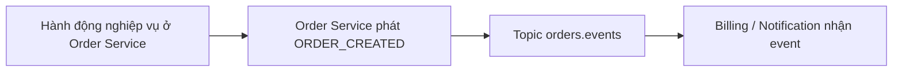
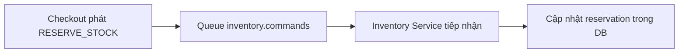
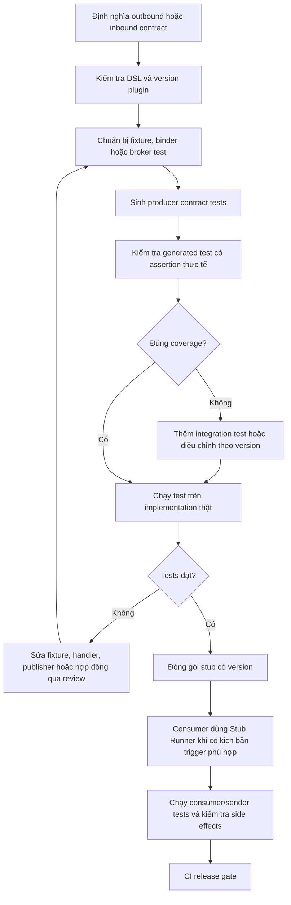

# Hợp đồng chỉ phát hoặc chỉ tiếp nhận thông điệp

Trong hệ thống hướng sự kiện (*event-driven*), một dịch vụ không nhất thiết luôn **nhận một thông điệp rồi phát một thông điệp khác**. Có dịch vụ chỉ **phát sự kiện** khi nghiệp vụ xảy ra, chẳng hạn Order Service phát `ORDER_CREATED` để Billing và Notification xử lý. Có dịch vụ chủ yếu **tiếp nhận lệnh hoặc sự kiện** rồi cập nhật trạng thái nội bộ mà **không phát phản hồi trực tiếp**, chẳng hạn Inventory Service tiếp nhận lệnh giữ hàng và ghi kết quả vào cơ sở dữ liệu.

Với **Spring Cloud Contract**, nhóm producer và consumer có thể mô tả hợp đồng HTTP hoặc thông điệp bằng **Groovy/YAML DSL**, sinh kiểm thử phía cung cấp (*producer verification*), tạo stub, dùng **Stub Runner** và đưa vào CI để phát hiện thay đổi không tương thích. Đối với message contract, cần hiểu chính xác **hướng dữ liệu**, cách kích hoạt ứng dụng, điểm quan sát để assert, và những trường hợp plugin/phiên bản **không sinh kiểm thử như mong đợi**.

Bài thuộc chương **Hợp đồng thông điệp** của lộ trình **SPRING_CLOUD_CONTRACT**, tập trung vào hai dạng **chỉ phát** (*outbound-only*) và **chỉ tiếp nhận** (*inbound-only*). Các ví dụ dùng message broker hoặc Spring messaging adapter, nhưng ngữ nghĩa và tên destination cần được điều chỉnh theo **Spring Cloud Contract Verifier, Spring Cloud Stream/Spring Integration và binder phiên bản dự án**.

## 1. Vì sao không phải hợp đồng nào cũng có cả input và output?

Hợp đồng HTTP quen thuộc có dạng request → response. Với messaging, một thông điệp có thể được phát sau hành động nội bộ hoặc một dịch vụ có thể nhận thông điệp để tạo **tác dụng phụ**, không gửi message trả lời ngay.

Ba mô hình cần phân biệt:

| Mô hình | Bắt đầu từ đâu? | Điều quan sát/kiểm chứng | Ví dụ |
|---|---|---|---|
| **Chỉ phát** (*output-only*) | Một phương thức/event trong producer được kích hoạt | Message được gửi tới destination, đúng header/body | Order Service phát `ORDER_CREATED` |
| **Chỉ tiếp nhận** (*input-only*) | Một message đến từ input destination | Handler nhận đúng dữ liệu và tạo side effect/đáp ứng assertion | Inventory Service nhận `RESERVE_STOCK` và ghi trạng thái |
| **Nhận rồi phát** (*input-to-output*) | Message vào | Message phản hồi hoặc event khác được phát | Inventory nhận `RESERVE_STOCK` rồi phát `STOCK_RESERVED` |

Từ **producer** trong Spring Cloud Contract thường chỉ **ứng dụng đang được kiểm chứng**, không nhất thiết đồng nghĩa nó chỉ gửi message. Một ứng dụng có thể vừa là **consumer của một topic đầu vào**, vừa là **producer của event đầu ra**. Vì thế, hãy nói rõ “producer của hợp đồng” và “dịch vụ phát message” khi thảo luận.

### 1.1. Hai hướng dữ liệu





Ở mô hình thứ hai, **không thấy message đầu ra** không có nghĩa **không có kết quả nghiệp vụ**. Kết quả có thể là bản ghi database, chỉ số vận hành, một HTTP query về trạng thái sau đó hoặc một side effect khác. Điều kiện kiểm thử phải chỉ ra **điểm quan sát nào được phép kiểm chứng**.

## 2. Các khái niệm cốt lõi trong message DSL

Một hợp đồng message thường có các thành phần sau; không phải hợp đồng nào cũng cần đủ tất cả:

| Thành phần | Ý nghĩa | Lưu ý |
|---|---|---|
| `label` | Nhãn định danh kịch bản, hữu ích khi kích hoạt message stub | Đặt ổn định, tránh trùng |
| `input` | Mô tả nguồn kích hoạt hoặc message đầu vào | Không có nghĩa mọi contract đều phải có message từ broker |
| `triggeredBy(...)` | Gọi phương thức hook để kích hoạt **producer tự phát message** | Thường dùng trong dạng chỉ phát |
| `messageFrom(...)` | Nguồn/destination nhận message đầu vào | Thường dùng khi kiểm chứng message consumer/handler |
| `messageBody(...)` | Payload message đầu vào | Cần đúng kiểu/serialization được consumer mong đợi |
| `messageHeaders { ... }` | Header message đầu vào | Có thể bao gồm content type, event version, correlation ID |
| `assertThat(...)` | Hook assertion đối với tác dụng phụ/xử lý message đầu vào theo DSL được hỗ trợ | Kiểm tra cú pháp và mã sinh theo phiên bản |
| `outputMessage` | Mô tả message producer phát ra | Có thể vắng mặt trong thiết kế input-only khi phiên bản hỗ trợ |
| `sentTo(...)` | Destination message đầu ra | Không đồng nghĩa với HTTP URL |
| `body(...)`, `headers { ... }` | Payload và header message đầu ra | Kiểm tra định dạng và các matcher cần thiết |

**Quan trọng:** `triggeredBy(...)` và `messageFrom(...)` **không thay thế cho nhau**. `triggeredBy` diễn tả một thao tác nội bộ mà generated producer test thực hiện để ứng dụng phát message. `messageFrom` diễn tả một thông điệp được đưa vào ứng dụng từ kênh nhận.

### 2.1. So sánh luồng generated tests

| Bước | Dạng chỉ phát | Dạng chỉ tiếp nhận |
|---|---|---|
| Chuẩn bị | Seed dữ liệu để hook nghiệp vụ chạy | Seed dữ liệu để handler xử lý message |
| Kích hoạt | Generated test gọi hook `triggeredBy` | Test/hạ tầng gửi message vào `messageFrom` |
| Quan sát | Message ở `sentTo` | Side effect/hook assertion của handler |
| Assertion chính | Destination, headers, body của message đầu ra | Kết quả xử lý đầu vào theo khả năng hỗ trợ |
| Stub phía consumer | Có thể trigger message mẫu theo `label` | Không tự có message để “trả về”; cần chiến lược kiểm thử sender riêng |

Dạng **input-only** cần đặc biệt thận trọng: **việc không khai báo `outputMessage` không bảo đảm mọi phiên bản plugin sẽ sinh một test đầy đủ**. Chỉ dùng ví dụ này khi phiên bản Spring Cloud Contract hỗ trợ khai báo input kèm assertion hoặc có một cơ chế kiểm tra side effect tương đương. Sau khi sinh tests, phải **đọc generated source** để xác minh đã thực sự có assertion.

## 3. Kịch bản thực tế dùng xuyên suốt

Giả sử hệ thống thương mại điện tử có ba dịch vụ:

- **Order Service**: quản lý đơn hàng và phát sự kiện `ORDER_CREATED`.
- **Billing Service**: tiếp nhận `ORDER_CREATED` để chuẩn bị quy trình thanh toán.
- **Inventory Service**: tiếp nhận lệnh `RESERVE_STOCK` và ghi reservation vào database.

Dữ liệu được thống nhất cho bài học:

| Trường | Giá trị fixture |
|---|---|
| Mã đơn hàng | `ORDER-42` |
| Mã khách hàng | `CUSTOMER-7` |
| Mã sản phẩm | `SKU-42` |
| Số lượng | `2` |
| Mã sự kiện | `EVENT-ORDER-42` |
| Mã lệnh | `CMD-RESERVE-42` |
| Event type | `ORDER_CREATED` |
| Command type | `RESERVE_STOCK` |

Một message đầu ra từ Order Service:

```json
{
  "eventId": "EVENT-ORDER-42",
  "eventType": "ORDER_CREATED",
  "orderId": "ORDER-42",
  "customerId": "CUSTOMER-7",
  "sku": "SKU-42",
  "quantity": 2
}
```

Một message đầu vào của Inventory Service:

```json
{
  "commandId": "CMD-RESERVE-42",
  "commandType": "RESERVE_STOCK",
  "orderId": "ORDER-42",
  "sku": "SKU-42",
  "quantity": 2
}
```

Các giá trị trên là **fixture kiểm thử**, không phải dữ liệu sản xuất. Trong môi trường thật, ID có thể thay đổi theo request; contract có thể dùng matcher phù hợp thay cho kiểm tra toàn bộ ID cố định nếu consumer không phụ thuộc vào giá trị chính xác.

## 4. Hợp đồng chỉ phát thông điệp — outbound-only

Khi Order Service phát `ORDER_CREATED` sau một thao tác nghiệp vụ, bài kiểm thử cần:

1. Chuẩn bị đơn hàng `ORDER-42` trong trạng thái phù hợp.
2. Kích hoạt phương thức ứng dụng thực tế.
3. Quan sát message được phát ra destination dự kiến.
4. So khớp header, event type và payload theo hợp đồng.

Đối với Spring Cloud Contract Groovy DSL, mô hình phổ biến là `input { triggeredBy(...) }` kết hợp `outputMessage`.

### 4.1. Groovy DSL: phát `ORDER_CREATED`

```groovy
import org.springframework.cloud.contract.spec.Contract

Contract.make {
    name 'billing_order_created_event_v1'
    label 'billing_order_created_v1'
    description 'Order Service phát sự kiện khi đơn hàng được tạo'

    input {
        triggeredBy('publishOrderCreated()')
    }

    outputMessage {
        sentTo('orders.events')
        headers {
            header('contentType', 'application/json')
            header('eventType', 'ORDER_CREATED')
        }
        body(
            eventId: 'EVENT-ORDER-42',
            eventType: 'ORDER_CREATED',
            orderId: 'ORDER-42',
            customerId: 'CUSTOMER-7',
            sku: 'SKU-42',
            quantity: 2
        )
    }
}
```

Đoạn này minh họa một **hợp đồng chỉ phát** mặc dù vẫn xuất hiện khối `input`: `input` ở đây chứa **lời gọi phương thức nội bộ**, không phải một message từ queue. Đó là lý do không nên kết luận “hợp đồng có input thì phải nhận message từ broker”.

Ý nghĩa các phần:

- `name`: tên contract để sinh test và truy vết.
- `label`: nhận diện kịch bản phát event cho một số cơ chế Stub Runner.
- `triggeredBy('publishOrderCreated()')`: generated test cần gọi được phương thức `publishOrderCreated`.
- `sentTo('orders.events')`: destination được producer phát ra, sau khi đối chiếu cấu hình binder.
- `headers` và `body`: các dữ liệu mà Billing dựa vào để deserialize và xử lý event.

### 4.2. Base test cung cấp hook kích hoạt

Ví dụ hướng cấu trúc ở phía producer:

```java
import org.springframework.beans.factory.annotation.Autowired;
import org.springframework.boot.test.context.SpringBootTest;

@SpringBootTest
public abstract class OrderMessageContractBase {

    @Autowired
    private OrderApplicationService orderApplicationService;

    public void publishOrderCreated() {
        orderApplicationService.publishCreatedEvent("ORDER-42");
    }
}
```

`OrderApplicationService` và `publishCreatedEvent` là **mã dự án tự hiện thực**, không phải Spring Cloud Contract API. Trước khi hook được gọi, fixture cần bảo đảm `ORDER-42` có trạng thái hợp lệ và môi trường message/binder đã sẵn sàng.

Để producer verification có ý nghĩa, hook nên gọi **luồng nghiệp vụ phát sự kiện thật**. Không nên sửa hook thành đoạn tự tạo một payload JSON mẫu rồi gửi thẳng tới mock channel nếu mục tiêu là kiểm chứng logic phát event của Order Service.

Tùy phiên bản Spring Cloud Contract và test mode messaging, base class có thể cần thêm **MessageVerifier, Spring Cloud Stream binder, Spring Integration hoặc broker test infrastructure**. Chỉ có phương thức hook chưa đủ để khẳng định generated test sẽ nhận được message.

### 4.3. Dạng YAML minh họa cho chỉ phát

Những phiên bản có YAML message DSL tương ứng có thể diễn đạt cấu trúc như sau:

```yaml
name: billing_order_created_event_v1
label: billing_order_created_v1
description: Order Service phát sự kiện khi đơn hàng được tạo
input:
  triggeredBy: publishOrderCreated()
outputMessage:
  sentTo: orders.events
  headers:
    contentType: application/json
    eventType: ORDER_CREATED
  body:
    eventId: EVENT-ORDER-42
    eventType: ORDER_CREATED
    orderId: ORDER-42
    customerId: CUSTOMER-7
    sku: SKU-42
    quantity: 2
```

Đây là **biểu diễn minh họa cần đối chiếu schema YAML đúng phiên bản**, đặc biệt ở `triggeredBy` và cấu trúc `headers`. Sau khi plugin xử lý, phải kiểm tra mã sinh và mapping stub, không dựa vào việc YAML parser chỉ báo cú pháp hợp lệ.

Trong dự án thực hành, chọn **một nguồn Groovy hoặc YAML** cho cùng kịch bản `ORDER_CREATED`; nạp cả hai dễ tạo generated tests/message stubs trùng.

## 5. Điều gì được xác minh trong hợp đồng chỉ phát?

Producer test thường cần kiểm tra:

- **Có message** được phát từ hành động đã kích hoạt.
- **Destination** tương ứng với cam kết.
- **Header bắt buộc** có mặt và đúng giá trị hoặc matcher.
- **Payload** có schema/kiểu/giá trị nghiệp vụ phù hợp.
- **Không phát sai event type** khi consumer dựa vào `eventType` để điều hướng.

Ví dụ, nếu Billing sử dụng `orderId`, `quantity` và `eventType`, các trường đó là phần hợp đồng quan trọng. Nếu một refactor đổi `quantity` từ số nguyên thành chuỗi, producer verification cần phát hiện lỗi.

Mặc dù message được phát qua cơ chế async, test không nên chỉ kiểm tra “publisher method chạy không ném exception”. Điều này **chưa chứng minh** message tới đúng destination hoặc chứa đúng body. Generated test phải quan sát được thông điệp qua verifier/binder đã cấu hình.

### 5.1. Một message hay nhiều message?

Có các hành vi khác nhau:

| Hành vi thực tế | Test cần quan sát |
|---|---|
| Phát đúng một `ORDER_CREATED` | Event type/body và số message phù hợp nếu đó là cam kết |
| Phát cả `ORDER_CREATED` và event audit | Không nhầm event audit thành event hợp đồng |
| Phát trùng do retry | Xác định at-least-once semantics và khả năng idempotent |
| Phát không theo thứ tự | Không ép thứ tự nếu broker không cam kết |
| Phát vào partition khác | Kiểm tra key/partition khi consumer thật sự phụ thuộc |

Contract Verifier thường kiểm tra **message được mong đợi** theo cấu hình. Nếu sản phẩm có yêu cầu “không bao giờ phát thêm message khác”, có thể cần kiểm thử producer integration riêng để bảo vệ số lượng hoặc absence; không mặc định một contract output message duy nhất đã kiểm tra toàn bộ các sự kiện phát ra.

## 6. Hợp đồng chỉ tiếp nhận thông điệp — inbound-only

Đây là mô hình Inventory Service **nhận một lệnh** `RESERVE_STOCK` từ `inventory.commands`, kiểm tra dữ liệu, rồi cập nhật trạng thái reservation. Nó không bắt buộc phát một message trả lời ngay.

```text
Checkout / Order Service
       |
       | RESERVE_STOCK
       v
inventory.commands
       |
       v
Inventory Service
       |
       +--> validate sku, quantity
       +--> create reservation in database
       +--> no direct output message required
```

Kiểm thử dạng này cần xác minh **handler thật đã xử lý message**, chứ không chỉ có một message được gửi tới topic. Nếu test không có điểm assert output, cần một **hook kiểm tra side effect** hoặc bài integration test bổ sung.

### 6.1. Groovy DSL: input với side-effect assertion

Đối với những phiên bản Spring Cloud Contract hỗ trợ **input message và `assertThat` nhưng không yêu cầu `outputMessage`**, dạng mô tả có thể là:

```groovy
import org.springframework.cloud.contract.spec.Contract

Contract.make {
    name 'inventory_reserve_stock_inbound_v1'
    description 'Inventory tiếp nhận lệnh giữ hàng và cập nhật reservation'

    input {
        messageFrom('inventory.commands')
        messageBody(
            commandId: 'CMD-RESERVE-42',
            commandType: 'RESERVE_STOCK',
            orderId: 'ORDER-42',
            sku: 'SKU-42',
            quantity: 2
        )
        messageHeaders {
            header('contentType', 'application/json')
        }
        assertThat('reservationWasCreated()')
    }
}
```

Các điểm cần hiểu:

- `messageFrom` là nguồn message **đầu vào**, không phải destination của output message.
- `messageBody` và `messageHeaders` quy định một message dùng để kích hoạt consumer/handler phía producer.
- `assertThat('reservationWasCreated()')` dự kiến tham chiếu logic kiểm tra trạng thái sau xử lý.
- **Không khai báo `outputMessage`** vì kịch bản không cam kết phát message phản hồi.

**Cảnh báo phiên bản:** đây là **mẫu có điều kiện**, không phải tuyên bố rằng mọi phiên bản Groovy DSL đều hỗ trợ hợp đồng chỉ có input/`assertThat` hoặc sinh được một assertion side effect đúng như mong muốn. Hãy kiểm tra tài liệu của **phiên bản Spring Cloud Contract Verifier đang ghim** rồi sinh thử test. Nếu generated test bị bỏ qua, không gọi hook hoặc không assert side effect, phải bổ sung một **message-consumer integration test** riêng và không báo producer verification đã bao phủ kịch bản.

### 6.2. YAML DSL: khai báo ý định tương đương

Ví dụ YAML mang tính tham khảo về cấu trúc:

```yaml
name: inventory_reserve_stock_inbound_v1
description: Inventory nhận lệnh giữ hàng
input:
  messageFrom: inventory.commands
  messageBody:
    commandId: CMD-RESERVE-42
    commandType: RESERVE_STOCK
    orderId: ORDER-42
    sku: SKU-42
    quantity: 2
  messageHeaders:
    contentType: application/json
  assertThat: reservationWasCreated()
```

Chỉ sử dụng dạng này khi **schema YAML đúng phiên bản có hỗ trợ `input.assertThat` và input-only**. Nếu schema chỉ hỗ trợ kiểu message input-to-output, **không tự thêm một `outputMessage` giả** để làm plugin chấp nhận vì việc đó thay đổi ý nghĩa hợp đồng. Trong trường hợp công cụ chưa hỗ trợ, giữ việc kiểm tra message consumer bằng test tích hợp độc lập và ghi rõ giới hạn contract coverage.

### 6.3. Hook assertion phải kiểm tra một trạng thái có thể quan sát

Ví dụ kiểm tra reservation sau khi message handler xử lý:

```java
public abstract class InventoryMessageContractBase {

    @Autowired
    InventoryTestRepository testRepository;

    public boolean reservationWasCreated() {
        return testRepository.hasReservation(
            "ORDER-42",
            "SKU-42",
            2
        );
    }
}
```

**Đây là mô tả ý tưởng về hook**, không phải cam kết signature `boolean` phù hợp tất cả phiên bản generator. Trong dự án thật, phải xem generated source: phương thức `assertThat` được gọi ra sao, có cần trả `boolean` hay một assertion method và có cần visibility/package khác không. `InventoryTestRepository` là helper do dự án tự viết.

Nếu handler chạy **bất đồng bộ**, gọi repository ngay sau khi gửi message có thể thấy chưa ghi dữ liệu và gây flaky test. Khi đó dùng cơ chế **chờ theo điều kiện có timeout giới hạn** trong test infrastructure, ví dụ Awaitility hoặc StepVerifier thích hợp, không dùng `Thread.sleep` mù.

### 6.4. Thế nào là “tiếp nhận thành công” nếu không có output?

Một hợp đồng inbound-only phải thống nhất điểm quan sát. Có thể là:

| Side effect | Kiểm tra đề xuất |
|---|---|
| Reservation được tạo | Có record theo `orderId`, `sku`, `quantity` |
| Cập nhật trạng thái đơn hàng | Record chuyển từ `PENDING` sang `RESERVED` |
| Gọi external API | Adapter/mock endpoint được gọi đúng dữ liệu, khi boundary có chủ đích |
| Đưa message vào hàng lỗi | Message được dead-letter hoặc có trạng thái lỗi theo policy |
| Ghi audit record | Audit chứa event ID và kết quả xử lý |
| Không thay đổi khi nhận trùng event | Không tạo reservation thứ hai với cùng `commandId` |

Việc **không có output message** không có nghĩa mọi hành vi của handler đều nằm trong Spring Cloud Contract DSL. Các kiểm tra về DB transaction, duplicate delivery, rollback và dead-letter routing thường phù hợp với **integration tests chuyên biệt**.

## 7. Hợp đồng nhận rồi phát khác input-only ở đâu?

Để phân biệt, xét mô hình Inventory nhận lệnh giữ hàng rồi phát `STOCK_RESERVED`:

```groovy
import org.springframework.cloud.contract.spec.Contract

Contract.make {
    name 'inventory_reservation_emits_event_v1'
    label 'inventory_reserved_v1'

    input {
        messageFrom('inventory.commands')
        messageBody(
            orderId: 'ORDER-42',
            sku: 'SKU-42',
            quantity: 2
        )
    }

    outputMessage {
        sentTo('inventory.events')
        body(
            eventType: 'STOCK_RESERVED',
            orderId: 'ORDER-42',
            sku: 'SKU-42',
            quantity: 2
        )
    }
}
```

Đây **không còn là input-only**: producer đã cam kết phát message thứ hai. Kiểm thử có thể gửi message đầu vào và kiểm tra message đầu ra.

Nếu hệ thống Inventory thật sự không phát event, **đừng invent `STOCK_RESERVED`** chỉ để ví dụ trông giống request–response. Làm thế sẽ biến một contract xác nhận side effect nội bộ thành một contract về giao thức message không tồn tại.

## 8. Chuẩn bị base test và hạ tầng messaging

Các hợp đồng message có thể yêu cầu:

1. **Spring application context** để gọi business service hoặc nạp message handler.
2. **Message verifier** hay adapter phù hợp với Contract Verifier.
3. **Binder/broker thử nghiệm** như Spring Cloud Stream test binder hoặc broker Testcontainers, tùy kiến trúc và phiên bản.
4. **Fixture dữ liệu** để handler/publisher thực thi kịch bản xác định.
5. **Hook kích hoạt/assertion** ở base test.
6. **Chờ message/side effect hoàn tất** với timeout hợp lý.
7. **Isolation/cleanup** để test không nhận message từ lần chạy trước.

Khác với HTTP contract, message không nhất thiết được xử lý ngay khi phương thức gửi trả về. Các message brokers có thể giao hàng ít nhất một lần, làm trễ hoặc phát lại. Vì vậy, base test cần bảo đảm thông điệp quan sát đúng **correlation key** và môi trường không có dữ liệu tồn dư.

### 8.1. Chọn đúng test binder hoặc broker

| Chiến lược | Ưu điểm | Giới hạn |
|---|---|---|
| In-memory/test binder | Nhanh, dễ tái lập, không cần broker ngoài | Không chứng minh mọi đặc tính broker thật |
| Embedded broker hoặc Testcontainers | Gần mô hình gửi/nhận thật | Khởi động lâu hơn, cần cô lập và cleanup |
| Spring Integration message channel test | Hữu ích cho các luồng integration nội bộ | Có thể không phản ánh đầy đủ binder/broker |
| Mock publisher/consumer adapter | Tập trung lớp nghiệp vụ | Không chứng minh routing/serialization cuối đường |
| Broker dùng chung ở môi trường tích hợp | Có thể kiểm chứng nhiều thành phần | Dễ flakiness và ảnh hưởng chéo, không phù hợp contract tests lặp lại nếu không quản lý chặt |

Không mặc định tên logical binding trong Spring Cloud Stream, ví dụ `orderEvents-out-0`, bằng tên destination vật lý `orders.events`. Cấu hình binder có thể ánh xạ tên binding sang topic/queue. `sentTo` và `messageFrom` phải được kiểm chứng theo **hệ thống nhận diện destination của Verifier/binder phiên bản đang dùng**.

### 8.2. Functional bean không đồng nghĩa contract DSL

Spring Cloud Stream hiện đại thường dùng các bean functional như `Supplier<T>`, `Function<T,R>` và `Consumer<T>`. Chẳng hạn:

```java
@Bean
Consumer<ReserveStockCommand> reserveStock(InventoryService service) {
    return command -> service.reserve(
        command.orderId(),
        command.sku(),
        command.quantity()
    );
}
```

Đoạn trên minh họa **message handler của ứng dụng**; `ReserveStockCommand` và `InventoryService` là mã dự án. `Consumer<T>` trong Spring Cloud Stream là chức năng xử lý đầu vào; nó **không tự động tạo Contract.make** hoặc producer tests.

Contract Verifier cần được kết nối đúng với message binding để gửi test message tới bean này. Với một bản Spring Cloud Stream hoặc Contract Verifier khác, cơ chế integration, dependency và cấu hình test binder có thể thay đổi.

## 9. Stub Runner giúp consumer kiểm thử hai dạng hợp đồng như thế nào?

**Stub Runner** được dùng để cung cấp stub mà consumer có thể dựa vào để kiểm thử độc lập với producer. Tuy nhiên, với message contracts, hướng tương tác quyết định khả năng kiểm tra.

### 9.1. Chỉ phát: Stub Runner có thể phát message mẫu

Khi Order Service cam kết phát `ORDER_CREATED`, consumer Billing muốn kiểm tra code lắng nghe event:

1. Nạp stub artifact của Order Service.
2. Thiết lập message stub infrastructure tương thích với binder/channel.
3. Kích hoạt kịch bản theo **label** như `billing_order_created_v1`, nếu API Stub Runner và phiên bản đang dùng hỗ trợ.
4. Nhận message stub trên destination của consumer test.
5. Xác minh Billing deserialize payload và xử lý event đúng.

Một số phiên bản Stub Runner cung cấp API kích hoạt label thông qua `StubTrigger` hoặc cơ chế tương đương. Ví dụ định hướng:

```java
@Autowired
StubTrigger stubTrigger;

@Test
void shouldHandleCreatedOrder() {
    stubTrigger.trigger("billing_order_created_v1");

    // Chờ và kiểm tra Billing đã xử lý ORDER_CREATED.
    // Dùng test fixture và timeout thích hợp.
}
```

Các import/annotation và khả năng trigger cụ thể phụ thuộc dependency/phiên bản. Trước khi dùng, xác nhận stub artifact chứa **message contract có label** và binder/transport đang hoạt động. Một lời gọi `trigger(...)` không có nghĩa consumer đã xử lý message; phải có assertion side effect phía Billing.

### 9.2. Chỉ tiếp nhận: không có message đầu ra để stub phát

Nếu Inventory Service chỉ nhận `RESERVE_STOCK` và cập nhật DB, **không có output message** cho Stub Runner phát tới Checkout. Vì vậy, không nên giả định có thể dùng cùng `label`/`StubTrigger` như dạng chỉ phát để xác minh toàn bộ luồng.

Ở phía **sender** (dịch vụ phát command), kiểm tra:

- Client/publisher gửi tới đúng logical destination.
- Payload/header đúng contract và schema.
- Correlation/message ID phù hợp.
- Retry hoặc lỗi publish được xử lý theo chính sách.

Ở phía **Inventory Service**, kiểm tra:

- Handler thực nhận message.
- Validation và side effect đúng với payload.
- Error handling/idempotency theo các integration tests cần thiết.

Tùy phiên bản Stub Runner và binder, có thể có cơ chế mô phỏng kênh nhận hoặc xác minh gửi message; nhưng phải **chứng minh bằng một bài test cụ thể**, không tuyên bố chung rằng một input-only contract tự tạo stub phản hồi.

### 9.3. Stub xanh không chứng minh producer thật hoạt động

Producer verification và consumer stub test kiểm tra **hai đối tượng khác nhau**:

| Kiểm tra | Hệ thống đang chạy | Điều chứng minh |
|---|---|---|
| Outbound producer test | Order Service thật + test message infrastructure | Ứng dụng phát message theo hợp đồng |
| Inbound receiver test | Inventory Service thật + input message test | Handler thực xử lý payload theo ngữ nghĩa đã kiểm tra |
| Stub Runner test | Billing/Checkout thật + stub mô phỏng | Consumer/sender dùng đúng message contract trong kịch bản stub |
| End-to-end | Các dịch vụ + broker/DB thật | Tích hợp xuyên suốt và các đặc tính transport |

Việc producer phát message qua message verifier giả không chứng minh cấu hình production Kafka/RabbitMQ luôn đúng; cần integration/E2E khi các đặc tính đó là yêu cầu.

## 10. Matchers và dữ liệu động trong message-only contract

Nhiều message có trường động:

```json
{
  "eventId": "9bc155de-98b0-4fc2-8bfb-85423b71a3b0",
  "eventType": "ORDER_CREATED",
  "occurredAt": "2026-01-15T09:30:00Z",
  "orderId": "ORDER-42"
}
```

**Không nên cố định một UUID thật ngẫu nhiên** từ lần chạy trước vào contract producer test rồi buộc mọi lần publish phải giống thế. Có thể:

- Cố định test ID generator hoặc Clock trong môi trường producer verification.
- Dùng dual values và matcher theo kiểu/regex trong DSL **nếu vị trí message body và phiên bản hỗ trợ**.
- Để stub gửi giá trị mẫu ổn định cho consumer, còn producer test kiểm tra quy tắc định dạng.
- Giữ kiểm tra chính xác cho `eventType` và các field nghiệp vụ quan trọng.

### 10.1. Tránh matcher quá rộng

| Trường | Matcher yếu | Ràng buộc hợp lý hơn |
|---|---|---|
| `eventType` | Bất kỳ chuỗi | Chính xác `ORDER_CREATED` |
| `orderId` | `.*` | Non-empty và/hoặc format ID đã cam kết |
| `quantity` | Bất kỳ giá trị | Số nguyên dương phù hợp nghiệp vụ |
| `occurredAt` | Bất kỳ chuỗi | Timestamp đúng định dạng/timezone; hoặc Clock cố định |
| `contentType` | Không kiểm tra | Giá trị được công bố, ví dụ JSON |
| `eventVersion` | Bỏ qua | Giá trị version tương thích với consumer |

Matcher cho message body/header không hoàn toàn giống matcher HTTP JSONPath, và cú pháp có thể khác giữa Groovy và YAML cũng như giữa các dòng Spring Cloud Contract. Phải dùng tài liệu của **version đang chạy**, sinh test và xem assertion thực tế.

### 10.2. Tránh nhầm message ID với label

- `eventId`: dữ liệu của **một instance** sự kiện; có thể sinh ngẫu nhiên.
- `label`: định danh **kịch bản stub**, nên ổn định giữa các builds và consumer tests.
- `commandId`: khóa idempotency/correlation của lệnh; test nên quản lý rõ.

Đừng ghép timestamp/UUID ngẫu nhiên vào `label` vì consumer test sẽ không biết phải trigger kịch bản nào.

## 11. Thử lại, trùng message và idempotency

Trong messaging, một broker có thể redeliver message. Khi một service chỉ tiếp nhận lệnh, rủi ro là cùng `CMD-RESERVE-42` tạo **hai reservation**. Khi một service chỉ phát event, rủi ro là publisher retry làm consumer nhận trùng.

Cần phân biệt:

- **Hợp đồng schema và routing:** event type, payload, headers, destination.
- **Hợp đồng nghiệp vụ idempotency:** cùng command ID nhiều lần không tạo side effect trùng.
- **Đặc tính delivery của broker:** at-most-once, at-least-once, partition ordering, retries, dead-letter queue.

Không mặc định một message contract với một payload đã chứng minh idempotency hoặc exactly-once. Nếu nghiệp vụ yêu cầu, bổ sung integration test gửi cùng message hai lần trong một kịch bản có kiểm soát, rồi assert số bản ghi/trạng thái. Có thể dùng contract cho định dạng input, nhưng bài test idempotency thường cần kiểm tra **workflow có trạng thái** riêng.

### 11.1. Test message lỗi

Một inbound-only handler có thể từ chối:

- Thiếu `orderId`.
- `quantity <= 0`.
- Không có SKU trong catalog.
- Event/command version chưa được hỗ trợ.

Tùy chính sách, handler có thể ném lỗi, retry, bỏ qua có log, dead-letter message hoặc ghi trạng thái failure. Vì không có response message trực tiếp, **không thể mặc định mapping HTTP `400`/`409`** cho các trường hợp này. Cần định nghĩa rõ kết quả quan sát ở message/broker/DB và viết test phù hợp.

## 12. Mối liên hệ với hợp đồng HTTP

Một dịch vụ thường vừa cung cấp HTTP endpoint vừa phát message. Ví dụ:

```text
POST /api/orders
    |
    +--> HTTP 201 Created
    |
    +--> emit ORDER_CREATED to orders.events
```

Có ít nhất **hai cam kết**:

1. HTTP response: status `201`, header `Location`, JSON order ID.
2. Message output: event type, order ID, payload và destination.

Đôi khi cả hai xảy ra trong cùng một luồng nghiệp vụ, nhưng không nhất thiết nên gộp toàn bộ vào một hợp đồng khó bảo trì. Có thể viết **HTTP contract** và **message contract** riêng, cộng thêm integration test bảo đảm quan hệ giữa response ID và event ID.

**Cẩn trọng:** nếu trigger message contract gọi trực tiếp `publishCreatedEvent` và bỏ qua HTTP create-order flow, producer message test có thể đạt dù HTTP controller không gọi publisher. Khi quan hệ giữa hai luồng là yêu cầu quan trọng, hãy kiểm thử **đúng entry point nghiệp vụ** hoặc thêm bài integration xuyên suốt.

## 13. Kiểm soát state khi kiểm thử message-only

Message tests dễ bị ảnh hưởng bởi dữ liệu dùng chung và bất đồng bộ.

| Nguồn flakiness | Biểu hiện | Biện pháp |
|---|---|---|
| Broker còn message cũ | Test nhận event không thuộc kịch bản | Dùng topic/consumer group riêng, correlation ID |
| Listener chưa khởi động | Test timeout mặc dù producer có phát | Chờ readiness hoặc cấu hình binder đúng |
| Fixture DB chưa hoàn tất | Inbound handler báo không có SKU | Seed trước khi gửi input và chờ hoàn tất |
| Message được xử lý async | Assertion chạy quá sớm | Await theo điều kiện với timeout giới hạn |
| Cùng `commandId` giữa các tests | Idempotency state làm handler bỏ qua message | Reset/cô lập state theo test |
| Test chạy song song | Cùng queue/group nhận nhầm message | Namespace hoặc broker instance riêng |
| Clock/token test thay đổi | Header/validation bất ngờ sai | Clock và test credentials có kiểm soát |
| Stub mappings/message labels trùng | Trigger sai kịch bản | Quy ước đặt label và version rõ ràng |

Không chỉ dùng `Thread.sleep(1000)` rồi hy vọng mọi event đã đến. Chờ một **điều kiện quan sát được**, có timeout và thông báo lỗi rõ. Đồng thời giữ test data không chứa PII/token production.

## 14. Cấu hình và tương thích phiên bản

Spring Cloud Contract có thể tích hợp nhiều hệ thống messaging; cách liên kết với Spring Cloud Stream, Spring Integration và broker thay đổi theo phiên bản. Việc một ứng dụng dùng Spring Cloud Stream functional beans **không tự bảo đảm** mọi message contract được plugin nhận diện và sinh test đúng.

Một checklist trước khi triển khai:

1. Chốt **Spring Boot**, Spring Cloud release train và Spring Cloud Contract Verifier/plugin phù hợp.
2. Chọn **Groovy hay YAML DSL** có khả năng diễn đạt kịch bản yêu cầu.
3. Đọc phần **Messaging Contract DSL** của tài liệu **đúng version**.
4. Kiểm tra `triggeredBy`, `messageFrom`, `messageBody`, `messageHeaders`, `assertThat` và có/không có `outputMessage`.
5. Chọn message verifier/binder/test broker thích hợp.
6. Cấu hình base class/hook và data fixture.
7. Sinh producer tests, **đọc generated source** và chạy thật.
8. Kiểm tra stub artifact/message trigger theo version.
9. Bổ sung integration tests khi chỉ dùng contract chưa kiểm chứng hết side effects.
10. Gắn producer verification và consumer tests vào CI.

Nguồn tham khảo chính thức để đối chiếu bản cụ thể:

- [Spring Cloud Contract Reference](https://docs.spring.io/spring-cloud-contract/reference/)
- [Spring Cloud Release Trains](https://spring.io/projects/spring-cloud)
- [Spring Boot System Requirements](https://docs.spring.io/spring-boot/system-requirements.html)

Nếu build không nhận một cú pháp input-only, **không nên ép nó thành input-to-output bằng message giả**. Giữ kịch bản kiểm thử đúng bằng một integration test có điểm quan sát rõ, và chỉ dùng contract ở phần Verifier phiên bản đó hỗ trợ.

## 15. Tích hợp CI cho chỉ phát/chỉ nhận

Luồng kiểm chứng đề xuất:



Trước khi cho pipeline xanh:

- Generated producer message tests có được **sinh và chạy** không?
- Hợp đồng **chỉ phát** đã quan sát message thực ở destination chưa?
- Hợp đồng **chỉ tiếp nhận** đã quan sát side effect thật, hay chỉ gửi message rồi kết thúc test?
- Hook `assertThat` có thực sự được gọi và assert đúng điều kiện không?
- Test binder/broker đang nhận message của kịch bản hiện tại chứ không phải message tồn dư?
- Stub Runner có đúng label/message artifact và binder không?
- Nếu input-only không sinh stub phản hồi, consumer/sender có test cách gửi message riêng không?
- Có kiểm thử retry/idempotency/dead-letter khi nghiệp vụ cần không?
- Artifact stub có thể truy vết đến commit, contract và producer build đã được kiểm chứng không?

**Stub artifact có thể tạo ra từ hợp đồng chưa được producer xác minh**, nhưng nó phải được đánh dấu rõ là bản phục vụ phát triển sớm/preview, không được coi là bằng chứng phát hành chính thức.

## 16. Bài thực hành: hai dịch vụ, hai hướng message

Mục tiêu: tạo hai bài kiểm thử message có ngữ nghĩa khác nhau và xác minh đúng phạm vi Contract Verifier.

### Phần A — chỉ phát `ORDER_CREATED`

1. Tạo fixture `ORDER-42` có `customerId=CUSTOMER-7`, `sku=SKU-42`, `quantity=2`.
2. Viết contract Groovy hoặc YAML như mục 4.
3. Đặt `label=billing_order_created_v1` và hook `publishOrderCreated()`.
4. Cấu hình Order Service test base để gọi nghiệp vụ thật, binder/verifier nhận được event.
5. Sinh và chạy producer tests, kiểm tra destination, header và body.
6. Đóng gói stub và để Billing dùng Stub Runner kích hoạt label tương ứng nếu phiên bản hỗ trợ.
7. Xác minh handler Billing nhận đúng `ORDER_CREATED` và cập nhật trạng thái test.

### Phần B — chỉ tiếp nhận `RESERVE_STOCK`

1. Tạo fixture inventory có đủ hàng `SKU-42` cho quantity 2.
2. Viết contract input-only với `messageFrom=inventory.commands`, `messageBody`, `messageHeaders` và hook assertion theo bản Verifier hỗ trợ.
3. Sinh test, **đọc generated code** và xác nhận message thực được đưa vào handler, sau đó có assert side effect.
4. Nếu Verifier không hỗ trợ input-only như mô tả, viết Spring messaging integration test riêng để gửi message tới input destination.
5. Chờ reservation `ORDER-42/SKU-42` xuất hiện với timeout hợp lý.
6. Kiểm tra gửi cùng `commandId` hai lần không tạo hai reservation nếu đó là yêu cầu nghiệp vụ.
7. Không tạo một output message giả chỉ để làm tương thích với generator.

### Phần C — kiểm tra lỗi và CI

1. Thử thiếu field `orderId` hoặc `quantity=-1` trong command.
2. Kiểm tra hành vi từ chối theo policy thực: retry, dead-letter hoặc ghi failure status.
3. Chạy riêng từng test, cả suite và song song nếu môi trường cho phép.
4. Kiểm tra các topic/consumer groups không lẫn message cũ.
5. Ghim Spring Cloud Contract plugin, JDK và stub artifact version.
6. Đưa producer tests, integration tests bổ sung và consumer/sender tests vào CI.

**Tiêu chí hoàn thành:** outbound-only xác minh event thực; inbound-only xác minh việc tiếp nhận và side effect qua cơ chế được hỗ trợ hoặc test bổ sung; không nhầm label với message ID; test lặp lại được và CI không công bố stub chưa kiểm chứng.

## 17. Lỗi thường gặp và cách khắc phục

| Triệu chứng | Nguyên nhân có thể | Hướng xử lý |
|---|---|---|
| `publishOrderCreated()` không tìm thấy | Base class thiếu hook hoặc sai signature/visibility | Đọc generated test, chỉnh base class |
| Hook chạy nhưng không thấy output message | Binder/destination sai, publisher không phát, listener chưa sẵn sàng | Kiểm tra nghiệp vụ và message infrastructure |
| Generated test không sinh cho input-only | Phiên bản DSL/plugin không hỗ trợ mô hình hoặc thiếu điều kiện | Kiểm tra tài liệu/version, bổ sung integration test |
| Input-only test xanh dù DB chưa cập nhật | Không có assertion thực sự hoặc async chưa hoàn tất | Thêm/kiểm tra hook `assertThat` và chờ side effect |
| Message body sai JSON | Serialization hoặc content type không thống nhất | Kiểm tra header/codec và payload đã phát |
| Consumer không trigger được label | Label không có trong artifact hoặc Stub Runner không hỗ trợ cách gọi | Kiểm tra contract, mapping, version và binder |
| Test nhận nhầm sự kiện | Topic/queue còn message hoặc thiếu correlation | Cô lập broker/group và lọc event ID |
| Message duplicate tạo dữ liệu trùng | Handler chưa idempotent hoặc fixture dùng lại command ID | Bổ sung kiểm thử duplicate và cơ chế dedup |
| Test chỉ lỗi trên CI | Broker chưa ready, credentials/test profile khác, race | Cấu hình readiness, fixture và isolation |
| Stub trigger thành công nhưng consumer không xử lý | Message được phát nhưng handler consumer không subscribe hoặc deserialize lỗi | Quan sát side effect ở consumer và kiểm tra binding |
| Test “chỉ nhận” được sửa bằng cách thêm output giả | Hợp đồng đã đổi nghĩa | Bỏ output giả, chọn test strategy đúng |
| Build xanh nhưng không có generated tests | Contract path/plugin task sai hoặc test bị skip | Kiểm tra generated sources, test report, release gate |

## 18. Câu hỏi tự kiểm tra

1. **Dạng chỉ phát có thể có khối `input` không?** Có. `input { triggeredBy(...) }` là hook kích hoạt nội bộ, không đồng nghĩa nhận message từ broker.
2. **`triggeredBy` và `messageFrom` khác gì?** Một bên gọi phương thức để producer phát event, bên kia mô tả nguồn message đi vào handler.
3. **Vì sao input-only không nhất thiết có `outputMessage`?** Vì kết quả nghiệp vụ có thể là side effect trong database, không phát message trực tiếp.
4. **Nếu DSL/input-only không được phiên bản hỗ trợ, có nên thêm output giả không?** Không. Dùng bài integration test có assertion phù hợp và ghi rõ giới hạn.
5. **Hook `assertThat` có tự bảo đảm side effect đúng không?** Chỉ khi generated test thực sự gọi hook và hook assert một trạng thái có ý nghĩa; phải kiểm tra mã sinh.
6. **`label` có phải ID của một instance message không?** Không. Label nhận diện kịch bản; ID instance có thể động.
7. **Stub Runner giúp gì ở dạng chỉ phát?** Có thể trigger event mẫu theo label khi phiên bản và binder hỗ trợ, để consumer kiểm thử handler.
8. **Stub Runner có tự tạo response cho inbound-only không?** Không nên giả định; không có output message thì cần chiến lược kiểm thử sender/receiver riêng.
9. **Vì sao publisher method không ném exception chưa đủ?** Vì chưa chứng minh message đã tới đúng destination hoặc đúng payload.
10. **Message verifier cần kiểm tra broker thật không?** Tùy phạm vi: test binder có thể đủ cho contract, còn đặc tính transport thực cần integration/E2E tests.
11. **Vì sao input-only test cần chờ có timeout?** Vì handler có thể xử lý bất đồng bộ, assertion chạy quá sớm sẽ gây flakiness.
12. **Một test chỉ có message input chứng minh xử lý exactly-once chưa?** Chưa. Duplicate delivery/idempotency cần bài test riêng.
13. **Có thể đặt `eventType` thành matcher `.*` không?** Không nên nếu consumer dựa vào loại event; giữ assertion chính xác.
14. **Một producer vừa có HTTP POST vừa phát event cần kiểm tra gì?** Cam kết HTTP, cam kết message và tương quan giữa hai luồng nếu nghiệp vụ yêu cầu.
15. **Trước khi publish stub chính thức phải xác minh gì?** Producer tests thực sự chạy và có assertions, cùng các integration tests bổ sung cần thiết.
16. **Tại sao destination trong DSL có thể khác binding name trong code?** Binder có thể ánh xạ logical binding sang topic/queue vật lý; phải kiểm tra cấu hình.
17. **Vì sao test broker dùng chung dễ lỗi ngẫu nhiên?** Message tồn dư, consumer group và concurrency có thể khiến test nhận nhầm hoặc thiếu event.
18. **Một hợp đồng inbound-only xanh nhưng handler không thay đổi dữ liệu nói lên điều gì?** Có thể không có assertion side effect hoặc fixture/hook sai; phải kiểm tra điều kiện được thực thi.

## Kết luận

**Hợp đồng chỉ phát** và **hợp đồng chỉ tiếp nhận** là hai hướng messaging khác nhau, không phải hai phiên bản của request–response HTTP. Với Spring Cloud Contract, dạng **chỉ phát** thường dùng `triggeredBy` để kích hoạt producer và `outputMessage` để kiểm tra event; dạng **chỉ tiếp nhận** có thể dùng `messageFrom`, `messageBody` và assertion đối với side effect **khi DSL/Verifier phiên bản dự án hỗ trợ**. Muốn bài test có giá trị, phải kiểm chứng generated tests thực sự chạy, cấu hình binder/broker phù hợp, fixture và trạng thái bất đồng bộ được cô lập, và consumer dùng Stub Runner đúng phạm vi có thể mô phỏng. Kết hợp **producer verification**, **message integration tests**, **stub có phiên bản** và **CI release gate** giúp phát hiện thay đổi thông điệp không tương thích mà không tạo ra những cam kết output không tồn tại trong nghiệp vụ.
