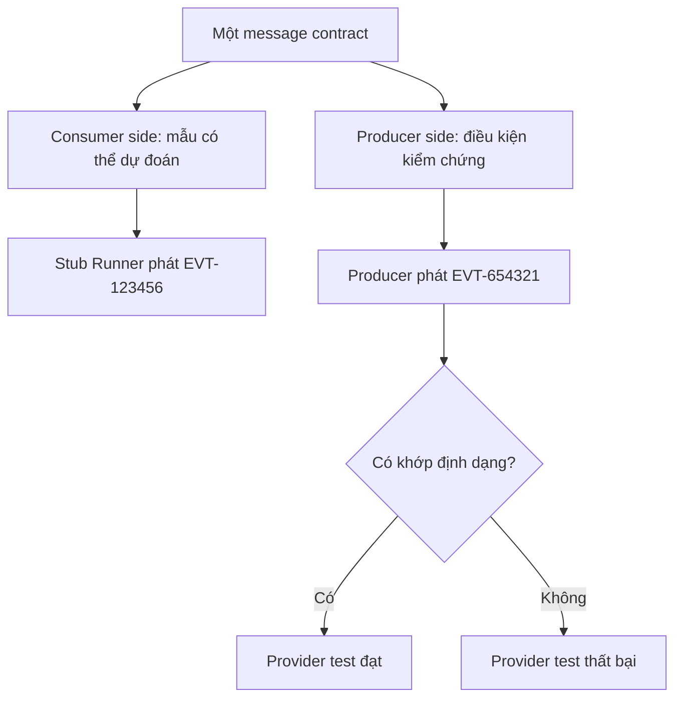
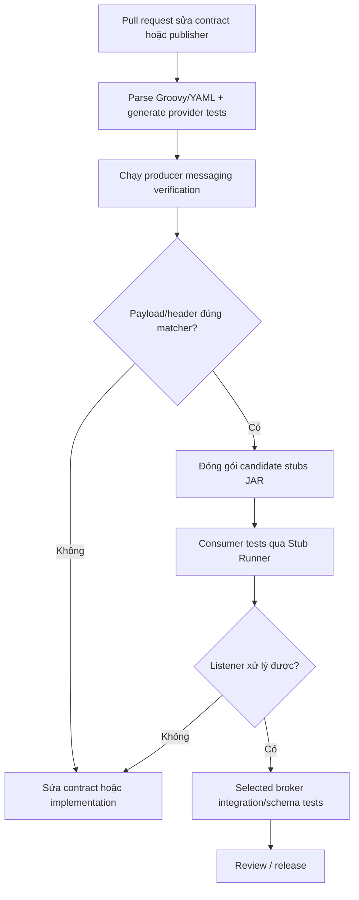

# Giá trị động và matcher trong payload hoặc header của hợp đồng thông điệp

Trong hệ thống microservices, một sự kiện `OrderCreated` thường chứa những trường **không cố định**: `eventId` được sinh ở mỗi lần phát, `occurredAt` theo đồng hồ, `correlationId` thay đổi theo luồng xử lý, và đôi khi `orderId` là định danh mới. Tuy vậy, consumer vẫn cần producer giữ một số cam kết ổn định: **loại sự kiện, schema version, kiểu dữ liệu, cấu trúc payload, định dạng ID và header phục vụ routing/correlation**.

**Spring Cloud Contract (SCC)** cho phép mô tả các cam kết ấy bằng **Groovy DSL hoặc YAML DSL**. Công cụ tạo **provider verification tests** để kiểm tra producer có phát message đúng hợp đồng và **stubs** để consumer kiểm thử qua **Stub Runner**. Khi dữ liệu được sinh động, dùng giá trị chính xác cho mọi field sẽ khiến test quá cứng; nhưng nới tất cả thành matcher `.*` sẽ khiến test không còn nhận diện breaking change.

Bài thuộc chương **Hợp đồng thông điệp** này hướng dẫn sử dụng **giá trị động và matcher trong payload hoặc header** của message contract, đối chiếu giữa phía producer và consumer, đồng thời trình bày những giới hạn khi chỉ dùng stub thay vì broker thực. Ví dụ xuyên suốt dùng `order-producer` phát sự kiện đơn hàng và `order-consumer` nhận sự kiện đó.

## 1. Khung tư duy: một sự kiện gồm những gì?

Giả sử producer gửi sự kiện sau khi tạo đơn hàng:

```json
{
  "eventId": "EVT-123456",
  "eventType": "OrderCreated",
  "schemaVersion": 1,
  "orderId": "ORD-123456",
  "occurredAt": "2026-11-24T03:15:30.123Z",
  "status": "CREATED",
  "totalMinor": 125000,
  "currency": "VND"
}
```

Các message headers minh họa:

```text
contentType: application/json
X-Correlation-Id: corr-123456
X-Producer: order-producer
```

Destination logic: `orders.created`.

Mỗi thành phần giữ một vai trò:

| Thành phần | Ví dụ | Điều cần làm rõ trong contract |
| --- | --- | --- |
| Destination | `orders.created` | Message phải được phát đến đâu |
| `label` | `order_created_v1` | Consumer test kích hoạt message stub bằng tên nào |
| `eventType` | `OrderCreated` | Loại sự kiện có ý nghĩa nghiệp vụ |
| `schemaVersion` | `1` | Phiên bản schema payload, cần bảo vệ ổn định |
| `eventId` | `EVT-123456` | Giá trị động, nhưng phải đúng định dạng |
| `orderId` | `ORD-123456` | ID thay đổi nhưng consumer cần biết kiểu/format |
| `occurredAt` | ISO 8601 với UTC `Z` | Timestamp động có quy tắc định dạng |
| `totalMinor` | `125000` | Số tiền nguyên theo đơn vị nhỏ nhất |
| `contentType` | `application/json` | Cách diễn giải payload |
| `X-Correlation-Id` | `corr-123456` | Header truy vết động |
| `X-Producer` | `order-producer` | Header cố định theo quy ước của ví dụ |

Trong bài này, một message được xem từ hai phía:

- **Producer verification:** chạy producer thật trong môi trường test, kích hoạt hành vi phát message, quan sát destination, headers và payload rồi so với contract.
- **Consumer stub test:** phát thông điệp **mẫu** từ contract qua Stub Runner để kiểm tra listener/consumer xử lý được dữ liệu đã cam kết.

Hai phía này không tự động có cùng đầu vào. **Giá trị mẫu** như `EVT-123456` hữu ích cho consumer; **matcher** như `^EVT-[0-9]{6}$` giúp provider test cho phép nhiều ID hợp lệ.

## 2. Một message contract cơ bản trong Groovy DSL

Ví dụ tệp `src/test/resources/contracts/messaging/order-created-v1.groovy`:

```groovy
import org.springframework.cloud.contract.spec.Contract

Contract.make {
    description 'Sau khi tạo đơn thành công, producer phát OrderCreated v1'
    label 'order_created_v1'

    input {
        triggeredBy('publishOrderCreated()')
    }

    outputMessage {
        sentTo('orders.created')

        headers {
            messagingContentType(applicationJson())
            header('X-Correlation-Id', 'corr-123456')
            header('X-Producer', 'order-producer')
        }

        body(
            eventId: 'EVT-123456',
            eventType: 'OrderCreated',
            schemaVersion: 1,
            orderId: 'ORD-123456',
            occurredAt: '2026-11-24T03:15:30.123Z',
            status: 'CREATED',
            totalMinor: 125000,
            currency: 'VND'
        )
    }
}
```

Ý nghĩa:

1. `description` giúp người đọc hiểu hành vi cần bảo vệ.
2. `label` là tên dùng để kích hoạt **message stub** từ consumer test.
3. `input.triggeredBy` chỉ phương thức trong provider test base dùng để kích hoạt producer **thực sự phát message**.
4. `outputMessage.sentTo` chỉ destination logic mà message được gửi tới; ý nghĩa destination phụ thuộc message integration/adapter đang dùng.
5. `outputMessage.headers` là metadata của message. `messagingContentType(applicationJson())` khai báo content type trong bối cảnh messaging.
6. `outputMessage.body` mô tả payload được producer phát và stub sẽ dùng làm dữ liệu mẫu.

**Đừng nhầm ba tên:** `order-created-v1.groovy` là tên tệp, `order_created_v1` là label test, còn `orders.created` là destination. Đổi label chưa chắc đổi topic; đổi topic chưa chắc đổi schema; tăng version Maven artifact chưa chắc đồng nghĩa tăng `schemaVersion` của sự kiện.

Ví dụ trên dùng **exact values** để làm rõ cấu trúc trước khi thêm matcher. Nếu `eventId` hoặc `occurredAt` được sinh theo runtime, provider test có thể fail dù producer vẫn hợp lệ. Phần tiếp theo giải quyết vấn đề này.

## 3. Phân biệt giá trị mẫu và giá trị động

Một giá trị động có hai khía cạnh:

- **Giá trị cụ thể** để stub gửi cho consumer; ví dụ `eventId: EVT-123456`.
- **Quy tắc chấp nhận** khi provider phát giá trị thực; ví dụ `eventId` phải khớp `^EVT-[0-9]{6}$`.



**Sự khác biệt về hướng rất quan trọng.** Với một message do producer **phát ra**, phía consumer dùng payload mẫu để test xử lý sự kiện; phía producer cần matcher để kiểm tra output thật. Đây giống chiều kiểm tra HTTP response, không giống request body gửi **vào** producer.

### 3.1. Những trường nên giữ exact

Không nên nới lỏng tất cả:

| Field | Có thể giữ exact khi | Rủi ro nếu nới matcher quá rộng |
| --- | --- | --- |
| `eventType` | Kịch bản chỉ phát `OrderCreated` | Event khác bị nhận như OrderCreated |
| `schemaVersion` | Consumer chỉ hỗ trợ schema v1 | Consumer parse sai payload phiên bản mới |
| `status` | Đơn mới tạo phải là `CREATED` | Producer phát trạng thái không hợp lệ |
| `currency` | Contract đang xử lý VND | Consumer tính tiền sai đơn vị |
| `totalMinor` | Input fixture có tổng cố định | Lỗi tính toán bị che giấu |
| Destination | `orders.created` là cam kết routing | Listener không nhận được sự kiện |

Một field biến thiên **không tự động phải dùng regex**. Nếu nó là số nguyên với miền xác định, dùng matcher kiểu và test nghiệp vụ có thể thích hợp hơn.

### 3.2. Những trường thường động

`eventId`, `correlationId`, `traceId`, timestamp và ID được sinh ở runtime là các ứng viên. Tuy nhiên cần hỏi: consumer dựa vào điều gì?

- ID là string hay number?
- Có prefix hay UUID format?
- Có duy nhất giữa các sự kiện không?
- Timestamp cần UTC hay offset bất kỳ?
- Header có bắt buộc xuất hiện hay có thể thiếu?
- Có liên hệ giữa `X-Correlation-Id` và dữ liệu truy vết ở hệ thống khác không?

Matcher đơn giản có thể kiểm tra **format**, nhưng không tự chứng minh uniqueness, tính nhân quả hay mối liên hệ giữa nhiều sự kiện.

## 4. Body matcher trong outputMessage bằng Groovy DSL

Spring Cloud Contract hỗ trợ `bodyMatchers` trên `outputMessage`. Trong ví dụ này, đưa ba field động vào matcher, giữ nguyên các field ổn định:

```groovy
import org.springframework.cloud.contract.spec.Contract

Contract.make {
    description 'Phát OrderCreated v1 với ID và timestamp đúng định dạng'
    label 'order_created_v1'

    input {
        triggeredBy('publishOrderCreated()')
    }

    outputMessage {
        sentTo('orders.created')

        headers {
            messagingContentType(applicationJson())
            header('X-Correlation-Id', 'corr-123456')
        }

        body(
            eventId: 'EVT-123456',
            eventType: 'OrderCreated',
            schemaVersion: 1,
            orderId: 'ORD-123456',
            occurredAt: '2026-11-24T03:15:30.123Z',
            status: 'CREATED',
            totalMinor: 125000,
            currency: 'VND'
        )

        bodyMatchers {
            jsonPath('$.eventId',
                byRegex('^EVT-[0-9]{6}$'))
            jsonPath('$.orderId',
                byRegex('^ORD-[0-9]{6}$'))
            jsonPath('$.occurredAt',
                byRegex('^[0-9]{4}-[0-9]{2}-[0-9]{2}T[0-9]{2}:[0-9]{2}:[0-9]{2}[.][0-9]{3}Z$'))
        }
    }
}
```

Giải thích:

- `body` vẫn cung cấp **mẫu message** để consumer test được lặp lại.
- `bodyMatchers` yêu cầu generated producer test kiểm tra các trường cụ thể bằng JSONPath.
- `byRegex` trên `eventId` hoặc `orderId` cho phép producer tạo các ID hợp lệ khác nhau.
- `occurredAt` được kiểm tra về **cấu trúc** timestamp UTC có ba chữ số phần giây.
- `eventType`, `schemaVersion`, `status`, `totalMinor`, `currency` không được nới matcher trong kịch bản ví dụ.

Nếu producer phát `eventId: EVT-654321`, matcher ID có thể pass. Nếu phát `eventId: wrong-id`, matcher phải fail. Nhưng nếu producer phát `status: UNKNOWN`, contract vẫn cần phát hiện qua giá trị cố định.

**Lưu ý:** Regex timestamp chỉ kiểm tra định dạng. Một chuỗi như `2026-99-99T99:99:99.999Z` có thể phù hợp pattern nhưng không phải ngày giờ thực. Muốn kiểm tra ngữ nghĩa, cần assertion sử dụng parser thời gian hoặc test nghiệp vụ riêng.

### 4.1. JSONPath cho payload lồng nhau và mảng

Giả sử payload khác có cấu trúc:

```json
{
  "eventId": "EVT-123456",
  "order": {
    "id": "ORD-123456",
    "status": "CREATED"
  },
  "items": [
    {"sku":"BOOK-01","quantity":2}
  ]
}
```

Có thể dùng:

```groovy
bodyMatchers {
    jsonPath('$.eventId', byRegex('^EVT-[0-9]{6}$'))
    jsonPath('$.order.id', byRegex('^ORD-[0-9]{6}$'))
}
```

`$.order.id` trỏ vào field lồng trong `order`; `$.items[0].sku` trỏ phần tử đầu tiên của mảng. Nếu thứ tự mảng không thuộc cam kết, không nên khóa matcher vào phần tử `[0]` mà không cân nhắc; hãy dùng phép kiểm tra tập phần tử/giới hạn kích thước phù hợp.

### 4.2. byType, byRegex và byCommand có mục đích khác nhau

| Matcher | Dùng khi | Giới hạn |
| --- | --- | --- |
| `byRegex('^EVT-[0-9]{6}$')` | Chuỗi có định dạng cụ thể | Không kiểm tra ID duy nhất hoặc tồn tại |
| `byType()` | Giá trị phải cùng kiểu với mẫu trong body | Không kiểm tra miền giá trị hay nghiệp vụ |
| `byEquality()` | Kiểm tra bằng giá trị mẫu | Có thể quá cứng với dữ liệu sinh động |
| `byCommand('validateEventId($it)')` | Cần logic assertion riêng phía producer | Phương thức phải có trong test base, không tự chạy trong consumer stub |
| `byNull()` | Field bắt buộc có giá trị null theo kịch bản | Khác với field hoàn toàn vắng mặt |

Ví dụ nếu `orderId` là **number** thay vì string, một regex đánh trên string có thể gây nhầm kiểu; nên giữ mẫu JSON number và chọn matcher kiểm tra kiểu dữ liệu đúng cách. Nếu `totalMinor` là tổng từ input fixture cố định, exact value vẫn tốt hơn `byType()`.

**Một matcher cần nằm đúng vị trí `outputMessage.bodyMatchers`**, không phải `response.bodyMatchers` của HTTP contract. Hai loại contract có cấu trúc khác nhau.

## 5. Groovy DSL: mô tả hai phía consumer và producer bằng value

Ngoài `bodyMatchers`, **Groovy DSL** có thể dùng giá trị động trực tiếp qua `value(consumer(...), producer(...))` hoặc dạng `$(consumer(...), producer(...))`.

Trong **outputMessage**, cách đọc:

- `consumer(...)` chứa **giá trị cụ thể mà consumer stub có thể phát**, ví dụ `EVT-123456`.
- `producer(...)` chứa **quy tắc hoặc giá trị để kiểm tra producer thật**, ví dụ regex của `eventId`.

Ví dụ rút gọn:

```groovy
import org.springframework.cloud.contract.spec.Contract

Contract.make {
    label 'order_created_v1'
    input {
        triggeredBy('publishOrderCreated()')
    }
    outputMessage {
        sentTo('orders.created')
        headers {
            messagingContentType(applicationJson())
        }
        body(
            eventId: value(
                consumer('EVT-123456'),
                producer(regex('^EVT-[0-9]{6}$'))
            ),
            eventType: 'OrderCreated',
            schemaVersion: 1,
            status: 'CREATED'
        )
    }
}
```

Cách này thể hiện hai nửa của một giá trị ngay trong payload. Nó thuận tiện khi có ít field động. Tuy nhiên, với payload dài hoặc rất nhiều matcher, `bodyMatchers` tách khỏi phần body có thể dễ review hơn.

**Không trộn nhiều cách khai báo mâu thuẫn** cho cùng field trong một contract. Nếu vừa dùng `value` với một regex lại vừa đặt `bodyMatchers` khác, reviewer có thể khó xác định quy tắc thực sự; hãy chọn một chiến lược nhất quán và xác minh generated test.

### 5.1. Đừng đảo consumer và producer

Nếu lỡ viết:

```groovy
eventId: value(
    consumer(regex('^EVT-[0-9]{6}$')),
    producer('EVT-123456')
)
```

thì ý định đã đổi: phía producer có thể bị ràng buộc vào một ID cố định, trong khi phía consumer không có dữ liệu mẫu như ban đầu mong muốn. Đây không phải cách biểu diễn tương đương với ví dụ ở trên.

Trong trường hợp message **đầu ra**, hãy tự hỏi:

1. Khi chạy Stub Runner, consumer sẽ nhận giá trị nào?
2. Khi chạy generated provider test, producer có thể trả những giá trị nào?
3. Cả hai có bảo vệ ngữ nghĩa consumer thực sự cần không?

Sau khi trả lời, kiểm tra cả **provider test** và **message stub** đã được sinh.

## 6. Matcher trong message headers: giữ metadata ổn định nhưng cho giá trị động

Một message có thể mang các header như:

```text
contentType: application/json
X-Correlation-Id: corr-123456
X-Producer: order-producer
```

`contentType` là thông tin về kiểu dữ liệu; `X-Correlation-Id` được tạo theo từng workflow, còn `X-Producer` là tên nguồn cố định trong ví dụ.

Đối với một header được phép biến thiên, Groovy DSL có thể biểu diễn giá trị phía consumer và phía producer bằng `value(...)`:

```groovy
outputMessage {
    sentTo('orders.created')

    headers {
        messagingContentType(applicationJson())
        header('X-Correlation-Id', value(
            consumer('corr-123456'),
            producer(regex('^corr-[0-9]{6}$'))
        ))
        header('X-Producer', 'order-producer')
    }

    body(
        eventId: 'EVT-123456',
        eventType: 'OrderCreated',
        schemaVersion: 1
    )
}
```

Trong ví dụ này:

- Consumer nhận message mẫu có `X-Correlation-Id: corr-123456`.
- Generated producer verification kiểm tra header động theo regex đã khai báo, tùy cách adapter chuyển giá trị header vào test.
- `X-Producer` vẫn là header có giá trị cố định.
- `contentType` yêu cầu message được biểu diễn theo JSON; **tên và kiểu header thực tế do message transport/binder quyết định**.

### 6.1. Header matcher khác với payload matcher

`bodyMatchers { jsonPath(...) }` hoạt động trên **JSON payload**. Nó không tự kiểm tra metadata của message. Header thường là một map riêng (tên -> giá trị); muốn kiểm tra header phải dùng cơ chế header value matcher hoặc matcher headers đúng DSL.

Ví dụ một consumer cần `X-Correlation-Id` để gắn log/tracing. Chỉ kiểm tra field `correlationId` trong body **không chứng minh header tồn tại**. Tương tự, header tồn tại không chứng minh nó **bằng** giá trị trong payload, trừ khi ta có assertion quan hệ phù hợp.

### 6.2. Các header do framework sinh không nên khóa cứng

Spring Messaging, binder hoặc broker có thể cung cấp metadata như message ID, timestamp, delivery tag, partition key hoặc trace headers. Chúng có thể:

- Đổi qua từng lần phát, dù payload giống nhau.
- Có kiểu dữ liệu không phải string, ví dụ số, timestamp hoặc đối tượng header riêng.
- Được tạo hoặc viết lại bởi binder/broker, không phải application code.
- Có mặt trong một transport nhưng vắng mặt trong transport khác.

Đừng tự giả định mọi header nhìn thấy trong integration log đều là **cam kết API public**. Chỉ đưa vào contract những header consumer thực sự dựa vào, và dùng matcher theo kiểu/format phù hợp.

## 7. YAML DSL: outputMessage với payload và header matcher

Trong **YAML DSL**, dữ liệu động thường được khai báo bằng **`matchers`** tách khỏi `body` và `headers`. Ví dụ tương ứng với các ý định ở trên:

```yaml
description: "Sau khi tạo đơn, phát OrderCreated v1 với ID và correlation động"
label: order_created_v1
input:
  triggeredBy: publishOrderCreated()
outputMessage:
  sentTo: orders.created
  headers:
    contentType: application/json
    X-Correlation-Id: corr-123456
    X-Producer: order-producer
  body:
    eventId: EVT-123456
    eventType: OrderCreated
    schemaVersion: 1
    orderId: ORD-123456
    occurredAt: "2026-11-24T03:15:30.123Z"
    status: CREATED
    totalMinor: 125000
    currency: VND
  matchers:
    body:
      - path: $.eventId
        type: by_regex
        value: '^EVT-[0-9]{6}$'
      - path: $.orderId
        type: by_regex
        value: '^ORD-[0-9]{6}$'
      - path: $.occurredAt
        type: by_regex
        value: '^[0-9]{4}-[0-9]{2}-[0-9]{2}T[0-9]{2}:[0-9]{2}:[0-9]{2}[.][0-9]{3}Z$'
    headers:
      - key: X-Correlation-Id
        regex: '^corr-[0-9]{6}$'
```

Điểm cần đọc kỹ:

| Vị trí YAML | Ý nghĩa |
| --- | --- |
| `outputMessage.body` | Payload mẫu cho message stub |
| `outputMessage.headers` | Các header mẫu của message |
| `outputMessage.matchers.body[].path` | JSONPath đến field được kiểm tra |
| `outputMessage.matchers.body[].type` | Kiểu matcher, ví dụ `by_regex` |
| `outputMessage.matchers.body[].value` | Biểu thức regex cho field |
| `outputMessage.matchers.headers[].key` | Tên header cần kiểm tra |
| `outputMessage.matchers.headers[].regex` | Regex cho giá trị header |
| `input.triggeredBy` | Tên phương thức provider test dùng để kích hoạt sự kiện |

**Khác biệt cú pháp đáng nhớ:** YAML header matcher trong ví dụ dùng cặp `key` và `regex`; nó **không** có cùng cấu trúc với body matcher sử dụng `path`, `type`, `value`.

YAML không dùng `value(consumer(...), producer(...))` như Groovy. Đối với YAML, khai báo giá trị mẫu trong `body`/`headers` và quy tắc ở `matchers` là cách rõ ràng. Mỗi `path` hoặc `key` phải tham chiếu đến phần dữ liệu được khai báo thực sự.

### 7.1. Giữ đúng kiểu và dấu nháy trong YAML

```yaml
body:
  schemaVersion: 1
  totalMinor: 125000
  orderId: "ORD-123456"
  occurredAt: "2026-11-24T03:15:30.123Z"
```

`schemaVersion` và `totalMinor` là JSON number; `orderId` và `occurredAt` là string. Với timestamp có dấu hai chấm, nên dùng dấu nháy để YAML parser không diễn giải ngoài ý định.

Regex ở YAML được đặt trong single quotes trong ví dụ để dễ giữ nguyên ký tự đặc biệt. Nếu dùng ký tự `\d`, cần chú ý YAML double quotes và Groovy strings có quy tắc escape khác nhau. Dùng `[0-9]` và `[.]` như ví dụ cũng là một cách tránh nhiều tầng escaping.

### 7.2. Kiểm tra version và generated output

Các phiên bản Spring Cloud Contract có thể khác nhau về schema và khả năng sinh matcher. Với **message contract**, đặc biệt cần kiểm chứng:

1. Plugin nhận đúng YAML `outputMessage.matchers.body` và `matchers.headers`.
2. Generated provider test có assertion cho payload và header.
3. Test không bị skip hoặc chạy với message verifier sai kiểu transport.
4. Stub message vẫn chứa **giá trị mẫu** mong muốn.
5. Consumer listener thực sự nhận đúng message trong môi trường test.

**YAML parse thành công chưa phải bằng chứng** các matcher thực sự có hiệu lực. Cần xem generated tests và kết quả pass/fail có chủ đích.

## 8. Trường số, enum, null và tập dữ liệu lồng nhau

Regex đặc biệt hữu ích với string, nhưng message payload còn có số, boolean, array và object.

### 8.1. Số nguyên và tiền

Giả sử message có:

```json
{
  "orderId": "ORD-123456",
  "totalMinor": 125000,
  "currency": "VND"
}
```

Nếu `totalMinor` là tiền theo đơn vị nhỏ nhất của VND, việc đổi từ `125000` sang `1250.00` trong cùng field có thể thay đổi cả kiểu và ý nghĩa. Với fixture đã có tổng tiền xác định, **exact value** là lựa chọn mạnh hơn regex cho “một con số”.

Nếu tổng tiền biến thiên, xác định ít nhất:

- Trường phải là **JSON number** hay decimal string?
- Có yêu cầu số nguyên, không âm, giới hạn tối đa?
- Đơn vị và currency có thống nhất không?
- Consumer dùng `long`, `BigDecimal` hay `Number` với giới hạn độ chính xác nào?

Matcher `byType()` có thể bảo vệ kiểu, nhưng không tự bảo vệ miền hoặc công thức tính tiền. Khi cần, bổ sung assertion nghiệp vụ trong provider test và unit test, không dùng regex `.*` cho số tiền.

### 8.2. Enum

Với sự kiện `OrderCreated`:

```json
{
  "eventType": "OrderCreated",
  "status": "CREATED"
}
```

Đây thường là **giá trị phải đúng theo ca nghiệp vụ**. Nếu producer phát `status: PAID` ngay tại thời điểm tạo đơn, contract nên phát hiện, thay vì đổi matcher thành `^(CREATED|PAID|CANCELLED)$` mà chưa thỏa thuận với consumer.

Khi cùng loại event thực sự cho phép nhiều trạng thái, hãy ghi rõ tập giá trị được phép và kiểm tra downstream consumer có hỗ trợ đầy đủ không.

### 8.3. Null, field vắng mặt và optional

Ba payload khác nhau:

```json
{"discountCode": null}
```

```json
{}
```

```json
{"discountCode": ""}
```

Chúng có ngữ nghĩa khác nhau: trường có `null`, trường không có, và chuỗi rỗng. Một matcher chỉ kiểm tra “chuỗi bất kỳ” không thể thay cho quyết định schema có cho phép vắng field hay không. Nếu consumer cần phân biệt, viết contract/test mô tả đúng chính sách optional/null.

### 8.4. Mảng message items

Với:

```json
{
  "items": [
    {"sku":"BOOK-01","quantity":2},
    {"sku":"PEN-02","quantity":1}
  ]
}
```

Nếu consumer dựa vào **thứ tự**, cần kiểm tra thứ tự. Nếu thứ tự không quan trọng, không nên viết test chỉ chấp nhận hai item ở thứ tự cố định rồi gọi đó là bảo vệ API. Khi mảng có số lượng phần tử biến thiên, matcher kiểu/kích thước và test chuyên biệt có thể cần thiết.

## 9. Matcher timestamp: định dạng và ngữ nghĩa là hai chuyện

Một timestamp phổ biến:

```text
2026-11-24T03:15:30.123Z
```

Regex:

```regex
^[0-9]{4}-[0-9]{2}-[0-9]{2}T[0-9]{2}:[0-9]{2}:[0-9]{2}[.][0-9]{3}Z$
```

Nó kiểm tra ký tự, nhưng không kiểm tra tính hợp lệ của ngày giờ. Đồng thời, hai chuỗi:

```text
2026-11-24T03:15:30.123Z
2026-11-24T10:15:30.123+07:00
```

có thể biểu diễn **cùng instant**, nhưng khác chuỗi. Producer và consumer cần thỏa thuận: có bắt buộc UTC `Z` và đúng ba chữ số mili giây không, hay mọi ISO 8601 offset hợp lệ đều được?

Một cách tăng chất lượng kiểm chứng:

1. Ghi rõ format trong schema contract.
2. Dùng matcher định dạng nếu giờ do runtime sinh.
3. Dùng parser `java.time.Instant` hoặc `OffsetDateTime` trong test nghiệp vụ khi cần xác minh ngày giờ thật.
4. Dùng `Clock.fixed` hoặc fixture nếu phải kiểm tra timestamp chính xác.
5. Không phụ thuộc timezone mặc định của máy CI.
6. Không dùng regex quá rộng khiến chuỗi rỗng hoặc thời gian vô nghĩa được chấp nhận.

**Matcher không tự xác nhận quan hệ giữa `occurredAt` và `createdAt` trong database**, hoặc giữa hai message trong cùng workflow. Những quan hệ đó cần test có đủ dữ liệu và ngữ cảnh.

## 10. Header correlation và quan hệ với payload

Một số ứng dụng mang cùng correlation ID trong payload và header:

```json
{
  "eventId": "EVT-123456",
  "correlationId": "corr-123456"
}
```

Header:

```text
X-Correlation-Id: corr-123456
```

Nếu contract đặt regex cho cả hai:

```text
payload.correlationId khớp ^corr-[0-9]{6}$
header.X-Correlation-Id khớp ^corr-[0-9]{6}$
```

thì producer vẫn có thể phát payload `corr-111111` và header `corr-222222`; **cả hai đều đúng regex nhưng khác nhau**. Nếu consumer yêu cầu hai giá trị bằng nhau, regex độc lập **không đủ**.

Cách xử lý:

- Dùng fixture có correlation cố định cho bài kiểm tra quan hệ nếu có thể.
- Dùng custom assertion phía producer có quyền truy cập cả payload lẫn headers trong một test cấp cao hơn.
- Viết integration test quan sát message đầy đủ và so sánh hai trường.
- Nếu dùng `assertThat` hoặc `byCommand` trong DSL, cần xác nhận phương thức nhận được **đủ ngữ cảnh** và generated test gọi đúng cách; không mặc định một JSONPath riêng lẻ truy cập được header.

Một sự kiện có `eventId` đúng format cũng **không chứng minh tính duy nhất** giữa hàng triệu sự kiện. Tính duy nhất, idempotency và deduplication cần được bảo vệ ở tầng lưu trữ/consumer xử lý event.

## 11. Hai dạng message input: triggeredBy và messageFrom

Tới đây ví dụ là **producer chủ động phát sự kiện** do một method kích hoạt:

```groovy
input {
    triggeredBy('publishOrderCreated()')
}
```

Trong ứng dụng event-driven, producer cũng có thể **nhận một message đầu vào rồi phát một message đầu ra**. Spring Cloud Contract có khái niệm `messageFrom`, `messageBody` và `messageHeaders`:

```groovy
import org.springframework.cloud.contract.spec.Contract

Contract.make {
    description 'Khi nhận OrderPaid, phát OrderCompleted'
    label 'order_completed_v1'

    input {
        messageFrom('orders.paid')
        messageBody(
            orderId: 'ORD-123456',
            paymentStatus: 'PAID'
        )
        messageHeaders {
            header('contentType', 'application/json')
        }
    }

    outputMessage {
        sentTo('orders.completed')
        body(
            orderId: 'ORD-123456',
            eventType: 'OrderCompleted',
            status: 'COMPLETED'
        )
        headers {
            messagingContentType(applicationJson())
        }
    }
}
```

Các điểm quan trọng:

- `input.messageFrom` là **destination đầu vào**.
- `input.messageBody` / `messageHeaders` mô tả message dùng làm đầu vào trong provider verification.
- `outputMessage` mô tả message producer phát sau khi xử lý input.
- `label` vẫn có thể hỗ trợ consumer-side Stub Runner kích hoạt output stub, tùy cấu hình và tích hợp.

Cấu trúc **matcher của outputMessage** không có nghĩa mọi matcher có thể sao chép nguyên vào `input`. Với luồng nhận message, cần đọc schema/capabilities của bản SCC đang sử dụng và kiểm tra generated input test, đặc biệt khi input thay đổi định dạng. Một hợp đồng output không tự kiểm chứng listener xử lý **mọi input hợp lệ**.

## 12. Provider verification test: điều kiện để matcher thật sự có hiệu lực

Viết Groovy/YAML chỉ là bước đầu. Để xác minh publisher, generated test phải **kích hoạt producer và nhận được message thật** qua bộ message verifier/transport phù hợp.

Ví dụ base class với Spring Boot và giả định đã có bean `OrderEventPublisher` do dự án định nghĩa:

```java
import org.springframework.beans.factory.annotation.Autowired;
import org.springframework.boot.test.context.SpringBootTest;
import org.springframework.cloud.contract.verifier.messaging.boot.AutoConfigureMessageVerifier;

@SpringBootTest
@AutoConfigureMessageVerifier
public abstract class OrderMessagingContractBase {

    @Autowired
    private OrderEventPublisher publisher;

    public void publishOrderCreated() {
        publisher.publishCreatedEventForContractTest();
    }
}
```

Đây là ví dụ **cần triển khai `OrderEventPublisher` trong ứng dụng thật** và cấu hình test message transport/binder thích hợp. Với mỗi cơ chế (Spring Cloud Stream, Spring Integration, JMS, Camel hoặc adapter riêng), cách resolve `sentTo` và quan sát output có thể khác nhau.

**Không cần thiết lập broker production để chạy mọi provider contract test**; có thể dùng test binder/message verifier khi phù hợp. Tuy nhiên một test binder đơn giản không chứng minh đầy đủ behavior của broker thật (partition, retry, DLQ, retention, serialization ngoài ứng dụng).

### 12.1. Điều generated test nên kiểm tra

Một provider verification test cho sự kiện có matcher cần:

1. Gọi `publishOrderCreated()` theo hợp đồng.
2. Quan sát message tại destination `orders.created` qua adapter test.
3. Kiểm tra header content type và các header đã cam kết.
4. Parse body thành JSON với hình dạng đúng.
5. Kiểm tra `eventType`, `schemaVersion`, `status`, `currency` theo giá trị cụ thể.
6. Kiểm tra `eventId`, `orderId` và `occurredAt` theo matcher.
7. Fail khi producer thay đổi dữ liệu quan trọng ngoài contract.

Chi tiết generated code khác theo phiên bản SCC và adapter. Khi debug, hãy **mở test được sinh ra** để xác định assertion thực tế chứ không suy đoán từ việc file contract tồn tại.

### 12.2. Tránh test phụ thuộc đồng hồ và dữ liệu bên ngoài

Nếu publisher gọi `Instant.now()` hoặc tạo UUID mới mỗi lần:

- Matcher phù hợp cho dữ liệu động giúp test tránh khóa vào literal sample.
- Nếu cần kiểm tra chính xác thời điểm, inject `Clock.fixed` vào test environment.
- Đảm bảo dữ liệu fixture/trạng thái message queue sạch giữa các test.
- Không cho các message khác từ test trước làm provider test bắt nhầm message.
- Không phụ thuộc vào service/broker bên ngoài không kiểm soát để test phát sinh sự kiện.

Một bài test tình cờ pass vì bắt được message của test trước không phải chứng cứ producer hiện tại đáp ứng hợp đồng.

## 13. Stub Runner: phát message mẫu để kiểm thử consumer

Sau khi producer đóng gói stubs JAR, consumer có thể dùng Stub Runner để phát sự kiện mẫu theo label. Ví dụ bean `StubTrigger`:

```java
import org.springframework.beans.factory.annotation.Autowired;
import org.springframework.cloud.contract.stubrunner.StubTrigger;

class OrderConsumerMessagingTest {

    @Autowired
    private StubTrigger stubTrigger;

    void triggerOrderCreatedMessage() {
        stubTrigger.trigger("order_created_v1");
    }
}
```

Đây là đoạn minh họa **cách gọi trigger**, chưa phải một JUnit test hoàn chỉnh. Dự án cần bật `@AutoConfigureStubRunner`, kết nối message stub với binder/transport đang dùng và có listener consumer chạy trong test context.

Ví dụ cấu hình:

```java
import org.springframework.boot.test.context.SpringBootTest;
import org.springframework.cloud.contract.stubrunner.spring.AutoConfigureStubRunner;
import org.springframework.cloud.contract.stubrunner.spring.StubRunnerProperties;

@SpringBootTest
@AutoConfigureStubRunner(
    ids = "com.example:order-producer:1.0.0:stubs",
    stubsMode = StubRunnerProperties.StubsMode.LOCAL
)
class OrderConsumerMessagingContractTest {
    // Cấu hình test binder / consumer listener tương ứng.
    // Gọi StubTrigger và assert hiệu ứng xử lý của consumer.
}
```

Tọa độ `groupId:artifactId:version:classifier` ở trên là ví dụ; Stub Runner cần resolve đúng stubs artifact, và CI phải dùng **candidate version** đang được đánh giá. Với messaging, port HTTP stub không phải là thành phần chính của quá trình phát message.

### 13.1. Assertion cần thiết ở consumer

Đừng chỉ gọi `stubTrigger.trigger("order_created_v1")` rồi kết luận listener đã xử lý message đúng. Hãy xác minh:

- Listener thực sự nhận được sự kiện.
- Payload JSON parse được theo DTO/schema của consumer.
- `eventId` được lưu/đọc đúng kiểu.
- Header `X-Correlation-Id` được chuyển tiếp hoặc ghi nhận theo thiết kế.
- `schemaVersion=1` khiến consumer dùng đúng nhánh deserialize.
- `totalMinor` và `currency` được hiểu đúng đơn vị.
- Lỗi xử lý (nếu có) được báo ra thay vì nuốt exception.

Vì listener thường bất đồng bộ, test nên **chờ có giới hạn** cho kết quả quan sát được (ví dụ sử dụng Awaitility hoặc synchronization primitive phù hợp), không dùng `Thread.sleep` dài và không assert ngay lập tức nếu handler cần thời gian.

### 13.2. Message stub không tự sinh dữ liệu ngẫu nhiên cho mọi lần trigger

Trong contract, `consumer('EVT-123456')` hoặc body sample YAML là **giá trị mẫu ổn định**. Stub Runner thường phát message có giá trị ấy, không có nghĩa mỗi lần trigger phải tạo một `eventId` mới. Nếu muốn kiểm tra consumer xử lý sự kiện có nhiều ID khác nhau, bổ sung consumer tests với các mẫu hoặc test producer/consumer khác.

Một stub ổn định hữu ích cho tái lập test; **tính duy nhất của eventId trong production** cần kiểm tra ở tầng khác.

## 14. Header của transport: những giới hạn phải nêu rõ

Message transport không đồng nhất:

| Tầng | Thứ có thể xuất hiện | Vì sao cần phân biệt? |
| --- | --- | --- |
| Application message | Payload, content type, business headers | Consumer có thể dựa vào chúng |
| Spring Messaging | Message headers, message ID/timestamp | Một phần do framework sinh |
| Binder/client library | Partition key, delivery metadata | Tên/kiểu tùy adapter |
| Broker thực | Offset, redelivery count, partition, DLQ | Có thể chỉ xuất hiện khi qua broker thật |
| Tracing infrastructure | Trace ID, span ID, baggage | Header có thể được inject tự động |

**Một header được xác minh trong test binder không bảo đảm header ấy sẽ tồn tại y nguyên khi đi qua broker, serializer và adapter production.** Nếu consumer thật phụ thuộc vào header này, bổ sung integration test dùng broker/container hoặc môi trường đại diện.

### 14.1. Content type không phải bằng chứng payload parse được

Ví dụ:

```text
contentType: application/json
```

nhưng payload thực tế là một chuỗi không phải JSON hợp lệ. Header đúng không khiến dữ liệu tự hợp lệ. Contract nên bảo vệ **cả body lẫn header**, còn integration test có thể phát hiện vấn đề encoding, serializer/deserializer và converter ở transport thực.

### 14.2. Header correlation có thể bị thay đổi khi qua gateway/broker

Một số middleware viết lại header hoặc đổi naming convention. Nếu producer contract test chỉ phát message vào in-memory channel, mọi thứ có thể pass; nhưng consumer qua một broker thực có thể nhận dạng header khác. Hãy chọn ranh giới test theo nơi consumer **thực sự nhận message**, nhất là khi có version migration hoặc nhiều binder.

## 15. Kết hợp matcher với schema evolution

Giả sử producer muốn chuyển schema v1:

```json
{
  "eventType": "OrderCreated",
  "schemaVersion": 1,
  "orderId": "ORD-123456"
}
```

sang schema v2:

```json
{
  "eventType": "OrderCreated",
  "schemaVersion": 2,
  "order": {
    "id": "ORD-123456"
  }
}
```

Đổi field từ `orderId` sang `order.id` có thể phá vỡ consumer v1, **dù ID vẫn khớp cùng regex**. Để kiểm soát:

1. Giữ contract/stub cho schema v1 khi consumer còn sử dụng.
2. Tạo contract v2 có payload và matcher đúng cấu trúc mới.
3. Phân biệt label/stubs và candidate versions, ví dụ `order_created_v1` và `order_created_v2`.
4. Chạy producer verification và consumer contract tests với cả phiên bản được hỗ trợ.
5. Xem ownership/telemetry/broker subscriptions trước khi loại bỏ v1.
6. Không lạm dụng matcher quá rộng làm mất khả năng phát hiện việc xóa/đổi field.

**Matcher cho format không tự tạo khả năng tương thích schema.** Cần kiểm tra tên field, kiểu, cấu trúc nested, enum, destination và header routing. Một trường mới được thêm có thể không phá vỡ consumer linh hoạt, nhưng một trường bị xóa/đổi kiểu hoặc version tăng không được consumer hiểu thường là rủi ro cao.

## 16. Những lỗi thường gặp và cách xử lý

| Sai sót | Tác động | Cách khắc phục |
| --- | --- | --- |
| Khóa cứng `eventId` runtime | Provider test flaky | Matcher format hoặc test fixture cố định |
| Dùng `.*` cho mọi field | Che breaking changes | Exact cho enum/version, regex chặt cho ID |
| Đảo `consumer` và `producer` ở outputMessage | Stub và provider assertions bị đảo mục đích | Xem generated test và message sample |
| Khai báo matcher body để mong check header | Header không được bảo vệ | Dùng header matcher đúng DSL |
| Quên `contentType` | Consumer decoder có thể sai | Khai báo media type và kiểm chứng payload |
| Matcher JSONPath sai | Assertion không nhắm đúng trường | Kiểm tra generated test và cấu trúc JSON |
| YAML matcher đặt sai cấp | SCC không dùng được rule | Đặt dưới `outputMessage.matchers` |
| Regex chỉ kiểm tra hình dạng timestamp | Chấp nhận ngày giờ vô nghĩa | Bổ sung parser/assertion ngữ nghĩa |
| Số tiền match chỉ bằng kiểu | Không phát hiện sai đơn vị/tổng | Exact hoặc test nghiệp vụ |
| Nhầm `label` và `sentTo` | Consumer trigger đúng label nhưng sai routing | Kiểm tra destination và binder |
| Chỉ gọi `StubTrigger` | Listener chưa chắc xử lý | Assertion hiệu ứng có chờ hữu hạn |
| Tin broker integration được chứng minh bằng stub | Bỏ sót encoding/partition/redelivery | Test broker hoặc transport đại diện |
| Đổi schema field nhưng giữ regex | Consumer cũ có thể hỏng | Versioned contract và consumer compatibility test |
| Test pass nhờ message tồn từ ca trước | False positive | Dọn queue/test fixture, correlation xác định |

Cách debug hữu ích là tách các câu hỏi: **contract parse đúng chưa? generated test có matcher chưa? producer phát message đúng destination chưa? test receiver có bắt đúng message không? consumer test có nhận stub đúng artifact version không?** Không sửa mọi matcher thành wildcard chỉ vì một bài test đang đỏ.

## 17. Kiểm chứng CI: ba cổng tối thiểu và các cổng bổ sung

Đối với message contracts có trường động, CI thường cần:



Với Maven, khi đã cấu hình `spring-cloud-contract-maven-plugin`, test dependencies và message verifier:

```bash
mvn clean verify
```

Lệnh trên **không tự chạy mọi bài test** trong sơ đồ nếu dự án chưa nối chúng vào pipeline. Cần kiểm tra generated provider tests thật sự được sinh/chạy; không chấp nhận chỉ nhìn `BUILD SUCCESS`.

### 17.1. Thử tạo lỗi có chủ đích

| Thay đổi | Bước nên phát hiện |
| --- | --- |
| `eventId` từ `EVT-123456` thành `BAD-ID` | Producer body regex assertion |
| `eventId` từ `EVT-123456` thành `EVT-654321` | Matcher hợp lệ nên vẫn pass |
| `schemaVersion` từ 1 thành 2 khi chưa có v2 contract | Exact field assertion |
| `eventType` từ `OrderCreated` thành `OrderCancelled` | Exact field assertion |
| `X-Correlation-Id` thành `invalid` | Header matcher |
| Bỏ `contentType` | Header/media-type assertion phù hợp |
| Bỏ field `orderId` | Provider body assertion |
| Đổi `totalMinor` từ number thành string | Test kiểu/giá trị theo cam kết |
| Consumer deserialize v1 không còn đúng | Consumer test với candidate stubs |
| Đổi tên destination khi listener còn ở topic cũ | Producer test và broker integration phù hợp |
| Broker không forward application header | Broker integration test, không trông cậy stub |

Nếu một thay đổi đáng lẽ fail mà CI vẫn xanh, hãy tìm **test nào thực sự chạy**, matcher được sinh có đúng không, test binder đang quan sát destination nào và consumer artifact có đúng phiên bản chưa.

### 17.2. Kiểm tra regex ở cả ranh giới

Ví dụ pattern `^EVT-[0-9]{6}$`:

| Giá trị | Mong đợi | Lý do |
| --- | --- | --- |
| `EVT-000001` | Pass | Tiền tố và sáu chữ số |
| `EVT-123456` | Pass | Giá trị mẫu |
| `EVT-999999` | Pass | Giá trị động hợp lệ |
| `EVT-12345` | Fail | Thiếu chữ số |
| `EVT-1234567` | Fail | Thừa chữ số |
| `EVT-12A456` | Fail | Có ký tự không phải chữ số |
| `evt-123456` | Fail | Sai chữ hoa/thường |
| `PREFIX-EVT-123456` | Fail | Có nội dung thừa |

Không chỉ viết một test pass; thêm test fail để kiểm tra regex không quá rộng và hệ thống test không vô tình bỏ qua matcher.

## 18. Bài tập thực hành và tiêu chí hoàn thành

Chuẩn bị một producer Spring Boot có cơ chế phát message và một consumer listener có thể nhận sự kiện qua binder/transport test. Cấu hình Spring Cloud Contract hỗ trợ messaging và Stub Runner với phiên bản tương thích.

1. **Static contract:** Viết `order-created-v1.groovy` với `label: order_created_v1`, `triggeredBy: publishOrderCreated()`, destination `orders.created`, payload và headers mẫu.
2. **Matcher payload:** Thêm `bodyMatchers` cho `eventId` và `occurredAt`, giữ exact `eventType` và `schemaVersion`. Thử producer phát ID hợp lệ khác và ID sai.
3. **Header động:** Thêm `X-Correlation-Id` với Groovy `value(consumer(...), producer(regex(...)))`. Bảo đảm stub có mẫu và provider verification kiểm tra regex.
4. **YAML tương đương:** Viết `outputMessage.matchers.body` và `matchers.headers` ở nhánh tách biệt. So sánh generated output giữa hai DSL.
5. **JSONPath lồng nhau:** Chuyển `orderId` thành `order.id`, sửa matcher và xác minh consumer v1 có cần migration không.
6. **Kiểu số và đơn vị:** Đặt `totalMinor` là number, `currency` exact; cố tình đổi sang string hoặc đơn vị khác để quan sát test.
7. **Ngày giờ:** Dùng regex timestamp UTC, sau đó thử một timestamp đúng format nhưng ngày không hợp lệ; bổ sung parser/test nghiệp vụ.
8. **Provider setup:** Cấu hình `@AutoConfigureMessageVerifier` và hook `publishOrderCreated()`. Kiểm tra generated test bắt đúng message và dọn state giữa các ca.
9. **Consumer:** Dùng Stub Runner + `StubTrigger` với label; assert listener nhận/parse payload và header có thời hạn chờ hữu hạn.
10. **Broker integration:** Nếu có broker thật, chạy test transport để xem header và payload có giữ đúng kiểu/encoding khi qua broker không.
11. **Version:** Tạo contract v2 với cấu trúc khác, kiểm tra consumer v1/v2 trên candidate stubs riêng.
12. **CI:** Chạy provider tests, phát hành candidate stubs, consumer tests và selected integration tests; chủ động tạo ba breaking changes để xác nhận pipeline chặn.

Bảng tự đánh giá:

| Năng lực | Bằng chứng |
| --- | --- |
| Phân biệt message contract | Hiểu `triggeredBy`, `label`, `sentTo`, `headers`, `body` |
| Chọn exact và dynamic đúng | Biết field nào giữ cố định và field nào biến thiên |
| Groovy body matcher | Dùng `jsonPath`, `byRegex` trong `outputMessage.bodyMatchers` |
| Groovy header dynamic | Dùng đúng `consumer` / `producer` cho output header |
| YAML matcher | `outputMessage.matchers.body` và `matchers.headers` có rule rõ |
| Provider verification | Hook phát message chạy, matcher thật sự được kiểm tra |
| Consumer Stub Runner | StubTrigger kích hoạt và listener có assertion |
| Hiểu giới hạn | Không nhầm stub với kiểm thử broker, uniqueness hay deduplication |
| CI kiểm soát tương thích | Thay đổi payload/header quan trọng làm test phù hợp fail |

## 19. Ghi nhớ và tài liệu tham khảo

**Giá trị động trong message contract không có nghĩa dữ liệu được tùy ý thay đổi.** Hãy cung cấp **một giá trị mẫu hợp lệ cho consumer**, đồng thời khai báo **quy tắc kiểm chứng đủ chặt cho producer**. Với payload JSON dùng matcher theo JSONPath; với headers dùng matcher riêng đúng cấu trúc DSL. Giữ exact những phần consumer phụ thuộc như `eventType`, `schemaVersion`, destination và quy tắc tiền tệ.

**Ba câu hỏi cần kiểm tra mỗi khi sửa hợp đồng thông điệp:**

1. Producer thực sự phát payload/header nào và generated test đã kiểm tra đúng chưa?
2. Consumer nhận được mẫu message nào từ Stub Runner và có xử lý được không?
3. Có hành vi nào ngoài contract tĩnh — broker encoding, ordering, retry, DLQ, deduplication, uniqueness, correlation xuyên nhiều message — cần integration test riêng không?

Tài liệu kỹ thuật để đối chiếu với phiên bản dự án:

- [Spring Cloud Contract — Messaging](https://docs.spring.io/spring-cloud-contract/reference/project-features-messaging.html)
- [Spring Cloud Contract — Contract DSL](https://docs.spring.io/spring-cloud-contract/reference/project-features-contract.html)
- [Spring Cloud Contract — Dynamic properties](https://docs.spring.io/spring-cloud-contract/reference/project-features-contract/dsl-dynamic-properties.html)

Kết hợp **producer verification**, **Stub Runner consumer tests** và **kiểm thử transport/broker phù hợp trong CI** sẽ giúp message contract vừa linh hoạt với dữ liệu sinh động vừa phát hiện sớm những thay đổi không tương thích.
