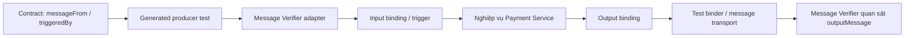
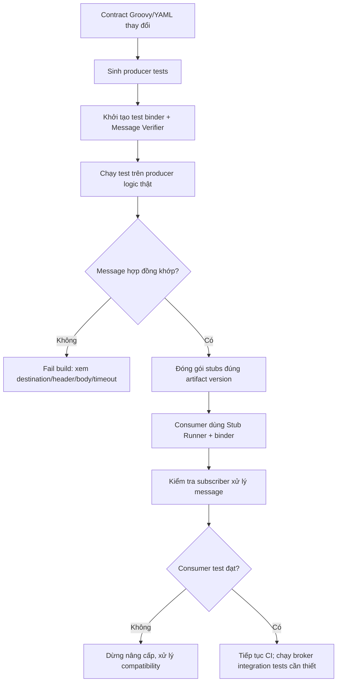

# Test binder và adapter kiểm thử trong luồng thông điệp

## 1. Mục tiêu: kiểm thử message mà không phụ thuộc broker thật ở mọi lần chạy

Trong hệ thống nhiều dịch vụ, một nghiệp vụ có thể tạo ra một **message** thay vì trả toàn bộ kết quả ngay qua HTTP. Chẳng hạn, `Order Service` phát `OrderPlaced` và `Payment Service` nhận sự kiện đó rồi phát `PaymentRequested`. `Notification Service` hoặc `Billing Service` có thể tiếp tục xử lý những sự kiện phía sau.

Một thay đổi tưởng nhỏ có thể phá vỡ tích hợp: producer phát sai destination, bỏ trường `orderId`, chuyển `amount` từ số thành chuỗi hoặc quên header `eventType`. **Spring Cloud Contract** cho phép mô tả hành vi thông điệp bằng Groovy/YAML DSL; sinh kiểm thử để xác minh producer, phát hành stub và dùng **Stub Runner** cho phía consumer trong CI.

Vấn đề là producer test phải **đưa message vào ứng dụng, kích hoạt nghiệp vụ và quan sát message đầu ra**. Nếu tất cả test phụ thuộc một Kafka/RabbitMQ/JMS broker thật, chúng có thể chậm, khó cô lập và dễ lỗi do hạ tầng hơn là do giao diện. Trong nhiều dự án Spring Cloud Stream, **test binder** giúp kiểm thử đường dữ liệu này ngay trong bộ nhớ; còn **adapter kiểm thử** giúp Spring Cloud Contract Verifier giao tiếp với hệ thống messaging cụ thể.

Bài học thuộc chương **Kiểm thử messaging**, tập trung vào:

1. Phân biệt **Spring Cloud Stream Binder**, **test binder** và **Message Verifier adapter**.
2. Thiết lập `InputDestination` và `OutputDestination` để kiểm tra function/consumer/publisher.
3. Viết hợp đồng `input`/`outputMessage` và nối chúng với producer verification.
4. Hiểu khi nào dùng `triggeredBy`, `messageFrom`, `@AutoConfigureMessageVerifier` và `StubTrigger`.
5. Chẩn đoán lỗi destination, serialization, Content-Type, timeout, classpath và test không thực sự chạy.
6. Đặt ranh giới rõ ràng giữa kiểm thử trong bộ nhớ và kiểm thử broker thật.

## 2. Bốn lớp dễ bị nhầm với nhau

Một đường truyền message có thể được nhìn theo bốn lớp:

| Lớp | Trách nhiệm | Ví dụ |
| --- | --- | --- |
| **Mã nghiệp vụ** | Nhận event, xử lý và tạo event mới | `Function<OrderPlaced, PaymentRequested>` |
| **Spring Cloud Stream Binder** | Nối input/output binding với một middleware | Kafka binder, Rabbit binder |
| **Test binder** | Thay phần vận chuyển trong test bằng đích gửi/nhận nội bộ | `spring-cloud-stream-test-binder`, `InputDestination`, `OutputDestination` |
| **Spring Cloud Contract Message Verifier adapter** | Giúp generated test gửi/nhận message theo tên destination trong hợp đồng | Tích hợp Spring Cloud Stream, Spring Integration; adapter riêng khi cần |

**Test binder không phải là một message broker thật.** Nó giúp kiểm tra việc ứng dụng xử lý, serialize và phát message thông qua binding ở môi trường test; không tự chứng minh Kafka partitioning, RabbitMQ acknowledgement, ACL, retention, retry hoặc durability của broker production.

**Adapter cũng không phải broker.** Nó là lớp nối giữa các hành động của Contract Verifier (gửi message vào đâu, chờ message ở đâu) và API của framework messaging. Nếu Spring Cloud Contract không hiểu transport tùy chỉnh, nhóm phải cung cấp cách tích hợp/adapter phù hợp thay vì sửa Groovy DSL thành HTTP.



Sơ đồ trên mô tả vai trò, không bắt buộc các thành phần phải nối trực tiếp đúng thứ tự đó trong mọi phiên bản hoặc framework. Với `triggeredBy`, test có thể **gọi phương thức nghiệp vụ** thay vì gửi input message.

## 3. Chọn loại kiểm thử nào?

Ba kiểu kiểm thử có điểm xuất phát và mục đích khác nhau:

| Kiểu | Chạy gì? | Dùng để trả lời câu hỏi |
| --- | --- | --- |
| **Kiểm thử function với test binder** | Gửi message bằng `InputDestination`, lấy message bằng `OutputDestination` | Function và binding tạo payload/headers mong đợi chưa? |
| **Producer contract verification** | Generated test từ `Contract.make`/YAML kích hoạt luồng và xác minh `outputMessage` | Producer hiện tại có đáp ứng hợp đồng đã cam kết với consumer không? |
| **Consumer test với Stub Runner** | Stub phát một message đã mô tả, consumer thật nhận và xử lý | Consumer có giải mã và xử lý đúng sự kiện đã thỏa thuận không? |

Kiểm thử function với test binder **không tự biến thành contract test**: nếu không có DSL, không có cơ sở hợp đồng chung để phát hành stub. Ngược lại, khai báo contract nhưng không có binder/adapter hoạt động cũng không tự đảm bảo test sẽ đưa/nhận message thành công.

## 4. Thiết lập test binder cho Spring Cloud Stream

Với **các phiên bản hiện đại** của Spring Cloud Stream, module kiểm thử thường là:

```xml
<!-- pom.xml: dependency phục vụ test, version do BOM tương thích quản lý -->
<dependency>
    <groupId>org.springframework.cloud</groupId>
    <artifactId>spring-cloud-stream-test-binder</artifactId>
    <scope>test</scope>
</dependency>
```

Tương đương trong Gradle Groovy DSL:

```groovy
dependencies {
    testImplementation 'org.springframework.cloud:spring-cloud-stream-test-binder'
}
```

Ngoài test binder, producer vẫn cần những dependency chính của ứng dụng (Spring Cloud Stream, Spring Boot, các binder thực tế nếu dùng) và dependency/plugin của **Spring Cloud Contract Verifier** để sinh contract tests. Chọn Spring Cloud release train tương thích với Spring Boot và ghim phiên bản build plugin phù hợp.

**Chú ý theo phiên bản:** Một số tài liệu Spring Cloud Stream/Contract đời cũ dùng classifier `test-binder` của `spring-cloud-stream` hoặc module `spring-cloud-stream-test-support`. Không thêm tất cả các biến thể này cùng lúc. Hãy dùng cơ chế test binder được hỗ trợ bởi phiên bản Spring Cloud Stream/Contract của project.

### 4.1. Bật test binder trong Spring test context

Một cấu hình thường gặp là import:

```java
import org.springframework.boot.test.context.SpringBootTest;
import org.springframework.cloud.stream.binder.test.EnableTestBinder;

@SpringBootTest
@EnableTestBinder
class PaymentStreamTest {
    // InputDestination / OutputDestination được inject ở ví dụ dưới.
}
```

Tài liệu Spring Cloud Stream hiện hành sử dụng `@EnableTestBinder` để đăng ký test binder trong application context. Trong một số bản/cách tổ chức test trước đây, bạn sẽ gặp `@Import(TestChannelBinderConfiguration.class)` hoặc `TestChannelBinderConfiguration.getCompleteConfiguration(...)`. **Chọn một cách phù hợp với phiên bản đang dùng** thay vì trộn nhiều cơ chế một cách ngẫu nhiên. Chỉ thêm dependency đôi khi chưa đủ trong một cấu hình test đã tùy chỉnh. Nếu project có nhiều binder hoặc nhiều binding, phải xác nhận **test binder được chọn cho đúng binding**, không vô tình gửi message đến broker production.

## 5. Ví dụ ứng dụng: function nhận và phát thông điệp

Giả sử `Payment Service` nhận `OrderPlaced` từ destination logic `orders.placed`, rồi phát `PaymentRequested` tới `payments.requested`.

Một ví dụ Java 17+ theo mô hình Spring Cloud Stream functional:

```java
package com.example.payment;

import java.util.function.Function;
import org.springframework.context.annotation.Bean;
import org.springframework.context.annotation.Configuration;
import org.springframework.messaging.Message;
import org.springframework.messaging.support.MessageBuilder;

@Configuration
public class PaymentStreamConfiguration {

    public record OrderPlaced(long orderId, long amount, String currency) {}
    public record PaymentRequested(long orderId, long amount,
                                   String currency, String status) {}

    @Bean
    Function<Message<OrderPlaced>, Message<PaymentRequested>>
    createPaymentRequest() {
        return incoming -> {
            OrderPlaced order = incoming.getPayload();
            PaymentRequested result = new PaymentRequested(
                order.orderId(), order.amount(), order.currency(), "REQUESTED"
            );
            return MessageBuilder.withPayload(result)
                .setHeader("eventType", "PaymentRequested")
                .build();
        };
    }
}
```

Đoạn code minh họa **chuyển đổi thông điệp**, không xử lý thanh toán thực, ghi database hoặc đảm bảo exactly-once. Khi triển khai thật, nghiệp vụ có thể phức tạp hơn và cần ràng buộc idempotency, transaction và thông tin tương quan.

Tên binding mặc định cho function `createPaymentRequest` là:

- `createPaymentRequest-in-0` cho message đầu vào.
- `createPaymentRequest-out-0` cho message đầu ra.

Ví dụ cấu hình `application.yml` của ứng dụng minh họa:

```yaml
spring:
  cloud:
    function:
      definition: createPaymentRequest
    stream:
      bindings:
        createPaymentRequest-in-0:
          destination: orders.placed
          content-type: application/json
        createPaymentRequest-out-0:
          destination: payments.requested
          content-type: application/json
```

**Phân biệt binding name và destination:** `createPaymentRequest-in-0` là tên binding trong ứng dụng; `orders.placed` là destination logic được cấu hình cho binding đó. Contract `messageFrom('orders.placed')` không có nghĩa generator bắt buộc sẽ tìm bean/channel đúng tên `orders.placed` ở mọi framework. Đối với Spring Cloud Stream/Integration, Spring Cloud Contract có cơ chế giải quyết destination trước, rồi đến tên channel trong những trường hợp được hỗ trợ.

Nếu dự án đổi `orders.placed` thành `order.placed.v2` nhưng chưa cập nhật binding/hợp đồng, message có thể không đến được consumer. Vì vậy **destination là phần của giao diện**, không chỉ payload.

## 6. Kiểm thử function thủ công bằng `InputDestination` và `OutputDestination`

Test binder cung cấp hai đối tượng hữu ích:

- **`InputDestination`**: đưa một message vào input binding của ứng dụng theo cách dành cho test.
- **`OutputDestination`**: nhận message mà output binding đã phát để kiểm tra.

Ví dụ JUnit 5 (cần import Spring Test, Jackson, AssertJ và các class liên quan):

```java
@SpringBootTest
@EnableTestBinder
class PaymentStreamTest {

    @Autowired InputDestination inputDestination;
    @Autowired OutputDestination outputDestination;
    @Autowired ObjectMapper objectMapper;

    @Test
    void transformsOrderPlacedIntoPaymentRequested() throws Exception {
        byte[] body = """
            {"orderId":42,"amount":125000,"currency":"VND"}
            """.getBytes(StandardCharsets.UTF_8);

        Message<byte[]> incoming = MessageBuilder.withPayload(body)
            .setHeader(MessageHeaders.CONTENT_TYPE, MimeTypeUtils.APPLICATION_JSON)
            .setHeader("eventType", "OrderPlaced")
            .build();

        inputDestination.send(incoming, "orders.placed");

        Message<byte[]> outgoing =
            outputDestination.receive(3000, "payments.requested");

        assertThat(outgoing).isNotNull();
        JsonNode json = objectMapper.readTree(outgoing.getPayload());
        assertThat(json.path("orderId").asLong()).isEqualTo(42L);
        assertThat(json.path("amount").asLong()).isEqualTo(125000L);
        assertThat(json.path("currency").asText()).isEqualTo("VND");
        assertThat(json.path("status").asText()).isEqualTo("REQUESTED");
        assertThat(outgoing.getHeaders().get("eventType"))
            .isEqualTo("PaymentRequested");
    }
}
```

Đây là **mẫu test cần được đặt trong dự án có application context và function ở mục 5**; chưa phải tệp Java độc lập biên dịch được vì phần import được lược bỏ. Đặt test binder trong test scope, không dùng kết quả `receive()` mà chưa kiểm tra `null` khi có timeout.

### 6.1. Vì sao cần dùng destination cụ thể?

Trong một dự án chỉ có một binding, đôi khi có thể gửi/nhận mà không truyền tên. Nhưng khi có nhiều function hoặc nhiều input/output, tên đích giúp xác định luồng được kiểm thử:

```java
inputDestination.send(incoming, "orders.placed");
Message<byte[]> result =
    outputDestination.receive(3000, "payments.requested");
```

Nếu ứng dụng dùng binding name thay vì destination name trong một API/version cụ thể, phải đối chiếu cấu hình và tài liệu của Spring Cloud Stream đang chạy. Khi có khai báo `destination`, ví dụ chính thức của test binder cho phép dùng tên destination đó để gửi/nhận; không nên đoán tên bằng cách nhìn duy nhất vào tên method.

### 6.2. Tại sao timeout và kiểm tra header quan trọng?

`receive(3000, ...)` giới hạn khoảng chờ ví dụ ở **3 giây**. Nếu message không được phát, kết quả có thể là `null`; một assertion ngay trên `outgoing.getPayload()` sẽ gây `NullPointerException` và làm mất thông tin gốc.

Nên kiểm tra trước:

1. Có message được nhận không?
2. Nó đến từ destination mong đợi không?
3. Body có thể giải mã đúng định dạng không?
4. Header `eventType`/correlation ID có đúng không?
5. Payload có đủ trường và kiểu cần thiết không?

Trong môi trường CI, tránh phụ thuộc một `Thread.sleep` cố định. Dùng cơ chế nhận/chờ có timeout hoặc assertion theo điều kiện.

## 7. Chuyển từ kiểm thử binder sang kiểm thử hợp đồng

Test ở mục 6 kiểm tra cùng một luồng nhưng **điều kiện nằm trong Java test của producer**. Muốn consumer có thể dùng cùng thỏa thuận để tạo stub, nên định nghĩa nó bằng Spring Cloud Contract DSL.

### 7.1. Hợp đồng Groovy khi có input message và output message

```groovy
import org.springframework.cloud.contract.spec.Contract

Contract.make {
    description 'OrderPlaced duoc chuyen thanh PaymentRequested'
    label 'order_placed_to_payment_requested'

    input {
        messageFrom('orders.placed')
        messageBody(
            orderId: 42,
            amount: 125000,
            currency: 'VND'
        )
        messageHeaders {
            header('eventType', 'OrderPlaced')
        }
    }

    outputMessage {
        sentTo('payments.requested')
        body(
            orderId: 42,
            amount: 125000,
            currency: 'VND',
            status: 'REQUESTED'
        )
        headers {
            header('eventType', 'PaymentRequested')
        }
    }
}
```

Đọc hợp đồng:

| Cú pháp | Điều kiểm thử cần thực hiện |
| --- | --- |
| `input.messageFrom` | Gửi/đưa message vào `orders.placed` |
| `input.messageBody` | Dữ liệu message đầu vào |
| `input.messageHeaders` | Metadata message đầu vào |
| `outputMessage.sentTo` | Quan sát message phát tới `payments.requested` |
| `outputMessage.body` | Payload mong đợi đầu ra |
| `outputMessage.headers` | Metadata mong đợi đầu ra |

Một generated producer test dùng **Message Verifier integration** để gửi message vào và nhận message ra. `InputDestination`/`OutputDestination` là API ở tầng test binder; **không cần giả định generated test sẽ trực tiếp gọi hai API này**, vì nó có thể làm việc thông qua adapter của Spring Cloud Contract.

### 7.2. Hợp đồng khi ứng dụng tự phát message: `triggeredBy`

Không phải mọi sự kiện đều xuất phát từ một message đầu vào. Chẳng hạn, `Payment Service` có tác vụ hẹn giờ hoặc xử lý API rồi phát `PaymentRequested`:

```groovy
import org.springframework.cloud.contract.spec.Contract

Contract.make {
    description 'Phat PaymentRequested tu nghiep vu'
    label 'payment_requested'

    input {
        triggeredBy('publishPaymentRequested()')
    }

    outputMessage {
        sentTo('payments.requested')
        body(
            orderId: 42,
            status: 'REQUESTED'
        )
        headers {
            header('eventType', 'PaymentRequested')
        }
    }
}
```

`publishPaymentRequested()` là phương thức cần được cung cấp bởi base test class hoặc cơ chế mà generator có thể gọi. Nó **không phải** lời gọi HTTP và cũng không tự được Spring Cloud Contract tạo nghiệp vụ bên trong. Method này phải thực sự kích hoạt publisher của producer.

### 7.3. YAML DSL tương đương với phương thức trigger

```yaml
description: Phat PaymentRequested tu nghiep vu
label: payment_requested
input:
  triggeredBy: publishPaymentRequested()
outputMessage:
  sentTo: payments.requested
  body:
    orderId: 42
    status: REQUESTED
  headers:
    eventType: PaymentRequested
```

YAML và Groovy thể hiện cùng giao diện. Các tính năng cụ thể của `input.messageFrom`, matcher động và cách resolve destination cần đối chiếu **đúng phiên bản YAML schema** đang sử dụng. Tránh dùng cú pháp của Groovy cho một key YAML nếu schema không hỗ trợ.

## 8. `@AutoConfigureMessageVerifier`: adapter giữa test và transport

Spring Cloud Contract không chỉ sinh assertion; khi kiểm thử messaging, nó cần một cách chuẩn để **gửi message** và **nhận message**. Tài liệu các bản mới nhắc đến hai interface:

- `org.springframework.cloud.contract.verifier.messaging.MessageVerifierSender`
- `org.springframework.cloud.contract.verifier.messaging.MessageVerifierReceiver`

Chúng đại diện cho hai chiều tương tác với hệ thống messaging. Một số phiên bản cũ mô tả interface tổng hợp `MessageVerifier`; do đó khi viết adapter riêng phải kiểm tra **API chính xác của phiên bản Spring Cloud Contract đã khóa**, không sao chép chữ ký method từ tutorial khác release.

Với các framework tích hợp có sẵn (như Spring Cloud Stream hoặc Spring Integration), cấu hình có thể được tự động hóa bằng:

```java
import org.springframework.boot.test.context.SpringBootTest;
import org.springframework.cloud.contract.verifier.messaging.boot.AutoConfigureMessageVerifier;
import org.springframework.cloud.stream.binder.test.EnableTestBinder;

@SpringBootTest
@AutoConfigureMessageVerifier
@EnableTestBinder
public abstract class MessagingContractBase {
    // Context, fixtures và trigger do project cung cấp.
}
```

Lớp trên là **khung base class**: chưa có logic cho `triggeredBy`. Với hợp đồng `messageFrom`, test cần có consumer function/listener thật và message transport kiểm thử có thể nhận/gửi message.

Nếu dùng `triggeredBy('publishPaymentRequested()')`, có thể mở rộng:

```java
public abstract class MessagingContractBase {

    @Autowired
    protected PaymentPublisher paymentPublisher;

    public void publishPaymentRequested() {
        paymentPublisher.publish(42L, "REQUESTED");
    }
}
```

Đoạn thứ hai chỉ minh họa **phần thân/phương thức trigger**, không thay thế các annotation và import ở đoạn trước. `PaymentPublisher` là service do ứng dụng tự cung cấp; có thể tái sử dụng trong lớp base đầy đủ với Spring context, message verifier và test binder.

**Không cấu hình test chỉ để phát ra một message giả khớp hợp đồng.** Nếu base class tự tạo message giống mẫu rồi trả cho verifier, test sẽ xanh nhưng chưa kiểm tra publisher của ứng dụng. Trigger phải đi qua code thực chịu trách nhiệm phát message.

### 8.1. Adapter tùy chỉnh dùng khi nào?

Nếu ứng dụng dùng framework chưa có tích hợp phù hợp, message transport đặc thù hoặc test needs khác thông thường, có thể viết adapter tương thích với interface mà Verifier phiên bản đó yêu cầu.

Một adapter đúng phải giải quyết:

1. **Send:** chuyển payload và headers từ test vào destination logic của ứng dụng.
2. **Receive:** chờ message đầu ra ở đúng destination với timeout hợp lý.
3. **Conversion:** giữ đúng loại nội dung (bytes, JSON, string) và metadata.
4. **Isolation:** không rò message của một test sang test khác.
5. **Error reporting:** phân biệt thiếu message, sai destination và lỗi parse.

Ví dụ **pseudocode**, không phải implementation interface có thể biên dịch ngay:

```text
send(destination, payload, headers):
    resolve destination / binding
    build message preserving headers and payload
    forward message into application input

receive(destination, timeout):
    subscribe or poll the specified output
    return received message, or report timeout
```

Không tự đặt tên các method của interface Java dựa trên pseudocode này. Khi triển khai adapter thật, cần đọc chữ ký `MessageVerifierSender`/`MessageVerifierReceiver` từ dependency của project và đăng ký bean phù hợp với auto-configuration của bản đó.

### 8.2. Tích hợp nào được hỗ trợ?

Tài liệu Spring Cloud Contract mô tả các hướng tích hợp messaging như **Spring Cloud Stream, Spring Integration, Spring JMS và Apache Camel**. Cách hiểu destination có thể khác: Spring Cloud Stream/Integration có binding hoặc channel; Camel có endpoint URI; JMS có queue/topic.

**Test binder của Spring Cloud Stream không thay thế mọi loại adapter.** Một dự án chỉ dùng Spring JMS không thể thêm `spring-cloud-stream-test-binder` rồi mong generated test tự kiểm tra một `JmsTemplate` tùy chỉnh. Cần chọn integration đúng framework hoặc tự thiết lập adapter/hạ tầng test tương ứng.

## 9. Vì sao route và content type hay gây test fail?

### 9.1. Sai destination

Contract yêu cầu:

```groovy
outputMessage {
    sentTo('payments.requested')
    body(orderId: 42, status: 'REQUESTED')
}
```

Nhưng ứng dụng khai báo:

```yaml
spring:
  cloud:
    stream:
      bindings:
        createPaymentRequest-out-0:
          destination: payments.pending
```

Khi đó, output được phát về `payments.pending`, không phải destination hợp đồng. Nếu test đang lắng nghe `payments.requested`, có thể nhận `null` hoặc timeout.

Không nên đổi hợp đồng sang `payments.pending` chỉ để test xanh nếu consumer còn subscribe `payments.requested`. Cần quyết định phiên bản/luồng chuyển đổi với consumer trước.

### 9.2. Sai Content-Type hoặc chuyển đổi payload

Spring Cloud Stream có cơ chế chuyển đổi giữa Java object, JSON bytes, `String` và `Message<?>` tùy cấu hình content type, function signature, serializer/converter và binding.

Kiểm tra:

- Message input đang mang `byte[]`, `String` hay DTO?
- Header `contentType`/binding `content-type` có phải `application/json`?
- Producer output thực sự chứa JSON như hợp đồng hay một string đã bị escape hai lần?
- Message verifier nhận các header nội bộ của framework; có đang lẫn chúng với header nghiệp vụ?

Ví dụ JSON `{"orderId":42}` khác với **chuỗi JSON được bọc lại** như `"\"{\\\"orderId\\\":42}\""` về dữ liệu mà consumer giải mã. Nếu content type sai, producer có thể pass một test quá rộng theo kiểu string nhưng consumer deserialize thất bại.

### 9.3. Header nghiệp vụ và header hạ tầng

Một số headers do framework thêm vào (như ID nội bộ hoặc timestamp của message) có thể thay đổi qua mỗi lần chạy. Nên cố định/matcher các header **consumer thật sự phụ thuộc**, ví dụ `eventType`, `correlationId` hay schema version; không yêu cầu mọi byte header nội bộ phải bằng một giá trị bất biến.

## 10. Consumer test với Stub Runner và message trigger

Producer contract test xác minh publisher thật, còn consumer có thể dùng **message stubs** để kiểm thử subscriber mà không khởi động publisher thật.

Với hợp đồng có `label 'payment_requested'`, Stub Runner hỗ trợ `StubTrigger` trong cấu hình messaging thích hợp. Ví dụ:

```java
@SpringBootTest
@AutoConfigureStubRunner(
    ids = "com.example:payment-service:1.0.0:stubs",
    stubsMode = StubRunnerProperties.StubsMode.LOCAL
)
@EnableTestBinder
class PaymentRequestedConsumerTest {

    @Autowired
    StubTrigger stubTrigger;

    @Test
    void receivesPaymentRequested() {
        boolean started = stubTrigger.trigger("payment_requested");
        assertThat(started).isTrue();

        // Chờ consumer xử lý message và kiểm tra side effect
        // bằng repository/service của consumer.
    }
}
```

Đây là **khung minh họa**: cần các import, message binder/consumer function, stub artifact đã được cài vào Maven local và các assertion nghiệp vụ thật. `StubRunnerProperties.StubsMode.LOCAL` chỉ phù hợp khi stub đã nằm trong local repository; trên CI có thể dùng artifact repository thích hợp.

**Quan trọng:** `trigger()` trả thành công không chứng minh subscriber đã xử lý nghiệp vụ. Test consumer còn cần xác minh một tác động quan sát được, ví dụ database có bản ghi, trạng thái dịch vụ được cập nhật hoặc một output message đúng.

Không đồng nhất việc Stub Runner phát được message với broker thật đang được cấu hình đúng. Stub Runner + test binder có thể rất hữu ích cho kiểm thử consumer nhanh và ổn định, nhưng kiểm thử triển khai vẫn cần hạ tầng thích hợp.

## 11. Sự khác biệt giữa test binder và integration test với broker

| Thuộc tính | Spring Cloud Stream test binder | Broker integration test (ví dụ Testcontainers) |
| --- | --- | --- |
| Hạ tầng | Trong bộ nhớ / test context | Kafka/RabbitMQ hoặc broker thực chạy trong môi trường test |
| Tốc độ và cô lập | Thường nhanh, ít phụ thuộc môi trường | Chậm hơn nhưng phản ánh transport thực |
| Kiểm tra function và binding | Phù hợp | Phù hợp |
| Serialization/deserialization | Có thể kiểm tra trong phạm vi converter/binding được dùng | Kiểm tra thêm tương thích với serializer/broker thực |
| Partition, broker routing, retention | Không đủ bằng chứng | Có thể kiểm chứng theo cấu hình môi trường test |
| Ack, retry, re-delivery, DLQ | Không nên suy từ test binder | Cần integration/failure tests tương ứng |
| ACL và authentication broker | Không mô phỏng đầy đủ | Cần cấu hình/quyền thực trong test |
| Tính ổn định CI | Thường cao nếu fixture độc lập | Phụ thuộc lifecycle container và tài nguyên |

Nên kết hợp: test binder và contract verifier cho vòng phản hồi nhanh; một số broker integration/E2E tests cho rủi ro transport quan trọng. **Không phải dự án nào cũng cần khởi động broker thật cho mọi hợp đồng**, nhưng cũng không nên tuyên bố test binder xác minh mọi tính chất của broker.

### 11.1. Ví dụ idempotency cần test riêng

Trong broker có at-least-once delivery, cùng một `OrderPlaced` có thể được nhận hai lần. Một contract chứa `orderId=42` chỉ kiểm tra **hình dạng và dữ liệu** của một tương tác được mô tả, chưa chứng minh consumer xử lý trùng an toàn.

Nếu nghiệp vụ không được trừ tiền hai lần, hãy thêm `eventId` và thiết kế test gửi cùng event hai lần, rồi kiểm tra tác động nghiệp vụ theo cơ chế deduplication của ứng dụng. Điều đó có thể là integration test hoặc service test riêng.

## 12. Chẩn đoán lỗi thường gặp

| Triệu chứng | Nguyên nhân có thể | Cách kiểm tra |
| --- | --- | --- |
| `InputDestination` không được inject | Test binder chưa được bật, thiếu dependency | Kiểm tra `spring-cloud-stream-test-binder`, `@EnableTestBinder` hoặc cấu hình test binder tương ứng, Spring context |
| Gửi message nhưng output `null` | Sai destination, function definition hoặc output binding | Kiểm tra `spring.cloud.function.definition`, binding names, `destination` |
| JSON parse fail | Sai content type, payload đã serialize kép, converter không phù hợp | In ra loại payload/header và JSON bytes đã che dữ liệu nhạy cảm |
| Output đúng body nhưng thiếu header | Function không gắn `eventType` hoặc header bị biến đổi | Kiểm tra `MessageBuilder` và converter/binder |
| Generated messaging tests không chạy | Thiếu `@AutoConfigureMessageVerifier`, base class sai hoặc plugin không sinh test | Kiểm tra generated source, test count và test annotations |
| `triggeredBy` không tìm thấy method | Base class không khai báo method đúng hoặc visibility không phù hợp | Đối chiếu chữ ký method và `baseClassForTests`/`baseClassMappings` |
| `messageFrom` không đưa dữ liệu vào ứng dụng | Adapter không resolve destination hoặc listener chưa sẵn sàng | Kiểm tra message verifier, channel/binding và test transport |
| Stub Runner không kích hoạt được label | Không có hợp đồng `label`, sai stub version hoặc messaging config | Kiểm tra artifact, label và `StubTrigger` |
| Test đổ lỗi timeout không ổn định trên CI | Chờ quá ngắn hoặc event xử lý bất đồng bộ | Kiểm tra các bước async, timeout hữu hạn và isolation |
| Test binder pass nhưng deploy không nhận message | Khác biệt broker config, ACL, routing key, partition | Chạy thêm broker integration test với cấu hình gần production |

### 12.1. Test binder bị bỏ qua dù đã thêm dependency

Một lỗi phổ biến là chỉ thêm dependency `spring-cloud-stream-test-binder` nhưng test context vẫn chọn binder khác hoặc không tạo bean `InputDestination`/`OutputDestination`. Hãy xác minh `@EnableTestBinder` (hoặc cách bật binder đúng phiên bản), các binder được enable và kết quả dependency resolution. Khi dùng Gradle/Maven, cần để dependency **đúng test scope**.

### 12.2. Test nhận message của bài khác

Nếu nhiều hợp đồng dùng chung destination và test chạy song song, có thể còn message trong queue/test context từ lần trước. Hãy cô lập state, sử dụng test context/queue phù hợp hoặc làm sạch các message tồn trước khi assertion. Đừng sửa payload matcher quá rộng để vô tình chấp nhận một message không thuộc tương tác đang kiểm tra.

### 12.3. “Producer test xanh” nhưng thực ra chỉ kiểm tra mock

Nếu base class tạo một `Message` giả giống hệt hợp đồng và tự đưa vào output mà không gọi business publisher, Verifier không thể phát hiện khi publisher thật bị xóa. Producer verification phải đi qua hành vi ứng dụng cần bảo vệ. Nếu phần broker được thay bằng test binder thì đó là thay thế **transport**, không phải thay thế nghĩa vụ nghiệp vụ.

## 13. Pipeline CI cho producer và consumer



Checklist CI tối thiểu:

1. **Ghim phiên bản tương thích** Spring Boot/Cloud, Spring Cloud Stream và Spring Cloud Contract; kiểm tra plugin sinh test.
2. **Khởi tạo test binder/adapter có chủ đích**, không cho test vô tình truy cập broker production.
3. **Chạy generated producer tests**, xác nhận số lượng test không về 0 và không bị skip.
4. **Xác minh destination, header và payload**, không chỉ rằng có message bất kỳ.
5. **Chỉ publish stub sau verification đạt** và gắn với version artifact của producer.
6. **Consumer chạy stub đúng version** bằng Stub Runner, kiểm tra handler/side effect thật.
7. **Giữ broker integration tests** cho schema/serialization, ACL, routing, partition, retry/DLQ và những đặc tính vận hành quan trọng.

## 14. Bài thực hành: từ binder test đến contract test

Giả sử `Shipping Service` nhận `OrderPaid` ở `orders.paid`, phát `ShipmentRequested` sang `shipments.requested` với:

```json
{
  "eventType": "ShipmentRequested",
  "orderId": 42,
  "warehouseId": "WH-1",
  "schemaVersion": 1
}
```

### Yêu cầu

1. Viết cấu hình hai binding cho function `requestShipment`, ánh xạ input `orders.paid`, output `shipments.requested`.
2. Viết JUnit test dùng `InputDestination` để gửi `OrderPaid` và `OutputDestination` để nhận `ShipmentRequested`; kiểm tra `orderId`, `warehouseId` và `eventType`.
3. Viết Groovy DSL `input.messageFrom` + `outputMessage.sentTo` cho cùng tương tác.
4. Giải thích vai trò của `@AutoConfigureMessageVerifier` so với `@EnableTestBinder`.
5. Nếu function trả đúng payload nhưng gửi đến `shipments.created`, producer verification nên làm gì?
6. Nếu test binder pass nhưng trên Kafka message không tới subscriber vì ACL, cần bổ sung loại kiểm thử nào?

### Gợi ý cấu hình binding

```yaml
spring:
  cloud:
    function:
      definition: requestShipment
    stream:
      bindings:
        requestShipment-in-0:
          destination: orders.paid
          content-type: application/json
        requestShipment-out-0:
          destination: shipments.requested
          content-type: application/json
```

### Gợi ý hợp đồng Groovy

```groovy
import org.springframework.cloud.contract.spec.Contract

Contract.make {
    description 'OrderPaid kich hoat ShipmentRequested'
    input {
        messageFrom('orders.paid')
        messageBody(orderId: 42, warehouseId: 'WH-1')
    }
    outputMessage {
        sentTo('shipments.requested')
        body(
            eventType: 'ShipmentRequested',
            orderId: 42,
            warehouseId: 'WH-1',
            schemaVersion: 1
        )
        headers {
            header('eventType', 'ShipmentRequested')
        }
    }
}
```

**Gợi ý lời giải:** (2) dùng `send(..., "orders.paid")` và `receive(timeout, "shipments.requested")`, kiểm tra message không null trước khi giải mã JSON; (4) test binder cấp transport trong bộ nhớ, còn Message Verifier cấp cầu nối cho generated contract tests; (5) phải fail nếu hợp đồng yêu cầu destination cũ; (6) cần broker integration/E2E test với cấu hình quyền và routing phù hợp.

## 15. Checklist trước khi merge

- Dự án đang kiểm thử **function qua binder**, **producer contract** hay **consumer stub**? Mục tiêu có được tách rõ?
- Đã thêm đúng test binder theo phiên bản Spring Cloud Stream và bật nó bằng `@EnableTestBinder` hoặc cấu hình test tương ứng?
- `InputDestination`/`OutputDestination` dùng đúng **destination** hoặc binding name theo cấu hình có hiệu lực?
- Payload có đúng kiểu/JSON Content-Type; header nghiệp vụ có được kiểm chứng?
- Hợp đồng `messageFrom`/ `triggeredBy` và `outputMessage` có diễn đạt đúng luồng thực?
- Generated producer test có `@AutoConfigureMessageVerifier`/base class phù hợp, adapter đúng framework và trigger thật?
- Có timeout hữu hạn, kiểm tra null và cô lập message giữa các test?
- Stub Runner dùng đúng label, artifact version và consumer test kiểm chứng **kết quả xử lý**?
- CI có chặn phát hành stub nếu producer verification fail, và có broker integration test cho những đặc tính ngoài phạm vi test binder?

**Tài liệu chính thức để tham khảo theo phiên bản:**

- [Spring Cloud Contract — Messaging](https://docs.spring.io/spring-cloud-contract/reference/project-features-messaging.html).
- [Spring Cloud Stream — Testing / Test Binder](https://docs.spring.io/spring-cloud-stream/reference/spring-cloud-stream/spring_integration_test_binder.html).
- [Spring Cloud Contract — Stub Runner](https://docs.spring.io/spring-cloud-contract/reference/project-features-stubrunner.html).

**Ghi nhớ:** **Test binder** cho phép gửi/nhận message qua `InputDestination` và `OutputDestination` trong môi trường test; **Message Verifier adapter** nối các thao tác gửi/nhận theo `messageFrom` và `sentTo` của Spring Cloud Contract với framework messaging, còn `triggeredBy` gọi phương thức được cung cấp ở phía producer test. Kiểm thử producer phải quan sát message thực do ứng dụng tạo, consumer dùng stub để kiểm tra cách nhận và xử lý, còn broker integration tests bảo vệ những đặc tính vận chuyển như routing, ACL, retry và delivery mà test binder trong bộ nhớ không thể tự chứng minh.
