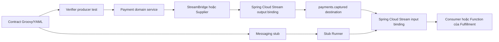
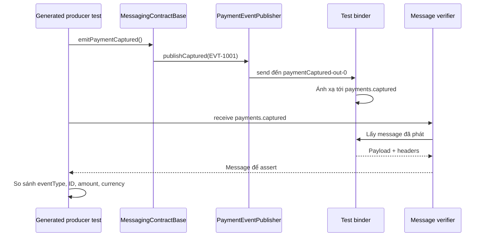
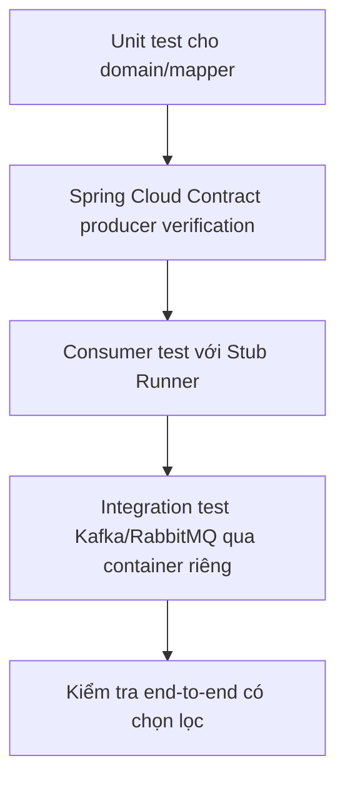
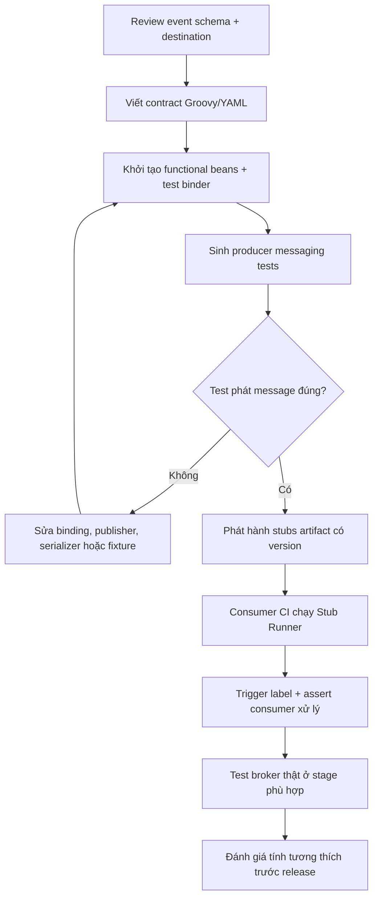

# Tích hợp Spring Cloud Stream theo mô hình lập trình được hỗ trợ

## 1. Bối cảnh: hợp đồng thông điệp phải đi qua luồng ứng dụng thật

Một hệ thống thương mại điện tử gồm `payment-service` (producer) và `fulfillment-service` (consumer). Khi thanh toán của đơn `ORD-2001` được xác nhận, Payment phát sự kiện `PaymentCaptured` đến destination `payments.captured`. Fulfillment đọc sự kiện để tạo yêu cầu giao hàng. Hai bên cần thống nhất **destination, kiểu sự kiện, nội dung payload, headers và ý nghĩa các trường**.

**Spring Cloud Contract** cho phép định nghĩa hợp đồng HTTP hoặc thông điệp bằng **Groovy/YAML DSL**, sinh producer verification test, đóng gói stub và để consumer dùng **Stub Runner**. Khi kết hợp với **Spring Cloud Stream**, producer test có thể kích hoạt mã gửi message và quan sát message được phát; consumer test có thể nhận sự kiện giả lập trên một destination được kiểm soát. CI dùng các bước đó để phát hiện thay đổi không tương thích trước khi triển khai.

Khác với HTTP có request và response trên cùng kết nối, message thường được gửi **bất đồng bộ** qua broker và được xử lý ở thời điểm khác. Vì vậy một bài test “đúng JSON” chưa đủ: nếu payload đúng nhưng gửi nhầm topic, hoặc consumer không được binding tới topic, ứng dụng vẫn không tương thích.

Chủ đề này tập trung vào một câu hỏi thực dụng: **kết nối Contract Verifier với mô hình lập trình Spring Cloud Stream nào để test đang kiểm tra đúng code ứng dụng?** Trong các dòng Spring Cloud Stream hiện đại, hướng được khuyến nghị là **mô hình functional** dựa trên `Supplier<T>`, `Function<T,R>`, `Consumer<T>` và `StreamBridge`, thay cho các ví dụ cũ sử dụng `@EnableBinding`/`@StreamListener`.

Sau bài học, bạn có thể xác định mô hình lập trình phù hợp với phiên bản dự án, cấu hình functional bindings, viết messaging contract, thiết lập test binder và `@AutoConfigureMessageVerifier`, dùng Stub Runner kiểm thử consumer, và phân tách producer contract test với integration test có Kafka/RabbitMQ thật.

## 2. Ba lớp công nghệ có trách nhiệm khác nhau

| Lớp | Vai trò | Thành phần ví dụ |
| --- | --- | --- |
| **Spring Cloud Contract** | Mô tả và xác minh **cam kết giao tiếp**. | `input { triggeredBy(...) }`, `outputMessage { sentTo(...) }`, generated test, `StubTrigger`. |
| **Spring Cloud Stream** | Gắn mã nghiệp vụ với các **bindings** và abstraction của hệ thống messaging. | `Consumer`, `Function`, `Supplier`, `StreamBridge`, `payments.captured`. |
| **Binder/broker** | Chuyển message đến nơi nhận; xử lý các đặc tính hạ tầng. | Test binder trong JVM, Kafka binder, Rabbit binder và broker tương ứng. |

Một kiến trúc minh họa:



**Contract không phải cấu hình broker.** Một contract có `sentTo('payments.captured')` nói rằng event phải đến destination đã thỏa thuận; để ứng dụng thực sự gửi đến đó, Spring Cloud Stream cần binding được khai báo phù hợp. Ngược lại, đặt đúng `destination` trong YAML cấu hình không chứng minh payload sự kiện đúng: phải có assertion contract.

## 3. Mô hình functional được khuyến nghị

Trong các dòng Spring Cloud Stream mới, bean Java functional là trung tâm của mô hình xử lý message:

| Bean | Đầu vào và đầu ra | Trường hợp sử dụng |
| --- | --- | --- |
| `Supplier<T>` | Không có input binding; tạo giá trị đưa ra output binding. | Nguồn sự kiện được framework lấy dữ liệu theo cơ chế nguồn/polling được cấu hình. |
| `Function<T,R>` | Nhận message từ input; phát kết quả qua output. | Chuyển `PaymentCaptured` thành yêu cầu giao hàng. |
| `Consumer<T>` | Nhận message từ input; không có output binding của function. | Cập nhật read model, lưu trạng thái hoặc thực thi side effect. |
| `StreamBridge` | Gửi message chủ động đến một output binding/destination. | Một thao tác HTTP/domain hoặc scheduler đã quyết định thời điểm phát event. |

Ví dụ một bean xử lý message:

```java
@Configuration
class FulfillmentStreamConfiguration {

    @Bean
    Consumer<PaymentCaptured> recordCapturedPayment(
            FulfillmentService service) {
        return event -> service.registerPaidOrder(
            event.orderId(), event.paymentId()
        );
    }
}
```

Đoạn mã minh họa giả định có kiểu `PaymentCaptured` và `FulfillmentService`, cùng import Spring/Java thích hợp. Khi Spring Cloud Stream phát hiện bean functional và được cấu hình kích hoạt function đó, nó tạo **input binding** theo quy ước. Đây là handler thật mà consumer test cần chạy, không phải một mock luôn trả kết quả mong đợi.

Nếu ứng dụng có nhiều functional beans, đặt `spring.cloud.function.definition` để chỉ rõ bean hoặc composition cần bind. Với một bean duy nhất, framework có thể tự phát hiện, nhưng **khai báo tường minh** giúp test và CI tránh thay đổi hành vi khi thêm bean mới.

### Cảnh báo về mô hình annotation cũ

Bạn có thể gặp code kiểu:

```java
// Mẫu legacy, KHÔNG dùng làm thiết kế mặc định cho dự án mới:
@EnableBinding(OldChannels.class)
class OldListener {
    @StreamListener("input")
    public void handle(String payload) { /* ... */ }
}
```

Các hướng dẫn Spring Cloud Stream trước đây sử dụng interface channel và annotation như trên. Từ dòng 3.x, tài liệu khuyến nghị mô hình functional; mức hỗ trợ các API annotation cũ **phụ thuộc phiên bản**, một số tổ hợp mới không còn cho phép dùng như ví dụ legacy. **Không khẳng định chỉ thêm `@EnableBinding` là tích hợp được với Spring Cloud Contract hiện tại.**

Khi nâng cấp hệ thống, nên viết bean `Consumer/Function/Supplier` và chuyển cấu hình binding sang tên functional, sau đó chạy lại generated producer tests và consumer tests để chứng minh cùng contract vẫn hoạt động. Chỉ giữ mô hình legacy nếu đang bị ràng buộc bởi phiên bản cụ thể và có test kiểm chứng rõ ràng.

## 4. Đặt đúng tên binding và destination

Với functional bean:

```java
@Bean
Consumer<PaymentCaptured> recordCapturedPayment(
        FulfillmentService service) {
    return event -> service.registerPaidOrder(
        event.orderId(), event.paymentId()
    );
}
```

Spring Cloud Stream tạo tên binding đầu vào mặc định:

```text
recordCapturedPayment-in-0
```

Đây là **binding name nội bộ** của ứng dụng. Ta ánh xạ nó sang destination được hai bên cam kết:

```yaml
spring:
  cloud:
    function:
      definition: recordCapturedPayment
    stream:
      bindings:
        recordCapturedPayment-in-0:
          destination: payments.captured
          content-type: application/json
```

Đừng nhầm:

- `recordCapturedPayment` là **tên bean function**.
- `recordCapturedPayment-in-0` là **tên input binding**, được tạo theo quy ước `<functionName>-in-0`.
- `payments.captured` là **destination logic** (ví dụ topic/exchange do binder ánh xạ), cần khớp với hợp đồng.
- `content-type: application/json` là thông tin định dạng dùng cho message conversion, không phải URL hoặc HTTP header.

Một `Function<T,R>` thông thường có **hai binding**: `<functionName>-in-0` và `<functionName>-out-0`. Một `Supplier<T>` có output binding `<functionName>-out-0`. Nếu đổi tên function trong code mà không cập nhật cấu hình, message có thể không đi vào nơi consumer đang lắng nghe.

Nếu muốn đổi tên binding tường minh, Spring Cloud Stream có khả năng mapping `spring.cloud.stream.function.bindings.<implicit-name>`, nhưng đây là **một lớp ánh xạ bổ sung**. Chỉ dùng khi cần tương thích cấu hình cũ; theo mặc định nên giữ tên functional để dễ lần ngược từ bean đến destination.

## 5. Dùng StreamBridge cho event do nghiệp vụ kích hoạt

Sự kiện `PaymentCaptured` thường xuất hiện sau khi ứng dụng nhận một thao tác, cập nhật trạng thái thanh toán thành công và quyết định công bố kết quả. Trong tình huống này, **`StreamBridge` thường phù hợp hơn `Supplier` tự poll liên tục**, vì ta muốn điều khiển thời điểm phát trong cùng workflow.

DTO đơn giản:

```java
public record PaymentCaptured(
    String eventId,
    String eventType,
    String paymentId,
    String orderId,
    long amount,
    String currency
) {}
```

Publisher dùng StreamBridge:

```java
@Service
public class PaymentEventPublisher {
    private final StreamBridge streamBridge;

    public PaymentEventPublisher(StreamBridge streamBridge) {
        this.streamBridge = streamBridge;
    }

    public boolean publishCaptured(PaymentCaptured event) {
        return streamBridge.send(
            "paymentCaptured-out-0",
            MessageBuilder.withPayload(event)
                .setHeader(MessageHeaders.CONTENT_TYPE,
                           MimeTypeUtils.APPLICATION_JSON)
                .setHeader("eventType", event.eventType())
                .build()
        );
    }
}
```

Ví dụ cần import `StreamBridge`, `MessageBuilder`, `MessageHeaders` và `MimeTypeUtils` đúng phiên bản cùng Spring Cloud Stream. Việc `send(...)` trả boolean không tự đảm bảo broker cuối đã lưu message bền vững; ý nghĩa xác nhận gửi phụ thuộc binder/cấu hình và cần test integration riêng.

Cấu hình tạo output binding tường minh:

```yaml
spring:
  cloud:
    stream:
      output-bindings: paymentCaptured-out-0
      bindings:
        paymentCaptured-out-0:
          destination: payments.captured
          content-type: application/json
```

`StreamBridge` cũng có thể tạo binding động khi gọi `send()`; ở đây chọn output binding **đã được khai báo** để giảm lỗi định tuyến và làm rõ tên destination. Không đặt tên `paymentCaptured-out-0` trong contract nếu consumer thực tế chỉ biết destination `payments.captured`.

**Đảm bảo dữ liệu test:** với một event mẫu, `eventId`, `paymentId`, `orderId` và thời điểm tạo (nếu có) phải được kiểm soát. Không để mỗi lần chạy Contract Verifier sinh UUID hoặc timestamp mới rồi bắt assert exact value. Khi cần test các giá trị động, dùng matcher và dữ liệu mẫu phù hợp.

## 6. Viết contract cho thông điệp được phát

Giả sử sau khi capture thành công, `payment-service` phát payload:

```json
{
  "eventId": "EVT-1001",
  "eventType": "PaymentCaptured",
  "paymentId": "PAY-1001",
  "orderId": "ORD-2001",
  "amount": 250000,
  "currency": "VND"
}
```

### Groovy DSL

```groovy
import org.springframework.cloud.contract.spec.Contract

Contract.make {
    name 'payment_captured_event'
    description 'Thông báo thanh toán PAY-1001 đã được capture'
    label 'payment_captured_1001'

    input {
        triggeredBy('emitPaymentCaptured()')
    }

    outputMessage {
        sentTo('payments.captured')
        body([
            eventId: 'EVT-1001',
            eventType: 'PaymentCaptured',
            paymentId: 'PAY-1001',
            orderId: 'ORD-2001',
            amount: 250000,
            currency: 'VND'
        ])
        headers {
            messagingContentType(applicationJson())
            header('eventType', 'PaymentCaptured')
        }
    }
}
```

Phân tích:

1. `label 'payment_captured_1001'` là tên dùng để **kích hoạt messaging stub** qua `StubTrigger` ở phía consumer.
2. `input { triggeredBy('emitPaymentCaptured()') }` yêu cầu generated producer test **gọi phương thức** `emitPaymentCaptured()` từ base test hoặc nơi được giải quyết hợp lệ.
3. `sentTo('payments.captured')` xác định destination cần nhận output message.
4. `body([...])` mô tả payload JSON; `headers` mô tả metadata mà consumer phụ thuộc.
5. Contract cần được kết hợp với **test binder/message verifier** để test có thể quan sát message; bản thân file DSL không mở Kafka, không tự gửi sự kiện.

Đối với Spring Cloud Stream, tên trong `sentTo(...)` được giải quyết theo destination của binding khi có ánh xạ; vì vậy phải dùng tên destination đúng với cấu hình Stream. Một test chỉ kiểm tra payload ở biến Java mà không xác minh message đã được gửi đến destination **chưa đủ**.

### YAML DSL tương đương

```yaml
description: Thông báo thanh toán PAY-1001 đã được capture
name: payment_captured_event
label: payment_captured_1001
input:
  triggeredBy: emitPaymentCaptured()
outputMessage:
  sentTo: payments.captured
  body:
    eventId: EVT-1001
    eventType: PaymentCaptured
    paymentId: PAY-1001
    orderId: ORD-2001
    amount: 250000
    currency: VND
  headers:
    contentType: application/json
    eventType: PaymentCaptured
```

Chọn **một trong hai** bản Groovy/YAML làm contract nguồn cho cùng kịch bản để tránh sinh các test/stub trùng nhau. Cú pháp `triggeredBy` và `sentTo` thuộc **messaging contract**, khác với `request.method` và `response.status` của HTTP.

## 7. Kết nối Contract Verifier với test binder

Để producer verification xác minh output message mà không cần một broker dùng chung, có thể dùng **Spring Integration Test Binder** của Spring Cloud Stream. Nó cung cấp các đầu vào/đầu ra kiểm thử **trong JVM** thay cho broker thật, giúp giữ tốc độ và dữ liệu ổn định.

Phụ thuộc Maven theo mô hình test binder hiện đại:

```xml
<dependency>
    <groupId>org.springframework.cloud</groupId>
    <artifactId>spring-cloud-stream-test-binder</artifactId>
    <scope>test</scope>
</dependency>
<dependency>
    <groupId>org.springframework.cloud</groupId>
    <artifactId>spring-cloud-starter-contract-verifier</artifactId>
    <scope>test</scope>
</dependency>
```

Gradle Groovy DSL tương ứng:

```groovy
dependencies {
    testImplementation 'org.springframework.cloud:spring-cloud-stream-test-binder'
    testImplementation 'org.springframework.cloud:spring-cloud-starter-contract-verifier'
}
```

Các đoạn trên là **mảnh cấu hình**, không phải POM/Gradle script hoàn chỉnh. Dự án cần các dependencies Spring Cloud Stream, Spring Boot test, bộ sinh test của Spring Cloud Contract và quản lý phiên bản tương thích. Một số tài liệu Spring Cloud Contract của các phiên bản cũ dùng **test-jar classifier `test-binder`** của `spring-cloud-stream` hoặc `spring-cloud-stream-test-support`. **Không trộn các artifact test binder giữa nhiều thế hệ**; xác minh bộ Spring Boot, Spring Cloud Stream và Spring Cloud Contract thực tế của dự án.

Một base class producer verification minh họa:

```java
package com.example.payment.contract;

@SpringBootTest(classes = PaymentApplication.class)
@AutoConfigureMessageVerifier
@Import(TestChannelBinderConfiguration.class)
public abstract class MessagingContractBase {

    @Autowired
    PaymentEventPublisher publisher;

    public void emitPaymentCaptured() {
        PaymentCaptured event = new PaymentCaptured(
            "EVT-1001",
            "PaymentCaptured",
            "PAY-1001",
            "ORD-2001",
            250000L,
            "VND"
        );
        publisher.publishCaptured(event);
    }
}
```

Đây là **phác thảo lớp base**: cần import annotation, `TestChannelBinderConfiguration` và các kiểu ứng dụng đúng với phiên bản thư viện. Nếu generator dùng JUnit 5, base test phải được cấu hình tương thích với JUnit Jupiter; Maven/Gradle plugin cần trỏ `baseClassForTests` tới tên đầy đủ của lớp này. Dự án có thể dùng `@ImportAutoConfiguration(TestChannelBinderConfiguration.class)` thay cho `@Import(...)` theo cấu hình test được hỗ trợ. **Ở các dòng Spring Cloud Stream mới, tài liệu Testing còn hướng dẫn `@EnableTestBinder`** để kích hoạt test binder; hãy chọn đúng annotation/cơ chế của phiên bản đang dùng, thay vì ghép nhiều cấu hình binder và cho rằng test sẽ tự chọn đúng.

**Vai trò từng phần:**

- `@SpringBootTest` khởi động application context để chạy publisher thật.
- `@AutoConfigureMessageVerifier` bật hạ tầng xác minh messaging cho generated tests theo Spring Cloud Contract.
- `TestChannelBinderConfiguration` đưa test binder vào context phù hợp, tránh kết nối Kafka/RabbitMQ thật trong test.
- `emitPaymentCaptured()` là **trigger có kiểm soát** mà contract gọi; nó sử dụng publisher thật, không tự chèn message thẳng vào queue kết quả rồi tuyên bố producer hoạt động.

Trong các bản Spring Cloud Contract hiện đại, generated test dùng `ContractVerifierMessaging` để nhận và xác minh message. Nếu test report có generated test nhưng message không xuất hiện, kiểm tra việc import binder, `@AutoConfigureMessageVerifier`, classpath hoặc ánh xạ destination. Không sửa generated test bằng tay vì generator sẽ ghi lại.

## 8. Verifier thực sự kiểm tra gì?

Với contract phần 6, chu trình producer verification:



Test phải chứng minh **sự kiện do code producer tạo ra**. Những giá trị nghiệp vụ quan trọng:

| Trường | Ví dụ | Tại sao cần ràng buộc |
| --- | --- | --- |
| `eventType` | `PaymentCaptured` | Consumer chọn handler theo loại sự kiện. |
| `paymentId` | `PAY-1001` | Tương ứng đúng giao dịch được capture. |
| `orderId` | `ORD-2001` | Fulfillment không được tạo đơn giao sai khách hàng. |
| `amount` | `250000` | Ngăn sai số tiền ghi nhận. |
| `currency` | `VND` | Ngăn nhầm đơn vị tiền tệ. |
| `eventId` | `EVT-1001` | Hỗ trợ kiểm tra trùng và idempotency của consumer. |
| Header Content-Type | `application/json` | Đảm bảo phần mềm nhận giải mã được payload. |

Nếu `eventId` là UUID phát sinh động trong production, tránh assert literal vô lý: dùng matcher theo định dạng **đã được công bố** và một giá trị stub mẫu để consumer test xác định. Nếu event chứa timestamp, kiểm soát `Clock` hoặc matcher thời gian; chỉ kiểm tra format không đủ bảo đảm thứ tự và quan hệ thời gian.

Lỗi cần được phát hiện: producer đổi `eventType` thành `PaymentAuthorized` mà consumer vẫn chờ `PaymentCaptured`; gửi đúng payload nhưng nhầm `payments.refunded`; bỏ `currency`; hoặc biến `amount` từ số nguyên thành chuỗi. Một test chỉ assert “có một message” không đủ.

## 9. Kiểm thử consumer function với InputDestination

Đối với consumer `fulfillment-service`, ta có thể kiểm thử functional bean **không cần Spring Cloud Contract stub** trước, để xác nhận bản thân handler và binding chạy đúng.

Ví dụ cấu hình bean:

```java
@Configuration
class FulfillmentFunctions {
    @Bean
    Consumer<PaymentCaptured> recordCapturedPayment(
            FulfillmentService service) {
        return event -> service.registerPaidOrder(
            event.orderId(), event.paymentId()
        );
    }
}
```

Test Spring Cloud Stream sử dụng test binder:

```java
@SpringBootTest(properties = {
    "spring.cloud.function.definition=recordCapturedPayment",
    "spring.cloud.stream.bindings.recordCapturedPayment-in-0.destination=payments.captured",
    "spring.cloud.stream.bindings.recordCapturedPayment-in-0.content-type=application/json"
})
@Import(TestChannelBinderConfiguration.class)
class FulfillmentFunctionTest {

    @Autowired InputDestination input;
    @Autowired FulfillmentProbe probe;

    @Test
    void processesCapturedPayment() {
        String json = """
            {"eventId":"EVT-1001","eventType":"PaymentCaptured",
             "paymentId":"PAY-1001","orderId":"ORD-2001",
             "amount":250000,"currency":"VND"}
            """;

        input.send(
            MessageBuilder.withPayload(
                json.getBytes(StandardCharsets.UTF_8))
                .setHeader(MessageHeaders.CONTENT_TYPE,
                           MimeTypeUtils.APPLICATION_JSON)
                .build(),
            "payments.captured"
        );

        await().untilAsserted(() ->
            assertThat(probe.hasOrder("ORD-2001")).isTrue()
        );
    }
}
```

**Giới hạn ví dụ:** `FulfillmentProbe` là đối tượng quan sát kết quả do test cung cấp, ví dụ in-memory repository được inject vào service; `await()` thuộc thư viện Awaitility nếu dự án sử dụng. Cần import `InputDestination` từ test binder, `MessageBuilder`, `StandardCharsets` và các annotation/matcher phù hợp. Với implementation xử lý đồng bộ, có thể kiểm tra trực tiếp; với bất đồng bộ, dùng thời hạn chờ có giới hạn thay vì `Thread.sleep(...)`.

Điều test chứng minh là Spring Cloud Stream **binding tới destination đúng** và bean `Consumer` có thể xử lý payload. Nó không tự xác minh nhà sản xuất Payment đã gửi message đúng — cần bài **producer verification** ở phần 7–8. Cũng không chứng minh offset, partition, ack hoặc retry của Kafka/RabbitMQ; đó là việc của integration test với binder/broker thật.

### Nếu consumer là Function

Một ứng dụng có thể dùng:

```java
@Bean
Function<PaymentCaptured, FulfillmentRequested> requestFulfillment() {
    return payment -> new FulfillmentRequested(
        payment.orderId(), payment.paymentId()
    );
}
```

Tên binding theo quy ước:

```yaml
spring:
  cloud:
    function:
      definition: requestFulfillment
    stream:
      bindings:
        requestFulfillment-in-0:
          destination: payments.captured
        requestFulfillment-out-0:
          destination: fulfillments.requested
```

Trong test binder, dùng `InputDestination.send(...)` để cấp message đầu vào và `OutputDestination.receive(...)` để đọc đầu ra (với timeout và tên destination phù hợp). Đừng nhầm **output** của `Function` với việc `Consumer` tự có output binding: `Consumer<T>` trả `void` và không phát một output message qua functional binding.

## 10. Stub Runner messaging: phát sự kiện đến consumer thật

Sau khi producer verification đạt, producer phát hành **artifact stub** kèm các định nghĩa contract. Với messaging, Stub Runner sử dụng thông tin contract để thiết lập route và cho phép test consumer **kích hoạt message bằng label**.

Ví dụ cấu hình consumer test:

```java
@SpringBootTest(properties = {
    "spring.cloud.function.definition=recordCapturedPayment",
    "spring.cloud.stream.bindings.recordCapturedPayment-in-0.destination=payments.captured"
})
@Import(TestChannelBinderConfiguration.class)
@AutoConfigureStubRunner(
    ids = "com.example:payment-service:1.4.2:stubs",
    stubsMode = StubRunnerProperties.StubsMode.LOCAL
)
class FulfillmentMessagingStubTest {

    @Autowired StubTrigger stubTrigger;
    @Autowired FulfillmentProbe probe;

    @Test
    void handlesPaymentCapturedStub() {
        boolean triggered =
            stubTrigger.trigger("payment_captured_1001");

        assertThat(triggered).isTrue();
        await().untilAsserted(() ->
            assertThat(probe.hasOrder("ORD-2001")).isTrue()
        );
    }
}
```

Đây là **ví dụ minh họa cách phối hợp**: cần dependency `spring-cloud-starter-contract-stub-runner`, Spring Cloud Stream, test binder, import và các kiểu ứng dụng/test probe. `LOCAL` lấy stub artifact đã cài vào local Maven repository; CI có thể dùng một artifact repository ở chế độ `REMOTE` nếu được cấu hình. Version `1.4.2` là ví dụ giả định, nên chọn phiên bản producer thực tế đã được xác minh.

**Cơ chế chính:**

1. Test khởi động Fulfillment với input binding `recordCapturedPayment-in-0` trỏ tới `payments.captured`.
2. Stub Runner đọc contract tương ứng trong artifact đã phiên bản hóa.
3. `stubTrigger.trigger("payment_captured_1001")` kích hoạt message theo label.
4. Message đi vào destination mà `Consumer<PaymentCaptured>` đang lắng nghe.
5. Consumer xử lý và test xác minh **kết quả nghiệp vụ**, không chỉ việc label tồn tại.

Không cần producer chạy thật trong consumer test này. Nhưng **stub thành công không thay thế producer verification** — nếu Payment đang gửi sai event, consumer test với stub cũ vẫn có thể xanh.

### Tránh nhầm binding name với destination trong Stub Runner

Tài liệu Spring Cloud Contract nêu cơ chế giải quyết tên `messageFrom` và `sentTo` với Spring Cloud Stream: thường tìm theo **destination** được mapping từ binding trước, sau đó có thể thử theo **tên channel** nếu không có destination. Vì vậy ưu tiên giữ rõ:

```text
Contract: sentTo("payments.captured")
Producer binding: paymentCaptured-out-0 -> payments.captured
Consumer binding: recordCapturedPayment-in-0 -> payments.captured
```

Nếu contract dùng `sentTo('paymentCaptured-out-0')` nhưng consumer binding chỉ biết `payments.captured`, test có thể không nhận được message. Đừng cố “sửa” bằng cách thay tên tùy ý hoặc trỏ nhiều binding vào một topic ngoài ý muốn. Hãy đối chiếu cấu hình Stream, contract, generated test và stub runtime.

## 11. Hợp đồng cho luồng nhận message rồi phát message

Ngoài `triggeredBy(...)`, Spring Cloud Contract hỗ trợ mô tả một **message đầu vào gây ra message đầu ra**. Đây là mô hình phù hợp cho `Function<PaymentCaptured, FulfillmentRequested>`.

Ví dụ Groovy DSL:

```groovy
import org.springframework.cloud.contract.spec.Contract

Contract.make {
    name 'captured_payment_requests_fulfillment'
    label 'payment_capture_creates_fulfillment'

    input {
        messageFrom('payments.captured')
        messageBody([
            eventId: 'EVT-1001',
            eventType: 'PaymentCaptured',
            paymentId: 'PAY-1001',
            orderId: 'ORD-2001',
            amount: 250000,
            currency: 'VND'
        ])
        messageHeaders {
            header('contentType', 'application/json')
        }
    }

    outputMessage {
        sentTo('fulfillments.requested')
        body([
            orderId: 'ORD-2001',
            paymentId: 'PAY-1001',
            state: 'READY'
        ])
        headers {
            messagingContentType(applicationJson())
        }
    }
}
```

Ý nghĩa:

- Generated producer verification test **gửi message vào** `payments.captured`.
- Nó chờ và xác minh message **ra** ở `fulfillments.requested`.
- Đây là contract của ứng dụng **xử lý input để tạo output**. Nó không tự động thay thế contract mà Payment cung cấp cho Fulfillment; hai ranh giới cần có chủ sở hữu rõ.

YAML DSL tương đương:

```yaml
name: captured_payment_requests_fulfillment
label: payment_capture_creates_fulfillment
input:
  messageFrom: payments.captured
  messageBody:
    eventId: EVT-1001
    eventType: PaymentCaptured
    paymentId: PAY-1001
    orderId: ORD-2001
    amount: 250000
    currency: VND
  messageHeaders:
    contentType: application/json
outputMessage:
  sentTo: fulfillments.requested
  body:
    orderId: ORD-2001
    paymentId: PAY-1001
    state: READY
  headers:
    contentType: application/json
```

Hai contract chỉ là ví dụ DSL: dự án phải có test binder, ứng dụng functional và fixture phù hợp để kiểm chứng. Nếu một bean chỉ **tiêu thụ message rồi lưu database** và không phát output, có thể dùng DSL input cùng assertion do base test cung cấp (chẳng hạn `assertThat('fulfillmentWasRegistered()')` trong phiên bản hỗ trợ), thay vì dựng một output message giả không tồn tại.

## 12. Chọn đúng mô hình theo tình huống

| Tình huống | Spring Cloud Stream phù hợp | Spring Cloud Contract phù hợp |
| --- | --- | --- |
| REST API kích hoạt phát `PaymentCaptured` | `StreamBridge` trên output binding. | `triggeredBy(...)` để gọi workflow; `outputMessage.sentTo` để kiểm tra event. |
| Scheduler/nguồn định kỳ phát message | `Supplier<T>` nếu có polling/lifecycle được kiểm soát. | Trigger có thể kiểm soát hoặc contract phản ánh output thực; tránh test phụ thuộc scheduler chạy ngẫu nhiên. |
| Nhận message và cập nhật trạng thái | `Consumer<T>`. | Contract cho input + assertion về kết quả; test binder chạy consumer logic. |
| Nhận `PaymentCaptured`, phát `FulfillmentRequested` | `Function<T,R>`. | `input.messageFrom` + `outputMessage.sentTo`, xác minh cả payload vào/ra. |
| Consumer chạy với một event Payment mô phỏng | `Consumer<T>`/`Function<T,R>` + test binder. | Stub Runner + `StubTrigger.trigger(label)`. |
| Xác minh Kafka partition, retry, offset, rebalance | Kafka binder/broker thật trong môi trường test. | Có thể giữ contract cho payload, nhưng cần integration test hạ tầng riêng. |

**Không bắt buộc dùng cùng một mô hình functional ở hai phía.** Payment có thể dùng `StreamBridge`, Fulfillment có thể dùng `Consumer<T>`, miễn hai bên thống nhất destination và schema. Contract là giao thức bên ngoài, không phải cam kết rằng cả hai ứng dụng đều phải có một bean tên giống nhau.

## 13. Những đặc điểm messaging mà test binder chưa chứng minh

Test binder giúp kiểm tra luồng và nội dung trong JVM, nhưng thường **không mô phỏng chính xác toàn bộ broker thật**:

- **Kafka:** partition key, ordering trong một partition, offsets, consumer groups, rebalance, retry/commit.
- **RabbitMQ:** exchange, routing key, queue binding, ack/nack, dead-letter exchange và quyền broker.
- **Mạng và triển khai:** kết nối TLS, ACL, serialization binary, quá tải, disconnect, trùng message khi retry.
- **Giao dịch:** DB commit thành công nhưng event chưa publish, publish thành công nhưng DB rollback, transactional outbox và idempotency.

Nếu cùng module test đưa cả **test binder** và **binder middleware thật** lên classpath, test binder có thể được ưu tiên trong test context, khiến một bài được gọi là “Kafka integration test” lại chỉ chạy trong bộ nhớ. Khi cần xác minh broker thật, nên dùng module hoặc test setup **tách biệt** với test binder và kiểm tra kết nối thực sự được thiết lập tới broker do môi trường test cung cấp.

Vì thế nên có các tầng test bổ sung:



Không cần biến mỗi pull request thành một bài end-to-end phụ thuộc shared broker. Nhưng **contract xanh không có nghĩa** đã chứng minh thông điệp được giao đúng một lần, không mất dữ liệu khi ứng dụng crash hoặc hoạt động bền vững khi broker bị phân vùng mạng.

### Idempotency của consumer

Consumer có thể nhận lại `EVT-1001` nhiều lần do broker redelivery, retry hoặc failover. Trong ví dụ Fulfillment, `eventId` là khóa hữu ích để nhận diện trùng sự kiện. Hãy kiểm tra rằng việc xử lý trùng **không tạo hai yêu cầu giao hàng** nếu đó là cam kết của hệ thống.

Schema/contract xác minh rằng `eventId` có mặt, đúng định dạng; **nó không tự kiểm tra thuật toán deduplication**. Viết test riêng: gửi cùng `EVT-1001` hai lần bằng `InputDestination` hoặc broker test, rồi assert chỉ tạo một fulfillment request.

## 14. Lỗi thường gặp khi phối hợp Contract và Stream

| Triệu chứng | Nguyên nhân cần kiểm tra | Hướng khắc phục |
| --- | --- | --- |
| Generated test không nhận được message | Thiếu `@AutoConfigureMessageVerifier` hoặc test binder không hoạt động. | Kiểm tra base class, test binder dependency, import configuration và test logs. |
| Contract trỏ `payments.captured` nhưng output đi nơi khác | Binding `paymentCaptured-out-0.destination` sai. | Đối chiếu destination logic, binding name, và `sentTo`. |
| `Consumer` không được gọi | Sai `spring.cloud.function.definition` hoặc `recordCapturedPayment-in-0.destination`. | Kiểm tra tên bean, tên binding, cấu hình function và output/trace. |
| Code dùng `@EnableBinding` nhưng bản Stream mới không hoạt động | Đang áp dụng ví dụ annotation legacy không tương thích. | Chuyển sang `@Bean Consumer/Function/Supplier` và chạy lại tests. |
| Test binder lấy nhầm Kafka binder | Classpath/config có nhiều binders, không kích hoạt đúng binder test. | Chỉ định test binder theo hướng dẫn phiên bản, tránh broker live trong unit/contract test. |
| StreamBridge gửi message nhưng `receive` không thấy | Binding được tạo động với tên khác hoặc output không map vào destination mong đợi. | Khai báo output binding rõ ràng và so sánh message destination thực tế. |
| Payload byte[] không decode thành DTO | Header content-type hoặc message conversion không đúng. | Dùng `application/json`, schema DTO tương thích và kiểm tra exception chuyển đổi. |
| Stub Runner có label nhưng consumer không xử lý | Stub message vào destination không được consumer bind. | Kiểm tra `sentTo`, function binding, test binder và probe nghiệp vụ. |
| Test lúc xanh lúc đỏ | Scheduler chạy không xác định, `UUID.randomUUID()`, message từ test trước còn trong queue. | Fixture/clock cố định, trigger có kiểm soát, isolated context/destination. |
| Chỉ consumer test xanh, producer phát event sai | Stub artifact cũ chưa được xác minh từ producer hiện tại. | Chạy producer verification, publish stub cùng version và update consumer. |
| Nhiều messaging frameworks trên classpath | Stub Runner chọn integration không như dự định. | Cấu hình các cờ `stubrunner.stream.enabled`/`integration.enabled` theo phiên bản. |
| Build xanh nhưng không có test messaging | Plugin không thấy contract, test bị skip hoặc base mapping sai. | Kiểm tra generated tests, executed counts và fail khi 0 test. |

### Bốn kiểm tra nhanh khi “không có event”

1. **Contract có `label`, `triggeredBy/messageFrom` và `sentTo` đúng chưa?**
2. **Publisher/consumer có dùng functional bean hoặc StreamBridge và binding name đúng không?**
3. **Test binder/Message Verifier có thực sự ở trong Spring TestContext không?**
4. **Generated test có chạy và quan sát destination mong đợi không?** Nếu không, xem logs và số test thay vì chỉ nhìn file đã sinh.

## 15. Tích hợp CI và phát hành stub

Một pipeline nhất quán:



Điều kiện nên có trong CI:

1. **Nguồn sự thật:** contract và cấu hình binding được quản lý theo commit/version; không tải “bản mới nhất” một cách ngầm định.
2. **Sinh test:** generated producer messaging tests phải được compiler/test engine phát hiện. Không chấp nhận `BUILD SUCCESS` khi 0 test được thực thi.
3. **Cô lập:** test binder, fixture và clock có thể tái tạo; không phụ thuộc Kafka/RabbitMQ dùng chung ở vòng contract.
4. **Destination và payload:** test kiểm tra đúng `payments.captured`, `eventType`, `paymentId`, `orderId`, `amount`, `currency` và headers quan trọng.
5. **Stub:** artifact được phát hành **chỉ sau producer verification đạt**, bao gồm messaging contract đã thống nhất, và được version hóa.
6. **Consumer:** Stub Runner phát event theo `label`; test chạy qua bean handler thật, xác minh trạng thái business.
7. **Broker integration:** một stage riêng kiểm tra Kafka/RabbitMQ cho các thuộc tính binder, ordering, partition, acknowledgment và retry mà test binder không đảm bảo.
8. **Nâng cấp framework:** khi đổi Spring Boot/Cloud Stream/Contract, kiểm tra compatibility matrix, artifact test binder, tên binding và cách message verifier được auto-configure.

Nếu muốn chứng minh cơ chế CI thực sự phát hiện phá vỡ hợp đồng, thử làm thay đổi **có chủ đích trong nhánh test**: producer đổi field `orderId` thành `orderCode` hoặc gửi sang `payments.refunded`. Producer verification phải thất bại. Sau đó phục hồi và chạy lại. Đừng cập nhật contract để “đuổi theo” implementation sai mà chưa có thỏa thuận với consumer.

## 16. Bài thực hành: chuyển event legacy sang functional

Một dự án `inventory-service` trước đây dùng `@StreamListener` để nhận `StockReserved` từ destination `stock.reserved`. Ứng dụng mới dùng mô hình functional. Sau khi nhận, nó phát `InventoryAllocationReady` đến `inventory.allocations`.

Message mẫu:

```json
{
  "eventId": "EVT-STOCK-1001",
  "eventType": "StockReserved",
  "orderId": "ORD-2001",
  "sku": "SKU-001",
  "quantity": 2
}
```

Output mong đợi:

```json
{
  "eventType": "InventoryAllocationReady",
  "orderId": "ORD-2001",
  "sku": "SKU-001",
  "allocatedQuantity": 2
}
```

**Nhiệm vụ:**

1. Viết bean `@Bean Function<StockReserved, InventoryAllocationReady> allocateInventory()` để thay mô hình annotation legacy.
2. Cấu hình `spring.cloud.function.definition=allocateInventory` và hai bindings `allocateInventory-in-0`, `allocateInventory-out-0` lần lượt map đến `stock.reserved` và `inventory.allocations`.
3. Viết messaging contract Groovy dùng `messageFrom('stock.reserved')` với `messageBody` đầu vào và `outputMessage.sentTo('inventory.allocations')`; assert `orderId`, `sku`, số lượng đúng nghiệp vụ.
4. Viết YAML DSL tương đương, rồi chọn một bản để lưu làm nguồn contract trong repository.
5. Cấu hình test binder và `@AutoConfigureMessageVerifier` trong base class để generated producer test gửi input và nhận output **không cần Kafka/RabbitMQ thật**.
6. Viết một test dùng `InputDestination.send(...)` và `OutputDestination.receive(...)` kiểm tra chính bean `allocateInventory` chạy qua binding của Stream.
7. Tạo stub version hóa từ contract đã verify; trong consumer test, dùng `StubTrigger.trigger(label)` để gửi message tới handler cần kiểm thử.
8. Đổi tên `allocateInventory-in-0.destination` thành `stock.cancelled` nhưng giữ contract `stock.reserved`. Kết quả test nào phải thất bại và vì sao?
9. Thiết kế test broker Kafka/RabbitMQ riêng để xác minh delivery, retry và message trùng. Giải thích vì sao contract test dùng test binder chưa chứng minh những thuộc tính đó.

**Gợi ý tự kiểm:** một lời giải đúng phải phân biệt **bean function**, **binding name**, **destination** và **contract field**; chỉ dùng mô hình được phiên bản hỗ trợ; producer test phải chạy qua mã ứng dụng thật; consumer test phải xử lý stub bằng handler thật.

## 17. Ghi nhớ

- Spring Cloud Stream hiện đại ưu tiên **functional beans** `Supplier`, `Function`, `Consumer` và **`StreamBridge`** cho nguồn message chủ động. Những ví dụ `@EnableBinding`/`@StreamListener` là legacy, cần kiểm tra compatibility.
- Tên binding functional theo dạng `<functionName>-in-0` hoặc `<functionName>-out-0`; chúng **không đồng nhất** với destination như `payments.captured`.
- Với producer phát event, Spring Cloud Contract dùng `input.triggeredBy(...)` và `outputMessage.sentTo(...)`; với message vào tạo message ra, dùng `input.messageFrom(...)` và `outputMessage.sentTo(...)`.
- Producer verification cần **`@AutoConfigureMessageVerifier`**, test binder hoặc tích hợp messaging thích hợp, và một trigger/fixture đi qua mã producer thật.
- **Spring Cloud Stream test binder** kiểm tra luồng và binding trong JVM; **không** chứng minh mọi đặc tính Kafka/RabbitMQ thật.
- **Stub Runner + StubTrigger** cho phép consumer test nhận message từ artifact có version và kiểm tra handler thật, nhưng không thay thế producer verification.
- Trong CI, kiểm tra cả **test được sinh, được chạy, message destination, payload, headers, stub version** và các kiểm thử broker integration cần thiết.

### Tài liệu tham khảo

- [Spring Cloud Contract — Messaging](https://docs.spring.io/spring-cloud-contract/reference/project-features-messaging.html): `triggeredBy`, `messageFrom`, `outputMessage`, `@AutoConfigureMessageVerifier` và StubTrigger.
- [Spring Cloud Stream — Producing and Consuming Messages](https://docs.spring.io/spring-cloud-stream/reference/spring-cloud-stream/producing-and-consuming-messages.html): functional model, StreamBridge và message conversion.
- [Spring Cloud Stream — Functional Binding Names](https://docs.spring.io/spring-cloud-stream/reference/spring-cloud-stream/functional-binding-names.html): quy ước tên binding `-in-0`/`-out-0` và mapping destination.
- [Spring Cloud Stream — Testing](https://docs.spring.io/spring-cloud-stream/reference/spring-cloud-stream/spring_integration_test_binder.html): test binder, InputDestination, OutputDestination và phạm vi kiểm thử.
- [Spring Cloud Contract — Stub Runner](https://docs.spring.io/spring-cloud-contract/reference/project-features-stubrunner.html): khởi chạy stub ở phía consumer.
