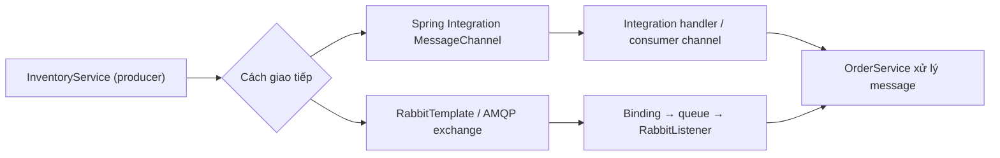
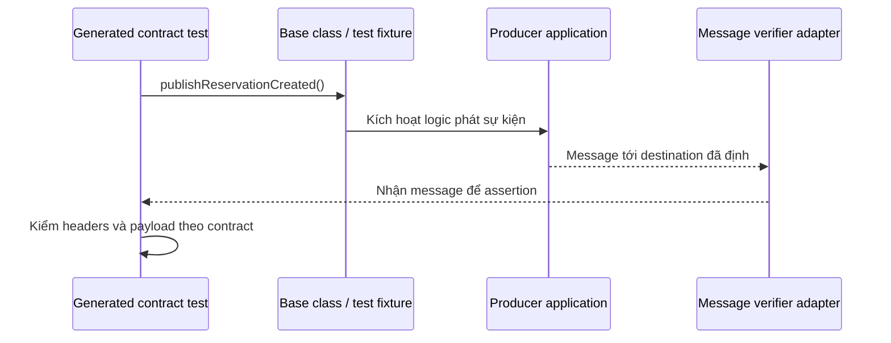
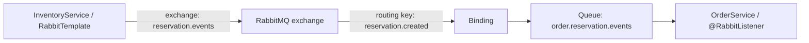
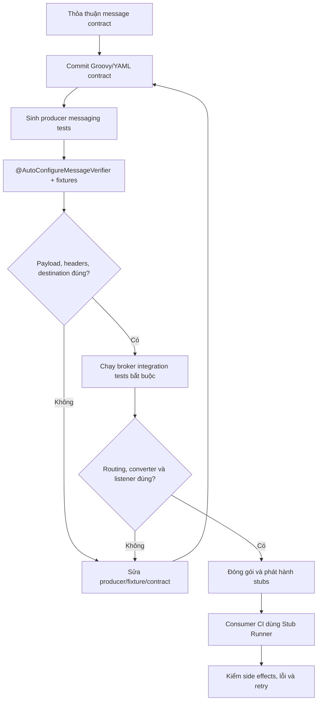

# Tích hợp Spring Integration và Spring AMQP theo phiên bản

Khi ứng dụng giao tiếp qua **message**, contract không chỉ mô tả JSON payload. Producer và consumer còn phải thống nhất nơi gửi, nơi nhận, header, định dạng nội dung và thời điểm một message được phát ra. Trong hệ sinh thái Spring, **Spring Integration** xử lý các luồng qua `MessageChannel` và endpoint tích hợp, còn **Spring AMQP** thường xử lý message qua RabbitMQ exchange, routing key và queue. Cùng một contract Spring Cloud Contract có thể phục vụ kiểm thử giao tiếp, nhưng **cách nối tới transport và khả năng tự cấu hình phụ thuộc phiên bản thư viện**.

Bài thuộc chương **Kiểm thử messaging** của module **SPRING_CLOUD_CONTRACT**. Ta sẽ dùng **Groovy/YAML DSL** để mô tả hành vi phát/nhận message, **Contract Verifier** để sinh producer tests, **Stub Runner** để kích hoạt message mẫu cho consumer, và **CI** để ngăn thay đổi không tương thích. Trọng tâm đặc biệt là không nhầm một Spring Integration channel với RabbitMQ exchange, không mang cấu hình Stub Runner AMQP của phiên bản cũ sang phiên bản mới mà chưa kiểm, và không đánh đồng một message test với bảo đảm delivery của broker thật.

Sau bài học, bạn có thể:

- So sánh mô hình `MessageChannel` của Spring Integration với `exchange → binding → queue → listener` của Spring AMQP.
- Hiểu vai trò `input`, `triggeredBy`, `messageFrom`, `outputMessage`, `sentTo` và `label` trong messaging contract.
- Dùng `@AutoConfigureMessageVerifier` và base class để generated test kiểm thông điệp do producer phát.
- Biết khi nào Stub Runner có thể kích hoạt message theo label bằng `StubTrigger`.
- Chọn đúng tích hợp theo **phiên bản Spring Cloud Contract, Spring Boot, Spring Integration và Spring AMQP** đang chạy.
- Tránh xung đột khi nhiều framework messaging nằm cùng classpath.
- Bổ sung broker integration tests cho routing, ack, retry, dead-letter và các bảo đảm không nằm trong một contract payload.

## 1. Hai kiểu hạ tầng messaging dễ bị lẫn

**Spring Integration** là framework tổ chức luồng xử lý thông điệp ở mức ứng dụng. Thành phần trung tâm thường là `Message<?>`, `MessageChannel`, gateway, transformer, router, filter hoặc service activator. Một channel có thể hoạt động **trong bộ nhớ** mà không cần broker.

**Spring AMQP** là bộ công cụ Spring cho AMQP. Với RabbitMQ kiểu phổ biến, ứng dụng gửi thông điệp tới **exchange**; broker dùng **routing key** và các **binding** để đưa message vào queue; consumer thường xử lý bằng `@RabbitListener` hoặc listener container.

| Thành phần | Spring Integration | Spring AMQP / RabbitMQ |
| --- | --- | --- |
| Nơi phát/nhận | `MessageChannel`, adapter, gateway | Exchange, queue, routing key, listener |
| Ví dụ gửi | `channel.send(message)` | `rabbitTemplate.convertAndSend(exchange, key, body)` |
| Ví dụ nhận | `PollableChannel.receive()` hoặc message handler | `@RabbitListener(queues = "...")` |
| Phụ thuộc broker | Không bắt buộc | Thường cần broker trong luồng thật |
| Điều cần contract bảo vệ | Tên destination, payload, headers, kịch bản kích hoạt | Payload, headers, destination và routing liên quan consumer |
| Điều contract không tự chứng minh | Toàn bộ IntegrationFlow, concurrency, retry | Binding broker thật, ack, redelivery, durability, DLQ |

Một ứng dụng có thể dùng **cả hai**: Spring IntegrationFlow kết thúc bằng AMQP outbound adapter; hoặc AMQP inbound adapter đẩy message vào một Integration channel. Tuy vậy, hai cách gọi cùng là “messaging” **không biến `sentTo('events')` thành một destination được giải nghĩa giống nhau** trong mọi phiên bản và adapter.

### Luồng tổng thể producer → consumer



Chọn một nhánh theo transport thật của hệ thống. Kiểm thử contract cần kiểm phần giao diện mà consumer dựa vào, còn kiểm thử broker cần đi qua hạ tầng tương ứng.

## 2. Vì sao phải nêu phiên bản?

Trong hệ sinh thái Spring, **cùng tên sản phẩm không đảm bảo cùng API, starter hoặc auto-configuration** giữa các đời. Ngoài ra, tài liệu Spring Cloud Contract ở các version khác nhau liệt kê các adapter messaging không giống hệt nhau.

| Dòng tài liệu / sản phẩm | Điều cần lưu ý |
| --- | --- |
| **Spring Cloud Contract 3.1.x** | Tài liệu 3.1.1 có mục riêng **Consumer Side Messaging With Spring AMQP**, mô tả tích hợp `RabbitTemplate`/`@RabbitListener` và các thuộc tính `stubrunner.amqp.*`. |
| **Spring Cloud Contract 4.2.x** | Tài liệu messaging nhấn mạnh **Spring Integration**, Spring Cloud Stream, Camel và JMS; không nên sao chép nguyên hướng dẫn `@SpyBean` hoặc thuộc tính AMQP cũ nếu chưa thử với bộ thư viện thực tế. |
| **Spring Cloud Contract 5.0.x** | Tài liệu tham chiếu tiếp tục nói về Integration, Stream, Camel, JMS và tình huống classpath có AMQP; nhưng khả năng, đường đi và cách bật adapter AMQP phải được xác minh trên **artifact/version cụ thể**, không suy từ một chú thích chung. |
| **Spring Boot 3.x / 4.x** | Tên starter AMQP và mô hình client có thay đổi giữa các thế hệ. Đặc biệt ở Boot 4, tài liệu phân biệt RabbitMQ AMQP 0.9.1 và AMQP 1.0; không giả định một starter dùng cho mọi giao thức. |
| **Spring Integration qua các đời** | Java DSL đã được đưa vào dự án core ở Spring Integration 5.0; API, cấu hình channel và test support cần được lấy theo release train tương thích với Spring Framework. |

**Lưu ý về bảng:** đây là **hướng dẫn xác minh tương thích**, không phải cam kết “phiên bản 5.x đã bỏ AMQP”. Một mục không được liệt kê riêng trong tài liệu hiện tại **không đủ chứng minh tính năng đã bị xóa**. Cần xem API/module thực sự có trong dependency graph, các thuộc tính configuration được bind, và một smoke test có phát/nhận message. Tránh trộn tài liệu 3.1.1 với runtime mới mà không kiểm chứng.

### Mối liên hệ giữa Spring Boot và Spring Cloud

Spring Cloud phát hành theo **release train** và tương thích với các thế hệ Spring Boot cụ thể. Ví dụ trong bảng tương thích Spring Cloud, `2025.0.x` hướng đến Boot `3.5.x`; `2025.1.x` hướng đến Boot `4.0.x` và một số `4.1.x` theo bản bảo trì. Không tùy ý chọn plugin Spring Cloud Contract, Spring Boot và Spring Integration ở các thế hệ khác nhau rồi kỳ vọng mọi annotation và bean đều có mặt.

**Quy trình chọn phiên bản nên theo thứ tự:**

1. Xác định phiên bản Spring Boot/JDK và Spring Cloud release train của dự án.
2. Chọn phiên bản **Spring Cloud Contract** tương thích, khóa qua build/BOM phù hợp.
3. Xác định producer thực sự dùng **Spring Integration**, **RabbitMQ AMQP 0.9.1**, **AMQP 1.0** hay kết hợp.
4. Chọn starter/adapter theo protocol, không chỉ theo chữ “AMQP”.
5. Kiểm tài liệu **cùng phiên bản** của Contract Verifier/Stub Runner và danh sách bean trên test classpath.
6. Sinh test, chạy test và thử `StubTrigger`/message receive trong một smoke test.

## 3. Một sự kiện nghiệp vụ xuyên suốt

Giả sử `InventoryService` phát sự kiện giữ hàng thành công. `OrderService` cần dùng nó để tiếp tục quy trình đơn:

```json
{
  "reservationId": "RES-100",
  "orderId": "ORD-1001",
  "status": "HELD"
}
```

Hai nhóm thống nhất:

- Event type: `reservation.created`.
- Payload phải có `reservationId`, `orderId` và `status`.
- `status` là `HELD` trong kịch bản thành công.
- Consumer không được giả định `reservationId` là một hằng số ở production.
- Destination thật được xác định theo transport: **channel** đối với Spring Integration thuần; **exchange/routing key/queue** đối với RabbitMQ.

Đây là hợp đồng nghiệp vụ **giả định** để học. Tên event, đường truyền và nội dung phải theo thỏa thuận thực tế của producer–consumer.

## 4. Messaging DSL khác HTTP DSL ở đâu?

Hợp đồng HTTP thường có `request { ... }` và `response { ... }`. Với message, Spring Cloud Contract có các khối như `input` và `outputMessage`:

| Thành phần DSL | Vai trò trong một kịch bản messaging |
| --- | --- |
| `name` | Định danh contract và giúp truy vết generated test |
| `description` | Bối cảnh consumer/producer và lý do event tồn tại |
| `label` | Nhãn dùng để kích hoạt message stub theo API `StubTrigger` |
| `input { triggeredBy(...) }` | Generated producer test gọi phương thức để yêu cầu producer phát message |
| `input { messageFrom(...) }` | Mô tả destination có **message đầu vào** để kích hoạt xử lý |
| `input { messageBody(...) }` | Nội dung message đầu vào |
| `input { messageHeaders { ... } }` | Các header message đầu vào |
| `outputMessage { sentTo(...) }` | Nơi producer phải phát message đầu ra |
| `outputMessage { body(...) }` | Payload mong đợi |
| `outputMessage { headers { ... } }` | Các header phải có trong message đầu ra |

Không phải hợp đồng nào cũng có cả **message đầu vào** và **message đầu ra**. Một event do lệnh nội bộ hoặc scheduler kích hoạt có thể dùng `triggeredBy`; một handler nhận command message có thể dùng `messageFrom`; một consumer chỉ nhận message và không phát gì tiếp có thể có loại kịch bản khác.

**Quan trọng:** `triggeredBy('someMethod()')` không tự định nghĩa logic nghiệp vụ. Generated test cần tìm được phương thức thích hợp trong base class/test context và gọi **đường phát message thật** của producer.

## 5. Groovy DSL: producer phát một message khi gọi phương thức

Giả sử đang kiểm bằng Spring Integration, nơi `reservationEvents` là channel mà test có thể quan sát.

```groovy
import org.springframework.cloud.contract.spec.Contract

Contract.make {
    name 'reservation_created_message'
    description '''
        InventoryService phát sự kiện giữ hàng để OrderService
        ghi nhận trạng thái HELD của đơn liên quan.
    '''
    label 'reservation_created'

    input {
        triggeredBy('publishReservationCreated()')
    }

    outputMessage {
        sentTo('reservationEvents')
        body([
            reservationId: 'RES-100',
            orderId      : 'ORD-1001',
            status       : 'HELD'
        ])
        headers {
            messagingContentType(applicationJson())
            header('eventType', 'reservation.created')
        }
    }
}
```

Đọc ví dụ:

1. `label 'reservation_created'` là tên mà consumer test có thể dùng để yêu cầu stub phát event mẫu; **đổi label có thể phá test consumer**.
2. `triggeredBy('publishReservationCreated()')` yêu cầu phía producer test có phương thức kích hoạt.
3. `sentTo('reservationEvents')` được dùng với ý nghĩa **channel/destination** khi chọn adapter Spring Integration.
4. `body` và `headers` là những điều cần xác minh ở output message.

**Lưu ý version:** cách resolve `sentTo` có khác biệt giữa Integration, Stream, Camel hoặc AMQP; tài liệu Contract Verifier mô tả với Integration/Stream rằng công cụ có thể tìm **destination** trước và sau đó đến **channel name**. Tên `reservationEvents` trong ví dụ chỉ là tên đã được cấu hình trong project. Không coi nó là queue hoặc exchange RabbitMQ nếu ứng dụng đang sử dụng transport khác.

### YAML DSL tương đương cho cùng tình huống

```yaml
name: reservation_created_message
description: InventoryService phát event để OrderService cập nhật đơn
label: reservation_created
input:
  triggeredBy: publishReservationCreated()
outputMessage:
  sentTo: reservationEvents
  body:
    reservationId: RES-100
    orderId: ORD-1001
    status: HELD
  headers:
    contentType: application/json
    eventType: reservation.created
```

Đây là **cách viết thay thế**, không nên đặt file Groovy và YAML có cùng nội dung vào tập nguồn đang được generator đọc rồi khiến test và stub bị nhân đôi. Nếu dùng matcher động, YAML có cơ chế riêng; không chép cú pháp `$(consumer(...),producer(...))` của Groovy vào YAML rồi hy vọng nó được diễn giải tự động.

### Dữ liệu sinh động trong output

Nếu `reservationId` là chuỗi phát sinh, phần body Groovy có thể dùng:

```groovy
body([
    reservationId: $(consumer('RES-100'),
                     producer(regex('RES-[0-9]+'))),
    orderId      : 'ORD-1001',
    status       : 'HELD'
])
```

Đây là **mảnh DSL**, thay cho `body` trong contract trước. Phía stub trả `RES-100` để consumer xử lý, còn producer test kiểm mã ID thật khớp mẫu. Regex không chứng minh ID duy nhất, đã lưu thành công hay tương ứng đúng đơn hàng; cần test nghiệp vụ nếu consumer phụ thuộc vào các quan hệ ấy.

## 6. Generated test phía producer kiểm điều gì?

Về nguyên tắc, Contract Verifier sinh một producer test có các bước:



Test sinh có thể:

- Gọi phương thức `publishReservationCreated()` được chỉ định trong `triggeredBy`.
- Chờ/nhận message từ destination `reservationEvents` qua adapter của framework.
- Assert có message, header `eventType` và payload đã cam kết.

Nhưng test **không tự bảo đảm** dữ liệu được ghi vào database, RabbitMQ broker thật đã ack, hoặc consumer đã nhận message. Những bảo đảm đó cần integration tests phù hợp.

### Base class cần có gì?

Một mẫu khởi tạo cho JUnit 5 và Spring Boot:

```java
package com.example.inventory;

import org.springframework.beans.factory.annotation.Autowired;
import org.springframework.boot.test.context.SpringBootTest;
import org.springframework.cloud.contract.verifier.messaging.boot.AutoConfigureMessageVerifier;

@SpringBootTest
@AutoConfigureMessageVerifier
public abstract class MessagingContractBase {

    @Autowired
    ReservationEventPublisher publisher;

    public void publishReservationCreated() {
        publisher.publish("RES-100", "ORD-1001");
    }
}
```

`ReservationEventPublisher` là **lớp giả định thuộc ứng dụng**, không phải API của Spring Cloud Contract. Nó phải phát message qua thành phần đang được verification quan sát, thay vì chỉ return một map từ test. Package annotation và cấu hình message verifier cần được **xác nhận ở phiên bản dependency đang dùng**; mục đích của `@AutoConfigureMessageVerifier` là bật adapter cần thiết cho messaging verification.

Nếu base class gọi publisher nhưng adapter không nhận được message, lỗi có thể nằm ở bean channel, broker connection, routing, test mode hoặc classpath chứ không phải payload contract.

## 7. Ví dụ Spring Integration chỉ dùng channel trong bộ nhớ

Một cách học dễ tái lập là dùng `QueueChannel` ở profile test. Nó cho phép message được đưa vào một channel có thể poll, không cần khởi động RabbitMQ.

```java
package com.example.inventory;

import org.springframework.context.annotation.Bean;
import org.springframework.context.annotation.Configuration;
import org.springframework.integration.channel.QueueChannel;
import org.springframework.messaging.PollableChannel;

@Configuration
class ContractChannelConfiguration {

    @Bean("reservationEvents")
    PollableChannel reservationEvents() {
        return new QueueChannel();
    }
}
```

Đây là **một cấu hình thử nghiệm**, không phải thành phần bắt buộc với mọi ứng dụng. Hãy bảo đảm bean này chỉ có mặt tại nơi dự án dự kiến và không trùng định nghĩa channel production.

Publisher tối giản minh họa:

```java
package com.example.inventory;

import java.util.Map;
import org.springframework.beans.factory.annotation.Qualifier;
import org.springframework.messaging.MessageChannel;
import org.springframework.messaging.support.MessageBuilder;
import org.springframework.stereotype.Service;

@Service
class ReservationEventPublisher {

    private final MessageChannel channel;

    ReservationEventPublisher(
            @Qualifier("reservationEvents") MessageChannel channel) {
        this.channel = channel;
    }

    void publish(String reservationId, String orderId) {
        channel.send(MessageBuilder.withPayload(Map.of(
                    "reservationId", reservationId,
                    "orderId", orderId,
                    "status", "HELD"))
                .setHeader("contentType", "application/json")
                .setHeader("eventType", "reservation.created")
                .build());
    }
}
```

Ở mô hình này, adapter Contract Verifier phải biết **cách nhận message từ `reservationEvents`**. Ví dụ đang gửi payload dạng `Map`; nếu ứng dụng thật gửi byte[] hoặc chuỗi JSON, cần bảo đảm converter/serialization và assertion kiểm **dạng wire format** đúng với nhu cầu consumer.

### Điểm cần nhớ về `DirectChannel` và `QueueChannel`

- `DirectChannel` thường chuyển message tới subscriber/handler trong cùng luồng gọi và **không tự lưu message** cho một test poll về sau.
- `QueueChannel` là `PollableChannel` nên phù hợp khi test muốn nhận message theo cách poll.
- Nếu ứng dụng production đã có `IntegrationFlow` phức tạp với nhiều subscriber, việc thay `DirectChannel` bằng `QueueChannel` trong test **có thể thay đổi hành vi**; nên dùng test tap, bridge hoặc adapter kiểm thử phù hợp để không che lỗi trên đường truyền thực tế.
- Nếu contract verifier tự tìm channel theo tên, hãy xác minh tên, bean type, destination resolution và khả năng nhận thực tế bằng smoke test.

**Một test pass trên QueueChannel không chứng minh RabbitMQ broker routing hoạt động**, vì khi đó hoàn toàn không có exchange, binding, listener container hay network.

## 8. Kiểm đầu vào dạng message bằng `messageFrom`

Ngoài kịch bản publisher tự phát event, producer có thể là một handler nhận command message và sinh event kết quả.

Ví dụ **mẫu DSL**:

```groovy
import org.springframework.cloud.contract.spec.Contract

Contract.make {
    name 'reserve_stock_command_results_in_event'
    description 'Lệnh đặt giữ hàng tạo một event xác nhận'

    input {
        messageFrom('reservationCommands')
        messageBody([
            orderId : 'ORD-1001',
            sku     : 'SKU-001',
            quantity: 2
        ])
        messageHeaders {
            messagingContentType(applicationJson())
        }
    }

    outputMessage {
        sentTo('reservationEvents')
        body([
            orderId: 'ORD-1001',
            status : 'HELD'
        ])
        headers {
            header('eventType', 'reservation.created')
        }
    }
}
```

Trường `messageFrom` có thể được adapter Integration hiểu là channel/destination của message đầu vào. Test thực tế cần **handler đang subscribe** tại đó và khả năng quan sát output. Nếu `reservationCommands` là một queue RabbitMQ trong production, mẫu setup Spring Integration bộ nhớ chỉ mới kiểm logic khi message đến channel; phải có bài test khác cho exchange/binding/consumer thực.

Không đặt `triggeredBy` và `messageFrom` cho cùng một kịch bản khi hai cơ chế là những kiểu kích hoạt khác nhau mà dự án không chủ đích kết hợp; hãy chọn mô hình tương ứng với đường xử lý cần kiểm.

## 9. Spring AMQP: exchange không phải queue, routing key không phải label

Trong RabbitMQ dùng AMQP 0.9.1, publisher thường gửi tới một **exchange**, kèm **routing key**. Broker dùng binding để định tuyến tới một hoặc nhiều queue; listener nhận message từ queue. Điều này khác với việc gửi thẳng tới channel `reservationEvents` trong bộ nhớ.



Phân biệt bốn giá trị:

| Giá trị | Ý nghĩa | Có tự thay thế nhau không? |
| --- | --- | --- |
| `reservation.events` | Tên exchange RabbitMQ | Không |
| `reservation.created` | Routing key / event type theo quy ước | Không |
| `order.reservation.events` | Tên queue consumer đọc | Không |
| `reservation_created` | `label` của Spring Cloud Contract để kích hoạt stub | Không |

Ví dụ producer sử dụng `RabbitTemplate` trong ứng dụng RabbitMQ kiểu truyền thống:

```java
package com.example.inventory;

import java.util.Map;
import org.springframework.amqp.rabbit.core.RabbitTemplate;
import org.springframework.stereotype.Service;

@Service
class RabbitReservationPublisher {

    private final RabbitTemplate rabbitTemplate;

    RabbitReservationPublisher(RabbitTemplate rabbitTemplate) {
        this.rabbitTemplate = rabbitTemplate;
    }

    void publish(String reservationId, String orderId) {
        rabbitTemplate.convertAndSend(
            "reservation.events",
            "reservation.created",
            Map.of(
                "reservationId", reservationId,
                "orderId", orderId,
                "status", "HELD"
            )
        );
    }
}
```

Đoạn này giả định ứng dụng có **RabbitTemplate** và message converter phù hợp. Nếu không cấu hình JSON converter, payload Java `Map` chưa chắc được gửi với `contentType: application/json` như contract yêu cầu. Cần kiểm converter và wire format thực, không chỉ kiểu dữ liệu trong Java.

Ví dụ consumer nhận từ queue:

```java
package com.example.order;

import org.springframework.amqp.rabbit.annotation.RabbitListener;
import org.springframework.stereotype.Component;

@Component
class ReservationCreatedListener {

    @RabbitListener(queues = "order.reservation.events")
    void onReservationCreated(ReservationCreatedEvent event) {
        // Cập nhật đơn theo reservationId và orderId.
    }
}
```

`ReservationCreatedEvent` là DTO thuộc ứng dụng ví dụ; listener thật còn cần queue/binding và converter để deserialize payload vào kiểu này. Annotation không tự chứng minh queue đang gắn đúng exchange hoặc broker đã xác nhận delivery.

### Contract nào áp dụng cho AMQP?

Kịch bản event vẫn mô tả bằng `input`/`outputMessage`, nhưng nếu chọn adapter AMQP, `sentTo('reservation.events')` có thể được hiểu là **exchange** thay vì Spring Integration channel. Trong hướng dẫn Spring Cloud Contract đời 3.1.x, routing key có thể được truyền qua header `amqp_receivedRoutingKey` cho tích hợp AMQP.

```groovy
import org.springframework.cloud.contract.spec.Contract

Contract.make {
    name 'rabbit_reservation_created'
    label 'rabbit_reservation_created'

    input {
        triggeredBy('publishRabbitReservationCreated()')
    }

    outputMessage {
        // Mẫu cho adapter AMQP của phiên bản hỗ trợ:
        // destination được hiểu là exchange.
        sentTo('reservation.events')
        body([
            reservationId: 'RES-100',
            orderId      : 'ORD-1001',
            status       : 'HELD'
        ])
        headers {
            messagingContentType(applicationJson())
            header('eventType', 'reservation.created')
            header('amqp_receivedRoutingKey', 'reservation.created')
        }
    }
}
```

**Giới hạn phiên bản:** header `amqp_receivedRoutingKey` và cơ chế chuyển từ exchange/routing key tới listener được mô tả trong hướng dẫn AMQP cũ. Với release train mới, hãy **xác minh module AMQP Stub Runner, schema metadata và adapter thực tế** trước khi dùng contract trên làm mẫu production. Không suy rằng mọi RabbitMQ client hoặc mọi phiên bản Contract Verifier đều xử lý header này giống nhau; đặc biệt tránh dùng nguyên adapter cho **AMQP 1.0** khi tài liệu chỉ mô tả kiểu RabbitMQ 0.9.1.

## 10. Test producer dùng broker thật hay không?

Việc dùng `RabbitTemplate` trong production **không có nghĩa** generated contract tests luôn phải khởi động broker RabbitMQ. Mỗi mức kiểm có mục tiêu khác nhau:

| Mức | Cấu hình thường gặp | Bằng chứng |
| --- | --- | --- |
| Spring Integration channel test | Channel in-memory và `@AutoConfigureMessageVerifier` | Producer phát payload/header hợp đồng tới channel đã cấu hình |
| Contract test với AMQP adapter được hỗ trợ | Messaging verifier tích hợp `RabbitTemplate`/listener theo phiên bản | Payload/header được quan sát qua cơ chế adapter |
| Unit test publisher AMQP | Mock/spy `RabbitTemplate` | Publisher gọi đúng exchange, routing key và nội dung ở mức invocation |
| Broker integration test | RabbitMQ thật trong môi trường thử nghiệm hoặc container | Exchange, binding, queue, converter và listener tương tác được |
| System test | Broker, DB, network, nhiều instance | Các bất biến quan trọng dưới retry, lỗi và tải |

**Không suy từ mock `RabbitTemplate` rằng broker thật định tuyến đúng.** Kiểm thử trên broker có thể dùng môi trường RabbitMQ được quản lý riêng hoặc một container thử nghiệm nếu tổ chức cho phép. Đây là bài test tích hợp bổ sung, không phải phép xác minh mà một DSL body map có thể tự thực hiện.

### Bộ dữ liệu và topology cho broker integration test

Ví dụ kịch bản thực:

1. Tạo exchange `reservation.events` kiểu `topic` hoặc kiểu đã thống nhất.
2. Tạo queue `order.reservation.events` cho `OrderService`.
3. Binding queue với routing key `reservation.created`.
4. Publisher gửi event theo đúng converter và content type.
5. Listener nhận và parse payload, kiểm event type, ID, status.
6. Kiểm message không bị rơi vào queue khác ngoài ý muốn nếu routing policy yêu cầu.

Để test tái lập, topology phải được tạo dứt khoát và dọn sau khi chạy; dùng queue names tách biệt giữa các job CI khi chạy song song. Một queue production thật không phải môi trường phù hợp để chạy generated tests.

## 11. Stub Runner với Spring Integration ở consumer

Trong Spring Cloud Contract, message stubs khác HTTP mappings: **contract definition** thường được đóng gói cùng stub artifact để Stub Runner đọc và dựng các tuyến message phù hợp. Consumer có thể kích hoạt một event đã đặt `label` bằng `StubTrigger`.

Ví dụ test consumer theo hướng Spring Integration:

```java
package com.example.order;

import org.junit.jupiter.api.Test;
import org.springframework.beans.factory.annotation.Autowired;
import org.springframework.boot.test.context.SpringBootTest;
import org.springframework.cloud.contract.stubrunner.StubTrigger;
import org.springframework.cloud.contract.stubrunner.spring.AutoConfigureStubRunner;
import org.springframework.cloud.contract.stubrunner.spring.StubRunnerProperties;

import static org.assertj.core.api.Assertions.assertThat;

@SpringBootTest
@AutoConfigureStubRunner(
    ids = "com.example:inventory-service:1.0.0:stubs",
    stubsMode = StubRunnerProperties.StubsMode.LOCAL
)
class ReservationEventConsumerTest {

    @Autowired
    StubTrigger stubTrigger;

    @Autowired
    OrderProjection orderProjection;

    @Test
    void shouldConsumeReservationCreated() {
        assertThat(stubTrigger.trigger("reservation_created")).isTrue();
        // Đọc trạng thái OrderProjection theo cơ chế đồng bộ hoặc
        // eventually/await nếu listener của ứng dụng xử lý bất đồng bộ.
        assertThat(orderProjection.statusOf("ORD-1001"))
            .isEqualTo("HELD");
    }
}
```

**Đây là mã minh họa cần điều chỉnh**: `OrderProjection` là thành phần giả định thuộc consumer; artifact `com.example:inventory-service:1.0.0:stubs` phải tồn tại ở repository local hoặc nơi tương ứng; các import/annotation/API `StubTrigger` phải phù hợp với phiên bản đang chạy. Nếu consumer xử lý message bất đồng bộ, assertion ngay sau `trigger` có thể tạo flaky test; dùng cơ chế chờ có timeout.

Điểm quan trọng: `trigger("reservation_created")` sử dụng **label contract**, không phải RabbitMQ exchange hoặc event type. Hãy quản lý label như một phụ thuộc tích hợp nếu consumer test đang dùng nó.

### Khi Integration stub không gửi vào đúng nơi

Kiểm tra:

- `@AutoConfigureStubRunner` có được bật trên test hay không.
- Dependency `spring-cloud-starter-stub-runner` và Spring Integration support có trong test classpath không.
- Plugin có đóng gói đúng contract nguồn vào artifact stub không.
- `sentTo` có được resolve thành destination/channel đúng không.
- Consumer listener/`IntegrationFlow` có subscribe đúng channel không.
- Có adapter khác trên classpath giành quyền diễn giải destination không.
- Test có chờ xử lý message bất đồng bộ trong thời gian hợp lý không.

Một lời gọi `StubTrigger` thành công cho biết stub **đã kích hoạt** theo cơ chế của nó; không tự chứng minh consumer đã cập nhật database hoặc xử lý side effect. Hãy assert **kết quả quan sát được** trong consumer.

## 12. Stub Runner với Spring AMQP: phải kiểm phiên bản và auto-configuration

Tài liệu Spring Cloud Contract 3.1.x có mô tả tích hợp AMQP cho consumer trong đó Stub Runner sử dụng `RabbitTemplate`, `@RabbitListener` và listener containers, cố gắng hoạt động **không cần broker RabbitMQ thật** ở một số cấu hình. Tài liệu đó cũng mô tả việc dùng spy trên `RabbitTemplate` và khả năng mock `ConnectionFactory`.

Đó là **hành vi của tích hợp/phiên bản cụ thể**, không phải bảo đảm chung cho mọi đời Spring Boot hoặc cho mọi AMQP transport. Các kiểu listener container, annotation mock/spy và configuration properties có thể thay đổi.

### Ví dụ cấu hình thuộc tính theo hai đời tài liệu

Một số tài liệu cũ dùng dạng prefix rút gọn:

```yaml
# Mẫu cho các dòng tài liệu cũ; kiểm version trước khi dùng:
stubrunner:
  amqp:
    enabled: true
  stream:
    enabled: false
  integration:
    enabled: false
```

Tài liệu thuộc tính mới của Spring Cloud Contract có dạng:

```yaml
# Ví dụ dạng property prefix hiện hành:
spring:
  cloud:
    contract:
      stubrunner:
        amqp:
          enabled: true
        stream:
          enabled: false
        integration:
          enabled: false
```

Các property trên **không thay thế nhau theo mọi phiên bản**. Cần đối chiếu trang cấu hình của release đang chạy và kiểm log startup cho biết AMQP messaging stub adapter đã thực sự được bật. Nếu classpath có đồng thời AMQP, Integration và Stream, việc tắt hai adapter còn lại chỉ là **một cách chọn**; không nên tắt bừa các chức năng ứng dụng thực sự cần ở các bài test khác.

### Đặc điểm đáng kiểm trong phiên bản hỗ trợ AMQP

| Nội dung | Điều cần xác minh |
| --- | --- |
| `amqp.enabled` | Có bật đúng stub adapter hay không |
| `amqp.mockConnection` | Test có dùng mocked connection factory hay cần broker thật |
| `RabbitTemplate` | Có được spy/intercept đúng theo phiên bản không |
| `@RabbitListener` | Có được adapter tìm và kích hoạt không |
| Listener container | Có hỗ trợ loại container đang dùng không |
| Exchange/binding/routing key | Stub tìm đúng queue/listener từ contract destination không |
| Converter | Payload thành byte/string/DTO đúng như consumer mong đợi không |
| Các framework khác | Stub Runner có chọn nhầm Integration/Stream adapter không |

**Cẩn thận với Spring Boot mới:** nếu hệ thống đã nâng Spring Framework/Boot và đổi annotation test spy hoặc cơ chế RabbitMQ AMQP client, không giả định các bài test đời 3.1 dùng `@SpyBean` vẫn compile. Hãy chạy một integration smoke test của Stub Runner trên **dependency set thật** trước khi quyết định adapter AMQP cũ đủ đáp ứng nhu cầu.

## 13. Phân biệt Boot 4 AMQP 0.9.1 và AMQP 1.0

Spring Boot đời mới có thể hỗ trợ các kiểu AMQP khác nhau. Theo tài liệu Boot 4, các starter được phân tách theo protocol và loại client:

| Nhu cầu | Hướng lựa chọn ở Boot 4 | Điều cần tránh |
| --- | --- | --- |
| RabbitMQ AMQP 0.9.1 truyền thống | `spring-boot-starter-rabbitmq` | Không nhầm với generic AMQP 1.0 client |
| RabbitMQ AMQP 1.0 native | `spring-boot-starter-amqp-rabbitmq` | Không giả định dùng các API 0.9.1 của `RabbitTemplate` |
| Generic AMQP 1.0 | `spring-boot-starter-amqp` | Không giả định mọi broker có RabbitMQ 0.9.1 semantics |

Đối với các phiên bản Spring Boot cũ hơn, tên starter có thể khác. **Không dùng bảng này như danh sách dependency áp dụng cho mọi thời điểm**; khi làm dự án mới, chọn đúng trang tài liệu theo Spring Boot version đã khóa.

Hệ quả đối với Spring Cloud Contract: một adapter Stub Runner từng tương tác với `RabbitTemplate` và `SimpleMessageListenerContainer` không thể mặc nhiên kiểm được một client AMQP 1.0 không dùng những lớp đó. Nếu đang chuyển protocol, cần **chọn lại test boundary** và có thể viết custom MessageVerifier adapter/integration test thay vì giữ nguyên stub setup cũ.

## 14. Message headers, converter và kiểu payload

Một nội dung JSON như sau có thể đi qua nhiều biểu diễn:

```json
{
  "reservationId": "RES-100",
  "orderId": "ORD-1001",
  "status": "HELD"
}
```

Trong Java, publisher có thể gửi `Map<String,Object>`; Spring Integration có thể truyền một `Message<Map<...>>` trực tiếp; RabbitTemplate có thể dùng converter để tạo bytes với content type thích hợp. Consumer thực tế lại có thể nhận `byte[]`, `String`, DTO hoặc map.

Một contract nên mô tả **dạng payload và các headers thực sự được consumer dựa vào**, không chỉ việc Java method được gọi. Cần xem:

| Thuộc tính | Ví dụ cam kết | Rủi ro nếu bỏ |
| --- | --- | --- |
| `contentType` | `application/json` | Consumer parser không biết cách đọc |
| `eventType` | `reservation.created` | Consumer không định tuyến event đúng |
| `reservationId` | Chuỗi theo quy tắc `RES-...` | Consumer không xác định được lượt giữ |
| `orderId` | Định danh đơn phù hợp | Cập nhật nhầm đơn |
| `status` | `HELD` | Consumer hiểu sai trạng thái |
| Routing key | `reservation.created` ở AMQP 0.9.1 | Message không tới queue mong đợi |
| Correlation ID | Theo quy tắc nếu là cam kết | Khó truy vết/ghép cặp yêu cầu |

Một `MessageHeaders` của Spring và `MessageProperties` của AMQP **không giống nhau hoàn toàn**. Header mapper và converter có thể đổi tên hoặc kiểu giá trị; ví dụ key/giá trị của AMQP nhận được từ broker có thể khác header nội bộ Integration.

Với các thuộc tính ở tầng broker, hãy có một broker integration test để xác minh mapping thật. Chỉ so chuỗi JSON sau khi adapter đã convert về `Map` có thể bỏ sót lỗi content type hoặc delivery properties.

## 15. Contract test không thay thế kiểm thử độ tin cậy của broker

Những hành vi sau có thể quan trọng cho `OrderService` nhưng **không được chứng minh** chỉ bằng một message contract có `body` và `headers` đúng:

- Broker đã thực sự ghi message bền vững.
- Producer publish confirm được xử lý đúng.
- Queue được bind với đúng exchange/routing key ở môi trường triển khai.
- Listener ack/nack đúng khi xử lý thành công/thất bại.
- Message được redeliver theo chính sách, vào dead-letter queue khi vượt retry.
- Consumer xử lý trùng event **idempotent**.
- Thứ tự giữa các partition/consumer instances được giữ theo phạm vi cam kết.
- Một transaction database và publish event có tính nhất quán như outbox pattern yêu cầu.

Ví dụ lỗi điển hình: generated producer test kiểm được payload `status=HELD` ở channel in-memory, nhưng khi deploy publisher cấu hình sai exchange hoặc routing key. Contract test vẫn pass vì không đi qua broker. Một broker integration test với đúng topology sẽ phát hiện lớp lỗi đó.

### Retry và duplicate delivery

Nếu broker hoặc consumer có semantics **at-least-once**, cùng `reservation.created` có thể đến hai lần. Consumer nên có chiến lược idempotency dựa trên event ID hoặc business key theo thỏa thuận. Test consumer có thể gửi hai message giống nhau và kiểm không tạo side effect trùng.

Ngay cả khi stub gửi đúng một message và consumer test xanh, đó vẫn **không phải bằng chứng** consumer an toàn với redelivery hoặc producer không bao giờ phát event trùng.

## 16. Đưa producer verification và consumer tests vào CI



Với dự án producer Maven đã cấu hình Spring Cloud Contract Verifier:

```bash
mvn -B -ntp clean verify
```

Với Gradle, chạy task build/check phù hợp mà dự án đã nối vào bước sinh và thực thi contract tests. Trong cả hai trường hợp, cần xác minh **plugin tạo test, test được biên dịch và test runner thực sự chạy**; build xanh với 0 contract tests không phải bằng chứng producer đáp ứng hợp đồng.

### Gợi ý điều kiện chặn phát hành

1. Toàn bộ Groovy/YAML contract được generator tìm thấy.
2. Generated messaging tests không bị skip; không có `NoSuchBeanDefinition` hoặc `receive` timeout bị bỏ qua.
3. Các test dùng đúng adapter Integration hoặc AMQP tương thích với phiên bản.
4. Có integration tests cho exchange/binding/queue khi application dựa trên broker.
5. Stub artifact chứa **contract definitions** messaging đúng version.
6. Consumer test gọi được `StubTrigger` và xử lý output message như mong đợi.
7. Artifact chỉ được publish từ commit/version đã qua các cổng bắt buộc.

Nếu dùng container broker trong CI, có thể tách job broker integration riêng. Tuy vậy, với một sản phẩm phụ thuộc routing và converter của RabbitMQ, không nên cho phép release chỉ dựa vào test channel in-memory.

## 17. Chẩn đoán lỗi theo triệu chứng

| Triệu chứng | Nguyên nhân khả dĩ | Cách xử lý |
| --- | --- | --- |
| Không sinh messaging test | Plugin không đọc contract hoặc DSL sai | Kiểm đường dẫn, tên contract, log generator |
| Generated test không tìm được `publishReservationCreated()` | Base class không có method hoặc cấu hình sai | Thêm method thực sự kích hoạt publisher |
| Test timeout khi `receive` | Sai channel/destination, queue rỗng, adapter chưa bật | Kiểm `sentTo`, bean channel, `@AutoConfigureMessageVerifier` |
| Test nhận payload nhưng header `contentType` khác | Converter/header mapper không thống nhất | Kiểm mapping header và dạng wire format |
| Integration test pass, AMQP test fail | In-memory channel đúng nhưng broker routing sai | Kiểm exchange, binding, queue, routing key |
| AMQP stub không kích hoạt listener | Sai adapter version, listener container hoặc mock connection | Kiểm classpath/thuộc tính và smoke test |
| Có cả Integration và AMQP trên classpath | Stub Runner chọn cơ chế không mong muốn | Chỉ bật adapter mục tiêu, tắt adapter khác phù hợp |
| `StubTrigger.trigger(...)` trả false | Label không được tìm thấy hoặc artifact thiếu contract | Kiểm artifact, IDs, label, version |
| Trigger được nhưng consumer state không đổi | Listener không subscribe, xử lý async hoặc exception | Kiểm handler, chờ bounded, logs và side effects |
| Test pass local nhưng CI fail ngẫu nhiên | Queue state chung, timeout, concurrency hoặc broker chưa sẵn | Isolate fixture, timeout hợp lý, readiness check |
| Tài liệu cũ có `@SpyBean` nhưng runtime mới lỗi | Annotation/test support thay đổi | Dùng đúng API test của version và adapter mới |
| Test dùng RabbitMQ AMQP 1.0 với config 0.9.1 | Lệch protocol/client API | Chọn lại starter và broker test boundary |

## 18. Quy trình nâng phiên bản an toàn

Khi nâng Spring Boot, Spring Cloud Contract hoặc Spring Integration/AMQP, không chỉ chạy `mvn test` rồi thấy xanh là đủ. Một migration đáng tin cậy có các bước:

1. **Lập bảng trước/sau**: Spring Boot, Spring Cloud train, Contract Verifier, Stub Runner, Integration, AMQP và JDK.
2. **Đọc migration guide đúng version**; đừng dùng ví dụ từ blog của thế hệ cũ làm tiêu chuẩn duy nhất.
3. **Kiểm dependency graph** xem có đồng thời Integration, Cloud Stream, RabbitMQ adapter, JMS hay không.
4. **Xác nhận starter/transport**: RabbitMQ AMQP 0.9.1 hay AMQP 1.0.
5. **Kiểm cấu hình**: `@AutoConfigureMessageVerifier`, thuộc tính `stubrunner.*`/`spring.cloud.contract.stubrunner.*` được bind đúng.
6. **Chạy một contract tối thiểu** có `triggeredBy`, `outputMessage` và destination; kiểm generated assertion thật.
7. **Chạy consumer smoke test** có `StubTrigger` và assertion lên listener/state.
8. **Chạy broker integration test** cho routing, converter và ack/redelivery nếu production dựa vào chúng.
9. So sánh payload/header/status event trước–sau; cập nhật contract nếu hai bên đồng ý thay đổi.
10. Phát hành stub version mới để consumer nâng cấp có chủ đích, không thay artifact đã phát hành bằng nội dung khác.

### Một bảng kiểm phiên bản tự điền

| Thành phần | Phiên bản hiện tại | Phiên bản mục tiêu | Test cần chạy |
| --- | --- | --- | --- |
| Spring Boot | Điền từ build | Điền từ build | Spring context và listener |
| Spring Cloud release train | Điền từ BOM | Điền từ BOM | Tương thích auto-config |
| Contract Verifier | Điền từ plugin | Điền từ plugin | Generate/execute producer tests |
| Stub Runner | Điền từ dependency | Điền từ dependency | Trigger label và consume message |
| Spring Integration | Điền từ dependencies | Điền từ dependencies | Channel/destination resolution |
| Spring AMQP / RabbitMQ client | Điền từ dependencies | Điền từ dependencies | Converter, exchange/binding/queue |
| JDK/JUnit | Điền từ toolchain | Điền từ toolchain | Biên dịch và test discovery |

**Không tự điền số version theo suy đoán**. Chúng phải đến từ POM/Gradle/BOM và tài liệu release train của dự án cụ thể.

## 19. Checklist tích hợp theo phiên bản

- [ ] Đã xác định producer/consumer và hành vi message cần bảo vệ.
- [ ] Đã phân biệt Integration channel và RabbitMQ exchange/queue/routing key.
- [ ] Biết runtime đang dùng AMQP 0.9.1 hay AMQP 1.0 nếu có RabbitMQ.
- [ ] Đã chọn các phiên bản Boot/Cloud/Contract/Integration/AMQP tương thích.
- [ ] Contract Groovy/YAML có `name`, `label`, `input` và `outputMessage` đúng mô hình.
- [ ] `triggeredBy` chỉ tới method thật của base class, không phải tên tưởng tượng.
- [ ] `sentTo` có destination đúng với adapter đang được test.
- [ ] Payload, `contentType` và các header nghiệp vụ phản ánh đúng wire format.
- [ ] Có `@AutoConfigureMessageVerifier` hoặc setup adapter tương ứng trên generated producer tests.
- [ ] Test Integration dùng channel có thể quan sát mà không che mất logic cần kiểm.
- [ ] Nếu dùng Stub Runner AMQP, đã đối chiếu thuộc tính và loại listener với version thật.
- [ ] Khi classpath có nhiều messaging frameworks, đã chọn adapter rõ ràng.
- [ ] Generated tests được sinh và thực thi, không xanh giả với 0 test.
- [ ] Có broker integration test cho routing/converter/ack khi hệ thống phụ thuộc.
- [ ] Consumer test kích hoạt `StubTrigger` và kiểm side effect, không chỉ kiểm giá trị boolean trả về.
- [ ] Message delivery duplicate/retry/DLQ được test riêng nếu quan trọng.
- [ ] CI chặn publish stub nếu producer verification hoặc integration tests bắt buộc fail.
- [ ] Stub artifact có version rõ ràng và truy vết được về commit đã xác minh.

### Bài tập thực hành

Bạn có `InventoryService` phát event khi giữ hàng thành công và `OrderService` nhận để cập nhật đơn.

**Quy ước message**:

```json
{
  "reservationId": "RES-100",
  "orderId": "ORD-1001",
  "status": "HELD"
}
```

**Yêu cầu:**

1. Vẽ hai sơ đồ: message đi qua `MessageChannel` trong Spring Integration và qua exchange/binding/queue trong RabbitMQ.
2. Viết Groovy contract với `label 'reservation_created'`, `triggeredBy` và `outputMessage` gửi tới channel `reservationEvents`.
3. Viết YAML tương đương, không tạo duplicate test bằng cách giữ cả hai contract trong cùng tập nguồn.
4. Tạo `QueueChannel` dành cho môi trường test và publisher phát `Message<Map<...>>`; cấu hình base class `@AutoConfigureMessageVerifier` để generated test quan sát message.
5. Thay `reservationId` bằng consumer sample và producer regex; kiểm trường `status` vẫn chính xác bằng `HELD`.
6. Tạo một ứng dụng RabbitMQ 0.9.1 dùng `RabbitTemplate` gửi tới exchange `reservation.events` với routing key `reservation.created`. Định nghĩa binding và `@RabbitListener` phù hợp.
7. Lập bảng version của Spring Boot/Cloud Contract/Integration/AMQP/JDK trên dự án bạn. Xác định có thể dùng adapter AMQP Stub Runner như hướng dẫn cũ hay phải dùng broker integration test/custom adapter.
8. Nếu adapter AMQP tương thích, bật thuộc tính AMQP tương ứng và tắt các adapter messaging khác khi cần; xác nhận Stub Runner kích hoạt được listener. Nếu không tương thích, thử consumer qua fake hoặc broker test có kiểm soát.
9. Chạy producer contract tests và consumer test `StubTrigger.trigger('reservation_created')`; kiểm `OrderService` thật sự đổi trạng thái đơn.
10. Tạo một broker integration test để phát hiện việc đổi routing key sai hoặc bỏ binding. Giải thích vì sao in-memory contract test không phát hiện được lỗi này.
11. Mô phỏng nhận hai event trùng và listener ném exception; kiểm chính sách idempotency, retry/ack/DLQ theo quy ước ứng dụng.
12. Đưa các bài test bắt buộc vào CI và chỉ phát hành stub từ commit producer đã đạt verification.

**Tiêu chí hoàn thành:** bạn biết **một destination trong contract được giải nghĩa bởi adapter nào**, kiểm được payload/header của producer qua Contract Verifier, kích hoạt event mẫu cho consumer bằng Stub Runner, và xác định rõ phần nào cần broker integration test theo **bộ phiên bản đang triển khai**.

## Tài liệu tham khảo theo phiên bản

- [Spring Cloud Contract — Messaging (current reference)](https://docs.spring.io/spring-cloud-contract/reference/project-features-messaging.html): Groovy/YAML messaging DSL, `@AutoConfigureMessageVerifier`, Integration, Stub Runner và `StubTrigger`.
- [Spring Cloud Contract — Configuration Properties (current)](https://docs.spring.io/spring-cloud-contract/reference/configprops.html): thuộc tính `spring.cloud.contract.stubrunner.amqp.enabled`, `integration.enabled` và các lựa chọn adapter.
- [Spring Cloud Contract 3.1.1 — Messaging and AMQP](https://docs.spring.io/spring-cloud-contract/docs/3.1.1/reference/html/project-features.html): ví dụ AMQP đời cũ, mock broker, routing key và những property trước đây.
- [Spring Boot — AMQP](https://docs.spring.io/spring-boot/reference/messaging/amqp.html): phân biệt các starter và protocol AMQP trên Boot mới.
- [Spring AMQP — Annotation-driven Listener Endpoints](https://docs.spring.io/spring-amqp/reference/amqp/receiving-messages/async-annotation-driven.html): `@RabbitListener`, queue binding và listener containers.
- [Spring Integration — Reference](https://docs.spring.io/spring-integration/reference/): channel, integration flow, adapters và testing support.
- [Spring Cloud — Release Trains](https://spring.io/projects/spring-cloud/): bảng tương thích với các thế hệ Spring Boot.
