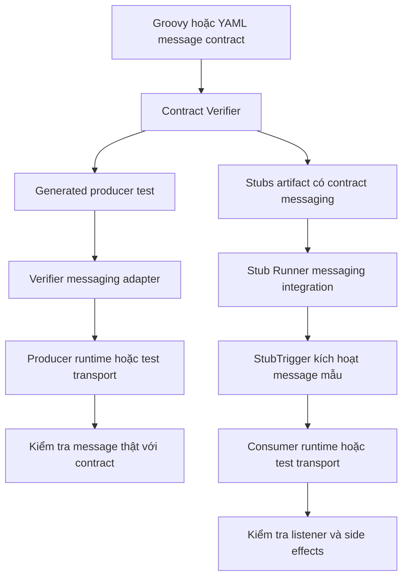
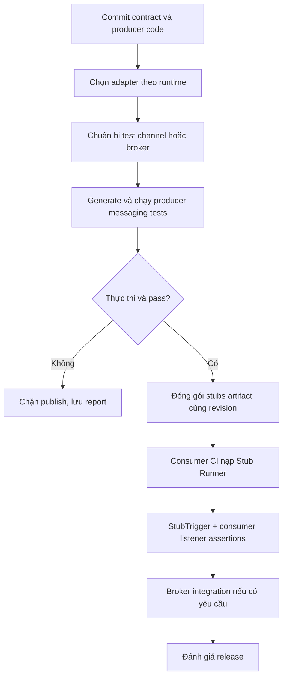

# Các adapter messaging bổ sung và điều kiện sử dụng

## 1. Vì sao kiểm thử hợp đồng thông điệp cần adapter?

Trong **Spring Cloud Contract**, producer và consumer có thể thống nhất cách giao tiếp không chỉ bằng HTTP mà còn qua **message broker**, queue, topic hoặc channel. Hợp đồng viết bằng **Groovy/YAML DSL** mô tả thông điệp đầu vào, hành động kích hoạt, thông điệp đầu ra, destination, header, body và matcher. Contract Verifier sinh **producer tests**; phía consumer có thể dùng **Stub Runner** để phát message mẫu và kiểm tra listener mà không cần khởi chạy producer thật.

Với HTTP, generated test biết cách gửi request qua một HTTP client và nhận status/body. Với messaging, khái niệm “gửi” hoặc “nhận” message phải gắn với một runtime thực tế:

- Spring Integration xử lý các `MessageChannel`.
- Spring Cloud Stream xử lý binding, function và binder.
- Apache Camel định tuyến qua endpoint URI và route.
- Spring JMS sử dụng destination của JMS broker.
- Một số tổ hợp phiên bản tích hợp thêm Spring AMQP hoặc Spring Kafka.
- Một ứng dụng có transport nội bộ hoặc công nghệ không được hỗ trợ có thể cần **adapter tùy biến**.

**Adapter messaging** ở đây là cầu nối giữa các lệnh gửi/nhận mà Contract Verifier hoặc Stub Runner cần thực hiện và cơ chế vận chuyển thật hoặc giả lập ở môi trường test. Thêm contract DSL **không tự biến mọi topic/queue thành một destination hoạt động**.

**Mục tiêu của bài học:** lựa chọn adapter theo runtime và phạm vi kiểm thử, cấu hình môi trường producer/consumer chính xác, phát hiện xung đột adapter trên classpath, phân biệt test binder với broker thật, và xây quy trình CI phát hiện thay đổi thông điệp không tương thích.

## 2. Phân biệt bốn thành phần thường bị gọi chung là “adapter”

| Thành phần | Chức năng | Ví dụ | Không tự bảo đảm |
| --- | --- | --- | --- |
| **Messaging runtime** | Chạy ứng dụng, định tuyến message | Spring Cloud Stream, Spring Integration, Camel | Contract đã được kiểm chứng |
| **Verifier transport adapter** | Cho generated producer test gửi/nhận message | `MessageVerifierSender` / `MessageVerifierReceiver` và implementation | Consumer xử lý đúng |
| **Stub Runner messaging integration** | Nạp contract/stub và phát message mẫu về phía consumer | `StubTrigger` phối hợp binder/channel/broker | Producer thật đã phát event |
| **Broker hoặc test binder** | Truyền message trong môi trường test | In-memory binder, ActiveMQ/Artemis, RabbitMQ, Kafka test broker | Schema, ý nghĩa và tương thích của payload |



Hai nhánh này có trách nhiệm khác nhau. **Producer test** bảo vệ lời hứa về message được phát từ implementation. **Consumer test** bảo vệ cách listener xử lý message phù hợp hợp đồng. Nếu chỉ chạy một nhánh, không thể kết luận toàn bộ giao tiếp đã được kiểm chứng.

## 3. Bảng lựa chọn adapter theo công nghệ và mục tiêu

| Hệ thống đang dùng | Adapter/hướng tích hợp cần xem xét | Điều kiện tối thiểu | Hạn chế quan trọng |
| --- | --- | --- | --- |
| **Spring Integration** | Adapter channel/message của Spring Integration | `MessageChannel` phù hợp, các channel quan sát được trong test context | Không kiểm tra một broker ngoài process nếu chỉ dùng channel in-memory |
| **Spring Cloud Stream** | Adapter Stream + **test binder** hoặc binder thật | Function/binding được đăng ký, `destination` map đúng, test binder tương thích version | Test binder không chứng minh Kafka/RabbitMQ production routing |
| **Apache Camel** | Adapter Camel route/endpoint | Camel context khởi động, endpoint URI có component tương ứng | Route test không tự xác minh broker hoặc giao dịch thật |
| **Spring JMS** | Adapter JMS + broker test đang chạy | `ConnectionFactory`, destination, listener và thời gian chờ phù hợp | Có thể phụ thuộc broker, không phải in-memory channel thuần |
| **Spring AMQP / RabbitMQ** | Adapter theo phiên bản SCC hoặc chạy qua Stream/Camel | Routing exchange/queue/binding đúng, cấu hình mock/real connection phù hợp | Tính sẵn có và hành vi auto-config thay đổi theo phiên bản |
| **Spring Kafka** | Adapter theo phiên bản SCC hoặc chạy qua Stream | Topic, consumer group, serializer, broker test và offset isolation | Không thể suy ra ordering/ack chỉ từ contract |
| **Transport riêng/không được hỗ trợ** | Tự triển khai verifier sender/receiver hoặc dùng adapter tầng chung | Biết cách gửi, nhận, timeout, headers, destination và lifecycle | Tự chịu trách nhiệm wiring, isolation và phần stub consumer |

**Điểm quan trọng về phiên bản:** Danh sách tích hợp trong tài liệu messaging của Spring Cloud Contract các nhánh hiện hành có thể gồm **Camel, Integration, Stream, JMS**. Tài liệu của những nhánh khác còn mô tả **AMQP và Kafka**; một số property của Stub Runner vẫn đề cập adapter đó. Không được kết luận “hỗ trợ chắc chắn” hay “đã bị loại bỏ hoàn toàn” cho một tổ hợp cụ thể chỉ dựa vào bảng tổng quan. Hãy xác minh **đúng bản Spring Cloud Contract, Spring Boot, framework messaging và dependency trong dự án** trước khi chọn adapter.

### Quy trình quyết định nhanh

1. Ứng dụng đang phát/nhận thông điệp qua abstraction nào: Stream function, Integration channel, Camel route, `JmsTemplate`, `RabbitTemplate` hay `KafkaTemplate`?
2. Producer test cần kiểm tra **payload/header** nhanh hay cần cả **serialization, broker routing và acknowledgment**?
3. Consumer test sẽ nhận stub qua **test binder/channel** hay một broker được khởi chạy trong CI?
4. Adapter tương ứng có mặt và thực sự được auto-configure ở phiên bản SCC đang dùng không?
5. Có nhiều abstraction trên classpath khiến adapter nhận sai message hoặc không biết destination không?
6. Những yêu cầu ngoài contract như retry, idempotency, partition/order, transaction sẽ được kiểm tra ở tầng nào?

Lựa chọn adapter đúng là lựa chọn **ranh giới kiểm thử có thể quan sát**, không phải chọn công nghệ có nhiều tính năng nhất.

## 4. Một hợp đồng làm mốc so sánh giữa các adapter

Giả sử `payment-service` hoàn tất thanh toán và phát sự kiện `PaymentCompleted`. Consumer `notification-service` cần xử lý:

```text
Logical destination: payments.completed
Header eventType: PaymentCompleted
Header contentType: application/json
Body: {"paymentId":"pay-900","orderId":"ord-42","status":"COMPLETED"}
```

Một contract Groovy minh họa:

```groovy
import org.springframework.cloud.contract.spec.Contract

Contract.make {
    description 'Phát PaymentCompleted sau khi thanh toán'
    label 'payment_completed'

    input {
        triggeredBy('completePayment()')
    }

    outputMessage {
        sentTo('payments.completed')
        headers {
            header('eventType', 'PaymentCompleted')
            messagingContentType(applicationJson())
        }
        body([
            paymentId: 'pay-900',
            orderId  : 'ord-42',
            status   : 'COMPLETED'
        ])
    }
}
```

Ý nghĩa cần được giữ khi thay adapter:

- **Trigger:** producer test kích hoạt hành động `completePayment()` trên ứng dụng thật ở test context.
- **Destination:** test adapter phải giải quyết `payments.completed` thành đúng nơi quan sát message.
- **Header:** `eventType` và content type là thông tin consumer phụ thuộc.
- **Body:** các field và giá trị của kịch bản không bị đổi kiểu hoặc tên.
- **Label:** `payment_completed` giúp consumer trigger message stub tương ứng.

**Lưu ý:** Chuỗi `payments.completed` là một **destination logic** trong contract. Với Stream/Integration, adapter có thể tìm destination của binding/channel rồi mới tới tên channel; với Camel, destination có thể là URI có prefix component; với JMS, nó là tên destination theo broker. Vì vậy **không sao chép nguyên chuỗi destination sang mọi runtime rồi mặc định route tự xuất hiện**.

### YAML DSL tương ứng về ý định

```yaml
description: Phát PaymentCompleted sau khi thanh toán
label: payment_completed
input:
  triggeredBy: completePayment
outputMessage:
  sentTo: payments.completed
  headers:
    eventType: PaymentCompleted
    contentType: application/json
  body:
    paymentId: "pay-900"
    orderId: "ord-42"
    status: "COMPLETED"
```

Groovy và YAML thể hiện **cùng một kịch bản**, không nên để cả hai bản trong thư mục contract được plugin quét nếu không có chủ đích sinh hai hợp đồng riêng. Khi chuyển định dạng, phải kiểm tra generated producer tests và message stub trên adapter cụ thể, không chỉ xác nhận YAML parse thành công.

## 5. Điều kiện chung cho generated producer messaging tests

Trong Spring Cloud Contract, cấu hình producer messaging thường cần:

1. Contract có `input` (như `triggeredBy` hoặc `messageFrom`) và `outputMessage` tương ứng.
2. Plugin Contract Verifier sinh test và được cấu hình để dùng **base class** đúng.
3. Test context khởi tạo producer, channel/binding/route, và verifier adapter.
4. Base class hoặc test setup cung cấp method trigger, dữ liệu fixture, và khả năng quan sát output.
5. Generated test thật sự được biên dịch và chạy; báo cáo không có “0 contract tests” hoặc bị skip ngoài ý muốn.

Ví dụ **khung** base class Spring Boot:

```java
// Minh họa trách nhiệm base class; import/package phụ thuộc bản SCC.
@SpringBootTest
@AutoConfigureMessageVerifier
public abstract class MessagingContractBase {

    @Autowired
    PaymentApplicationService paymentService;

    public void completePayment() {
        // Fixture pay-900 phải ở trạng thái phù hợp.
        // Kích hoạt business code, KHÔNG tự bơm message mẫu vào verifier.
        paymentService.complete("pay-900");
    }
}
```

`PaymentApplicationService` là kiểu ứng dụng minh họa, không phải API có sẵn của Spring Cloud Contract. **`@AutoConfigureMessageVerifier`** là annotation đáng chú ý khi sử dụng cấu hình messaging tích hợp; phải chọn dependency, package import và test framework tương ứng phiên bản. Nếu consumer test dùng `@AutoConfigureStubRunner`, phần messaging auto-config của Stub Runner có thể được đưa vào cùng context theo tích hợp tương ứng.

Không dùng một base class tự tạo message giống body trong contract rồi nạp thẳng vào kênh test, bởi test sẽ pass mà không kiểm chứng đường đi xuất sự kiện thực của producer.

## 6. Adapter Spring Integration: khi dùng channel và message flow

**Spring Integration** phù hợp nếu ứng dụng tổ chức giao tiếp bằng `MessageChannel`, gateway, transformer, router hoặc service activator. Khi producer phát vào một channel, adapter kiểm thử cần **quan sát được message** trên đường đi phù hợp.

### Điều kiện để dùng

- Dependency Spring Integration và tích hợp SCC phù hợp trên test classpath.
- Channel/binding mà `sentTo(...)` trỏ đến tồn tại hoặc được resolve đúng.
- Message từ business code thực sự chảy qua channel trong test context.
- Kênh nhận có thể quan sát được mà không làm mất message trước khi assertion chạy.
- Fixture và message listener được cô lập giữa các test.

Một luồng minh họa:

```text
PaymentApplicationService
      |
      v
  output Channel ---> consumer thật ở production
      |
      v
  test bridge/channel ---> verifier nhận message trong test
```

Spring Integration có thể dùng **`QueueChannel`** hoặc bridge đến channel riêng để test nhận message. Trong ví dụ XML của tài liệu Spring Cloud Contract, một `bridge` đưa output tới một test queue channel; cách triển khai bằng Java DSL có thể khác. Đừng áp đặt một cách bắt message lên mọi flow, vì `DirectChannel` đồng bộ có thể có nhiều handler và việc thêm subscriber test có thể thay đổi luồng xử lý.

### Những lỗi đặc trưng

| Triệu chứng | Nguyên nhân có thể |
| --- | --- |
| Verifier timeout khi nhận | Channel chưa được đăng ký, sai tên, output đi sang channel khác |
| Test nhận thông điệp khác | Shared channel/queue còn message cũ hoặc listener khác tiêu thụ |
| Một message bị xử lý hai lần | Test bridge hoặc flow thay đổi fan-out ngoài ý muốn |
| Producer test pass nhưng broker thật lỗi | Test chỉ chạy channel in-memory, chưa kiểm tra broker adapter |

**Phạm vi bảo đảm:** Test này có thể chứng minh producer xuất dữ liệu đúng qua Spring Integration channel. Nó **không tự chứng minh** AMQP/Kafka broker ngoài ứng dụng đã nhận, persist hay giao message.

## 7. Adapter Spring Cloud Stream: function, binding và test binder

**Spring Cloud Stream** là lựa chọn thường gặp khi code nghiệp vụ tương tác với message qua binding/function thay vì gọi client Kafka hoặc RabbitMQ trực tiếp. Một message contract với `sentTo('payments.completed')` cần được resolve qua đúng binding/destination của Stream.

### Ví dụ binding phía consumer

Một ứng dụng thông báo dùng Spring Cloud Function có thể định nghĩa:

```java
@Bean
Consumer<PaymentCompleted> onPaymentCompleted() {
    return event -> notificationService.enqueue(event.orderId());
}
```

Và cấu hình minh họa:

```yaml
spring:
  cloud:
    function:
      definition: onPaymentCompleted
    stream:
      bindings:
        onPaymentCompleted-in-0:
          destination: payments.completed
          group: notification-service
```

Tên binding `onPaymentCompleted-in-0` là kết quả của mô hình function của Spring Cloud Stream trong tình huống này. `PaymentCompleted`, `notificationService` và DTO chỉ là các kiểu ứng dụng minh họa. Consumer cần có serializer/converter và configuration tương thích để payload thật được chuyển sang `PaymentCompleted`.

### Test binder và điều kiện sử dụng

Với nhiều phiên bản Spring Cloud Stream hiện đại, dự án có thể dùng dependency test:

```groovy
// build.gradle: dependency test; đối chiếu với BOM của dự án.
testImplementation 'org.springframework.cloud:spring-cloud-stream-test-binder'
```

Một bản `@Import(TestChannelBinderConfiguration.class)` hoặc cơ chế auto-configuration test binder phù hợp có thể giúp luồng gửi/nhận chạy **không cần broker thật**, để contract và consumer test chạy nhanh, ổn định. Tuy nhiên, class package, bean/function wiring, test binder version và cách đăng ký test context cần đối chiếu đúng nhánh Spring Cloud Stream. Các hướng dẫn cũ có thể dùng classifier `test-binder` trên dependency khác.

**Điểm quyết định:** Stub Runner phải phát message tới đúng destination của consumer binding; producer verifier phải quan sát đúng output binding. Nếu `sentTo` được resolve thành channel name khác với destination, `StubTrigger` có thể chạy nhưng listener không nhận được gì.

### Khi không nên chỉ dùng test binder

Test binder không mô phỏng đầy đủ:

- Kafka partition key, offset, consumer group rebalance và retention.
- RabbitMQ exchange, queue binding, routing key, publisher confirms, dead-letter.
- Serialization thực qua network và schema registry.
- Mất kết nối broker, retry thực, acknowledgment và redelivery.

Khi những đặc tính này quan trọng, cần **integration test với broker** (ví dụ test container hoặc broker test riêng) bên cạnh contract tests. Không xóa test binder vì nó “không phải broker thật”; hai lớp kiểm thử phục vụ hai mục đích khác nhau.

## 8. Adapter Apache Camel: endpoint URI là một phần của routing

**Apache Camel** phù hợp khi producer/consumer dùng route và component endpoint, ví dụ JMS, AMQP hoặc các transport thông qua Camel. Điểm cần chú ý nhất là `sentTo(...)` có thể được hiểu là **URI endpoint Camel**, không chỉ một tên queue trừu tượng.

Ví dụ contract được thiết kế riêng cho Camel có thể dùng:

```groovy
outputMessage {
    sentTo('jms:queue:payments.completed')
    body([
        paymentId: 'pay-900',
        status: 'COMPLETED'
    ])
    headers {
        header('eventType', 'PaymentCompleted')
    }
}
```

URI trong ví dụ chỉ có nghĩa khi Camel context có **component `jms`** và một connection factory/destination thích hợp. Nếu muốn thử một route thuần in-memory, có thể sử dụng component kiểm thử của Camel như `direct:` hoặc `seda:` khi phù hợp. Nhưng thay một endpoint production bằng `mock:` trong bài test chỉ chứng minh **điểm thay thế được gọi**, chưa chứng minh transport thật tương thích.

### Điều kiện để dùng

1. Camel context và route cần kiểm tra phải được khởi tạo.
2. Component của URI được cài đặt, không gây lỗi `NoSuchEndpointException`.
3. Message headers và body được chuyển đổi đúng trước/đúng sau route.
4. Nếu route thay đổi destination theo header, contract bảo vệ những header cần thiết.
5. Test lifecycle không để exchange từ test trước còn trong route hoặc queue.

**Cẩn thận với migration:** Cùng một contract DSL có thể phải đổi destination từ channel name sang URI theo Camel. Đây là **cách cấu hình test adapter/transport**, không nên tự đổi một logical destination công khai mà consumer đang dựa vào nếu chưa thỏa thuận tương thích.

## 9. Adapter Spring JMS: cần môi trường broker phù hợp

**Spring JMS** sử dụng API gửi/nhận message thông qua JMS connection và destination. Theo hướng dẫn messaging của Spring Cloud Contract, tích hợp Stub Runner JMS **giả định có một JMS broker đang chạy**. Điều này khác với test binder in-memory: thêm dependency `spring-jms` không tự tạo một hàng đợi hoạt động.

Điều kiện tối thiểu:

- Có `ConnectionFactory` kết nối đúng broker test (hoặc embedded broker được phiên bản/thư viện hiện tại hỗ trợ).
- Destination ở `sentTo` trỏ đúng queue/topic logic theo cấu hình JMS.
- Message converter xử lý đúng bytes/text/object và content type.
- `JmsTemplate`, listener container, acknowledgement/transaction nếu cần được cấu hình.
- Broker và message queue được dọn/đặt namespace riêng để các test không đọc trúng dữ liệu cũ.

Ví dụ một consumer listener:

```java
@JmsListener(destination = "payments.completed")
public void handlePayment(String json) {
    // Parse JSON và thực hiện nghiệp vụ tiêu thụ event.
}
```

Đây là đoạn minh họa listener, cần dependency JMS, broker và import annotation trong project. Nếu hệ thống dùng queue giữa producer và consumer, phải có cách xác minh **message được routing đúng queue**, không chỉ kiểm tra producer gọi `JmsTemplate.convertAndSend(...)`.

### Những rủi ro trong test JMS

| Triệu chứng | Câu hỏi cần kiểm tra |
| --- | --- |
| Kết nối bị từ chối | Broker test đã chạy, host/port/auth đúng chưa? |
| Message không đến | Destination là queue hay topic, có sai tên không? |
| Test nhận event của lần trước | Queue đã purge hoặc tách riêng theo test chưa? |
| Producer test timeout | Listener nhận/ack trước khi verifier quan sát message? |
| Khác nhau giữa local và CI | Broker embedded, transaction, converter hoặc concurrency config có giống nhau không? |

Một consumer stub test qua JMS xác minh **listener với message mô phỏng**, không tự xác minh producer đã commit DB trước khi gửi message hoặc bảo đảm không trùng giao dịch.

## 10. Spring AMQP và Spring Kafka: phân biệt adapter SCC với broker test

Spring AMQP và Spring Kafka là lựa chọn thường gặp cho microservice. Tuy nhiên **hỗ trợ trực tiếp của Spring Cloud Contract phụ thuộc phiên bản**; tài liệu của các nhánh Spring Cloud Contract khác nhau không phải lúc nào cũng liệt kê cùng tập tích hợp. Ngoài ra, một ứng dụng dùng Kafka hoặc RabbitMQ thông qua **Spring Cloud Stream** có thể chọn adapter Stream thay vì một adapter Kafka/AMQP trực tiếp.

### 10.1. Spring AMQP với RabbitMQ

Message producer có thể dùng `RabbitTemplate`, consumer dùng `@RabbitListener`. Trái với queue trừu tượng, RabbitMQ định tuyến dựa trên **exchange, routing key và binding**.

```text
Producer --publish--> Exchange
                       | routing key + binding
                       v
                     Queue --> @RabbitListener
```

Để consumer nhận đúng message khi Stub Runner kích hoạt:

1. Xác định `sentTo` mô tả exchange hay destination logic nào theo adapter đang dùng.
2. Kiểm tra queue và binding đến exchange đó đã được khai báo trong test context/broker.
3. Kiểm tra routing key và message headers nếu consumer phụ thuộc.
4. Nếu adapter dùng mock connection factory, hiểu rằng không có bảo đảm broker đã nhận/ack.
5. Nếu muốn xác minh exchange routing thật, chạy integration test với RabbitMQ test broker.

Một số phiên bản SCC dùng thuộc tính `spring.cloud.contract.stubrunner.amqp.enabled` để bật tích hợp AMQP và cấu hình connection được mock hoặc broker thật. **Đọc tài liệu cấu hình của version được khóa trong build**; không coi property là lời bảo đảm mọi tổ hợp Spring AMQP + SCC đều hoạt động mặc định.

### 10.2. Spring Kafka

Producer có thể phát record bằng `KafkaTemplate`, consumer dùng `@KafkaListener` hoặc function/binding của Stream. Contract có thể kiểm tra payload và headers của event, nhưng Kafka còn có những đặc tính quan trọng **ngoài DSL cơ bản**:

- Topic có tồn tại và producer có quyền publish không?
- Serializer/deserializer hoặc schema registry có tương thích không?
- Partition key có bảo đảm ordering trong **một partition** theo yêu cầu không?
- Consumer group và offset có được cô lập cho từng test?
- Consumer có xử lý được redelivery, retry hoặc duplicate không?

Với tích hợp Kafka trực tiếp ở những phiên bản SCC hỗ trợ, cần xác nhận `spring.cloud.contract.stubrunner.kafka.enabled` và những thành phần initializer/test broker theo hướng dẫn nhánh đó. Nếu ứng dụng dùng Stream, kiểm thử hợp đồng có thể dùng **Stream test binder**, rồi dùng Kafka integration test riêng cho partition, offset và serialization.

### 10.3. Chọn đúng mức độ trung thực

| Kiểu test | Chạy gì? | Điều chứng minh được | Chưa chứng minh |
| --- | --- | --- | --- |
| Contract + test binder | Message đi qua abstraction in-memory | Application phát/đọc payload, header, destination logic theo test | Broker production routing và giao hàng |
| Contract + AMQP/Kafka adapter với broker test | Broker/transport test tham gia luồng | Có thể bắt thêm lỗi destination, serialization và config | Cluster failover, retention/throughput production |
| Integration test với container/broker | Producer/consumer thật, broker gần production | Routing, retry, ack và converter trong setup test | Toàn bộ tình huống mạng, quy mô và cluster production |
| E2E/resilience test | Nhiều service, broker và DB | Luồng nghiệp vụ xuyên dịch vụ, điều kiện lỗi cụ thể | Không thể thay mọi contract test nhanh |

Không vì chạy được Kafka/RabbitMQ container mà bỏ producer contract tests: broker hoạt động tốt vẫn không phát hiện được một field bị đổi tên nếu test không assert schema.

## 11. Khi nào cần tự viết messaging adapter?

Một hệ thống có thể dùng một giao thức không nằm trong các tích hợp được hỗ trợ, một message bus nội bộ hoặc một wrapper đặc thù. Khi đó có hai hướng:

1. **Giữ contract ở tầng abstraction chung:** dùng Spring Integration/Stream/Camel nếu ứng dụng đã đi qua tầng này và nó phản ánh đúng giao diện consumer.
2. **Viết adapter tùy biến cho verifier:** cung cấp cách gửi message từ generated test và nhận output đã phát, rồi bổ sung cơ chế consumer stub tương ứng nếu cần.

Ở các nhánh Spring Cloud Contract hiện đại, tài liệu nhắc tới các interface:

- `org.springframework.cloud.contract.verifier.messaging.MessageVerifierSender` — cầu nối **gửi** message đến destination.
- `org.springframework.cloud.contract.verifier.messaging.MessageVerifierReceiver` — cầu nối **nhận** message từ destination, có thể phụ thuộc timeout/contract.
- `MessageVerifier` hoặc `ContractVerifierMessageExchange` — những abstraction hỗ trợ ở các phiên bản/tình huống test cụ thể.

**Lưu ý phiên bản:** Interface và chữ ký method có thay đổi giữa các nhánh Spring Cloud Contract. Không lấy một đoạn implementation trên internet cho phiên bản khác rồi copy nguyên xi. Hãy đọc API/Javadoc của **dependency thực sự trong project**, kiểm tra việc Spring inject đúng bean vào generated tests và không có bean cạnh tranh.

### Trách nhiệm tối thiểu của adapter tùy biến

Một adapter thích hợp phải:

1. **Resolve destination:** chuyển logical `sentTo`/`messageFrom` thành channel, topic, queue hoặc endpoint đang kiểm thử.
2. **Gửi đúng cấu trúc:** bảo toàn payload bytes/object, content type, custom headers và correlation ID.
3. **Nhận có kiểm soát:** timeout rõ ràng, chỉ nhận message phù hợp, không vô tình tiêu thụ message của test khác.
4. **Chuyển đổi đúng kiểu:** tránh biến object JSON thành chuỗi JSON đã escape hoặc đổi số thành chuỗi.
5. **Khởi tạo và dọn tài nguyên:** đăng ký listener trước trigger, đóng consumer/session, purge/test namespace khi cần.
6. **Đảm bảo quan sát implementation:** nhận output từ business code thực, không trực tiếp chép contract body vào buffer giả để kiểm tra.

Một **mã giả** minh họa ranh giới adapter, **không phải Java interface có thể biên dịch nguyên văn**:

```text
send(message, logicalDestination, contract):
    physicalDestination = resolver.resolve(logicalDestination)
    transport.publish(
        physicalDestination,
        converter.toWire(message.payload),
        message.headers
    )

receive(logicalDestination, timeout, contract):
    physicalDestination = resolver.resolve(logicalDestination)
    raw = transport.poll(physicalDestination, timeout)
    return converter.toContractMessage(raw.payload, raw.headers)
```

Hãy dùng unit/integration tests để kiểm tra riêng adapter trước khi cho generated contract tests phụ thuộc vào nó. Ví dụ: thử payload UTF-8, JSON number/string, header bắt buộc, message không đến, hai event có correlation ID khác nhau và timeout.

### Chú ý với Stub Runner JUnit extension

Nếu không dùng Spring Boot `@AutoConfigureStubRunner` mà chọn `StubRunnerRule` hoặc `StubRunnerExtension` độc lập, một số phiên bản yêu cầu **cung cấp `MessageVerifierSender` và `MessageVerifierReceiver` vào builder** để phát messaging stub. Nếu không, HTTP stubs có thể vẫn chạy nhưng khi trigger message sẽ báo lỗi không có sender. Cần đọc API của rule/extension ở đúng phiên bản; consumer test chưa “sẵn sàng messaging” chỉ vì Stub Runner tải được artifact.

## 12. Nhiều adapter trên classpath: tránh auto-configuration mâu thuẫn

Một producer/consumer thực tế có thể đồng thời dùng Spring Integration, Spring Cloud Stream, Spring JMS và Spring AMQP. Nhiều adapter có mặt trong classpath làm tăng nguy cơ:

- Có hai bean cùng chức năng gửi/nhận message, Spring không chọn được bean cần dùng.
- Stub Runner định tuyến message stub qua Stream khi listener đang đăng ký ở AMQP trực tiếp.
- Destination `payments.completed` được resolve thành channel name thay vì exchange hoặc queue.
- Test binder và broker thật đều khởi tạo, nhưng assertion quan sát nhầm nơi.
- Test pass do adapter in-memory nhưng deployment lại dùng cấu hình broker khác.

Với những phiên bản SCC cung cấp các property bật/tắt adapter, có thể **tắt những tích hợp không cần thiết** để chỉ còn đường vận chuyển mong muốn.

Ví dụ cấu hình định hướng chọn AMQP cho consumer test có Stream và Integration trên classpath:

```yaml
spring:
  cloud:
    contract:
      stubrunner:
        stream:
          enabled: false
        integration:
          enabled: false
        amqp:
          enabled: true
```

Ví dụ này không tự cung cấp broker, queue, exchange/binding hoặc listener. Nếu JMS/Kafka/Camel cũng hiện diện thì cần xem xét trạng thái các adapter đó và tắt/bật tương ứng **theo config properties thực sự có ở phiên bản dùng**. Đừng dùng giá trị “mặc định” của một phiên bản khác để quyết định adapter sẽ được chọn.

### Bộ kiểm tra trước khi chạy

| Kiểm tra | Tín hiệu mong đợi |
| --- | --- |
| Dependency | Phiên bản Spring Boot, SCC và messaging framework tương thích |
| Bean trong test context | Chỉ adapter phù hợp được chọn làm sender/receiver |
| Destination | Cùng tên/URI mà contract và runtime đang dùng |
| Listener readiness | Consumer/broker subscriber đã đăng ký trước `StubTrigger` |
| Payload/headers | Converter không làm thay đổi format hoặc header bắt buộc |
| Trạng thái test | Không còn message cũ, consumer group/queue đã cô lập |
| Test report | Generated producer tests đã chạy, consumer assertion thực sự được thực thi |

Không nên sửa contract `sentTo(...)` chỉ để “đi vào được một adapter”, trừ khi đó cũng là thay đổi giao diện đã được consumer chấp nhận. Thường cần sửa **binding/adapter configuration**, không phải lời hứa nghiệp vụ trong contract.

## 13. Consumer test: Stub Runner, StubTrigger và adapter thực tế

Khác với HTTP, messaging stub thường cần **giữ thông tin contract** trong stubs artifact, rồi dùng tích hợp messaging của Stub Runner để tạo route và phát message. Một contract có `label 'payment_completed'` cho phép consumer kích hoạt message tương ứng.

Ví dụ khung consumer Spring Boot:

```java
import org.junit.jupiter.api.Test;
import org.springframework.beans.factory.annotation.Autowired;
import org.springframework.boot.test.context.SpringBootTest;
import org.springframework.cloud.contract.stubrunner.StubRunnerProperties;
import org.springframework.cloud.contract.stubrunner.StubTrigger;
import org.springframework.cloud.contract.stubrunner.spring.AutoConfigureStubRunner;

import static org.assertj.core.api.Assertions.assertThat;

@SpringBootTest
@AutoConfigureStubRunner(
    ids = "com.example:payment-service:1.2.0:stubs",
    stubsMode = StubRunnerProperties.StubsMode.LOCAL
)
class PaymentEventConsumerTest {

    @Autowired
    StubTrigger stubTrigger;

    @Test
    void shouldHandlePaymentCompleted() {
        boolean triggered = stubTrigger.trigger("payment_completed");
        assertThat(triggered).isTrue();

        // Thêm assertion có chờ theo điều kiện:
        // notificationRepository có yêu cầu thông báo cho ord-42.
        // Chỉ assert triggered=true KHÔNG chứng minh listener xử lý đúng.
    }
}
```

`@AutoConfigureStubRunner` hỗ trợ cấu hình download/nạp stub trong Spring Boot test context. Với `LOCAL`, artifact phải được cài sẵn trong Maven local repository; CI tách máy thường cần mode/repository khác. **Thông điệp có tới consumer listener hay không** còn phụ thuộc đúng adapter, destination, binding/broker và lúc listener đã sẵn sàng.

Nếu consumer test chỉ có dòng `stubTrigger.trigger(...)`, không kiểm tra trạng thái ứng dụng sau khi nhận, thì nó mới xác nhận đã **yêu cầu phát stub**, chưa xác nhận hành vi consumer. Nên kiểm tra side effect bằng Awaitility hoặc cơ chế đợi có timeout phù hợp, thay vì `Thread.sleep` không xác định.

### Trigger theo artifact và label

Khi có nhiều producer stubs được tải, label như `payment_completed` có thể bị trùng giữa các artifact. API `StubTrigger` có các dạng kích hoạt theo label hoặc theo **artifact/ivy notation + label**. Ví dụ về ý định:

```java
// Khi nhiều artifact dùng chung một label, chọn rõ nguồn stub.
stubTrigger.trigger("com.example:payment-service", "payment_completed");
```

**Không chọn trigger tất cả** nếu một test chỉ muốn kiểm tra một event: nhiều message đồng thời có thể làm assertion sai vì consumer xử lý event khác ngoài kịch bản. Với từng version SCC, kiểm tra overload API và định dạng tọa độ artifact được hỗ trợ.

### Phân biệt test response với broker thực

Một consumer có thể pass với Stream test binder nhưng fail khi chạy RabbitMQ do exchange/binding sai. Điều đó **không phủ nhận** giá trị contract test: contract test xác nhận listener xử lý một message hợp lệ; broker integration test xác nhận topology/serialization thật. Cả hai phải pass nếu hệ thống yêu cầu cả hai.

## 14. Lựa chọn phạm vi theo ba tầng kiểm thử

Một hệ thống cần tránh hai cực đoan: chỉ dùng mock/in-memory rồi tuyên bố tương thích production, hoặc dùng broker và toàn bộ môi trường production-like cho mọi unit test khiến phản hồi chậm và flaky.

| Tầng | Runtime/adapter | Tập trung vào | Phù hợp trong CI |
| --- | --- | --- | --- |
| **Nhanh — contract** | Spring Integration channel, Stream test binder, Camel in-memory endpoint | Producer output, payload, header, destination logic; consumer xử lý event mẫu | Mỗi PR, chạy thường xuyên |
| **Trung bình — broker integration** | JMS, RabbitMQ, Kafka test broker/container | Converter, destination thật, subscription, routing, ack/retry trong môi trường test | PR quan trọng, nightly hoặc trước release |
| **Rộng — E2E/resilience** | Nhiều service, DB/outbox/broker/gateway | Bảo đảm nghiệp vụ xuyên hệ thống, timeout, duplicate, partition, recovery | Release gate hoặc lịch kiểm tra phù hợp |

Tùy kiến trúc, tầng “contract” có thể chạy cùng broker test và tầng “integration” có thể chỉ chạy một module. Bảng phân lớp là **phạm vi bằng chứng**, không phải bắt buộc về công cụ.

### Những bất biến không có sẵn chỉ nhờ adapter

- **Delivery:** adapter gửi message trong test không chứng minh broker production luôn chuyển thành công.
- **At-least-once / duplicate:** cần test consumer xử lý cùng `eventId` nhiều lần nếu nghiệp vụ yêu cầu idempotency.
- **Ordering:** cần test thứ tự các message có quan hệ, partition key và consumer rebalance nếu quan trọng.
- **Transaction/outbox:** cần test DB commit, rollback và việc publish event theo chính sách.
- **Schema evolution:** cần kiểm tra tương thích serialization/deserialization và schema registry nếu dùng.
- **Security/ACL:** test binder không chứng minh quyền publish/subscribe của broker production.

Một contract có thể xác nhận `eventType = PaymentCompleted`, nhưng không thể tự suy ra thanh toán đã commit hay không bị ghi hai lần.

## 15. Ma trận chẩn đoán khi adapter messaging gặp lỗi

| Triệu chứng | Tầng cần xem | Cách xác minh |
| --- | --- | --- |
| Không có generated messaging tests | Plugin/DSL | Contract path, YAML/Groovy schema, input/output và task sinh code |
| Test chạy nhưng timeout khi nhận | Adapter/route/binder | Destination, bean sender/receiver, listener readiness |
| Có bean ambiguity khi khởi động context | Auto-configuration | Framework đồng thời trên classpath; adapter enabled flags |
| Stub Runner tải artifact nhưng `trigger` trả false | Contract/stubs | Label, classifier, version và hợp đồng messaging có trong JAR |
| `trigger` trả true nhưng listener không chạy | Consumer transport | Binding/destination, adapter được chọn, queue/topic và subscriber |
| Payload đọc thành string thay vì object | Converter/serializer | Content type, raw bytes, object mapper, schema |
| Header `eventType` biến mất | Binder/mapper | Message header mapping/filter, khác biệt transport |
| Kafka consumer không đọc event | Broker test | Topic, consumer group, offset, partition, ACL |
| RabbitMQ listener không nhận | AMQP routing | Exchange, routing key, binding đến queue |
| JMS test chỉ fail khi chạy suite | Shared broker/queue | Purge, destination riêng, listener khác tiêu thụ |
| Local pass, CI fail | Môi trường | Broker readiness, dependency versions, test binder, concurrency |
| Consumer stub pass, producer test fail | Producer behavior | Implementation đã đổi field/header/destination |
| Producer test pass, consumer stub fail | Stub transport | Tọa độ artifact, label, route, consumer converter và test setup |

### Tự kiểm tra bằng một message đã biết

Khi nghi adapter routing sai, dùng một message có:

```json
{
  "paymentId": "pay-900",
  "orderId": "ord-42",
  "status": "COMPLETED"
}
```

Sau đó lần lượt quan sát:

1. Contract source có `sentTo('payments.completed')` và đúng headers không?
2. Generated producer test có dùng đúng destination và matcher không?
3. Business code có phát event sau `completePayment()` không?
4. Adapter sender/receiver có ở test context không, được chọn đúng framework không?
5. Message đã đến test channel, endpoint hay broker được lắng nghe chưa?
6. Consumer Stub Runner có nạp đúng artifact, đúng `payment_completed` label không?
7. Consumer listener có xử lý và tạo đúng side effect không?

Đây là cách tách **lỗi producer contract**, **lỗi cấu hình adapter**, **lỗi broker** và **lỗi consumer**. Đừng nới matcher `.*` hoặc tắt generated tests để che lỗi routing.

## 16. Tích hợp adapter messaging vào CI



Với Maven producer đã cấu hình Contract Verifier, một lệnh kiểm tra điển hình:

```bash
./mvnw clean verify
```

Với Gradle, cần kiểm tra các task plugin đăng ký trước khi chạy:

```bash
./gradlew tasks --all
./gradlew clean check
```

**Không giả định** mọi phiên bản plugin tự nối generated messaging tests vào cùng lifecycle hoặc task. Xem report thực tế: bao nhiêu contract được phát hiện, bao nhiêu generated tests chạy, có test bị skip không, và adapter nào được kích hoạt.

### Một bộ log CI hữu ích

- Spring Cloud Contract version, Spring Boot version, messaging runtime/binder version.
- Tên adapter hoặc implementation sender/receiver được chọn; những adapter bị tắt.
- Destination logic, binder mapping và broker test đang chạy (không ghi credentials).
- Tên contract và `label`; các test thực sự đã chạy.
- Expected/actual payload type và headers quan trọng, đã ẩn thông tin nhạy cảm.
- Tọa độ stubs artifact, classifier/version, commit nguồn.
- Kết quả consumer listener assertion và broker integration nếu có.

Không đưa password broker, token hay toàn bộ payload chứa dữ liệu cá nhân vào CI artifact công khai.

### Cổng phát hành cần có

1. Contract source được tìm thấy và xử lý, không có hiện tượng 0 tests ngoài ý muốn.
2. Producer test gọi đường đi nghiệp vụ thật (theo phạm vi đã định) và nhận đúng message.
3. Stubs artifact chỉ được phát hành sau khi producer verification pass.
4. Consumer CI tải đúng artifact, kích hoạt đúng label và kiểm tra side effect thực tế.
5. Các bất biến broker/DB không nằm trong contract có integration tests riêng nếu nghiệp vụ yêu cầu.

## 17. Bài thực hành: chọn adapter khi có cả Stream và RabbitMQ trực tiếp

### Bối cảnh

Hệ thống thanh toán có hai thành phần:

- `payment-service` sử dụng Spring AMQP trực tiếp để phát `PaymentCompleted` lên RabbitMQ.
- `notification-service` dùng `@RabbitListener` nhận message và tạo yêu cầu gửi thông báo.

Do một số dependency dùng chung, test classpath của consumer còn có **Spring Cloud Stream và Spring Integration**. Nhóm quan sát thấy `StubRunner` đã tải stubs JAR, `StubTrigger.trigger("payment_completed")` không báo lỗi, nhưng `@RabbitListener` không nhận được message.

Contract producer có logical destination `payments.completed`, header `eventType = PaymentCompleted` và JSON body chứa `paymentId`, `orderId`, `status`. Consumer cần bảo vệ schema và behavior, đồng thời CI cần một lớp test broker thật để xác minh routing.

### Nhiệm vụ A. Chọn adapter và phạm vi

1. Giải thích tại sao chọn **Spring AMQP** cho consumer-side stub có thể hợp lý hơn Stream test binder nếu listener đang là `@RabbitListener` trực tiếp.
2. Xác nhận phiên bản SCC hiện dùng có tích hợp AMQP tương ứng hay không, và cần bật/tắt những auto-config nào.
3. Kiểm tra logical `sentTo` sẽ được diễn giải thành **exchange/binding/queue** ra sao trong adapter đó.
4. Liệt kê phần nào có thể kiểm tra bằng mock connection factory và phần nào bắt buộc cần RabbitMQ test broker.

### Nhiệm vụ B. Cấu hình tối thiểu

Một đoạn cấu hình định hướng:

```yaml
spring:
  cloud:
    contract:
      stubrunner:
        ids: com.example:payment-service:1.2.0:stubs
        stubs-mode: LOCAL
        stream:
          enabled: false
        integration:
          enabled: false
        amqp:
          enabled: true
```

Giải thích ý nghĩa:

- `ids` chọn artifact có contract/stub messaging; version phải là bản đã được producer xác minh.
- `stream.enabled: false` và `integration.enabled: false` tránh hai adapter chiếm đường đi trong test nếu chỉ cần AMQP.
- `amqp.enabled: true` yêu cầu dùng tích hợp AMQP **nếu phiên bản và dependencies hỗ trợ**.
- Cấu hình **chưa** định nghĩa broker, exchange/queue/binding, converter, consumer listener hoặc quyền kết nối; phải bổ sung trong project.

Không sao chép cấu hình này vào dự án chỉ dùng Stream test binder và kỳ vọng nó hoạt động: lựa chọn adapter phải xuất phát từ code/runtime mà consumer thật sử dụng.

### Nhiệm vụ C. Kiểm tra hành vi

1. Producer test thực thi `completePayment()` và nhận `PaymentCompleted` ở adapter phù hợp.
2. Cố ý đổi header `eventType` thành `PaymentFailed`: generated producer test phải phát hiện nếu contract ràng buộc equality.
3. Nạp stubs artifact ở consumer và `trigger("payment_completed")`, kiểm tra **request gửi thông báo** được tạo đúng cho `ord-42`.
4. Cố ý đổi destination binding hoặc xóa một queue binding: quan sát test nào fail và tại sao.
5. Chạy với broker RabbitMQ test thật để xác minh message được routing đến queue được listener đăng ký.
6. Trigger cùng event hai lần: nếu consumer cam kết idempotency, thêm assertion không tạo hai thông báo trùng.

### Ma trận đáp án kỳ vọng

| Thử nghiệm | Kết quả mong đợi | Điều được chứng minh |
| --- | --- | --- |
| Producer phát đúng event/header/body | Producer contract test pass | Implementation đáp ứng contract trong test |
| Producer đổi `eventType` | Producer contract test fail | Header là lời hứa có ý nghĩa |
| Stub Trigger trả true nhưng listener không chạy | Consumer test có assertion **phải fail** | Trigger không thay thế kiểm chứng xử lý |
| Chọn sai adapter | Có thể không có message hoặc lỗi auto-config | Cần resolve đúng runtime/destination |
| Dùng AMQP mock connection | Có thể kiểm tra listener/route giả lập | Chưa xác minh broker thật |
| Chạy RabbitMQ test broker với binding đúng | Consumer integration test pass | Topology và converter trong môi trường test đúng |
| Xóa exchange/queue binding | Broker integration test nên fail | Lỗi routing thực, không chỉ schema |
| Xử lý event trùng | Pass/fail theo policy idempotency | Bất biến nghiệp vụ ngoài một lần trigger |

### Nhiệm vụ D. Nếu chuyển producer sang Kafka?

Hãy so sánh hai đường đi:

- Producer/consumer chuyển hẳn sang **Spring Cloud Stream**: dùng adapter Stream trong contract test, dùng Kafka binder và broker test ở integration stage.
- Producer/consumer gọi **Spring Kafka** trực tiếp: kiểm tra sự hỗ trợ của phiên bản SCC hoặc xây verifier adapter phù hợp, đồng thời có Kafka test broker để xác minh topic, serializer, consumer group và offset.

Trong cả hai trường hợp, **không đổi tùy tiện `eventType`, `orderId` hay ý nghĩa của payload** nếu consumer cũ vẫn phụ thuộc vào chúng. Nếu logical destination đổi do migration transport, cần xem đó là thay đổi trong kiến trúc/binding hay là thay đổi giao diện được các consumer khác quan sát, rồi có kế hoạch tương thích thích hợp.

## 18. Checklist chọn adapter messaging

- [ ] Đã xác định runtime nào thật sự gửi/nhận message: Stream, Integration, Camel, JMS, AMQP, Kafka hay transport riêng.
- [ ] Đã kiểm tra đúng phiên bản Spring Cloud Contract và những adapter/framework được hỗ trợ, không suy từ tài liệu nhánh khác.
- [ ] Contract Groovy/YAML có `input`/`outputMessage`, destination, headers, body và matcher phù hợp.
- [ ] Base class của generated tests được cấu hình với `@AutoConfigureMessageVerifier` hoặc tích hợp tương ứng.
- [ ] Hành động trigger gọi business code thật; verifier nhận output từ adapter được chọn.
- [ ] Nếu dùng Stream, function/binding và test binder được cấu hình theo version; biết rõ giới hạn in-memory.
- [ ] Nếu dùng Integration, channel có thể quan sát được và không bị listener khác tiêu thụ ngoài ý muốn.
- [ ] Nếu dùng Camel, endpoint URI có component/route thực sự tồn tại trong test context.
- [ ] Nếu dùng JMS, có broker/connection factory/destination và cleanup phù hợp.
- [ ] Nếu dùng AMQP/Kafka, đã xác minh adapter theo phiên bản; topology, serializer và broker test khi cần.
- [ ] Nếu nhiều framework cùng trên classpath, chỉ bật các tích hợp mong muốn và kiểm tra bean thực sự được inject.
- [ ] Nếu viết adapter riêng, đã test send/receive, converter, header, destination, timeout và isolation.
- [ ] Consumer dùng Stub Runner/`StubTrigger` đúng artifact/version/label và kiểm tra **side effect**, không chỉ kiểm tra trigger trả true.
- [ ] CI chặn phát hành nếu generated producer tests chưa chạy hoặc fail; contract/stubs cùng revision.
- [ ] Các yêu cầu delivery, retry, duplicate, ordering, transaction và security được kiểm tra ở lớp broker/DB/E2E riêng.

## 19. Tài liệu đối chiếu phiên bản

Những nguồn tham khảo chính thức hữu ích khi cấu hình trong dự án thực tế:

- [Spring Cloud Contract — Messaging](https://docs.spring.io/spring-cloud-contract/reference/project-features-messaging.html): DSL, adapter, generated producer tests và consumer stubs.
- [Spring Cloud Contract — Configuration Properties](https://docs.spring.io/spring-cloud-contract/reference/configprops.html): các property bật/tắt tích hợp Stub Runner.
- [Spring Cloud Contract — Stub Runner JUnit](https://docs.spring.io/spring-cloud-contract/reference/project-features-stubrunner/stub-runner-junit.html): cấu hình Rule/Extension và yêu cầu verifier sender/receiver khi dùng messaging.
- [Spring Integration — Reference](https://docs.spring.io/spring-integration/reference/): channel và các adapter/gateway.

**Chú ý:** Các URL `reference` có thể trỏ tới bản ổn định mới hơn bản dự án đang dùng. Trước khi sao chép dependency, annotation, property hoặc interface implementation, hãy chuyển sang **tài liệu của đúng phiên bản đã khóa trong build** và chạy kiểm thử smoke với một contract nhỏ.

**Ghi nhớ:** Các adapter messaging bổ sung giúp Spring Cloud Contract kết nối contract DSL với cách ứng dụng thật gửi/nhận sự kiện. **Chọn adapter dựa trên runtime, version và điều cần chứng minh**; cấu hình đúng destination, test context và lifecycle; kiểm tra generated producer tests và consumer Stub Trigger riêng biệt. Adapter chọn đúng không thay thế kiểm thử broker, DB hay transaction — nhưng giúp phát hiện sớm thay đổi không tương thích ở header, payload và luồng thông điệp.
