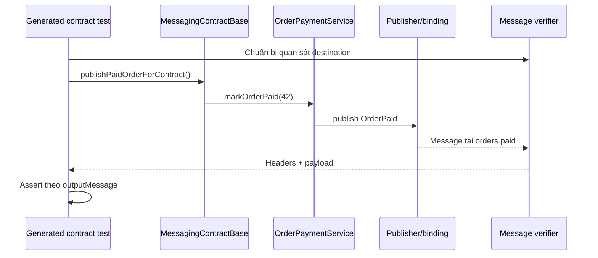
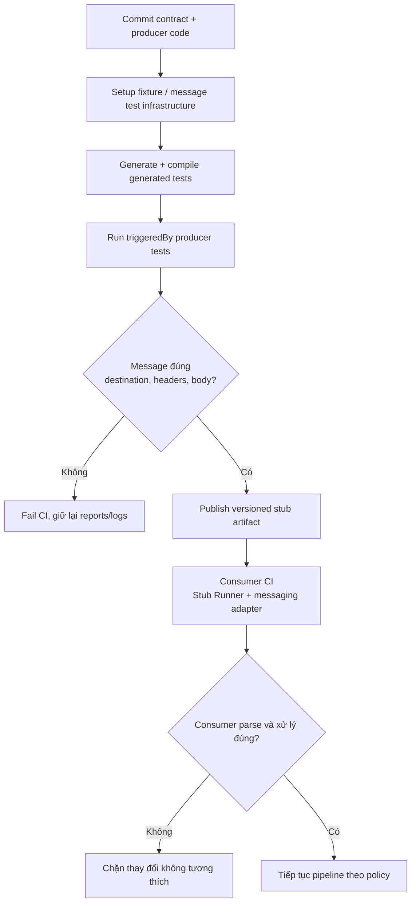

# Chuẩn bị base test cho lời gọi kích hoạt gửi thông điệp

## 1. Mục tiêu của bài học

Trong **Spring Cloud Contract**, một hợp đồng thông điệp không chỉ mô tả *message được phát ra trông như thế nào*. Để kiểm chứng **producer thật**, generated test còn phải có cách **kích hoạt ứng dụng phát message**. Với luồng phát sự kiện được khởi động bởi một thao tác nghiệp vụ, Groovy DSL hỗ trợ `input { triggeredBy('tenPhuongThuc()') }`: generated test gọi phương thức đó rồi xác minh thông điệp đầu ra theo `outputMessage`.

Điểm dễ nhầm là **`triggeredBy` không tự tạo ra phương thức trong ứng dụng**. Nhóm phát triển phải triển khai phương thức được nhắc đến ở **base test** hoặc một vị trí mà generated test gọi được, đồng thời cấu hình ứng dụng, message verifier, binder/transport và fixture đủ để event thực sự được phát.

Bài này thuộc chương **Kiểm thử messaging** của module **Spring Cloud Contract**. Sau khi học, bạn có thể:

1. Phân biệt hợp đồng `triggeredBy` với hợp đồng `messageFrom`.
2. Viết Groovy/YAML contract cho một sự kiện outbound có destination, headers và body cụ thể.
3. Chuẩn bị **base test** với Spring context, phương thức trigger, fixture, thời gian chờ và dọn trạng thái.
4. Phân biệt gọi **luồng nghiệp vụ thật** với việc tự gửi message từ mã test để “qua” assertion.
5. Kiểm tra generated test đã **được sinh, biên dịch, thực thi và đạt**, rồi phát hành stub và dùng **Stub Runner**/tích hợp messaging phía consumer trong CI.

**Phạm vi:** ví dụ tập trung vào một ứng dụng Spring phát `OrderPaid` sau khi một đơn hàng đã được thanh toán. Các class nghiệp vụ như `OrderPaymentService` hoặc `OrderFixture` là thành phần **minh họa của ứng dụng**, không phải API có sẵn của Spring Cloud Contract.

## 2. Hai cách khởi động hợp đồng messaging

### 2.1. Producer được kích hoạt bằng lời gọi Java

Kịch bản: ứng dụng đã có lệnh nghiệp vụ `markOrderPaid(42)`; khi thực thi lệnh này, nó phải phát sự kiện:

```text
Base test
    |
    | publishPaidOrderForContract()
    v
OrderPaymentService  --->  Event Publisher  --->  orders.paid
                                                 |
                                                 v
                                          OrderPaid message
```

Contract sẽ dùng:

```groovy
input {
    triggeredBy('publishPaidOrderForContract()')
}

outputMessage {
    sentTo('orders.paid')
    body(orderId: 42, state: 'PAID')
}
```

Verifier sinh test và gọi phương thức `publishPaidOrderForContract()` được kế thừa từ base class. Hệ thống test cần thu thập message phát ra ở destination mong đợi để kiểm tra body/headers.

### 2.2. Producer được kích hoạt bởi một message đến

Trường hợp khác: `inventory-service` nhận message `OrderCreated` rồi phát `InventoryReservationRequested`. Lúc này đầu vào cần mô tả bằng `messageFrom`, `messageBody`, `messageHeaders`:

```groovy
input {
    messageFrom('orders.created')
    messageBody(orderId: 42)
}
outputMessage {
    sentTo('inventory.reservation.requested')
    body(orderId: 42)
}
```

Không sử dụng `triggeredBy` như một cách thay thế tự động cho `messageFrom`: làm như vậy có thể bỏ qua listener, deserialization và routing inbound mà hợp đồng đang cần kiểm tra.

| Đặc điểm | `triggeredBy(...)` | `messageFrom(...)` |
|---|---|---|
| Nguồn kích hoạt | Lời gọi method từ generated test | Một thông điệp inbound |
| Base test phải cung cấp | Method có thể gọi, kích hoạt nghiệp vụ thật | Test transport/listener, fixture, message verifier |
| Kiểm tra chính | Producer phát event sau hành động | Producer xử lý message đầu vào rồi phát output |
| Ví dụ | Thanh toán thành công → `OrderPaid` | `OrderCreated` → `ReservationRequested` |
| Điều không tự chứng minh | HTTP listener, DB hoặc trigger ngoài phạm vi test | Tất cả lỗi broker, retry và duplicate trên production |

## 3. Thiết kế hợp đồng cho sự kiện `OrderPaid`

Giả sử sự kiện công khai gồm:

```json
{
  "eventId": "EVT-42",
  "orderId": 42,
  "state": "PAID",
  "amount": 120000,
  "currency": "VND"
}
```

Headers:

```text
eventType: OrderPaid
contentType: application/json
correlationId: CORR-42
```

Destination logic: `orders.paid`. Trong ứng dụng dùng Spring Cloud Stream, tên binding nội bộ có thể là `orderPaid-out-0` và được ánh xạ tới destination `orders.paid`. **Tên binding và destination không nhất thiết giống nhau**; message verifier phải được cấu hình phù hợp với cách ứng dụng thực sự publish.

Những cam kết cần kiểm tra:

| Thành phần | Giá trị mẫu | Điều consumer phụ thuộc |
|---|---|---|
| Destination | `orders.paid` | Consumer nhận đúng luồng sự kiện |
| `eventType` | `OrderPaid` | Routing/dispatch theo loại sự kiện |
| `orderId` | `42` dạng number | Tìm đúng đơn hàng |
| `state` | `PAID` | Xử lý nhánh thanh toán |
| `amount` | `120000` dạng number | Xử lý số tiền đúng kiểu |
| `currency` | `VND` | Không nhầm đơn vị |
| `eventId` | `EVT-42` trong mẫu | Truy vết/deduplication theo hợp đồng |
| `correlationId` | `CORR-42` | Liên kết các bước của luồng |

Sự kiện mẫu được thiết kế **có tính xác định** để dễ học. Nếu `eventId`/`correlationId` sinh động ở production, có thể dùng **response/output matcher** phù hợp, giữ giá trị mẫu cụ thể cho stub.

## 4. Groovy DSL: `triggeredBy` và `outputMessage`

Ví dụ file `src/test/resources/contracts/orders/order-paid-event.groovy`:

```groovy
import org.springframework.cloud.contract.spec.Contract

Contract.make {
    description 'Thanh toán đơn hàng làm phát sự kiện OrderPaid'
    label 'order_paid_event'

    input {
        triggeredBy('publishPaidOrderForContract()')
    }

    outputMessage {
        sentTo('orders.paid')

        headers {
            header('eventType', 'OrderPaid')
            header('contentType', 'application/json')
            header('correlationId', 'CORR-42')
        }

        body(
            eventId: 'EVT-42',
            orderId: 42,
            state: 'PAID',
            amount: 120000,
            currency: 'VND'
        )
    }
}
```

Phân tích:

- `input.triggeredBy(...)` yêu cầu generated test thực hiện **lời gọi Java** với đúng chữ ký method được cung cấp; nó **không** đưa một inbound message vào broker.
- `outputMessage.sentTo(...)` mô tả destination/kênh đầu ra mà verifier cần quan sát.
- `headers` đặt kỳ vọng trên **message headers**, không phải HTTP response headers.
- `body(...)` mô tả payload của output message, bao gồm đúng kiểu `orderId`/`amount` là số.
- `label` giúp nhận diện kịch bản và có thể liên quan cách kích hoạt message stub trong những tích hợp được hỗ trợ, **không phải là tên method trigger**.

**Một bài học quan trọng:** contract không nói rõ ứng dụng phải dùng Spring Cloud Stream, Spring Integration, RabbitMQ hay Kafka. Nó mô tả giao diện. Cơ chế hiện thực/test adapter được lựa chọn theo transport và phiên bản thư viện đang dùng.

### 4.1. Phản ví dụ: không có method trigger

Nếu DSL ghi:

```groovy
input {
    triggeredBy('publishPaidOrderForContract()')
}
```

nhưng generated test không thấy method có tên/chữ ký đó, test có thể **không compile**. Nếu method tồn tại nhưng không gọi nhánh nghiệp vụ phát message, generated test có thể chạy nhưng **timeout vì không nhận output**. Cả hai đều là lỗi ở setup/luồng kích hoạt, cần phân biệt với việc producer phát sai payload.

### 4.2. YAML DSL tương đương

Với DSL YAML được Spring Cloud Contract phiên bản dự án hỗ trợ, có thể biểu đạt:

```yaml
description: Thanh toán đơn hàng làm phát sự kiện OrderPaid
label: order_paid_event
input:
  triggeredBy: publishPaidOrderForContract()
outputMessage:
  sentTo: orders.paid
  headers:
    eventType: OrderPaid
    contentType: application/json
    correlationId: CORR-42
  body:
    eventId: EVT-42
    orderId: 42
    state: PAID
    amount: 120000
    currency: VND
```

Đây là ví dụ **cùng ý nghĩa với Groovy**, không cần lưu cả hai file trong cùng tập hợp contract thực tế. YAML mapping/sequence và cú pháp matcher có quy tắc khác Groovy closures; khi dùng matcher động cần kiểm chứng dạng YAML được phiên bản Verifier hiện tại hỗ trợ.

## 5. Base test là cầu nối giữa hợp đồng và code producer

Verifier không biết doanh nghiệp triển khai việc thanh toán ở lớp nào. Nó chỉ có tên lời gọi `publishPaidOrderForContract()`. **Base test** chịu trách nhiệm nối tên đó tới một luồng chạy được trong Spring context.



Thứ tự chính xác của các bước capture/subscribe trong generated code có thể khác theo adapter; sơ đồ mô tả **vai trò và dòng dữ liệu**, không phải mã sinh nguyên văn.

### 5.1. Ví dụ base class JUnit 5

Giả sử ứng dụng dùng Spring Boot, message transport có tích hợp với Spring Cloud Contract Verifier, và có hai thành phần của dự án:

- `OrderPaymentService`: chứa **luồng nghiệp vụ thật** để thanh toán và phát `OrderPaid`.
- `OrderFixture`: chuẩn bị/xóa đơn hàng kiểm thử.

Ví dụ:

```java
package com.example.orders.contract;

import com.example.orders.OrderApplication;
import com.example.orders.service.OrderPaymentService;
import com.example.orders.testutil.OrderFixture;
import org.junit.jupiter.api.AfterEach;
import org.junit.jupiter.api.BeforeEach;
import org.springframework.beans.factory.annotation.Autowired;
import org.springframework.boot.test.context.SpringBootTest;
import org.springframework.cloud.contract.verifier.messaging.boot.AutoConfigureMessageVerifier;

@SpringBootTest(classes = OrderApplication.class)
@AutoConfigureMessageVerifier
public abstract class MessagingContractBase {

    @Autowired
    private OrderPaymentService orderPaymentService;

    @Autowired
    private OrderFixture orderFixture;

    @BeforeEach
    public void prepareState() {
        // Fixture của dự án, không phải API của Spring Cloud Contract.
        orderFixture.resetAndCreateReadyOrder(42L, 120000L, "VND");
    }

    // Chữ ký khớp chính xác triggeredBy('publishPaidOrderForContract()').
    public void publishPaidOrderForContract() {
        orderPaymentService.markOrderPaid(42L, "CORR-42");
    }

    @AfterEach
    public void cleanupState() {
        orderFixture.removeContractOrder(42L);
    }
}
```

**Những điều kiện phải đáp ứng:**

1. `@AutoConfigureMessageVerifier` giúp cấu hình hệ thống xác minh message khi tích hợp tương ứng được kích hoạt và dependency phù hợp có mặt. Annotation này **không tự cấu hình mọi broker**, không thay thế test binder hoặc transport adapter.
2. `OrderApplication`, `OrderPaymentService` và `OrderFixture` là **class của dự án minh họa**; cần thay bằng class thật của producer. `markOrderPaid(...)` phải gọi phần xử lý và phát event **thực tế**, không trực tiếp viết một message giả để né logic.
3. Base class phải **được khai báo cho generator** để generated tests kế thừa nó. Chỉ tạo class có tên `MessagingContractBase` không đủ.
4. Method trigger nên dùng **`public`**, có chữ ký chính xác và không phụ thuộc thứ tự test; phương thức package-private/protected có thể gặp vấn đề nếu generated tests ở package khác.
5. `@BeforeEach`/`@AfterEach` thuộc JUnit 5. Plugin cần được cấu hình test framework tương thích; nếu dùng JUnit 4, cơ chế annotation khác.
6. Nếu muốn cố định `eventId=EVT-42`, fixture hoặc publisher cần tạo ID như vậy; nếu ID thực tế động, hãy dùng matcher thay vì hardcode sai.
7. Cleanup phải bảo vệ database, cache, mock và kênh message khỏi ảnh hưởng chéo, kể cả khi assertion thất bại.

### 5.2. Vì sao không viết trực tiếp logic giả trong trigger?

Ví dụ không nên dùng làm kiểm chứng producer:

```java
public void publishPaidOrderForContract() {
    // Anti-pattern: phát đúng payload chỉ để generated test xanh.
    messageChannel.send(
        MessageBuilder.withPayload(
            new OrderPaid("EVT-42", 42L, "PAID"))
        .build());
}
```

Nếu code production **thực sự** gọi `OrderPaymentService.markOrderPaid` nhưng test lại tạo `OrderPaid` trực tiếp, test chỉ chứng minh message channel hoạt động, **không chứng minh nghiệp vụ production tạo đúng event**. Tốt hơn là trigger gọi đúng entry point của ứng dụng, còn fixture/mock chỉ kiểm soát những dependency cần thiết.

Trường hợp ứng dụng có publisher độc lập là API công khai cần bảo vệ, gọi publisher thật có thể hợp lý; quyết định phụ thuộc **phạm vi hợp đồng đã thống nhất**. Dù chọn cách nào, phải mô tả rõ phần code production thực sự được đi qua.

## 6. Gắn base test với generated tests

### 6.1. Maven Verifier plugin

Ví dụ đoạn cấu hình cho module producer:

```xml
<plugin>
    <groupId>org.springframework.cloud</groupId>
    <artifactId>spring-cloud-contract-maven-plugin</artifactId>
    <version>REPLACE_WITH_COMPATIBLE_VERSION</version>
    <extensions>true</extensions>
    <configuration>
        <baseClassForTests>
            com.example.orders.contract.MessagingContractBase
        </baseClassForTests>
        <testFramework>JUNIT5</testFramework>
    </configuration>
</plugin>
```

Đoạn XML chỉ minh họa **liên kết base class và JUnit**; dự án còn phải cấu hình dependency, transport integration, vòng đời Maven và plugin version tương thích với Spring Boot/Spring Cloud. Giá trị `REPLACE_WITH_COMPATIBLE_VERSION` phải được thay trước khi dùng trong build thực tế.

Trong một số dự án, HTTP contracts và messaging contracts cần base test khác nhau. Nếu cùng một cấu hình `baseClassForTests` áp dụng cho tất cả, cần thiết kế base class có thể phục vụ cả hai hoặc cấu hình ánh xạ base class theo quy ước package của plugin đang dùng. Đừng chỉ sửa tên class generated bằng tay.

### 6.2. Gradle và test task

Với Gradle, plugin Spring Cloud Contract cũng cần biết base class và test framework. Cú pháp cụ thể thay đổi theo phiên bản plugin và dự án; hãy kiểm tra **extension được sử dụng trong project thực tế**, thay vì sao chép nguyên cấu hình Maven sang Gradle.

Những điều quan trọng không đổi:

- Generated tests thật sự được đặt trong test source set hoặc cấu hình tương đương.
- `MessagingContractBase` có trên test classpath.
- Engine JUnit phù hợp chạy generated tests.
- Có message verifier/binder/test transport để gửi/nhận message.
- Test report cho biết **generated test nào thực sự chạy**, không chỉ có task generate thành công.

## 7. Chuẩn bị transport: test binder, message verifier và destination

`triggeredBy` gọi Java method, nhưng verifier còn phải **quan sát output message**. Hệ thống test cần kết nối tới channel/destination mà ứng dụng thực sự publish. Có thể chọn chiến lược khác nhau:

| Kiến trúc ứng dụng | Chiến lược test thường gặp | Điều cần kiểm tra |
|---|---|---|
| Spring Cloud Stream functional/`StreamBridge` | Test binder phù hợp với stack, kết hợp message verifier | Tên binding → destination logic, content-type |
| Spring Integration channels | Message verifier tương thích với `MessageChannel` | Bean/channel đúng tên, subscriber/capture |
| Kafka/RabbitMQ thực với test container | Integration test có broker cô lập và adapter phù hợp | Topic/queue, offset/group, serializer, cleanup |
| Custom producer không có adapter sẵn | Test integration tự thu message hoặc triển khai adapter được hỗ trợ | Generated test có thực sự nhận được output không |

**Không nên khẳng định chỉ cần `@AutoConfigureMessageVerifier` là đủ** cho bất kỳ broker nào. Phải có dependency và cấu hình tương thích với phiên bản framework của dự án.

### 7.1. Ví dụ naming với Spring Cloud Stream

Giả sử ứng dụng dùng một binding tên `orderPaid-out-0` và publish qua `StreamBridge`:

```java
import org.springframework.cloud.stream.function.StreamBridge;
import org.springframework.messaging.Message;
import org.springframework.messaging.support.MessageBuilder;

public class OrderPaidPublisher {
    private final StreamBridge streamBridge;

    public OrderPaidPublisher(StreamBridge streamBridge) {
        this.streamBridge = streamBridge;
    }

    public void publish(OrderPaidEvent event, String correlationId) {
        Message<OrderPaidEvent> message = MessageBuilder
            .withPayload(event)
            .setHeader("eventType", "OrderPaid")
            .setHeader("correlationId", correlationId)
            .build();

        boolean accepted = streamBridge.send("orderPaid-out-0", message);
        if (!accepted) {
            throw new IllegalStateException("Output message not accepted");
        }
    }
}
```

`OrderPaidEvent` là DTO của ứng dụng. Ví dụ binding:

```yaml
spring:
  cloud:
    stream:
      bindings:
        orderPaid-out-0:
          destination: orders.paid
          contentType: application/json
```

Ở đây:

- `orderPaid-out-0` là **tên binding** mà code dùng với `StreamBridge.send(...)`.
- `orders.paid` là **destination** đã cấu hình.
- `outputMessage.sentTo('orders.paid')` trong ví dụ contract nói về **đích logic mong đợi**; một số message verifier/test binder định vị output theo tên channel/binding. Cần xác minh hoặc cấu hình ánh xạ đúng cho **phiên bản và adapter** đang dùng. Không đổi tùy tiện `sentTo` thành tên khác chỉ vì tên đó giống Kafka topic hơn.
- `contentType` có thể được biểu diễn thành header hoặc được transport/converter tự áp dụng. Kiểm tra **header thực tế nhìn thấy** bởi verifier trước khi khóa equality của nó vào hợp đồng.

### 7.2. Dependency test binder

Với Spring Cloud Stream trong các stack hỗ trợ, dependency test có thể dùng `spring-cloud-stream-test-binder` cùng BOM/version tương thích:

```xml
<dependency>
    <groupId>org.springframework.cloud</groupId>
    <artifactId>spring-cloud-stream-test-binder</artifactId>
    <scope>test</scope>
</dependency>
```

Tùy phiên bản Spring Cloud Stream, có thể cần import `TestChannelBinderConfiguration` hoặc một cấu hình test binder tương đương; không mặc định starter sẽ tự bật trong mọi project. Với message verifier của Spring Cloud Contract, cũng cần dependency verifier/messaging đúng bản. Chọn dependency dựa trên **ma trận tương thích của dự án**, tránh trộn các version Spring Cloud Stream và Spring Cloud Contract không tương thích.

Test binder rất hữu ích để kiểm tra logic messaging **không cần broker production**, nhưng **không thay thế hoàn toàn integration test Kafka/RabbitMQ**: phân vùng, offset, ack, retry, DLQ và delivery semantics còn phụ thuộc broker thật.

## 8. Kiểm soát fixture và trạng thái trước khi trigger

Generated test gọi `publishPaidOrderForContract()` trong một bối cảnh Spring. Để output ổn định, trạng thái đầu vào phải phù hợp với nghiệp vụ:

```text
Trước test:
  Order 42 tồn tại, state = PENDING
  Amount = 120000, currency = VND
  Correlation ID dự kiến = CORR-42
  Không có OrderPaid cũ trong output capture
  Không có duplicate payment event cho Order 42

Trigger:
  markOrderPaid(42, "CORR-42")

Sau trigger:
  Order 42 chuyển state = PAID
  Một OrderPaid với schema/correlation đã cam kết được phát
```

Nếu producer đã được mock để luôn gửi một message mẫu, test có thể pass nhưng không chứng minh hành vi thực. Nếu database test chứa sẵn order `42` ở trạng thái `PAID`, `markOrderPaid` có thể từ chối thanh toán lại hoặc không phát sự kiện, khiến test timeout.

### 8.1. Cách chuẩn bị bằng mock

Mock một dependency ngoại vi (ví dụ payment gateway) để kiểm soát kết quả, **không mock toàn bộ producer event flow**. Ví dụ ý tưởng:

```java
@BeforeEach
void setup() {
    // Ví dụ tên method thuộc project.
    orderFixture.resetAndCreateReadyOrder(42L, 120000L, "VND");

    // Mô phỏng chỉ gateway bên ngoài trả thanh toán thành công.
    when(paymentGateway.capturePayment(42L))
        .thenReturn(PaymentResult.success("PAY-42"));
}
```

Trong dự án thật, `paymentGateway` có thể là `@MockitoBean`, spy hoặc test double tại biên, và framework cần reset stub/calls giữa các test. Không sử dụng API `PaymentResult` ở ví dụ như thể nó là lớp của Spring Cloud Contract.

### 8.2. Cách chuẩn bị bằng database

Khi muốn kiểm tra repository/transaction/outbox thật, dùng database dành riêng cho test với seed/cleanup có kiểm soát. Một contract có thể cần order `42` ở `PENDING` trước trigger; không được dựa vào test khác tạo nó.

Nếu sử dụng `@Transactional` trong test, lưu ý transaction của test **không mặc nhiên bao trùm** publisher chạy bất đồng bộ, broker, outbox được commit ở transaction khác hoặc message đã phát. Cleanup data và message capture là hai việc độc lập.

## 9. Cleanup: không để message cũ làm sai test mới

Các nguồn ảnh hưởng chéo thường gặp:

| Tài nguyên | Trạng thái rò rỉ | Cách cô lập |
|---|---|---|
| Database | Order `42` đã `PAID` từ test trước | Seed/rollback phù hợp hoặc database/schema riêng |
| Message capture | Event cũ còn trong queue test | Drain/reset đúng phạm vi, correlation ID riêng |
| Stream binding/test binder | Queue output chứa message cũ | Tái tạo/clear test binder theo lifecycle |
| Kafka group/offset | Test này nhận message của test khác | Topic/group/namespace riêng theo job |
| Mock gateway | Stub/call count cũ còn giữ | Reset theo test lifecycle của framework |
| Cache/singleton | Đơn hàng/flag cũ ảnh hưởng trigger | Xóa cache đúng key hoặc scope test riêng |
| Đồng hồ/UUID generator | Giá trị biến thiên, không phù hợp sample | Inject clock/ID generator hoặc dùng matcher |

Đặt cleanup trong `@AfterEach` hoặc teardown tương ứng và **không nuốt exception**. Cố ý dùng môi trường test cô lập; tránh dọn topic hoặc database dùng chung với ứng dụng khác. Khi chạy song song, cleanup sau test **không khắc phục được race condition** trong lúc hai test cùng publish/consume trên một kênh.

### 9.1. Correlation ID và request ID

Nếu nhiều test dùng cùng destination, một correlation ID riêng cho kịch bản giúp phân biệt output. Tuy nhiên, đừng chỉ dựa vào `correlationId=CORR-42` nếu test khác cũng dùng ID này; dùng namespace/instance riêng hoặc thiết kế capture sạch. Khi ID động, contract có thể kiểm tra **định dạng**, còn test transport chọn message đúng theo tiêu chí an toàn.

## 10. Trường động: dùng matcher mà không làm yếu hợp đồng

Trong output message, một ID sự kiện có thể được tạo bằng UUID. Không nên khóa producer phải trả `EVT-42` nếu nghiệp vụ cho phép giá trị khác.

Ví dụ Groovy:

```groovy
outputMessage {
    sentTo('orders.paid')
    headers {
        header('eventType', 'OrderPaid')
    }
    body(
        eventId: $(
            consumer('7a48d8e3-2f69-44c4-a93b-6d40517e8e63'),
            producer(regex(uuid()))
        ),
        orderId: 42,
        state: 'PAID',
        currency: 'VND'
    )
}
```

Đoạn trên chỉ là **trích `outputMessage`**. Với **output/response**, phía consumer cung cấp giá trị mẫu cho stub, còn phía producer là matcher dùng khi generated test so sánh message thật. Nếu hệ thống sử dụng định dạng ID khác UUID, cần thay matcher phù hợp.

Không chuyển `state: 'PAID'` thành `regex('.*')`: producer phát `FAILED` khi giao dịch thành công sẽ không bị phát hiện. Cũng không bỏ kiểm tra kiểu JSON number của `amount` nếu consumer phụ thuộc kiểu đó.

## 11. Khi generated test fail: tách lỗi build, trigger và output

| Biểu hiện | Nguyên nhân khả dĩ | Kiểm tra trước |
|---|---|---|
| Generated Java **không compile** | Method `publishPaidOrderForContract()` không tồn tại/không truy cập được; base class FQN sai | Xem generated source, chữ ký method, plugin mapping |
| Generated test chạy nhưng **timeout** | Trigger không phát event, listener/binder chưa sẵn sàng hoặc destination sai | Log trigger, wiring output, capture |
| Không tìm thấy message ở `orders.paid` | Binding `orderPaid-out-0` chưa ánh xạ đúng hoặc verifier nghe nhầm kênh | Binding/destination/adapter |
| Có message nhưng header không khớp | Không propagate `correlationId`, converter thêm/sửa header | Header thực tế sau transport |
| Body sai `amount`/`currency` | Mapper/serializer lỗi, fixture sai | Payload sau serialization và data setup |
| Test riêng pass, cả suite fail | Event cũ, shared queue, DB/cache rò rỉ | Isolation và cleanup |
| Build success nhưng **0 tests** | Generator không chạy, JUnit engine sai, tests bị exclude | Report và task graph |
| Test bị **skipped** | `skipTests`, `@Disabled`, profile sai | Runner flags và report |
| Stub được sinh nhưng producer sai | Chỉ kiểm tra mappings, chưa chạy test producer | Chạy generated producer verification |
| Consumer không nhận stub event | Stub Runner thiếu messaging integration/trigger | Test binder/adapter và label |

### 11.1. Đừng sửa sai nơi

- Nếu method thiếu: sửa **base class hoặc cấu hình kế thừa**, không xóa `triggeredBy` chỉ để compile.
- Nếu method gọi đúng nhưng event không phát: kiểm tra **luồng nghiệp vụ và test transport**, không tăng timeout vô hạn.
- Nếu event phát nhưng body sai: so sánh expected/actual và fixture trước khi đổi contract.
- Nếu stub consumer chạy được: vẫn cần **test producer** để kiểm tra ứng dụng thật.

## 12. Sinh test chưa đồng nghĩa test đã thực thi

Một pipeline messaging đáng tin phải phân biệt:

1. File hợp đồng được **phát hiện** bởi plugin.
2. Generated test được **sinh** với lời gọi trigger đúng.
3. Generated test **biên dịch** được với base class trên classpath.
4. JUnit/TestNG **phát hiện và chạy** class generated.
5. **Producer phát message thật**, verifier nhận đúng output và assertion đạt.

Ví dụ lệnh build thường gặp (minh họa, **không phải kết quả đã chạy trong bài**):

```bash
# Maven module producer, khi verifier được nối vào lifecycle.
mvn clean verify

# Gradle wrapper, khi plugin và test task đã được cấu hình.
./gradlew clean test
```

Không chỉ nhìn dòng `BUILD SUCCESS`. Báo cáo Surefire/Failsafe hoặc Gradle Test phải có tên generated test tương ứng, **executed > 0**, không bị skip, `failures=0` và `errors=0`. Một test có thể được sinh nhưng không chạy vì thiếu engine, cấu hình exclude hoặc cờ `-DskipTests`.

### 12.1. Thử thay đổi có chủ đích

Trong môi trường test cô lập:

- Đổi `state` của event thành `PENDING`; contract yêu cầu `PAID` phải fail.
- Bỏ header `eventType`; nếu hợp đồng yêu cầu, assertion phải fail.
- Publish sai destination; test phải không nhận đúng output hoặc báo sai destination.
- Bỏ gọi publisher trong service; test phải báo không có output thay vì pass.
- Cho trigger gọi publisher mock tạo payload cố định; kiểm tra lại xem test có đang bỏ qua nghiệp vụ thật không.

Sau mỗi thử nghiệm, khôi phục code. Mục tiêu là **chứng minh test có khả năng phát hiện lỗi**, không sửa contract để thích ứng với một bug của producer.

## 13. Stub Runner phía consumer: một kiểm chứng riêng

Spring Cloud Contract có thể đóng gói stub từ contract để consumer sử dụng. Với messaging, **khác HTTP WireMock**, cần cấu hình cơ chế trigger/adaptor và binder tương thích để consumer nhận message mẫu.

`label 'order_paid_event'` có thể được dùng để chọn/kích hoạt message stub trong những tích hợp hỗ trợ label-based triggering. Nó **không thay thế** `publishPaidOrderForContract()` trong producer generated test.

Ví dụ consumer `notification-service` cần xử lý:

```json
{
  "eventId": "EVT-42",
  "orderId": 42,
  "state": "PAID",
  "amount": 120000,
  "currency": "VND"
}
```

Consumer test có thể kiểm tra message được deserialize thành DTO, handler chọn đúng `eventType`, và thông báo được ghi vào database test. Kiểm tra **client/listener của consumer thực tế**, không chỉ việc Stub Runner khởi động thành công.

**Giới hạn:** Stub Runner có thể phát một message mẫu mà không hề chạy `OrderPaymentService` của producer. Vì vậy, test consumer pass **không chứng minh** producer đang phát event đúng; phải có generated producer verification riêng.

## 14. CI: bảo đảm producer và consumer cùng được kiểm tra



Checklist CI tối thiểu:

- **Version:** dùng Spring Boot, Spring Cloud Contract và messaging binder theo BOM/phiên bản tương thích.
- **Setup:** fixture deterministic, output capture sạch, không phụ thuộc Kafka/RabbitMQ production.
- **Execution:** generated tests **thực sự chạy**, không bị skipped, có assertion destination/body/headers.
- **Failure gate:** chặn publish nếu producer test fail, timeout hoặc không có test.
- **Artifact:** stub được gắn version rõ ràng; consumer test dùng đúng version cần kiểm tra.
- **Consumer:** test listener/handler thật, parse dữ liệu và xử lý nhánh nghiệp vụ quan trọng.
- **Compatibility:** đánh giá khi đổi tên topic, header, field JSON, kiểu dữ liệu, event type hoặc semantic trạng thái.

Contract test không thay thế mọi integration test broker: retry, DLQ, partition ordering, idempotency và exactly-once semantics có thể cần test riêng trên transport phù hợp.

## 15. Bài thực hành: triển khai một base test cho `triggeredBy`

**Bối cảnh:** `order-service` phát `OrderPaid` sau khi thanh toán; `notification-service` là consumer. Hiện tại contract đã có `triggeredBy('publishPaidOrderForContract()')` nhưng generated test **không compile** do chưa có base class, hoặc chạy rồi timeout.

**Nhiệm vụ:**

1. Viết Groovy contract ở mục 4 và chọn tên `publishPaidOrderForContract()` rõ nghĩa.
2. Tạo `MessagingContractBase` trong source set test của producer, khai báo đúng package và method `public void publishPaidOrderForContract()`.
3. Cấu hình plugin Verifier trỏ đến fully qualified class name của base test, chọn JUnit/test mode phù hợp.
4. Khởi động Spring context trong base test; thêm `@AutoConfigureMessageVerifier` và message test infrastructure/binder tương thích với application transport.
5. Chuẩn bị fixture order `42` ở trạng thái **sẵn sàng thanh toán**, amount `120000`, currency `VND` trước mỗi test.
6. Để method trigger gọi **luồng nghiệp vụ thật** `markOrderPaid(...)`, không gửi payload giả trực tiếp từ test.
7. Kiểm tra mapping giữa binding name `orderPaid-out-0` và destination `orders.paid` để verifier có thể nhận output.
8. Thêm cleanup order, mock gateway, message capture và correlation state. Chạy generated test riêng và trong suite để phát hiện rò rỉ.
9. Đọc generated test và test report: xác nhận lời gọi method trigger, việc thu thập message và assertions đã thực thi/đạt.
10. Thử đổi `state=PAID` thành `PENDING` và bỏ `correlationId` trong producer tạm thời; test phải fail nếu matcher tương ứng bảo vệ các trường đó.
11. Khôi phục producer. Đóng gói/phát hành stub với version, cấu hình Stub Runner/messaging adapter ở consumer và kiểm tra listener xử lý event mẫu.
12. Đưa producer verification và consumer tests vào CI, chặn publish khi generated tests không thực thi hoặc không đạt.

### 15.1. Tự kiểm tra

| Câu hỏi | Đáp án |
|---|---|
| `triggeredBy` có tự tạo method trong base test không? | **Không**; phải triển khai method mà generated test gọi được |
| Method trigger có nên chỉ gọi `MessageChannel.send(...)` với message giả không? | **Không**, nếu hợp đồng cần kiểm chứng luồng nghiệp vụ production |
| `@AutoConfigureMessageVerifier` có tự tạo Kafka production broker không? | **Không**; cần adapter/binder/transport test phù hợp |
| `sentTo('orders.paid')` có luôn bằng tên binding `orderPaid-out-0` không? | **Không**; phải kiểm tra cấu hình ánh xạ |
| Tại sao `@BeforeEach` quan trọng? | Đảm bảo order/clock/mock đúng trước từng trigger |
| Vì sao test timeout dù method tồn tại? | Có thể không phát message, sai destination, verifier không capture hoặc lỗi async |
| Stub Runner consumer pass có chứng minh producer thật phát message đúng không? | **Không**; phải chạy generated producer tests |
| Khi output ID động, nên cố định exact ID hay matcher? | Matcher định dạng phù hợp ở phía producer, sample cụ thể ở phía consumer |

## 16. Checklist review base test cho lời gọi trigger

- [ ] Hợp đồng dùng `triggeredBy(...)` cho hành động nghiệp vụ kích hoạt outbound event, không nhầm với `messageFrom(...)`.
- [ ] Method trigger tồn tại, `public` và có chữ ký khớp đúng chuỗi trong contract.
- [ ] Generated tests thực sự kế thừa base class đúng package/configuration.
- [ ] Trigger gọi entry point production thích hợp, không tự phát message giả làm test xanh.
- [ ] Spring context, `@AutoConfigureMessageVerifier` và transport adapter/test binder có cấu hình tương thích.
- [ ] Binding name/destination logic khớp giữa code publisher, cấu hình và `outputMessage.sentTo(...)`.
- [ ] Fixture, mocks, clock, ID generator và trạng thái giao dịch được chuẩn bị có chủ đích.
- [ ] Output capture/queue được cô lập; cleanup an toàn cả khi assertion thất bại và khi chạy song song.
- [ ] Headers (event type/correlation/content type), payload JSON và kiểu dữ liệu quan trọng đều được kiểm tra.
- [ ] Matcher chỉ được nới cho dữ liệu thực sự động; giá trị nghiệp vụ quan trọng vẫn được kiểm tra chính xác.
- [ ] Generated tests được sinh, biên dịch, phát hiện, thực thi và đạt; report không chỉ ghi build success.
- [ ] Stub Runner messaging integration có cấu hình và đúng stub version; consumer test chạy listener thật.
- [ ] CI chặn publish khi producer verification fail/skip và đánh giá breaking change ở destination/schema/headers.

**Ghi nhớ:** `triggeredBy` là **móc nối giữa hợp đồng messaging và phương thức kích hoạt do dự án cung cấp**. Một base test đúng phải chuẩn bị được state, gọi luồng nghiệp vụ thật, quan sát message ở destination chính xác và dọn tài nguyên sau test. Khi kết hợp generated producer verification, stub có phiên bản và consumer test qua Stub Runner, nhóm phát triển mới có bằng chứng đáng tin rằng sự kiện được phát đúng giao diện mà consumer phụ thuộc.
