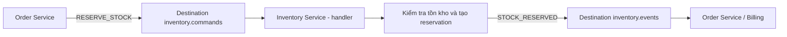
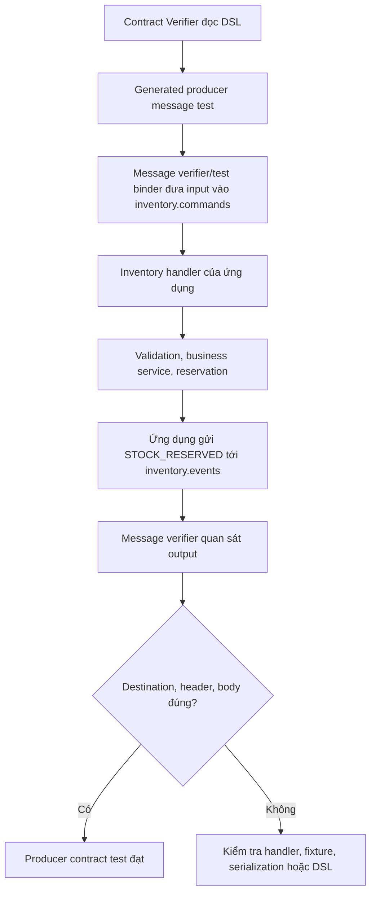
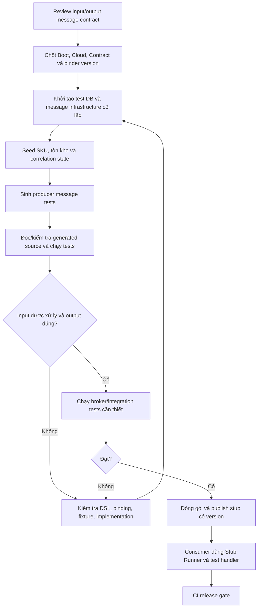

# Giả lập đầu vào và kiểm tra thông điệp đầu ra

Trong hệ thống microservices hướng sự kiện, hai dịch vụ không nhất thiết giao tiếp bằng HTTP request–response. **Order Service** có thể gửi lệnh giữ hàng `RESERVE_STOCK` vào một message destination; **Inventory Service** xử lý lệnh, cập nhật trạng thái rồi phát sự kiện `STOCK_RESERVED` sang destination khác. Nếu producer đổi tên trường `orderId`, chuyển `quantity` từ số sang chuỗi, gửi sai destination hoặc thay `eventType`, consumer có thể ngừng hoạt động dù không endpoint HTTP nào bị thay đổi.

Trong **Spring Cloud Contract**, hợp đồng thông điệp giúp producer và consumer thỏa thuận **message đầu vào, message đầu ra và các thuộc tính phải giữ ổn định**. Contract Verifier có thể sử dụng mô tả này để **giả lập message đầu vào**, kích hoạt handler của producer và kiểm tra message đầu ra; stub sinh từ hợp đồng giúp consumer sử dụng **Stub Runner** để thử các tích hợp riêng. Để hoạt động, dự án cần tích hợp **message verifier, binder/channel hoặc broker test** tương thích với phiên bản Spring Cloud Contract và hệ thống messaging đang dùng.

Bài thuộc chương **Kiểm thử messaging** của lộ trình **SPRING_CLOUD_CONTRACT**. Trọng tâm là mô hình **input-to-output message contract**: mô phỏng một sự kiện hoặc lệnh đi vào ứng dụng, quan sát hành vi xử lý, rồi xác minh message mà ứng dụng phát ra. Bài cũng phân biệt phần Contract Verifier kiểm tra với các trách nhiệm khác như broker delivery, retry, idempotency và end-to-end flow.

## 1. Từ HTTP request–response sang message input–output

Đối với HTTP, hợp đồng thường xác định:

```text
Client -- GET /api/orders/42 --> Producer
Client <-- 200 + JSON -------- Producer
```

Đối với messaging, cách tiếp cận có thể là:



Điểm khác biệt quan trọng:

- Input message **không phải HTTP request**; nó có destination, payload và metadata/headers.
- Output message **không phải HTTP response trên cùng kết nối**; nó có thể đến sau, được xử lý trên luồng khác và gửi đến destination khác.
- Một message không có HTTP status `200`, `404` hay `409`. Lỗi có thể được biểu diễn bằng event, exception, retry, dead-letter routing hoặc trạng thái bên trong.
- Producer test cần quan sát được message **do ứng dụng thật tạo ra**, không chỉ gọi một hàm rồi tự so sánh với JSON hard-code trong test.
- Thứ tự, delivery guarantee và latency thuộc cấu hình broker/transport; một contract body đúng không tự chứng minh mọi đặc tính đó.

Đối với ví dụ xuyên suốt, **Inventory Service** là *producer đang được kiểm chứng* vì nó công bố hành vi xử lý message và phát `STOCK_RESERVED`. Nhưng trong luồng dữ liệu, Inventory vừa là **consumer của lệnh vào** vừa là **producer của sự kiện ra**. Phải nêu rõ hai góc nhìn để không nhầm ai đang bị kiểm thử.

## 2. Những thông tin một message contract cần làm rõ

Một message contract tốt phải đủ để hai nhóm hiểu **điều kiện kích hoạt** và **điều kiện quan sát**.

| Thành phần | Ví dụ | Vì sao quan trọng |
|---|---|---|
| Input destination | `inventory.commands` | Message phải đến đúng nơi handler đang nghe |
| Input message type | `RESERVE_STOCK` | Handler chọn đúng nhánh xử lý |
| Correlation key | `commandId=CMD-42` | Kết nối lệnh với sự kiện hoặc log |
| Input business data | `orderId=ORDER-42`, `sku=SKU-42`, `quantity=2` | Quy định payload mà handler chấp nhận |
| Content type/header | `application/json`, `schemaVersion=1` | Consumer deserialize và định tuyến chính xác |
| Output destination | `inventory.events` | Dịch vụ khác đăng ký nhận đúng event |
| Output event type | `STOCK_RESERVED` | Consumer hiểu kết quả thành công |
| Output data | `orderId`, `reservationId`, `quantity` | Consumer xây dựng trạng thái tiếp theo |
| Error behavior | `STOCK_REJECTED`, retry hoặc dead-letter | Phải được xác định riêng theo chính sách |
| Delivery/ordering | At-least-once, partition key… | Cần integration tests bổ sung khi được cam kết |

Hai destination có thể là **logical destinations**, được binder ánh xạ sang topic/queue vật lý. Ví dụ Spring Cloud Stream có thể dùng tên binding `reserveStock-in-0` và `reserveStock-out-0`, nhưng hai tên đó **không mặc nhiên bằng** `inventory.commands` và `inventory.events`.

### 2.1. Điều kiện đầu vào và kết quả đầu ra

Bài học sử dụng fixture:

| Giá trị | Đầu vào | Đầu ra |
|---|---|---|
| `commandId` | `CMD-42` | Có thể xuất hiện trong `correlationId` |
| `commandType` | `RESERVE_STOCK` | Không bắt buộc lặp nguyên tên |
| `orderId` | `ORDER-42` | `ORDER-42` |
| `sku` | `SKU-42` | `SKU-42` |
| `quantity` | `2` | `2` |
| `reservationId` | Chưa có | `RES-42` trong fixture |
| `eventType` | Chưa có | `STOCK_RESERVED` |

Giả định Inventory có **5 sản phẩm SKU-42** sẵn có, nên việc giữ **2 sản phẩm** thành công. Producer test phải chuẩn bị dữ liệu đó trước khi gửi lệnh. Nếu tồn kho chỉ còn 1, handler có thể phát sự kiện từ chối thay vì `STOCK_RESERVED`; test thất bại do fixture sai, không nhất thiết do contract.

## 3. Cấu trúc Groovy DSL cho input-to-output

Trong Spring Cloud Contract Groovy DSL, mô hình thường có:

```groovy
import org.springframework.cloud.contract.spec.Contract

Contract.make {
    name 'inventory_reserve_stock_emits_reserved_v1'
    label 'inventory_reserve_stock_v1'

    input {
        messageFrom('inventory.commands')
        messageBody(
            commandId: 'CMD-42',
            commandType: 'RESERVE_STOCK',
            orderId: 'ORDER-42',
            sku: 'SKU-42',
            quantity: 2
        )
        messageHeaders {
            header('contentType', 'application/json')
            header('schemaVersion', '1')
        }
    }

    outputMessage {
        sentTo('inventory.events')
        headers {
            header('contentType', 'application/json')
            header('eventType', 'STOCK_RESERVED')
        }
        body(
            eventType: 'STOCK_RESERVED',
            correlationId: 'CMD-42',
            reservationId: 'RES-42',
            orderId: 'ORDER-42',
            sku: 'SKU-42',
            quantity: 2
        )
    }
}
```

**Điểm cần chú ý:** đoạn ví dụ mô tả contract message theo DSL quen thuộc; cú pháp header/content type và khả năng sinh test tương ứng **phải được kiểm tra trong phiên bản Spring Cloud Contract đang ghim**. Một số binder có thể chuyển content type sang đối tượng `MimeType` hoặc áp dụng cơ chế chuyển đổi payload, nên giá trị header quan sát trong message verifier phải được so sánh theo cách mà phiên bản đó hỗ trợ.

Hãy đọc hợp đồng từ trên xuống:

1. `name` định danh hợp đồng, giúp truy vết generated test.
2. `label` định danh kịch bản để dùng trong những cơ chế kích hoạt stub message phù hợp.
3. `input.messageFrom('inventory.commands')` nói nguồn message giả lập được gửi vào.
4. `input.messageBody(...)` là dữ liệu mà handler phải tiếp nhận.
5. `input.messageHeaders` mô tả metadata gửi tới handler.
6. `outputMessage.sentTo('inventory.events')` là nơi chờ message đầu ra.
7. `outputMessage.headers` và `outputMessage.body` là các điều kiện producer phải đáp ứng.

Khác với **hợp đồng chỉ phát**, dạng này **không cần** `triggeredBy(...)` nếu việc gửi input message tới handler đã là điều kiện kích hoạt. `triggeredBy` thường dùng khi producer tự phát sự kiện sau một thao tác nội bộ được test gọi. Không ghép `messageFrom` và `triggeredBy` tùy ý nếu chưa hiểu thứ tự và loại kịch bản DSL hỗ trợ.

### 3.1. Đầu vào ở dạng JSON trên wire

Hợp đồng trên mô tả payload logic:

```json
{
  "commandId": "CMD-42",
  "commandType": "RESERVE_STOCK",
  "orderId": "ORDER-42",
  "sku": "SKU-42",
  "quantity": 2
}
```

Thông điệp đầu ra:

```json
{
  "eventType": "STOCK_RESERVED",
  "correlationId": "CMD-42",
  "reservationId": "RES-42",
  "orderId": "ORDER-42",
  "sku": "SKU-42",
  "quantity": 2
}
```

Đừng nhầm **dạng đối tượng dữ liệu trong DSL** với bytes thật trên broker. Hệ thống có thể serialise qua JSON, Avro hoặc Protobuf; kiểu `quantity`, media type, header encoding và schema version phải được kiểm tra tại đúng lớp. Bài contract message có thể chạy qua test binder trong bộ nhớ mà không kiểm chứng wire format cuối cùng ở Kafka/RabbitMQ thật.

## 4. Một bản YAML DSL tương đương

Với phiên bản Spring Cloud Contract hỗ trợ **YAML messaging contracts**, có thể diễn đạt cùng hành vi như sau:

```yaml
name: inventory_reserve_stock_emits_reserved_v1
label: inventory_reserve_stock_v1
description: Inventory xử lý lệnh giữ hàng và phát STOCK_RESERVED
input:
  messageFrom: inventory.commands
  messageBody:
    commandId: CMD-42
    commandType: RESERVE_STOCK
    orderId: ORDER-42
    sku: SKU-42
    quantity: 2
  messageHeaders:
    contentType: application/json
    schemaVersion: '1'
outputMessage:
  sentTo: inventory.events
  headers:
    contentType: application/json
    eventType: STOCK_RESERVED
  body:
    eventType: STOCK_RESERVED
    correlationId: CMD-42
    reservationId: RES-42
    orderId: ORDER-42
    sku: SKU-42
    quantity: 2
```

**YAML không tự bảo đảm DSL được Verifier nhận diện.** Hãy xác nhận:

- Plugin đang đọc đúng thư mục và đuôi `.yml`/`.yaml`.
- Cấu trúc `input.messageFrom`, `input.messageBody`, `input.messageHeaders` và `outputMessage` được **schema của phiên bản đó** hỗ trợ.
- `schemaVersion: '1'` là **chuỗi** do đã dùng nháy; nếu serializer/handler mong số, cần thống nhất lại kiểu.
- `quantity: 2` là số trong YAML, còn `quantity: '2'` là chuỗi.
- Mappings và generated assertions thực sự kiểm tra các trường đã công bố.

**Không bật đồng thời Groovy và YAML tương đương cho cùng kịch bản** nếu sẽ sinh test/stub trùng. Hãy chọn một nguồn chính, dùng bản còn lại như ví dụ chuyển đổi hoặc kiểm tra cách biểu diễn.

## 5. Ai gửi input message trong producer verification?

Khi generated test dùng mô hình input-to-output, cần có cơ chế đưa payload vào ứng dụng.



Mục đích không phải để test viết tay **tự chế tạo** `STOCK_RESERVED`. Generated test chỉ phải **kích hoạt input**, sau đó quan sát output được **implementation producer tạo ra**.

Các thành phần thường cần:

- **MessageVerifier** hoặc integration tương ứng để gửi input và nhận output.
- **Spring Cloud Stream test binder, Spring Integration channel**, hoặc broker test được phiên bản plugin hỗ trợ.
- **Application context** chứa listener/consumer function và publisher function.
- **Fixture** tạo sẵn SKU/stock/reservation state đúng kịch bản.
- **Timeout/await** để test không kết luận quá sớm khi xử lý bất đồng bộ.

Nếu chỉ mock toàn bộ handler để nó trả một output mẫu, test có thể xanh nhưng không còn xác minh phần logic mà consumer phụ thuộc. Mock đúng ranh giới ngoài phạm vi, nhưng đừng thay implementation producer cần kiểm chứng bằng bản giả.

## 6. Cấu hình Spring Cloud Stream functional bean: ví dụ

Một ứng dụng Spring Cloud Stream hiện đại có thể dùng functional style để nhận lệnh và phát sự kiện:

```java
import java.util.function.Function;
import org.springframework.context.annotation.Bean;
import org.springframework.context.annotation.Configuration;

@Configuration
class InventoryMessagingConfiguration {

    @Bean
    Function<ReserveStockCommand, StockReservedEvent> reserveStock(
            InventoryService inventoryService) {

        return command -> inventoryService.reserve(
            command.commandId(),
            command.orderId(),
            command.sku(),
            command.quantity()
        );
    }
}
```

Trong ví dụ này:

- `ReserveStockCommand`, `StockReservedEvent` và `InventoryService` là **mã do dự án định nghĩa**.
- `Function<I,O>` diễn đạt xử lý một input và trả một output ở mức ứng dụng.
- Cách binder chuyển dữ liệu từ broker thành command, rồi event ra destination, phụ thuộc cấu hình message conversion/binding thực tế.
- Kịch bản giả định xử lý thành công; trường hợp thiếu tồn kho cần thiết kế event lỗi hoặc cơ chế xử lý khác.

Một cấu hình Spring Cloud Stream tham khảo:

```yaml
spring:
  cloud:
    function:
      definition: reserveStock
    stream:
      bindings:
        reserveStock-in-0:
          destination: inventory.commands
          content-type: application/json
        reserveStock-out-0:
          destination: inventory.events
          content-type: application/json
```

Bảng phân biệt tên:

| Tên | Vai trò |
|---|---|
| `reserveStock` | Tên functional bean |
| `reserveStock-in-0` | Logical input binding của function |
| `reserveStock-out-0` | Logical output binding của function |
| `inventory.commands` | Destination được bind làm input |
| `inventory.events` | Destination được bind làm output |

**Không đánh đồng binding name với destination vật lý.** Nếu Contract Verifier dùng tên logical destination để tìm channel, cách ánh xạ phải phù hợp với test verifier/binder phiên bản đang chạy. Ví dụ cấu hình chỉ là điểm bắt đầu để thử, không phải một cấu hình đầy đủ cho mọi bản Spring Cloud Stream.

### 6.1. Nếu producer không dùng `Function<I,O>`

Nhiều dự án nhận input bằng `Consumer<Command>` rồi phát output qua `StreamBridge` hoặc publisher khác. Điều đó vẫn phù hợp với **input-to-output message contract** nếu ứng dụng thật tạo được message đầu ra theo hợp đồng.

Contract DSL không phụ thuộc việc code được triển khai bằng `Function`, `Consumer + StreamBridge`, Spring Integration flow hay @KafkaListener; tuy nhiên **test infrastructure phải đưa message vào đúng điểm** và quan sát đầu ra đúng channel/destination.

## 7. Base test class cho message verification

Generated producer tests thường cần **base test class** để khởi động application context và chuẩn bị fixture. Khác với HTTP, chỉ cấu hình `MockMvc` không đủ cho message testing.

Ví dụ cấu trúc:

```java
import org.junit.jupiter.api.BeforeEach;
import org.springframework.beans.factory.annotation.Autowired;
import org.springframework.boot.test.context.SpringBootTest;

@SpringBootTest
public abstract class InventoryMessageContractBase {

    @Autowired
    InventoryContractFixtures fixtures;

    @BeforeEach
    protected void prepareState() {
        fixtures.resetReservations();
        fixtures.setAvailableStock("SKU-42", 5);
        fixtures.ensureReservationAbsent("CMD-42");
    }
}
```

`InventoryContractFixtures` là helper **do nhóm producer hiện thực**. Base class ví dụ **chưa tự cấu hình message verifier hoặc binder**; dự án phải bổ sung annotation/configuration/dependency tương ứng được Spring Cloud Contract và hệ thống messaging phiên bản đó yêu cầu.

Một số tích hợp Spring Cloud Contract với Spring messaging cung cấp annotation như `@AutoConfigureMessageVerifier` để hỗ trợ message verification. **Tên package, starter/dependency, hỗ trợ binder và khả năng auto configuration phụ thuộc phiên bản**; không copy một annotation mà chưa xác nhận generated code gọi loại verifier nào.

### 7.1. Một base test hợp lệ phải đáp ứng gì?

1. Spring context chứa handler và publisher thực.
2. Test binder/channel/broker đã sẵn sàng trước khi gửi message.
3. Fixture có `SKU-42` với tồn kho đủ, chưa có reservation `CMD-42`.
4. Generated test gửi input với payload đúng encoding.
5. Handler hoàn tất xử lý hoặc test có cơ chế chờ kết quả với timeout.
6. Message verifier quan sát đúng destination `inventory.events`.
7. Assertions kiểm tra output **của ứng dụng**, không phải message test dựng sẵn.
8. Setup/cleanup không làm các message tests khác ảnh hưởng nhau.

Nếu plugin không sinh được một test hợp lệ, phải xem generated source, base class mapping và message infrastructure trước khi sửa nghiệp vụ.

## 8. Đầu vào giả lập không có nghĩa bypass xử lý thật

Trong contract test, từ “giả lập” thường chỉ **nguồn message bên ngoài được tạo bởi test** thay vì một microservice khác phát thật. Inventory Service vẫn nên chạy handler, validation và business service trong phạm vi được chọn.

| Lớp | Có thể thay bằng test double? | Hệ quả |
|---|---|---|
| Dịch vụ gửi input bên ngoài | Có: generated test gửi message mẫu | Không cần khởi chạy Order Service |
| Broker bên ngoài | Có: test binder/in-memory channel | Nhanh nhưng không chứng minh mọi đặc tính transport |
| Inventory message handler | **Không nên** nếu đây là implementation cần verify | Mock handler có thể làm test xanh giả |
| Inventory business service | Cân nhắc phạm vi, tránh mock toàn bộ logic quan trọng | Chỉ kiểm chứng adapter nếu đã mock nghiệp vụ |
| Database/repository | Có thể mock có chủ đích hoặc dùng DB test | Chọn mức độ kiểm tra và bổ sung integration tests |
| Output publisher/adapter | Dùng verifier/test binder để **quan sát** message | Không thay output bằng message hard-code trong test |

Một hợp đồng “được gửi vào đúng handler và tạo message đầu ra đúng” có giá trị hơn một test “cả input và output đều do chính test dựng rồi so sánh”.

### 8.1. Test binder và broker thật khác nhau

Test binder có thể đủ để kiểm tra **logic input-to-output**: chuyển payload, gọi handler và quan sát output. Nhưng broker thật có thể thêm hoặc biến đổi:

- Header và content type.
- Partition key, offset, message ID.
- Trật tự theo partition, retry hoặc redelivery.
- Serialization Avro/Protobuf với schema registry.
- Transaction/acknowledgment và dead-letter routing.

Nếu consumer phụ thuộc các đặc tính đó, cần thêm **integration tests với broker tương ứng** như Kafka/RabbitMQ trong môi trường được quản lý. Không kết luận một contract test dùng in-memory binder đã kiểm chứng toàn bộ đặc tính vận chuyển production.

## 9. Kiểm tra header và dữ liệu liên kết

Message body là quan trọng nhưng không phải toàn bộ hợp đồng.

Ví dụ đầu vào có `commandId=CMD-42` và output có `correlationId=CMD-42`. Điều này thể hiện **quan hệ giữa request message và event đầu ra**. Consumer có thể dùng correlation ID để theo dõi workflow.

Nếu chỉ dùng hai matcher regex độc lập, ví dụ cả hai đều phù hợp `[A-Z0-9-]+`, test có thể đạt dù output mang correlation ID **không liên quan** input. Khi mối liên hệ là yêu cầu nghiệp vụ, cần:

1. Dùng fixture cố định để kiểm tra output chính xác như ví dụ `CMD-42`.
2. Hoặc dùng khả năng matcher/biến dữ liệu động của **phiên bản DSL** đang chạy nếu có.
3. Bổ sung integration assertion kiểm tra tương quan khi generator không thể biểu diễn đầy đủ.

Tương tự, header `schemaVersion`, `contentType` và `eventType` có thể quyết định consumer có parse được message không. Không bỏ tất cả headers chỉ vì JSON body trông đúng.

### 9.1. Giá trị cố định và dữ liệu động

| Trường | Chiến lược |
|---|---|
| `commandType=RESERVE_STOCK` | Kiểm tra chính xác |
| `eventType=STOCK_RESERVED` | Kiểm tra chính xác |
| `sku=SKU-42` trong kịch bản này | Fixture cố định và kiểm tra chính xác |
| `quantity=2` | Giữ kiểu số và giá trị nghiệp vụ |
| `reservationId` sinh mới | Test ID generator cố định hoặc matcher đúng định dạng |
| `createdAt` | Clock cố định hoặc matcher thời gian phù hợp |
| `correlationId` | Kiểm tra tương quan với input, không chỉ regex |
| `schemaVersion` | Chuỗi/số đúng theo format đã thống nhất |

Nếu contract khóa cứng một UUID sinh ngẫu nhiên từ lần chạy trước, test sẽ dễ đỏ giả. Nếu matcher `.*` chấp nhận mọi `eventType`, test sẽ bỏ sót lỗi tương thích. Chọn matcher theo **cam kết**, không theo mong muốn làm cho test xanh.

## 10. Bất đồng bộ: chờ output mà không làm test flaky

Một message handler có thể thực hiện truy vấn DB rồi publish event bằng thread/scheduler khác. Generated test có thể chạy trước khi event xuất hiện nếu message infrastructure không được cấu hình để chờ phù hợp.

Những lỗi thường gặp:

| Triệu chứng | Khả năng | Biện pháp |
|---|---|---|
| Không thấy event đầu ra | Binder sai hoặc handler chưa subscribe | Kiểm tra binding/consumer function |
| Có event nhưng test timeout | Destination sai hoặc timeout quá ngắn | Kiểm tra destination và processing latency |
| Đôi khi nhận event khác | Broker còn message cũ | Correlation ID và isolation |
| Lúc output `quantity=2`, lúc `quantity=1` | Fixture bị test khác sửa | Reset/cô lập DB |
| Input gửi thành công nhưng handler lỗi deserialize | Sai JSON content type/schema | Kiểm tra converter và payload bytes |
| Output tới sai destination | Binding mapping không đúng | Đối chiếu logical binding và topic thực |
| Test xanh dù logic không chạy | Test đang nhận message dựng sẵn | Kiểm tra nguồn output thực sự |

**Tránh dùng `Thread.sleep(1000)` như giải pháp duy nhất.** Chờ theo điều kiện quan sát được với timeout hợp lý; kiểm tra message payload/destination. Khi dùng message verifier có cơ chế polling/receive, hiểu timeout và điều kiện chọn message của chính verifier.

Với input-to-output contract, cần phân biệt **message không được tạo** với **message có tạo nhưng chưa đến thời điểm quan sát**. Log message trace/correlation và trạng thái handler là chìa khóa.

### 10.1. Test chạy song song

Nếu hai contract tests cùng gửi `CMD-42` vào một queue/broker:

- Handler có thể coi message thứ hai là duplicate.
- Test A có thể nhận output do test B tạo.
- Test B có thể không thấy output vì test A đã lấy mất.
- Test fixture của A có thể reset reservation trong lúc B xử lý.

Hãy dùng database/schema, broker destination, consumer group hoặc correlation scope riêng theo test/job khi cần. Nếu hợp đồng cố định `CMD-42`, test infrastructure phải bảo đảm nhiều lần chạy được cô lập; không ngầm chia sẻ state giữa toàn bộ suite.

## 11. Mô phỏng lỗi đầu vào và thông điệp lỗi đầu ra

Kịch bản thành công phát `STOCK_RESERVED`. Nhưng nếu Inventory không đủ hàng, ứng dụng có thể phát `STOCK_REJECTED`.

Giả định SKU `SKU-EMPTY` có tồn kho 0. Hợp đồng riêng:

```groovy
import org.springframework.cloud.contract.spec.Contract

Contract.make {
    name 'inventory_reserve_stock_rejected_v1'
    label 'inventory_stock_rejected_v1'

    input {
        messageFrom('inventory.commands')
        messageBody(
            commandId: 'CMD-REJECT-42',
            commandType: 'RESERVE_STOCK',
            orderId: 'ORDER-43',
            sku: 'SKU-EMPTY',
            quantity: 2
        )
    }

    outputMessage {
        sentTo('inventory.events')
        body(
            eventType: 'STOCK_REJECTED',
            correlationId: 'CMD-REJECT-42',
            orderId: 'ORDER-43',
            reason: 'INSUFFICIENT_STOCK'
        )
    }
}
```

Đây là hai **kịch bản có input khác nhau**, không phải hai mappings cùng khớp một message tùy ý. Generated producer tests phải chạy với fixture khác nhau và không phụ thuộc thứ tự.

Nếu dự án thật không phát `STOCK_REJECTED` mà gửi vào dead-letter queue, retry hoặc ghi lỗi nội bộ, **không được tự thêm sự kiện giả** để hợp đồng trông giống request–response. Hãy mô tả chính xác cơ chế được công bố và bổ sung integration test phù hợp cho retry/dead-letter.

### 11.1. Không có HTTP status trong message contract

Đừng dùng `response.status=409` để mô tả lỗi giữ hàng khi giao tiếp hoàn toàn bằng message. HTTP `409` chỉ có ý nghĩa trong một HTTP contract. Đối với messaging, API có thể dùng:

- Event thất bại `STOCK_REJECTED` với `reason` ổn định.
- Error channel hoặc dead-letter destination.
- Exception khiến broker retry và sau đó đưa message vào hàng lỗi.
- Trạng thái reservation thất bại trong database.

Consumer muốn xử lý lỗi cần hợp đồng hoặc integration tests **phản ánh đúng giao thức message**, không phải mã HTTP suy diễn.

## 12. Consumer dùng Stub Runner kiểm thử message như thế nào?

Sau khi producer verification đạt, các message contracts có thể được đóng gói thành **stub artifact**. Consumer của Inventory events (ví dụ Order Service) có thể dùng **Stub Runner** cùng message infrastructure tương thích để nhận event mẫu.

Với một số phiên bản, Stub Runner cung cấp `StubTrigger` cho phép kích hoạt message theo `label`:

```java
import org.junit.jupiter.api.Test;
import org.springframework.beans.factory.annotation.Autowired;
import org.springframework.cloud.contract.stubrunner.StubTrigger;

class InventoryEventConsumerTest {

    @Autowired
    StubTrigger stubTrigger;

    @Test
    void handlesStockReserved() {
        stubTrigger.trigger("inventory_reserve_stock_v1");

        // Đợi handler của Order Service xử lý message stub.
        // Assert state/side effect của consumer.
    }
}
```

Ví dụ mô tả **cách sử dụng ở mức ý tưởng**. Để chạy thật còn cần Spring Boot test context, cấu hình Stub Runner, đúng artifact có message stub và adapter/binder phù hợp. `StubTrigger` import/API có thể thay đổi theo phiên bản; phải đối chiếu tài liệu.

Điểm đặc biệt với **input-to-output contract**:

- `input.messageFrom` phục vụ producer verification: đưa một message vào Inventory để quan sát event nó phát.
- `outputMessage` là event mà consumer có thể muốn **stub trigger** để tự kiểm tra handler.
- Consumer test thông thường **không nhất thiết gửi `RESERVE_STOCK` qua Stub Runner rồi mong nó mô phỏng trọn vẹn Inventory handler và sinh output** như một microservice stateful thật.
- Nếu test muốn kiểm tra luồng cả gửi lệnh rồi nhận event, cần cơ chế mô phỏng phù hợp phiên bản và/hoặc integration test giữa các dịch vụ; đừng giả định Stub Runner cung cấp toàn bộ workflow chỉ từ một contract.

### 12.1. Các cấp độ bằng chứng

| Bài kiểm thử | Chạy thứ gì? | Chứng minh |
|---|---|---|
| **Producer message contract test** | Inventory Service thật + test message infrastructure | Handler xử lý input và phát output đúng hợp đồng |
| **Consumer test với Stub Runner** | Order Service thật + message stub | Consumer nhận/parse/xử lý event mẫu |
| **Sender integration test** | Order Service publisher thật + test binder | Sender tạo command đúng destination/payload |
| **Broker integration test** | App + Kafka/RabbitMQ test | Conversion, routing, retries, acknowledgement theo phạm vi |
| **End-to-end** | Các dịch vụ và transport tương tác thật | Workflow toàn cục, correlation và side effects |

**Một consumer stub test xanh không chứng minh implementation Inventory đã đáp ứng contract**. Producer verification vẫn phải chạy trước khi phát hành stub được coi là đã xác minh.

## 13. Kiểm tra generated test và mapping trước khi kết luận đạt

Sau khi định nghĩa Groovy/YAML contract:

1. Cấu hình Spring Cloud Contract Verifier plugin với version phù hợp Spring Boot/Spring Cloud.
2. Chọn message test infrastructure tương thích.
3. Sinh producer contract tests.
4. Mở generated source: test có **gửi message input** không? Có đợi/check **output message** không?
5. Kiểm tra generated test được gắn đúng base class và có classpath/binder.
6. Chạy một contract riêng trên dữ liệu fixture sạch.
7. Cố ý làm sai output `eventType` hoặc `quantity`; test cần thất bại.
8. Kiểm tra stub artifact và message labels sau build.
9. Chỉ sau khi producer tests thực sự chạy và đạt mới dùng artifact làm bản đã xác minh.

Các phiên bản Spring Cloud Contract có thể khác ở cách dùng `MessageVerifier`, auto configuration, handler/callback API và YAML schema. Đừng sửa mã generated bằng tay để test pass; sửa **DSL, plugin config, base class hoặc implementation** rồi generate lại.

### 13.1. Phát hiện generated test chưa thực sự kiểm tra output

Dấu hiệu đáng lo:

- Test chỉ tạo một `Message<?>` từ DSL rồi so sánh với chính object ấy.
- Handler của Inventory không được gọi.
- Test không đợi bất kỳ message nào từ `inventory.events`.
- Test không assert `eventType` hoặc `quantity`.
- Test report không có kịch bản input-to-output tương ứng.
- Plugin task sinh test bị skip hoặc không quét thư mục DSL.

Nếu thấy những dấu hiệu này, không kết luận contract đã được thực thi. Phải sửa cấu hình integration hoặc viết **message integration test bổ sung** để bảo vệ điểm còn thiếu.

## 14. Message headers và schema evolution

Trong hệ thống nhiều consumer, thay đổi không tương thích có thể nằm ở header hoặc format dù JSON nhìn giống nhau.

Ví dụ:

- `schemaVersion` chuyển từ `'1'` sang `'2'` mà Billing chưa hỗ trợ.
- Header content type đổi JSON thành Avro mà consumer chưa có decoder.
- `eventType` đổi thành `STOCK_RESERVED_V2`.
- `quantity` đổi từ integer sang string.
- `correlationId` không còn liên hệ với `commandId`.
- Producer ngừng gửi header routing mà consumer dùng để lọc message.

Các thay đổi này nên được kiểm soát bằng contract phù hợp. Nếu một trường được phép mở rộng, matcher cần đủ linh hoạt; nếu consumer dựa vào giá trị cụ thể, giữ assertion rõ ràng.

### 14.1. Tính tương thích của schema

| Thay đổi | Khả năng tác động |
|---|---|
| Thêm trường tùy chọn mà consumer bỏ qua được | Thường có thể tương thích, tùy schema/parser |
| Xóa trường consumer bắt buộc | Có thể phá vỡ |
| Đổi kiểu dữ liệu | Rất dễ phá vỡ |
| Đổi tên event type | Phá vỡ điều hướng theo loại sự kiện |
| Đổi destination | Consumer có thể không còn nhận message |
| Đổi từ JSON sang định dạng khác | Cần consumer và producer cùng chuyển đổi |
| Đổi từ event thành command semantics | Có thể thay đổi toàn bộ workflow |

Spring Cloud Contract giúp bảo vệ những gì DSL và test thực sự mô tả. Với Avro/Protobuf, cần kết hợp **schema compatibility tooling** tương ứng; một body map Groovy không tự kiểm tra đầy đủ schema registry.

## 15. CI cho input-to-output message contracts

Một pipeline đáng tin:



**Checklist trước khi publish stub:**

- [ ] File Groovy/YAML được plugin đọc và có generated producer test tương ứng.
- [ ] Generated test thực sự đưa input vào handler của ứng dụng.
- [ ] Test nhận message **do producer thật phát** tại output destination.
- [ ] Header, event type, payload và dữ liệu tương quan được assert.
- [ ] Fixture có trạng thái tồn kho xác định; tests chạy độc lập.
- [ ] Binder/broker test không có message cũ hoặc state từ job khác.
- [ ] Test async có timeout giới hạn, không phụ thuộc `sleep` may rủi.
- [ ] Các trường hợp thất bại hoặc thiếu dữ liệu đã được kiểm tra theo policy.
- [ ] Không có token thật, PII hoặc message nhạy cảm trong log/artifact.
- [ ] Consumer test với Stub Runner dùng đúng artifact/version.
- [ ] Producer verification/test integration không bị skip trong CI.

Nếu dùng **stub preview** để cho consumer phát triển khi producer chưa hoàn thành, hãy phân biệt rõ với **stub từ build producer đã qua verification**. Chỉ loại sau mới có bằng chứng implementation tuân thủ hợp đồng.

## 16. Bài thực hành: Inventory giữ hàng và phát sự kiện

Bối cảnh: Order Service gửi lệnh `RESERVE_STOCK`, Inventory Service trả kết quả bằng sự kiện `STOCK_RESERVED` hoặc `STOCK_REJECTED`. Hai nhóm dùng Spring Cloud Contract cùng message binder hoặc broker test phù hợp.

### Phần A — thiết kế hợp đồng

1. Xác định input destination `inventory.commands` và output `inventory.events`.
2. Chọn payload lệnh: `commandId=CMD-42`, `orderId=ORDER-42`, `sku=SKU-42`, `quantity=2`.
3. Thống nhất output `STOCK_RESERVED` có `correlationId=CMD-42`, `reservationId=RES-42`.
4. Quy định giá trị header như `contentType` và `schemaVersion` nếu consumer sử dụng.
5. Viết Groovy DSL hoặc YAML tương đương, chỉ bật **một nguồn** cho kịch bản.

### Phần B — chuẩn bị producer

1. Tạo functional bean hoặc message handler thật cho `RESERVE_STOCK`.
2. Ánh xạ input/output binding đến destination đã thống nhất.
3. Cấu hình message verifier/test binder phù hợp với Spring Cloud Contract version.
4. Tạo fixture `SKU-42` có 5 sản phẩm, chưa có reservation cho `CMD-42`.
5. Tách test DB/broker/group để không nhận message từ suite trước.

### Phần C — sinh và chạy producer test

1. Sinh generated contract tests và kiểm tra chúng đã được nhận diện.
2. Mở generated source, xác nhận có gửi input message và assert output.
3. Chạy test, kiểm tra `STOCK_RESERVED` đến đúng destination cùng body/header.
4. Cố ý đổi `quantity` output từ 2 sang 3: test phải thất bại.
5. Cố ý đổi `eventType`: test phải thất bại.
6. Khôi phục code sau thí nghiệm.

### Phần D — kịch bản lỗi

1. Seed `SKU-EMPTY` với tồn kho 0.
2. Viết hợp đồng thứ hai cho `STOCK_REJECTED` hoặc chính sách lỗi mà hệ thống thật công bố.
3. Kiểm tra input khác nhau phân biệt kịch bản; không dùng matcher quá rộng.
4. Với retry/idempotency, bổ sung integration tests gửi trùng `commandId` hoặc tạo lỗi tạm thời.
5. Kiểm tra dead-letter routing nếu nghiệp vụ yêu cầu.

### Phần E — Stub Runner và CI

1. Đóng gói artifact từ producer build đã vượt verification.
2. Cho Order Service consumer test nhận message mẫu `STOCK_RESERVED` theo label qua Stub Runner nếu phiên bản hỗ trợ.
3. Assert handler thật cập nhật trạng thái đơn hàng dựa trên `correlationId`.
4. Kiểm tra sender của Order Service gửi `RESERVE_STOCK` đúng payload/binding bằng test riêng khi cần.
5. Đưa producer verification, message integration tests và consumer stub tests vào CI, ghim version artifact.

**Tiêu chí hoàn thành:** gửi input giả lập vào **handler thật** tạo ra output đúng contract; generated tests có assert destination/header/body và thất bại khi producer vi phạm; fixture cô lập, test chạy lại ổn định; consumer kiểm tra được event stub phù hợp mà không nhầm với bằng chứng producer thật.

## 17. Lỗi thường gặp và cách chẩn đoán

| Triệu chứng | Nguyên nhân khả dĩ | Hướng xử lý |
|---|---|---|
| Không sinh producer message test | File ngoài thư mục, plugin thiếu hỗ trợ hoặc DSL không hợp lệ | Kiểm tra plugin/version, contract source directory |
| Không gửi được input message | Verifier không tìm thấy channel/destination | Kiểm tra binding name, message verifier và bean consumer |
| Input được gửi nhưng handler không xử lý | Không subscribe, converter lỗi hoặc handler exception | Kiểm tra Spring context, content type, log |
| Handler xử lý nhưng output không xuất hiện | Publisher/binding output sai hoặc xử lý async chưa xong | Quan sát output destination, readiness, timeout |
| Output đến đúng channel nhưng assertion fail | Schema, header, kiểu JSON hoặc giá trị sai | So sánh dữ liệu thực với contract |
| `correlationId` khác `commandId` | Business logic truyền sai ID hoặc matcher quá lỏng | Kiểm tra tương quan đầu vào–đầu ra |
| Test xanh khi sửa sai output | Generated test không thực hiện assertion hoặc mock quá sâu | Đọc generated source, thử mutation có chủ đích |
| Test flaky khi chạy song song | Dùng chung broker/DB/correlation ID | Cô lập fixture, channel/group hoặc broker |
| Stub Runner không trigger message | Label không có trong artifact, config binder không đúng | Kiểm tra stub artifact, label, phiên bản |
| Consumer nhận event nhưng không xử lý | Deserialize/handler subscription lỗi | Dùng client/handler thật và assert side effects |
| Event type thay đổi không bị phát hiện | Regex matcher quá rộng | Giữ assertion chính xác với field nghiệp vụ |
| Test chỉ lỗi ở CI | Khác dependency, test broker chưa ready hoặc fixture bẩn | Ghim phiên bản, readiness/cleanup/isolation |

Một quy trình debug hiệu quả:

1. Kiểm tra version Spring Boot/Cloud/Contract và tích hợp messaging.
2. Xác nhận plugin nhận đúng file Groovy/YAML.
3. Đọc generated source để biết **input được gửi thế nào** và **output được kiểm tra thế nào**.
4. Quan sát handler đã nhận input đúng payload, headers và destination chưa.
5. Quan sát message output thật, tránh nhầm với object test tự tạo.
6. Kiểm tra fixture, correlation và các side effects.
7. Chạy test riêng và cả suite để phát hiện trạng thái chia sẻ.
8. Sửa đúng lớp lỗi: DSL, plugin config, base class, binder hoặc implementation.
9. Sinh lại test và kiểm tra stub/version trước khi phát hành.

## 18. Câu hỏi tự kiểm tra

1. **Input-to-output message contract khác HTTP request–response ở đâu?** Message đầu vào và đầu ra có thể nằm trên hai destinations, xử lý bất đồng bộ và không dùng HTTP status.
2. **`messageFrom` có ý nghĩa gì?** Chỉ ra nguồn/destination của message đầu vào mà test gửi để kích hoạt handler.
3. **`outputMessage.sentTo` có ý nghĩa gì?** Chỉ ra destination nơi test kỳ vọng producer phát message.
4. **`triggeredBy` có bắt buộc cho kịch bản input-to-output không?** Không. Thường `messageFrom` đã mô tả điều kiện kích hoạt qua message đầu vào.
5. **Tại sao cần dữ liệu tồn kho fixture?** Để handler xử lý đầu vào trên trạng thái biết trước và phát output mong đợi.
6. **`Function<Command,Event>` là Contract DSL hay code ứng dụng?** Là code ứng dụng; Contract Verifier phải tích hợp để gửi input và quan sát output.
7. **Tên binding `reserveStock-in-0` có bằng topic `inventory.commands` không?** Không mặc nhiên. Cấu hình binder ánh xạ logical binding sang destination.
8. **Message test có kiểm tra đúng broker delivery guarantee không?** Không phải mọi đặc tính. Cần broker integration test nếu chúng thuộc cam kết.
9. **Vì sao kiểm tra publisher method không ném lỗi là chưa đủ?** Vì chưa chứng minh message đúng destination/header/body.
10. **Nếu output ID là UUID động thì làm sao tránh flaky test?** Cố định test generator hoặc matcher định dạng phù hợp, đồng thời kiểm tra correlation cần thiết.
11. **Vì sao hai regex phù hợp cho commandId và correlationId chưa chứng minh chúng liên quan nhau?** Vì mỗi regex chỉ kiểm tra hình dạng, không so sánh hai giá trị.
12. **Stub Runner có tự động chạy handler Inventory thật khi consumer trigger label không?** Không. Stub phục vụ message mô phỏng; cần producer verification riêng.
13. **Có thể nhận nhầm event từ test trước không?** Có, nếu broker/test channel và correlation ID dùng chung.
14. **Có nên dùng `Thread.sleep(1000)` để chắc đã nhận event?** Không nên làm chiến lược chính; chờ theo điều kiện với timeout.
15. **Nếu hệ thống không phát event khi thiếu tồn kho, có nên bịa `STOCK_REJECTED` cho contract không?** Không. Cần kiểm tra cơ chế retry/dead-letter/side effect thật.
16. **Khi nào cần test idempotency?** Khi broker có thể gửi trùng hoặc nghiệp vụ yêu cầu xử lý lặp mà không tạo side effect sai.
17. **Build xanh nhưng không có generated message test đã chứng minh hợp đồng chưa?** Chưa. Phải xem test generation và test reports.
18. **Điều gì cần đạt trước khi publish stub được coi là đã xác minh?** Generated producer tests chạy trên implementation thật, assert input/output đúng, và các kiểm thử tích hợp cần thiết đạt.

## Kết luận

**Giả lập đầu vào và kiểm tra thông điệp đầu ra** là kỹ thuật trọng tâm để kiểm chứng các microservices sử dụng messaging bằng Spring Cloud Contract. Một contract tốt phải nêu rõ **input destination, payload, headers, output destination và các trường consumer phụ thuộc**. Contract Verifier cần gửi message giả lập vào **handler thực của producer**, quan sát message thật được phát và so khớp kỳ vọng, trong khi base test quản lý fixture, binder/broker và trạng thái bất đồng bộ. Khi kết hợp **Groovy/YAML DSL**, **generated producer verification**, **Stub Runner cho consumer**, các bài broker/integration tests bổ sung và **CI release gate**, nhóm phát hiện sớm thay đổi message không tương thích mà không nhầm một stub mô phỏng với bằng chứng implementation đang hoạt động đúng.
