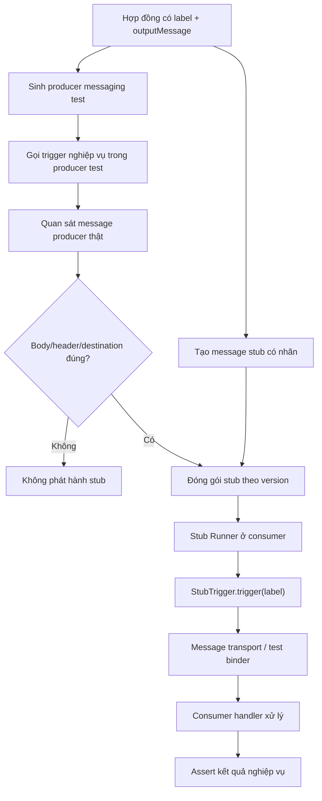
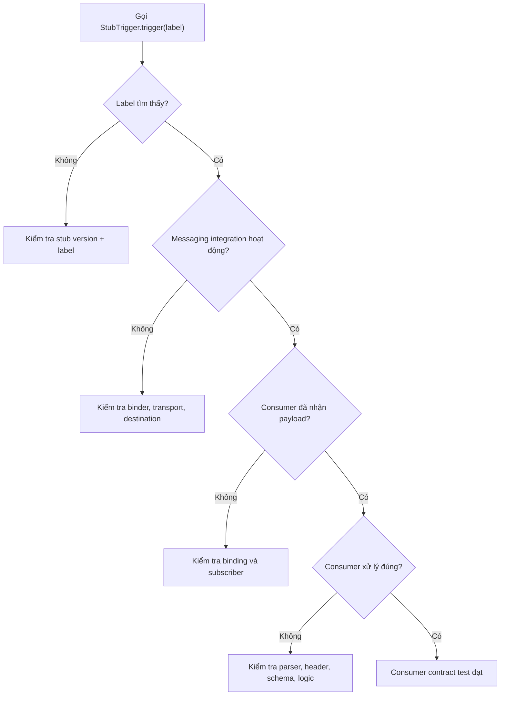

# Stub Runner kích hoạt thông điệp theo nhãn hợp đồng

## 1. Vì sao consumer cần kích hoạt thông điệp từ stub?

Trong **Spring Cloud Contract** (module `SPRING_CLOUD_CONTRACT`), producer và consumer thống nhất hành vi tích hợp thông qua **Groovy/YAML DSL** cho HTTP hoặc thông điệp. Contract Verifier có thể sinh kiểm thử xác minh producer thật, đóng gói stub theo phiên bản và để consumer sử dụng stub qua **Stub Runner**. Những bước này có thể tích hợp vào CI để phát hiện thay đổi API hoặc event không tương thích.

Với HTTP, consumer chủ động gửi request đến stub server và nhận response. Với **messaging**, producer có thể phát sự kiện vào bất kỳ thời điểm nào, không nhất thiết có một lời gọi HTTP từ consumer. Khi consumer cần kiểm thử logic xử lý một sự kiện như `ORDER_CREATED`, nó cần cách **yêu cầu stub phát một thông điệp mẫu** để handler của chính consumer có dữ liệu đầu vào.

Spring Cloud Contract hỗ trợ **nhãn hợp đồng** (`label`) và API **`StubTrigger`** cho tình huống này:

- Hợp đồng mô tả message producer phải phát, kèm `label` nhận diện kịch bản.
- Producer test thực thi hành vi producer thật và xác minh destination, body, headers của message.
- Stub được tạo từ hợp đồng đã xác minh và đóng gói theo phiên bản.
- Consumer test dùng `StubTrigger.trigger("nhãn")` để yêu cầu Stub Runner phát message tương ứng thông qua messaging integration được cấu hình.
- Consumer test chờ và kiểm tra **hành vi của consumer**, chẳng hạn cập nhật read model hoặc ghi nhận đơn hàng.

**Điểm quan trọng:** kích hoạt stub thành công **không đồng nghĩa** consumer đã xử lý đúng message. Bài kiểm thử chỉ có ý nghĩa khi còn xác minh kết quả thực tế sau khi handler chạy.

### Mục tiêu bài học

Sau bài này, bạn có thể:

1. Đặt `label` đúng chỗ trong hợp đồng Groovy/YAML messaging.
2. Phân biệt `label`, `name`, `input.triggeredBy(...)`, `outputMessage.sentTo(...)` và tên event trong body/header.
3. Đóng gói message stub, chọn đúng artifact/version và cấu hình Stub Runner ở consumer.
4. Gọi `StubTrigger.trigger(label)` và kiểm tra consumer xử lý sự kiện bất đồng bộ.
5. Chẩn đoán trường hợp trigger không thấy label, message không đến hoặc consumer nhận nhưng giải mã sai.
6. Thiết kế các nhánh thành công/thất bại và pipeline CI không dựa trên kết quả giả tạo.

## 2. Hai luồng kiểm thử tách biệt: producer và consumer

Một contract có thể làm nguồn cho cả **producer verification** và **consumer stub tests**, nhưng hai luồng chạy khác nhau.



**Luồng producer:** gửi request hoặc gọi một phương thức làm ứng dụng phát event; test kiểm tra message do **producer thật** tạo ra. Test này cần lớp nền, fixture và message verifier/transport phù hợp.

**Luồng consumer:** producer thật **không cần chạy**. Stub Runner phát một message đại diện cho hợp đồng đã được producer xác minh. Test kiểm tra consumer có đọc và xử lý đúng sự kiện hay không.

Hai kết quả bổ sung cho nhau:

| Bằng chứng | Xác nhận được | Không tự chứng minh |
| --- | --- | --- |
| Producer test đạt | Với fixture và trigger đã chọn, producer phát message khớp hợp đồng | Consumer sẽ xử lý được message |
| `StubTrigger.trigger(label)` trả thành công | Stub có kịch bản theo label và đã yêu cầu kích hoạt thành công theo integration đang chạy | Handler consumer đã hoàn tất |
| Consumer test assert read model được cập nhật | Consumer xử lý được message mẫu của stub | Producer hiện tại còn đúng nếu bỏ qua producer verification |
| Tích hợp broker thật đạt | Cấu hình transport/serializer của môi trường thử nghiệm hoạt động | Mọi chính sách retry, ordering, delivery đều đúng trong sản xuất |

Không nên nhầm **stub HTTP WireMock** với **stub thông điệp**. Một HTTP stub server có thể phục vụ request/response, nhưng không tự biết cách đẩy event vào Kafka, RabbitMQ, JMS hoặc Spring Cloud Stream nếu chưa có integration thích hợp.

## 3. Nhãn hợp đồng là gì?

Trong Groovy DSL, `label` được khai báo ở **cấp hợp đồng**, cùng cấp với `name`, `input` và `outputMessage`:

```groovy
import org.springframework.cloud.contract.spec.Contract

Contract.make {
    name 'order_created_event'
    label 'order_created'

    input {
        triggeredBy('publishOrderCreated()')
    }

    outputMessage {
        sentTo('orders.events')
        body([
            eventType: 'ORDER_CREATED',
            orderId  : 'ord-1001'
        ])
        headers {
            header('eventType', 'ORDER_CREATED')
            messagingContentType(applicationJson())
        }
    }
}
```

Ở đây:

- `name 'order_created_event'`: định danh của tình huống hợp đồng, hữu ích cho người viết và generated test.
- `label 'order_created'`: **nhãn kịch bản** mà consumer test sẽ dùng để kích hoạt stub.
- `triggeredBy('publishOrderCreated()')`: tên phương thức do **producer test base** hiện thực để gây ra sự kiện khi kiểm chứng producer.
- `sentTo('orders.events')`: destination đầu ra cần được kiểm tra và dùng để phát message stub trong integration phù hợp.
- `body(...)`: payload mà consumer nhận.
- `headers { ... }`: metadata quan trọng, chẳng hạn event type và content type.

Những giá trị này có thể giống nhau về mặt ý nghĩa, nhưng **không thay thế cho nhau**:

| Giá trị | Nằm ở đâu? | Ai dùng? |
| --- | --- | --- |
| `order_created_event` | `name` của contract | Generator, log, người đọc |
| `order_created` | `label` của contract | `StubTrigger` ở consumer |
| `publishOrderCreated()` | `input.triggeredBy` | Generated **producer** test gọi helper |
| `orders.events` | `outputMessage.sentTo` | Message verifier/transport và consumer binding |
| `ORDER_CREATED` | `body.eventType` hoặc `headers.eventType` | Consumer logic |

**Không gọi** `stubTrigger.trigger("publishOrderCreated()")` nếu nhãn đã khai báo là `order_created`. `StubTrigger` tìm **label**, không tìm tên phương thức trigger trong base class.

### 3.1. Đặt tên label có khả năng truy vết

Với một producer phát nhiều loại message:

| Tình huống | `name` | `label` gợi ý |
| --- | --- | --- |
| Tạo đơn | `order_created_event` | `order_created` |
| Hủy đơn | `order_cancelled_event` | `order_cancelled` |
| Đặt hàng hết kho | `inventory_reservation_rejected` | `reservation_rejected` |
| Thanh toán thành công | `payment_succeeded_event` | `payment_succeeded` |
| Thanh toán thất bại | `payment_failed_event` | `payment_failed` |

Tên nhãn nên ổn định, rõ nghĩa, không phụ thuộc dữ liệu ngẫu nhiên và **không trùng nhau ngoài chủ đích** trong tập stub có thể được tải đồng thời. Trong ứng dụng lớn, có thể dùng tiền tố miền như `orders.order_created` theo quy ước của nhóm, nhưng cần bảo đảm producer và consumer cùng sử dụng một chuỗi nhãn.

Không nên dùng `label 'event_1'` hoặc đặt label bằng ID đơn cố định; điều đó làm test khó hiểu và khó bảo trì.

## 4. YAML DSL: nhãn và thông điệp tương đương

Hợp đồng trên có thể viết bằng YAML:

```yaml
name: order_created_event
label: order_created
description: Phát sự kiện sau khi tạo đơn thành công
input:
  triggeredBy: publishOrderCreated()
outputMessage:
  sentTo: orders.events
  body:
    eventType: ORDER_CREATED
    orderId: ord-1001
  headers:
    eventType: ORDER_CREATED
    contentType: application/json
```

Đây là **biểu diễn thay thế** cho cùng một contract Groovy. Trong dự án thật, chọn một dạng DSL cho từng tình huống, tránh đặt cả hai file trùng nhau dưới thư mục mà plugin quét.

Trong YAML, `label` vẫn ở **cấp cao nhất** của hợp đồng, không lồng trong `input` hoặc `outputMessage.headers`. Header `eventType` trong `outputMessage.headers` là **metadata của message**, còn `label` là **metadata điều khiển stub**; consumer không nhận một message header tên `label` chỉ vì contract có trường này.

**Cần nhớ:** nhãn không phải tên topic/queue. Thay `label: order_created` thành `label: created_order` không tự đổi destination `orders.events`; ngược lại, đổi destination cũng không tự sửa tên label trong consumer test.

## 5. Producer verification phải chạy trước khi tin vào stub

Để consumer có thể tin rằng mẫu `ORDER_CREATED` đại diện cho producer, producer cần được kiểm chứng với contract đó.

### 5.1. Lớp nền có phương thức kích hoạt

Giả sử producer phát sự kiện khi tạo đơn. Lớp nền kiểm thử có thể trông như sau:

```java
package com.example.orders.contract;

import org.springframework.beans.factory.annotation.Autowired;
import org.springframework.boot.test.context.SpringBootTest;
import org.springframework.cloud.contract.verifier.messaging.boot.AutoConfigureMessageVerifier;

@SpringBootTest
@AutoConfigureMessageVerifier
public abstract class OrdersMessagingContractBase {

    @Autowired
    private OrderEventTestDriver eventTestDriver;

    public void publishOrderCreated() {
        eventTestDriver.createOrderAndPublish("ord-1001", "SKU-001", 2);
    }
}
```

`OrderEventTestDriver` và `createOrderAndPublish(...)` là **thành phần minh họa do nhóm producer tự hiện thực**, không phải API mặc định của framework. Dự án cần cấu hình message verifier, message binder hoặc test transport tương ứng với công nghệ được sử dụng.

Generated producer test cần gọi hành vi của **ứng dụng thật**, chẳng hạn một service thực sự tạo đơn và phát event. Nếu `eventTestDriver` chỉ xây dựng sẵn đúng JSON rồi đưa thẳng vào verifier, không qua mã producer, test có thể xanh nhưng không kiểm chứng hành vi mà hợp đồng công bố.

### 5.2. Dữ liệu fixture phải tạo đúng nhánh

Ví dụ:

```text
Contract: order_created_event
Trigger: publishOrderCreated()
Precondition:
  - SKU-001 tồn tại và có hàng
  - Đơn ord-1001 có thể được tạo
  - Event store/transport ở trạng thái sạch
Expected:
  - Một event ORDER_CREATED
  - Destination orders.events
  - Body.orderId = ord-1001
  - Content-Type phù hợp application/json
```

Những điều kiện này bảo đảm bài test **không vô tình phát nhánh lỗi** do sản phẩm hết hàng hoặc dữ liệu cũ. Nếu việc phát message bất đồng bộ, producer test cần một cơ chế chờ thích hợp theo công cụ kiểm thử và có timeout rõ ràng.

### 5.3. Ranh giới của producer test

Test đạt chứng minh producer phát một message khớp hợp đồng trong **tình huống được chuẩn bị**. Nó không tự chứng minh:

- Event được giao đúng một lần.
- Mọi consumer nhận được event khi mạng lỗi.
- Kafka partition key, broker retention hoặc JMS selector được cấu hình đúng.
- Một message được gửi nhiều lần sẽ không gây xử lý trùng.
- Toàn bộ schema ở mọi phiên bản đều tương thích.

Những khía cạnh này cần integration, schema và resilience tests bổ sung khi sản phẩm yêu cầu.

## 6. Tạo và chọn đúng message stub artifact

Khi producer verification đạt, hợp đồng có thể được đóng gói vào **stub artifact** đi cùng phiên bản producer. Ví dụ tọa độ Maven:

```text
com.example:orders-producer:1.4.2:stubs
```

Các thành phần:

- `com.example`: group ID.
- `orders-producer`: artifact ID của producer.
- `1.4.2`: phiên bản đã công bố.
- `stubs`: classifier thường dùng cho artifact chứa stub.

Một consumer test có thể chọn stub này qua `@AutoConfigureStubRunner`. Đây là **stub từ hợp đồng của producer**, không phải bản sao producer service đang chạy trên cùng cổng.

### 6.1. Ba chế độ thường gặp

| Stubs mode | Nguồn stub | Tình huống phù hợp | Điều kiện |
| --- | --- | --- | --- |
| `CLASSPATH` | Artifact/stub có sẵn trên test classpath | Test đóng gói sẵn fixture/stub | Classpath cần chứa đúng nguồn stub |
| `LOCAL` | Local Maven repository | Phát triển và kiểm thử trên máy khi đã cài artifact | Phiên bản mong đợi phải tồn tại trong repository cục bộ |
| `REMOTE` | Maven repository được cấu hình | CI hoặc nhóm tiêu thụ bản đã publish | Repository, quyền truy cập, version đúng |

Đây là lựa chọn về **nơi tải stub**, không quyết định message được gửi bằng Kafka, RabbitMQ, Spring Cloud Stream hay transport nào. Với messaging, còn phải chuẩn bị **messaging integration** để Stub Runner có thể đưa message đến consumer handler.

Để có thể tái lập kết quả, nên ghim phiên bản như `1.4.2`. Tránh để bài kiểm thử luôn trỏ vào phiên bản mới nhất hoặc một `SNAPSHOT` thay đổi liên tục nếu không có mục đích riêng.

### 6.2. Kiểm tra artifact trước khi chạy consumer

Trong quá trình chẩn đoán, xác minh:

1. Producer build thực sự quét file hợp đồng có `label`.
2. Bước tạo stub cho messaging đã chạy và artifact chứa hợp đồng/kịch bản mong đợi.
3. Tọa độ artifact mà consumer yêu cầu khớp phiên bản producer đã xác minh.
4. Consumer không vô tình tải một bản stub cũ thiếu nhãn mới.
5. Mọi plugin và dependency của phần messaging tương thích về phiên bản.

**Một test có thể khởi động Stub Runner thành công nhưng không có label cần dùng**, chẳng hạn artifact cũ chưa chứa hợp đồng mới. Vì vậy, cần kiểm tra label khi trigger và không coi việc Spring context khởi động là bằng chứng đủ.

## 7. Cấu hình Stub Runner trong consumer test

Với Spring Boot/JUnit 5, consumer thường dùng dependency `spring-cloud-starter-contract-stub-runner` trong phạm vi test, cùng các thư viện messaging của ứng dụng.

Đoạn dependency Maven rút gọn:

```xml
<dependency>
  <groupId>org.springframework.cloud</groupId>
  <artifactId>spring-cloud-starter-contract-stub-runner</artifactId>
  <scope>test</scope>
</dependency>
```

Dự án phải quản lý version tương thích với Spring Boot và Spring Cloud Contract, ví dụ thông qua dependency management tương ứng. Chỉ thêm dependency trên **không tự cấu hình transport cho message**.

### 7.1. Test kích hoạt bằng nhãn

Đây là một bài kiểm thử **consumer** minh họa:

```java
package com.example.inventory.contract;

import java.time.Duration;
import org.junit.jupiter.api.Test;
import org.springframework.beans.factory.annotation.Autowired;
import org.springframework.boot.test.context.SpringBootTest;
import org.springframework.cloud.contract.stubrunner.StubRunnerProperties;
import org.springframework.cloud.contract.stubrunner.StubTrigger;
import org.springframework.cloud.contract.stubrunner.spring.AutoConfigureStubRunner;

import static org.assertj.core.api.Assertions.assertThat;
import static org.awaitility.Awaitility.await;

@SpringBootTest
@AutoConfigureStubRunner(
    ids = "com.example:orders-producer:1.4.2:stubs",
    stubsMode = StubRunnerProperties.StubsMode.LOCAL
)
class OrderCreatedConsumerContractTest {

    @Autowired
    private StubTrigger stubTrigger;

    @Autowired
    private InventoryReadModelRepository readModel;

    @Test
    void consumesOrderCreatedEvent() {
        boolean triggered = stubTrigger.trigger("order_created");
        assertThat(triggered).isTrue();

        await().atMost(Duration.ofSeconds(5))
               .untilAsserted(() ->
                   assertThat(readModel.hasOrder("ord-1001")).isTrue()
               );
    }
}
```

**Điều kiện để chạy ví dụ:**

- `InventoryReadModelRepository` và `hasOrder(...)` là API **giả định của ứng dụng consumer**, không phải class có sẵn của Spring Cloud Contract.
- Dự án cần dependency **Awaitility** nếu dùng `await()` như trên.
- Consumer có handler/subscriber thực và một cách nhận sự kiện `orders.events` qua transport/test binder đã cấu hình.
- Stub artifact `com.example:orders-producer:1.4.2:stubs` phải được cài vào local Maven repository khi dùng `LOCAL`.
- Test database hoặc read model phải được reset để không có sẵn `ord-1001` từ lần chạy trước. Nếu đã tồn tại, assertion cuối có thể đạt **trước khi handler xử lý message mới**.

Điểm cốt lõi của test là hai assertion khác nhau:

1. `triggered == true`: Stub Runner **nhận được yêu cầu kích hoạt một nhãn**.
2. `readModel.hasOrder("ord-1001") == true`: logic consumer **đã xử lý message**, với điều kiện fixture ban đầu không có bản ghi đó.

Không nên chỉ viết:

```java
assertThat(stubTrigger.trigger("order_created")).isTrue();
```

và kết luận consumer tích hợp thành công. Kết quả `true` không khẳng định message handler đã parse đúng, ghi dữ liệu đúng hoặc hoàn tất xử lý.

### 7.2. Vì sao nên chờ bằng điều kiện thay vì `Thread.sleep`?

Message có thể được xử lý bất đồng bộ. Một test dùng:

```java
stubTrigger.trigger("order_created");
Thread.sleep(1000);
assertThat(readModel.hasOrder("ord-1001")).isTrue();
```

có hai vấn đề: một giây có thể quá ngắn trên CI chậm, nhưng lại lãng phí khi consumer xử lý nhanh. Chờ **theo điều kiện** đến một timeout xác định cho kết quả dễ hiểu hơn. Dù vậy, timeout cũng phải dựa vào đặc điểm test infrastructure; không nên tăng vô hạn chỉ để che lỗi binding hoặc event handler.

### 7.3. Khởi tạo trạng thái trước trigger

Một trình tự đáng tin cậy:

```text
Before test:
  - Khởi tạo Spring context và message binding
  - Dọn read model / inbox / cache cho case này
  - Đăng ký consumer handler
  - Xác minh đã tải đúng stub version

During test:
  - StubTrigger.trigger("order_created")
  - Chờ event được consumer xử lý
  - Assert orderId, quantity, trạng thái mới

After test:
  - Dọn dữ liệu test và message còn sót
  - Bảo đảm case tiếp theo không đọc nhầm event cũ
```

Nếu binder vận hành ở chế độ bất đồng bộ, phải bảo đảm consumer đã **đăng ký subscriber trước khi trigger**; ngược lại message có thể được phát trong lúc test handler chưa sẵn sàng.

## 8. Đưa message stub đến đúng consumer handler

`StubTrigger` chỉ yêu cầu Stub Runner kích hoạt **message stub**. Nó không tự tạo ra kết nối mạng, queue, Kafka topic hoặc function binding trong mọi công nghệ.

Giả sử ứng dụng Inventory dùng Spring Cloud Stream với một function:

```java
import java.util.function.Consumer;
import org.springframework.context.annotation.Bean;
import org.springframework.context.annotation.Configuration;
import org.springframework.messaging.Message;

@Configuration
class InventoryMessageConfiguration {

    @Bean
    Consumer<Message<String>> orderCreated(InventoryEventHandler handler) {
        return message -> handler.handle(
            message.getPayload(),
            message.getHeaders()
        );
    }
}
```

`InventoryEventHandler` là thành phần **của consumer**, cần có parser/logic nghiệp vụ thực. Trong một cấu hình Spring Cloud Stream theo mô hình functional, có thể ánh xạ binding đến destination:

```yaml
spring:
  cloud:
    function:
      definition: orderCreated
    stream:
      bindings:
        orderCreated-in-0:
          destination: orders.events
```

**Giới hạn của ví dụ:** đây là *minh họa cấu hình binding của consumer*, không phải cấu hình đầy đủ bảo đảm Stub Runner đã tích hợp thành công. Cần thêm binder/test binder, message converter và các thư viện tương thích với phiên bản Spring Cloud Stream/Spring Cloud Contract của dự án. Nếu producer contract dùng một **logical destination** nhưng binder đặt tên topic khác, phải cấu hình ánh xạ phù hợp.

Đặc biệt, đừng nhầm:

- `orders.events` là destination logic của thông điệp.
- `order_created` là **label** mà test dùng để trigger.
- `orderCreated-in-0` là tên **consumer binding** theo quy ước của function trong ví dụ.
- `ORDER_CREATED` là **event type** trong body hoặc header.

Các tên này phục vụ bốn mục đích khác nhau. Gửi đúng `label` nhưng binding sai destination thì handler vẫn có thể không nhận message.

### 8.1. Chọn đúng messaging integration

| Môi trường | Cách kiểm thử khả thi | Giới hạn |
| --- | --- | --- |
| Spring Cloud Stream với test binder | Đưa message vào channel/binder test đã cấu hình | Không chứng minh hoạt động broker ngoài |
| Spring Integration test channel | Gửi/nhận qua channel phù hợp | Phải phản ánh converter và flow cần kiểm tra |
| RabbitMQ/Kafka/JMS thực trong integration test | Kiểm chứng hạ tầng, routing và serialization thực | Cần broker, cấu hình mạng, cleanup và timeout |
| Chỉ có HTTP stub mapping | Không đủ để kích hoạt event messaging theo label | Cần messaging stub integration |

Một số tính năng chỉ được hỗ trợ trong những phiên bản/binder nhất định. Khi triển khai, ưu tiên xác nhận khả năng của **bản Spring Cloud Contract và message framework dự án sử dụng**; không coi mọi công cụ broker là tương đương.

## 9. Nhãn hợp đồng trong tình huống message-in → message-out

Không phải mọi event đều được phát bằng `input.triggeredBy(...)`. Một producer có thể **nhận message đầu vào** rồi phát message đầu ra. Ví dụ Inventory Service nhận `ORDER_CREATED` và phát `INVENTORY_RESERVED`.

```groovy
import org.springframework.cloud.contract.spec.Contract

Contract.make {
    name 'inventory_reserved_event'
    label 'inventory_reserved'

    input {
        messageFrom('orders.events')
        messageBody([
            orderId  : 'ord-1001',
            productId: 'SKU-001',
            quantity : 2
        ])
        messageHeaders {
            header('eventType', 'ORDER_CREATED')
        }
    }

    outputMessage {
        sentTo('inventory.reservations')
        body([
            orderId: 'ord-1001',
            result : 'RESERVED'
        ])
        headers {
            header('eventType', 'INVENTORY_RESERVED')
            messagingContentType(applicationJson())
        }
    }
}
```

**Phía producer**: generated test gửi message đầu vào theo `messageFrom`/`messageBody`/`messageHeaders`, rồi quan sát output từ code Inventory thật.

**Phía consumer**: với một message stub có `label 'inventory_reserved'`, test của dịch vụ nhận `INVENTORY_RESERVED` có thể dùng `StubTrigger.trigger("inventory_reserved")` khi hệ thống Stub Runner/messaging integration hỗ trợ. **Không nên suy rằng trigger này đồng thời thực thi lại toàn bộ luồng input → processing của producer.** Stub thường phát **đầu ra đã được mô tả**, không chạy code Inventory Service thật.

Nếu consumer cần kiểm thử việc **gửi một input message** và đợi một output phản hồi qua broker, đây có thể là **kiểm thử tương tác hai chiều** với thêm yêu cầu request/reply hoặc routing. Cần chọn stub integration hỗ trợ cơ chế này và xác minh cụ thể; chỉ gọi một label không chứng minh tính đúng của toàn bộ protocol.

### 9.1. YAML DSL tương đương

```yaml
name: inventory_reserved_event
label: inventory_reserved
input:
  messageFrom: orders.events
  messageBody:
    orderId: ord-1001
    productId: SKU-001
    quantity: 2
  messageHeaders:
    eventType: ORDER_CREATED
outputMessage:
  sentTo: inventory.reservations
  body:
    orderId: ord-1001
    result: RESERVED
  headers:
    eventType: INVENTORY_RESERVED
    contentType: application/json
```

Ở hai DSL, `label` vẫn được đặt ở **cấp hợp đồng** và có thể được dùng để kích hoạt kịch bản stub. Nếu consumer cần nhận cả `RESERVED` và `REJECTED`, nên có những hợp đồng riêng với nhãn và fixture riêng.

## 10. Quản lý nhiều label và nhiều producer

Một consumer có thể phụ thuộc vào hai producer:

- `orders-producer` phát `order_created`.
- `payments-producer` phát `payment_succeeded`.

Khi stub của cả hai producer được nạp cùng lúc, việc gọi `stubTrigger.trigger("order_created")` cần nhận diện đúng kịch bản. Tốt nhất mỗi label được đặt **rõ nghĩa và không trùng ngoài ý muốn** trong tập stub đang được dùng.

Với Stub Runner, API `StubTrigger` ở các phiên bản thường cung cấp cách kích hoạt theo **label** và một số overload cho phép định danh stub cụ thể. Khi cần phân biệt hai producer cùng có label `created`, hãy tham khảo API của phiên bản đang dùng và chọn định danh artifact phù hợp; **không giả định chỉ dùng một chuỗi label trùng nhau là luôn chọn đúng producer**.

### 10.1. Quy ước nhãn khi có nhiều nhóm

| Producer | Kịch bản | Label đề xuất |
| --- | --- | --- |
| Orders | Tạo đơn thành công | `orders.order_created` |
| Orders | Hủy đơn | `orders.order_cancelled` |
| Payments | Thanh toán thành công | `payments.payment_succeeded` |
| Payments | Thanh toán thất bại | `payments.payment_failed` |
| Inventory | Giữ hàng thành công | `inventory.reserved` |
| Inventory | Từ chối giữ hàng | `inventory.rejected` |

Đây là **quy ước đặt tên gợi ý**, không phải cú pháp bắt buộc của framework. Nếu đổi nhãn đã được consumer test sử dụng, phải cập nhật hợp đồng và các test liên quan cùng lúc; nhãn là **giao diện của bài kiểm thử stub** dù không nhất thiết xuất hiện trên message wire.

### 10.2. Nhãn có thể thay đổi giữa các phiên bản

Giả sử producer v1.4.2 có `label = order_created` nhưng v1.5.0 đổi thành `orders.order_created`. Consumer test đang dùng:

```java
stubTrigger.trigger("order_created");
```

với stub v1.5.0 có thể không tìm thấy kịch bản tương ứng. Mặc dù body/schema của event không thay đổi, **test integration đã phụ thuộc vào tên label cũ**. Cần quản lý nhãn ổn định hoặc thay đổi có chủ đích kèm cập nhật consumer tests, và xác minh stub artifact đúng version.

## 11. Thiết kế assertion đúng cho consumer bất đồng bộ

### 11.1. Kiểm tra một kết quả nghiệp vụ cụ thể

Một consumer Inventory nhận `ORDER_CREATED` rồi lưu yêu cầu giữ hàng. Assertions nên kiểm tra:

- Có yêu cầu với `orderId = ord-1001`.
- `productId = SKU-001` và `quantity = 2` được ghi đúng.
- Trạng thái ban đầu là `PENDING` hoặc giá trị đã thống nhất.
- Không có bản ghi không liên quan bị cập nhật.

Ví dụ ý tưởng:

```java
assertThat(stubTrigger.trigger("order_created")).isTrue();

await().atMost(Duration.ofSeconds(5))
       .untilAsserted(() -> {
           var entry = readModel.findByOrderId("ord-1001");
           assertThat(entry).isPresent();
           assertThat(entry.get().getProductId()).isEqualTo("SKU-001");
           assertThat(entry.get().getQuantity()).isEqualTo(2);
       });
```

Đây là đoạn **bổ sung cho test đã cấu hình** ở mục 7, không phải lớp Java độc lập. `readModel.findByOrderId(...)` và API của entity là **giả định minh họa**.

### 11.2. Kiểm tra trước khi trigger

Nếu read model đã có sẵn `ord-1001`, assertion sau trigger có thể vượt qua dù consumer handler đang hỏng. Trước trigger cần:

```java
assertThat(readModel.findByOrderId("ord-1001")).isEmpty();
assertThat(stubTrigger.trigger("order_created")).isTrue();
```

Hoặc tạo ID fixture riêng cho test. Điều cần bảo vệ là **thay đổi trạng thái được gây ra bởi event mới**, không chỉ sự tồn tại của dữ liệu mẫu.

### 11.3. Chỉ nhận một event không có nghĩa xử lý idempotent

Stub thường phát một message mỗi lần được kích hoạt. Để kiểm tra hành vi xử lý trùng, có thể gọi:

```java
assertThat(stubTrigger.trigger("order_created")).isTrue();
assertThat(stubTrigger.trigger("order_created")).isTrue();
```

Sau đó assert read model không tạo bản ghi trùng hoặc trừ kho hai lần nếu **đó là cam kết của consumer**. Tuy nhiên, loại test này chỉ giúp kiểm tra logic ứng dụng khi nhận lặp cùng payload; nó **không chứng minh** toàn bộ chính sách delivery/retry/idempotency của broker ngoài.

### 11.4. Kiểm tra xử lý lỗi và dead-letter

Với message sai schema, content type không phù hợp hoặc event type lạ, cần xác định chiến lược consumer:

- Bỏ qua message có loại không hỗ trợ?
- Ghi lỗi và đưa vào dead-letter queue?
- Retry sau khi có lỗi hạ tầng?
- Gửi event phản hồi lỗi?

Không nên giả định Stub Runner sẽ tự phát message sai chỉ vì một label hợp lệ tồn tại. Hãy tạo hợp đồng/kịch bản lỗi thích hợp nếu producer thực sự phát loại message đó, hoặc dùng test riêng tiêm dữ liệu không hợp lệ vào consumer để kiểm tra phòng vệ.

## 12. Lỗi thường gặp khi `StubTrigger` không hoạt động

| Triệu chứng | Nguyên nhân có thể | Bước kiểm tra |
| --- | --- | --- |
| `trigger("order_created")` trả `false` | Label không tồn tại trong stub được nạp | Kiểm tra `label` trong hợp đồng nguồn và artifact/version thực tế |
| Stub Runner khởi động nhưng không phát message | Chỉ có HTTP stub hoặc thiếu message integration | Xem messaging support, binder/transport và generated stub |
| Kích hoạt được label nhưng consumer không nhận | Destination/binding sai, handler chưa đăng ký | Đối chiếu `sentTo`, consumer binding, trạng thái subscriber |
| Consumer nhận message nhưng không parse được | Content type, serializer, schema hoặc kiểu payload khác | Xem headers/payload thực tế và cấu hình converter |
| Producer verification fail nhưng consumer stub test pass | Stub chỉ mô phỏng hợp đồng cũ, producer thật đã lệch | Chạy producer tests trước publish; dùng đúng stub version |
| Event đến nhưng assert timeout | Handler chậm/hỏng, read model sai, timeout chưa phù hợp | Xem logs handler, lỗi database và cơ chế chờ theo điều kiện |
| Test pass khi chạy riêng nhưng fail cả suite | Message/dữ liệu cũ, test song song, shared broker queue | Dọn fixture, tách consumer group/channel hoặc tuần tự hóa test |
| Gọi label đúng nhưng nhận event từ producer khác | Trùng label hoặc tải nhiều stub artifacts | Dùng nhãn duy nhất hoặc API định danh artifact cụ thể |
| Không tìm thấy `LOCAL` stub | Chưa cài artifact vào local Maven repository | Cài/publish bản đúng, kiểm tra tọa độ và classifier `stubs` |
| Mode `REMOTE` không tải được | Sai repository URL/quyền truy cập/version | Kiểm tra cấu hình Maven repo và credentials an toàn |
| Message thiếu header `eventType` | Producer chỉ đặt eventType trong body | Thống nhất vị trí header/body và kiểm tra contract |
| Test báo xanh nhưng không có assertion xử lý | Chỉ assert return value của `trigger` | Bổ sung assertion trên kết quả nghiệp vụ consumer |

### 12.1. Thứ tự chẩn đoán



Khi chẩn đoán, đừng sửa body hoặc label ngay nếu lỗi thực tế là consumer chưa đăng ký một channel. Ngược lại, đừng tăng timeout vô hạn nếu `trigger(...)` đã trả `false`: đó là dấu hiệu cần kiểm tra stub label/artifact trước.

### 12.2. Mẫu log giúp truy vết

```text
consumerCase=consumesOrderCreatedEvent
stubCoordinate=com.example:orders-producer:1.4.2:stubs
contractLabel=order_created
expectedDestination=orders.events
triggerResult=true
consumerHandler=InventoryOrderCreatedHandler
expectedOrderId=ord-1001
observedReadModelUpdated=true
```

Đây là **log minh họa**, không phải định dạng framework tự in ra. Không ghi token repository, thông tin xác thực broker hoặc dữ liệu cá nhân thật trong log CI.

## 13. Producer và consumer triển khai ở nhiều phiên bản

Khi producer phát hành event mới hoặc thay đổi schema, cần kiểm tra ít nhất hai phía:

| Thành phần | Việc cần xác nhận |
| --- | --- |
| Producer mới | Generated producer test đạt với body, header và destination theo hợp đồng mới |
| Stub mới | Có đúng label, payload mẫu và phiên bản artifact tương ứng |
| Consumer cũ | Có tiếp tục parse và xử lý được event mới không? |
| Consumer mới | Có xử lý được stub của producer cũ trong giai đoạn triển khai chồng lấn không? |
| Broker/transport | Converter, destination, routing và các chính sách cần thiết còn tương thích không? |

Ví dụ producer thêm `currency: 'VND'` vào body event. Consumer cũ có thể bỏ qua trường lạ, nhưng một DTO/deserializer nghiêm ngặt có thể từ chối payload. **Một producer test đạt không tự chứng minh mọi consumer đều tương thích.**

Mặt khác, khi producer đổi nhãn stub từ `order_created` sang `orders.order_created`, consumer test có thể không trigger được dù dữ liệu trên broker không đổi. Đây là **thay đổi giao diện phục vụ kiểm thử**, cần phối hợp và version hóa.

## 14. Tích hợp trigger theo nhãn vào CI

Một pipeline hợp lý có thể gồm:

```text
Producer:
  1. Review Groovy/YAML contract và label
  2. Sinh producer messaging tests
  3. Chuẩn bị fixture, trigger nghiệp vụ và verifier
  4. Chạy producer verification
  5. Đóng gói stub theo version, công bố khi đạt

Consumer:
  6. Tải đúng version stub từ LOCAL/REMOTE/CLASSPATH
  7. Khởi động consumer handler và messaging test integration
  8. Dọn read model và message cũ
  9. Gọi StubTrigger.trigger(label)
 10. Chờ xử lý theo điều kiện và assert nghiệp vụ
 11. Ghi nhận pass/fail, label và version vào report
```

Trong producer CI, cần xác nhận **đã phát hiện hợp đồng** và **generated tests thực sự chạy**. Trong consumer CI, cần xác nhận **nhãn đúng có mặt** và **handler đã xử lý message**, không chỉ Spring context đã khởi động.

Các phép kiểm tra nên được tách theo lớp:

| CI stage | Bằng chứng cần giữ | Không thay thế |
| --- | --- | --- |
| Contract parsing | Hợp đồng có `label` và message hợp lệ | Producer verification |
| Producer verification | Message producer thật khớp contract | Consumer handler tests |
| Stub packaging | Artifact version chứa event stub | Kiểm thử tương thích của mọi consumer |
| Consumer stub test | Handler xử lý message mẫu đúng | Broker integration/security tests |
| Broker integration | Routing, serializer và transport trong môi trường thật | Kiểm thử mọi failure mode ở production |

Để tránh flakiness:

- Ghim stub version, không lặng lẽ dùng bản mới nhất.
- Cô lập read model, subscription và test consumer group khi chạy song song.
- Dùng timeout có giới hạn và điều kiện chờ rõ ràng.
- Đảm bảo subscriber/binder sẵn sàng **trước** khi trigger.
- Truy vết label, artifact và message schema trong log.
- Chặn publish nếu producer verification thất bại.

## 15. Bài tập thực hành: Inventory consumer xử lý hai sự kiện

### 15.1. Yêu cầu nghiệp vụ

Inventory Service tiêu thụ sự kiện từ Orders Producer. Với một đơn:

- `ORDER_CREATED` yêu cầu giữ hàng cho `ord-1001`, `SKU-001`, số lượng `2`.
- `ORDER_CANCELLED` yêu cầu giải phóng lượng hàng đã giữ cho `ord-1001`.

Producer công bố hai hợp đồng:

| Hợp đồng | Label | Destination | Event type | Body |
| --- | --- | --- | --- | --- |
| Đơn được tạo | `order_created` | `orders.events` | `ORDER_CREATED` | `orderId`, `productId`, `quantity` |
| Đơn bị hủy | `order_cancelled` | `orders.events` | `ORDER_CANCELLED` | `orderId` |

Consumer phải kiểm tra **hai hành vi khác nhau**, không chỉ việc message có tới.

### 15.2. Hợp đồng Groovy cho sự kiện hủy đơn

```groovy
import org.springframework.cloud.contract.spec.Contract

Contract.make {
    name 'order_cancelled_event'
    label 'order_cancelled'

    input {
        triggeredBy('publishOrderCancelled()')
    }

    outputMessage {
        sentTo('orders.events')
        body([
            eventType: 'ORDER_CANCELLED',
            orderId  : 'ord-1001'
        ])
        headers {
            header('eventType', 'ORDER_CANCELLED')
            messagingContentType(applicationJson())
        }
    }
}
```

Phương thức `publishOrderCancelled()` là **helper do producer test base hiện thực**. Hệ thống producer phải có fixture cho đơn có thể hủy; helper không được tự gửi một message giả để qua mặt việc kiểm chứng.

### 15.3. Consumer test giả lập hai sự kiện

```java
@Test
void processesCreateThenCancel() {
    assertThat(stubTrigger.trigger("order_created")).isTrue();
    await().atMost(Duration.ofSeconds(5))
           .untilAsserted(() ->
               assertThat(readModel.isReserved("ord-1001")).isTrue()
           );

    assertThat(stubTrigger.trigger("order_cancelled")).isTrue();
    await().atMost(Duration.ofSeconds(5))
           .untilAsserted(() ->
               assertThat(readModel.isReserved("ord-1001")).isFalse()
           );
}
```

Đây là **đoạn nằm trong test đã cấu hình** với `StubTrigger`, `readModel` và Awaitility, không phải class độc lập. Fixture ban đầu phải bảo đảm đơn chưa được giữ hàng, và consumer handler phải thực sự đang lắng nghe `orders.events`.

### 15.4. Bài tập mở rộng

1. Viết YAML DSL cho `order_cancelled_event` theo đúng `label`, `input` và `outputMessage` ở trên.
2. Kiểm tra consumer có phân biệt `eventType` ở header và body theo thỏa thuận của dự án không.
3. Cố ý đổi label trong consumer test thành `order_cancel` và quan sát kết quả trigger.
4. Cố ý đổi `sentTo` thành destination không có subscriber và giải thích vì sao có thể trigger thành công nhưng assertion cuối không đạt.
5. Cho consumer xử lý hai lần `order_cancelled` và thiết kế assertion idempotency.
6. Thêm hợp đồng cho event `ORDER_REJECTED` với label mới; kiểm tra consumer có nhánh xử lý khác không.
7. Chuyển sang stub `REMOTE` trong CI, xác nhận repository và phiên bản artifact được nạp.
8. Đề xuất một integration test dùng broker/serializer thực để kiểm tra header, content type và routing mà test binder chưa bảo vệ.

### 15.5. Câu hỏi tự kiểm tra

**Câu 1.** `label 'order_created'` khác `triggeredBy('publishOrderCreated()')` như thế nào?

**Đáp án:** Label nhận diện kịch bản **stub** cho consumer trigger; `triggeredBy` chỉ phương thức mà **producer test** gọi để khiến producer thật phát message.

**Câu 2.** `StubTrigger.trigger(label)` trả `true` có đủ để kết luận consumer xử lý đúng không?

**Đáp án:** Không. Cần xác minh handler đã xử lý và cập nhật kết quả nghiệp vụ.

**Câu 3.** Thay tên destination nhưng giữ label có khiến Stub Runner tự định tuyến đến topic cũ không?

**Đáp án:** Không. Destination và label có vai trò khác nhau; wiring transport phải khớp với `sentTo`.

**Câu 4.** Nếu consumer đang dùng Stub Runner `LOCAL`, nhưng chỉ có artifact trong repository từ xa thì chuyện gì có thể xảy ra?

**Đáp án:** Consumer không tìm được stub tương ứng trong local Maven repository. Cần cài artifact vào local repo hoặc chuyển sang mode tải từ xa với cấu hình phù hợp.

**Câu 5.** Vì sao bài test cần reset read model trước khi trigger?

**Đáp án:** Để tránh assertion đạt nhờ dữ liệu từ test trước, thay vì kết quả do message mới gây ra.

## 16. Checklist khi sử dụng Stub Runner cho messaging

- [ ] Mỗi kịch bản cần kích hoạt có `label` rõ ràng, thống nhất giữa producer và consumer.
- [ ] Phân biệt `name`, `label`, `triggeredBy`, `sentTo`, event type trong body/header.
- [ ] Producer test base có trigger thật và message verifier/binder phù hợp.
- [ ] Producer verification đã chạy với fixture đúng trước khi publish stub.
- [ ] Stub artifact có classifier/version và chứa hợp đồng cần trigger.
- [ ] `@AutoConfigureStubRunner` tải đúng nguồn `CLASSPATH`/`LOCAL`/`REMOTE`.
- [ ] Consumer handler và messaging integration đã sẵn sàng trước khi trigger.
- [ ] `StubTrigger.trigger(label)` trả kết quả được kiểm tra, không bỏ qua lỗi label.
- [ ] Consumer test assert kết quả nghiệp vụ sau khi nhận message.
- [ ] Test bất đồng bộ chờ theo điều kiện, có timeout và cô lập trạng thái.
- [ ] Có nhánh hợp đồng riêng cho các event mà consumer xử lý khác nhau.
- [ ] Không coi stub là bằng chứng đầy đủ cho broker, serializer, retry và delivery semantics.
- [ ] CI ghi nhận label, stub version, test counts và chặn publish khi producer verification thất bại.

### Tài liệu tham khảo

- [Spring Cloud Contract — Messaging](https://docs.spring.io/spring-cloud-contract/reference/project-features-messaging.html): cách mô tả `input`/`outputMessage`, label, producer verification và message stubs.
- [Spring Cloud Contract — Stub Runner](https://docs.spring.io/spring-cloud-contract/reference/project-features-stubrunner/stub-runner-core.html): lựa chọn stub artifact, chạy stub và cơ chế kích hoạt phù hợp.

**Ghi nhớ:** `label` là chiếc cầu giữa hợp đồng thông điệp và bài kiểm thử consumer. `StubTrigger.trigger(label)` yêu cầu Stub Runner phát message **mẫu** mà producer đã cam kết; việc consumer nhận, giải mã và xử lý nó phải được assert riêng. Kết hợp producer verification, stub đúng phiên bản, messaging integration và kiểm tra bất đồng bộ giúp phát hiện thay đổi không tương thích mà không cần khởi chạy producer thật trong mọi bài test consumer.
