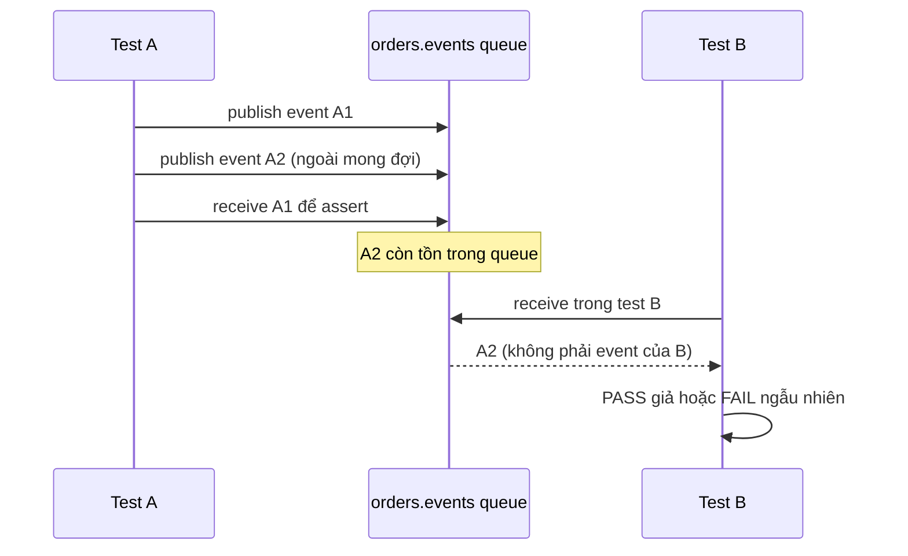
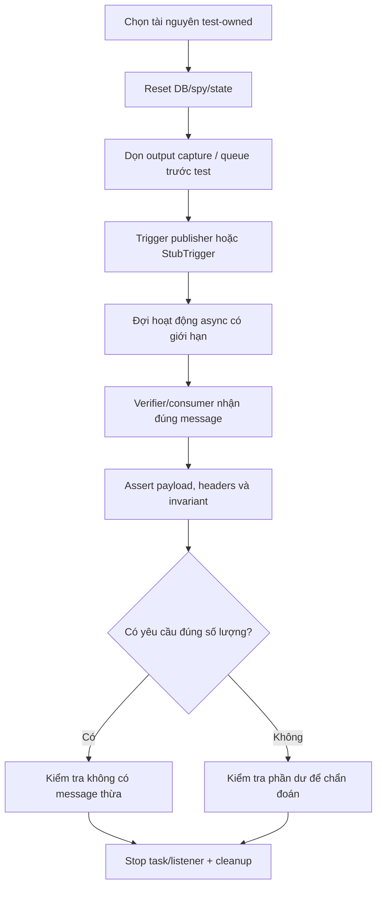
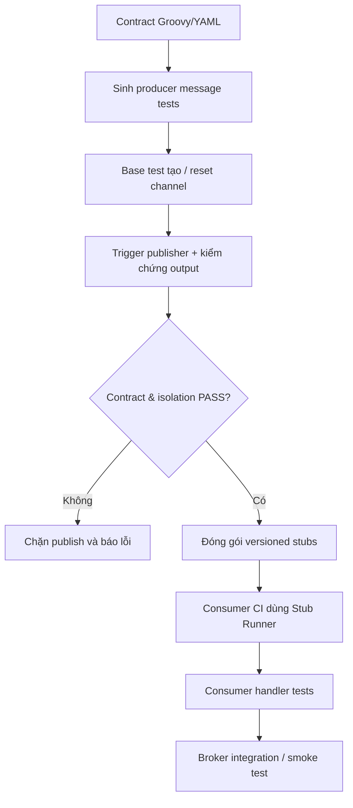

# Dọn kênh hoặc hàng đợi để các kiểm thử không ảnh hưởng nhau

> **Chương:** Kiểm thử messaging  
> **Module:** Spring Cloud Contract (`SPRING_CLOUD_CONTRACT`) — kiểm thử hợp đồng giữa producer và consumer bằng Groovy/YAML DSL cho HTTP và thông điệp, sinh producer verification tests, phát hành stub, dùng Stub Runner và kiểm soát tương thích qua CI.

## Mục tiêu học tập

Sau bài này, bạn có thể:

1. Nhận diện **message tồn từ test trước** và những trạng thái dùng chung khác khiến messaging contract test xanh giả, đỏ ngẫu nhiên hoặc phụ thuộc thứ tự chạy.
2. Giải thích điểm khác nhau giữa **cô lập trạng thái test**, **dọn hàng đợi**, **chờ xử lý bất đồng bộ**, và **kiểm tra không có message thừa**.
3. Viết base test JUnit 5 cho Spring Cloud Contract có `@BeforeEach`/`@AfterEach` dọn một `PollableChannel` **dành riêng cho test**, dùng `receive(0)` để không chờ vô hạn.
4. Phân biệt chiến lược cho `QueueChannel`, `DirectChannel`, `PublishSubscribeChannel`, Spring Cloud Stream test binder và broker như Kafka/JMS/RabbitMQ.
5. Giữ generated producer test thực sự kiểm tra publisher và thông điệp được sinh, thay vì tiêu thụ sai message hoặc che lỗi phát trùng.
6. Thiết kế consumer test dùng Stub Runner/`StubTrigger` với state riêng, correlation ID và điều kiện chờ có giới hạn.
7. Áp dụng quy tắc isolation trong CI khi có nhiều contract, test chạy song song và retry.

## 1. Tình huống: test B "PASS" nhờ message của test A

Giả sử `order-service` (producer) phát thông điệp `OrderAccepted` tới `orders.events`. Dịch vụ `billing-service` (consumer) nhận sự kiện để bắt đầu lập hóa đơn.

Contract của hai bên cam kết payload:

```json
{
  "eventType": "OrderAccepted",
  "orderId": "ORD-1001",
  "amount": 240000,
  "currency": "VND"
}
```

Một suite producer có hai bài kiểm tra:

- **Test A:** kích hoạt chấp nhận đơn `ORD-1001` và kiểm tra đúng sự kiện `OrderAccepted`.
- **Test B:** kiểm tra một tương tác khác, cũng sử dụng kênh `orders.events`.

Nếu Test A tạo **hai message** nhưng chỉ một message được Verifier nhận để đối chiếu, message còn lại nằm trong queue. Test B bắt đầu và đọc message tồn đó trước khi kết quả của chính mình được phát.

Hậu quả có thể là:

- Test B **PASS nhầm** nếu payload tồn tình cờ khớp contract B.
- Test B **FAIL không ổn định** nếu payload tồn khác dữ liệu B mong đợi.
- Khi chạy riêng từng test đều xanh, nhưng chạy cả suite lại đỏ.
- Khi đổi thứ tự chạy hoặc bật parallel execution, lỗi xuất hiện/ngừng xuất hiện.



**Thông điệp còn dư là trạng thái dùng chung.** Khác với một REST request thường không giữ payload trong một hàng đợi chờ test sau đọc, kênh kiểu queue có thể giữ message cho tới khi một consumer thực sự nhận nó.

Dọn queue có thể giảm rủi ro này, nhưng **dọn không đúng thời điểm còn nguy hiểm hơn**: nó có thể xóa message của test đang chạy hoặc làm mất bằng chứng producer phát dư sự kiện.

## 2. Cô lập là mục tiêu, dọn queue chỉ là một kỹ thuật

Một messaging test đáng tin cậy cần những đặc tính:

| Đặc tính | Ý nghĩa |
| --- | --- |
| **Độc lập thứ tự** | Chạy A rồi B hay B rồi A đều cho cùng kết quả |
| **Tái lập** | Chạy nhiều lần trên cùng mã và fixture cho cùng kết luận |
| **Đúng nguồn** | Message được assert thực sự được phát bởi trigger của test hiện tại |
| **Không rò rỉ** | Message, consumer state, subscriptions hoặc task cũ không tác động test sau |
| **Không xóa nhầm** | Cleanup chỉ thay đổi tài nguyên test sở hữu, không ảnh hưởng test đang chạy hoặc môi trường dùng chung |
| **Tín hiệu lỗi rõ** | Publisher phát dư, sai destination hoặc sai payload phải làm test phù hợp đỏ, không bị cleanup che đi |

Một chiến lược tốt thường kết hợp:

1. **Tài nguyên tách biệt:** test queue/destination/topic, consumer group, context, fixture.
2. **Đặt lại trước test:** xóa message cũ khi test **sở hữu độc quyền** queue.
3. **Kiểm tra sau test:** phát hiện message ngoài mong đợi khi contract đòi hỏi đúng số lượng.
4. **Đợi công việc hoàn tất:** tránh message đến trễ sau khi test đã kết thúc.
5. **Correlation:** gắn mã kịch bản vào message khi nhiều luồng có thể cùng một destination.
6. **Đóng tài nguyên:** dừng listener, executor, broker/context test ở đúng thời điểm.

**Không coi "dọn sạch sau mỗi test" là bảo đảm đủ:** nếu publisher bất đồng bộ còn chạy, nó vẫn có thể phát message sau khi cleanup đã hoàn tất.

## 3. Phân biệt các kiểu message channel

Không phải channel nào cũng có "queue" để dọn.

| Cơ chế | Cách nhận | Có thể dọn bằng `receive(0)`? | Điều cần nhớ |
| --- | --- | --- | --- |
| Spring Integration `QueueChannel` | Pull/poll | **Có** nếu test sở hữu queue | Message được giữ tới khi bị nhận; `receive(0)` không chờ |
| Spring Messaging `PollableChannel` | Pull/poll | **Có**, nếu implementation hỗ trợ | `receive(0)` vừa **lấy** vừa **loại khỏi** queue |
| Spring Integration `DirectChannel` | Gửi trực tiếp cho subscriber | **Không** | Không có queue nội bộ để poll; reset subscriber/test state |
| `PublishSubscribeChannel` | Phát cho subscriber | **Không** | Không triển khai `PollableChannel`; cần capture riêng |
| `ExecutorChannel` hoặc channel async | Handler trên executor | **Không theo cách này** | Chờ task, hủy subscription/cô lập executor |
| Spring Cloud Stream **test binder** | `OutputDestination.receive(...)` | **Có trên output capture của test binder** | Chỉ drain destination test-owned, tránh tranh receive với Verifier |
| Kafka topic | Consumer đọc theo offset | **Không** bằng `PollableChannel` | Cô lập topic/group/offset; đừng xóa topic dùng chung |
| JMS/RabbitMQ queue | Broker lưu message/ack | **Không** bằng Spring Integration API một cách tổng quát | Tạo queue riêng, purge có kiểm soát hoặc tách broker |

Sự khác biệt này dẫn tới quy tắc đầu tiên: **xác định implementation thật đang giữ message trước khi viết mã cleanup**.

### 3.1. QueueChannel và receive(0)

Trong Spring Integration, `QueueChannel` là channel kiểu point-to-point, lưu message trong queue. `PollableChannel.receive(long timeout)` với `timeout = 0` được dùng để lấy message **ngay lập tức**, trả `null` nếu không có message.

```java
Message<?> message = channel.receive(0);
```

Không dùng `receive()` không có timeout trong vòng dọn: thao tác đó có thể **chờ vô hạn** khi queue rỗng.

### 3.2. QueueChannel không phải PublishSubscribeChannel

Với `PublishSubscribeChannel`, thông điệp được gửi tới các subscriber. Không có `receive(0)` vì nó không phải `PollableChannel`. Để quan sát message cho test, có thể cài một **test subscriber** ghi các event vào `BlockingQueue` của riêng nó, sau đó reset queue capture giữa test.

Không nên viết một vòng drain `QueueChannel` rồi áp dụng nguyên xi cho mọi tích hợp messaging.

## 4. Hợp đồng ví dụ: producer phát OrderAccepted

Đặt một contract Groovy vào `src/test/resources/contracts/order_accepted.groovy` của producer:

```groovy
org.springframework.cloud.contract.spec.Contract.make {
    name 'order_accepted'
    label 'order_accepted'

    input {
        triggeredBy('publishOrderAccepted()')
    }

    outputMessage {
        sentTo('orders.events')
        headers {
            messagingContentType(applicationJson())
        }
        body(
            eventType: 'OrderAccepted',
            orderId: 'ORD-1001',
            amount: 240000,
            currency: 'VND'
        )
    }
}
```

Ý nghĩa:

- Generated producer test gọi `publishOrderAccepted()` ở base class.
- Verifier cần nhận message đã phát đến `orders.events`.
- Test kiểm tra header và body đã cam kết.
- `label` giúp consumer Stub Runner kích hoạt message stub theo tên.

Phiên bản YAML tương đương về hành vi:

```yaml
name: order_accepted
label: order_accepted

input:
  triggeredBy: publishOrderAccepted()

outputMessage:
  sentTo: orders.events
  headers:
    contentType: application/json
  body:
    eventType: OrderAccepted
    orderId: ORD-1001
    amount: 240000
    currency: VND
```

Chọn **một DSL** cho cùng tình huống khi build; để cả YAML lẫn Groovy trong cùng thư mục contract có thể sinh test/stub trùng nhau.

**Dọn queue không phải một field của contract.** Nó thuộc test infrastructure, thường nằm trong base test mà generated test kế thừa. Không ghi một thao tác purge broker vào `outputMessage` chỉ để producer verification "xanh".

## 5. Kênh test riêng cho ví dụ Spring Integration

Một cấu hình **dành cho test** (ví dụ `ContractMessageChannels.java` nằm ở nguồn test):

```java
package com.example.orders;

import org.springframework.boot.test.context.TestConfiguration;
import org.springframework.context.annotation.Bean;
import org.springframework.integration.channel.QueueChannel;
import org.springframework.messaging.PollableChannel;

@TestConfiguration(proxyBeanMethods = false)
public class ContractMessageChannels {

    @Bean("orders.events")
    public PollableChannel orderEvents() {
        return new QueueChannel(32);
    }
}
```

Điểm quan trọng:

- `orders.events` là **tên bean/channel trong test**, trùng destination ở contract.
- `QueueChannel(32)` tạo một queue có giới hạn dung lượng để không giữ vô hạn message ngoài mong đợi.
- Khi chạy test, publisher phải gửi **vào đúng bean channel này**. Nếu production đã khai báo một bean cùng tên, không đăng ký trùng; dùng test profile/override có kiểm soát hoặc cấu hình application phù hợp.
- Không suy ra `@Bean("orders.events")` tự tạo Kafka topic hay RabbitMQ exchange trong production.

Với test có Spring Integration trên classpath, Spring Cloud Contract có tích hợp verifier để tìm destination/channel. Cần cấu hình đúng binder/adapter nếu project đồng thời chứa nhiều thư viện messaging.

### 5.1. Publisher thật — không phải mock dựng sẵn message

Ví dụ publisher dùng chính `MessageChannel` đã đăng ký:

```java
package com.example.orders;

import org.springframework.beans.factory.annotation.Qualifier;
import org.springframework.messaging.MessageChannel;
import org.springframework.messaging.MessageHeaders;
import org.springframework.messaging.support.MessageBuilder;
import org.springframework.stereotype.Service;
import org.springframework.util.MimeTypeUtils;

@Service
public class OrderEventPublisher {

    private final MessageChannel output;

    public OrderEventPublisher(
            @Qualifier("orders.events") MessageChannel output) {
        this.output = output;
    }

    public void publishOrderAccepted() {
        String json = """
            {
              "eventType": "OrderAccepted",
              "orderId": "ORD-1001",
              "amount": 240000,
              "currency": "VND"
            }
            """;

        output.send(
            MessageBuilder.withPayload(json)
                .setHeader(
                    MessageHeaders.CONTENT_TYPE,
                    MimeTypeUtils.APPLICATION_JSON
                )
                .build()
        );
    }
}
```

Đây là **publisher minh họa để giải thích luồng message**, chưa có logic lưu đơn. Contract test phải gọi **publisher thật** để biết liệu code gửi event theo đúng thỏa thuận hay không. Nếu generated test chỉ tự ghi một JSON mẫu vào queue rồi tự assert lại, nó không kiểm chứng producer.

Nếu dự án dùng `StreamBridge`, KafkaTemplate hoặc JMS adapter thật, test setup/binder sẽ khác. Đừng đồng thời cài `QueueChannel` giả và hy vọng nó thay thế một topic Kafka mà không có adapter nối giữa chúng.

### 5.2. Payload và header cần tương thích

Contract mong body JSON. Publisher ở trên gửi một chuỗi JSON cùng header `contentType: application/json`. Tùy integration của Verifier, payload có thể được đọc dưới dạng chuỗi, `byte[]` hoặc object/Map; cần xem **generated test và message thật** nếu serializer khác nhau.

Một message được dọn khỏi queue thì **không còn ở đó để Verifier assert**. Vì vậy logic cleanup trong base test phải chạy ở thời điểm đúng.

## 6. Base test: dọn trước và sau từng producer contract test

Trong producer, plugin Contract Verifier được cấu hình `baseClassForTests = com.example.orders.ContractTestBase`. Class này là nơi đặt logic reset trạng thái.

```java
package com.example.orders;

import org.junit.jupiter.api.AfterEach;
import org.junit.jupiter.api.BeforeEach;
import org.springframework.beans.factory.annotation.Autowired;
import org.springframework.beans.factory.annotation.Qualifier;
import org.springframework.boot.test.context.SpringBootTest;
import org.springframework.context.annotation.Import;
import org.springframework.messaging.Message;
import org.springframework.messaging.PollableChannel;
import org.springframework.cloud.contract.verifier.messaging.boot.AutoConfigureMessageVerifier;

@SpringBootTest
@AutoConfigureMessageVerifier
@Import(ContractMessageChannels.class)
public abstract class ContractTestBase {

    @Autowired
    @Qualifier("orders.events")
    protected PollableChannel events;

    @Autowired
    protected OrderEventPublisher publisher;

    @BeforeEach
    protected void clearBeforeContract() {
        drainOwnedQueue(events);
    }

    protected void publishOrderAccepted() {
        publisher.publishOrderAccepted();
    }

    @AfterEach
    protected void clearAfterContract() {
        drainOwnedQueue(events);
    }

    protected static int drainOwnedQueue(PollableChannel channel) {
        int removed = 0;
        Message<?> message;
        while ((message = channel.receive(0)) != null) {
            removed++;
            if (removed > 10_000) {
                throw new IllegalStateException(
                    "Queue liên tục được ghi; cần dừng publisher trước khi dọn"
                );
            }
        }
        return removed;
    }
}
```

Đây là mẫu cho **queue in-memory chuyên dụng mà suite đang sở hữu**. Để chạy được, dự án cần lớp ứng dụng Spring Boot, Spring Integration, các test dependencies tương ứng và cấu hình để publisher thực sự gửi tới `orders.events`; project chứa nhiều producer beans/binding khác nhau cần điều chỉnh setup.

### 6.1. Giải thích vòng đời

| Giai đoạn | Hành động | Vì sao |
| --- | --- | --- |
| `@BeforeEach` | Rút hết message tồn ở output queue test-owned | Test mới không nhận event cũ |
| Trigger từ contract | Gọi `publishOrderAccepted()` | Kích hoạt publisher thật |
| Generated assertion | Verifier nhận và kiểm tra đúng message | Bảo vệ hành vi producer |
| `@AfterEach` | Dọn các message còn lại | Không để residual state cho test tiếp |
| Teardown context khi cần | Dừng subscriber/executor/broker | Không để tác vụ tiếp tục ghi sau cleanup |

**Dọn trước test** quan trọng vì Spring test framework có thể cache `ApplicationContext` giữa các test. Một channel singleton có thể sống qua nhiều phương thức dù mỗi test dùng JUnit instance mới.

**Dọn sau test** giúp hạn chế rò rỉ khi assertion fail sớm hoặc producer phát nhiều event. Nhưng **đừng dùng cleanup để che duplicate**: nếu hợp đồng hoặc nghiệp vụ yêu cầu đúng một message, phải có assertion riêng kiểm tra không có message thừa, xem mục 7.

### 6.2. Vì sao receive(0) phải nằm ngoài phần assert chính?

Vì `receive(0)` **tiêu thụ** message. Nếu base test gọi nó **sau trigger nhưng trước generated verifier**, Verifier có thể không còn event để đọc và timeout.

Trình tự đúng:

```text
DỌN → CHUẨN BỊ FIXTURE → TRIGGER → VERIFIER RECEIVE/ASSERT → DỌN PHẦN DƯ
```

Không gọi thêm một `receive(0)` từ helper `assertThat` nếu helper ấy có thể lấy chính message mà generated test còn đang chờ. Các kiểm tra tùy biến cần rõ ai sở hữu lần nhận message.

### 6.3. Vì sao đặt giới hạn vòng lặp dọn?

Khi producer nền tiếp tục gửi message, queue không bao giờ trở về rỗng; vòng lặp `while (receive(0) != null)` có thể kéo dài bất thường. Giới hạn số lần drain **không giải quyết gốc rễ**, nhưng giúp báo lỗi thay vì treo mãi. Gốc rễ cần xử lý bằng cách tắt scheduler/consumer background hoặc cô lập destination.

Một queue rỗng tại thời điểm `receive(0) == null` **không bảo đảm** không có message nào sẽ đến **ngay sau đó**.

## 7. Đừng dùng cleanup để che lỗi phát trùng

Hãy xét bug publisher gửi **hai message** thay vì một:

```java
publisher.publishOrderAccepted();
publisher.publishOrderAccepted(); // bug: phát trùng
```

Generated messaging contract test thông thường có thể chỉ xác minh **một output message phù hợp**. Nếu `@AfterEach` âm thầm dọn message thứ hai, suite vẫn xanh mặc dù nghiệp vụ yêu cầu đúng một sự kiện.

Có hai mức kiểm tra khác nhau:

1. **Contract về nội dung:** message nhận được đúng destination, headers và body.
2. **Bất biến số lượng:** trong kịch bản này publisher chỉ được tạo **một** sự kiện (hoặc một số lượng xác định).

Nếu bất biến thứ hai quan trọng, cần test riêng hoặc extension rõ ràng cho biết điều kiện ấy.

### 7.1. Kiểm tra message thừa khi publisher đồng bộ

Khi chắc chắn publisher hoàn thành đồng bộ, generated verifier đã đọc message duy nhất và **không có consumer cạnh tranh**, có thể dùng assertion sau khi test:

```java
@AfterEach
protected void assertNoUnexpectedOutputThenClean() {
    try {
        Message<?> extra = events.receive(0);
        assertNull(
            extra,
            "Producer phát thêm một message ngoài hợp đồng"
        );
    } finally {
        drainOwnedQueue(events);
    }
}
```

Đây là **biến thể thay cho `clearAfterContract()`**, không dùng cả hai hook theo mặc định. Cần static import `org.junit.jupiter.api.Assertions.assertNull`.

**Điều kiện áp dụng:**

- Test cụ thể kỳ vọng **đúng một** message và verifier đã nhận message chính.
- Không có message đang bay từ một task bất đồng bộ chưa hoàn tất.
- `events` là queue **test-owned** và không bị listener khác tiêu thụ.
- Nếu contract cho phép nhiều message, kiểm tra phải được thiết kế theo số lượng đó, không ép tất cả tình huống về một.

Nếu generated test fail trước khi nhận output chính, assert trong `@AfterEach` có thể báo thêm message tồn, khiến log có hai lỗi. Đó là điều bình thường; ưu tiên nhìn **lỗi gốc** và không sửa contract chỉ để xóa lỗi phụ.

### 7.2. Tách test kiểm tra số lượng khỏi contract nếu cần

Một integration/unit test chuyên biệt có thể:

```java
@Test
void publishMotLanChiPhatMotMessage() {
    drainOwnedQueue(events);

    publisher.publishOrderAccepted();

    Message<?> first = events.receive(1_000);
    assertNotNull(first);
    assertNull(events.receive(0), "Không được phát message thứ hai");
}
```

Đoạn trên giả định các import assertion đầy đủ và publisher kết thúc đồng bộ. Với publisher bất đồng bộ, chỉ nhìn queue ngay lập tức sau event đầu có thể chưa đủ để phát hiện message thừa đến muộn: cần chờ producer báo hoàn tất hoặc quan sát một khoảng chờ có giới hạn, tùy lời hứa nghiệp vụ.

## 8. Publisher bất đồng bộ: cleanup trước/sau chưa đủ

Một lỗi khó thấy:

```text
Test A: start async publish
Test A: assertion kết thúc / teardown dọn queue
Test B: setup dọn queue
Async task của A: publish muộn vào queue
Test B: receive message A → FAIL/PASS giả
```

Nếu publisher thực hiện gửi qua `@Async`, scheduler, reactor pipeline hoặc listener có executor, cần **đồng bộ hóa vòng đời**.

### 8.1. Những cách xử lý theo mức độ ưu tiên

1. **Đợi publisher hoàn tất** bằng `Future/CompletableFuture`, handle của task hoặc tín hiệu ứng dụng trước khi coi test kết thúc.
2. **Tách destination theo test** khi hạ tầng cho phép và dùng mã correlation của riêng kịch bản.
3. **Tắt tác vụ nền không liên quan** trong test profile; tránh scheduler production tự bơm message lúc test đang chạy.
4. **Dùng chờ có giới hạn** cho output mong đợi thay vì `Thread.sleep` tùy ý.
5. Chỉ dùng `@DirtiesContext` khi state của Spring context khó reset an toàn; đây là biện pháp tốn tài nguyên hơn.

Ví dụ ý tưởng với `CompletableFuture`:

```java
CompletableFuture<Void> completion =
    publisher.publishAcceptedAsync("ORD-1001");

completion.join(); // Chờ đến lúc publisher báo xử lý xong.
```

Đoạn này chỉ là **thiết kế API minh họa**, vì `OrderEventPublisher` ở mục 5 có phương thức đồng bộ khác. Nếu phần mềm thực sự trả một future khi publish, test nên chờ future phù hợp. `join()` cũng cần chiến lược timeout để CI không treo khi task hỏng; có thể dùng `get(timeout, TimeUnit.SECONDS)` và xử lý timeout.

### 8.2. Chờ có giới hạn không đồng nghĩa ngủ cố định

Không nên dựa vào:

```java
Thread.sleep(3_000); // Hy vọng message đã đến.
```

Lệnh này làm suite chậm, vẫn flaky khi CI tải nặng và không xác nhận đúng sự kiện.

Khi viết test consumer hoặc test thông điệp thủ công, có thể dùng Awaitility:

```java
await().atMost(Duration.ofSeconds(5))
    .untilAsserted(() ->
        assertEquals("READY", stateStore.status("ORD-1001"))
    );
```

`stateStore` là probe/fixture quan sát state do **handler thật** cập nhật; cần dependency Awaitility hoặc công cụ polling tương đương. Với generated producer test, Verifier có cơ chế receive/timeout của chính nó, nên không tự đặt một consumer mới tranh đọc cùng queue chỉ để chờ.

## 9. Correlation ID: phân biệt message của test hiện tại

Với suite bất đồng bộ hoặc nhiều producer dùng chung destination, **correlation** giúp xác minh nguồn sự kiện.

Có thể đưa một mã `testRunId` hoặc `correlationId` vào **header/payload**, nếu phù hợp với hợp đồng và logic ứng dụng:

```json
{
  "eventType": "OrderAccepted",
  "orderId": "ORD-1001",
  "correlationId": "run-B-0007",
  "amount": 240000
}
```

Khi test nhận message, nó chỉ chấp nhận sự kiện thuộc kịch bản hiện tại và báo lỗi/ghi nhận sự kiện không mong đợi. Tuy nhiên:

- **Không tự ý thêm `correlationId` vào public contract** nếu API thực không cam kết field đó. Có thể dùng test-specific header hoặc fixture khi ứng dụng cho phép.
- Chỉ **bỏ qua** message có correlation khác có thể che lỗi rò rỉ; nên ghi log và xử lý phần dư như một tín hiệu isolation.
- ID chỉ giải quyết **nhận diện**, không tự xóa backlog, không dừng scheduler cũ.
- Nếu các test chạy song song cùng queue, một consumer có thể lấy nhầm message của test khác trước khi kiểm tra correlation. **Lọc sau khi lấy không thay thế cô lập queue**.

Nên ưu tiên queue/destination riêng khi thật sự có concurrent consumers, và dùng correlation như **lớp bảo vệ bổ sung**.

## 10. Spring Cloud Stream test binder: dọn đúng output capture

Nếu dự án dùng Spring Cloud Stream function model, test binder cung cấp `InputDestination` và `OutputDestination` để test giao tiếp **in-memory**, không cần broker thật.

Ví dụ một test riêng (không được chạy đồng thời với generated Contract Verifier đang nhận cùng message):

```java
@Autowired
OutputDestination outputDestination;

@BeforeEach
void clearStreamOutput() {
    while (outputDestination.receive(0, "orders.events") != null) {
        // Rút hết message đang chờ ở output capture của test binder.
    }
}
```

`receive(0, destinationName)` lấy message ở output destination với timeout bằng 0. Tên `orders.events` chỉ đúng nếu binding của ứng dụng thực sự ánh xạ tới destination đó; một function có thể dùng binding name như `orders-out-0` thay thế.

### 10.1. Điều kiện để đoạn này có hiệu lực

- Bạn đã bật **Spring Cloud Stream test binder** tương thích phiên bản project (ví dụ dependency test `spring-cloud-stream-test-binder`).
- `OutputDestination` là **output capture của suite đang chạy**.
- Test sở hữu destination đó, không có generated verifier hoặc test khác cùng nhận trong lúc dọn.
- Không có event đang được xử lý bất đồng bộ ở thời điểm cleanup.
- Bạn xác định đúng **binding name/destination name** của output; sai tên có thể dẫn đến dọn nhầm hoặc không dọn được.

**Không gọi cả Verifier receive và `OutputDestination.receive` song song với cùng một message**. Đây là hai consumer cạnh tranh, một bên có thể lấy event trước khiến bên kia timeout.

### 10.2. InputDestination không phải hàng đợi output

`InputDestination.send(...)` được dùng để **đưa message vào consumer/function** trong test binder. `OutputDestination.receive(...)` được dùng để **đọc kết quả**. Nếu consumer có state trong repository/test spy, bạn cũng cần **reset state ấy**, không chỉ drain output.

Ví dụ một test consumer function đọc `PaymentCaptured` và xuất `OrderPaid`:

```java
inputDestination.send(
    MessageBuilder.withPayload(inputJson.getBytes(StandardCharsets.UTF_8))
        .build(),
    "payments.events"
);

Message<byte[]> output =
    outputDestination.receive(5_000, "orders.events");

assertNotNull(output);
```

Đây là snippet minh họa, cần cấu hình function/binding, import và assertions tương ứng. Chờ tối đa 5 giây ở lần **nhận output mong đợi** khác với `receive(0)` dùng để **dọn message tồn**.

## 11. Với DirectChannel và PublishSubscribeChannel: reset subscriber, không drain channel

### 11.1. DirectChannel

`DirectChannel` gửi message tới handler được chọn, không giữ backlog nội bộ như QueueChannel. Nếu test thất bại vì state cũ, nguyên nhân thường nằm ở:

- Handler/service singleton giữ dữ liệu từ lần trước.
- Test spy/mock có invocation history chưa reset.
- Repository in-memory giữ event/record cũ.
- Task bất đồng bộ chưa hoàn tất.
- Subscriber bị đăng ký hai lần.

Giải pháp là **reset state của handler/test probe** hoặc dựng context/test fixture mới, không tìm một phương thức `receive(0)` không tồn tại.

### 11.2. PublishSubscribeChannel

`PublishSubscribeChannel` gửi một message tới các subscriber; một subscriber test có thể ghi message vào queue capture riêng:

```java
private final BlockingQueue<Message<?>> observed =
    new LinkedBlockingQueue<>();

private final MessageHandler probe = observed::offer;

// Trong setup, đăng ký probe vào PublishSubscribeChannel phù hợp.
// Trong teardown, hủy đăng ký probe.
// Trước test mới, observed.clear() nếu queue capture thuộc test.
```

Đây là **pseudocode về kiến trúc test**: phương thức subscribe/unsubscribe và kiểu channel thực tế cần được cấu hình cho đúng. Queue `observed` chỉ là **test probe**, không phải queue của production publisher.

Nếu không unsubscribe, mỗi test có thể thêm một subscriber mới; khi gửi một message, nhiều handler chạy và có thể làm test lặp hoặc leak memory. Cần quản lý **vòng đời đăng ký subscriber** bên cạnh việc dọn dữ liệu.

## 12. Broker thật hoặc embedded broker: ưu tiên cô lập tài nguyên

Khi dùng Kafka, JMS hoặc RabbitMQ trong integration tests, ý nghĩa "dọn queue" khác in-memory channel.

| Hạ tầng | Nguồn nhiễm giữa test | Chiến lược ưu tiên |
| --- | --- | --- |
| Kafka | Topic log cũ, offset/group dùng lại, consumer chưa assign | Topic/destination riêng, group ID riêng khi phù hợp, kiểm soát offset |
| RabbitMQ | Queue durable còn message, ACK/requeue, binding/subscriber cũ | Queue test riêng, xóa/purge **chỉ queue test-owned**, chờ consumer dừng |
| JMS | Queue còn message, redelivery, durable subscriptions | Queue riêng và reset broker/test fixture; không purge queue dùng chung |
| Testcontainers broker | Container dùng chung quá lâu, state từ class trước | Namespace/topic/queue theo suite, lifecycle và cleanup có thứ tự |
| Embedded/in-memory broker | Context/consumer còn tồn hoặc test order | Context reset khi cần, fixture isolate và dừng task |

**Không bao giờ purge/xóa queue/topic production hoặc môi trường dùng chung chỉ để dọn test.** Hành động cleanup phá hủy dữ liệu chỉ được phép trên tài nguyên mà suite sở hữu độc quyền và đã xác định chính xác.

### 12.1. Kafka: group mới không đồng nghĩa topic rỗng

Kafka lưu **log trên topic** và mỗi consumer group quản lý offset của mình. Nếu tạo consumer group mới nhưng dùng topic cũ với `auto.offset.reset=earliest`, consumer có thể đọc lại **tất cả event từ test trước**.

Nếu dùng `latest`, consumer mới lại có thể bỏ qua một event gửi **trước khi partition assignment hoàn tất**. Không có một property nào giải quyết toàn bộ vấn đề timing.

Cách làm tin cậy:

1. Ưu tiên **topic test riêng** cho mỗi class/suite/case nếu chi phí cho phép.
2. Dùng **consumer group riêng** khi nhiều test cùng hạ tầng.
3. Hoàn tất assignment/seek tới offset dự định **trước khi gửi** event của test.
4. Dùng correlation ID/record key để xác minh event đúng nguồn, không chỉ đếm event.
5. Hủy consumer và đóng container/broker đúng vòng đời.

Tài liệu Spring Kafka khuyến nghị dùng **topic khác nhau cho từng test** với embedded Kafka để tránh cross-talk. `@DirtiesContext` có thể hữu ích cho một số vấn đề lifecycle context/embedded broker, nhưng tạo lại context tốn chi phí và không tự xóa một Kafka topic ngoài JVM.

### 12.2. RabbitMQ và JMS: ACK/redelivery có thể làm "message cũ" xuất hiện lại

Nếu test đã nhận một message nhưng chưa ACK (hoặc transaction rollback), broker có thể **redeliver** nó cho consumer sau. Một thao tác drain của test khác có thể ăn message này và khiến kết quả khó đoán.

Nên dùng queue/destination test riêng và xác định rõ:

- Cơ chế ACK/commit/rollback.
- Listener container đã dừng hoàn toàn trước khi purge hay chưa.
- Có DLQ, retry/backoff hoặc redelivery nào đang hoạt động không.
- Queue có durable/auto-delete hoặc được tái sử dụng qua nhiều suite không.

Purge broker **không giống** `PollableChannel.receive(0)`; nó tác động vào hạ tầng và có thể làm mất message của consumer khác nếu không cô lập.

## 13. Consumer test với Stub Runner: tránh trạng thái listener cũ

Ở consumer, Stub Runner có thể kích hoạt sự kiện mẫu theo `label` từ contract đã phát hành.

Ví dụ giả định đã có `OrderEventHandler` cập nhật một `TestOrderState` do test quan sát:

```java
@SpringBootTest
@AutoConfigureStubRunner(
    ids = "com.example:order-service:1.0.0:stubs",
    stubsMode = StubRunnerProperties.StubsMode.LOCAL
)
class BillingEventContractTest {

    @Autowired
    StubTrigger stubTrigger;

    @Autowired
    TestOrderState testOrderState;

    @BeforeEach
    void resetState() {
        testOrderState.reset();
    }

    @Test
    void billingNhanOrderAccepted() {
        assertTrue(stubTrigger.trigger("order_accepted"));

        await().atMost(Duration.ofSeconds(5))
            .untilAsserted(() ->
                assertEquals(
                    "READY_TO_BILL",
                    testOrderState.getStatus("ORD-1001")
                )
            );
    }
}
```

Đây là test **minh họa**, cần import, dependency của Stub Runner, binder/adapter và các lớp `TestOrderState`/handler thật. `@AutoConfigureStubRunner` chỉ nạp stubs; để message đến listener cần **messaging integration được cấu hình đúng**.

### 13.1. Vì sao chỉ trigger() == true chưa đủ?

`stubTrigger.trigger("order_accepted")` báo rằng stub có thể kích hoạt event theo label. Nó **không chứng minh** handler của consumer đã:

- Nhận đúng event trên binding.
- Giải mã thành công JSON/headers.
- Cập nhật dữ liệu nghiệp vụ.
- Không xử lý trùng hoặc không giữ state từ test trước.

Do đó cần assert **kết quả quan sát được sau khi handler chạy**, với timeout có giới hạn.

### 13.2. Reset state consumer trước mỗi test

Nếu `TestOrderState` là một bean singleton hoặc repository in-memory, lần test trước có thể đã để `ORD-1001` ở trạng thái `READY_TO_BILL`. Test mới chưa nhận message vẫn nhìn thấy đúng status và **PASS giả**.

Trước test cần reset trạng thái quan sát, còn sau test cần đảm bảo các listener/task đã hoàn tất. Với state khó reset, cân nhắc tạo context riêng hoặc dùng một `orderId` đặc trưng cho từng test nếu contract/stub hỗ trợ. Tránh cố ý dùng `ORD-1001` ở mọi test bất đồng bộ mà không cô lập state.

## 14. Có nên dùng @DirtiesContext?

`@DirtiesContext` yêu cầu Spring Test đánh dấu context là "bẩn" và không tái sử dụng cache theo phạm vi đã khai báo. Nó hữu ích khi một test thay đổi singleton state, subscription hoặc cấu hình không thể reset đúng.

Ví dụ áp dụng cho class có integration setup phức tạp:

```java
@DirtiesContext(classMode = DirtiesContext.ClassMode.AFTER_CLASS)
class MessagingIntegrationTest {
    // ...
}
```

Nên hiểu rõ:

- **Ưu điểm:** giảm rò state giữa các class dùng cùng Spring context.
- **Nhược điểm:** tạo lại context/broker có thể tăng đáng kể thời gian CI.
- **Giới hạn:** nếu queue/topic nằm ở **broker bên ngoài** còn sống, đóng Spring context **không tự xóa message trên broker**.
- **Phạm vi:** `AFTER_CLASS` dọn context sau cả class, **không** cách ly hai test methods trong cùng class nếu chúng dùng chung state. `AFTER_EACH_TEST_METHOD` tách nhiều hơn nhưng tốn chi phí lớn.

Ưu tiên reset fixture hoặc sở hữu kênh test riêng; dùng `@DirtiesContext` khi sự cố do context cache hoặc cơ chế lifecycle, không như một "nút sửa mọi flaky test".

## 15. Chạy song song: khi nào phải vô hiệu hóa?

Hai test chạy song song trên **cùng QueueChannel** có thể có tình huống:

```text
Test A: beforeEach drain
Test B: beforeEach drain
Test A: publish A
Test B: publish B
Verifier A: receive B
Verifier B: receive A
```

**Không có thứ tự cleanup nào sửa được việc hai consumer cùng tranh queue.**

Giải pháp tùy tình huống:

- Mỗi test có **context/channel riêng**.
- Mỗi test dùng destination tách biệt/được đặt tên riêng.
- Với integration tests dùng broker, dùng topic/queue và consumer group test-owned.
- Nếu không thể tách, đặt các test có cùng queue vào **resource lock** hoặc tắt parallel execution cho nhóm đó.

JUnit 5 có thể khai báo tài nguyên khóa cho test class khi cần:

```java
@ResourceLock(value = "orders.events")
class OrderMessagingContractTests {
    // Các test được điều phối qua một resource lock khi
    // JUnit Jupiter hỗ trợ và cấu hình parallel execution phù hợp.
}
```

Đây là **gợi ý cho test class do mình quản lý**. Với class **do Contract Verifier sinh**, annotation có thể phải đặt ở lớp base hoặc cấu hình generated tests theo plugin; cần kiểm tra cơ chế kế thừa và runner thực tế. Nếu chắc chắn không thể khóa đúng test, tắt parallel trong module messaging tests là phương án an toàn hơn.

## 16. Quy trình chuẩn cho mỗi test



Trình tự cần điều chỉnh theo công cụ; generated Verifier test thường **tự thực hiện trigger/receive/assert**, vì vậy base class chỉ nên đảm nhiệm fixture/cleanup. Không đưa một receiver thứ hai vào giữa các bước của generated test.

### 16.1. Check-list trước khi chạy test

- Queue/output capture thực sự được sở hữu bởi test?
- Có mock/listener/service singleton giữ state từ lần trước?
- Scheduler hoặc publisher async có thể tự phát message không?
- Có hai consumer cùng nhận từ một queue không?
- Destination `sentTo` trong contract đã đúng cấu hình thực?
- Có contract khác phát cùng message/label?
- Test có chờ đúng output thay vì ngủ cố định?
- Khi test xanh, message nhận được có chắc từ trigger hiện tại không?

### 16.2. Check-list sau test

- Generated verifier đã nhận và kiểm tra message chính?
- Có thêm message bị bỏ lại không, và sự tồn tại của chúng có là lỗi nghiệp vụ?
- Tác vụ async/listener đã dừng hoặc hoàn tất?
- State của consumer/test probe đã được reset?
- Queue dùng chung không bị purge trái quyền?
- Test chạy riêng và chạy cả suite có cùng kết quả?

## 17. Đưa isolation vào CI

Pipeline producer ví dụ:



Với Maven đã cấu hình plugin, một bước thường dùng:

```bash
mvn clean verify
```

Sau khi producer verification **được sinh và thực sự chạy PASS**, mới cài/phát hành artifact stubs phù hợp:

```bash
mvn clean install
```

Không dùng `-DskipTests` rồi tuyên bố stub đã được xác minh. Trong CI, cần:

1. Kiểm tra số generated tests thực thi thực tế, không chấp nhận "0 test" ngoài dự kiến.
2. Lưu test reports và log khi timeout hoặc sai payload.
3. Chạy lại suite theo **thứ tự đảo hoặc ngẫu nhiên** trên nhánh thử nghiệm để tìm rò state.
4. Chạy lặp một nhóm test messaging nhạy cảm để phát hiện flakiness có hệ thống.
5. Không song song hóa các test cùng tài nguyên nếu chưa bảo đảm cô lập.
6. Gắn version stub rõ ràng để consumer không lấy nhầm event schema cũ.
7. Với broker integration, tạo/xóa **tài nguyên riêng của CI job**, không động vào hạ tầng khác.

**Flaky test không nên được giải quyết chỉ bằng retry.** Retry có thể khiến pipeline xanh nhưng vẫn che race hoặc test contamination; dùng lại log và điều kiện lặp để xử lý nguyên nhân.

## 18. Chẩn đoán các triệu chứng phổ biến

| Triệu chứng | Nguyên nhân có thể | Cách giải quyết |
| --- | --- | --- |
| Test B PASS dù không trigger đúng | B lấy message còn tồn từ A | Drain queue test-owned trước test, thêm correlation / isolated channel |
| Test chỉ FAIL khi chạy cả suite | Context/queue/subscriber dùng chung | Kiểm tra test order, teardown và Spring context cache |
| Test FAIL sau khi thêm `@BeforeEach` | Cleanup chạy quá muộn, lấy message chính | Đảm bảo drain trước trigger, không có competing receiver |
| Test ngẫu nhiên timeout | Publisher async đến trễ, wrong destination | Chờ task/đúng binding, timeout bounded, cô lập |
| Test mất message khi chạy song song | Hai verifier cùng poll một queue | Dùng destination riêng hoặc chạy tuần tự |
| Queue càng chạy càng đầy | Message thừa, consumer không đọc, subscription leak | Assert số lượng, dừng task, sửa publisher |
| Producer phát hai event nhưng test xanh | Verifier chỉ nhận một, `@AfterEach` lặng lẽ xóa dư | Thêm kiểm tra duplicate/số lượng |
| `receive()` khiến build treo | Poll không timeout trên queue rỗng | Dùng `receive(0)` cho cleanup, timeout bounded cho expected message |
| `PublishSubscribeChannel` không có `receive` | Không phải PollableChannel | Dùng test subscriber/capture |
| Test Stream binder vẫn đọc event cũ | `OutputDestination` giữ message hoặc sai binding name | Drain đúng output capture test-owned |
| Kafka consumer đọc lại event cũ | Group mới, offset `earliest` trên topic dùng chung | Topic riêng, điều khiển seek/offset/correlation |
| Kafka consumer bỏ lỡ event | `latest` sau khi event đã gửi trước assignment | Hoàn tất assignment rồi publish |
| RabbitMQ/JMS nhận lại event | Unacked/redelivery hoặc durable queue cũ | Queue test riêng, xử lý ACK và listener lifecycle |
| Consumer test xanh giả | State của test listener chưa reset | Reset repository/probe trước test, assert kết quả event mới |
| `@DirtiesContext` không xóa backlog | Message nằm ngoài JVM trên broker | Cô lập broker resource, đừng chỉ reset context |

## 19. Bài tập thực hành

**Bài 1 — Dò lỗi theo thứ tự test.** Test A phát hai message, Verifier nhận một; Test B không trigger đúng nhưng vẫn nhận một message. Hãy vẽ timeline và giải thích tại sao `@BeforeEach` drain của Test B làm giảm rủi ro nhưng **không chứng minh producer A phát đúng một event**.

**Bài 2 — Viết hàm drain.** Với `PollableChannel` riêng cho test, viết `drainOwnedQueue` dùng `receive(0)` cho đến khi nhận `null`. Vì sao `receive()` không có timeout có thể khiến suite treo?

**Bài 3 — Base test.** Tạo `ContractTestBase` dùng `@SpringBootTest`, `@AutoConfigureMessageVerifier`, `@Import` cấu hình `QueueChannel` và `@BeforeEach` cleanup. Viết `publishOrderAccepted()` để generated contract test gọi publisher thật.

**Bài 4 — Thử duplicate event.** Sửa publisher cố ý phát hai `OrderAccepted`. Giữ contract output một event. Viết test bổ sung hoặc hook phù hợp chứng minh sự kiện thừa bị phát hiện thay vì bị `@AfterEach` xóa im lặng.

**Bài 5 — Dùng Stream test binder.** Cho function có input destination `payments.events` và output `orders.events`. Viết code reset `OutputDestination`, gửi input bằng `InputDestination`, sau đó nhận output với timeout. Tại sao không nên dùng một manual receive cùng lúc với generated Verifier?

**Bài 6 — Async race.** Test A đã teardown nhưng `@Async` publisher vẫn gửi một event vào queue ở lúc Test B bắt đầu. Hãy nêu hai giải pháp **có thể xác minh được** tốt hơn việc tăng `Thread.sleep`.

**Bài 7 — Kafka isolation.** Hai test dùng cùng topic, mỗi test dùng group mới với `auto.offset.reset=earliest`. Vì sao vẫn đọc event cũ? Hãy thiết kế topic/group/offset riêng phù hợp.

**Bài 8 — Stub Runner consumer.** Sau `stubTrigger.trigger("order_accepted")`, hãy kiểm tra handler của `billing-service` thực sự chuyển đơn sang `READY_TO_BILL`. Nêu cách reset consumer state để lần test sau không PASS giả.

**Bài 9 — CI.** Lập danh sách kiểm tra trước khi publish stub cho module messaging: generated tests, isolation, số message, timeouts, broker test-owned resources và version artifact.

### Gợi ý đáp án

1. Drain trước B loại message A còn tồn, nhưng không chứng minh A phát đúng số lượng; cần kiểm tra duplicate ở A.
2. Dùng vòng `while (channel.receive(0) != null)`; `receive()` không timeout có thể chờ mãi khi queue rỗng.
3. Test base phải chuẩn bị đúng channel và method trigger, không tự gửi message mẫu thay publisher thật.
4. Assert sau generated receive không còn message, hoặc test publisher số lượng riêng khi hoạt động đồng bộ; với async phải chờ hoàn tất.
5. Dùng `OutputDestination.receive(0, name)` để dọn trước, rồi `InputDestination.send` và `OutputDestination.receive(timeout, name)` trong test riêng; receiver cạnh tranh sẽ lấy mất output của Verifier.
6. Chờ future/ack hoàn tất hoặc cô lập destination per test + correlation; tránh ngủ đoán.
7. Kafka group mới với `earliest` vẫn đọc lịch sử topic. Dùng topic test riêng và xác định offset/assignment trước khi publish.
8. Reset state trước trigger; dùng chờ có giới hạn để xác nhận handler thật cập nhật kết quả.
9. Producer tests thực thi PASS, không có rò state, không publish với test skipped, cleanup chỉ dùng resource test-owned, consumer pin version stub.

## 20. Ghi nhớ

**Dọn kênh/hàng đợi trong messaging contract tests** không chỉ là xóa message còn sót. Mục tiêu là **mỗi test phải kiểm chứng đúng sự kiện do chính nó kích hoạt**, không phụ thuộc thứ tự, trạng thái context, background tasks hoặc broker data từ test khác.

Với **Spring Integration `QueueChannel` riêng cho test**, có thể dùng `PollableChannel.receive(0)` trong `@BeforeEach` và `@AfterEach` của base test; tránh drain khi generated Verifier đang cần nhận message. Với `DirectChannel` và `PublishSubscribeChannel`, phải reset subscriber/state thay vì gọi `receive`. Với **Spring Cloud Stream test binder**, dùng output capture phù hợp. Với **Kafka/JMS/RabbitMQ**, ưu tiên topic/queue/consumer group test-owned và vòng đời rõ ràng, không purge bừa bãi.

Để không làm mất hành vi quan trọng, hãy **kiểm tra duplicate/message thừa khi nghiệp vụ đòi hỏi**, đợi publisher bất đồng bộ hoàn tất, bảo đảm consumer state được reset, và xác minh generated producer tests thật sự chạy trong CI. Stub được phát hành sau producer verification và được consumer kiểm tra bằng Stub Runner; broker integration/E2E tests tiếp tục bảo vệ các thuộc tính ngoài phạm vi contract.

## Tài liệu tham khảo

- [Spring Cloud Contract — Messaging](https://docs.spring.io/spring-cloud-contract/reference/project-features-messaging.html) — `input`, `outputMessage`, `triggeredBy`, `@AutoConfigureMessageVerifier`, StubTrigger và các integration.
- [Spring Integration — Message Channel Implementations](https://docs.spring.io/spring-integration/reference/channel/implementations.html) — sự khác nhau giữa `QueueChannel`, `DirectChannel` và `PublishSubscribeChannel`, cách poll với timeout.
- [Spring Integration — Configuring Message Channels](https://docs.spring.io/spring-integration/reference/channel/configuration.html) — cấu hình QueueChannel và giới hạn dung lượng.
- [Spring Cloud Stream — Producing and Consuming Messages](https://docs.spring.io/spring-cloud-stream/reference/spring-cloud-stream/producing-and-consuming-messages.html) — `InputDestination` và `OutputDestination` của test binder.
- [Spring Kafka — Testing Applications](https://docs.spring.io/spring-kafka/reference/testing.html) — embedded broker, consumer group, offset và khuyến nghị tách topic để tránh cross-talk.
- [Spring Cloud Contract — Stub Runner Core](https://docs.spring.io/spring-cloud-contract/reference/project-features-stubrunner/stub-runner-core.html) — consumer tests và phiên bản stub artifact.
- [JUnit 5 — User Guide](https://docs.junit.org/current/user-guide/) — lifecycle `@BeforeEach`/`@AfterEach`, parallel execution và resource locks.
