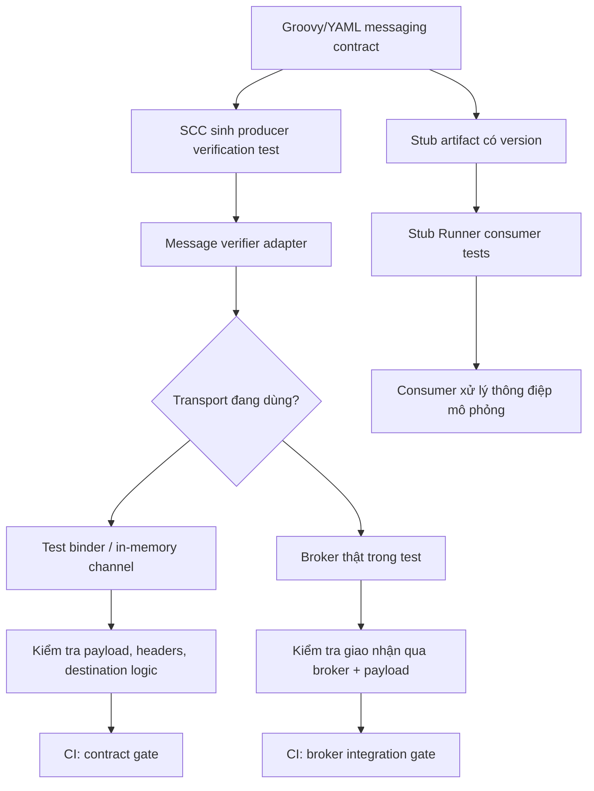
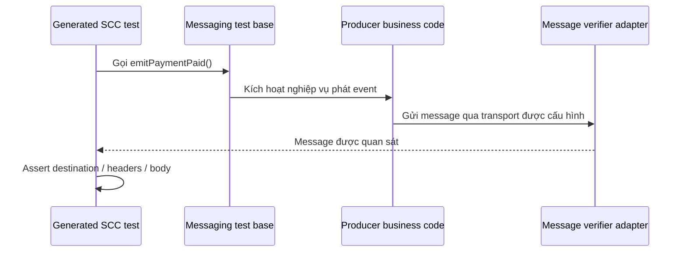
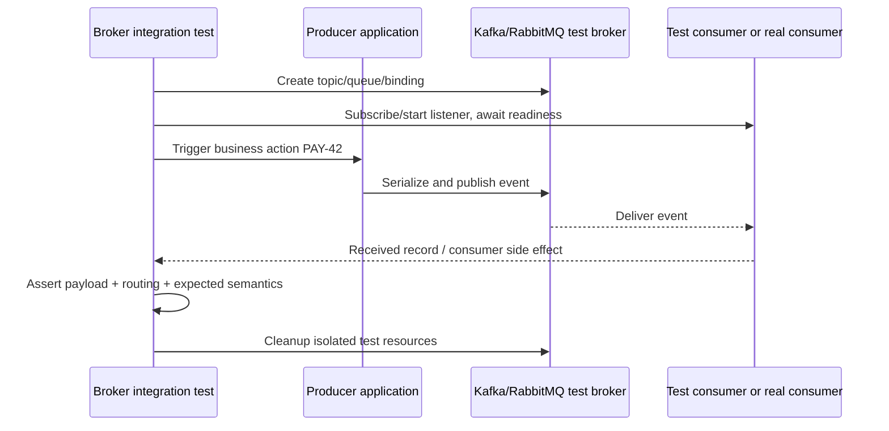
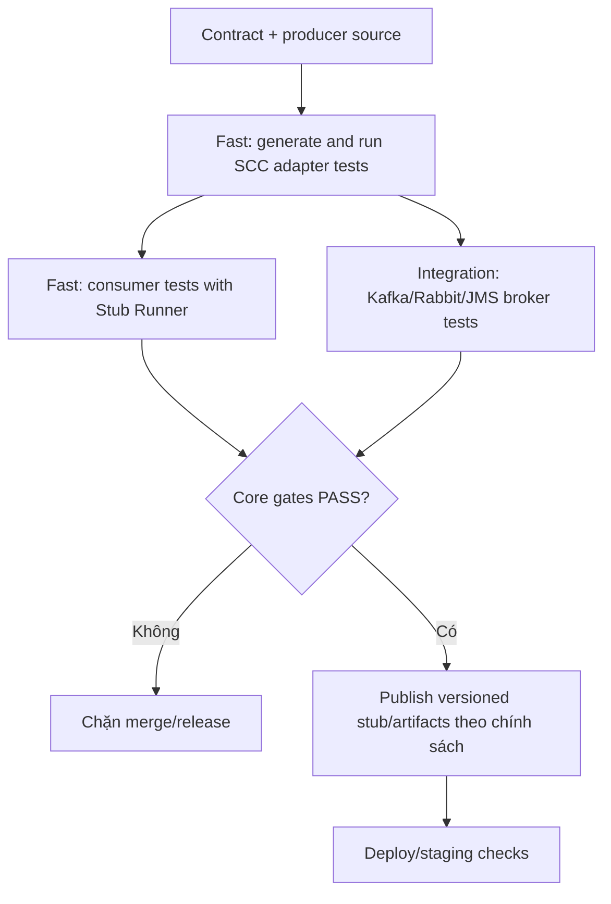

# Phân biệt kiểm thử qua adapter với kiểm thử broker thật

## 1. Hai bài test cùng “nhận được message” nhưng chứng minh hai điều khác nhau

Trong một kiến trúc event-driven, **producer** phát thông điệp như `PaymentPaid`, còn **consumer** nhận và xử lý thông điệp đó. Hai phía cần thống nhất **destination**, định dạng payload, headers, phiên bản sự kiện và ý nghĩa nghiệp vụ. Với **Spring Cloud Contract (SCC)**, nhóm có thể mô tả các tương tác messaging bằng **Groovy/YAML DSL**, sinh **producer verification tests**, tạo stub để consumer thử nghiệm bằng **Stub Runner** và gắn các bước đó vào **CI** nhằm phát hiện thay đổi không tương thích.

Vấn đề là một bài test “đã gửi và nhận được message” có thể chạy qua **adapter hoặc test binder trong bộ nhớ**, hoặc qua **Kafka/RabbitMQ/JMS broker thực sự được khởi động trong môi trường test**. Hai loại bằng chứng này không giống nhau.

Giả sử producer phát:

```json
{
  "paymentId": "PAY-42",
  "orderId": "ORD-7",
  "amount": 150000,
  "currency": "VND",
  "state": "PAID"
}
```

Một producer contract test nhận được JSON đúng ở destination mô phỏng là bằng chứng quan trọng về **cấu trúc message và lời gọi vào kênh phát**. Nhưng nó chưa chứng minh message sẽ được route qua exchange/topic thật, được serialize đúng bytes khi đi qua network, được consumer group xử lý đúng hay đi vào dead-letter queue khi consumer lỗi.

**Mục tiêu bài học:**

1. Hiểu đúng thuật ngữ **messaging adapter**, **test binder** và **broker thật** trong Spring Cloud Contract.
2. Biết contract messaging kiểm chứng điều gì ở producer và consumer.
3. Viết Groovy/YAML DSL cho một sự kiện và chuẩn bị base test với `@AutoConfigureMessageVerifier`.
4. Chọn kiểm thử qua adapter/test binder để phát hiện nhanh lỗi payload, header và xử lý function.
5. Chọn kiểm thử qua broker thật khi cần bảo vệ routing, serialization, consumer group, acknowledgment, retry, DLQ, partition hoặc transaction.
6. Thiết kế pipeline CI tách các lớp kiểm thử, không ngộ nhận kết quả xanh của stub là bằng chứng broker production đúng.

> **Phân biệt cốt lõi:** “Có message đúng theo hợp đồng” không đồng nghĩa “broker và hệ thống giao nhận thực hiện đúng toàn bộ cam kết vận hành”.

## 2. Adapter, test binder và broker thực là ba khái niệm khác nhau

### 2.1. Adapter trong Spring Cloud Contract là điểm tích hợp

SCC định nghĩa các giao diện như `MessageVerifierSender` và `MessageVerifierReceiver` để kết nối generated verification tests với cơ chế gửi/nhận thông điệp. Các tích hợp được tài liệu hóa bao gồm **Spring Integration, Spring Cloud Stream, Apache Camel và Spring JMS**. Bạn có thể cung cấp adapter/tích hợp riêng khi dự án cần công nghệ khác.

`@AutoConfigureMessageVerifier` trong **base class** giúp cấu hình phần messaging verification phù hợp với integration/test classpath. Thực tế đường đi của message phụ thuộc **adapter nào đã được chọn, bean/configuration nào đang hoạt động, và môi trường test được dựng ra sao**.

**Không nên kết luận:** “Có `@AutoConfigureMessageVerifier` nên chắc chắn không đi qua broker.” Annotation này không bảo đảm mọi giao nhận đều nằm trong bộ nhớ.

### 2.2. Test binder là một loại môi trường không có broker mạng

**Spring Cloud Stream test binder** cung cấp cơ chế kiểm thử trong JVM (dựa trên Spring Integration) để các component giao tiếp qua binding mô phỏng, không cần khởi động Kafka hay RabbitMQ. Bạn có thể dùng `InputDestination` và `OutputDestination` trong test để gửi/nhận message ở đường ranh binder.

Đây là lựa chọn tốt cho test nhanh, tái lập được và độc lập network. Nhưng test binder **không thực hiện đầy đủ hành vi của Kafka/RabbitMQ thật**.

Một số công cụ khác cũng có chế độ không broker, ví dụ `TestRabbitTemplate` của Spring AMQP có thể gọi listener trực tiếp trong test. Tuy nhiên, đây không phải “RabbitMQ broker thu nhỏ”: đường routing và ack/requeue của broker thật có thể không được thực thi.

### 2.3. Broker thật trong test là gì?

“Broker thật” là một instance của message broker được khởi động hoặc cung cấp riêng cho bài test, chẳng hạn:

- Một **Kafka broker** dành cho integration test, có topic, partition, consumer group và offset.
- Một **RabbitMQ broker** dành cho integration test, có exchange, queue, binding, acknowledgment và dead-letter routing.
- Một **JMS broker** được cấu hình cho môi trường test, với queue/topic và client JMS thực.

Nó có thể chạy trong **Testcontainers**, container dùng chung có kiểm soát hoặc hạ tầng test cô lập. Chữ “thật” ở đây nghĩa là giao tiếp qua **broker implementation/protocol thực**, **không có nghĩa phải dùng production**.

Một broker riêng dùng cho CI vẫn chưa đồng nghĩa hệ thống production được xác minh toàn diện: phiên bản, cluster topology, ACL, TLS, replication, network policy và lưu lượng production có thể khác.

## 3. Sơ đồ hai đường kiểm thử



**Điểm cần hiểu:** Sơ đồ không nói SCC luôn có hai chế độ riêng tên “ADAPTER” và “BROKER”. Đây là **hai cách bố trí môi trường test** xung quanh adapter và ứng dụng. Khi chuyển transport, generated test và message contract có thể được tái sử dụng một phần, nhưng cách khởi tạo bean, destination, test infrastructure và các assertion vận hành sẽ khác.

## 4. Ma trận bằng chứng: điều nào cần broker?

| Câu hỏi | Adapter/test binder trong JVM | Broker thật trong test |
|---|---|---|
| Message JSON có field và kiểu được thỏa thuận? | **Tốt** khi đường đi có serialization/validation phù hợp | **Tốt** khi gửi và đọc lại payload qua client thật |
| Header `eventType`, `contentType` đúng? | Kiểm tra được tại abstraction | Kiểm tra được header thực tế nếu client/binder chuyển đổi đúng |
| Ứng dụng gọi đúng logical destination? | Có thể kiểm tra binding/destination logic | Kiểm tra được topic/exchange/queue/binding thực tế |
| Function consumer chuyển dữ liệu đúng? | **Tốt** để kiểm tra nhanh | Kiểm tra được trong môi trường tích hợp |
| JSON serializer/deserializer theo broker client thật? | **Không bảo đảm** | Có thể kiểm tra nếu test dùng serializer thật |
| Kafka partition key, consumer group, offset commit? | Không mô phỏng đầy đủ | **Cần broker** với cấu hình phù hợp |
| Rabbit exchange routing, ack/nack/requeue, DLQ? | Không mô phỏng đầy đủ | **Cần broker** với queue/exchange/binding phù hợp |
| Redelivery sau lỗi và retry policy? | Có thể kiểm tra logic ứng dụng riêng | Cần integration test để kiểm tra đường broker |
| Ordering với nhiều partition/consumer? | Không bảo đảm | Có thể kiểm tra từng thiết lập cụ thể, không tự chứng minh mọi tải |
| Transaction/outbox và tính nhất quán DB–broker? | Không đủ | Cần thêm DB integration và tình huống lỗi |
| Throughput, lag, backpressure, failover? | Không đại diện đầy đủ | Broker test/load/chaos có kiểm soát theo mục tiêu |
| Mọi bảo đảm của cluster production? | Không | **Vẫn không** nếu topology và điều kiện không tương đương |

Không phải mọi use case đều cần dựng broker thật cho **mỗi contract**. Thường nên dùng adapter/test binder làm **vòng phản hồi nhanh**, bổ sung broker integration tests theo **rủi ro giao nhận quan trọng**.

## 5. Contract messaging mẫu: một sự kiện thanh toán

Giả sử producer `billing-service` phải phát sự kiện `PaymentPaid` sang logical destination `payments.events`. Consumer `notification-service` cần nhận được `paymentId`, `orderId`, `amount`, `currency`, `state` và một header xác định loại sự kiện.

### 5.1. YAML DSL

File minh họa `payment-paid.yml`:

```yaml
description: "Phát sự kiện khi thanh toán đã hoàn tất"
label: payment_paid
input:
  triggeredBy: emitPaymentPaid()
outputMessage:
  sentTo: payments.events
  headers:
    contentType: application/json
    eventType: PAYMENT_PAID
  body:
    paymentId: "PAY-42"
    orderId: "ORD-7"
    amount: 150000
    currency: "VND"
    state: "PAID"
```

Đoạn YAML dựa trên cấu trúc messaging DSL được Spring Cloud Contract tài liệu hóa:

- `label`: nhãn consumer có thể dùng để **kích hoạt stub message**.
- `input.triggeredBy`: tên phương thức **do test base/producer test fixture cung cấp**, được generated test gọi để kích hoạt việc phát message.
- `outputMessage.sentTo`: logical destination mà SCC adapter phải quan sát.
- `outputMessage.headers` và `body`: những dữ liệu consumer cần, được producer verification kiểm tra.

**Lưu ý:** `sentTo: payments.events` là tên minh họa. Với **Spring Cloud Stream/Integration**, SCC có thể phân giải destination hoặc channel/binding name; với Camel/JMS ý nghĩa chuỗi có thể khác. Phải đối chiếu **mapping thực tế của binder/adapter và broker**. Một chuỗi destination đúng trong contract không tự tạo topic, exchange hay queue vật lý.

### 5.2. Cùng ý nghĩa trong Groovy DSL

```groovy
import org.springframework.cloud.contract.spec.Contract

Contract.make {
    description('Phát sự kiện khi thanh toán đã hoàn tất')
    label('payment_paid')

    input {
        triggeredBy('emitPaymentPaid()')
    }

    outputMessage {
        sentTo('payments.events')
        headers {
            header('contentType', 'application/json')
            header('eventType', 'PAYMENT_PAID')
        }
        body(
            paymentId: 'PAY-42',
            orderId: 'ORD-7',
            amount: 150000,
            currency: 'VND',
            state: 'PAID'
        )
    }
}
```

Hai ví dụ là **hai cách biểu đạt cùng một tình huống**, không phải yêu cầu lưu hai contract trùng nhau. Khi cần field động như `eventId`/timestamp, dùng giá trị hai phía hoặc matcher theo đúng DSL và phiên bản SCC để tránh cố định dữ liệu ngẫu nhiên.

### 5.3. Contract không định nghĩa toàn bộ broker semantics

Contract ở trên **không tự tuyên bố**:

- Kafka topic có bao nhiêu partition, replication factor hay retention.
- RabbitMQ exchange type, durable queue, binding key và DLX.
- Consumer group của `notification-service`, offset hoặc acknowledgment mode.
- Số lần retry, backoff, DLQ, duplicate delivery và transactional outbox.
- ACL/TLS hoặc schema registry của production.

Nếu các đặc tính này quan trọng, hãy kiểm thử hoặc kiểm soát bằng cấu hình/test riêng. Đừng thêm key YAML tùy ý rồi kỳ vọng SCC tự biến chúng thành chính sách broker.

## 6. Producer verification qua adapter hoạt động ra sao?

Với contract có `input.triggeredBy` và `outputMessage`, generated producer test về mặt ý nghĩa thực hiện:

1. Khởi tạo **Spring test context** và message verifier integration.
2. Gọi phương thức `emitPaymentPaid()` trong base test.
3. Đợi adapter quan sát message ở destination phù hợp.
4. So khớp payload và headers với contract.
5. Fail nếu không nhận được message phù hợp hoặc assertion sai.



**Một contract message có thể được xác minh bằng transport giả lập** mà không cần mở Kafka/RabbitMQ. Đây là lợi thế: CI nhanh, ít phụ thuộc hạ tầng. Nhưng **không nên gọi đó là test broker** nếu transport là in-memory binder.

### 6.1. Base test với `@AutoConfigureMessageVerifier`

Ví dụ định hướng cho JUnit 5 và Spring Boot:

```java
@SpringBootTest
@AutoConfigureMessageVerifier
public abstract class MessagingContractBase {

    @Autowired
    private PaymentContractFixture fixture;

    @Autowired
    private PaymentApplicationService paymentService;

    @BeforeEach
    void prepareData() {
        fixture.paymentCanBeMarkedPaid("PAY-42", "ORD-7", 150000L);
    }

    public void emitPaymentPaid() {
        paymentService.markPaidAndPublish("PAY-42");
    }
}
```

**Đây là khung minh họa**, không phải class có thể biên dịch nguyên vẹn: cần imports, test configuration, các bean `PaymentContractFixture` và `PaymentApplicationService` do dự án cung cấp. `emitPaymentPaid()` nên kích hoạt **đường nghiệp vụ thực** mà producer dùng để phát sự kiện. Đừng thay bằng `verifier.send(...)` trực tiếp chỉ để test tự tạo message đúng; như vậy có nguy cơ bỏ qua publisher đang cần kiểm chứng.

SCC cần base class được plugin liên kết bằng `baseClassForTests` hoặc mapping tương đương, test runner hợp lệ và các integration/dependencies phù hợp trên test classpath. `@AutoConfigureMessageVerifier` cấu hình **lớp kết nối gửi/nhận message**; muốn biết qua broker hay trong memory phải nhìn adapter/beans/test binder đang dùng.

### 6.2. Không nhầm phương thức trigger với API production

Phương thức `emitPaymentPaid()` trong test base là **hook test** để bắt đầu tình huống. Nó không phải một endpoint consumer gọi. Dữ liệu setup ở `@BeforeEach` là **fixture**, không phải một phần payload contract. Việc generated test nhận message còn phụ thuộc destination mapping và receiver; khi test fail, cần xem lần lượt fixture, trigger, serializer, adapter và assertions.

## 7. Spring Cloud Stream test binder: ví dụ không cần broker mạng

Nếu producer dùng **Spring Cloud Stream**, có thể dùng `spring-cloud-stream-test-binder` ở test scope. Tài liệu Spring Cloud Stream mô tả test binder trong JVM, giúp gửi/nhận qua `InputDestination` và `OutputDestination` mà không cần Kafka/RabbitMQ thật.

Maven dependency test:

```xml
<dependency>
    <groupId>org.springframework.cloud</groupId>
    <artifactId>spring-cloud-stream-test-binder</artifactId>
    <scope>test</scope>
</dependency>
```

Gradle Groovy DSL:

```groovy
dependencies {
    testImplementation 'org.springframework.cloud:spring-cloud-stream-test-binder'
}
```

Bên cạnh đó, producer contract test cần `spring-cloud-starter-contract-verifier` và SCC build plugin theo phiên bản tương thích. Việc thêm test binder **không thay thế** plugin sinh tests hoặc `@AutoConfigureMessageVerifier` khi generated messaging tests yêu cầu.

### 7.1. Test function qua InputDestination/OutputDestination

Giả sử ứng dụng có một function chuyển chuỗi thành chữ hoa, chỉ để minh họa đường test binder:

```java
@SpringBootTest
@Import(TestChannelBinderConfiguration.class)
class UppercaseStreamTest {

    @Autowired
    private InputDestination input;

    @Autowired
    private OutputDestination output;

    @Test
    void transformsMessage() {
        input.send(new GenericMessage<>("paid".getBytes(UTF_8)));
        Message<byte[]> message = output.receive(5000);

        assertNotNull(message);
        assertEquals("PAID", new String(message.getPayload(), UTF_8));
    }

    @SpringBootApplication
    static class TestApp {
        @Bean
        Function<String, String> uppercase() {
            return String::toUpperCase;
        }
    }
}
```

Đoạn code là **ví dụ về Spring Cloud Stream test binder**, cần imports/JUnit/Boot configuration, function binding và phiên bản phù hợp để chạy; không phải generated SCC test. Nó cho thấy ứng dụng nhận message thông qua một binding mô phỏng và phát ra message có thể quan sát. **Không có network hop tới broker thật** trong cơ chế này.

Khi ứng dụng có nhiều binding, chỉ rõ logical destination hoặc binding name trong `send/receive` và cấu hình `spring.cloud.stream.bindings.*.destination`. Đừng chỉ test default binding rồi suy luận topic production đã được cấu hình đúng.

### 7.2. Tên binder và destination dễ gây hiểu nhầm

Ví dụ Spring Cloud Stream function `uppercase` mặc định có binding names như `uppercase-in-0` và `uppercase-out-0`, còn destination thật có thể được ánh xạ thành `payment-events`. Test binder giúp kiểm tra **logic gắn với binding**, nhưng **không xác minh rằng Kafka/RabbitMQ vật lý đã có đúng topic/queue/exchange**.

Ở những phiên bản Spring Cloud Stream khác nhau, cách kích hoạt test binder có thể dùng `@Import(TestChannelBinderConfiguration.class)` hoặc hỗ trợ như `@EnableTestBinder`. Hãy theo **tài liệu đúng phiên bản**; không ghép các ví dụ cũ và mới rồi cho rằng tự động hoạt động.

## 8. Consumer side: Stub Runner và lời gọi trigger

Khi contract có `label: payment_paid`, consumer có thể dùng tích hợp messaging của **Stub Runner** để kích hoạt sự kiện mô phỏng. Một ví dụ ý tưởng:

```java
@SpringBootTest
@AutoConfigureStubRunner(
    ids = "com.example:billing-service:+:stubs",
    stubsMode = StubRunnerProperties.StubsMode.LOCAL
)
class NotificationConsumerContractTest {

    @Autowired
    StubTrigger stubTrigger;

    @Test
    void processesPaymentPaidEvent() {
        stubTrigger.trigger("payment_paid");

        // Chờ consumer xử lý message và kiểm tra tác động mong đợi
        // bằng assertion/awaiting có timeout và fixture cô lập.
    }
}
```

**Lưu ý:** Đây là khung ví dụ phụ thuộc stub artifact đúng group/artifact/version, annotation/import và tích hợp messaging của dự án. `com.example:billing-service:+:stubs` chỉ là tọa độ minh họa; dùng version cụ thể để CI có thể tái lập. Test phải **có assertion về kết quả consumer**, không chỉ gọi `trigger()` rồi kết thúc.

Một số tích hợp Stub Runner (như JMS) **có thể cần broker đang chạy**, trong khi Stream test binder có thể dùng in-memory. Vì vậy, **không được nói mọi consumer messaging stub chạy hoàn toàn trong bộ nhớ**. Phải đọc documentation của tích hợp đang dùng và quan sát đường truyền thực tế.

### 8.1. Consumer test xanh không chứng minh producer bản mới phát đúng

Nếu consumer test dùng stub chứa `paymentId: PAY-42` nhưng producer mới đổi field thành `id`, consumer test có thể vẫn xanh. Chỉ **producer verification** chạy trên mã producer mới, với contract đúng version, mới có cơ hội phát hiện sai lệch. Ngược lại, producer verification xanh qua adapter vẫn chưa chứng minh broker production route đúng và consumer thật nhận đúng ở một deployment cụ thể.

## 9. Vì sao test adapter vẫn rất có giá trị?

Adapter/test binder phù hợp khi cần **phản hồi nhanh trên mỗi commit**:

- Kiểm tra code phát event tạo đúng payload, headers, enum và kiểu dữ liệu.
- Kiểm tra function consumer parse dữ liệu, gọi service đúng và xử lý nhánh lỗi/empty.
- Cô lập broker network, giảm phụ thuộc Docker và thời gian khởi động.
- Dùng fixture có thể tái lập để phát hiện regression trong logic ứng dụng.
- Kiểm tra nhiều trường hợp âm mà không cần tạo topic/queue và listener phức tạp.

Nhưng **phải gọi đúng tên bằng chứng**:

- **“Adapter contract test PASS”**: hợp đồng payload/destination abstraction đã được kiểm tra trên đường adapter đang cấu hình.
- **“Broker integration test PASS”**: ứng dụng đã gửi/nhận message qua broker test, dưới cấu hình cụ thể.
- **“Production đã hoạt động đúng”**: vẫn cần quan sát/deployment checks hoặc các lớp xác minh tương ứng, không suy ra chỉ từ hai dòng PASS.

Một bài test nhanh, rõ scope, được chạy thường xuyên giá trị hơn một bài test “sát production” nhưng flaky và ít khi được chạy. Thiết kế tốt thường giữ cả **adapter tests rộng** và **broker tests có trọng tâm**.


## 10. Khi nào cần chạy broker thật?

Câu hỏi hữu ích không phải “Test broker có mạnh hơn test binder không?”, mà là **rủi ro nào cần bảo vệ ở đường truyền vật lý**. Một số trường hợp broker test là lựa chọn cần thiết:

1. **Routing:** Kafka topic và group, hoặc Rabbit exchange, routing key, queue binding phải đúng với cấu hình triển khai.
2. **Serialization:** bytes trên wire phải tương thích với serializer/deserializer, type headers và schema đã công bố.
3. **Acknowledgment:** khi consumer thành công hoặc lỗi, offset/ack/requeue phải diễn ra đúng chính sách.
4. **Retry và DLQ/DLT:** message lỗi được thử lại số lần hợp lý, sau đó tới đúng destination lỗi.
5. **Ordering/partitioning:** các event của cùng một aggregate giữ thứ tự trong phạm vi broker bảo đảm; key phân vùng có tác dụng.
6. **Durability và restart:** message đã ghi được đọc lại khi client/broker có vòng đời khác; cần test điều kiện thực sự quan trọng.
7. **Outbox/idempotency:** publisher, database và broker không tạo mất/sai/trùng giao dịch theo chính sách.
8. **Security và topology:** producer/consumer có thể kết nối bằng cấu hình TLS/ACL và topology test tương ứng.

Một **Kafka/RabbitMQ container** chạy trong CI cung cấp broker thật nhưng vẫn có thể dùng topology đơn giản (một node) và tài nguyên nhỏ. Vì vậy, kết quả broker test là bằng chứng **cho thiết lập test cụ thể**, không phải bảo đảm availability/replication/failover của cluster nhiều node production.

### 10.1. Chọn mức thử nghiệm bằng ma trận rủi ro

| Nếu lỗi này xảy ra... | Adapter/test binder có thể phát hiện? | Có nên thêm broker test? |
|---|---|---|
| Producer đổi tên `paymentId` thành `id` | Có, khi contract assert field | Không bắt buộc cho riêng lỗi schema |
| Consumer parse `amount` string thay vì number | Có, nếu test dữ liệu đủ chặt | Có nếu conversion thực tế phụ thuộc serializer broker |
| Sai Kafka topic ở binding production | Có thể không | **Có** |
| Rabbit routing key không match binding | Thường không mô phỏng thật | **Có** |
| Kafka consumer group cấu hình sai và không nhận event | Không bảo đảm | **Có** |
| Listener lỗi nhưng queue không requeue/DLQ | Không đủ | **Có** |
| Một sự kiện bị xử lý hai lần sau retry | Có thể test idempotency logic | Nên có broker + DB integration cho đường end-to-end |
| Producer phát payload đúng nhưng lỗi TLS/ACL | Không | Có test deployment/security phù hợp |
| Eventual consistency hoặc xử lý bất đồng bộ chậm | Không đầy đủ | Tùy SLA và tác động đến consumer |

**Tiêu chuẩn lựa chọn:** nếu thuộc tính phụ thuộc vào **hành vi của Kafka/Rabbit/JMS broker thật hoặc cấu hình binder thật**, ít nhất một bài test tương ứng phải đi qua broker. Không nên chỉ mock tất cả rồi kết luận đặc tính đó đã được kiểm tra.

## 11. Kiểm thử tích hợp Kafka: kiểm chứng cả binding và client thật

Với **Kafka**, dữ liệu được phát vào một topic; **partition**, **key**, **offset**, **consumer group** và cấu hình serializer ảnh hưởng trực tiếp hành vi giao nhận.

### 11.1. Tình huống tích hợp tối thiểu

Một broker integration test có thể kiểm tra:

1. Khởi động Kafka riêng trong môi trường test.
2. Tạo topic `payments.events` với cấu hình số partition thích hợp.
3. Chạy producer với **Kafka binder/Kafka client thật**, không phải test binder.
4. Kích hoạt nghiệp vụ `markPaidAndPublish("PAY-42")`.
5. Dùng Kafka consumer test thực để subscribe topic với consumer group cô lập.
6. Đợi một record bằng timeout hữu hạn.
7. Assert **topic**, **key**, **headers** và payload sau khi deserialize.
8. Dọn consumer/broker và các dữ liệu liên quan.

Đây là kiểm thử **đường gửi thực**. Nếu bạn muốn kiểm tra cả `notification-service`, khởi động consumer thật trong test context hoặc một ứng dụng riêng, rồi assert side effect bên consumer (ví dụ notification record trong test database).

### 11.2. Skeleton Testcontainers — chú trọng tính di động

Các phiên bản Testcontainers và Spring Boot có API container/module khác nhau. Mẫu sau là **pseudocode có định hướng**, không phải class độc lập có thể biên dịch ngay:

```java
@Testcontainers
@SpringBootTest
class PaymentKafkaIntegrationTest {

    @Container
    static final KafkaContainer kafka =
        createKafkaContainerWithCompatibleImage();

    @DynamicPropertySource
    static void kafkaProperties(DynamicPropertyRegistry registry) {
        registry.add(
            "spring.kafka.bootstrap-servers",
            kafka::getBootstrapServers
        );
    }

    @Test
    void paymentPaidIsPublishedToRealKafka() {
        // 1. Chuẩn bị payment PAY-42 và topic test riêng.
        // 2. Kích hoạt nghiệp vụ producer phát sự kiện.
        // 3. Tạo KafkaConsumer test với bootstrap servers từ container.
        // 4. Subscribe topic và đợi record với timeout hữu hạn.
        // 5. Assert key, headers và payload đã deserialize.
        // 6. Dọn group/consumer và dữ liệu test.
    }
}
```

**Lưu ý:** `createKafkaContainerWithCompatibleImage()` là **placeholder**: cần thay bằng constructor/API của Testcontainers Kafka module tương thích, image được duyệt và imports đúng. Nếu ứng dụng dùng **Spring Cloud Stream Kafka binder**, chỉ đưa `spring.kafka.bootstrap-servers` vào registry có thể chưa đủ: phải bảo đảm **cấu hình binder dùng bootstrap server của container**, chẳng hạn các thuộc tính `spring.cloud.stream.kafka.binder.brokers` thích hợp theo phiên bản. Đừng assume mọi đường truyền tự lấy cùng property.

Với Spring Boot có hỗ trợ `@ServiceConnection`, có thể tận dụng connection details theo đúng phiên bản; dù thế vẫn phải kiểm tra binding thực tế và **không để test binder thay thế Kafka binder**.

### 11.3. Offset, partition và ordering

Kafka duy trì thứ tự **bên trong từng partition**. Không nên viết test yêu cầu tổng thứ tự giữa nhiều partition rồi coi đó là cam kết Kafka thông thường. Nếu consumer cần thứ tự sự kiện của một `paymentId`, chọn partition key có chủ đích, gửi ít nhất hai sự kiện cho cùng key rồi assert thứ tự tiêu thụ **trong điều kiện đã cấu hình**.

Một test Kafka nhận được một event **không chứng minh** rằng retry, rebalance hoặc partition reassignment đều hoạt động đúng. Các tình huống này cần bài test cụ thể.

## 12. Kiểm thử tích hợp RabbitMQ: exchange, queue, ack và DLQ

Với **RabbitMQ**, đường đi thường là:

```text
Producer → exchange → binding theo routing key → queue → consumer
```

Test binder hoặc `TestRabbitTemplate` brokerless có thể kiểm tra listener/controller logic nhưng không chắc đi qua exchange/binding thực. Broker integration test cần RabbitMQ chạy thật và cấu hình exchange/queue/binding có ý nghĩa.

### 12.1. Tình huống routing

Giả sử publisher gửi `PaymentPaid` với routing key `payment.paid`. Bài test nên:

- Khởi tạo exchange và queue dành cho test, binding key đúng.
- Khởi chạy publisher/consumer theo cấu hình AMQP thật.
- Gửi event từ **đường nghiệp vụ producer**.
- Assert message tới đúng queue, payload và properties phù hợp.
- Gửi một message với routing key không khớp để kiểm tra cấu hình routing nếu điều đó thuộc yêu cầu.
- Dọn resources/queue hoặc dùng namespace riêng sau test.

Nếu chỉ inject mock của `RabbitTemplate` và assert `convertAndSend("payments", "...", payload)` đã được gọi, test chứng minh **code gọi template**, chưa chứng minh broker route đúng.

### 12.2. Acknowledgment, requeue và dead-letter

Với RabbitMQ, chế độ `AUTO`/`MANUAL`/`NONE` của listener container dẫn đến cơ chế ack khác nhau. Test broker cần mô tả rõ **ứng dụng dùng mode nào** và expected outcome khi xử lý lỗi:

| Tình huống | Điều cần kiểm tra trên broker |
|---|---|
| Consumer xử lý thành công | Message được ack theo chính sách, không bị redeliver bất ngờ |
| Consumer ném lỗi transient | Retry/requeue đúng số lần và backoff phù hợp |
| Consumer ném lỗi không thể khắc phục | Message tới DLQ/destination lỗi theo cấu hình |
| Consumer crash trước ack | Broker redeliver theo semantics thực tế |
| Message thiếu field bắt buộc | Không mất âm thầm; được reject/DLQ/ghi nhận có kiểm soát |

**Cẩn thận:** không phải mọi cấu hình RabbitMQ đều có DLQ mặc định. Cần thiết lập dead-letter exchange/queue và chính sách reject/requeue có chủ đích; nếu broker test không tạo các thành phần ấy, không thể tuyên bố hệ thống đã bảo vệ poison message.

### 12.3. Spring AMQP brokerless test cũng là một lựa chọn

`TestRabbitTemplate` có thể gọi listener đã đăng ký trực tiếp trong test thread (trong những trường hợp Spring AMQP hỗ trợ). Nó giúp kiểm tra **listener logic** mà không cần broker, nhưng routing của công cụ này có giới hạn riêng và **không thay thế** việc thử exchange/queue binding, network hay ack/requeue thật.

Chọn công cụ theo điều cần chứng minh: **listener nhận đúng payload** có thể brokerless; **binding và DLQ hoạt động thật** cần RabbitMQ test.

## 13. JMS và các adapter khác: không đồng nhất tất cả thành “in-memory”

Spring Cloud Contract cũng có tích hợp với **Spring JMS** và **Apache Camel**, ngoài Spring Cloud Stream/Integration. Cách adapter gửi và nhận message phụ thuộc framework. Tài liệu SCC nêu riêng rằng tích hợp messaging **Stub Runner với Spring JMS giả định có một JMS broker đang chạy**.

Vì vậy, ba câu sau không tương đương:

- **Dùng SCC MessageVerifier adapter:** đúng về abstraction, chưa nói transport.
- **Dùng Spring Cloud Stream test binder:** thường không cần broker mạng do dùng môi trường in-JVM.
- **Dùng SCC Stub Runner với JMS:** có thể yêu cầu broker thật, tùy tích hợp/configuration.

Muốn biết một bài test có thực sự đi qua broker hay không, hãy kiểm tra **connection URL/broker endpoints, bean class/binder type, destination declarations và log gửi/nhận**. Chỉ nhìn thấy `@AutoConfigureMessageVerifier`, `@AutoConfigureStubRunner` hoặc chữ `integration test` trong tên class là chưa đủ.

## 14. Thiết kế một broker integration test có bằng chứng rõ

Chúng ta có thể dùng mô hình **Arrange – Act – Observe – Assert – Cleanup**:

### Arrange

Khởi tạo broker và các tài nguyên test với tên/namespace riêng; cấu hình producer với binder thật; chuẩn bị fixture `PAY-42`. Nếu consumer group/offset hoặc queue cũ còn dữ liệu, cần reset hoặc tạo nhóm/topic/queue khác.

### Act

Gọi một **business action** như `paymentService.markPaidAndPublish("PAY-42")`. Không gọi thẳng test adapter để tự gửi payload trùng contract rồi tuyên bố producer phát đúng.

### Observe

Dùng broker client/test listener độc lập để nhận message. Chờ bằng **poll/await có timeout hữu hạn**; tránh `Thread.sleep` để “hy vọng message đã đến”. Đảm bảo consumer đã subscribe/ready **trước** khi phát event, đặc biệt với Kafka `auto.offset.reset=latest` hoặc sự kiện chỉ tồn tại trong khoảng thời gian ngắn.

### Assert

So khớp:

- **Destination/topic/queue** thật.
- **Payload** sau khi serialize/deserialize, kiểu số/boolean/string.
- **Headers/properties** mà consumer sử dụng.
- **Key/routing key/partition** nếu có yêu cầu.
- **Kết quả xử lý consumer** và side effect nếu integration test thực sự chạy consumer.
- **Retry/ack/DLQ** khi bài test nhắm tới các semantics này.

### Cleanup

Đóng consumer, broker/container và các tài nguyên; dọn test DB/offset/group theo quy tắc, không tác động hệ thống dùng chung. Khi CI chạy song song, namespace tài nguyên cần cô lập theo job/test.



Điểm khác biệt so với **adapter test** nằm ở việc **broker implementation và giao thức mạng thật là một phần đường kiểm thử**, không chỉ là message channel mô phỏng.

## 15. Retry, poison message và idempotency: bài contract không tự bảo vệ

Một message đúng schema vẫn có thể gây sự cố khi consumer lỗi hoặc hệ thống khởi động lại.

### 15.1. Retry có thể tạo side effect trùng

Giả sử consumer nhận `PaymentPaid` và ghi “đã gửi email thông báo”. Khi consumer xử lý thành công nhưng crash trước khi broker ghi nhận ack/offset, event có thể được giao lại. Nếu logic không idempotent, người dùng có thể nhận hai email.

Một contract test payload `PaymentPaid` xanh **không chứng minh** điều này an toàn. Broker integration test cần giả lập lỗi ở điểm phù hợp, gửi lại hoặc cho broker redeliver, rồi kiểm tra trạng thái consumer/deduplication. Chú ý policy khác nhau giữa Kafka, Rabbit và JMS.

### 15.2. Poison message cần kết quả được thiết kế

Một payload không thể deserialize hoặc vi phạm schema có thể luôn thất bại. Hãy xác định yêu cầu:

- Được retry bao nhiêu lần?
- Backoff ra sao?
- Cuối cùng đi tới DLQ/DLT hay được lưu riêng để xử lý?
- Có cảnh báo/metric nào báo sự kiện lỗi?
- Có bảo vệ không mất message và không chặn cả consumer group/queue không?

Nếu những điều này là yêu cầu nghiệp vụ/vận hành quan trọng, viết **broker integration test** cho chúng. Không mặc định Spring Cloud Contract tự sinh contract về DLQ chỉ vì `outputMessage.body` chứa payload hợp lệ.

### 15.3. “Exactly once” không tự xuất hiện

Khái niệm exactly-once phụ thuộc transaction/broker/client/configuration và có phạm vi xác định; **không suy ra từ việc dùng Kafka hoặc một lần test xanh**. Với side effect bên ngoài (email, HTTP, database khác), thường cần **idempotency key, deduplication, transactional outbox/inbox hoặc cơ chế nhất quán phù hợp** và kiểm thử chúng.

## 16. Hệ quả của serialization và schema evolution

Test adapter trong JVM có thể truyền một `Message<PaymentPaid>` hoặc object Java trực tiếp, nên chưa chắc đi qua cùng serializer mà Kafka/Rabbit client dùng ở production.

Ví dụ:

```java
record PaymentPaid(
    String paymentId,
    String orderId,
    long amount,
    String currency,
    String state
) {}
```

Nếu test in-memory gửi object này trực tiếp, nó có thể bỏ qua lỗi wire format như:

```json
{
  "paymentId": "PAY-42",
  "orderId": "ORD-7",
  "amount": "150000",
  "currency": "VND",
  "state": "PAID"
}
```

Trong JSON trên, `amount` đã chuyển từ **number** sang **string**. Nếu consumer yêu cầu số, việc khác kiểu có thể phá vỡ deserialize.

**Chiến lược thực tế:**

1. Dùng **SCC contract** ràng buộc những trường consumer thật sự cần.
2. Dùng **adapter tests** để bao phủ logic tạo/đọc event với fixture phong phú.
3. Dùng **broker integration tests** để đọc **raw bytes hoặc payload đã deserialize bằng serializer thật**, so sánh schema, headers và routing.
4. Nếu dùng Avro/Protobuf/schema registry, kiểm tra **compatibility rules và subject/version** bằng test/cổng CI tương ứng; YAML body JSON một mình chưa bao phủ schema registry.

Đừng phụ thuộc vào tên `contentType` mà quên xem binder có thực sự chuyển kiểu và mã hóa payload như dự định hay không.

## 17. Tính cô lập và ổn định của broker tests

Broker integration tests thường có nhiều yếu tố gây flaky hơn adapter tests:

| Vấn đề | Hậu quả | Biện pháp |
|---|---|---|
| Topic/queue/group dùng lại giữa các test | Đọc nhầm event cũ, offset sai | Tạo namespace/resource riêng theo test/job |
| Consumer subscribe sau khi publish | Bỏ lỡ record theo policy offset | Đợi assignment/readiness trước khi phát |
| Port broker hard-code | Xung đột giữa CI jobs | Dùng container dynamic ports/connection details |
| Dùng `Thread.sleep` cố định | Chậm hoặc không đủ khi CI bận | Poll/await với timeout hữu hạn |
| Binder test còn trên classpath/active | Test tưởng dùng Kafka nhưng vẫn in-memory | Xác minh real binder bean và địa chỉ broker |
| Retry/DLQ chưa được cấu hình | Test không thể chứng minh đường lỗi | Khởi tạo đủ exchange/topic/queue và policy |
| Data DB không reset | Consumer side effect sai theo lần chạy | Fixture và cleanup độc lập |
| Parallel tests dùng chung topic | Message lẫn giữa các test | Tên resource/group riêng, điều phối parallel |
| Không đóng consumer/container | Rò tài nguyên, chạy suite sau bị ảnh hưởng | Cleanup bằng lifecycle/test framework |
| Một broker node nhưng suy ra failover cluster | Kết luận vượt phạm vi | Dùng topology và test chaos riêng khi cần |

**Chú ý khi kiểm tra Kafka:** nếu consumer test cấu hình đọc từ `latest`, nó có thể bỏ lỡ record phát trước khi subscription sẵn sàng. Nếu dùng `earliest`, lại phải tránh đọc record cũ. Quyết định dựa trên mục tiêu test và cô lập topic/group, không dùng offset setting một cách tùy tiện để làm test xanh.

## 18. Tích hợp hai lớp kiểm thử vào CI

Một pipeline hiệu quả nên phân giai đoạn:



### 18.1. Vòng nhanh

- SCC sinh producer verification tests và chạy chúng với adapter/test binder phù hợp.
- Consumer tests dùng Stub Runner để kiểm tra logic client trên payload/header đã thỏa thuận.
- Test validation/serialization logic độc lập, nhiều trường hợp âm, fixture có thể tái lập.
- Không cần khởi động broker nếu bài test chỉ nhằm xác minh nội dung và route logic ở abstraction.

### 18.2. Vòng tích hợp

- Khởi động broker thật cô lập với Testcontainers hoặc môi trường test tương đương.
- Bật **real binder/client**, không để test binder ghi đè.
- Chạy các trường hợp routing, serialization, consumer group/ack, retry/DLQ và idempotency theo rủi ro đã chọn.
- Chạy với timeout, log và cleanup có kiểm soát; lỗi phải khiến job tương ứng fail.
- Tách những kiểm thử đắt đỏ về tải, cluster failover hoặc security deployment thành stage phù hợp, nhưng không bỏ qua hoàn toàn nếu chúng là release criteria.

### 18.3. Gắn kết version để tránh bằng chứng giả

Producer test xanh trên commit A nhưng stub phát hành từ commit B, hoặc consumer test tải stub “latest” không cố định, đều làm kết luận tương thích kém tin cậy. CI nên ghi nhận:

- **Contract revision** và producer commit.
- **Generated producer tests** được thực thi và test reports.
- **Broker config/topology** được dùng trong integration test.
- **Artifact stub version** được phát hành.
- **Consumer version** thực hiện kiểm thử tương ứng.

Khi một thay đổi API/message có chủ ý được đề xuất, cần review với consumer, xử lý phiên bản và kế hoạch migration; không chỉ sửa contract cho xanh mà bỏ qua ứng dụng đang dùng.

## 19. Bài tập thực hành: chọn đúng đường test cho sự kiện hóa đơn

### 19.1. Bối cảnh

Producer `invoice-service` phát sự kiện `InvoiceIssued` tới logical destination `invoices.events` sau khi tạo hóa đơn. Consumer `email-service` nhận event để gửi email. Giao diện được đề xuất:

```json
{
  "invoiceId": "INV-501",
  "customerId": "CUS-7",
  "amount": 99000,
  "currency": "VND",
  "state": "ISSUED"
}
```

Yêu cầu vận hành: dùng Kafka, mọi event của cùng `invoiceId` phải đi cùng partition key; nếu consumer xử lý lỗi tạm thời, có retry giới hạn; nếu không thể xử lý, message phải có đường tới dead-letter topic; xử lý trùng sự kiện không được gửi trùng email.

### 19.2. Câu hỏi

1. Viết **YAML message contract** cho `InvoiceIssued` với `label`, `input.triggeredBy`, `outputMessage.sentTo`, headers và body.
2. Trong producer base test, mô tả `@AutoConfigureMessageVerifier` và method trigger phải gọi đường nghiệp vụ nào.
3. Thiết kế **một adapter/test-binder test** cho publisher hoặc function consumer; chỉ rõ nó bảo vệ những trường và logic gì.
4. Thiết kế **một Kafka integration test** kiểm tra topic, partition key và bytes/headers của event phát ra.
5. Thiết kế **một test retry/DLT**: consumer ném lỗi không thể khắc phục; record phải tới destination lỗi theo cấu hình.
6. Thiết kế **một test idempotency**: cùng event được giao hai lần nhưng chỉ sinh một yêu cầu gửi email.
7. Nêu vì sao consumer test dùng Stub Runner và producer contract test xanh vẫn chưa đủ để tuyên bố Kafka broker production đã đúng.
8. Đề xuất hai cổng CI riêng: **fast contract gate** và **broker integration gate**.

### 19.3. Gợi ý YAML

```yaml
description: "Phát sự kiện khi hóa đơn được tạo thành công"
label: invoice_issued
input:
  triggeredBy: emitInvoiceIssued()
outputMessage:
  sentTo: invoices.events
  headers:
    contentType: application/json
    eventType: INVOICE_ISSUED
  body:
    invoiceId: "INV-501"
    customerId: "CUS-7"
    amount: 99000
    currency: "VND"
    state: "ISSUED"
```

Hợp đồng mô tả **payload, headers và destination logic**. Nó không xác lập Kafka partition key, consumer group, DLT hay chính sách retry. Những thứ đó được cấu hình và kiểm thử riêng với Kafka binder/client thật.

### 19.4. Gợi ý phân loại bằng chứng

| Hạng mục | Adapter/SCC | Kafka broker test |
|---|---|---|
| `invoiceId`, `amount` đúng kiểu và giá trị | **Có** qua message contract | Có thể kiểm tra lại qua wire serialization |
| `eventType` header | **Có** ở adapter | Có qua Kafka headers |
| `invoices.events` logical destination | Có theo mapping adapter | Kiểm tra topic thực tế |
| Partition key bằng `invoiceId` | Không bảo đảm | **Cần kiểm tra record key và partition** |
| Consumer group nhận record | Không bảo đảm | **Cần consumer thật** |
| Retry/DLT | Không bảo đảm | **Cần policy và broker test** |
| Không gửi trùng email | Không đủ | **Integration test idempotency/side effect** |

**Đáp án tốt phải chỉ rõ** test sử dụng broker thật hay test binder, phiên bản artifact và loại assertion. Không chấp nhận “test xanh nên mọi trường hợp đã đúng” mà không chỉ ra đường đi của message.

## 20. Những lỗi cần tránh

| Sai lầm | Hậu quả | Cách khắc phục |
|---|---|---|
| Coi `@AutoConfigureMessageVerifier` là bảo đảm không dùng broker | Có thể hiểu sai scope test | Xem adapter, bean và transport thật |
| Coi test binder là Kafka/RabbitMQ thực | Bỏ lọt routing, partition, ack/DLQ | Viết broker integration tests |
| Chỉ mock publisher để assert có gọi `send()` | Không kiểm tra serializer và broker | Kiểm tra message contract + broker theo mục tiêu |
| Base test `triggeredBy` tự gửi đúng JSON thay producer | Test xanh dù producer implementation lỗi | Trigger qua business path thật |
| Logical destination đúng nên kết luận topic vật lý đúng | Mapping binder có thể sai | Kiểm tra config và topic/queue thực |
| Dùng Stub Runner rồi tuyên bố producer bản mới phát đúng | Stub có thể cũ | Chạy generated producer tests đúng commit |
| Stub Runner được cho là luôn brokerless | Một số integration như JMS cần broker | Kiểm tra tích hợp/version cụ thể |
| Một record được nhận nên kết luận retry/DLQ đúng | Chưa có lỗi hoặc redelivery | Test lỗi riêng với broker |
| Đặt `Thread.sleep` rồi đọc queue | Flaky khi CI bận | Await/poll với timeout hữu hạn |
| Dùng chung Kafka topic/group giữa nhiều test | Cross-talk hoặc offset sai | Namespace riêng và cleanup |
| Test binder vô tình thay real Kafka binder | Broker test thực chất in-memory | Kiểm tra binder bean, bootstrap server và network |
| Thay đổi schema rồi chỉ cập nhật contract cho xanh | Consumer cũ có thể vỡ | Review version/migration và chạy consumer test |
| Test broker một node rồi tuyên bố cluster HA | Quá mức bằng chứng | Thêm topology/failover tests phù hợp |

## 21. Checklist trước khi merge và phát hành

- [ ] Đã thống nhất message contract: destination, headers, payload, kiểu dữ liệu, enum và phiên bản.
- [ ] SCC plugin sinh và chạy producer messaging verification tests.
- [ ] Base test cấu hình `@AutoConfigureMessageVerifier` và trigger gọi **đường producer thật**.
- [ ] Adapter/test binder được cấu hình và nhận diện đúng; không ngộ nhận là broker thật.
- [ ] Stub Runner consumer test có assertion về **tác động phía consumer**, không chỉ kích hoạt label.
- [ ] Khi dùng Stub Runner với JMS/Camel/Stream, đã kiểm tra transport/broker mà integration đòi hỏi.
- [ ] Các rủi ro phụ thuộc broker có integration tests với real binder/client.
- [ ] Kafka tests kiểm tra topic/key/headers/serialization và consumer group khi cần.
- [ ] Rabbit tests kiểm tra exchange/binding/ack/requeue/DLQ khi cần.
- [ ] Retry, DLT/DLQ và idempotency có test lỗi/side effect phù hợp.
- [ ] Broker resource/topic/queue/group và database test được cô lập, cleanup và có timeout.
- [ ] Không dùng broker production để thực hành tạo/xóa dữ liệu.
- [ ] CI xác minh generated tests thực sự chạy và fail khi lệch.
- [ ] Artifact producer/stub và consumer tests có version, traceability rõ ràng.
- [ ] Cluster failover, security, load/latency chỉ được tuyên bố bảo vệ khi có tests tương ứng.

## 22. Ghi nhớ và tài liệu tham khảo

**Adapter là điểm trừu tượng kết nối test với messaging; test binder là một cách chạy messaging trong JVM; broker thật là hạ tầng giao nhận được đưa vào đường thực thi của integration test.** Chúng có mối quan hệ nhưng không đồng nghĩa.

Trong Spring Cloud Contract, **Groovy/YAML DSL + MessageVerifier + generated producer tests** giúp bảo vệ payload/header/destination logic. **Stub Runner** giúp consumer kiểm tra cách nhận và xử lý thông điệp mô phỏng. **Spring Cloud Stream test binder** giúp kiểm tra function/binding nhanh mà không cần broker. Để chứng minh routing, serialization qua network, consumer group, ack/requeue, retry/DLQ hoặc idempotency, cần **Kafka/Rabbit/JMS integration tests** với broker, database và client phù hợp.

Lớp kiểm thử tốt nhất là lớp cung cấp **bằng chứng vừa đủ cho rủi ro cần kiểm soát**, được chạy lặp lại trong CI và có thể truy vết theo version. Không đánh đồng tất cả kết quả xanh thành bảo đảm production.

**Tài liệu chính thức để đối chiếu với phiên bản Spring Boot/Cloud/SCC của dự án:**

- [Spring Cloud Contract — Messaging DSL, integrations, MessageVerifier, Stub Runner](https://docs.spring.io/spring-cloud-contract/reference/project-features-messaging.html).
- [Spring Cloud Contract — YAML Schema cho input/outputMessage](https://docs.spring.io/spring-cloud-contract/reference/yml-schema.html).
- [Spring Cloud Stream — Testing Applications và Test Binder](https://docs.spring.io/spring-cloud-stream/reference/spring-cloud-stream/spring_integration_test_binder.html).
- [Spring Cloud Stream — Reference Documentation](https://docs.spring.io/spring-cloud-stream/reference/spring-cloud-stream.html).
- [Spring for Apache Kafka — Testing Applications](https://docs.spring.io/spring-kafka/reference/testing.html).
- [Spring AMQP — Testing Support](https://docs.spring.io/spring-amqp/reference/testing.html).


