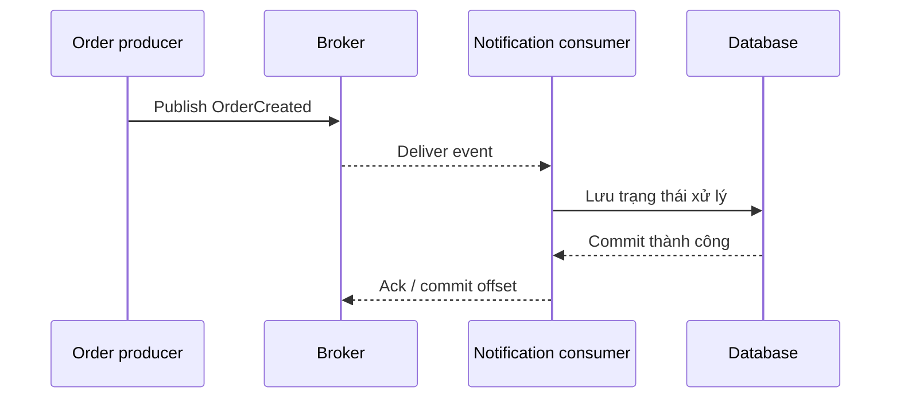
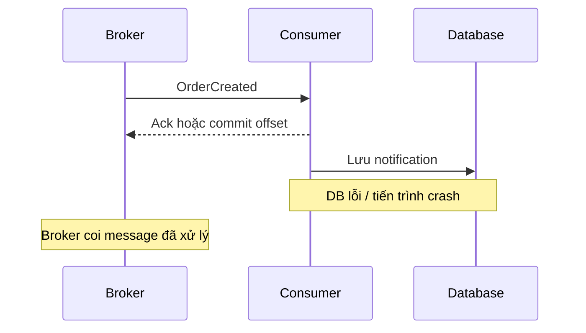
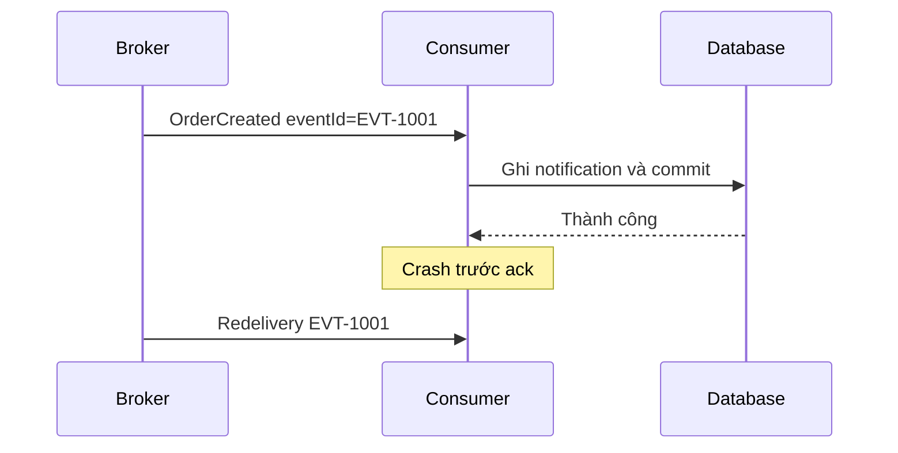
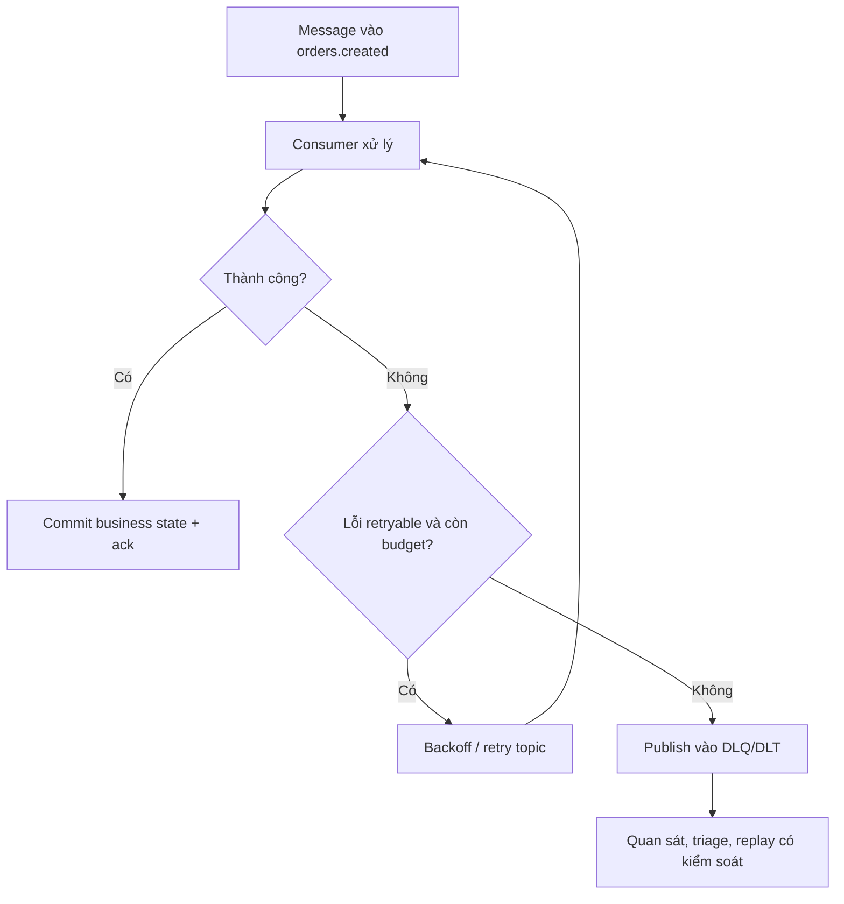
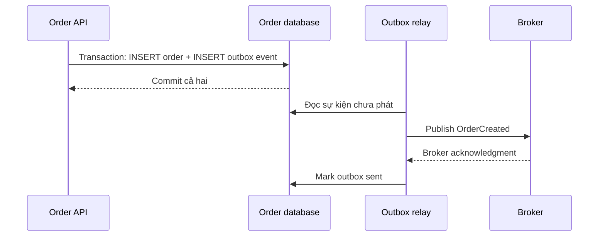
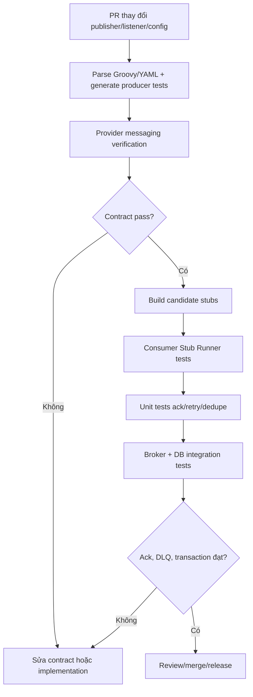

# Khi cần bổ sung kiểm thử ack, retry, DLQ và giao dịch trong Spring Cloud Contract

Trong hệ thống hướng sự kiện, một thông điệp có **đúng cấu trúc** vẫn có thể dẫn tới kết quả sai: consumer nhận sự kiện nhưng không ghi được dữ liệu, broker chuyển lại thông điệp khiến một đơn hàng bị xử lý hai lần, sự kiện lỗi mãi không vào dead-letter queue (DLQ), hoặc giao dịch database đã commit nhưng message chưa được phát. Những lỗi này xuất hiện **sau hoặc xung quanh** bước gửi/nhận message, không chỉ trong payload.

**Spring Cloud Contract (SCC)** hỗ trợ khai báo hợp đồng giữa **producer** và **consumer** bằng Groovy/YAML DSL, tạo **provider verification tests** và phát hành stubs để dùng với **Stub Runner**. Với messaging, contract thường bảo vệ **destination, headers, payload và hành vi phát message trong một tình huống**. Nhưng contract không tự kiểm chứng toàn bộ **cơ chế xác nhận (ack), thử lại (retry), chuyển thư lỗi (DLQ) và nhất quán giao dịch** của broker cùng ứng dụng.

Bài thuộc chương **Kiểm thử messaging** này giúp xác định **khi nào cần thêm các tầng kiểm thử ngoài message contract**, cách thiết kế case tái lập được và cách đưa chúng vào CI. Ví dụ sử dụng `order-producer` phát sự kiện `OrderCreated` và `notification-consumer` xử lý sự kiện để ghi trạng thái gửi thông báo.

## 1. Mục tiêu: biết chính xác điều gì đã được kiểm chứng

Sau bài học, bạn cần phân biệt được:

1. **Kiểm thử hợp đồng thông điệp**: xác minh schema, header, destination và payload theo một kịch bản.
2. **Ack/nack**: xác minh lúc nào consumer báo broker đã xử lý thành công, thất bại hoặc muốn nhận lại.
3. **Retry/redelivery**: xác minh số lần, delay, phân loại lỗi và điều kiện dừng.
4. **DLQ/DLT**: xác minh message không xử lý được được chuyển đến kênh lỗi có thông tin chẩn đoán và không tự tạo vòng lặp vô hạn.
5. **Idempotency**: xác minh xử lý lại cùng một sự kiện không tạo tác dụng phụ trùng lặp.
6. **Giao dịch**: xác minh tính nhất quán giữa database, consumer offset/ack và việc phát sự kiện, kể cả khi tiến trình crash.
7. **Giới hạn công cụ**: biết lúc nào Stub Runner/test binder là đủ và lúc nào cần broker thật trong integration test.

**Tín hiệu then chốt:** nếu yêu cầu chứa những từ như **“sau khi commit”, “chỉ ack khi”, “thử lại ba lần”, “đưa DLQ”, “không gửi trùng”, “không mất sự kiện”**, một contract chỉ kiểm tra body/header thường **không đủ**.

## 2. Nhìn toàn bộ vòng đời của một message

Giả sử producer tạo đơn hàng và phát `OrderCreated`:



Sơ đồ trên là **đường thành công lý tưởng**. Thực tế, lỗi có thể xảy ra ở nhiều vị trí:

| Vị trí lỗi | Kịch bản | Rủi ro |
| --- | --- | --- |
| Trước publish | DB tạo đơn thành công nhưng tiến trình chết trước publish | Sự kiện bị mất |
| Sau publish, trước ghi nhận kết quả | Producer không biết broker đã nhận message hay chưa | Publish lại dẫn tới trùng |
| Trong consumer trước ghi DB | Consumer ném exception | Broker có thể giao lại hoặc message bị mất tùy ack policy |
| Sau ghi DB, trước ack | DB đã commit, consumer crash | Message giao lại và tác dụng phụ có thể lặp |
| Sau ack, trước commit DB | Consumer báo thành công quá sớm | Message có thể mất dù dữ liệu chưa lưu |
| Trong retry | Message độc hại luôn gây lỗi | Tắc partition/queue hoặc vòng lặp retry |
| Trong DLQ routing | Retry hết nhưng chuyển DLQ thất bại | Message không đến nơi xử lý lỗi |

Điều cần kiểm tra không chỉ là `body.eventId` hợp lệ mà còn là **tính đúng đắn của từng lần chuyển trạng thái** qua các thành phần.

### 2.1. Ba khái niệm không nên đồng nhất

- **Publish thành công**: producer hoặc client thư viện nhận được xác nhận phù hợp từ transport. Điều này chưa đồng nghĩa consumer đã xử lý.
- **Delivery thành công**: broker đã chuyển message tới consumer hoặc listener. Điều này chưa đồng nghĩa database đã commit.
- **Business processing thành công**: consumer đã hoàn tất tác dụng phụ cần thiết. Điều này chưa tự động đồng nghĩa broker đã nhận ack.

Một message contract có thể bảo vệ nội dung sự kiện được producer phát; **không nên lấy việc body đúng làm bằng chứng cả ba bước đã hoàn tất**.

## 3. Contract messaging kiểm tra được gì?

Một Groovy contract cơ bản:

```groovy
import org.springframework.cloud.contract.spec.Contract

Contract.make {
    description 'Tạo đơn hàng thành công thì phát OrderCreated v1'
    label 'order_created_v1'

    input {
        triggeredBy('publishOrderCreated()')
    }

    outputMessage {
        sentTo('orders.created')
        headers {
            messagingContentType(applicationJson())
            header('X-Event-Version', '1')
        }
        body(
            eventId: 'EVT-1001',
            eventType: 'OrderCreated',
            schemaVersion: 1,
            orderId: 'ORD-1001',
            totalMinor: 125000,
            currency: 'VND'
        )
    }
}
```

Hợp đồng này mô tả:

- `input.triggeredBy`: phương thức trong provider test base kích hoạt producer phát message.
- `outputMessage.sentTo`: destination logic mà contract kỳ vọng.
- `outputMessage.headers`: những header message consumer phụ thuộc.
- `outputMessage.body`: dữ liệu mẫu và ràng buộc về sự kiện.
- `label`: tên dùng để consumer kích hoạt stub bằng `StubTrigger`.

Ví dụ tương ứng bằng YAML:

```yaml
description: "Tạo đơn hàng thành công thì phát OrderCreated v1"
label: order_created_v1
input:
  triggeredBy: publishOrderCreated()
outputMessage:
  sentTo: orders.created
  headers:
    contentType: application/json
    X-Event-Version: "1"
  body:
    eventId: EVT-1001
    eventType: OrderCreated
    schemaVersion: 1
    orderId: ORD-1001
    totalMinor: 125000
    currency: VND
```

Hai tệp là **hai cách biểu diễn cùng kịch bản**, không nên cùng được build quét khi chúng trùng hành vi. Với SCC bản cụ thể, cần xác minh cú pháp, adapter messaging và generated test thực tế trước khi coi các ví dụ là cấu hình hoàn chỉnh.

### 3.1. Contract đủ để kiểm tra cấu trúc nhưng chưa đủ cho delivery semantics

| Yêu cầu | Message contract thông thường | Cần thêm gì? |
| --- | --- | --- |
| Payload có `eventType: OrderCreated` | Có | Provider verification |
| Header `X-Event-Version` đúng | Có | Provider verification với message adapter phù hợp |
| Message gửi tới `orders.created` | Có, theo destination do adapter quan sát | Test broker nếu routing vật lý quan trọng |
| Consumer parse được sự kiện mẫu | Có thể dùng Stub Runner | Assertion của listener consumer |
| Consumer chỉ ack sau khi DB commit | Không | Integration test ack/commit |
| Lỗi tạm thời được redeliver | Không | Broker/listener retry test |
| Lỗi vĩnh viễn được đưa DLQ sau giới hạn | Không | DLQ integration test |
| Cùng `eventId` không tạo tác dụng phụ hai lần | Không | Idempotency test |
| DB commit và publish event không bị lệch | Không | Outbox/transaction integration test |
| Exactly-once end-to-end | Không | Thiết kế bảo đảm nhất quán cùng test theo scope cụ thể |

**Một mẫu message là một cam kết về dữ liệu, không phải một kịch bản thời gian đầy đủ.**

## 4. Khi nào cần bổ sung test ack hoặc nack?

**Ack** là hành động consumer xác nhận message đã được xử lý theo quy tắc của transport. **Nack**, requeue, reject hoặc không commit offset có ý nghĩa khác nhau tùy broker, listener container và chính sách retry.

Một số ví dụ:

| Hệ sinh thái | Cơ chế thường gặp | Điều cần xác minh |
| --- | --- | --- |
| RabbitMQ (AMQP) | `basicAck`, `basicNack`, `basicReject`; requeue hoặc DLX | Ack đúng delivery tag; requeue hay dead-letter đúng ý |
| Apache Kafka | Commit consumer offsets, manual acknowledgment trong Spring Kafka | Offset chỉ được commit đúng thời điểm; retry/DLT không bị hiểu sai |
| JMS | Client acknowledgment, transaction hoặc listener-container-managed ack | Session/transaction có được xác nhận sau xử lý thành công không |
| Cloud queues như SQS | Delete message/visibility timeout/redrive | Message có được xóa sau thành công, được nhìn thấy lại sau lỗi không |

Không tồn tại một API `ack()` thống nhất cho tất cả broker. Không sao chép code nack của RabbitMQ sang Kafka; **Kafka không có cùng giao thức ack/requeue như AMQP**.

### 4.1. Khi ack quá sớm



Khi ack/commit xảy ra trước tác dụng phụ nghiệp vụ, message có thể bị **mất về mặt xử lý** nếu DB thất bại sau đó. Một test đúng phải gây lỗi ở thời điểm này và xác nhận kết quả redelivery/khả năng phục hồi theo thiết kế.

### 4.2. Khi ack sau commit



Ghi DB trước ack giảm nguy cơ mất công việc, nhưng mở cửa cho **xử lý trùng** khi crash xảy ra giữa commit và ack. Vì vậy với delivery **at-least-once**, cần thiết kế consumer **idempotent**, không chỉ đặt ack sau DB commit.

**Kết luận quan trọng:** thay đổi vị trí ack không tự biến toàn bộ workflow thành exactly-once.

## 5. Kiểm thử ack ở listener Spring: cần quan sát được gì?

Ví dụ Spring Kafka với **manual acknowledgment**. Đoạn sau giả định container factory `manualAckKafkaListenerContainerFactory` đã được cấu hình ở chế độ manual ack phù hợp với phiên bản Spring Kafka:

```java
import org.springframework.kafka.annotation.KafkaListener;
import org.springframework.kafka.support.Acknowledgment;
import org.springframework.stereotype.Component;

@Component
public class OrderCreatedListener {

    private final NotificationHandler handler;

    public OrderCreatedListener(NotificationHandler handler) {
        this.handler = handler;
    }

    @KafkaListener(
        topics = "orders.created",
        containerFactory = "manualAckKafkaListenerContainerFactory"
    )
    public void receive(String payload, Acknowledgment acknowledgment) {
        handler.handle(payload);
        acknowledgment.acknowledge();
    }
}
```

`NotificationHandler` là service do ứng dụng định nghĩa. Ví dụ đặt lời gọi acknowledgment **sau** `handler.handle`. Tuy nhiên, nếu `handler.handle` dùng transaction bất đồng bộ hoặc chỉ xếp lịch công việc rồi trả về, thứ tự hai dòng **chưa chứng minh** business processing đã commit. Cần chắc chắn method chỉ trả khi nghĩa vụ giao dịch cần thiết đã hoàn tất.

Không nên coi đoạn code trên là bảo đảm broker commit ngay lập tức. Thời điểm offset được ghi thực tế phụ thuộc ack mode, transaction, listener container và cấu hình consumer.

### 5.1. Ma trận test ack tối thiểu

| Tình huống | Kết quả cần xác minh |
| --- | --- |
| Handler thành công và commit DB | Message được acknowledge/offset được tiến theo chính sách |
| Handler ném lỗi trước ghi DB | Không đánh dấu xử lý thành công; áp dụng retry/error handler |
| Handler ghi DB xong rồi process crash trước ack | Message có thể giao lại; dedupe bảo vệ tác dụng phụ |
| Handler chặn quá lâu | Timeout/rebalance/visibility được xử lý theo thiết kế |
| Message không giải mã được | Không mắc kẹt vĩnh viễn; có đường xử lý lỗi/DLQ rõ |
| Consumer restart | Trạng thái offset/delivery tiếp tục đúng như cấu hình |

Ở mức unit test, có thể dùng fake acknowledgment để kiểm tra listener gọi hay không gọi `acknowledge()` khi handler thành công/lỗi. Nhưng unit test ấy **không chứng minh broker đã commit offset đúng**: để kiểm tra thật, cần integration test với Kafka broker hoặc transport đại diện.

### 5.2. Ví dụ test đơn vị cho thứ tự ack

Mã sau dùng các test double để kiểm tra nhánh xử lý ở level listener. Giả định `NotificationHandler` là một interface trong ứng dụng và có mock tương ứng:

```java
import static org.junit.jupiter.api.Assertions.assertThrows;
import static org.mockito.Mockito.*;

import org.junit.jupiter.api.Test;
import org.springframework.kafka.support.Acknowledgment;

class OrderCreatedListenerTest {

    @Test
    void acknowledgesOnlyAfterHandlerSuccess() {
        NotificationHandler handler = mock(NotificationHandler.class);
        Acknowledgment acknowledgment = mock(Acknowledgment.class);
        OrderCreatedListener listener = new OrderCreatedListener(handler);

        listener.receive("{\"eventId\":\"EVT-1001\"}", acknowledgment);

        var inOrder = inOrder(handler, acknowledgment);
        inOrder.verify(handler).handle(anyString());
        inOrder.verify(acknowledgment).acknowledge();
    }

    @Test
    void doesNotAcknowledgeWhenHandlerFails() {
        NotificationHandler handler = mock(NotificationHandler.class);
        Acknowledgment acknowledgment = mock(Acknowledgment.class);
        doThrow(new IllegalStateException("db unavailable"))
            .when(handler).handle(anyString());

        OrderCreatedListener listener = new OrderCreatedListener(handler);

        assertThrows(IllegalStateException.class,
            () -> listener.receive("{}", acknowledgment));

        verify(acknowledgment, never()).acknowledge();
    }
}
```

Đây là **test nhánh chương trình**, không phải mô phỏng đầy đủ xử lý lỗi của Spring Kafka container. Lỗi trong `@KafkaListener` có thể còn bị error handler của container bắt, retry hoặc chuyển DLT. Cần test cấp container/broker cho các kết luận đó.

## 6. Khi nào cần bổ sung test retry hoặc redelivery?

Retry trở nên bắt buộc kiểm chứng khi có **lỗi tạm thời** (database mất kết nối, HTTP downstream 503, broker chưa sẵn sàng) hoặc yêu cầu chuyển sang đường xử lý khác sau một số lần thất bại.

Hai dạng chính:

1. **Blocking retry:** listener/container giữ message hoặc worker chờ rồi thử lại trước khi tiếp tục xử lý.
2. **Non-blocking retry:** chuyển message sang retry topic/queue, xử lý lại sau, có thể hỗ trợ delay hoặc scheduled delivery tùy broker/framework.

Không mặc định mọi hệ thống dùng đúng hai dạng trên hoặc mọi API của framework đều xử lý giống nhau. Điều cần kiểm chứng là **hành vi quan sát được**: số lần xử lý, thời gian/delay trong phạm vi cho phép, điều kiện dừng và tác dụng phụ.

### 6.1. Retry cần phân biệt lỗi

| Lỗi | Ví dụ | Chính sách thường hợp lý |
| --- | --- | --- |
| Lỗi mạng/downstream tạm thời | Timeout, 503 của phụ thuộc | Retry hữu hạn với backoff |
| Database deadlock có thể phục hồi | Transaction conflict nhất thời | Retry có điều kiện và idempotency |
| Payload JSON sai cấu trúc | Không parse được JSON | Thường không retry mãi; chuyển DLQ và điều tra |
| Schema version không hỗ trợ | Event v3, consumer chỉ biết v1 | Nên phân loại non-retryable |
| Thiếu field bắt buộc | `orderId` không có | DLQ hoặc xử lý lỗi theo policy |
| Lỗi nghiệp vụ vĩnh viễn | Đơn bị từ chối | Không lặp mãi cùng input |
| Broker rebalance/restart | Consumer bị ngắt giữa chừng | Phục hồi theo offset, kiểm tra idempotency |

Một contract kiểm tra schema có thể giúp giảm lỗi payload, nhưng **không mô phỏng được hết các lỗi runtime** hoặc chính sách retry của listener.

### 6.2. Attempts, backoff và deadline

Ví dụ một chính sách **ba attempts tổng cộng**, gồm lần đầu và tối đa hai lần retry:

```text
Attempt 1: xử lý ngay -> lỗi tạm thời
Delay 1: 200 ms
Attempt 2: xử lý lại -> lỗi tạm thời
Delay 2: 400 ms
Attempt 3: xử lý lại -> lỗi
Hết giới hạn -> chuyển DLQ hoặc lỗi cuối theo policy
```

Công thức exponential backoff minh họa:

```text
delay_n = min(initialDelay * 2^(n-1), maxDelay)
```

Với jitter, delay có thể biến động trong khoảng cho phép để tránh hàng nghìn consumer cùng thử lại đồng loạt. Khi test, **inject clock/scheduler** hoặc dùng virtual time nếu framework hỗ trợ; không nên đo toàn bộ delay bằng `Thread.sleep` dài khiến CI chậm và flaky.

Phải thống nhất rõ **“max attempts = 3” nghĩa là tổng ba lần hay ba lần retry sau lần đầu**. Tên config có thể khác nhau giữa Kafka/Rabbit/listener framework; assertions phải dựa trên contract vận hành đã quyết định, không suy từ tên biến.

### 6.3. Kiểm thử retry bằng điều khiển lỗi

Một test integration có thể sắp đặt handler trả kết quả:

```text
EventId = EVT-1001
Lần 1 -> lỗi transient
Lần 2 -> lỗi transient
Lần 3 -> thành công

Assertions:
- Handler được gọi đúng 3 lần theo policy.
- Sau thành công, không tiếp tục retry.
- Tác dụng phụ nghiệp vụ chỉ được ghi 1 lần.
- Không gửi message đến DLQ.
- Ack/offset sau xử lý cuối cùng phù hợp chính sách.
```

Đối với message lỗi vĩnh viễn:

```text
Lần 1 -> IllegalArgumentException: invalid schema
Expected:
- Không retry hoặc chỉ retry theo policy đã công bố.
- Không ghi tác dụng phụ.
- Message được chuyển DLQ hoặc error channel.
- Ghi nhận nguyên nhân lỗi phù hợp, không rò dữ liệu nhạy cảm.
```

**Đừng chỉ đếm lần handler được gọi.** Kiểm tra đồng thời số bản ghi DB, sự kiện phụ phát sinh, offset/ack và DLQ, vì nhiều lần handler có thể tạo tác dụng phụ sai ngay cả khi policy dừng đúng lúc.

## 7. DLQ/DLT là gì và khi nào phải test?

**Dead-letter queue (DLQ)** hoặc **dead-letter topic (DLT)** giữ những message mà luồng xử lý chính không thể hoàn tất theo chính sách. Một số broker chuyển message trực tiếp; framework khác dùng recoverer để publish lại tới một topic/queue mới.

Một luồng thường gặp:



Không phải broker nào cũng dùng chung thứ tự `publish DLQ → ack original`; đó là một quyết định quan trọng liên quan xác nhận và transaction. **Nếu DLQ publish lỗi mà original đã được đánh dấu thành công, message có thể mất**. Test phải bao phủ đường lỗi này nếu hệ thống yêu cầu không mất sự kiện.

### 7.1. Các yêu cầu DLQ cần viết thành test

| Yêu cầu | Assertion quan trọng |
| --- | --- |
| Chỉ chuyển DLQ sau khi hết budget | Số attempts và điều kiện phân loại lỗi |
| Routing đúng | Topic/queue DLQ được cấu hình chính xác |
| Giữ dữ liệu đủ để điều tra | Payload gốc hoặc payload an toàn, ID, nguyên nhân, timestamp, nguồn |
| Không làm mất trace context | Event ID/correlation ID được bảo toàn hoặc ánh xạ rõ |
| Không tạo vòng lặp vô hạn | Message ở DLQ không tự được gửi thẳng về nguồn liên tục |
| Không làm mất message khi publish DLQ thất bại | Kiểm tra retry/recovery và ack original có thứ tự an toàn |
| Có đường replay | Replay có kiểm soát, giới hạn, dedupe, audit |
| Không lộ dữ liệu nhạy cảm | Error message/log/DLQ không chứa secret hoặc PII không cần thiết |

**DLQ không phải nơi lưu vĩnh viễn tự động đảm bảo mọi thứ.** Retention, quyền truy cập, cảnh báo, triage, replay và chính sách xóa đều phải được vận hành riêng.

### 7.2. Đừng đồng nhất DLT và broker-native DLQ

- **Kafka:** thư lỗi thường được biểu diễn bằng **dead-letter topic** và consumer error handler/recoverer; topic này thường do ứng dụng/framework publish tới.
- **RabbitMQ:** dead-letter exchange (DLX) có thể định tuyến message bị reject/expire vượt giới hạn tới queue khác theo cấu hình broker.
- **SQS:** redrive policy dựa trên receive count/visibility timeout đưa message sang DLQ.

Các cơ chế trên khác nhau về thời điểm ack, header metadata, ordering và cách retry. **Test phải bám đúng broker và cấu hình hệ thống sử dụng.**

## 8. Một message contract cho dữ liệu lỗi có bảo vệ DLQ không?

Ta có thể viết contract cho **message do ứng dụng chủ động phát lên error topic**, nếu đây là sự kiện công khai của hệ thống.

Ví dụ:

```groovy
import org.springframework.cloud.contract.spec.Contract

Contract.make {
    description 'Phát sự kiện OrderProcessingFailed với thông tin lỗi'
    label 'order_processing_failed_v1'

    input {
        triggeredBy('publishOrderProcessingFailure()')
    }

    outputMessage {
        sentTo('orders.processing.failed')
        headers {
            messagingContentType(applicationJson())
        }
        body(
            eventId: 'EVT-1001',
            originalEventType: 'OrderCreated',
            errorCode: 'NOTIFICATION_DELIVERY_FAILED',
            retryExhausted: true
        )
    }
}
```

Contract này bảo vệ **schema và destination của một thông điệp lỗi do ứng dụng phát**. Nó **không chứng minh** một message bị lỗi từ `orders.created` đã đi qua đúng hai lần retry, được broker chuyển vào native DLQ, hoặc consumer đã ack original đúng thời điểm.

Đặc biệt, nếu DLQ do broker tự xử lý (không phải ứng dụng chủ động publish), cần **integration test broker** để quan sát routing thật. Không nhầm một contract cho business event `OrderProcessingFailed` với cấu hình DLX/DLT của middleware.

### 8.1. Những metadata hữu ích khi triage

Một dead-letter record có thể cần:

```json
{
  "eventId": "EVT-1001",
  "sourceDestination": "orders.created",
  "failureCategory": "NON_RETRYABLE",
  "attempts": 3,
  "occurredAt": "2026-11-24T03:15:30.123Z"
}
```

Đây là **schema minh họa do ứng dụng có thể lựa chọn**, không phải định dạng DLQ chuẩn của Kafka/RabbitMQ/SQS. Ở broker thực, metadata có thể là header/attribute thay vì JSON body. Nếu consumer của DLQ phụ thuộc vào các trường này, nên mô tả bằng contract riêng và kiểm thử tương thích.

Tránh ghi toàn bộ stack trace, credentials, dữ liệu cá nhân hoặc payload nguyên vẹn khi chính sách bảo mật không cho phép; chọn trường chẩn đoán tối thiểu.

## 9. Giao dịch: tại sao “DB commit và publish” khó bảo đảm?

Một lỗi phổ biến ở producer:

```java
public void createOrder(CreateOrderRequest request) {
    orderRepository.save(toEntity(request));
    eventPublisher.publishOrderCreated(request);
}
```

Ngay cả khi method có `@Transactional` cho database, việc publish tới broker thường thuộc **một hệ thống giao dịch riêng**. Có thể xảy ra:

1. DB commit nhưng publish thất bại → **mất sự kiện**.
2. Publish thành công rồi DB rollback → consumer thấy event cho đơn không tồn tại.
3. Publish thành công nhưng producer không nhận được ack → publish lại có thể tạo **event trùng**.

Gắn `@Transactional` vào method **không tự tạo transaction nguyên tử giữa JDBC và Kafka/RabbitMQ**. Cần hiểu transaction manager, kết nối, propagation và các giới hạn của broker/client thực tế.

### 9.1. Transactional outbox

Một cách phổ biến để tránh khoảng trống giữa **ghi dữ liệu và ghi ý định phát sự kiện** là **transactional outbox**:



Hai bản ghi `order` và `outbox event` được ghi **trong cùng transaction database**, giảm rủi ro “order đã commit nhưng không có dấu vết phải publish”. Tuy nhiên relay có thể crash **sau publish, trước mark sent**, nên broker có thể nhận **cùng event nhiều lần**. Vì vậy outbox thường đi kèm **consumer idempotency**.

### 9.2. Test outbox cần bao phủ điểm crash

| Điểm lỗi | Kết quả đúng mong đợi |
| --- | --- |
| DB transaction rollback | Không có order mới, không có outbox record tương ứng |
| DB transaction commit | Cả order và outbox event được lưu |
| Broker tạm thời không sẵn sàng | Outbox record còn lại để retry publish |
| Relay crash trước publish | Event chưa mất, relay khác có thể tiếp tục |
| Relay crash sau publish trước mark sent | Có thể publish lặp; eventId giữ ổn định để dedupe |
| Consumer nhận event trùng | Không tạo notification/billing side effect trùng |
| Outbox event bị poison | Có retry/alert/triage, không vô hạn im lặng |

Một producer message contract chỉ kiểm tra **event payload được publish trong một kịch bản**, không tự kiểm tra **tính nguyên tử của hai bản ghi DB** hay khả năng phục hồi relay sau crash.

## 10. Giao dịch ở consumer: ack và DB không dễ thành một bước

Ở consumer, các thao tác thường là:

```text
1. Nhận OrderCreated từ broker
2. Kiểm tra eventId đã xử lý hay chưa
3. Ghi notification và processed-event marker
4. Commit database
5. Ack message / commit offset
```

Nếu bước 4 đã thành công nhưng bước 5 thất bại, message có thể tới lần nữa. Không được hy vọng “chỉ nhận một lần” để bảo vệ tính đúng đắn.

### 10.1. Idempotent consumer với khóa sự kiện

Một chiến lược:

- Mỗi message có `eventId` ổn định qua mọi lần redelivery.
- Database có **unique constraint** theo `consumerName + eventId` hoặc khóa nghiệp vụ tương đương.
- Trong cùng transaction, consumer ghi marker đã xử lý và side effect nghiệp vụ.
- Khi nhận lại `eventId`, consumer phát hiện duplicate và không tạo side effect mới.
- Sau khi xác nhận trạng thái DB theo thiết kế, consumer có thể ack message.

Mô hình logic:

```sql
-- Pseudocode schema: cú pháp cụ thể tùy database.
CREATE TABLE processed_message (
    consumer_name VARCHAR(100) NOT NULL,
    event_id VARCHAR(100) NOT NULL,
    processed_at TIMESTAMP NOT NULL,
    PRIMARY KEY (consumer_name, event_id)
);
```

Quan trọng: **check-then-insert** tách rời mà không có unique constraint/transaction vẫn dễ gặp race condition khi hai worker nhận cùng event. Idempotency không chỉ là `if (exists) return`; phải có kiểm soát cạnh tranh ở tầng lưu trữ hoặc cơ chế tương đương.

### 10.2. Test consumer idempotency

```text
Given: cùng message eventId = EVT-1001
When: consumer nhận 2 lần (kể cả đồng thời nếu hỗ trợ)
Then:
- processed-message marker tồn tại 1 bản ghi cho consumer này
- notification được tạo đúng 1 lần
- không phát hai email/tác dụng phụ không đảo ngược
- mỗi lần delivery kết thúc theo chính sách ack
```

Nếu side effect là gọi dịch vụ bên ngoài (gửi email, trừ tiền), transaction trong database **không tự rollback được** thao tác bên ngoài. Cần thiết kế idempotency key ở dịch vụ downstream, outbox cho side effect hoặc quy trình phục hồi riêng. Test phải bao phủ đúng hành vi mà hệ thống cam kết.

## 11. Exactly-once: phải định nghĩa phạm vi trước khi kiểm chứng

Một số nền tảng hỗ trợ “exactly-once processing” trong **phạm vi hẹp**. Ví dụ Kafka transactions có thể phối hợp tiêu thụ và phát message trong Kafka theo cấu hình phù hợp. Nhưng từ đó **không thể suy ra** một giao dịch ghi vào database bất kỳ hoặc gọi HTTP bên ngoài cũng exactly-once.

| Mức đảm bảo | Đặc điểm | Điều phải test |
| --- | --- | --- |
| At-most-once | Cố tránh lặp, nhưng có thể mất message khi lỗi | Không xử lý trùng; đánh giá rủi ro mất |
| At-least-once | Cố tránh mất, nhưng message có thể giao lại | Dedupe/idempotency hoạt động |
| Exactly-once trong phạm vi broker/stream | Có cơ chế transaction/offset theo platform | Phạm vi bảo đảm, crash/rebalance, producer settings |
| Exactly-once business side effect | Mỗi nghĩa vụ nghiệp vụ xảy ra một lần dù redelivery | Thiết kế idempotent giao dịch và kiểm thử crash windows |

Không nên ghi `exactlyOnce: true` trong tài liệu rồi coi đó là một thuộc tính mặc nhiên của Spring Cloud Contract. SCC không phải engine quản lý semantics giao dịch của Kafka/Rabbit/database.

### 11.1. Kịch bản test lỗi đúng vị trí

Chèn fault ở những ranh giới:

1. Trước database commit.
2. Sau database commit nhưng trước ack/offset commit.
3. Trước broker publish.
4. Sau broker publish nhưng trước producer nhận acknowledgment.
5. Khi chuyển DLQ thất bại.
6. Khi consumer restart/rebalance.

Mỗi fault phải có assertion về **dữ liệu, số lần side effect, trạng thái message và recovery**, chứ không chỉ mong test không ném exception.

## 12. Viết kiểm thử bổ sung theo từng tầng

Một chương trình kiểm thử có thể chia thành bốn tầng:

### 12.1. Tầng A — Contract: schema và destination

Dùng Groovy/YAML DSL để kiểm tra producer phát message có:

- `eventType`, `schemaVersion`, `orderId`, `eventId`.
- Headers như `contentType`, correlation ID nếu consumer cần.
- Destination `orders.created`.
- Các matcher cho giá trị động theo quy tắc.

Generated provider tests chạy với test binder/message verifier phù hợp. Consumer dùng Stub Runner để phát sự kiện mẫu và assert listener xử lý được **hợp đồng dữ liệu**.

### 12.2. Tầng B — Unit tests: policy và listener branches

Mock repository/service/acknowledgment để kiểm tra:

- Handler thành công thì mới gọi ack.
- Handler thất bại không được đánh dấu xử lý thành công.
- Lỗi retryable và non-retryable được phân loại đúng.
- Retry budget được đếm đúng (kể cả lần đầu).
- Idempotency logic trả kết quả hợp lý trước khi truy cập broker.

Những bài test này nhanh và có thể chạy nhiều giá trị biên, nhưng **không chứng minh hành vi broker thật**.

### 12.3. Tầng C — Integration với broker và database

Dùng **broker thật trong test environment** (ví dụ Kafka hoặc RabbitMQ qua Testcontainers), database test phù hợp và listener container chạy cấu hình đại diện. Kiểm tra:

- Đưa message thật vào queue/topic.
- Chờ listener xử lý rồi quan sát DB.
- Gây lỗi dependency để kiểm tra redelivery/retry.
- Xác minh DLQ/DLT có message sau khi hết attempts.
- Restart consumer hoặc broker trong các test fault có kiểm soát.
- Dùng eventId trùng để kiểm tra unique constraint/idempotency.
- Đọc message headers thực tế sau serialize/deserialze.

Không cần chạy broker production để làm integration test, nhưng phải dùng **loại broker và cấu hình quan trọng tương thích** với hệ thống đang sử dụng.

### 12.4. Tầng D — End-to-end và vận hành

Khi rủi ro lớn, test qua hệ thống gần thực:

- IAM/ACL, partition, retention, routing, networking.
- DLQ replay, alert và dashboard.
- Broker failover, consumer rebalance và disaster recovery.
- Quan sát lag/queue depth và số lần retry.

Loại test này thường chậm, cần tài nguyên và kiểm soát môi trường; không nhất thiết chạy mọi trường hợp trên từng commit. Hãy chọn những kịch bản có giá trị cao cho CI định kỳ hoặc trước release.

## 13. Ví dụ khung integration test broker

Để tránh gắn bài học vào một phiên bản framework cụ thể, dưới đây là **pseudocode** cho kịch bản at-least-once và DLQ. Cần thay các thao tác bằng API thực của Kafka/Rabbit/Testcontainers:

```text
setup:
  startBrokerContainer()
  startDatabaseContainer()
  startConsumerWithProductionLikeRetrySettings()
  clearTopicOrQueueState()

test "transient failure then success":
  setNotificationRepositoryToFail(times = 2)
  publish("orders.created", eventId = "EVT-1001")
  awaitUntil(notificationCount("EVT-1001") == 1)
  assert handlerAttemptCount("EVT-1001") == 3
  assert dlqCount("EVT-1001") == 0
  assert processedMarkerCount("EVT-1001") == 1

test "permanent failure to DLQ":
  setHandlerToReject("UNSUPPORTED_SCHEMA")
  publish("orders.created", eventId = "EVT-1002")
  awaitUntil(dlqContains("EVT-1002"))
  assert notificationCount("EVT-1002") == 0
  assert retryCountWithinPolicy("EVT-1002")
  assert originalMessageNotStuck()

test "duplicate after commit before ack":
  publish("orders.created", eventId = "EVT-1003")
  injectCrashAfterDatabaseCommitBeforeAck()
  restartConsumer()
  awaitUntil(processedMarkerCount("EVT-1003") == 1)
  assert notificationCount("EVT-1003") == 1
```

Các hàm như `startBrokerContainer()`, `awaitUntil` và `injectCrashAfterDatabaseCommitBeforeAck()` là **tên minh họa**, không phải API có sẵn của SCC. Test cần tự xây fixture và cơ chế fault injection.

### 13.1. Chờ kết quả đúng cách

Message handler thường bất đồng bộ, nên test không được assert DB ngay sau khi publish rồi kết luận lỗi chỉ vì consumer chưa xử lý kịp.

Ưu tiên:

- **Awaitility** hoặc cơ chế await có deadline hữu hạn cho trạng thái quan sát được.
- Định danh `eventId` duy nhất cho mỗi test.
- Cleanup dữ liệu/topic hoặc tạo namespace riêng để tránh bắt message của test trước.
- Không dùng `Thread.sleep` dài làm chiến lược đồng bộ chính.
- Không chỉ assert “eventually has a record”; còn phải assert **không có bản ghi trùng** và không có DLQ sai.

Với retry delay, có thể dùng clock/scheduler giả cho unit test policy; integration test broker nên kiểm tra **khoảng delay/điều kiện dừng phù hợp** thay vì so sánh chính xác từng mili giây.

## 14. Contract + Stub Runner hỗ trợ gì trong kiểm thử listener?

Ở consumer, có thể dùng Stub Runner để kích hoạt message mẫu đã được đóng gói:

```java
import org.springframework.beans.factory.annotation.Autowired;
import org.springframework.cloud.contract.stubrunner.StubTrigger;

class NotificationConsumerContractTest {

    @Autowired
    private StubTrigger trigger;

    void publishExample() {
        trigger.trigger("order_created_v1");
    }
}
```

Đây là đoạn minh họa **cách gọi trigger**; để có test thật cần `@AutoConfigureStubRunner`, binder/transport test phù hợp, listener consumer và assertion về kết quả sau khi nhận. Tọa độ stub artifact phải đúng version producer candidate.

### 14.1. Một consumer test có thể chứng minh

- Listener được kết nối đúng destination test.
- DTO/deserializer hiểu payload mẫu.
- Consumer sử dụng `eventId`, `orderId`, `totalMinor` đúng kiểu.
- Trạng thái notification được tạo với giá trị theo contract.
- Một số nhánh xử lý lỗi có thể mô phỏng bằng fake dependency.

### 14.2. Nó chưa tự chứng minh

- Broker thực sẽ redeliver message với độ trễ đúng.
- Ack/offset đã commit ở thời điểm đúng.
- DLQ routing, TTL, retention và headers broker-native đúng.
- Database commit và broker publish có tính nguyên tử.
- Consumer không tạo duplicate sau crash và restart.
- Message ordering, partitioning hoặc rebalance đúng.

**Stub Runner không thay thế integration test broker**; nó tập trung vào giao diện producer/consumer, giảm nhu cầu khởi động producer thật trong consumer tests.

## 15. Bảo vệ transaction/outbox bằng test riêng

Ví dụ pseudo-code của producer dùng transactional outbox:

```java
// Pseudocode Java/Spring: Repository và entity do dự án định nghĩa.
@Transactional
public OrderId createOrder(CreateOrderCommand command) {
    Order order = orders.save(Order.from(command));

    OutboxEvent event = OutboxEvent.orderCreated(
        stableEventIdFor(order),
        order.id()
    );
    outbox.save(event);

    return order.id();
}
```

Phương thức ghi order và outbox vào cùng database transaction, **không publish message trực tiếp trong đoạn này**. Relay xử lý phần publish sau commit:

```text
Relay scan pending outbox
  -> publish eventId=EVT-1001
  -> receive broker acknowledgement
  -> mark event as sent
```

Test cần chứng minh:

| Test | Assertion |
| --- | --- |
| Transaction rollback | Cả order và outbox event đều không tồn tại |
| Transaction commit | Cả order và outbox event cùng xuất hiện |
| Publish bị timeout | Outbox chưa bị đánh dấu xong sớm |
| Relay crash sau publish | Publish lại cùng eventId; consumer dedupe |
| Nhiều relay xử lý đồng thời | Claim/locking tránh publish không kiểm soát |
| DLQ/outbox poison event | Có giới hạn retry, alert và triage |
| Replay sau sự cố | Không tạo side effect trùng ngoài cam kết |

**Outbox không tự loại bỏ mọi bản sao sự kiện.** Nó làm cho yêu cầu “có sự kiện cần phát” gắn với transaction database, nhưng relay/broker vẫn có các điểm lỗi dẫn đến phát lại. Consumer phải xử lý trùng an toàn.

## 16. Các lỗi thường gặp khi mở rộng message contract tests

| Hiểu nhầm | Vì sao sai? | Hướng xử lý |
| --- | --- | --- |
| “Contract pass nghĩa là ack đúng” | Contract chủ yếu kiểm tra message output/input | Test listener ack và broker commit |
| “Broker giao một lần nên không cần dedupe” | At-least-once có thể redeliver | Unique key/eventId và idempotency tests |
| “Gọi `StubTrigger` là đã test DLQ” | Stub phát message mẫu, không vận hành DLQ thật | Test broker redrive/DLT |
| “Đặt `@Transactional` là đủ cho DB và broker” | Hai resource thường có transaction boundary khác nhau | Outbox, transaction design và fault tests |
| “Retry 3 lần nghĩa là thêm ba lần sau lần đầu” | Dễ nhầm tổng attempts với retries | Ghi rõ quy ước và assert số lần |
| “Lỗi JSON không parse được nên retry liên tục” | Poison message không tự hồi phục | Phân loại non-retryable và DLQ |
| “DLQ có message là xong” | Replay, retention, observability vẫn cần | Test vận hành và quy trình triage |
| “Ack sau DB commit đảm bảo exactly-once” | Crash trước ack gây redelivery | Idempotent consumer |
| “Test binder giống broker thật” | Metadata, transactions, ack khác | Integration test đúng broker |
| “Message đúng schema nghĩa là đúng transaction” | Schema không nói lúc nào DB commit | Test outbox và rollback |
| “Retry đúng lần là đủ” | Side effect có thể trùng qua attempts | Assert DB/business side effects |
| “Một unit test đủ phát hiện rebalance/restart” | Không có runtime broker/offset | Test fault-injection/integration |
| “Một DLQ schema là native DLQ cho mọi broker” | Cơ chế Kafka/Rabbit/SQS khác | Chọn test theo adapter thực tế |

Cách debug khi test thất bại: xác định **đầu tiên** là contract/payload sai, listener logic sai, broker routing sai, retry policy sai hay transaction/idempotency sai; sau đó đi tới đúng tầng kiểm thử thay vì nới matcher để làm test xanh.

## 17. Thiết kế CI với các cổng kiểm thử có chủ đích

Một pipeline hợp lý:



Với Maven project đã cấu hình `spring-cloud-contract-maven-plugin` và message verifier:

```bash
mvn clean verify
```

Lệnh trên **không tự chạy** mọi loại test trong sơ đồ nếu chúng chưa được nối vào build/pipeline. Cần kiểm tra generated tests thực sự sinh và chạy, artifact candidate được phát hành đúng version, và broker integration không bị skip.

### 17.1. Bộ lỗi cố ý để kiểm tra độ tin cậy của CI

| Cố tình gây lỗi | Test phải phát hiện |
| --- | --- |
| Đổi `eventType: OrderCreated` thành `OrderCancelled` | Provider contract test |
| Bỏ `eventId` hoặc đổi kiểu | Contract/schema test |
| Consumer ack trước khi xử lý | Listener test; broker fault integration |
| Handler ném exception nhưng vẫn ack | Ack/error-handling test |
| Retry vượt giới hạn | Retry policy unit/integration test |
| Message không hợp lệ không bao giờ vào DLQ | Broker DLQ integration |
| DLQ publish thất bại nhưng original bị mất | Broker/error-recovery integration |
| Consumer nhận cùng `eventId` hai lần tạo hai notification | Idempotency integration |
| DB commit nhưng không có outbox event | Transaction rollback/commit test |
| Relay crash sau publish tạo duplicate effect | Outbox + consumer dedupe test |
| Consumer đổi schema nhưng dùng stub version cũ | CI artifact/version check |

**Không phải mọi test phải chạy trên mỗi PR ở cùng mức tài nguyên.** Unit test và provider/consumer contract tests thường có thể chạy liên tục; một số broker fault test chậm có thể chạy theo lịch hoặc trước phát hành. Nhưng các rủi ro quan trọng nhất phải có cổng phù hợp và kết quả được xem xét trước release.

### 17.2. Quan sát vận hành cũng là một phần bằng chứng

Những chỉ số có ích:

- Consumer lag/queue depth.
- Tỷ lệ retry và số attempts theo error category.
- Số message vào DLQ/DLT, tuổi message lâu nhất.
- Số duplicate event được phát hiện và bỏ qua.
- Outbox pending/backlog và thời gian từ commit đến publish.
- Lỗi deserialize, schema version chưa hỗ trợ.
- Số crash/rebalance và thời gian hồi phục listener.

Các chỉ số không thay thế test, nhưng giúp phát hiện hành vi xấu chỉ bộc lộ dưới tải hoặc topology thật.

## 18. Bài tập thực hành: xây bộ kiểm thử từ contract tới giao dịch

Chuẩn bị `order-producer` phát `OrderCreated`, `notification-consumer` xử lý event, một database và Kafka hoặc RabbitMQ test broker. Thực hiện:

1. **Contract:** Viết `order-created-v1.groovy` hoặc YAML tương đương với `label`, `sentTo`, `contentType`, `eventId`, `schemaVersion` và payload. Chạy generated producer test.
2. **Stub Runner:** Phát sự kiện mẫu bằng `StubTrigger` rồi assert listener consumer deserialize và lưu notification đúng.
3. **Ack success:** Cấu hình listener ack/commit theo chính sách, kiểm tra khi handler thành công.
4. **Ack failure:** Cho handler ném exception trước DB commit; xác nhận test unit không ack và broker integration có recovery đúng.
5. **Retry transient:** Gây lỗi hai lần đầu, thành công lần ba; kiểm tra attempts, side effect đúng một lần và không có DLQ.
6. **Poison message:** Gửi schema không hỗ trợ; xác nhận phân loại non-retryable và message được chuyển DLQ/DLT thay vì lặp vô hạn.
7. **DLQ routing:** Kiểm tra destination, payload/headers chẩn đoán, xử lý khi DLQ publish thất bại.
8. **Duplicate:** Gửi cùng `eventId` hai lần, rồi thử đồng thời; kiểm tra unique constraint/processed marker và không tạo side effect trùng.
9. **Outbox:** Tạo đơn và outbox record trong cùng DB transaction; kiểm tra rollback, publish retry và crash windows.
10. **Consumer restart:** Crash sau DB commit, trước ack; restart consumer rồi xác minh message có thể redeliver nhưng vẫn xử lý idempotent.
11. **Exactly-once scope:** Viết rõ phạm vi đảm bảo của giải pháp, nhất là khi có DB hoặc HTTP side effect ngoài broker.
12. **CI:** Đưa contract verification, candidate stubs, unit retry/ack tests và selected broker/DB integration vào pipeline. Thử tạo ít nhất ba lỗi để xác minh test phù hợp fail.

Bảng tự đánh giá:

| Năng lực | Minh chứng đạt |
| --- | --- |
| Hiểu phạm vi contract | Nêu rõ payload/header/destination khác ack/retry/transaction |
| Ack/nack | Có test thành công, lỗi và crash window |
| Retry | Assert attempts, backoff, điều kiện dừng và side effect |
| DLQ | Message lỗi tới đúng destination, không loop, có dữ liệu triage |
| Idempotency | Gửi lặp event không tạo tác dụng phụ trùng |
| Transaction/outbox | Commit/rollback và relay crash có kết quả xác định |
| Consumer Stub Runner | Listener xử lý được event mẫu từ candidate artifact |
| Broker integration | Dùng broker/adapter đại diện và xác minh delivery semantics |
| CI | Breaking change và lỗi recovery được phát hiện ở tầng phù hợp |

## 19. Tổng kết: chọn thêm bài test khi hành vi vượt một message

**Spring Cloud Contract rất hữu ích cho việc xác minh producer/consumer thống nhất về cấu trúc và nội dung thông điệp.** Nhưng nếu mục tiêu là **không mất message, không xử lý trùng, có retry hữu hạn, có DLQ và giao dịch nhất quán**, phải mở rộng chương trình kiểm thử vượt khỏi một message contract tĩnh.

Hãy dùng quy tắc quyết định ngắn gọn:

- **Thay đổi payload/header/destination?** → Provider verification và consumer tests với Stub Runner.
- **Thay đổi vị trí ack hoặc offset commit?** → Listener test và broker integration.
- **Thay đổi retry/backoff/recoverer?** → Policy test cùng redelivery integration.
- **Thay đổi DLQ/DLT routing hoặc replay?** → Broker DLQ tests, test triage và quan sát vận hành.
- **Thay đổi DB transaction hoặc publish order?** → Outbox/transaction fault tests và idempotency.
- **Tuyên bố exactly-once?** → Xác định phạm vi kỹ thuật và chứng minh bằng các test crash/replay tương ứng.

Kết hợp **Groovy/YAML DSL, generated provider tests, Stub Runner, broker/DB integration và CI** theo đúng rủi ro giúp phát hiện sớm thay đổi API không tương thích đồng thời bảo vệ điều quan trọng hơn: mỗi sự kiện được xử lý đúng nghiệp vụ, ngay cả khi hệ thống gặp sự cố.
