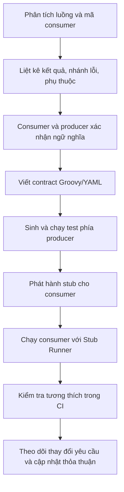

# Xác định nhu cầu thực tế của consumer trước khi viết hợp đồng

Trong **thiết kế hợp đồng** với **Spring Cloud Contract**, bước đầu tiên không phải là chọn cú pháp Groovy/YAML hay mô tả endpoint hiện có. Bước đầu tiên là xác định **consumer thực sự cần hành vi nào** để hoàn thành một luồng nghiệp vụ. Hợp đồng chỉ có giá trị khi nó mô tả đúng những gì consumer phụ thuộc vào và producer cam kết cung cấp.

Spring Cloud Contract hỗ trợ định nghĩa hành vi HTTP hoặc thông điệp, sinh kiểm thử ở phía producer, đóng gói stub để consumer chạy với Stub Runner và phát hiện thay đổi không tương thích trong CI. Tuy nhiên, các công cụ đó sẽ kiểm tra một **thỏa thuận đã được viết ra**; chúng không tự phát hiện liệu thỏa thuận có giải quyết đúng vấn đề của consumer hay không.

Sau bài học, bạn có thể:

- Phân biệt yêu cầu nghiệp vụ của consumer với danh sách trường và endpoint mà producer đang có.
- Thu thập bằng chứng từ luồng xử lý, mã gọi API và tình huống lỗi để xác định hành vi cần cam kết.
- Chuyển nhu cầu thành kịch bản có thể kiểm chứng, xác định ranh giới của hợp đồng.
- Chuẩn bị bộ tiêu chí đủ rõ để viết contract Groovy/YAML và kiểm thử bằng Spring Cloud Contract.

## 1. Consumer cần một kết quả nghiệp vụ, không chỉ một phản hồi HTTP

**Producer** là dịch vụ cung cấp khả năng; **consumer** là dịch vụ hoặc ứng dụng sử dụng khả năng đó. Một consumer có thể gọi nhiều API, nhưng không phải mọi dữ liệu producer trả về đều là phụ thuộc cần bảo vệ bằng hợp đồng.

Ví dụ, nhóm phát triển `OrderService` nói với nhóm `InventoryService`: “Chúng tôi cần API kiểm tra sản phẩm còn hàng”. Nếu lập tức tạo hợp đồng cho `GET /inventory/{sku}` trả về `availableQuantity`, hai nhóm có thể có một bản contract hợp lệ về mặt kỹ thuật nhưng sai về mặt nghiệp vụ.

Hỏi thêm về luồng đặt hàng sẽ làm lộ yêu cầu cốt lõi: khi khách nhấn **Đặt hàng**, `OrderService` cần **giữ hai đơn vị hàng trong một khoảng thời gian** để tránh hai đơn cùng sử dụng một lượng tồn kho. Việc đọc số lượng hiện tại không bảo đảm điều đó, vì tồn kho có thể thay đổi ngay sau phản hồi.

Từ khác biệt này, giải pháp cần được thảo luận có thể chuyển từ “đọc tồn kho” sang “tạo yêu cầu giữ hàng”. Đây là lý do phải làm rõ nhu cầu trước khi chốt đường dẫn, phương thức, trường dữ liệu hay mã trạng thái.

| Phát biểu ban đầu | Câu hỏi cần làm rõ | Nhu cầu thực tế có thể phát hiện |
| --- | --- | --- |
| “Cần biết còn hàng không” | Biết để hiển thị hay để xác nhận đơn? | Nếu xác nhận đơn, có thể cần giữ hàng nguyên tử |
| “Cần thông tin giá” | Giá hiển thị hay giá đã áp khuyến mãi khi thanh toán? | Cần tổng tiền và các quy tắc áp dụng tại thời điểm chốt đơn |
| “Cần trạng thái thanh toán” | Consumer xử lý thành công, thất bại và trạng thái chờ như thế nào? | Cần quy tắc chuyển trạng thái và sự kiện cập nhật |
| “Cần phản hồi nhanh” | Chậm bao lâu thì nghiệp vụ thất bại? Consumer có retry không? | Cần ngân sách thời gian, timeout và chính sách retry; một số yêu cầu nằm ngoài contract |

**Nguyên tắc:** chỉ cam kết những hành vi mà consumer phải dựa vào để hoạt động đúng; đừng sao chép toàn bộ mô hình nội bộ của producer thành hợp đồng.

## 2. Tìm nhu cầu từ bằng chứng và người chịu trách nhiệm

Nên gặp cả người phụ trách luồng nghiệp vụ và người trực tiếp viết consumer. Người hiểu quy trình giải thích **vì sao** cần dữ liệu; người triển khai chỉ ra **điểm nào trong mã thực sự phụ thuộc** vào phản hồi.

Nguồn thông tin hữu ích gồm:

1. **Luồng nghiệp vụ:** hành động nào kích hoạt lời gọi; kết quả thành công cho người dùng là gì; bước kế tiếp cần dữ liệu nào.
2. **Mã consumer:** HTTP client, DTO, các nhánh `if`, xử lý lỗi, timeout, retry và những trường đang được đọc thực tế. Mã hiện tại là bằng chứng về phụ thuộc, nhưng không tự động là yêu cầu đúng cho thiết kế mới.
3. **Trao đổi giữa hai nhóm:** ngữ nghĩa của từng trường, mã lỗi, quyền truy cập, điều kiện dữ liệu và điều gì producer thực sự có thể bảo đảm.
4. **Sự cố và vận hành:** các lỗi từng gây hỏng luồng, thay đổi API trước đây, dữ liệu bất thường và độ trễ thường gặp.
5. **Tài liệu nghiệp vụ:** chính sách giữ hàng, điều kiện hết hạn, quy tắc khuyến mãi, quyền của người gọi. Cần đối chiếu tài liệu với hành vi đang vận hành nếu chúng mâu thuẫn.

Với mỗi thông tin, ghi rõ **nguồn xác nhận** và **người quyết định**. Phân biệt điều đã được hai bên thống nhất với giả định còn phải kiểm chứng; giả định chưa xác nhận không nên xuất hiện như một bảo đảm trong contract.

### Bộ câu hỏi phỏng vấn consumer

| Nhóm câu hỏi | Điều cần tìm |
| --- | --- |
| Ngữ cảnh | Ai hoặc tác vụ nào gọi? Gọi ở thời điểm nào trong quy trình? |
| Đầu vào | Consumer biết sẵn định danh gì? Trường nào bắt buộc, đơn vị đo là gì? |
| Thành công | Consumer cần quyết định gì từ phản hồi? Trường nào được sử dụng ngay? |
| Lỗi nghiệp vụ | Khi hết hàng, hết hạn hoặc yêu cầu không hợp lệ, consumer sẽ làm gì? |
| Lỗi hệ thống | Nếu timeout, lỗi mạng hay `5xx`, consumer có retry? Có rủi ro tạo trùng giao dịch? |
| Trạng thái | API chỉ đọc dữ liệu hay tạo/cập nhật trạng thái? Có xử lý đồng thời không? |
| Tương thích | Consumer đang phát hành phiên bản nào? Trường hoặc hành vi nào không thể thay đổi đột ngột? |
| Phi chức năng | Xác thực, phân quyền, độ trễ, giới hạn tốc độ và quan sát vận hành cần xử lý ở lớp nào? |

Mục tiêu của cuộc trao đổi là tìm **nhánh xử lý có thể kiểm chứng**, không phải yêu cầu consumer liệt kê càng nhiều trường càng tốt.

## 3. Đi từ luồng nghiệp vụ đến một tập tình huống

Giả sử hai nhóm xác nhận ví dụ sau:

> Khi người mua xác nhận đơn `ORD-2048` gồm 2 sản phẩm `SKU-001` tại kho `WH-HCM-01`, `OrderService` gửi yêu cầu giữ hàng đến `InventoryService`. Nếu đủ hàng, producer tạo một lượt giữ hàng có định danh và thời điểm hết hạn; nếu không đủ hàng, consumer phải biết rằng không thể tiếp tục chốt đơn.

Đây là **ví dụ thiết kế để học**; đường dẫn và mã trạng thái dưới đây là phương án đề xuất, chỉ trở thành hợp đồng chính thức sau khi hai nhóm xác nhận.

### Xác định đầu vào và đầu ra

| Thông tin dự kiến | Consumer dùng để làm gì? | Điểm cần xác nhận |
| --- | --- | --- |
| `sku` (request) | Chọn mặt hàng cần giữ | Định dạng và khả năng tồn tại của SKU |
| `warehouseId` (request) | Chọn kho phục vụ đơn | Consumer có quyền chỉ định kho hay producer tự chọn? |
| `quantity` (request) | Số lượng cần giữ | Số nguyên dương; đơn vị và giới hạn tối đa |
| `Idempotency-Key` (header) | Retry an toàn sau timeout | Phạm vi, thời hạn và cách xử lý khi tái sử dụng khóa với nội dung khác |
| `reservationId` (response) | Tham chiếu khi xác nhận/hủy giữ hàng | Có duy nhất trong hệ thống không, sống đến khi nào? |
| `status` (response) | Biết kết quả giữ hàng | Các giá trị hợp lệ, ý nghĩa và chuyển trạng thái |
| `expiresAt` (response) | Quyết định thời hạn xử lý thanh toán | Chuẩn UTC/ISO 8601 và chính sách khi hết hạn |

Trường `availableQuantity` không được đưa vào chỉ vì producer sẵn có: nếu consumer chỉ cần biết giữ hàng thành công hay thất bại thì việc công khai tồn kho tức thời có thể tạo thêm một phụ thuộc không cần thiết.

### Viết kịch bản theo hành vi quan sát được

Có thể dùng cách diễn đạt **Given – When – Then** trước khi chọn Groovy hoặc YAML:

**Kịch bản A — giữ hàng thành công**

- **Given:** SKU tồn tại; kho có đủ hàng; `OrderService` được phép đặt giữ hàng.
- **When:** consumer gửi yêu cầu giữ 2 đơn vị với một khóa idempotency hợp lệ.
- **Then:** producer xác nhận đã giữ 2 đơn vị, trả `reservationId` và `expiresAt`; consumer có thể tiếp tục bước thanh toán.

**Kịch bản B — không đủ hàng**

- **Given:** kho chỉ còn 1 đơn vị có thể giữ.
- **When:** consumer yêu cầu giữ 2 đơn vị.
- **Then:** producer trả lỗi nghiệp vụ được thống nhất (ví dụ `409 Conflict` kèm mã `INSUFFICIENT_STOCK`); consumer thông báo không thể tiếp tục đơn và không giả định hàng đã được giữ.

**Kịch bản C — dữ liệu không hợp lệ**

- **Given:** consumer gửi `quantity = 0`.
- **When:** producer nhận yêu cầu.
- **Then:** producer trả phản hồi lỗi đầu vào đã thống nhất (ví dụ `400 Bad Request`); consumer sửa đầu vào thay vì tự động retry vô hạn.

**Kịch bản D — timeout sau khi gửi yêu cầu**

- **Given:** consumer chưa biết producer đã giữ hàng hay chưa.
- **When:** timeout xảy ra và consumer gửi lại cùng yêu cầu với cùng `Idempotency-Key`.
- **Then:** hành vi tạo trùng, tra cứu kết quả cũ hay trả lỗi phải được hai nhóm định nghĩa rõ. Nếu cam kết chống tạo trùng, cần kiểm thử bổ sung ở mức tích hợp/trạng thái, vì một tương tác request-response đơn lẻ chưa chứng minh được tính idempotent.

Để tránh viết hợp đồng quá rộng, hãy phân loại kịch bản: **bắt buộc để consumer hoạt động**, **quan trọng cho vận hành**, hoặc **chưa nằm trong phạm vi tích hợp hiện tại**. Một trường có thể bắt buộc với ứng dụng A nhưng không cần cho ứng dụng B; khi có nhiều consumer, phải thỏa thuận rõ ai phụ thuộc vào hành vi nào.

## 4. Tạo ma trận yêu cầu có thể kiểm chứng

Ma trận dưới đây là cầu nối giữa trao đổi nghiệp vụ và các contract cụ thể. Nó giúp kiểm tra mỗi điều khoản xuất hiện vì nhu cầu nào và cách phát hiện khi producer thay đổi.

| Mã | Nhu cầu consumer | Hành vi producer dự kiến | Cách kiểm chứng |
| --- | --- | --- | --- |
| R1 | Chốt đơn khi giữ hàng thành công | `POST /api/v1/reservations` trả `201` cùng `reservationId`, `status`, `expiresAt` | Spring Cloud Contract cho phản hồi thành công |
| R2 | Dừng chốt đơn khi thiếu hàng | Trả `409` và mã lỗi `INSUFFICIENT_STOCK` | Contract riêng cho lỗi nghiệp vụ |
| R3 | Không chấp nhận số lượng không hợp lệ | Trả `400` cho `quantity <= 0` | Contract cho ràng buộc đầu vào |
| R4 | Retry sau lỗi mạng mà không giữ hàng hai lần | Xử lý cùng khóa idempotency theo chính sách đã thống nhất | Contract cho phản hồi quan sát được **và** kiểm thử tích hợp nhiều lần gọi |
| R5 | Người dùng không thể chốt đơn bằng lượt giữ hàng hết hạn | Thống nhất thời điểm hết hạn và xử lý trạng thái hết hạn | Contract cho trường thời gian/trạng thái; kiểm thử thời gian và workflow riêng |

**Lưu ý:** `201`, `409`, `400`, tên endpoint và mã lỗi ở đây là **quy ước giả định của ví dụ**, không phải hành vi mặc định mà Spring Cloud Contract bắt producer phải tuân theo. Điều cần thống nhất là ý nghĩa của chúng đối với consumer.

Chỉ khi hai bên đồng ý R1–R5 mới chọn chi tiết kỹ thuật như tên trường, JSON schema, header, kiểu dữ liệu, đường dẫn hay phương thức. Nếu một yêu cầu vẫn có nhiều cách hiểu, hãy bổ sung ví dụ dữ liệu và tình huống phản ví dụ trước khi triển khai DSL.

## 5. Phác thảo contract từ một nhu cầu đã xác nhận

Sau khi thống nhất R1, có thể dùng Groovy DSL của Spring Cloud Contract để mô tả **một** tương tác HTTP. Ví dụ minh họa:

```groovy
import org.springframework.cloud.contract.spec.Contract

Contract.make {
    name 'reserve_stock_success'
    description 'OrderService giữ 2 sản phẩm để tiếp tục thanh toán'

    request {
        method 'POST'
        url '/api/v1/reservations'
        headers {
            contentType(applicationJson())
            header('Idempotency-Key', 'ord-2048')
        }
        body([
            sku        : 'SKU-001',
            warehouseId: 'WH-HCM-01',
            quantity   : 2
        ])
    }

    response {
        status 201
        headers {
            contentType(applicationJson())
        }
        body([
            reservationId: 'res-789',
            status       : 'HELD',
            expiresAt    : '2026-11-24T04:15:00Z'
        ])
    }
}
```

Ví dụ dùng các giá trị cố định để trình bày ngắn gọn. Trong hệ thống thật, các giá trị động như `reservationId` hoặc `expiresAt` có thể cần **matcher** để test không phụ thuộc vào một giá trị cố định; cách chọn matcher phải phản ánh đúng bảo đảm của producer. Kịch bản R2 và R3 nên nằm ở các contract riêng với đầu vào và phản hồi riêng.

Từ góc nhìn consumer, mỗi phần của contract đều cần một lý do:

- **`POST` và URL:** tạo yêu cầu giữ hàng, thay vì chỉ đọc số tồn kho.
- **`sku`, `warehouseId`, `quantity`:** xác định chính xác hàng cần giữ.
- **`Idempotency-Key`:** hỗ trợ chính sách retry đã được thống nhất; riêng việc có header không chứng minh hệ thống chống tạo trùng.
- **`201`:** cho consumer biết producer chấp nhận và tạo lượt giữ hàng thành công.
- **`reservationId`, `status`, `expiresAt`:** dữ liệu consumer thật sự cần cho bước tiếp theo và xử lý hết hạn.

Nếu consumer không sử dụng một trường và không có yêu cầu liên thông nào khác phụ thuộc vào trường đó, hãy cân nhắc bỏ nó khỏi phạm vi cam kết. Ngược lại, nếu một trường quyết định nhánh xử lý, cần quy định rõ tính bắt buộc, kiểu dữ liệu, đơn vị, ý nghĩa của `null` và các giá trị hợp lệ.

### Hợp đồng không bao phủ mọi thuộc tính hệ thống

Spring Cloud Contract đặc biệt hữu ích để xác minh **hình dạng và hành vi quan sát được** của giao tiếp HTTP hoặc message. Nó không thay thế toàn bộ kiểm thử về tranh chấp tồn kho, giao dịch, quyền truy cập, hiệu năng, retry theo thời gian hay quy trình xuyên dịch vụ.

Ví dụ, một stub trả `201` không chứng minh rằng InventoryService thật sự khóa đủ hàng khi 100 yêu cầu đến đồng thời. Bảo đảm đó phải được kiểm tra bằng các phép thử tích hợp/đồng thời phù hợp và thiết kế giao dịch của producer.

Nếu giao tiếp là sự kiện thay vì HTTP, câu hỏi vẫn bắt đầu từ consumer: sự kiện nào kích hoạt xử lý, trường nào bắt buộc, ý nghĩa của event, cách xử lý trùng lặp hoặc sai thứ tự. Sau đó mới biểu diễn giao tiếp message bằng DSL tương ứng.

## 6. Thống nhất với producer và nối vào quy trình kiểm thử

Trước khi đưa contract vào repository, consumer và producer nên cùng duyệt từng kịch bản và trả lời ba câu hỏi:

1. **Consumer cần bảo đảm gì?** Ví dụ: `status = HELD` thực sự đồng nghĩa hai đơn vị đã được giữ, không chỉ là đã nhận yêu cầu.
2. **Producer có thể thực hiện ổn định không?** Đặc biệt với lỗi nghiệp vụ, trạng thái cuối cùng, thời gian và trường động.
3. **Thay đổi nào sẽ khiến consumer hỏng?** Ví dụ: đổi `409` thành `200` với body báo lỗi, bỏ `reservationId`, đổi đơn vị thời gian hoặc đổi tên giá trị trạng thái.

Luồng làm việc phù hợp:



Khi producer chạy các test được sinh từ contract, một thay đổi không còn đáp ứng hành vi đã thống nhất có thể làm test thất bại. Consumer dùng stub để phát triển/kiểm thử nhánh gọi API ngay cả khi producer thật chưa sẵn sàng. Kết hợp những bước này trong CI giúp phát hiện sớm sự lệch nhau giữa hai phía, nhưng chỉ đối với các hành vi **đã được mô tả và kiểm thử**.

Trường hợp có nhiều consumer, đừng mặc nhiên coi một contract là đại diện cho mọi người dùng của API. Cần biết phiên bản consumer nào đang hoạt động, những cam kết nào còn được sử dụng và cách thay đổi/hủy bỏ chúng. Với thay đổi phá vỡ tương thích, thảo luận chiến lược chuyển đổi hoặc versioning trước khi thay thế hợp đồng cũ.

## 7. Những sai lầm thường gặp

| Sai lầm | Hậu quả | Cách xử lý |
| --- | --- | --- |
| Bắt đầu từ Swagger/endpoint của producer | Hợp đồng mô tả thứ đang có, bỏ sót mục đích thật | Lần theo hành động nghiệp vụ và nhánh xử lý của consumer |
| Yêu cầu toàn bộ response object | Coupling vào trường không sử dụng, thay đổi nhỏ dễ gây vỡ hợp đồng | Chỉ đưa vào các trường cần được cam kết; tách dữ liệu mở rộng không thiết yếu |
| Chỉ có trường hợp `2xx` | Consumer chưa biết xử lý hết hàng, đầu vào sai hoặc lỗi hệ thống | Thu thập cả đường đi thất bại và quyết định của consumer |
| Đồng nhất HTTP response với tính đúng nghiệp vụ | Test stub đều xanh nhưng vẫn có đặt hàng trùng hoặc vượt tồn | Bổ sung kiểm thử trạng thái, tích hợp và đồng thời |
| Dùng ví dụ dữ liệu mà không xác nhận ngữ nghĩa | Hai nhóm diễn giải `status` hoặc thời điểm hết hạn khác nhau | Ghi rõ ý nghĩa, kiểu, đơn vị, giá trị hợp lệ và phản ví dụ |
| Dùng thời gian/ID cố định như điều kiện nghiệp vụ | Test dễ giòn hoặc áp đặt chi tiết ngẫu nhiên | Dùng matcher thích hợp cho giá trị động, kiểm tra tính chất cần bảo đảm |
| Coi SLA/timeout là toàn bộ contract HTTP | Bỏ sót kiểm thử vận hành chuyên biệt | Xác định mục tiêu phi chức năng và kiểm thử bằng công cụ phù hợp |

## 8. Checklist trước khi bắt đầu viết Groovy/YAML

Hãy chỉ chuyển sang viết contract khi có thể trả lời rõ các điểm sau:

- [ ] Biết **consumer nào**, phiên bản hoặc luồng nào đang phụ thuộc vào API.
- [ ] Có mô tả bước nghiệp vụ kích hoạt lời gọi và kết quả consumer cần.
- [ ] Đã phân biệt các trường **bắt buộc đối với consumer** với thông tin producer tình cờ có.
- [ ] Có ít nhất một kịch bản thành công và các kịch bản lỗi liên quan trực tiếp đến quyết định của consumer.
- [ ] Đã thống nhất phương thức/endpoint hoặc loại message, định dạng, mã trạng thái, trường và ngữ nghĩa.
- [ ] Đã làm rõ nullability, dữ liệu động, đơn vị thời gian, xử lý retry và idempotency nếu có.
- [ ] Biết điều gì kiểm được bằng contract và điều gì cần kiểm thử tích hợp, bảo mật, hiệu năng hoặc đồng thời.
- [ ] Producer đồng ý với cam kết; consumer có người xác nhận các hành vi cần thiết.
- [ ] Có kế hoạch đưa contract, test producer, stub và kiểm tra tương thích vào CI.

### Bài tập áp dụng

Một nhóm `NotificationService` yêu cầu `UserService` “gửi mọi thay đổi hồ sơ người dùng” để gửi email chào mừng. Đừng vội tạo sự kiện `UserUpdated` chứa toàn bộ thông tin hồ sơ. Hãy làm ba việc:

1. Hỏi **chính xác sự kiện nghiệp vụ** nào khiến consumer cần gửi email: đăng ký mới, kích hoạt tài khoản, hay thay đổi địa chỉ email?
2. Lập ba kịch bản: gửi email thành công, nhận sự kiện trùng lặp, và thiếu dữ liệu liên hệ. Với mỗi kịch bản, xác định dữ liệu tối thiểu consumer cần để quyết định xử lý.
3. Viết bảng gồm **nhu cầu consumer → điều producer cam kết → cách kiểm chứng**, rồi trao đổi với nhóm producer trước khi tạo message contract.

Nếu sau bài tập bạn có thể giải thích **vì sao mỗi trường, trạng thái và kịch bản cần xuất hiện**, bạn đã có đầu vào tốt cho bước tiếp theo: viết hợp đồng Spring Cloud Contract có ý nghĩa đối với cả producer lẫn consumer.
