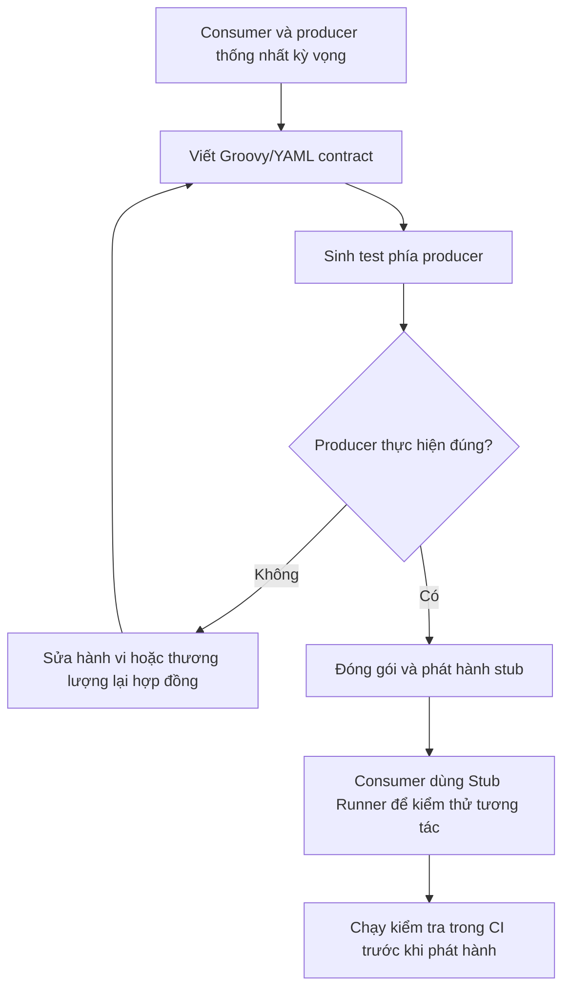

# Chọn ranh giới HTTP hoặc messaging cần kiểm chứng

## 1. Vì sao phải chọn đúng ranh giới hợp đồng?

Trong hệ thống microservice, một thay đổi nhỏ ở dịch vụ A có thể khiến dịch vụ B lỗi dù cả hai vẫn biên dịch và chạy unit test thành công. Ví dụ, API của `Order Service` đổi `orderId` thành `id`, hoặc `Payment Service` đổi tên sự kiện `PaymentAuthorized` thành `PaymentApproved`. Những thay đổi này nằm **ở giao diện giao tiếp giữa các dịch vụ**, không nằm ở một phương thức Java riêng lẻ.

**Spring Cloud Contract** giúp producer (bên cung cấp API hoặc phát thông điệp) và consumer (bên sử dụng API hoặc nhận thông điệp) thống nhất kỳ vọng bằng hợp đồng có thể kiểm chứng. Có thể định nghĩa hành vi HTTP hoặc messaging bằng Groovy/YAML DSL, sinh kiểm thử ở phía producer, tạo stub phục vụ consumer và đưa các bước đó vào CI. Tuy nhiên, trước khi viết DSL, cần xác định **giao tiếp nào thực sự đáng lập hợp đồng**.

> **Ranh giới hợp đồng** là điểm mà hành vi quan sát được của một thành phần trở thành cam kết với thành phần khác: request/response HTTP, hoặc thông điệp được gửi/nhận qua một kênh. Hợp đồng mô tả những gì bên ngoài có quyền dựa vào, không mô tả cách producer cài đặt nội bộ.

Sau bài này, bạn có thể:

- Phân biệt ranh giới HTTP đồng bộ với ranh giới messaging bất đồng bộ.
- Chọn các tương tác quan trọng cho contract test dựa trên consumer thực tế, mức độ rủi ro và khả năng thay đổi độc lập.
- Xác định những trường, trạng thái, header, định dạng và ngữ nghĩa sự kiện cần ràng buộc; tránh kiểm thử chi tiết triển khai.
- Phác thảo một bộ hợp đồng khả thi, biết phần nào Spring Cloud Contract kiểm chứng được và phần nào cần loại kiểm thử khác.

## 2. Nhìn hệ thống theo đường giao tiếp, không theo số lượng service

Giả sử hệ thống bán hàng có các thành phần sau:

```mermaid
flowchart LR
    UI[Ứng dụng khách] -->|HTTP POST /api/orders| ORD[Order Service]
    ORD -->|HTTP POST /api/payments| PAY[Payment Service]
    PAY -->|Sự kiện PaymentAuthorized| BUS[(Message broker)]
    BUS -->|Nhận PaymentAuthorized| ORD
    BUS -->|Nhận PaymentAuthorized| NOTI[Notification Service]
    ORD -->|HTTP GET /api/orders/{id}| UI
```

Mỗi mũi tên là một **ứng viên** cho hợp đồng. Không phải tất cả đều phải có cùng loại hoặc cùng số lượng contract test:

| Giao tiếp | Loại ranh giới | Kỳ vọng có thể kiểm chứng |
| --- | --- | --- |
| Ứng dụng khách gọi `POST /api/orders` | HTTP request/response | Phương thức, path, dữ liệu đầu vào, mã trạng thái và cấu trúc phản hồi |
| Order Service gọi `POST /api/payments` | HTTP request/response | Payload mà Order Service cần gửi và phản hồi mà nó thực sự xử lý |
| Payment Service phát `PaymentAuthorized` | Messaging đầu ra | Tên đích, header và payload của sự kiện mà subscriber phụ thuộc |
| Order Service nhận `PaymentAuthorized` | Messaging đầu vào | Cấu trúc message được chấp nhận và phản ứng quan sát được của service |
| Payment Service gọi lớp `PaymentRepository` | Nội bộ một service | Thường phù hợp với unit/integration test, không cần contract test liên dịch vụ |

Điểm then chốt: **giao tiếp thực tế quyết định loại hợp đồng**. Không chọn HTTP chỉ vì service có REST controller; cũng không chọn messaging chỉ vì hệ thống có Kafka hoặc RabbitMQ. Hãy xuất phát từ cách producer và consumer tương tác với nhau.

### Ai là producer, ai là consumer?

Hai vai trò cần được xác định **cho từng tương tác**, không gắn cố định với một ứng dụng:

- Với HTTP, producer là service cung cấp endpoint; consumer là service/client gọi endpoint đó.
- Với sự kiện, producer là thành phần phát message; consumer là thành phần đăng ký nhận và sử dụng message.
- Một service có thể là consumer HTTP trong tương tác này, nhưng lại là producer messaging trong tương tác khác.

Chẳng hạn, `Order Service` tiêu thụ HTTP API của `Payment Service` đồng thời tiêu thụ sự kiện `PaymentAuthorized`. Đây là **hai hợp đồng khác nhau**, dù cùng liên quan tới thanh toán.

## 3. Khi nào chọn hợp đồng HTTP?

Chọn HTTP khi consumer **chủ động gửi một request** và cần dựa vào phản hồi của producer theo giao thức HTTP. Các thành phần sau thường thuộc phạm vi hợp đồng:

| Thành phần | Câu hỏi thiết kế |
| --- | --- |
| Method và URL | Consumer có dựa vào `GET /api/orders/{id}` hay `POST /api/orders` không? Path variable và query parameter nào là bắt buộc? |
| Request | Body, header, media type, điều kiện xác thực hoặc mã định danh nào ảnh hưởng tới khả năng tương tác? |
| Response | Status HTTP, `Content-Type`, body và kiểu dữ liệu nào được consumer sử dụng? |
| Trường hợp lỗi | Consumer phản ứng thế nào với `400`, `404`, `409` hoặc lỗi nghiệp vụ cụ thể? |
| Ý nghĩa nghiệp vụ | `status: PAID` có ý nghĩa gì? Consumer có phân nhánh xử lý theo giá trị đó không? |

Ví dụ: màn hình chi tiết đơn hàng cần hiển thị mã đơn, trạng thái và tổng tiền. Ranh giới tối thiểu có thể là `GET /api/orders/{id}` trả `200` với `orderId`, `status`, `totalAmount`, kèm phản hồi `404` khi đơn hàng không tồn tại. Nếu giao diện không dùng trường `internalNote`, đừng đưa nó vào hợp đồng chỉ vì JSON hiện tại có trường đó.

**Không phải mọi giá trị cần được cố định.** Đối với ID ngẫu nhiên, thời gian tạo hoặc dữ liệu có giá trị thay đổi, nên dùng matcher phù hợp khi triển khai hợp đồng. Cố định một giá trị không quan trọng sẽ tạo ra báo lỗi giả khi producer thay đổi hợp lệ.

### Ví dụ hợp đồng HTTP bằng Groovy DSL

Đây là một hợp đồng minh họa do `Order Service` cung cấp. Consumer phụ thuộc vào việc tra cứu một đơn hàng đã thanh toán:

```groovy
import org.springframework.cloud.contract.spec.Contract

Contract.make {
    description 'Trả về các trường đơn hàng consumer đang sử dụng'

    request {
        method 'GET'
        url '/api/orders/ORD-123'
        headers {
            accept(applicationJson())
        }
    }

    response {
        status OK()
        headers {
            contentType(applicationJson())
        }
        body(
            orderId: 'ORD-123',
            status: 'PAID',
            totalAmount: 250000
        )
    }
}
```

Hợp đồng thể hiện một **đường đi tiêu biểu**: request hợp lệ và phản hồi `200`. Trong dự án thực tế, cần thống nhất tên, kiểu dữ liệu, đơn vị tiền tệ và ngữ nghĩa của `totalAmount` với consumer. Hợp đồng này cũng chưa mô tả trường hợp đơn hàng không tồn tại; nếu consumer dựa vào mã lỗi để điều hướng, đó là hợp đồng thứ hai đáng viết.

Ví dụ tương tự bằng **YAML DSL** cho nhánh lỗi:

```yaml
description: Trả về lỗi khi không tìm thấy đơn hàng
request:
  method: GET
  url: /api/orders/ORD-404
  headers:
    Accept: application/json
response:
  status: 404
  headers:
    Content-Type: application/json
  body:
    code: ORDER_NOT_FOUND
    message: Order not found
```

Từ góc nhìn thiết kế, giá trị bền vững ở đây không phải chuỗi thông báo `Order not found` mà là **mã lỗi và status mà consumer dùng để xử lý**. Nếu wording của `message` không phải cam kết công khai, có thể bỏ trường đó khỏi kỳ vọng hoặc kiểm tra linh hoạt hơn khi triển khai DSL.

## 4. Khi nào chọn hợp đồng messaging?

Chọn messaging khi một thành phần **phát hoặc nhận thông điệp qua broker/kênh sự kiện**, và thành phần khác dựa vào định dạng hoặc ý nghĩa của thông điệp đó. Consumer thường không nhận phản hồi ngay sau một lời gọi; kết quả có thể đến sau, bị gửi lại hoặc xử lý bất đồng bộ.

Một hợp đồng message thường cần trả lời:

- **Sự kiện nào?** Ví dụ `PaymentAuthorized`, `PaymentFailed` hay `OrderCancelled`. Chúng có mang những ý nghĩa nghiệp vụ khác nhau không?
- **Được gửi đi đâu?** Tên destination, topic, exchange, queue hoặc logical channel nào là phần giao tiếp đã thỏa thuận?
- **Payload nào ổn định?** `eventType`, `orderId`, `paymentId`, `amount`, `currency`, `schemaVersion` có cần thiết cho subscriber không?
- **Header/metadata nào quan trọng?** `contentType`, correlation ID, event ID, version, key hoặc loại sự kiện.
- **Điều kiện phát là gì?** Thành công sau khi xác nhận thanh toán, hay ngay khi nhận yêu cầu? Consumer sẽ hiểu sự kiện như một sự thật đã xảy ra hay một yêu cầu xử lý?

Ví dụ, `Notification Service` lắng nghe `PaymentAuthorized` để gửi biên nhận. Nếu producer âm thầm đổi `orderId` thành `purchaseId`, consumer có thể không xác định được đơn hàng liên quan. Đây là một **thay đổi ở ranh giới messaging** cần được phát hiện sớm.

### Ví dụ hợp đồng message bằng Groovy DSL

Ở phía producer `Payment Service`, một hợp đồng minh họa cho sự kiện đầu ra:

```groovy
import org.springframework.cloud.contract.spec.Contract

Contract.make {
    description 'Phát thông điệp sau khi thanh toán được xác nhận'
    label 'paymentAuthorized'

    input {
        triggeredBy('publishPaymentAuthorized()')
    }

    outputMessage {
        sentTo('payments.authorized')
        headers {
            header('contentType', 'application/json')
        }
        body(
            eventType: 'PaymentAuthorized',
            orderId: 'ORD-123',
            paymentId: 'PAY-456',
            currency: 'VND',
            amount: 250000
        )
    }
}
```

`triggeredBy('publishPaymentAuthorized()')` mô tả cách test được sinh ra yêu cầu producer kích hoạt hành vi, vì vậy **lớp cơ sở của generated test phải cung cấp phương thức phù hợp**. `sentTo('payments.authorized')` đại diện cho destination theo cấu hình tích hợp message của ứng dụng. Cần nối contract với binder/message verifier thực tế của dự án; chỉ có tệp DSL không đủ để chứng minh message đã được phát qua broker thật.

Ví dụ này cố ý chọn các trường subscriber thực sự sử dụng. Với hệ thống có nhiều subscriber, có thể cần bổ sung `eventId`, `occurredAt`, `schemaVersion` hoặc metadata dùng để khử trùng lặp, theo thỏa thuận giữa các bên. Tên destination cũng phải được chọn theo giao tiếp thực tế, tránh nhầm với một tên topic ví dụ.

### Phát message và nhận message là hai góc kiểm chứng

Với một luồng sự kiện, nên phân biệt:

1. **Kiểm chứng producer phát message:** Khi hành vi nghiệp vụ xảy ra, producer có phát đúng destination và đúng cấu trúc mà consumer kỳ vọng không?
2. **Kiểm chứng service nhận message:** Khi một message hợp lệ được đưa vào kênh đầu vào, service nhận có chấp nhận và tạo ra hành vi quan sát được hay không?

Spring Cloud Contract hỗ trợ mô tả input message trong DSL (chẳng hạn `messageFrom`, `messageBody`, `messageHeaders`) và output message tương ứng. Tuy nhiên, không phải mọi handler đều có output message; nếu kết quả là thay đổi cơ sở dữ liệu, cần bổ sung phép kiểm tra trạng thái hoặc integration test phù hợp. Không nên gán một `outputMessage` giả chỉ để cố tạo contract cho một handler chỉ ghi dữ liệu.

## 5. Quy trình năm bước để chọn phạm vi contract test

### Bước 1 — Liệt kê tương tác xuyên ranh giới triển khai

Vẽ các lời gọi hoặc luồng message giữa những thành phần có thể phát hành/triển khai độc lập. Với mỗi tương tác, ghi rõ **consumer**, **producer**, **giao thức**, **hành vi nghiệp vụ** và **phụ thuộc quan sát được**. Các lời gọi nội bộ trong cùng service chưa phải mục tiêu ưu tiên của consumer-driven contract test.

### Bước 2 — Hỏi consumer thật sự phụ thuộc vào điều gì

Đừng sao chép toàn bộ OpenAPI hoặc toàn bộ JSON hiện tại thành một hợp đồng. Hỏi:

- Consumer có đọc trường này không, và đọc để làm gì?
- Giá trị nào khiến consumer chọn một nhánh nghiệp vụ khác?
- Nếu kiểu dữ liệu, tên field hoặc status thay đổi, consumer sẽ lỗi hay vẫn chạy bình thường?
- Hợp đồng hiện hữu có thể phát hiện thay đổi đó ở phía producer trước khi triển khai không?

Ví dụ, `Order Service` chỉ dùng `paymentId` và `status` từ kết quả gọi Payment API. Nếu producer thêm trường `riskScore`, việc thêm trường này có thể hoàn toàn tương thích; ràng buộc consumer phải so khớp toàn bộ JSON một cách cứng nhắc sẽ làm giảm khả năng tiến hóa API.

### Bước 3 — Phân loại đồng bộ hay bất đồng bộ

| Dấu hiệu | Nên bắt đầu từ |
| --- | --- |
| Client gọi endpoint và cần status/body ngay | Hợp đồng HTTP |
| Client gọi endpoint để tạo công việc, sau đó nhận event hoàn tất | Ít nhất một hợp đồng HTTP cho việc chấp nhận lệnh **và** một hợp đồng messaging cho event liên quan, nếu có consumer phụ thuộc |
| Một service phát sự kiện nghiệp vụ để nhiều subscriber dùng | Hợp đồng messaging đầu ra |
| Một service xử lý command/event từ broker | Hợp đồng messaging đầu vào hoặc kiểm thử tích hợp handler, tùy hành vi có thể kiểm chứng |
| Thay đổi timeout, throughput, thứ tự xử lý hoặc độ trễ | Performance/resilience/integration test; hợp đồng dữ liệu chưa đủ |

Một hành trình nghiệp vụ có thể đi qua cả HTTP và messaging. **Không cần ép toàn bộ hành trình vào một kiểu hợp đồng.** Hãy kiểm chứng từng ranh giới với loại thử nghiệm phù hợp.

### Bước 4 — Chọn tình huống mang rủi ro tương thích cao

Ưu tiên các tương tác có nhiều consumer, nhiều nhóm triển khai, thay đổi thường xuyên, lỗi khó phát hiện hoặc hậu quả nghiệp vụ lớn. Bắt đầu bằng **happy path** tiêu biểu, sau đó chọn các nhánh lỗi hoặc biến thể mà consumer xử lý theo cách khác.

| Ứng viên | Rủi ro nếu thay đổi | Mức ưu tiên ví dụ | Lý do |
| --- | --- | --- | --- |
| `POST /api/payments` tạo thanh toán | Cao | Cao | Sai kiểu amount/status có thể làm hỏng luồng đặt hàng |
| `PaymentAuthorized` chứa `orderId` | Cao | Cao | Nhiều subscriber liên kết sự kiện với đúng đơn hàng |
| `GET /api/orders/{id}` trả `404` | Trung bình–cao | Cao nếu consumer xử lý rõ `404` | Consumer có thể hiển thị trạng thái “không tìm thấy” |
| `GET /health` cho liveness probe | Tùy ngữ cảnh | Thấp nếu đã có monitor khác | Chủ yếu là kiểm tra vận hành, ít quy tắc nghiệp vụ liên service |
| Tên phương thức nội bộ `calculateFee()` | Thấp với consumer ngoài service | Không cần contract | Không phải giao diện liên dịch vụ |

Mức ưu tiên trên chỉ là **minh họa**. Nếu endpoint health thực sự được một hệ thống bên ngoài dùng theo hợp đồng đã công bố, vẫn phải xem nó như giao diện cần quản lý.

### Bước 5 — Viết contract nhỏ, rõ và có chủ sở hữu

Mỗi contract nên có một mục đích dễ giải thích: “khi consumer làm X, producer cam kết Y”. Ghi nhận service giữ hợp đồng, consumer nào cần, phiên bản API/event, và cách chạy test trong CI. Nếu không thể chỉ ra consumer hay cách dùng một field, hãy xem lại vì sao field đó đang được ràng buộc.

## 6. Chọn độ chi tiết của hợp đồng: đủ phát hiện lỗi, không khóa chặt triển khai

Tập trung vào **giao diện trên đường truyền** và ngữ nghĩa có tác động tới consumer:

| Nên ràng buộc khi consumer phụ thuộc | Thường không nên ràng buộc bằng contract test |
| --- | --- |
| HTTP method, path, query bắt buộc | Tên hàm controller, tên class/service nội bộ |
| Status, media type, header nghiệp vụ | Thứ tự gọi repository, tên bảng trong database |
| Tên/kiểu trường JSON và giá trị trạng thái quan trọng | Thứ tự key trong JSON object khi consumer không phụ thuộc |
| Destination, payload, header và phiên bản sự kiện | Cấu hình thread pool và chi tiết triển khai handler |
| Nhánh lỗi mà consumer phải xử lý | Câu chữ thông báo chỉ để hiển thị khi không có cam kết cố định |

Một số quyết định thiết kế cần thống nhất sớm:

- **Bắt buộc hay tùy chọn:** Phân biệt trường luôn có, trường có thể vắng và trường nhận `null`. Consumer của bạn có chịu được dữ liệu thiếu không?
- **Đơn vị và kiểu:** `amount: 250000` đang là VND nguyên, phần trăm hay số thập phân? `occurredAt` dùng ISO 8601 hay epoch? Kiểu dữ liệu thay đổi có làm lỗi parser không?
- **Enum/trạng thái:** Consumer có xử lý trạng thái mới không? Đổi `PAID` thành `COMPLETED` có thể là breaking change dù cùng mang ý nghĩa gần giống.
- **Định danh:** `orderId`, `eventId`, correlation ID dùng ở đâu? Matcher nên kiểm tra định dạng cần thiết thay vì cố định một ID ngẫu nhiên.
- **Tính mở rộng:** Producer thêm trường mới thường tương thích với consumer bỏ qua trường lạ; xóa hoặc đổi tên trường đang được sử dụng thường không tương thích. Cần kiểm chứng thực tế thư viện giải mã của consumer trước khi kết luận.

Trong Spring Cloud Contract, DSL hỗ trợ matcher và cách khai báo giá trị khác nhau cho phía producer/consumer. Chúng hữu ích với dữ liệu động, nhưng **matcher quá rộng** (ví dụ chấp nhận mọi chuỗi cho một trạng thái nghiệp vụ) sẽ khiến test bỏ lọt thay đổi phá vỡ consumer. Ngược lại, cố định toàn bộ timestamp/ID khiến test dễ thất bại vì dữ liệu ngẫu nhiên.

## 7. Những phần hợp đồng không tự bảo đảm

Contract test trả lời câu hỏi: **producer còn cung cấp hành vi/giao diện đã cam kết hay không?** Nó không tự thay thế mọi phép thử hệ thống:

- **HTTP:** Test contract không tự chứng minh authorization, timeout, rate limit, tracing, hiệu năng, chuyển hướng proxy hay hoạt động của cả chuỗi service. Nếu các thuộc tính này là cam kết quan trọng, dùng kiểm thử bảo mật, tích hợp hoặc hiệu năng phù hợp.
- **Messaging:** Kiểm tra payload/destination không chứng minh message luôn được giao một lần, giữ thứ tự toàn cục, không mất khi broker lỗi, hoặc xử lý idempotent. Cần integration test với broker, thử retry/DLQ và kiểm thử hành vi khi nhận lại message.
- **Ngữ nghĩa nghiệp vụ sâu:** Một body có cấu trúc hợp lệ nhưng số tiền tính sai vẫn có thể vượt qua contract chỉ kiểm tra format. Unit/domain test phải kiểm tra quy tắc tính tiền.
- **Tiến hóa schema:** Một schema hợp lệ không bảo đảm mọi consumer đều hỗ trợ mọi phiên bản. Cần xác định chính sách tương thích và kiểm tra các consumer quan trọng.

Đặc biệt với message broker, contract test phù hợp để bắt **lỗi tương thích định dạng và khả năng phát/nhận theo thỏa thuận**. Các đặc tính giao hàng thực tế phải được xác nhận qua kiểm thử khác.

## 8. Tình huống thực hành: đổi tên field gây lỗi ở đâu?

`Payment Service` đang cung cấp hai kênh:

1. HTTP `POST /api/payments` trả `paymentId` và `status` cho `Order Service`.
2. Sau khi xác nhận, nó phát `PaymentAuthorized` có `paymentId`, `orderId` và `amount`; `Order Service` và `Notification Service` cùng đăng ký.

Nhóm Payment muốn đổi `paymentId` thành `transactionId` ở cả HTTP response và event. Nhóm nói rằng database vẫn lưu đúng giao dịch, nên thay đổi “an toàn”. Hãy phân tích theo ranh giới:

| Thay đổi | Consumer có thể bị ảnh hưởng | Hợp đồng nên phát hiện |
| --- | --- | --- |
| HTTP response bỏ `paymentId` | Order Service nếu đọc trường cũ | Test producer cho `POST /api/payments` không còn đáp ứng field được cam kết |
| Event bỏ `paymentId` | Order/Notification subscriber nếu cần liên kết thanh toán | Test producer message không còn đáp ứng payload đã cam kết |
| Database đổi tên cột nhưng JSON/event giữ nguyên | Không ảnh hưởng trực tiếp tới consumer ngoài service | Không nhất thiết làm contract test thất bại; unit/integration test xử lý tính đúng đắn nội bộ |
| Event thêm `transactionId` nhưng vẫn giữ `paymentId` | Consumer hiện tại thường vẫn chạy nếu chịu được trường bổ sung | Xác nhận quy tắc tương thích và kiểm chứng bằng consumer test |

Một chiến lược tiến hóa thận trọng là **thêm trường mới, giữ trường cũ trong thời gian chuyển đổi, cập nhật consumer và đo mức sử dụng trước khi xóa**. Với sự kiện có version rõ ràng, có thể phát hành phiên bản mới hoặc tổ chức chuyển đổi theo chính sách tương thích đã được các bên chấp nhận. Chỉ tăng `schemaVersion` không tự làm consumer cũ hiểu payload mới.

### Bảng lựa chọn hợp đồng cho tình huống

| Mã | Producer → Consumer | Ranh giới | Tình huống quan trọng | Đích kiểm chứng |
| --- | --- | --- | --- | --- |
| C1 | Payment → Order | HTTP | Thanh toán được chấp nhận | `POST /api/payments` trả `201`/`200` theo API thực tế, `paymentId` và `status` đúng kiểu |
| C2 | Payment → Order | HTTP | Từ chối do dữ liệu sai | Status và mã lỗi mà Order xử lý |
| C3 | Payment → Order, Notification | Messaging | Thanh toán đã xác nhận | `PaymentAuthorized`, destination, `orderId`, `paymentId`, số tiền và đơn vị |
| C4 | Payment → Notification | Messaging | Thêm trường metadata mới | Consumer hiện có vẫn đọc được các trường đã cam kết |

Không nên tự giả định `201` hay `200` là đúng: **chọn một status theo hành vi API đã được nhóm thống nhất**, rồi đưa status đó vào contract. Tương tự, destination và cách chia event phải phản ánh triển khai thật, không áp dụng máy móc từ ví dụ.

## 9. Đưa những ranh giới đã chọn vào quy trình kiểm chứng

Sau khi chọn các contract, một luồng triển khai với Spring Cloud Contract thường là:



Ở ranh giới HTTP, stub cho phép consumer kiểm tra cách nó gửi request và xử lý phản hồi mà không cần chạy producer thật. Ở ranh giới messaging, cách kiểm thử stub và message phụ thuộc vào cơ chế tích hợp của dự án. Stub Runner giúp dùng các stub được phát hành, nhưng nó **không thay thế** kiểm thử tích hợp với broker và kiểm thử hành vi phân tán.

Khi đặt vào CI, nên ưu tiên thứ tự sau:

1. **Producer CI:** Sinh và chạy generated tests từ các contract đang có; pipeline thất bại nếu producer phá vỡ cam kết.
2. **Phát hành stub có phiên bản:** Chỉ phát hành artifact tương ứng với producer đã vượt qua kiểm thử; quản lý phiên bản và nguồn tải stub rõ ràng.
3. **Consumer CI:** Dùng stub qua Stub Runner để xác minh HTTP client hoặc message flow của consumer ở các kịch bản đã chọn.
4. **Kiểm thử bổ sung:** Chạy tích hợp broker, resilience, security và end-to-end đối với rủi ro mà contract test không bao phủ.

Nếu hợp đồng của một producer bị thay đổi, hãy đánh giá ảnh hưởng tới **tất cả consumer đã được biết đến** trước khi phê duyệt. Một consumer test xanh chỉ chứng minh các kỳ vọng mà test đó thực sự kiểm tra.

## 10. Sai lầm thường gặp khi chọn ranh giới

| Sai lầm | Hậu quả | Cách sửa |
| --- | --- | --- |
| Viết contract cho từng hàm nội bộ | Nhiều test, ít bảo vệ tương thích liên dịch vụ | Chỉ đưa tương tác ngoài service vào phạm vi contract |
| Chỉ viết HTTP contract trong luồng có event | Bỏ lọt breaking change của message payload | Lập contract cho cả HTTP và message khi consumer phụ thuộc cả hai |
| Contract ràng buộc toàn bộ response như snapshot | Thêm trường vô hại cũng gây báo lỗi | Chỉ giữ những trường/giá trị consumer dùng, chọn matcher hợp lý |
| Chỉ kiểm thử `200`, bỏ nhánh lỗi | Consumer có thể vỡ khi gặp `404` hoặc mã lỗi mới | Bổ sung nhánh lỗi thật sự làm thay đổi cách xử lý |
| Kiểm tra payload nhưng không quan tâm destination | Message đúng dữ liệu nhưng được gửi sai kênh | Đưa destination vào hợp đồng khi đó là cam kết công khai |
| Dùng contract thay thế integration test với broker | Không phát hiện lỗi retry, DLQ, duplicate, partition | Kiểm tra giao hàng và xử lý trùng lặp ở tầng tích hợp |
| Không xác định chủ sở hữu và consumer | Dễ đổi API mà không biết ai phụ thuộc | Lưu ma trận producer–consumer và duyệt thay đổi theo tác động |

## 11. Bài tập tự luyện

Một hệ thống đặt vé có ba giao tiếp:

- Ứng dụng web gọi `POST /api/bookings`; khi thành công, API trả `bookingId` và `status: PENDING`.
- `Booking Service` phát `BookingConfirmed` lên topic `booking.confirmed`; `Email Service` dùng `bookingId` và `customerEmail` để gửi vé.
- `Booking Service` cập nhật bảng `bookings` bằng một repository nội bộ.

**Yêu cầu:**

1. Xác định đâu là ranh giới HTTP, messaging và nội bộ.
2. Đề xuất ít nhất hai contract và ba trường/đặc tính bắt buộc cho mỗi contract.
3. Nếu trường `customerEmail` bị xóa khỏi event nhưng vẫn có trong database, contract nào phải thất bại? Vì sao?
4. Một message `BookingConfirmed` được broker giao hai lần và Email Service gửi hai email. Contract test payload có đủ phát hiện lỗi đó không? Cần thêm phép kiểm thử gì?

<details>
<summary>Gợi ý đáp án</summary>

1. `POST /api/bookings` là HTTP; `BookingConfirmed` là messaging; lời gọi repository nằm trong service và không cần hợp đồng liên dịch vụ.
2. HTTP contract nên kiểm tra `POST` và path chính xác, schema request mà web gửi, status thành công và `bookingId`/`status`. Messaging contract nên kiểm tra destination `booking.confirmed`, loại sự kiện, `bookingId`, `customerEmail` và metadata cần thiết.
3. Contract messaging do producer cung cấp phải báo lỗi nếu `customerEmail` là trường mà Email Service đã yêu cầu và phụ thuộc. Database vẫn có cột đó không đảm bảo consumer nhận được field.
4. Không. Cần kiểm thử tích hợp với broker và kiểm chứng tính idempotent/khử trùng lặp của Email Service, chẳng hạn dựa trên `eventId` ổn định.

</details>

## 12. Checklist trước khi viết DSL

Đối với mỗi hợp đồng dự kiến tạo, tự kiểm tra:

- [ ] Đã xác định đúng producer, consumer và ranh giới triển khai độc lập.
- [ ] Đã chọn HTTP khi có request/response, messaging khi có luồng message thực tế.
- [ ] Có tình huống nghiệp vụ rõ ràng mà consumer đang phụ thuộc.
- [ ] Chỉ ràng buộc method/path/status/header/body hoặc destination/message fields cần thiết.
- [ ] Đã chọn nhánh lỗi và giá trị động theo tác động thực tế, không sao chép toàn bộ triển khai.
- [ ] Đã thống nhất ý nghĩa trạng thái, đơn vị đo, định dạng thời gian, trường bắt buộc/tùy chọn và chính sách phiên bản.
- [ ] Đã biết generated producer test và consumer stub test sẽ chạy ở đâu trong CI.
- [ ] Đã nhận diện rủi ro nằm ngoài phạm vi contract test để có kiểm thử bổ sung.

**Ghi nhớ:** Chọn ranh giới contract từ **sự phụ thuộc có thật của consumer**. HTTP bảo vệ cam kết request/response; messaging bảo vệ cam kết về thông điệp và kênh giao tiếp. Một bộ hợp đồng tốt đủ cụ thể để ngăn breaking change, nhưng đủ tập trung để các dịch vụ vẫn phát triển độc lập.
