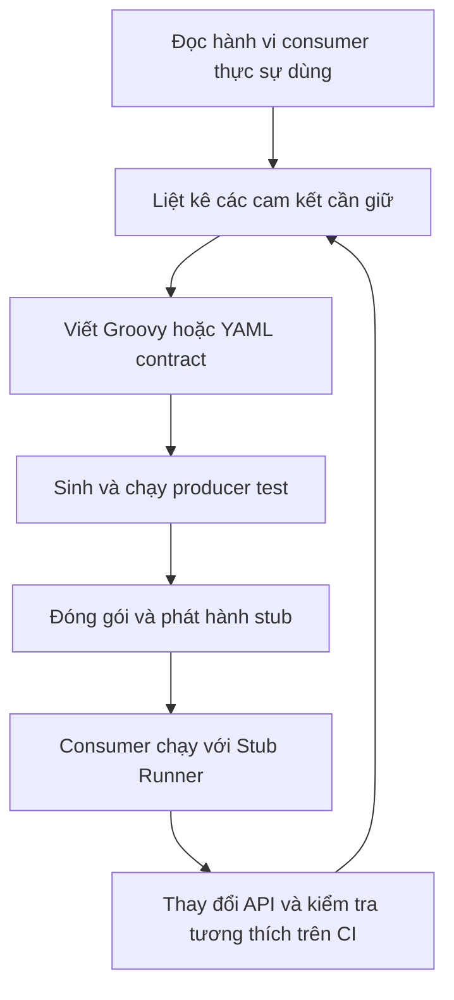

# Hợp đồng tối thiểu và nguy cơ ràng buộc dữ liệu không cần thiết

## 1. Vì sao hợp đồng càng nhiều trường chưa chắc càng tốt?

Trong **Spring Cloud Contract**, hợp đồng (*contract*) mô tả những hành vi mà producer phải bảo đảm để consumer có thể giao tiếp an toàn: phương thức và đường dẫn HTTP, dữ liệu đầu vào cần thiết, mã trạng thái, header và những đặc điểm của phản hồi; với hệ thống bất đồng bộ, hợp đồng có thể mô tả thông điệp được phát hoặc nhận. Từ Groovy/YAML DSL, công cụ có thể sinh kiểm thử cho producer và stub để consumer kiểm thử độc lập.

**Hợp đồng tối thiểu** (*minimal contract*) là hợp đồng chỉ ràng buộc những điều consumer thực sự cần và những bất biến nghiệp vụ phải giữ. “Tối thiểu” ở đây nói về **số lượng cam kết**, không phải số dòng DSL hay mức độ lỏng lẻo của kiểm thử.

Ví dụ, màn hình theo dõi đơn hàng chỉ cần `orderId` và `status` để hiển thị “Đã xác nhận”. API hiện tại có thể trả thêm thời gian tạo, mã kho và các thuộc tính phục vụ vận hành. Nếu đưa mọi trường đó vào hợp đồng, việc producer đổi định dạng thời gian hoặc thuật toán chọn kho có thể làm kiểm thử hợp đồng thất bại mặc dù màn hình consumer vẫn hoạt động bình thường.

Một hợp đồng tốt cần cân bằng hai phía:

- **Đủ chặt** để phát hiện thay đổi phá vỡ hành vi consumer dựa vào, ví dụ `status` đổi từ chuỗi sang đối tượng, HTTP `200` thành `204`, hoặc trường bắt buộc biến mất.
- **Đủ hẹp** để không biến chi tiết triển khai, dữ liệu ví dụ ngẫu nhiên hay trường consumer không dùng thành lời hứa tương thích lâu dài.

Mục tiêu của bài này là nhận diện ràng buộc thừa, thiết kế một hợp đồng HTTP tối thiểu bằng Spring Cloud Contract DSL và kiểm chứng rằng hợp đồng vẫn phát hiện thay đổi API thực sự không tương thích.

## 2. Phân biệt phản hồi thực tế với phần giao diện cần cam kết

Giả sử producer `order-service` cung cấp endpoint `GET /api/orders/{id}`. Một phản hồi thực tế có thể là:

```json
{
  "orderId": 42,
  "status": "CONFIRMED",
  "createdAt": "2026-11-24T03:00:00Z",
  "warehouseId": "WH-07",
  "internalRiskScore": 0.12,
  "tracking": {
    "traceId": "trace-abc-123"
  }
}
```

Consumer trong ví dụ chỉ thực hiện:

```java
String label(OrderSummary summary) {
    return switch (summary.status()) {
        case "CONFIRMED" -> "Đã xác nhận";
        case "PENDING" -> "Đang xử lý";
        default -> "Trạng thái khác";
    };
}
```

Trong luồng này, `orderId` giúp consumer liên kết dữ liệu với đơn hàng đã yêu cầu, còn `status` quyết định nhãn hiển thị. Không có logic nào phụ thuộc `createdAt`, `warehouseId`, `internalRiskScore` hay `tracking.traceId`.

| Thành phần | Consumer có dựa vào? | Quyết định thiết kế |
| --- | --- | --- |
| `GET /api/orders/42` và HTTP `200` | Có | Cam kết request và trạng thái thành công |
| `Content-Type: application/json` | Có, để đọc JSON | Cam kết media type phù hợp |
| `orderId` là số `42` | Có, để khớp đơn hàng được hỏi | Kiểm tra giá trị hoặc quan hệ với ID request |
| `status` là chuỗi `CONFIRMED` trong tình huống này | Có | Kiểm tra giá trị chính xác cho kịch bản |
| `createdAt` | Không | Không buộc vào giá trị hoặc định dạng cụ thể ở hợp đồng này |
| `warehouseId`, `internalRiskScore`, `tracking.traceId` | Không | Không đưa vào các điều kiện xác minh |

Điều này **không có nghĩa** các trường phụ phải bị xóa khỏi response của producer. Chúng có thể tiếp tục tồn tại để phục vụ consumer khác. Hợp đồng ở đây chỉ ghi lại một phần hành vi mà consumer đang xét có quyền kỳ vọng.

### Các dấu hiệu của một hợp đồng bị ràng buộc quá mức

Một hợp đồng đáng xem lại khi nó cố định những chi tiết sau dù consumer không sử dụng:

1. **Toàn bộ đối tượng JSON:** chép nguyên mẫu response vào hợp đồng và mặc nhiên coi mọi trường là bắt buộc.
2. **Giá trị dễ thay đổi:** timestamp chính xác đến mili giây, mã trace, UUID sinh ngẫu nhiên, thứ tự lấy từ cơ sở dữ liệu.
3. **Dữ liệu nội bộ:** tên bảng, mã kho xử lý, score vận hành hoặc thông tin chỉ dành cho logging.
4. **Cấu trúc danh sách quá chặt:** bắt số phần tử, thứ tự phần tử hay vị trí cụ thể khi consumer chỉ cần tập phần tử theo khóa.
5. **Biểu diễn phụ thuộc công nghệ:** ép tên header hoặc chuỗi JSON phải giống byte-for-byte khi yêu cầu nghiệp vụ chỉ cần cùng ý nghĩa.

Hệ quả là **false alarm về tương thích**: producer thay đổi một chi tiết không liên quan nhưng pipeline hợp đồng đỏ. Nhóm dễ mất niềm tin vào kiểm thử, phải sửa đồng thời nhiều stub hoặc trì hoãn cải tiến API vô ích. Ngược lại, nếu cắt bỏ cả yêu cầu thực sự cần thiết, hợp đồng sẽ bỏ sót lỗi phá vỡ consumer.

## 3. Thiết kế hợp đồng tối thiểu với Groovy DSL

Từ hành vi tiêu thụ đã xác định, ta chỉ ràng buộc request `GET`, JSON response thành công và hai trường mà consumer đọc.

Ví dụ một tệp `src/test/resources/contracts/orders/order-confirmed.groovy` của **producer**:

```groovy
import org.springframework.cloud.contract.spec.Contract

Contract.make {
    description 'Consumer cần mã và trạng thái của đơn hàng 42'

    request {
        method GET()
        url '/api/orders/42'
        headers {
            accept(applicationJson())
        }
    }

    response {
        status OK()
        headers {
            contentType(applicationJson())
        }
        body([
            orderId: 42,
            status : 'CONFIRMED'
        ])
        bodyMatchers {
            jsonPath('$.orderId', byEquality())
            jsonPath('$.status', byEquality())
        }
    }
}
```

Ý nghĩa của các điều kiện:

- `method` và `url` chỉ ra hành vi consumer sẽ gọi. Giá trị `42` là dữ liệu cố định **cho kịch bản kiểm thử này**, không phải tuyên bố mọi đơn hàng đều có ID `42`.
- `status OK()` và `contentType(applicationJson())` bảo vệ cách consumer diễn giải phản hồi.
- `body` khai báo dữ liệu mẫu của kịch bản, đồng thời cung cấp nội dung cho stub mà consumer sử dụng.
- Hai matcher `byEquality()` thể hiện chính xác giá trị cần kiểm tra trong kịch bản. Chúng không đặt điều kiện riêng cho `createdAt`, `warehouseId` hay `tracking.traceId`.

Không nên thay tất cả kiểm tra bằng một regex `.*` chỉ để bài kiểm thử dễ qua: nếu `status` là điều kiện quyết định nhánh xử lý, đổi `CONFIRMED` thành giá trị bất kỳ có thể phá vỡ hành vi. Cũng không nên kiểm tra ID chỉ bằng “là số” nếu consumer yêu cầu response phải ứng với ID đã gửi. Ở kịch bản với request `/42`, kiểm tra `orderId` bằng `42` thể hiện chính xác mối liên hệ đó.

### Viết cùng ý tưởng bằng YAML DSL

Với dự án cấu hình Spring Cloud Contract để nạp hợp đồng YAML, có thể biểu diễn cùng kịch bản như sau:

```yaml
description: Consumer cần mã và trạng thái của đơn hàng 42
request:
  method: GET
  url: /api/orders/42
  headers:
    Accept: application/json
response:
  status: 200
  headers:
    Content-Type: application/json
  body:
    orderId: 42
    status: CONFIRMED
  matchers:
    body:
      - path: $.orderId
        type: by_equality
      - path: $.status
        type: by_equality
```

Đây là **hai cách biểu diễn thay thế nhau** cho một kịch bản, không phải hai hợp đồng cần đặt cùng lúc trong thư mục kiểm thử. Chọn định dạng mà dự án đang sử dụng và bảo đảm phiên bản Spring Cloud Contract cùng plugin nhận đúng loại DSL.

> **Lưu ý về khả năng chấp nhận trường bổ sung:** Việc chỉ khai báo hai trường trong DSL thể hiện ý định hợp đồng tối thiểu, nhưng mức độ so khớp JSON thực tế phụ thuộc cách DSL, matcher và phiên bản công cụ sinh kiểm thử. Hãy mở mã kiểm thử producer đã sinh và chạy một trường hợp producer trả thêm metadata để xác nhận phép so khớp cho phép phần mở rộng mong muốn. Không mặc định rằng chỉ cần bỏ trường khỏi mẫu là mọi chế độ so sánh đều bỏ qua trường đó.

## 4. Chọn matcher theo ý nghĩa nghiệp vụ

Matcher là công cụ biểu đạt **cái gì phải ổn định**, không phải cách làm mọi dữ liệu biến động đều hợp lệ.

| Yêu cầu của consumer | Hướng kiểm tra phù hợp | Điều cần tránh |
| --- | --- | --- |
| Phải nhận trạng thái `CONFIRMED` cho kịch bản xác nhận | So sánh bằng giá trị cụ thể (`byEquality`) | Regex cho phép mọi chuỗi |
| Chỉ cần mã đơn có kiểu số, không phụ thuộc ID cố định | Kiểm tra kiểu hoặc mẫu số khi quan hệ với request không phải yêu cầu | Khóa một giá trị ngẫu nhiên vào hợp đồng |
| Cần số tiền chính xác và đơn vị tiền | Ràng buộc số tiền, kiểu dữ liệu và mã tiền tệ theo nghiệp vụ | Chỉ kiểm tra số tiền có mặt mà bỏ qua tiền tệ |
| Cần các trạng thái trong tập cho phép | Ràng buộc tập trạng thái được consumer xử lý | Chấp nhận giá trị lạ mà consumer không biết xử lý |
| Cần `items` và xử lý từng phần tử, không dựa thứ tự | Kiểm tra trường quan trọng của phần tử; tránh khóa thứ tự nếu không có nghĩa | So sánh cứng toàn bộ mảng và thứ tự mẫu |
| Cần phân biệt `null`, vắng trường và giá trị có mặt | Đặt trường hợp riêng theo đúng quy tắc API | Xem ba trạng thái này tự động tương đương |

**Không phải cứ dữ liệu biến động là bỏ qua.** Chẳng hạn consumer dùng `createdAt` để sắp xếp, thì sự hiện diện, kiểu và quy ước thời gian của trường đó chính là một phần hợp đồng cần bảo vệ. Có thể tránh khóa **giá trị thời gian cụ thể** nhưng vẫn kiểm tra nó là chuỗi ngày giờ hợp lệ theo định dạng đã thống nhất.

Ngoài ra, một giá trị ví dụ trong stub và một ràng buộc trên phía producer phục vụ hai mục đích khác nhau. Stub cần dữ liệu cụ thể để consumer chạy; matcher cần mô tả điều producer phải duy trì. Khi sử dụng giá trị động, mẫu số hay consumer/producer matcher của Spring Cloud Contract, hãy xác định rõ bên nào nhận ví dụ cố định và bên nào được phép biến thiên; đừng để dữ liệu sinh ngẫu nhiên làm test không ổn định.

## 5. Khi tối giản quá mức cũng nguy hiểm

Giả sử consumer có logic:

```java
if (response.statusCode() == 404) {
    showOrderNotFound();
}
```

Nếu luồng “không tìm thấy đơn hàng” là một hành vi consumer thực sự dùng, chỉ viết contract cho HTTP `200` là **chưa đủ**. Cần thêm một hợp đồng cho request một ID không tồn tại và response `404`, cùng cấu trúc lỗi nếu consumer đọc nó. Tương tự, nếu consumer gửi `Authorization`, `Content-Type` hoặc request body với trường bắt buộc, phải đưa đúng các yêu cầu đó vào hợp đồng.

Cần phân biệt ba cấp độ:

- **Bắt buộc:** trường hoặc điều kiện mà thiếu nó consumer không thực hiện được mục tiêu, ví dụ `status`, HTTP status, quy ước null có ý nghĩa.
- **Tùy chọn nhưng có ý nghĩa:** consumer có xử lý khi trường xuất hiện, và cũng xử lý an toàn khi vắng mặt. Hợp đồng có thể cần các kịch bản riêng để chứng minh cả hai cách dùng.
- **Không liên quan đến consumer này:** chỉ có mặt vì response hiện tại đang trả về; không nên đưa thành điều kiện tương thích cho consumer ấy.

Không được dùng “tối thiểu” làm lý do bỏ kiểm tra phân quyền, dữ liệu nhạy cảm, quy tắc giá tiền hoặc lỗi API khi chúng là một phần hành vi cần bảo đảm. Với messaging contract cũng áp dụng nguyên tắc tương tự: consumer sự kiện có thể cần `eventType`, `orderId` và khóa idempotency, nhưng không nhất thiết cần thời điểm log hoặc mọi metadata trong thông điệp.

## 6. Thay đổi API nào cần làm contract thất bại?

Xét hợp đồng mẫu với consumer chỉ cần `orderId` và `status`:

| Thay đổi ở producer | Kỳ vọng về tương thích | Lý do |
| --- | --- | --- |
| Thêm `estimatedDeliveryAt` vào JSON | Nên được phép | Consumer hiện tại không phụ thuộc trường mới |
| Đổi giá trị `internalRiskScore` | Nên được phép | Chi tiết nội bộ ngoài phạm vi hợp đồng |
| Đổi `status` thành `{ "code": "CONFIRMED" }` | Phải phát hiện | Consumer đang đọc `status` như chuỗi |
| Bỏ `orderId` | Phải phát hiện | Consumer mất khóa liên kết với request |
| Trả HTTP `204` thay `200` và không có body | Phải phát hiện | Consumer dự kiến nhận JSON có dữ liệu |
| Đổi thứ tự trường JSON | Nên được phép | Thứ tự thuộc tính object JSON không tạo ý nghĩa cho consumer |
| Đổi tên `status` thành `state` | Phải phát hiện | Trường consumer đang đọc biến mất |

“Nên được phép” là **mục tiêu thiết kế**. Kiểm tra thực tế bằng test sinh ra để bảo đảm so khớp đang thực hiện đúng mục tiêu đó. Nếu test thất bại khi thêm trường, cần xem lại cách khẳng định cấu trúc response hoặc chế độ so sánh JSON; nếu test vẫn qua khi `status` đổi kiểu, cần bổ sung hoặc siết matcher.

Một hợp đồng là **quan hệ giữa producer và một nhu cầu consumer cụ thể**, không phải bản sao đầy đủ của schema lưu trữ. Consumer khác có thể cần `createdAt`, và khi đó hợp đồng của consumer ấy phải bảo vệ dữ liệu đó. Không nên tự động ép tất cả consumer dùng chung một hợp đồng chi tiết nhất.

## 7. Quy trình áp dụng trong Spring Cloud Contract và CI



1. **Xác minh nhu cầu tiêu thụ.** Đọc mã xử lý response, mapper và các nhánh lỗi của consumer. Tìm trường thực sự được dùng, kiểu, quy tắc rỗng/null và các tình huống nghiệp vụ. Không suy tất cả nhu cầu từ mẫu JSON trong tài liệu API.
2. **Viết một hợp đồng cho một hành vi có ý nghĩa.** Chọn request và expectation rõ ràng. Nếu consumer phân biệt nhiều tình huống, viết thêm kịch bản riêng cho từng khác biệt quan trọng.
3. **Sinh kiểm thử producer.** Trong dự án đã cấu hình plugin Spring Cloud Contract, bước `mvn verify` hoặc tác vụ Gradle tương ứng sẽ kiểm tra producer đáp ứng hợp đồng. Xem test sinh ra khi cần xác nhận cách so khớp JSON và matcher.
4. **Tạo và phát hành stub.** Stub được sinh từ các contract hợp lệ và đóng gói theo cấu hình dự án. Consumer dùng **Stub Runner** để chạy kiểm thử tích hợp với phản hồi giả lập, không cần producer thật khởi chạy cùng lúc.
5. **Đặt cả hai phía vào CI.** Pipeline producer bắt thay đổi hành vi không đáp ứng contract; pipeline consumer chạy với phiên bản stub phù hợp để chứng minh logic tiêu thụ. Quản lý phiên bản stub để một consumer biết mình đang kiểm tra theo hợp đồng nào.
6. **Thử cả thay đổi an toàn và thay đổi phá vỡ.** Thêm một trường metadata mà consumer không dùng: bài kiểm thử tương thích nên tiếp tục thành công. Đổi kiểu `status` hoặc bỏ trường bắt buộc: bài kiểm thử phải thất bại. Đây là cách phát hiện hợp đồng quá chặt hoặc quá lỏng.

Các bước phát hành stub và tích hợp CI phụ thuộc cấu hình Maven/Gradle, repository artifact và chính sách version của dự án; bản thân việc viết một tệp DSL không tự động xuất bản stub.

## 8. Bài tập thực hành

Một API trả về:

```json
{
  "paymentId": "pay-981",
  "state": "SETTLED",
  "amount": 250000,
  "currency": "VND",
  "processorTrace": "tr-55b",
  "settledAt": "2026-11-24T09:00:00+07:00"
}
```

Consumer chỉ cho phép tải biên lai khi `state = SETTLED`, hiển thị `amount` cùng `currency` và không sử dụng `processorTrace` hay `settledAt`.

**Yêu cầu:** Thiết kế contract cho kịch bản thanh toán thành công, nêu những trường phải giữ và những trường không cần ràng buộc. Sau đó giả định producer thay `processorTrace` bằng giá trị khác và đổi `amount` từ số thành chuỗi; hãy dự đoán thay đổi nào cần làm kiểm thử thất bại.

**Gợi ý đáp án:** Giữ đường dẫn/method request liên quan, HTTP status và media type nếu consumer dựa vào, cùng `paymentId` (nếu dùng để định danh), `state`, `amount`, `currency`. Không cần khóa `processorTrace` hoặc `settledAt` ở hợp đồng này. Thay trace phải được phép; đổi kiểu `amount` phải bị phát hiện vì consumer sử dụng nó để hiển thị và tính toán theo kiểu số. Nếu consumer thực sự không đọc `paymentId`, cũng không nên tự coi đó là trường bắt buộc chỉ vì response hiện tại có nó.

## 9. Những câu hỏi để tự rà soát hợp đồng

- Nếu bỏ trường này khỏi response, **consumer cụ thể này** có thực sự lỗi không?
- Nếu giữ ý nghĩa nhưng thay giá trị ví dụ, test có thất bại vì một chi tiết ngẫu nhiên không?
- Hợp đồng có kiểm tra các quy tắc thật sự quan trọng như HTTP status, kiểu dữ liệu, trạng thái hợp lệ và nullability không?
- Một trường mới, thứ tự JSON khác hoặc metadata nội bộ mới có làm test đỏ trái với mục tiêu tương thích không?
- Stub có đủ dữ liệu để consumer kiểm thử luồng nghiệp vụ, và producer test có bảo vệ chính những dữ liệu đó không?
- Đã xem mã test được sinh và chạy thử ít nhất một thay đổi tương thích cùng một thay đổi phá vỡ chưa?

Khi trả lời được các câu hỏi này, nhóm sẽ có hợp đồng **nhỏ về phạm vi nhưng mạnh về ý nghĩa**: Spring Cloud Contract tập trung bảo vệ những cam kết mà consumer cần, còn producer có không gian thay đổi các chi tiết triển khai không thuộc hợp đồng.
