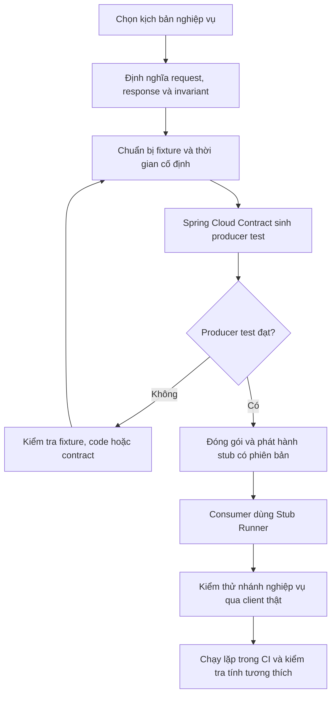

# Giữ dữ liệu kiểm thử xác định và có ý nghĩa nghiệp vụ

## 1. Dữ liệu kiểm thử là một phần của thiết kế hợp đồng

Trong kiến trúc microservices, producer cung cấp HTTP API hoặc phát thông điệp, còn consumer dựa vào những hành vi đã cam kết để thực hiện nghiệp vụ. **Spring Cloud Contract** cho phép mô tả các hành vi đó bằng **Groovy DSL hoặc YAML DSL**, sinh kiểm thử xác minh producer, đóng gói stub để consumer kiểm thử qua **Stub Runner**, và đưa các bước xác minh vào CI để phát hiện thay đổi API không tương thích.

Khi viết contract, việc chọn dữ liệu có ảnh hưởng trực tiếp đến chất lượng kiểm thử. Hãy xem hai phản hồi:

```json
{"id":"1","status":"OK","value":123}
```

và:

```json
{
  "paymentId": "PAY-0001",
  "orderId": "ORD-1001",
  "status": "PAID",
  "amount": 250000,
  "currency": "VND",
  "paidAt": "2026-01-15T09:00:00Z"
}
```

Cả hai đều có thể dùng làm dữ liệu thử, nhưng phản hồi thứ hai cho người đọc hiểu *đơn hàng nào đã thanh toán, với số tiền và trạng thái gì*. Nó giúp nhóm phát triển phát hiện một thay đổi có thể phá vỡ logic nghiệp vụ, chẳng hạn consumer chỉ cho giao hàng khi `status = PAID`.

Hai tiêu chí phải đi cùng nhau:

- **Xác định (deterministic):** khi chạy trong cùng điều kiện đã kiểm soát, test cho cùng một kết quả; dữ liệu, thời gian, trạng thái nền và phiên bản stub không thay đổi ngoài ý muốn.
- **Có ý nghĩa nghiệp vụ (business-meaningful):** các giá trị thể hiện một tình huống sử dụng thật, sự nhất quán giữa các trường và quy tắc mà consumer phụ thuộc, thay vì chỉ là số hoặc chuỗi bất kỳ để cho test xanh.

**Xác định không đồng nghĩa mọi phản hồi production luôn chứa đúng một chuỗi.** Nếu hệ thống tạo transaction ID động, contract vẫn có thể kiểm tra *định dạng hợp lệ*, trong khi stub dùng một ID mẫu ổn định và các invariant nghiệp vụ được kiểm tra bằng test bổ sung.

### Kết quả học tập

Sau bài này, bạn có thể chọn bộ dữ liệu contract rõ mục đích, phân biệt giá trị cần đối chiếu chính xác với giá trị nên dùng matcher, thiết lập fixture và thời gian ổn định cho producer verification, thiết kế stub hữu ích với consumer, và giảm các lỗi ngẫu nhiên khi chạy test trên CI.

## 2. Thiết kế từ một tình huống nghiệp vụ cụ thể

Giả sử `checkout-service` cần kiểm tra một giao dịch trước khi xác nhận đơn, còn `payment-service` là producer của endpoint:

```http
GET /api/payments/PAY-0001
Accept: application/json
```

Nhóm Checkout quan tâm đến các quyết định:

1. Nếu thanh toán **`PAID`**, đơn có thể chuyển sang bước xử lý tiếp theo.
2. Nếu thanh toán **`PENDING`**, đơn chưa được giao.
3. Nếu mã thanh toán không tồn tại, consumer cần xử lý trường hợp không tìm thấy, thay vì mặc định đã thanh toán.

Đừng bắt đầu bằng cách sinh các giá trị hoàn toàn ngẫu nhiên rồi viết assert theo chúng. Hãy chọn **một dữ liệu đại diện cho một nhánh nghiệp vụ** và mô tả được vì sao kết quả mong đợi là đúng.

| Kịch bản | Dữ liệu quan trọng | Kỳ vọng và ý nghĩa |
| --- | --- | --- |
| Đã thanh toán | `PAY-0001`, `ORD-1001`, `PAID`, `250000 VND` | Checkout được tiếp tục xử lý đúng đơn `ORD-1001`. |
| Đang chờ | `PAY-0002`, `ORD-1002`, `PENDING`, `99000 VND` | Checkout phải chờ; không được coi `PENDING` như `PAID`. |
| Không tồn tại | `PAY-9999` | API phản hồi theo hợp đồng lỗi, ví dụ `404` nếu hai bên đã thống nhất. |
| Dữ liệu sai | `amount` âm hoặc thiếu `currency` trong yêu cầu tạo thanh toán | API từ chối theo quy tắc xác thực đã thỏa thuận; không nên coi là giao dịch hợp lệ. |

Các mã trên là **dữ liệu giả lập có chủ đích**, không mang thông tin khách hàng thật. Số tiền được hiểu là giá trị nguyên theo quy ước của API trong ví dụ; hệ thống thực tế phải ghi rõ đơn vị và cách làm tròn. Một contract hữu ích cần thống nhất cách biểu diễn tiền và ngày giờ, vì sai khác về đơn vị có thể nghiêm trọng hơn lỗi cú pháp JSON.

### Đặt tên để người đọc thấy ý định

Ưu tiên tên như `payment_status_paid.yml`, `payment_status_pending.yml`, `payment_not_found.yml` thay vì `case1.yml` hay `test3.yml`. Với tên mô tả hành vi, khi CI báo một contract thất bại, người sửa API có thể hiểu ngay quy tắc nào bị ảnh hưởng.

## 3. Một hợp đồng YAML với dữ liệu ổn định

Ví dụ contract HTTP cho kịch bản thanh toán đã hoàn tất:

```yaml
description: Lấy giao dịch đã thanh toán để xác nhận đơn hàng
name: payment_status_paid
request:
  method: GET
  url: /api/payments/PAY-0001
  headers:
    Accept: application/json
response:
  status: 200
  headers:
    Content-Type: application/json
  body:
    paymentId: PAY-0001
    orderId: ORD-1001
    status: PAID
    amount: 250000
    currency: VND
    paidAt: "2026-01-15T09:00:00Z"
```

Contract này có một loạt quyết định rõ ràng:

- **Mã yêu cầu và mã phản hồi khớp nhau:** request hỏi `PAY-0001`, response nói về `PAY-0001`. Điều này giúp phát hiện lỗi trả nhầm giao dịch.
- **Trạng thái `PAID` là dữ liệu cốt lõi:** consumer dùng nó để quyết định có xử lý đơn không, nên cần kiểm tra rõ ràng.
- **`amount` và `currency` đi cùng nhau:** `250000` mà không có đơn vị là thông tin mơ hồ; đổi `VND` sang `USD` có thể ảnh hưởng nghiêm trọng đến nghiệp vụ.
- **`paidAt` có thời điểm và múi giờ xác định:** dùng dạng ISO 8601 với hậu tố `Z` (UTC), tránh giá trị phụ thuộc đồng hồ máy chạy test.

Với Spring Cloud Contract, file YAML này có thể được dùng để sinh **producer verification test** và stub. Khi test producer thực thi, ứng dụng phải có trạng thái dữ liệu phù hợp để GET `PAY-0001` trả về thông tin như hợp đồng. **Định nghĩa contract không tự tạo bản ghi trong cơ sở dữ liệu của producer**; bước thiết lập fixture là trách nhiệm của bộ kiểm thử.

### Tách từng hành vi khác nhau thành kịch bản rõ ràng

Một hợp đồng khác cho thanh toán chưa hoàn tất:

```yaml
description: Lấy giao dịch đang chờ xử lý
name: payment_status_pending
request:
  method: GET
  url: /api/payments/PAY-0002
response:
  status: 200
  headers:
    Content-Type: application/json
  body:
    paymentId: PAY-0002
    orderId: ORD-1002
    status: PENDING
    amount: 99000
    currency: VND
```

Trong mô hình minh họa, giao dịch `PENDING` chưa có `paidAt`. Nếu **việc không có** trường `paidAt` là một yêu cầu nghiệp vụ bắt buộc, phải xác minh điều đó một cách tường minh bằng matcher/kiểm thử bổ sung: chỉ việc bỏ `paidAt` khỏi ví dụ JSON **không tự bảo đảm** rằng phản hồi thực tế sẽ không chứa trường ấy. Nếu API quyết định trả `paidAt: null` thay vì bỏ trường, hãy mô tả và kiểm thử đúng cam kết đó.

Tương tự, `404` cho thanh toán không tồn tại là **một lựa chọn thiết kế cần thống nhất**, không phải quy tắc ngầm cho mọi API. Contract testing chỉ xác minh quyết định đã được producer và consumer đồng ý.

## 4. Biểu diễn tương đương với Groovy DSL

Spring Cloud Contract cũng hỗ trợ Groovy DSL. Ví dụ cùng tình huống `PAY-0001`:

```groovy
import org.springframework.cloud.contract.spec.Contract

Contract.make {
    name 'payment_status_paid'
    description 'Lấy giao dịch đã thanh toán để xác nhận đơn hàng'

    request {
        method 'GET'
        url '/api/payments/PAY-0001'
    }

    response {
        status 200
        headers {
            contentType(applicationJson())
        }
        body([
            paymentId: 'PAY-0001',
            orderId: 'ORD-1001',
            status: 'PAID',
            amount: 250000,
            currency: 'VND',
            paidAt: '2026-01-15T09:00:00Z'
        ])
    }
}
```

YAML và Groovy ở đây là **hai cách thể hiện cùng một kịch bản**. Trong một dự án, bạn nên chọn một định nghĩa duy nhất làm nguồn sự thật, tránh vô tình sinh hai bài test trùng nhau từ hai bản contract.

Giá trị cố định rất phù hợp khi test cần khẳng định **một mối quan hệ cụ thể**: `PAY-0001` thuộc `ORD-1001`, trạng thái `PAID` và tiền tệ `VND`. Nhưng nếu producer thực sự tạo một mã mới trong mọi request, việc bắt toàn bộ ID phải bằng một hằng số có thể làm test thất bại dù API vẫn đúng.

## 5. Khi nào dùng giá trị chính xác, khi nào dùng matcher?

**Matcher** mô tả một tập giá trị hợp lệ thay vì ép kết quả phải trùng từng ký tự. Tuy nhiên, càng dùng matcher rộng, test càng khó phát hiện lỗi nghiệp vụ. Cần phân loại:

| Trường | Chiến lược thường phù hợp | Lý do |
| --- | --- | --- |
| `status` | Đối chiếu chính xác `PAID` hoặc `PENDING` | Quyết định nhánh nghiệp vụ. |
| `currency` | Đối chiếu chính xác `VND` | Tránh nhầm đơn vị thanh toán. |
| `amount` của fixture cố định | Đối chiếu chính xác `250000` | Đảm bảo đúng giá trị giao dịch của kịch bản. |
| `paymentId` đã có trong URL | Ưu tiên đối chiếu đúng mã được yêu cầu | Giữ nhất quán giữa request và response. |
| `transactionId` mới sinh | Matcher có ràng buộc định dạng và độ dài | Tránh test hỏng vì mã động, nhưng vẫn phát hiện giá trị sai khuôn dạng. |
| `createdAt` do hệ thống tạo | Cố định đồng hồ hoặc xác minh định dạng/khoảng thời gian phù hợp | Tránh phụ thuộc thời điểm chạy; vẫn phải kiểm tra ngữ nghĩa thời gian. |
| Thứ tự phần tử một danh sách | Kiểm tra chính xác nếu API hứa có sắp xếp; nếu không, so sánh không phụ thuộc thứ tự | Tránh kiểm thử tính chất mà API không cam kết. |

Chẳng hạn, Groovy DSL hỗ trợ giá trị khác nhau cho phía consumer (stub) và producer (verification). Trường **`transactionId` mới sinh** có thể được mô tả theo ý tưởng:

```groovy
body([
    transactionId: $(consumer('TX-1001'),
                     producer(regex('TX-[0-9]{4}'))),
    status: 'PAID'
])
```

Ở **phần response** của contract, `consumer('TX-1001')` cho stub một giá trị cụ thể ổn định để trả về, còn `producer(regex(...))` cho phép test producer chấp nhận mã giao dịch đúng định dạng. Cách khai báo giá trị động phụ thuộc DSL và phiên bản đang dùng; ví dụ trên minh họa hướng sử dụng trong Groovy DSL của Spring Cloud Contract.

Điều cần nhớ: regex `TX-[0-9]{4}` vẫn cho phép `TX-9999`, nên **không đủ để chứng minh mã ấy thuộc đúng đơn hàng hoặc đúng thanh toán**. Nếu quy tắc tương quan giữa các trường là thiết yếu, hãy kiểm tra quan hệ bằng giá trị xác định, matcher phù hợp hoặc test nghiệp vụ bổ sung. Đừng thay tất cả thành `.*`, `anyNumber()` hay `anyNonBlankString()` chỉ để test luôn xanh.

### Tính xác định nằm ở kết quả, không nhất thiết ở từng byte

Cần phân biệt hai mức:

- **Dữ liệu cụ thể của stub:** khi consumer gửi cùng request khớp contract, stub trả lại phản hồi mẫu ổn định để consumer test có thể lặp lại.
- **Điều kiện xác minh producer:** có thể kiểm tra phản hồi bằng matcher để chấp nhận ID động mà vẫn bảo vệ những thuộc tính quan trọng (định dạng, kiểu dữ liệu, trạng thái, mối quan hệ nghiệp vụ).

Nếu test dùng matcher, dữ liệu producer vẫn có thể thay đổi giữa các lần chạy nhưng **kết luận đạt/trượt phải ổn định** khi hành vi đúng và môi trường đã kiểm soát. Đó mới là mục tiêu của deterministic testing.

## 6. Loại bỏ những nguồn ngẫu nhiên không cần thiết

Các nguyên nhân gây test lúc xanh lúc đỏ (*flaky test*) thường không nằm ở DSL mà nằm ở dữ liệu và môi trường xung quanh.

### 6.1. Đồng hồ hệ thống, múi giờ và locale

**Tránh:** sinh `paidAt` trực tiếp từ `Instant.now()` trong fixture, rồi so sánh với một thời điểm hard-code không liên quan. Test cũng có thể hỏng khi máy CI ở múi giờ khác máy phát triển.

**Nên:** đặt một thời điểm cố định khi kiểm thử, tốt nhất bằng cách inject `Clock` vào logic tạo thời gian:

```java
import java.time.Clock;
import java.time.Instant;
import java.time.ZoneOffset;

Clock testClock = Clock.fixed(
    Instant.parse("2026-01-15T09:00:00Z"),
    ZoneOffset.UTC
);
```

Trong ứng dụng Spring, bộ kiểm thử có thể cung cấp `Clock` cố định cho những thành phần đọc thời gian. Nếu nghiệp vụ thực sự cần so với “hôm nay” (ví dụ hóa đơn quá hạn), hãy tính mốc từ `testClock`, không lấy từ đồng hồ máy chạy test. Với dữ liệu ngày tháng, nêu rõ múi giờ; với số thập phân, kiểm soát locale và định dạng chuỗi.

### 6.2. ID ngẫu nhiên, sequence và dữ liệu tồn dư

**Tránh:** dùng `UUID.randomUUID()` để chọn ID đầu vào, đồng thời để stub kỳ vọng một ID cố định; phụ thuộc giá trị auto-increment trong database còn dữ liệu của những test trước.

**Nên:** dùng mã ổn định và có tên dễ phân biệt (`PAY-0001`, `ORD-1001`) cho fixture; reset trạng thái hoặc dùng dữ liệu cô lập ở mỗi test. Nếu ID phải sinh động trong production, áp dụng matcher phù hợp và kiểm thử riêng tính duy nhất/tương quan.

### 6.3. Thứ tự thực thi và bất đồng bộ

Đừng viết test giả định phần tử nào sẽ xuất hiện trước nếu API không cam kết sắp xếp. Đừng giả định event đã được xử lý ngay sau khi publish nếu hệ thống có độ trễ không đồng bộ. Hãy dùng điểm đồng bộ/điều kiện hoàn thành rõ ràng, timeout hợp lý và xác minh đúng tập dữ liệu thay vì `Thread.sleep(...)` cố định.

### 6.4. Phụ thuộc dịch vụ và hệ thống ngoài

Test contract không nên lệ thuộc một API live, tài khoản khách hàng thật hoặc dịch vụ thanh toán bên thứ ba. Những hệ thống ấy có thể chậm, thay dữ liệu hoặc có hành vi nằm ngoài quyền kiểm soát. Khi producer verification cần dữ liệu từ hạ tầng, hãy dùng test profile, fixture nội bộ, mock adapter hoặc môi trường tích hợp được kiểm soát, tùy mức xác minh mong muốn.

## 7. Chuẩn bị fixture cho producer verification

Spring Cloud Contract Verifier **sinh test từ contract**; bài test được sinh cần có cách khởi tạo ứng dụng và trạng thái phù hợp. Với ví dụ `GET /api/payments/PAY-0001`, nếu producer sử dụng cơ sở dữ liệu, fixture phải chuẩn bị đúng giao dịch trước khi request được thực hiện.

Ví dụ *minh họa* cách chuẩn bị dữ liệu ở tầng test (kiểu `Payment`, repository và hàm tạo phụ thuộc vào dự án):

```java
@BeforeEach
void prepareFixture() {
    paymentRepository.deleteAll();
    paymentRepository.save(
        new Payment(
            "PAY-0001",
            "ORD-1001",
            PaymentStatus.PAID,
            new BigDecimal("250000"),
            "VND",
            Instant.parse("2026-01-15T09:00:00Z")
        )
    );
}
```

Đây **không phải** đoạn mã hoàn chỉnh để chép chạy ngay; dự án cần các import, model, repository, transaction và cấu hình test thật. Trong Spring Cloud Contract, lớp base test được cấu hình cho generator có thể chuẩn bị fixture trước khi các bài test sinh ra chạy. Mục đích của ví dụ là cho thấy **dữ liệu phải tồn tại đúng lúc** và **không phụ thuộc trạng thái từ test khác**.

Một fixture tốt cần thỏa:

1. **Đủ nhưng tối thiểu:** chỉ thêm bản ghi, quan hệ và quyền truy cập cần để xác minh tình huống.
2. **Nhất quán:** `PAY-0001` thuộc `ORD-1001`, số tiền `250000` và trạng thái `PAID` ở cả fixture lẫn contract.
3. **Cô lập:** chạy lại hoặc chạy song song không khiến test ảnh hưởng nhau. Nếu dùng `deleteAll()`, chỉ làm trong **database kiểm thử riêng**, không dùng trên database có dữ liệu dùng chung.
4. **Không phụ thuộc thứ tự:** mỗi test tự thiết lập trạng thái cần thiết, không đợi test trước “vô tình” tạo dữ liệu.
5. **Rõ nguồn thời gian:** mọi ngày giờ có mốc và múi giờ thống nhất.

Nếu repository/test suite dùng transaction rollback, database riêng theo test hoặc fixture builder, hãy theo cơ chế sẵn có. Với test HTTP chạy qua tiến trình/luồng khác transaction của test, cần kiểm tra cách dữ liệu được commit và quan sát; rollback của test method **không luôn cô lập được** mọi thay đổi đi qua HTTP.

## 8. Dữ liệu stub phải giúp consumer kiểm tra hành vi thật

Stub Runner giúp consumer chạy với phản hồi được tạo từ contract của producer. Giá trị ở phía stub nên **cố định, dễ hiểu và đủ khác nhau giữa các tình huống**:

```text
PAY-0001 -> HTTP 200, status=PAID,    orderId=ORD-1001
PAY-0002 -> HTTP 200, status=PENDING, orderId=ORD-1002
PAY-9999 -> HTTP 404 (nếu hợp đồng đã quy định)
```

Khi đó, một bài test consumer có thể xác minh quy tắc:

```java
// Mã minh họa: CheckoutService được cấu hình gọi payment stub.
assertThat(checkoutService.canConfirmOrder("ORD-1001")).isTrue();
assertThat(checkoutService.canConfirmOrder("ORD-1002")).isFalse();
```

Trong ví dụ này, client của `CheckoutService` phải gọi đúng mã thanh toán gắn với từng đơn. Đừng chỉ test “stub trả HTTP 200” rồi kết luận consumer hoạt động đúng; hãy gọi **đường đi thực tế của mã consumer** và xác minh quyết định nghiệp vụ.

Nếu cả hai fixture đều trả `PAID`, test không chứng minh rằng Checkout biết từ chối đơn chưa thanh toán. Nếu ID giữa URL và response không nhất quán, test có thể che khuất lỗi map dữ liệu. Nếu stub dùng đúng một phản hồi chung cho mọi request, consumer có thể vượt qua test dù gọi sai tài nguyên.

### Pin phiên bản stub trong CI

Sau khi producer verification đạt, producer phát hành artifact stub kèm phiên bản. Consumer dùng Stub Runner lấy stub thích hợp (từ local Maven repository hoặc artifact repository theo cấu hình). Để CI có thể tái hiện kết quả, nên **chọn phiên bản stub cụ thể**, tránh phụ thuộc vào “bản mới nhất” thay đổi sau mỗi lần chạy. Khi cần kiểm thử khả năng tương thích với bản mới, thực hiện bằng một job/cấu hình có chủ đích.

Ví dụ về tọa độ artifact mang tính minh họa:

```text
com.example:payment-service:1.4.2:stubs
```

Tên group, artifact, classifier và phiên bản phải khớp với cách producer thực tế đóng gói stub. Contract và stub được dùng trong test consumer cần tương ứng với cùng phiên bản đã qua xác minh producer.

## 9. Dữ liệu có ý nghĩa với message contract

Contract không chỉ áp dụng cho HTTP. Với Kafka/RabbitMQ hoặc các cơ chế gửi thông điệp khác, dữ liệu event cần mô tả đúng **chuyển trạng thái nghiệp vụ**, đồng thời tránh nguồn biến động làm test khó lặp lại.

Ví dụ sự kiện dành cho consumer xử lý kho:

```json
{
  "eventId": "EVT-RESERVED-0001",
  "eventType": "InventoryReserved",
  "occurredAt": "2026-01-15T09:03:00Z",
  "orderId": "ORD-1001",
  "sku": "SKU-001",
  "quantity": 2,
  "reservationId": "RES-0001"
}
```

Các trường `orderId`, `sku` và `quantity` có quan hệ nghiệp vụ: chính xác mặt hàng và số lượng nào đã được giữ cho đơn. Event với `quantity: 0` có thể là dữ liệu sai hoặc một trường hợp đặc biệt, tùy quy tắc của hệ thống; không nên chọn tùy tiện mà không nói rõ ý nghĩa.

Khi viết messaging contract, hãy:

- Dùng `eventType` và payload đại diện cho sự kiện có thật; xác định trường bắt buộc, định dạng và kiểu dữ liệu.
- Giữ `eventId`, `correlationId` hoặc `orderId` nhất quán giữa trigger và thông điệp mong đợi; chỉ dùng matcher cho giá trị thực sự biến động.
- Dùng timestamp cố định trong stub hoặc kiểm soát đồng hồ khi test producer.
- Quy định rõ hành vi khi nhận lại một event, khi xử lý trùng và khi thiếu trường quan trọng nếu đó là phần consumer dựa vào.
- Không giả định thứ tự giữa nhiều message nếu transport và hợp đồng không cam kết điều đó.

Spring Cloud Contract có cơ chế DSL và kiểm thử cho messaging, nhưng cấu hình tích hợp sẽ tùy công nghệ và hạ tầng sử dụng. Một stub HTTP trả JSON **không thay thế** được phép xác minh message được gửi đúng destination, header hay trigger trong hệ thống messaging.

## 10. Dữ liệu quá chung chung và dữ liệu quá cứng đều có hại

Thiết kế contract cần tìm mức ràng buộc đủ mạnh để bảo vệ consumer nhưng không biến chi tiết triển khai nội bộ thành yêu cầu API.

| Cách viết | Vấn đề | Cách cải thiện |
| --- | --- | --- |
| `status` khớp mọi chuỗi | Không phát hiện producer đổi `PAID` thành giá trị consumer không hiểu. | Assert tập trạng thái hoặc giá trị cụ thể cho từng kịch bản. |
| Mọi `id` đều là `1` | Khó xác minh liên kết giữa payment, order và reservation. | Dùng mã mẫu phân biệt tài nguyên và giữ nhất quán. |
| Sinh số tiền ngẫu nhiên ở mỗi lần chạy | Khó tái hiện lỗi và khó biết số tiền có hợp lệ không. | Chọn số tiền cố định có ý nghĩa, thêm ca biên khi nghiệp vụ yêu cầu. |
| Bắt `createdAt` bằng đúng nanosecond của production | Dễ hỏng dù dữ liệu vẫn hợp lệ. | Kiểm soát `Clock` hoặc matcher thời gian có ràng buộc. |
| Chỉ có kịch bản thành công | Consumer có thể xử lý sai khi `PENDING`, `404` hoặc validation error. | Bổ sung kịch bản đúng với các nhánh nghiệp vụ quan trọng. |
| Kiểm tra thứ tự mảng không được API cam kết | Test hỏng khi thay đổi cách truy vấn DB. | Kiểm tra thành phần tập hợp; chỉ kiểm tra thứ tự nếu là cam kết. |
| Dùng dữ liệu cá nhân thật từ production | Rủi ro bảo mật, khó chia sẻ và không ổn định. | Dùng dữ liệu tổng hợp/ẩn danh, không chứa thông tin nhạy cảm. |

Một tình huống thường gặp: API trả thêm trường `internalTrace` không ảnh hưởng consumer. Nếu contract buộc response phải đúng một cấu trúc không có bất kỳ trường nào khác, test có thể thất bại dù API vẫn tương thích. Ngược lại, nếu consumer thực sự phụ thuộc sự **vắng mặt** của trường (ví dụ không lộ `cardNumber`), phải mô tả và kiểm tra yêu cầu ấy một cách tường minh. Mức độ chặt của matcher nên xuất phát từ cam kết nghiệp vụ và an toàn dữ liệu.

## 11. Kiểm chứng tính xác định qua local và CI

Một quy trình thực tế:



Khi test bất ổn, hỏi lần lượt:

1. Request và dữ liệu nền có được thiết lập **giống nhau** trong mỗi lần chạy không?
2. Phản hồi thay đổi vì **nghiệp vụ** hay chỉ vì timestamp, ID, thứ tự bản ghi?
3. Trường nào consumer thật sự dùng và trường nào chỉ là chi tiết triển khai?
4. Producer test có gọi vào một test fixture ổn định không, hay đang dùng môi trường phụ thuộc bên ngoài?
5. Stub Runner có lấy **đúng phiên bản** stub không?
6. Test consumer có thực sự đi qua mã xử lý nghiệp vụ hay chỉ so sánh JSON mẫu?
7. Những test khác chạy song song có ghi đè bản ghi hoặc thay đổi trạng thái không?

Với CI, hãy chạy producer verification trước khi phát hành stub; khi consumer cần hỗ trợ một phiên bản API, chạy test consumer trên artifact stub được chốt phiên bản. Nếu thêm một trường hoặc thay đổi kiểu dữ liệu, xem lại **contract của consumer đang dùng trường đó**, không chỉ nhìn vào test mới nhất của producer. Có thể chạy lại một test nhiều lần để điều tra flaky behavior, nhưng việc lặp không thay thế giải pháp xử lý nguyên nhân như trạng thái dùng chung hay thời gian không kiểm soát.

## 12. Bài tập thực hành: thiết kế dữ liệu kiểm thử cho luồng thanh toán

Bạn phụ trách hợp đồng giữa `checkout-service` (consumer) và `payment-service` (producer). API trả về kết quả thanh toán; Checkout chỉ xác nhận đơn khi thanh toán thành công.

**Yêu cầu:**

1. Viết contract cho `PAY-0001` với `PAID`, `250000 VND`, `ORD-1001` và timestamp UTC cố định; bảo đảm ID trong request và response nhất quán.
2. Viết contract cho `PAY-0002` với `PENDING` và `ORD-1002`. Xác định rõ `paidAt` nên vắng mặt, là `null` hay có quy tắc khác.
3. Mô tả tình huống `PAY-9999` không tồn tại; chọn mã trạng thái và payload lỗi dựa trên cam kết của API.
4. Chỉ ra hai thuộc tính cần assert **chính xác** và một thuộc tính có thể dùng **matcher**, kèm lý do.
5. Mô tả cách dựng fixture trước producer test và cách consumer dùng Stub Runner chạy thử hai nhánh “xác nhận”/“không xác nhận”.
6. Giả sử một lần test trên CI trả `2026-01-15T09:00:00Z`, lần khác trả giờ hiện tại: giải thích vì sao không ổn định và đề xuất sửa bằng `Clock` hoặc matcher phù hợp.

**Tự đánh giá:** câu trả lời đạt yêu cầu khi mỗi contract có ý định nghiệp vụ rõ, các mã liên kết hợp lý, thời gian và dữ liệu nền được kiểm soát, stub cho phép consumer đi qua mã thật, và có lý do cụ thể cho từng matcher. Đừng chỉ tăng độ rộng của regex hoặc đổi dữ liệu ngẫu nhiên để làm test xanh.

## 13. Ghi nhớ và nguyên tắc áp dụng

**Dữ liệu hợp đồng tốt là dữ liệu giúp phát hiện lỗi nghiệp vụ một cách lặp lại được.**

- Chọn dữ liệu từ **quy tắc nghiệp vụ**: kịch bản `PAID`, `PENDING`, không tồn tại, giá trị không hợp lệ và những ca biên mà consumer cần xử lý.
- Dùng giá trị mẫu **ổn định và nhất quán** giữa request, response, fixture và stub; không dùng PII thật.
- Đối chiếu chính xác những trường ảnh hưởng quyết định nghiệp vụ; chỉ dùng matcher khi producer có lý do chính đáng để trả giá trị động.
- Kiểm soát đồng hồ, dữ liệu nền, thứ tự, trạng thái dùng chung và phiên bản stub để test không phụ thuộc môi trường ngẫu nhiên.
- Nhớ rằng Spring Cloud Contract kiểm tra cam kết được mô tả: **contract không tự dựng database fixture, không tự hiểu mọi invariant nghiệp vụ và không thay thế các bài test ứng dụng khác**.

### Tài liệu đọc thêm

- [Spring Cloud Contract Reference](https://docs.spring.io/spring-cloud-contract/reference/): tài liệu chính thức về DSL, sinh test producer và phát hành stub.
- [Spring Cloud Contract — Stub Runner](https://docs.spring.io/spring-cloud-contract/reference/project-features-stubrunner.html): cách consumer sử dụng stub của producer.
- [Java `Clock`](https://docs.oracle.com/en/java/javase/21/docs/api/java.base/java/time/Clock.html): tạo đồng hồ cố định, inject đồng hồ để kiểm thử thời gian.
