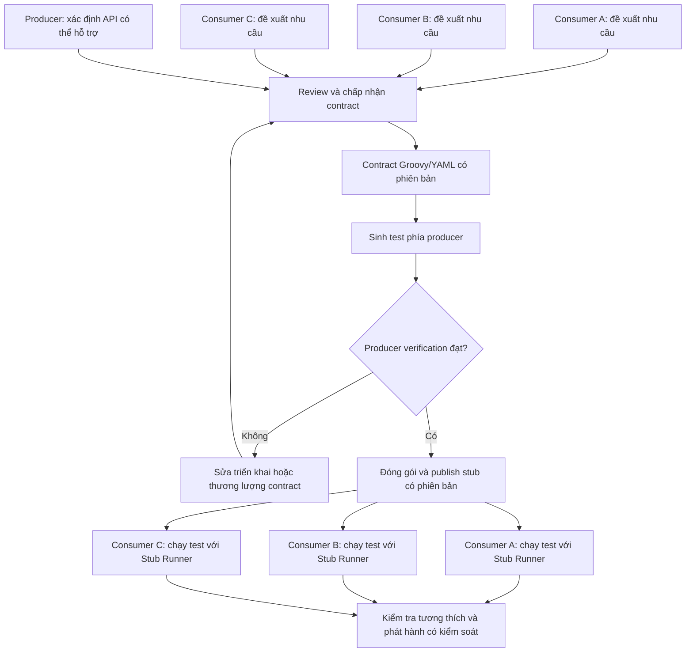

# Phạm vi trách nhiệm của producer và từng consumer

> **Chương:** Thiết kế hợp đồng  
> **Công nghệ:** Spring Cloud Contract (`SPRING_CLOUD_CONTRACT`)  
> **Trọng tâm:** Phân định ai đề xuất, ai xác nhận, ai kiểm chứng và ai chịu trách nhiệm khi nhiều consumer cùng sử dụng một API hoặc một loại thông điệp.

## Mục tiêu học tập

Sau bài này, bạn có thể:

1. Giải thích sự khác nhau giữa **quyền sở hữu API** của producer, **nhu cầu giao tiếp** của từng consumer và **hợp đồng đã được hai phía chấp nhận**.
2. Liệt kê trách nhiệm của producer và từng consumer trong quy trình thiết kế contract, sinh test phía producer, phát hành stub và chạy Stub Runner.
3. Thiết kế contract cho nhiều consumer sao cho mỗi consumer được bảo vệ trước thay đổi không tương thích mà không ràng buộc producer vào các chi tiết không cần thiết.
4. Xử lý xung đột yêu cầu, thay đổi API, tương thích ngược và quản lý phiên bản contract/stub trên CI.
5. Áp dụng nguyên tắc tương tự cho HTTP và thông điệp bất đồng bộ.

## 1. Tại sao phải phân chia trách nhiệm?

Một API có thể phục vụ nhiều ứng dụng, nhưng **mỗi consumer chỉ sử dụng một phần hành vi của API**. Khi producer thay đổi một field, một consumer có thể hoàn toàn không bị ảnh hưởng trong khi consumer khác gặp lỗi.

Xét hệ thống quản lý tồn kho:

- **`inventory-service`:** producer cung cấp thông tin tồn kho và thao tác giữ hàng.
- **`checkout-service`:** consumer cần biết có thể bán sản phẩm hay không.
- **`fulfillment-service`:** consumer cần tạo phiếu giữ hàng và nhận mã xác nhận.
- **`reporting-service`:** consumer đọc số lượng tồn kho để xây báo cáo.

Ví dụ producer trả:

```http
GET /api/stock/SKU-001 HTTP/1.1
Accept: application/json
```

```json
{
  "sku": "SKU-001",
  "available": true,
  "quantity": 8,
  "warehouse": "HCM-01"
}
```

Mỗi consumer có nhu cầu riêng:

| Consumer | Dữ liệu/hành vi phụ thuộc | Rủi ro khi thay đổi |
| --- | --- | --- |
| `checkout-service` | `available` kiểu boolean, mã trạng thái khi không tìm thấy SKU | Checkout có thể từ chối hoặc chấp nhận đơn sai |
| `reporting-service` | `quantity` kiểu số nguyên, `sku` để đối soát | Báo cáo không đọc được dữ liệu hoặc tính toán sai |
| `fulfillment-service` | `POST /api/reservations`, định dạng request và response xác nhận | Không giữ được hàng hoặc xử lý trùng yêu cầu |

Nếu một người nói "producer sở hữu API nên có thể sửa tùy ý", họ đang bỏ qua những consumer đang phụ thuộc hành vi đã phát hành. Ngược lại, nếu một consumer nói "tôi cần mọi trường nội bộ phải giữ nguyên", họ có thể khóa cứng thiết kế của producer mà không có lý do nghiệp vụ.

**Cách hiểu đúng:** producer chịu trách nhiệm **thực thi và duy trì giao diện đã cam kết**; từng consumer chịu trách nhiệm **nêu chính xác nhu cầu của mình và chứng minh mình sử dụng giao diện đó đúng cách**. Contract là thỏa thuận được kiểm chứng giữa hai bên, không phải tài liệu do một bên viết là tự động có hiệu lực.

## 2. Ba lớp trách nhiệm cần phân biệt

### 2.1. Producer sở hữu triển khai và các cam kết đã công bố

Producer sở hữu code, mô hình dữ liệu nội bộ, cơ chế lưu trữ và việc triển khai endpoint hoặc phát message. Producer quyết định cách thực thi miễn là kết quả quan sát được vẫn thỏa những hợp đồng đang được hỗ trợ.

Ví dụ `inventory-service` có thể đổi từ PostgreSQL sang Redis hoặc đổi thuật toán tính tồn kho mà không cần consumer biết, **nếu** hành vi API mà consumer dựa vào vẫn giữ nguyên.

### 2.2. Mỗi consumer sở hữu nhu cầu và cách sử dụng

Consumer hiểu rõ mình cần trường nào, status nào, sự kiện nào, nhánh lỗi nào và xử lý response ra sao.

Ví dụ `checkout-service` có quyền đề xuất: "tôi cần `available` là boolean". Consumer không có quyền đòi producer giữ nguyên tên bảng `stock_items` trong database, vì đó là chi tiết triển khai nằm ngoài giao diện.

### 2.3. Contract được cả hai phía chấp nhận

Contract thể hiện phần giao nhau giữa **điều consumer cần** và **điều producer cam kết cung cấp**:

- Consumer đề xuất hành vi quan sát được và ví dụ minh chứng.
- Producer review tính hợp lệ, khả năng thực hiện và xung đột với các hợp đồng khác.
- Khi được chấp nhận, contract trở thành **đầu vào kiểm thử có phiên bản**.
- Test phía producer xác nhận triển khai thỏa contract; stub từ contract đã được kiểm chứng giúp consumer phát triển và test độc lập.

Hợp đồng có thể do consumer mở pull request, do producer soạn theo yêu cầu đã thống nhất hoặc được quản lý trong kho contract riêng. **Vị trí lưu file không tự quyết định ai có trách nhiệm với nội dung.**

## 3. Trách nhiệm cụ thể của producer

### 3.1. Làm rõ ranh giới API được công bố

Producer phải xác định điều gì là giao diện công khai để consumer có thể dựa vào:

- HTTP method, path, query parameter, header, media type và request body.
- HTTP status, response header, cấu trúc body, kiểu dữ liệu và semantics của các trường.
- Hành vi trong những trường hợp đã cam kết: thành công, không tồn tại, input không hợp lệ, xung đột, từ chối nghiệp vụ.
- Với messaging: destination, loại sự kiện, payload, header và điều kiện phát sự kiện đã được cam kết.
- Các quy tắc phiên bản hóa, deprecation và cửa sổ tương thích nếu hệ thống có chính sách như vậy.

Producer **không cần** công khai database schema, class nội bộ hay đường đi của từng hàm chỉ vì consumer muốn xác nhận một response.

### 3.2. Review contract trước khi chấp nhận

Producer không nên merge ngay một contract chỉ vì consumer đề xuất. Cần đánh giá:

1. Request/response mô tả hành vi API thực sự hỗ trợ hay hành vi dự định bổ sung?
2. Dữ liệu nào ổn định, dữ liệu nào chỉ là ví dụ và cần dùng matcher?
3. Có contract khác đưa ra yêu cầu mâu thuẫn trên cùng request hay không?
4. Thay đổi này có làm hỏng các consumer hoặc phiên bản ứng dụng đang chạy không?
5. Contract có kiểm tra đúng thứ consumer cần mà không áp đặt dữ liệu nội bộ?

Ví dụ: nếu `reporting-service` yêu cầu trường `warehouse` nhưng producer chỉ cung cấp tổng tồn kho toàn hệ thống, hai đội phải thống nhất mở rộng API, tách endpoint hoặc chỉnh yêu cầu. Không thể coi việc consumer tự thêm field vào YAML là bằng chứng producer đã hỗ trợ field đó.

### 3.3. Sinh và chạy test trên triển khai thật của producer

Trong Spring Cloud Contract, contract Groovy/YAML được dùng để **sinh test phía producer**. Tùy cấu hình dự án, generated test có thể đi qua MockMvc, WebTestClient, RestAssured hoặc cơ chế kiểm chứng messaging.

Producer chịu trách nhiệm:

- Cấu hình plugin, phiên bản dependency và base test class.
- Tạo fixture/trạng thái dữ liệu đủ ổn định để chạy contract test.
- Đảm bảo generated test thực thi trên controller hoặc luồng phát thông điệp phù hợp.
- Đưa contract verification vào CI của producer, làm build thất bại khi vi phạm hợp đồng bắt buộc.
- Không sửa expected response cùng lúc với code chỉ để hợp thức hóa một thay đổi phá vỡ tương thích.

**Test được sinh ra chưa phải bảo đảm.** Bảo đảm chỉ có ý nghĩa khi test đã được chạy thành công trên phiên bản producer tương ứng và các trường hợp quan trọng được mô tả trong contract.

### 3.4. Phát hành stub có thể truy vết

Producer (hoặc pipeline do producer sở hữu) đóng gói và phát hành stub artifact sau khi kiểm chứng, thường là JAR có classifier `stubs` trong repository Maven/Gradle artifact được tổ chức sử dụng.

Producer phải làm rõ:

- Artifact thuộc service nào, phiên bản nào và lấy từ commit/build nào.
- Stub tương ứng với bộ contract nào và đã vượt producer verification chưa.
- Consumer tìm được stub bằng tọa độ/phiên bản ổn định như thế nào.
- Chính sách giữ các phiên bản cũ để consumer còn chạy bản cũ có thể tiếp tục test.

Không nên công bố một stub chưa được kiểm chứng như "bằng chứng producer chắc chắn tương thích".

### 3.5. Kiểm soát thay đổi API và thông báo tác động

Trước khi bỏ field, đổi kiểu, đổi status hay semantics, producer phải kiểm tra:

- Những contract đã chấp nhận nào đang dùng hành vi đó?
- Những consumer nào còn triển khai phiên bản cũ?
- Thay đổi có thể tương thích ngược hay phải bổ sung endpoint, media type hoặc phiên bản API?
- Có thể áp dụng quy trình mở rộng trước, chuyển consumer sau, thu hồi phần cũ cuối cùng không?

Producer kiểm soát lịch phát hành code của mình, nhưng không thể giả định mọi consumer luôn nâng cấp đồng thời.

## 4. Trách nhiệm của **từng** consumer

Mỗi consumer là một bên tham gia độc lập. Yêu cầu của `checkout-service` không tự đại diện cho `reporting-service`; việc checkout test xanh không chứng minh reporting hoạt động.

### 4.1. Xác định những phụ thuộc mà mình thực sự sử dụng

Consumer nên chỉ ra:

- Endpoint/message nào được gọi/nhận, với input hợp lệ nào.
- Field/header/status nào thực sự quyết định nghiệp vụ.
- Kiểu dữ liệu, tính bắt buộc, ý nghĩa null/vắng mặt và điều kiện lỗi quan trọng.
- Những nhánh response/message nào cần được mô tả để ứng dụng hành xử đúng.

Chẳng hạn, `checkout-service` cần biết `available` là boolean và cách xử lý `404`. Nếu không dùng `warehouse`, checkout không nên yêu cầu giữ cố định giá trị `HCM-01` chỉ để test xanh.

Một consumer vẫn có thể quan sát trường không thuộc nhu cầu kinh doanh, nhưng **đừng biến toàn bộ snapshot response thành ràng buộc bắt buộc** nếu không cần.

### 4.2. Đề xuất contract có thể thực thi và có thể review

Consumer cung cấp ví dụ request và kỳ vọng response, ưu tiên những trường hợp phản ánh quyết định nghiệp vụ.

Ví dụ, yêu cầu "khi SKU không tồn tại thì phản hồi `404` với error code `STOCK_NOT_FOUND`" rõ ràng hơn "API phải báo lỗi đúng".

Consumer cần trao đổi với producer nếu chưa thống nhất behavior; không tự coi contract draft là contract đã được hỗ trợ.

### 4.3. Test code của mình với stub đã được xác nhận

Với Spring Cloud Contract Stub Runner, consumer có thể tải stub artifact đã phát hành và khởi động stub service trong bài test.

Consumer chịu trách nhiệm:

- Chọn phiên bản stub phù hợp với phiên bản API mà mình sẽ chạy.
- Cấu hình HTTP client/message consumer trỏ đến stub trong môi trường test.
- Kiểm tra code tạo request đúng, parse response đúng và chuyển thành hành vi nghiệp vụ đúng.
- Kiểm tra cả lỗi đã cam kết, ví dụ không có hàng, `404`, `409` hoặc message thiếu điều kiện hợp lệ nếu có contract tương ứng.
- Không viết test chỉ assert stub server trả đúng nội dung mẫu; cần assert **hành vi của consumer** sau khi nhận phản hồi.

Stub Runner không thay thế kiểm chứng producer và cũng không chứng minh API hoạt động đúng trong môi trường production.

### 4.4. Chịu trách nhiệm với phần nằm ngoài contract

Consumer vẫn phải quản lý lỗi mạng, timeout, retry, circuit breaker, idempotency, mapping dữ liệu, quy tắc nghiệp vụ, bảo mật và quan sát hệ thống theo yêu cầu ứng dụng.

Một contract chỉ mô tả `200`/`404` không đảm bảo producer luôn online, có latency thấp hay message không bao giờ bị gửi trùng. Những thuộc tính đó cần test hoặc cơ chế vận hành khác nếu chúng là yêu cầu của hệ thống.

### 4.5. Không áp đặt nhu cầu của mình lên consumer khác

Khi `reporting-service` cần `quantity` còn `checkout-service` chỉ cần `available`:

- Reporting bổ sung yêu cầu của reporting theo quy trình review.
- Checkout không phải sửa test nếu API vẫn đáp ứng giao diện checkout đã chấp nhận.
- Producer cần kiểm chứng **tất cả** contract còn được hỗ trợ, không chỉ contract của consumer được sửa gần nhất.
- Nhóm có thể hợp nhất các contract có cùng hành vi, nhưng phải giữ được khả năng truy vết consumer nào còn phụ thuộc điều gì.

Không nhất thiết phải có một stub JAR riêng cho mỗi consumer. Có thể phát hành một bộ stub từ nhiều contract, hoặc dùng cách phân chia theo consumer khi dự án cấu hình và có nhu cầu. Đơn vị quản trị quan trọng là **cam kết còn hiệu lực** và **consumer được bảo vệ**.

## 5. Ma trận phân vai khi làm contract

| Hoạt động | Producer | Từng consumer | Kết quả mong đợi |
| --- | --- | --- | --- |
| Xác định nghiệp vụ phía gọi | Thảo luận tính khả thi | **Đề xuất, chịu trách nhiệm mô tả nhu cầu** | Request/response cần dùng được phát biểu rõ |
| Xác định khả năng và semantics của API | **Quyết định, công bố và giải thích** | Review theo nhu cầu | API có ý nghĩa nhất quán |
| Viết hoặc chỉnh contract draft | Cùng viết/review | Cùng viết/review; thường khởi xướng trong CDC | Contract thể hiện hành vi có thể kiểm tra |
| Chấp nhận contract vào giao diện hỗ trợ | **Xác nhận có thể và sẽ đáp ứng** | **Xác nhận đó là điều mình cần** | Cam kết hai chiều |
| Chạy generated contract test | **Thực thi và sửa producer khi vi phạm** | Góp ý chất lượng ví dụ | Bằng chứng producer đáp ứng |
| Publish stub có phiên bản | **Pipeline producer chịu trách nhiệm** | Chọn và sử dụng phiên bản | Stub truy vết được đến contract/build |
| Chạy consumer test với Stub Runner | Hỗ trợ xử lý thiếu hụt contract/stub | **Thực thi và sửa consumer khi không tương thích** | Bằng chứng consumer dùng được giao diện đã cam kết |
| Đánh giá breaking change | **Phân tích, đề xuất chiến lược chuyển tiếp** | **Xác nhận tác động và kế hoạch nâng cấp riêng** | Không làm hỏng consumer đang dùng |
| Kiểm thử end-to-end/triển khai | Hợp tác | Hợp tác | Phát hiện lỗi cấu hình, hạ tầng và luồng thực tế |

**CDC (consumer-driven contracts)** nhấn mạnh consumer khởi xướng kỳ vọng. Điều đó không chuyển quyền sở hữu triển khai producer sang consumer. Hợp đồng chỉ đáng tin khi producer công nhận và xác minh.

## 6. Thiết kế hợp đồng khi có nhiều consumer

### 6.1. Tách trách nhiệm theo kịch bản được sử dụng

Một cách tổ chức mang tính minh họa trong repository của producer:

```text
inventory-service/
└── src/test/resources/contracts/
    ├── checkout-service/
    │   └── stock_available.yml
    └── fulfillment-service/
        └── create_reservation.yml
```

Thư mục con giúp con người nhận biết ai đề xuất/đang dùng contract. Cách **đóng gói và lọc stub theo consumer** phụ thuộc cấu hình Spring Cloud Contract/Stub Runner của dự án; tên thư mục một mình không đảm bảo consumer chỉ nhận được đúng bộ stub của mình.

Các nhóm cũng có thể dùng kho contract độc lập để consumer gửi pull request, sau đó producer kéo contract về trong build. Cần có quy trình đồng bộ, review, versioning rõ ràng cho mô hình này.

### 6.2. Contract HTTP phục vụ checkout

`checkout-service` cần biết SKU còn bán được. Một contract đơn giản dùng YAML DSL:

```yaml
description: "Checkout co the kiem tra hang con ban duoc"
name: checkout_stock_available
request:
  method: GET
  url: /api/stock/SKU-001
  headers:
    Accept: application/json
response:
  status: 200
  headers:
    Content-Type: application/json
  body:
    sku: SKU-001
    available: true
    quantity: 8
    warehouse: HCM-01
```

Đặt tại `src/test/resources/contracts/checkout-service/stock_available.yml`. Ví dụ response mô tả nội dung producer trả cho SKU fixture trong bài test. **Không có nghĩa checkout cần kiểm tra cả bốn trường.** Contract thể hiện response của endpoint; consumer có thể chỉ dựa vào `sku` và `available`. Nếu `quantity`/`warehouse` là dữ liệu biến động, cần bổ sung matcher trong DSL hoặc đưa chúng vào scenario test được kiểm soát; tránh khóa chặt giá trị mẫu khi không phải điều cần cam kết.

Sau khi thống nhất các trường hợp thiết yếu, checkout nên đề xuất thêm contract riêng cho `404` hoặc response hết hàng, nếu các trường hợp đó quyết định luồng nghiệp vụ.

### 6.3. Contract HTTP phục vụ fulfillment

`fulfillment-service` dùng hành vi khác: giữ hàng cho một đơn.

```yaml
description: "Fulfillment tao phieu giu hang thanh cong"
name: fulfillment_create_reservation
request:
  method: POST
  url: /api/reservations
  headers:
    Content-Type: application/json
  body:
    orderId: ORD-1001
    sku: SKU-001
    quantity: 2
response:
  status: 201
  headers:
    Content-Type: application/json
  body:
    reservationId: RSV-1001
    status: CONFIRMED
```

Đặt tại `src/test/resources/contracts/fulfillment-service/create_reservation.yml`.

Những contract này độc lập về request và kỳ vọng. Checkout chỉ cần GET tồn kho; fulfillment cần POST giữ hàng. Producer có thể thay đổi thuật toán giữ hàng nội bộ miễn response đã cam kết vẫn đúng.

Ví dụ trên dùng giá trị cố định cho dễ học. Trong hệ thống thật, mã đặt hàng, ID reservation và tồn kho thường biến thiên: có thể dùng matcher, giá trị do test kiểm soát hoặc quy tắc ánh xạ phù hợp để kiểm chứng điều consumer thực sự cần. Đừng coi `RSV-1001` là mã mà mọi lần gọi production phải trả.

### 6.4. Nếu hai consumer dùng **cùng một endpoint**

Giả sử checkout dùng `available` và reporting dùng `quantity` trên cùng `GET /api/stock/SKU-001`. Có hai hướng thiết kế thường gặp:

1. **Một contract dùng chung:** producer cam kết response có cả những phần mà hai consumer cần; các consumer test logic riêng với cùng stub.
2. **Nhiều contract theo tình huống/consumer:** giữ riêng nhu cầu, nhưng phải đảm bảo các contract đồng thời có thể được một triển khai producer thỏa và các mapping stub không xung đột.

Cần tránh viết **hai contract có request hoàn toàn giống nhau nhưng response mâu thuẫn** (ví dụ một bên bắt `available: true`, bên kia bắt `available: false` với cùng trạng thái dữ liệu). Producer không thể cam kết cả hai câu trả lời cho cùng điều kiện; Stub Runner/WireMock cũng có thể khớp nhầm mapping nếu không có quy tắc phân biệt.

Nếu response khác theo trạng thái thực tế, hãy mô tả **điều kiện đầu vào/trạng thái fixture**, request/header khác biệt hoặc matcher thích hợp; không dùng tên consumer như một điều kiện giả tạo để giải thích hai phản hồi đối nghịch.

## 7. Một vòng đời contract đi qua các bên như thế nào?



Sơ đồ thể hiện **trách nhiệm và thứ tự bảo đảm logic**. Tùy chiến lược phát triển, các đội có thể dùng stub draft để phát triển sớm, nhưng không nên coi draft chưa được producer verification là bằng chứng về API thật.

### Bước 1 — Consumer nêu nhu cầu, producer phản hồi

Consumer mở một đề xuất có request, response, ý nghĩa dữ liệu và trường hợp lỗi. Producer xác nhận khả năng hỗ trợ và các cam kết cũ có liên quan.

### Bước 2 — Hai phía chấp nhận contract

Contract được lưu trong kho phù hợp quy trình của đội, được code review và gắn với thay đổi nghiệp vụ. Cần phân biệt **contract draft**, **contract đã chấp nhận** và **contract đang hỗ trợ trên production**.

### Bước 3 — Producer chạy generated test

Spring Cloud Contract sinh test từ DSL, producer cung cấp cấu hình để test thực sự gọi được controller/luồng messaging tương ứng. Nếu API trả sai kiểu hoặc sai status, test phải thất bại.

### Bước 4 — Producer publish stub

Sau khi kiểm chứng thành công, producer đóng gói stub artifact và cung cấp tọa độ/phiên bản. Artifact nên liên kết được với commit và pipeline verification để consumer không dùng nhầm một stub tự tạo.

### Bước 5 — Từng consumer kiểm thử mã của mình

Consumer cấu hình Stub Runner, gọi qua HTTP client thật của mình rồi assert hành vi nghiệp vụ. Test của consumer A không thay thế cho test của consumer B.

### Bước 6 — CI chặn thay đổi không tương thích

Producer CI kiểm tra những hợp đồng vẫn được hỗ trợ. Consumer CI kiểm tra phiên bản stub/API mục tiêu mà consumer dự kiến dùng. Với thay đổi có thể phá phiên bản đang chạy, pipeline cần thêm cách kiểm tra sự tương thích với consumer cũ hoặc kế hoạch chuyển tiếp.

## 8. Stub Runner: bên nào làm gì?

Consumer sử dụng stub đã được publish để không phải khởi động producer thật trong mỗi vòng test. Ví dụ:

```java
@SpringBootTest(properties = {
    "inventory.base-url=http://localhost:8090"
})
@AutoConfigureStubRunner(
    ids = "com.example:inventory-service:1.4.0:stubs:8090",
    stubsMode = StubRunnerProperties.StubsMode.LOCAL
)
class CheckoutContractIT {

    @Autowired CheckoutService checkout;

    @Test
    void checkoutChoPhepDatHangKhiConTonKho() {
        assertThat(checkout.canCheckout("SKU-001", 2)).isTrue();
    }
}
```

Đây là trích đoạn minh họa JUnit, AssertJ, Spring Boot và Spring Cloud Contract; import và các class nghiệp vụ do ứng dụng cung cấp. `inventory.base-url` là **property giả định** dùng trong ví dụ, cần được HTTP client của checkout đọc đúng. Các dự án thường chọn cổng động khi chạy song song.

Ý nghĩa của hai trách nhiệm khác nhau:

- **Producer:** bảo đảm artifact `com.example:inventory-service:1.4.0:stubs` phản ánh contract mà producer **đã vượt kiểm chứng**, đồng thời quy định phiên bản tương thích.
- **Checkout:** trỏ client vào stub, gửi request giống production, kiểm tra mình xử lý phản hồi đúng. Checkout không tự quyết định rằng stub đồng nghĩa với môi trường production khỏe mạnh.
- **Fulfillment và reporting:** có bài test và kỳ vọng riêng; có thể dùng cùng artifact đã kiểm chứng nhưng vẫn phải tự chạy test của mình.

Trong chế độ `LOCAL`, Stub Runner đọc artifact từ kho local; môi trường CI có thể dùng chế độ tương ứng với repository từ xa và cấu hình thông tin truy cập phù hợp. Mã ví dụ không thay thế các cấu hình dependency, plugin sinh stub, build và publish cần có trong dự án thật.

## 9. Xử lý xung đột giữa nhiều consumer

### Xung đột A — Hai consumer muốn định dạng khác nhau

`checkout-service` muốn `available` boolean, nhưng một consumer cũ mong `available` chuỗi `"Y"`/`"N"`.

**Producer nên làm gì?** Kiểm tra hợp đồng nào đang có hiệu lực. Nếu cả hai đều đã được hỗ trợ, không đổi kiểu âm thầm. Có thể giữ định dạng cũ trong API v1 và giới thiệu API v2, dùng media type versioning hoặc một endpoint mới với semantics rõ ràng. Thời điểm xóa v1 phụ thuộc kế hoạch chuyển consumer.

**Consumer nên làm gì?** Nêu hạn chế hệ thống, xác nhận hỗ trợ các phiên bản và kiểm thử migration bằng stub của phiên bản mục tiêu. Không buộc consumer khác đổi đồng thời trừ khi đã có kế hoạch đồng thuận.

### Xung đột B — Một consumer muốn đưa chi tiết nội bộ vào contract

`reporting-service` đề xuất response bắt buộc có `inventoryTableName`.

**Producer nên làm gì?** Hỏi consumer thực sự cần gì: thống kê theo warehouse, lịch sử điều chỉnh hay loại tồn kho? Cung cấp trường/endpoint nghiệp vụ ổn định, không phơi bày tên bảng nội bộ.

**Consumer nên làm gì?** Diễn đạt bài toán nghiệp vụ và chọn giao diện đã được review, không ràng buộc vào implementation.

### Xung đột C — Contract cố định dữ liệu động

Một consumer yêu cầu `reservationId` luôn bằng `RSV-1001`.

**Producer nên làm gì?** Thảo luận liệu đó chỉ là fixture minh họa hay một giá trị được bảo đảm. Nếu ID biến động, dùng matcher kiểm tra cấu trúc/kiểu hoặc kiểm soát fixture test; giữ contract có ý nghĩa thực tế.

**Consumer nên làm gì?** Test khả năng nhận ID hợp lệ và truyền tiếp ID theo nghiệp vụ, không cứng hóa một giá trị mẫu từ stub.

### Xung đột D — Producer muốn xóa trường chưa còn dùng ở consumer mới

Producer thấy consumer mới không dùng `quantity` nên định xóa field, nhưng reporting cũ vẫn đọc field đó.

**Producer nên làm gì?** Xem đầy đủ hợp đồng còn được hỗ trợ, không căn cứ vào consumer gần nhất. Giữ `quantity` trong phiên bản đang hỗ trợ hoặc tạo chiến lược chuyển đổi.

**Từng consumer nên làm gì?** Chủ động thông báo/duy trì contract thể hiện nhu cầu còn tồn tại, thực hiện kế hoạch cập nhật và xác nhận phiên bản tối thiểu có thể vận hành.

## 10. Ai chịu trách nhiệm khi contract test thất bại?

Không nên quy mọi test đỏ về producer hoặc consumer chỉ vì tên test. Cần xem **loại bằng chứng**:

| Tín hiệu CI | Cách hiểu trước tiên | Người chủ trì xử lý |
| --- | --- | --- |
| Generated test phía producer thất bại sau khi producer sửa response | Triển khai producer đang lệch contract đã chấp nhận | **Producer**; trao đổi consumer nếu cần thay contract |
| Consumer test với stub đúng phiên bản thất bại vì deserialize response | Client consumer không xử lý đúng dữ liệu đã cam kết hoặc chọn sai phiên bản | **Consumer**; producer hỗ trợ kiểm tra contract/artifact |
| Consumer yêu cầu field chưa được producer chấp nhận | Contract đang ở trạng thái đề xuất, chưa phải khả năng đã hỗ trợ | **Hai bên** thương lượng và chấp nhận phạm vi |
| Test chạy xanh với stub nhưng staging lỗi DNS/TLS | Contract không kiểm chứng cấu hình mạng/triển khai | **Nhóm sở hữu cấu hình/hạ tầng liên quan** |
| Hai stub cùng khớp request và trả response khác nhau | Thiết kế contract hoặc mapping thiếu điều kiện phân biệt | **Hai bên** sửa định nghĩa; producer kiểm chứng và publish lại |
| Consumer cũ lỗi sau một thay đổi API dù test contract mới xanh | Pipeline bỏ sót cam kết cũ hoặc đã ngừng hỗ trợ quá sớm | **Producer chủ trì khôi phục tương thích**, phối hợp consumer chuyển tiếp |

Bất kỳ bên nào cũng có thể phát hiện lỗi. Trách nhiệm chủ trì thể hiện nơi cần sửa để khôi phục cam kết, không phải quy kết ai "có lỗi".

## 11. Phạm vi trách nhiệm khi kiểm thử thông điệp

Bài học không chỉ áp dụng cho HTTP. Với producer phát sự kiện `StockReserved`:

```json
{
  "eventType": "StockReserved",
  "orderId": "ORD-1001",
  "sku": "SKU-001",
  "reservedQuantity": 2
}
```

Giả sử:

- `inventory-service` là **message producer**.
- `shipping-service` chỉ bắt đầu giao hàng khi có sự kiện giữ hàng thành công.
- `analytics-service` tổng hợp số lượng đã giữ theo SKU.

**Producer chịu trách nhiệm:** phát thông điệp có destination/header/payload và các semantics đã cam kết, sinh hoặc chạy verification thích hợp từ messaging contract, giữ tương thích với consumer đang dùng schema cũ.

**`shipping-service` chịu trách nhiệm:** mô tả trường trạng thái và mã đơn cần dùng, xử lý message đúng, không phụ thuộc các trường ngoài giao kèo, tự kiểm thử duplicate handling/idempotency nếu nghiệp vụ yêu cầu.

**`analytics-service` chịu trách nhiệm:** mô tả sự phụ thuộc vào `reservedQuantity` kiểu số, chuyển đổi và tổng hợp đúng, quản lý schema evolution tương ứng phiên bản đang sử dụng.

Spring Cloud Contract hỗ trợ DSL cho hợp đồng thông điệp, nhưng nội dung và cách setup có khác HTTP (ví dụ trigger, input/output message, destination, matcher). Kiểm tra cấu trúc message **không tự chứng minh** broker thật hoạt động, consumer group được cấu hình chuẩn hoặc hệ thống bảo đảm thứ tự/không trùng thông điệp; cần integration test/E2E và cơ chế vận hành phù hợp.

## 12. Thiết kế CI để bảo vệ producer và từng consumer

Một pipeline tham khảo:

| Giai đoạn | Trách nhiệm | Điều kiện đạt |
| --- | --- | --- |
| Contract review | Producer cùng consumer liên quan | Nhu cầu và khả năng thực hiện đã thống nhất; không mâu thuẫn contract đang hỗ trợ |
| Producer unit/integration | Producer | Logic, web layer, persistence và phụ thuộc trong phạm vi test đúng |
| Producer contract verification | Producer | Generated test từ toàn bộ contract còn hiệu lực đạt trên phiên bản triển khai mới |
| Publish stubs | Pipeline producer | Chỉ phát hành artifact truy vết được sau verification đạt |
| Consumer contract/integration | **Từng consumer** | Client và nghiệp vụ xử lý được stub/API mục tiêu |
| Backward compatibility check | Producer phối hợp các consumer còn hoạt động | Những cam kết cũ cần hỗ trợ vẫn được thỏa |
| E2E trọng yếu | Các nhóm liên quan | Luồng thật, cấu hình và tích hợp triển khai hoạt động |

Ví dụ pipeline có thể sắp xếp:

```text
Producer PR:
  review contract changes
      -> build + unit/integration
      -> generate contract tests
      -> run provider contract verification
      -> fail PR nếu vi phạm contract còn hỗ trợ

Producer release:
  verified build
      -> package stub JAR với version
      -> publish artifact + metadata truy vết

Consumer PR:
  resolve verified stubs version mục tiêu
      -> run Stub Runner
      -> run consumer integration/contract tests
      -> fail PR nếu consumer không đáp ứng contract

Deployment:
  check compatibility với consumer đang chạy
      -> limited end-to-end smoke checks
```

Không nên cho phép sửa kỳ vọng của tất cả consumer cùng một lúc chỉ để làm xanh CI sau khi producer sửa API. Muốn thay hợp đồng đang hỗ trợ, cần review tương thích và kế hoạch chuyển tiếp.

## 13. Chọn cách versioning và nâng cấp an toàn

### 13.1. Contract, stub và producer build phải có quan hệ truy vết

Một phiên bản stub cụ thể giúp consumer tái lập test. Tuy nhiên, phiên bản stub không tự nói lên toàn bộ mức độ tương thích của producer đang chạy. Cần biết release producer nào đã vượt các contract nào.

Nếu consumer ghim mãi stub v1.4.0, các bài test sẽ phản ánh **v1.4.0**; chúng không tự cảnh báo khi một producer v1.6.0 sau này làm hỏng API. Vì vậy producer cần chạy verification với các contract cũ còn hiệu lực hoặc có cơ chế kiểm tra tương thích được đội thống nhất.

### 13.2. Quy trình mở rộng trước, thu hẹp sau

Ví dụ muốn thay `available: boolean` bằng cấu trúc giàu thông tin hơn:

1. **Thêm** `availabilityStatus` cùng với `available` đang hỗ trợ.
2. Cập nhật contract để mô tả hành vi mới, vẫn giữ contract cũ trong giai đoạn chuyển đổi.
3. Publish stub đã kiểm chứng; mỗi consumer nâng cấp khi sẵn sàng và chạy test của mình.
4. Theo dõi consumer thực tế đã bỏ phụ thuộc vào `available` hay chưa.
5. **Chỉ sau khi cam kết cũ hết hiệu lực theo chính sách**, xóa `available` hoặc chuyển sang API version mới.

Đây là một chiến lược tương thích. Không phải thay đổi bổ sung nào cũng tự động an toàn: consumer có thể từ chối unknown fields, schema validator có thể yêu cầu exact shape, hoặc semantics của field mới làm thay đổi nghiệp vụ.

### 13.3. Danh sách consumer là thông tin quản trị quan trọng

Producer không thể đánh giá đầy đủ tác động nếu không biết ai đang gọi API hoặc nhận message. Nên có ít nhất một danh sách consumer còn hoạt động, phiên bản API đang dùng, chủ sở hữu và kế hoạch nâng cấp. Contract cùng với telemetry, dependency inventory hoặc đăng ký consumer có thể cung cấp bằng chứng bổ sung; **không nên mặc định rằng mọi consumer thực tế đều đã có contract trong repo**.

## 14. Checklist thiết kế contract khi có nhiều consumer

Trước khi đưa contract vào CI, kiểm tra những câu hỏi sau:

- **Consumer:** Ai sẽ sử dụng hành vi này? Kịch bản nào khiến nó quan trọng?
- **Producer:** API/message có thực sự hỗ trợ và có thể kiểm chứng hành vi này không?
- **Nội dung:** Những trường, trạng thái và error case thiết yếu đã được mô tả chưa?
- **Mức ràng buộc:** Có hard-code ID, timestamp, giá trị động hoặc chi tiết nội bộ vô ích không?
- **Xung đột:** Có contract khác cùng request nhưng kỳ vọng trái ngược mà chưa phân biệt điều kiện không?
- **Kiểm chứng:** Generated test có thực sự chạy trên producer không, hay chỉ sinh file?
- **Stub:** Artifact nào được publish, có version và dấu vết producer verification không?
- **Consumer:** Từng consumer có test code của mình với stub phù hợp không?
- **Tương thích:** Những consumer còn dùng bản cũ có tiếp tục được hỗ trợ theo chính sách không?
- **Vận hành:** Những rủi ro ngoài contract (network, broker, security, timeout, retries) có test/cơ chế riêng không?

Không cần chuyển tất cả các câu này thành một hợp đồng khổng lồ. Mục tiêu là **một bộ thỏa thuận nhỏ, rõ và kiểm chứng được**, được cập nhật cùng nhu cầu thực tế.

## 15. Bài tập thực hành

### Bài 1 — Xác định quyền sở hữu

Cho tình huống:

- `checkout-service` cần `available`.
- `reporting-service` cần `quantity`.
- `inventory-service` muốn đổi kiểu `quantity` từ integer sang chuỗi `"8"`.

Hãy trả lời:

1. Ai phải kiểm tra ảnh hưởng của thay đổi trước khi merge?
2. Contract của consumer nào nhiều khả năng bị phá?
3. Ai cần thực thi producer verification? Ai cần thực thi consumer test?
4. Nếu reporting chưa thể nâng cấp ngay, hãy đề xuất một hướng tương thích.

**Gợi ý:** Producer đánh giá toàn bộ cam kết; reporting bị ảnh hưởng trực tiếp; producer chạy generated test và reporting chạy test với stub; có thể giữ integer ở phiên bản cũ và đưa cách biểu diễn mới vào field/API version khác.

### Bài 2 — Review contract trước khi chấp nhận

Một consumer gửi yêu cầu: "Response của mọi đơn phải có `reservationId = RSV-1001` và `warehouse = HCM-01`, dù đơn tạo ở kho nào."

Hãy chỉ ra trường hợp nào là fixture để kiểm thử, trường hợp nào là cam kết hợp lý, và cách sửa contract để dữ liệu động không bị khóa cứng. Giải thích vì sao việc một consumer tự đặt giá trị trong file YAML chưa đủ để producer phải chấp nhận.

**Gợi ý:** Cần phân biệt dữ liệu mẫu và quy tắc nghiệp vụ; dùng matcher hoặc fixture có trạng thái kiểm soát. Đề xuất phải được producer review để trở thành cam kết chung.

### Bài 3 — Thiết kế CI

Hãy vẽ sơ đồ pipeline gồm producer PR, producer release, consumer PR và bước kiểm tra tương thích với consumer còn chạy bản cũ. Đánh dấu ai sở hữu từng bước và tình huống nào phải chặn phát hành.

**Tiêu chí hoàn thành:** Pipeline thể hiện được luồng `contract → generated provider test → verified stub → Stub Runner → consumer test` và không đồng nhất việc consumer test xanh với bằng chứng producer mới đã tương thích.

## Tài liệu tham khảo

- [Spring Cloud Contract Reference Documentation](https://docs.spring.io/spring-cloud-contract/reference/).
- [Spring Cloud Contract — Contract DSL](https://docs.spring.io/spring-cloud-contract/reference/project-features-contract.html).
- [Spring Cloud Contract — Consumer Driven Contracts](https://docs.spring.io/spring-cloud-contract/reference/).
- [Spring Cloud Contract — Stub Runner](https://docs.spring.io/spring-cloud-contract/reference/project-features-stubrunner/stub-runner-core.html).
