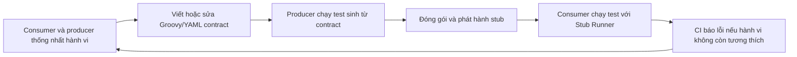

# Tiêu chí đánh giá một hợp đồng có thể duy trì lâu dài

## 1. Vì sao một hợp đồng chạy đúng hôm nay vẫn có thể khó duy trì?

Trong **Spring Cloud Contract**, hợp đồng (contract) mô tả hành vi mà một dịch vụ cung cấp cho bên sử dụng: yêu cầu HTTP nào được chấp nhận, phản hồi nào được trả về, hoặc thông điệp nào được phát/nhận. Từ hợp đồng viết bằng **Groovy DSL hoặc YAML DSL**, công cụ có thể sinh kiểm thử phía **producer** và tạo **stub** để **consumer** kiểm thử khi chưa cần chạy producer thật.

Một hợp đồng có thể hợp lệ về cú pháp, sinh test thành công nhưng vẫn trở nên tốn kém khi API phát triển. Ví dụ, nếu hợp đồng buộc `createdAt` luôn bằng một thời điểm cụ thể, test có thể thất bại mỗi lần dữ liệu thay đổi dù chức năng phục vụ consumer không hề sai. Ngược lại, nếu hợp đồng chỉ kiểm tra HTTP `200` mà bỏ qua các trường consumer thực sự sử dụng, một thay đổi phá vỡ tích hợp có thể lọt qua CI.

**Hợp đồng có thể duy trì lâu dài** là hợp đồng bảo vệ được kỳ vọng quan trọng của consumer, phản ánh đúng cam kết của producer và đủ ổn định để hai bên thay đổi phần triển khai nội bộ mà không liên tục phải sửa test. Chất lượng của hợp đồng được đánh giá bằng *khả năng phát hiện lỗi tương thích có ý nghĩa* so với *chi phí cập nhật và vận hành*.

## 2. Các tiêu chí cốt lõi

| Tiêu chí | Dấu hiệu đạt yêu cầu | Dấu hiệu cần xem lại |
|---|---|---|
| **Có nhu cầu consumer rõ ràng** | Biết consumer nào dùng hành vi này, dùng trường nào và để ra quyết định gì | Thêm hợp đồng chỉ vì endpoint tồn tại, không rõ ai cần |
| **Bảo vệ hành vi quan sát được** | Xác nhận method, đường dẫn, trạng thái, nội dung và quy tắc nghiệp vụ quan trọng | Phụ thuộc tên lớp Java, tên bảng, thứ tự gọi hàm hoặc cấu trúc nội bộ |
| **Đủ chặt nhưng không quá ràng buộc** | Kiểm tra giá trị cố định khi giá trị có ý nghĩa; dùng matcher cho dữ liệu biến thiên | Khớp chính xác timestamp, ID ngẫu nhiên, header không quan trọng hoặc toàn bộ JSON không cần thiết |
| **Rõ ngữ nghĩa và trường hợp lỗi** | Phân biệt hợp lệ/không hợp lệ, mã lỗi, trường bắt buộc, kiểu dữ liệu và trạng thái nghiệp vụ | Chỉ kiểm tra đường đi thành công hoặc dùng matcher quá rộng |
| **Dễ hiểu và dễ sửa** | Mỗi hợp đồng có một mục tiêu, tên/mô tả dễ tìm; fixture tối thiểu, có quy ước | Một file bao trùm quá nhiều hành vi, dữ liệu lặp và giá trị bí ẩn |
| **Ổn định, tái lập được** | Sinh test và stub cho cùng kết quả với dữ liệu kiểm soát được | Phụ thuộc đồng hồ thật, mạng ngoài, thứ tự chạy test hay dữ liệu dùng chung |
| **Có chiến lược tương thích** | Đánh giá thay đổi với consumer đang dùng, có lộ trình deprecate/version khi cần | Xóa/đổi tên trường hay mở rộng enum mà không xem tác động |
| **Được thực thi ở cả hai phía** | Producer xác minh hợp đồng, consumer chạy với stub đúng phiên bản, CI báo lỗi khi lệch | Hợp đồng được lưu như tài liệu tĩnh, test/stub không chạy trong pipeline |
| **Có chủ sở hữu và truy vết** | Có người duyệt, liên kết với nhu cầu nghiệp vụ và phiên bản phát hành | Không rõ ai duy trì, khi thất bại không biết thông báo cho ai |
| **An toàn và độc lập môi trường** | Fixture giả lập, không chứa khóa hay dữ liệu cá nhân thật; chạy nhất quán trên máy và CI | Hard-code token thật, địa chỉ môi trường production hoặc thông tin nhạy cảm |

Không nhất thiết mỗi hợp đồng phải thể hiện mọi tình huống của endpoint. Một tập hợp nhỏ các hợp đồng **đại diện cho những cam kết mà consumer dựa vào** thường bền vững hơn một bộ test ghi lại mọi chi tiết phản hồi tình cờ có ở thời điểm tạo test.

## 3. Xác định đúng phạm vi của cam kết

Trước khi viết DSL, cần trả lời bốn câu hỏi:

1. **Ai là consumer?** Chẳng hạn trang thanh toán cần biết đơn hàng đã thanh toán thành công để hiển thị nút tải hóa đơn.
2. **Consumer dựa vào điều gì?** Trường `state`, `id`, mã trạng thái HTTP và quy ước khi đơn hàng không tồn tại có thể là cam kết thực tế; một trường debug nội bộ thì không.
3. **Điều gì phải được giữ ổn định?** Tên và kiểu trường, ý nghĩa của trạng thái, quy ước lỗi, định dạng dữ liệu, tính idempotent nếu API cam kết điều đó.
4. **Điều gì được phép thay đổi?** Thời gian tạo, request ID, thứ tự các thuộc tính JSON, chi tiết lưu trữ, thuật toán bên trong hoặc các trường bổ sung không ảnh hưởng consumer.

Hợp đồng không nhất thiết là bản sao toàn bộ tài liệu OpenAPI. OpenAPI hữu ích để mô tả bề mặt API rộng; một hợp đồng trong Spring Cloud Contract thường tập trung vào **một kịch bản có thể kiểm chứng** cùng dữ liệu vào/ra cụ thể. Hai loại tài liệu có thể bổ trợ nhau: tài liệu API giúp khám phá quy ước, còn contract test xác nhận rằng hành vi đã cam kết vẫn chạy được.

### Ví dụ: một hợp đồng HTTP có chủ đích

Giả sử dịch vụ đơn hàng cung cấp `GET /v1/orders/42`. Consumer cần `id`, `state`, `totalAmount` và `currency` để hiển thị đơn hàng đã thanh toán. Hợp đồng YAML sau mô tả một tình huống với dữ liệu kiểm thử cố định:

```yaml
description: "Trả thông tin tối thiểu của đơn hàng đã thanh toán"
request:
  method: GET
  url: /v1/orders/42
  headers:
    Accept: application/json
response:
  status: 200
  headers:
    Content-Type: application/json
  body:
    id: 42
    state: PAID
    totalAmount: 120000
    currency: VND
```

Đây là ví dụ một **kịch bản**, không phải quy tắc rằng mọi đơn hàng đều có ID `42`, tổng tiền `120000` hay trạng thái `PAID`. Producer cần bố trí dữ liệu test tương ứng để kiểm thử sinh ra có thể thực thi. Stub trả phản hồi mẫu giúp consumer kiểm tra logic với trạng thái `PAID` mà không cần phụ thuộc producer đang chạy.

Nếu `state` chỉ được phép nhận một tập giá trị đã công bố thì hợp đồng phải giữ đúng ngữ nghĩa của tập đó. Không nên thay bằng mẫu `.*` vì khi ấy chuỗi sai như `UNKNOWN_INTERNAL` vẫn vượt qua phép kiểm tra. Ngược lại, với trường `requestId` sinh ngẫu nhiên hoặc `generatedAt` động, có thể dùng **body matcher** trong Spring Cloud Contract (chẳng hạn kiểm tra định dạng UUID/ISO-8601) cùng một **giá trị cụ thể cho phía stub**. Với Groovy DSL, Spring Cloud Contract hỗ trợ biểu thức giá trị khác nhau cho consumer và producer; với YAML DSL, có thể cấu hình `matchers` cho phần body. Cần chọn mẫu đủ chặt để thể hiện định dạng đã cam kết, thay vì nới lỏng mọi trường.

### Ví dụ hợp đồng quá giòn và cách cải thiện

Một hợp đồng dễ hỏng có thể yêu cầu phản hồi chứa đồng thời `serverBuild: "481"`, `generatedAt: "2026-11-24T01:00:00Z"`, mọi header phụ và toàn bộ trường debug. Khi bản build đổi hoặc thời gian hiện tại khác đi, test đỏ dù consumer không sử dụng các giá trị đó.

Cách cải thiện là:

- **Giữ chính xác** những gì là cam kết: HTTP `200`, `id`, `state`, kiểu tiền tệ và các giá trị nghiệp vụ đã cố định trong fixture.
- **Dùng matcher có giới hạn** cho dữ liệu động nếu consumer cần đọc định dạng của chúng: UUID hợp lệ, timestamp đúng chuẩn, số không âm, chuỗi không rỗng khi có yêu cầu.
- **Không đưa vào hợp đồng** thuộc tính chỉ phục vụ quan sát nội bộ nếu không thuộc giao diện đã cam kết.
- **Tách kịch bản khác** thành hợp đồng khác: không tìm thấy đơn hàng, quyền truy cập bị từ chối, dữ liệu đầu vào không hợp lệ.

Mục tiêu là giảm những lần thất bại giả do thay đổi vô hại, trong khi vẫn thất bại khi producer phá vỡ hành vi consumer cần.

## 4. Đánh giá tính tương thích khi API thay đổi

Hợp đồng bền vững phải đặt trong bối cảnh **các phiên bản consumer đang triển khai**. Một thay đổi “hợp lệ” với producer chưa chắc tương thích với consumer cũ.

| Thay đổi dự kiến | Rủi ro | Câu hỏi kiểm tra |
|---|---|---|
| Xóa hoặc đổi tên `state` thành `orderStatus` | Thường là breaking change | Consumer cũ còn đọc `state` không? Có cần giữ alias hoặc version API? |
| Đổi kiểu `totalAmount` từ số sang chuỗi | Breaking với consumer kỳ vọng kiểu số | Parsing, so sánh và validation của consumer có còn chạy? |
| Đổi HTTP `404` thành `200` kèm body lỗi | Breaking về ngữ nghĩa | Consumer có xử lý riêng lỗi không tìm thấy không? |
| Thêm trường *bắt buộc* trong request | Thường breaking với consumer cũ | Request đã triển khai có còn được chấp nhận? |
| Thêm trường *tùy chọn* trong response JSON | Thường tương thích, tùy consumer | Consumer có parser/schema nghiêm ngặt từ chối trường lạ không? |
| Thêm giá trị mới cho `state` | Có thể breaking | Consumer có xử lý giá trị chưa biết hay dùng nhánh `switch` đóng? |
| Thay đổi ý nghĩa của `PAID` | Breaking dù schema không đổi | Consumer còn có thể tin `PAID` đồng nghĩa thanh toán đã hoàn tất không? |
| Đổi thứ tự key trong JSON object | Thông thường không breaking | Có đang vô tình so sánh JSON như chuỗi thô không? |

**Quy tắc đánh giá:** nếu một thay đổi làm consumer hiện hữu không còn gửi được yêu cầu hợp lệ, không đọc/hiểu đúng phản hồi, hoặc đưa ra quyết định nghiệp vụ sai, hãy coi đó là rủi ro tương thích dù producer vẫn trả mã `2xx`.

Đối với thay đổi có nguy cơ breaking, quy trình an toàn thường là: khảo sát consumer hiện hành → thêm hành vi hoặc phiên bản mới trong khi giữ hành vi cũ → kiểm thử song song → thông báo deprecation và thời hạn chuyển đổi → chỉ loại bỏ hành vi cũ sau khi đã xác nhận các consumer liên quan chuyển xong. Không nên coi việc tăng số phiên bản tự nó đã giải quyết được vấn đề; consumer vẫn cần một đường di trú rõ ràng.

## 5. Thiết kế DSL và dữ liệu test để dễ duy trì

### 5.1. Một hợp đồng, một hành vi có thể giải thích

Chẳng hạn nên có các hợp đồng riêng cho:

- `GET /v1/orders/42` trả đơn hàng đã thanh toán (`200`, `PAID`).
- `GET /v1/orders/9999` khi không tồn tại (`404`, mã lỗi ổn định nếu đã cam kết).
- `POST /v1/orders` với dữ liệu không hợp lệ (`400`, cấu trúc lỗi có ý nghĩa với consumer).

Việc tách kịch bản giúp xác định rõ nguyên nhân khi test thất bại, tránh sửa nhiều kỳ vọng không liên quan trong cùng một file và giúp consumer chỉ dùng những stub cần thiết.

### 5.2. Phân biệt giá trị cố định và giá trị biến thiên

| Loại dữ liệu | Cách kiểm tra phù hợp | Lý do |
|---|---|---|
| `state: PAID` trong fixture thanh toán hoàn tất | Giá trị chính xác `PAID` | Trạng thái là quyết định nghiệp vụ |
| `currency: VND` trong fixture định giá VND | Giá trị chính xác `VND` | Đơn vị tiền ảnh hưởng cách hiển thị/tính toán |
| Mã định danh sinh ngẫu nhiên | Matcher đúng định dạng, cộng ràng buộc liên kết nếu cần | ID thay đổi theo lần chạy |
| Timestamp sinh lúc xử lý | Matcher ISO-8601 hoặc kiểm tra khoảng thời gian khi thực sự cần | Không nên cố định đồng hồ |
| Danh sách có quy tắc thứ tự được công bố | Kiểm tra thứ tự có ý nghĩa | Consumer dựa vào thứ tự |
| Danh sách không cam kết thứ tự | Kiểm tra nội dung theo tập/thuộc tính phù hợp | Tránh thất bại do thứ tự không có nghĩa |

Matcher cũng có thể quá rộng. Ví dụ, matcher “mọi chuỗi” cho trường `currency` không bảo đảm mã tiền hợp lệ; matcher “mọi số” cho `totalAmount` không phát hiện giá trị âm nếu nghiệp vụ cấm. Hãy ghi rõ quy tắc miền dữ liệu và áp dụng matcher phản ánh đúng quy tắc đó.

### 5.3. Dữ liệu fixture có thể tái lập

Producer test do Spring Cloud Contract sinh ra cần một **trạng thái chuẩn bị được**. Khi dùng ID `42`, có thể thiết lập đối tượng mẫu thông qua cấu hình test, mock tầng phụ thuộc hoặc khởi tạo database chuyên cho kiểm thử. Đừng buộc test phụ thuộc một bản ghi “may mắn đang có” trên môi trường dùng chung. Cần tránh chồng lấn fixture giữa các bài test chạy song song và tránh phụ thuộc vào thứ tự chạy.

Đối với API có side effect như tạo đơn hàng, nên thiết kế tiền điều kiện và việc làm sạch dữ liệu để chạy lại cùng kịch bản luôn cho kết quả phù hợp. Nếu hành vi có yếu tố bất đồng bộ, hãy xác định rõ điều kiện hoàn tất thay vì dùng thời gian `sleep` cố định làm một phần cam kết API.

### 5.4. Thông điệp cũng cần hợp đồng bền vững

Với giao tiếp sự kiện, consumer có thể phụ thuộc tên loại sự kiện, trường `orderId`, `state`, phiên bản schema và ngữ nghĩa thời điểm phát. Khi thiết kế contract cho thông điệp trong Spring Cloud Contract, hãy kiểm tra payload và các header có ý nghĩa (chẳng hạn loại sự kiện hoặc correlation ID) cùng cơ chế phát/nhận đang dùng. Không nên khẳng định thứ tự xử lý, số lần giao hàng hay khả năng giao đúng một lần nếu hạ tầng và thiết kế nghiệp vụ không cam kết chúng.

Ví dụ, sự kiện `OrderPaid` có thể cam kết `orderId` hợp lệ và `state = PAID`, còn timestamp phát sự kiện có thể được kiểm tra định dạng. Trường debug từ broker và ID delivery chỉ nên đưa vào nếu consumer thực sự phụ thuộc vào chúng.

## 6. Kiểm chứng khả năng duy trì qua producer, stub và CI

Một hợp đồng viết đẹp nhưng không chạy thường xuyên sẽ nhanh chóng mất giá trị. Với Spring Cloud Contract, luồng kiểm chứng lý tưởng gồm:



**Ở phía producer:** đặt hợp đồng tại vị trí cấu hình của Spring Cloud Contract, thường là `src/test/resources/contracts`, cấu hình plugin cùng base class/test setup phù hợp, rồi chạy vòng kiểm thử của dự án. Test sinh ra giúp đối chiếu hành vi của producer với những kỳ vọng đã ghi trong DSL. Với dự án Maven được cấu hình đầy đủ, quá trình build có thể sinh và đóng gói stub dưới classifier `stubs` để xuất bản cùng phiên bản artifact của producer.

**Ở phía consumer:** dùng **Stub Runner** tải/chạy stub của phiên bản producer cần kiểm tra; chạy integration/contract test của consumer với phản hồi dự đoán được. Consumer test phải có assertion riêng đối với hành vi ứng dụng của mình: việc Stub Runner trả được JSON chỉ chứng minh stub hoạt động, chưa chứng minh màn hình hay logic consumer xử lý đúng JSON ấy.

**Ở CI:** nên kiểm tra ít nhất ba điểm: producer test sinh từ hợp đồng vượt qua; stub được tạo và xuất bản đúng phiên bản/kho lưu trữ; consumer test với stub tương ứng vượt qua. Khi thay đổi hợp đồng, pipeline nên phát hiện ngay sự lệch giữa hai bên trước khi triển khai. Sử dụng phiên bản stub có thể truy vết để kết quả tái lập được; chỉ dùng phiên bản động như `+` nếu đã hiểu rõ sự đánh đổi và có quy tắc kiểm soát artifact.

Ví dụ kiểm tra cần phát hiện: một developer đổi `state` thành `orderStatus`. Nếu contract cũ vẫn được producer xác minh, test producer sẽ báo thiếu `state` khi hành vi thực tế không còn đáp ứng hợp đồng. Nếu developer cập nhật contract sang `orderStatus` nhưng consumer chưa đổi, consumer test dựa trên stub mới phải chỉ ra consumer không còn xử lý được phản hồi. **Chỉ chạy một trong hai phía sẽ để lại khoảng trống kiểm chứng.**

Spring Cloud Contract giúp kiểm tra những kịch bản **đã được mô tả và thực thi**; nó không tự bảo đảm mọi consumer thật đều tương thích, cũng không thay thế kiểm thử end-to-end, bảo mật hoặc kiểm thử tải. Bởi vậy, độ bao phủ cần được chọn dựa trên các hợp đồng nghiệp vụ quan trọng và thay đổi thực tế của hệ thống.

## 7. Checklist review trước khi chấp nhận hợp đồng

Hãy dùng checklist này khi tạo contract mới hoặc duyệt pull request thay đổi contract:

- [ ] Có mô tả rõ consumer, kịch bản nghiệp vụ và lý do kịch bản cần được bảo vệ.
- [ ] Method/path hoặc loại thông điệp, trạng thái, trường bắt buộc và quy ước lỗi được mô tả đủ để consumer sử dụng.
- [ ] Các assertion bám vào hành vi công khai, không khóa chặt chi tiết nội bộ không liên quan.
- [ ] Giá trị bất biến dùng so khớp chính xác; dữ liệu động dùng matcher đủ chặt và stub có ví dụ hợp lệ.
- [ ] Có kịch bản lỗi/ranh giới phù hợp với rủi ro, không chỉ một happy path hình thức.
- [ ] Fixture xác định, cách dựng dữ liệu test rõ ràng, chạy lặp lại độc lập trên local và CI.
- [ ] Tác động với consumer hiện hữu được đánh giá, đặc biệt khi đổi trường, kiểu, mã lỗi hoặc ngữ nghĩa enum.
- [ ] Producer test sinh ra thực sự chạy; stub được đóng gói/phát hành; consumer kiểm thử với Stub Runner.
- [ ] Tên, mô tả, cấu trúc file dễ tìm, chủ sở hữu và cách xử lý khi hợp đồng thất bại rõ ràng.
- [ ] Không đưa token, tài khoản thật, dữ liệu cá nhân hoặc địa chỉ hệ thống production vào fixture.

Có thể dùng thang điểm nội bộ đơn giản cho **10 tiêu chí ở bảng mục 2**: `0` nếu chưa đáp ứng, `1` nếu một phần, `2` nếu đáp ứng và có bằng chứng; tối đa `20` điểm. Đây là **gợi ý quản trị nội bộ, không phải chỉ số hoặc yêu cầu có sẵn của Spring Cloud Contract**. Không nên lấy tổng điểm cao để bỏ qua một lỗi nghiêm trọng như hợp đồng không chạy trong CI hoặc một thay đổi đã biết là breaking nhưng chưa có phương án chuyển đổi.

## 8. Tình huống thực hành: thay đổi hợp đồng mà vẫn giữ consumer cũ

**Bối cảnh:** consumer đang đọc `GET /v1/orders/{id}` và quyết định cho phép tải hóa đơn khi `state = PAID`. Producer muốn đổi tên trường thành `paymentStatus` và bổ sung `paidAt`.

1. **Xác định cam kết hiện có.** `state` là trường consumer đang sử dụng, nên xóa ngay sẽ làm hỏng tích hợp. `paidAt` là dữ liệu mới; cần xác định có bắt buộc hay chỉ là thông tin tùy chọn.
2. **Đề xuất thay đổi tương thích.** Trong giai đoạn chuyển đổi, producer tiếp tục trả `state` và có thể bổ sung `paymentStatus`, `paidAt` khi thích hợp. Cần đánh giá parser của consumer có chấp nhận trường mới không.
3. **Giữ hợp đồng cũ và thêm kịch bản cho khả năng mới.** Test producer phải vẫn chứng minh phản hồi đáp ứng cam kết cũ. Hợp đồng mới bảo vệ ngữ nghĩa của dữ liệu mới mà consumer tương lai sẽ dựa vào.
4. **Phát hành stub có phiên bản truy vết.** Consumer hiện hữu chạy test với stub chứa hành vi chuyển tiếp; consumer mới chạy test với các trường mới.
5. **Loại bỏ trường cũ có kiểm soát.** Chỉ sau khi xác nhận consumer đã chuyển đổi và chính sách tương thích cho phép, producer mới được bỏ `state` (thường qua phiên bản API hoặc đợt thay đổi được phối hợp rõ ràng).

**Bài tự đánh giá:** Nếu producer vẫn trả `200`, nhưng giá trị `PAID` chuyển thành `COMPLETED` trong `state`, hợp đồng có nên thất bại không? **Có**, khi consumer đã cam kết dựa vào `PAID` để cho phép tải hóa đơn. Đây là thay đổi ngữ nghĩa/giá trị quan sát được, không thể coi là thay đổi nội bộ vô hại.

## 9. Kết luận thực hành

Khi review một hợp đồng Spring Cloud Contract, hãy ưu tiên câu hỏi: **“Nếu hành vi này đổi, consumer có hỏng theo cách mà test cần phát hiện không?”** Nếu có, hợp đồng phải kiểm tra đủ chặt. Nếu không, cân nhắc bỏ chi tiết đó hoặc dùng matcher phù hợp để giảm công bảo trì. Kết hợp phạm vi cam kết rõ ràng, fixture ổn định, kiểm thử sinh ở producer, stub có phiên bản và kiểm thử consumer trong CI sẽ giúp hợp đồng tiếp tục hữu ích qua nhiều lần thay đổi API.
