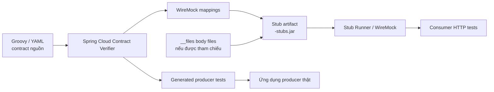
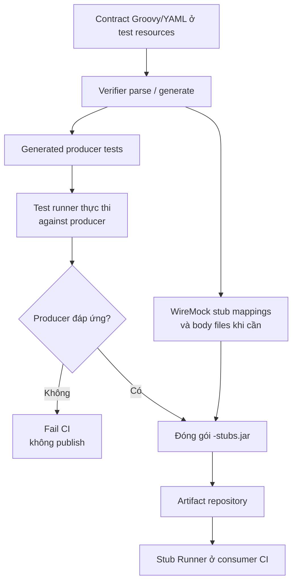
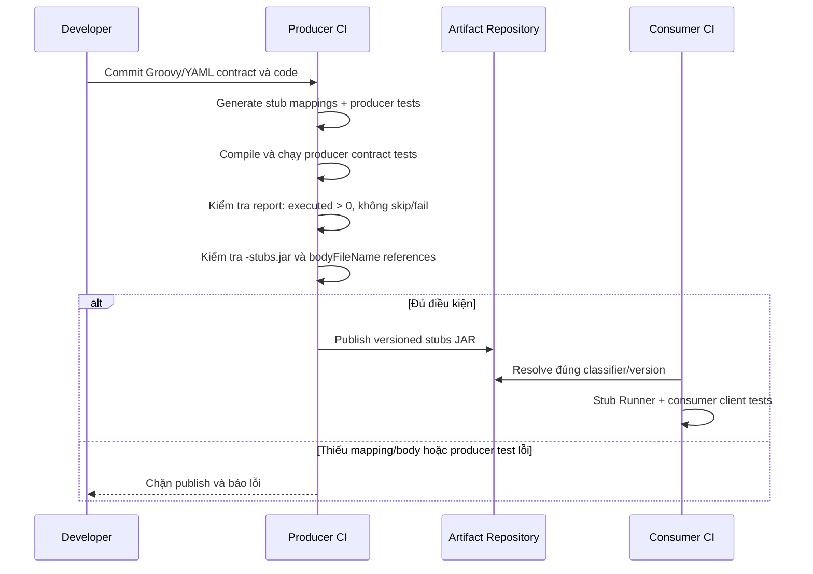

# WireMock mapping và tệp body trong gói stub

## 1. Vì sao cần hiểu những gì nằm bên trong stub?

Trong **Spring Cloud Contract**, nhóm producer và consumer thống nhất hành vi HTTP hoặc thông điệp thông qua hợp đồng viết bằng **Groovy DSL** hay **YAML DSL**. Spring Cloud Contract Verifier dùng hợp đồng để sinh **test phía producer** và, với HTTP, sinh những **WireMock stub mappings** mô phỏng API. Producer có thể đóng gói và phát hành stub dưới dạng artifact; consumer dùng **Stub Runner** để chạy stub trong kiểm thử, đồng thời CI kiểm tra các thay đổi API không tương thích.

Một lỗi thường gặp là xem `-stubs.jar` như một “hộp đen”: tệp đã được tạo nhưng consumer vẫn nhận `404`, JSON sai kiểu, response body rỗng hoặc không khớp request. Khi biết **mapping**, **body file** và **cấu trúc gói stub**, bạn có thể xác định:

- Request nào được WireMock chấp nhận.
- Mã HTTP, header và body nào sẽ được trả về.
- Body được lưu **ngay trong mapping** hay **trong một tệp được mapping tham chiếu**.
- Stub Runner tìm mappings trong artifact đã tải về như thế nào.
- Vì sao gói stub có thể hợp lệ về cú pháp nhưng không phản ánh producer thật nếu verification bị bỏ qua.

**Mục tiêu:** đọc và phân tích được `mappings/*.json`, `__files/*` và artifact `-stubs.jar`; kiểm tra các trường hợp inline body, `bodyFileName`, đường dẫn, encoding và quy trình đóng gói/phát hành có thể tái lập.

## 2. Ba khái niệm cần tách biệt

| Thành phần | Vai trò | Ví dụ |
|---|---|---|
| **Contract nguồn** | Định nghĩa hành vi hai bên thống nhất; đầu vào của Verifier | `get-order.groovy`, `get-order.yml` |
| **WireMock mapping** | Quy tắc so khớp HTTP request và xác định response | `mappings/get-order.json` |
| **Response body file** | Dữ liệu response tách khỏi mapping, được gọi bằng `bodyFileName` | `__files/orders/order-42.json` |
| **Stub artifact** | Gói chứa tài nguyên stub để phân phối có phiên bản | `order-service-1.2.3-stubs.jar` |
| **Stub Runner** | Nạp và phục vụ các stub cho consumer tests | WireMock HTTP server ở một cổng test |

Không phải mọi mapping đều có body file. WireMock có thể dùng **`body` hoặc `jsonBody` ngay trong mapping**, hoặc dùng **`bodyFileName`** trỏ đến tệp bên dưới `__files`. Một hợp đồng Spring Cloud Contract có response JSON **không bảo đảm** ở mọi phiên bản và cấu hình rằng generator sẽ luôn tạo ra `__files/*.json`. Cần **xem artifact được sinh thực tế** thay vì suy ra từ tên DSL.



Hai nhánh cùng xuất phát từ contract nhưng có nhiệm vụ khác nhau: **producer test** xác minh ứng dụng thật; **stub** giúp consumer thực thi với dữ liệu mô phỏng. Việc sinh hoặc chạy stub **không tự chứng minh producer thật đáp ứng hợp đồng**.

## 3. Contract HTTP ví dụ: trả đơn hàng đã thanh toán

Giả sử `order-service` công bố:

```http
GET /api/orders/42
Accept: application/json
```

Response phải là:

```http
HTTP/1.1 200 OK
Content-Type: application/json

{
  "id": 42,
  "state": "PAID",
  "currency": "VND",
  "items": [
    {"sku": "BOOK-101", "quantity": 2}
  ]
}
```

### 3.1. Groovy DSL

```groovy
import org.springframework.cloud.contract.spec.Contract

Contract.make {
    description 'Trả đơn hàng đã thanh toán'

    request {
        method GET()
        url '/api/orders/42'
        headers {
            header 'Accept', 'application/json'
        }
    }

    response {
        status OK()
        headers {
            contentType(applicationJson())
        }
        body(
            id: 42,
            state: 'PAID',
            currency: 'VND',
            items: [
                [sku: 'BOOK-101', quantity: 2]
            ]
        )
    }
}
```

### 3.2. YAML DSL

```yaml
description: Trả đơn hàng đã thanh toán
request:
  method: GET
  url: /api/orders/42
  headers:
    Accept: application/json
response:
  status: 200
  headers:
    Content-Type: application/json
  body:
    id: 42
    state: PAID
    currency: VND
    items:
      - sku: BOOK-101
        quantity: 2
```

Hai đoạn là **hai cách mô tả cùng một kịch bản**, không phải yêu cầu đặt cả hai bản trùng lặp trong thư mục contract. Khi Verifier chuyển hợp đồng thành stub HTTP, WireMock cần một quy tắc nhận ra `GET /api/orders/42` và một response mẫu có `id` dạng số, `state` bằng `PAID`, `items` là JSON array.

## 4. Cấu trúc của một WireMock mapping

Một **WireMock stub mapping** là tài liệu JSON gồm hai khối chính:

- `request`: phương thức HTTP, URL, header, query parameters và body patterns cần khớp.
- `response`: status, headers, body hoặc tên tệp body; đôi khi có delay, fault hoặc những cấu hình response khác.

Ví dụ minh họa mapping dùng **body inline**:

```json
{
  "request": {
    "method": "GET",
    "urlPath": "/api/orders/42",
    "headers": {
      "Accept": {"equalTo": "application/json"}
    }
  },
  "response": {
    "status": 200,
    "headers": {
      "Content-Type": "application/json"
    },
    "jsonBody": {
      "id": 42,
      "state": "PAID",
      "currency": "VND",
      "items": [
        {"sku": "BOOK-101", "quantity": 2}
      ]
    }
  }
}
```

Đây là **một mapping WireMock hợp lệ mang tính minh họa**, không cam kết generator ở mọi phiên bản Spring Cloud Contract tạo JSON với chính xác các trường và cách trình bày này. Một generator có thể dùng `body` là chuỗi JSON thay cho `jsonBody`; tiêu chí cần đánh giá là **kết quả HTTP** và yêu cầu so khớp.

### 4.1. Request matching phải đúng mức chặt

Các trường thường gặp:

| Trường trong `request` | Tác dụng | Lưu ý |
|---|---|---|
| `method` | Khớp `GET`, `POST`, `PUT`... | `GET` khác `POST` |
| `url` | Khớp URL đầy đủ theo matcher được chọn | Có thể phụ thuộc query và thứ tự biểu diễn |
| `urlPath` | Khớp đường dẫn, không gồm query string | Kết hợp `queryParameters` khi cần |
| `urlPathPattern` | Regex của URL path | Regex quá rộng dễ nhận nhầm endpoint |
| `queryParameters` | Quy tắc cho từng query parameter | Phân biệt missing/empty/multi-value theo yêu cầu |
| `headers` | Khớp request headers | Chỉ ràng buộc header consumer phải gửi |
| `bodyPatterns` | Khớp request body (JSON, regex...) | Dùng `equalToJson` hoặc JSONPath theo điều kiện |

Nếu mapping chỉ yêu cầu `GET /api/orders/42`, request `GET /api/orders/43` **không** nên nhận response của `42`. Nhưng nếu hợp đồng cho phép ID động, request matcher có thể rộng hơn; cần bảo đảm **response mẫu** và logic consumer test vẫn hợp lý cho dải ID chấp nhận.

### 4.2. Query parameter riêng với URL path

Ví dụ API `GET /api/orders?state=PAID`:

```json
{
  "request": {
    "method": "GET",
    "urlPath": "/api/orders",
    "queryParameters": {
      "state": {"equalTo": "PAID"}
    }
  },
  "response": {
    "status": 200,
    "headers": {"Content-Type": "application/json"},
    "jsonBody": [
      {"id": 42, "state": "PAID"}
    ]
  }
}
```

`urlPath` không tự kiểm tra tham số `state`. Nếu bỏ `queryParameters` trong ví dụ, cả `state=PAID` và `state=CANCELLED` có thể khớp mapping, tạo **false positive** cho consumer test. Mặt khác, không phải query nào cũng cần bị khóa cứng: chỉ kiểm tra những tham số là một phần hành vi đã cam kết.

### 4.3. JSON request body dùng `bodyPatterns`

Một mapping nhận POST với body JSON có thể dùng:

```json
{
  "request": {
    "method": "POST",
    "urlPath": "/api/orders",
    "headers": {
      "Content-Type": {"contains": "application/json"}
    },
    "bodyPatterns": [
      {
        "equalToJson": "{\"customerId\":\"CUS-42\",\"quantity\":2}"
      }
    ]
  },
  "response": {
    "status": 201,
    "headers": {"Content-Type": "application/json"},
    "jsonBody": {"id": 42, "state": "CREATED"}
  }
}
```

Tùy WireMock version, cách khai báo `equalToJson` và các tùy chọn về phần tử/field phụ có thể khác. Khi kiểm tra mapping được **generated**, hãy đọc JSON thực tế và xác minh request hợp lệ khớp, request sai khác quan trọng **không khớp**. Không nên tự suy đoán rằng mọi option trong JSON mapping đều tương ứng một matcher Groovy/YAML cụ thể.

## 5. Response body inline: `body` và `jsonBody`

Trong WireMock mapping, body có thể được đặt **ngay trong `response`**:

### 5.1. `body` là chuỗi

```json
{
  "request": {"method": "GET", "urlPath": "/api/ping"},
  "response": {
    "status": 200,
    "headers": {"Content-Type": "application/json"},
    "body": "{\"status\":\"OK\",\"count\":2}"
  }
}
```

Ở đây `response.body` là **JSON string chứa văn bản JSON**. WireMock gửi chuỗi này dưới dạng body của HTTP response. Muốn có dấu nháy kép trong nội dung, tệp mapping phải dùng `\"` theo cú pháp JSON của **mapping**, không phải vì giá trị nghiệp vụ chứa backslash.

### 5.2. `jsonBody` là cấu trúc JSON

```json
{
  "request": {"method": "GET", "urlPath": "/api/ping"},
  "response": {
    "status": 200,
    "headers": {"Content-Type": "application/json"},
    "jsonBody": {
      "status": "OK",
      "count": 2
    }
  }
}
```

`jsonBody` dễ đọc hơn vì giá trị được mô tả như object/array thay vì chuỗi đã escape. Kết quả trên đường truyền có thể mang cùng nội dung logic với `body` ở mục trước, dù **byte, khoảng trắng hoặc thứ tự key** có thể khác theo serializer. Consumer test nên so sánh JSON sau parse nếu điều đó phù hợp với hợp đồng, không ràng buộc byte một cách vô ích.

### 5.3. Khi nào nên dùng body file?

Tách body thành tệp riêng hữu ích khi:

- Response dài, có mảng/object lồng nhau nhiều cấp.
- Nhiều kịch bản cần fixture JSON rõ ràng để review.
- Body là văn bản, HTML, XML hoặc binary payload khó đọc khi escape trong mapping.
- Muốn tách điều kiện **request matching** khỏi dữ liệu **response mẫu**.

Tuy nhiên, tách file cũng tạo một quan hệ phụ thuộc: mapping chứa `bodyFileName` phải trỏ đến đúng tệp tồn tại trong gói stub. Nếu chỉ copy mapping mà quên body file, stub có thể không chạy hoặc trả lỗi khi truy xuất response.

## 6. `bodyFileName`: mapping liên kết tới `__files`

WireMock có quy ước **`mappings/`** cho các mapping JSON và **`__files/`** cho response files trong một **file root**. Khi mapping dùng `response.bodyFileName`, giá trị thường là **đường dẫn tương đối tính từ `__files/`**.

Ví dụ mapping tại `mappings/get-order-42.json`:

```json
{
  "request": {
    "method": "GET",
    "urlPath": "/api/orders/42"
  },
  "response": {
    "status": 200,
    "headers": {
      "Content-Type": "application/json; charset=utf-8"
    },
    "bodyFileName": "orders/order-42.json"
  }
}
```

Body file tương ứng ở `__files/orders/order-42.json`:

```json
{
  "id": 42,
  "state": "PAID",
  "currency": "VND",
  "items": [
    {
      "sku": "BOOK-101",
      "quantity": 2
    }
  ]
}
```

Quan hệ quan trọng:

```text
WireMock file root/
├── mappings/
│   └── get-order-42.json
└── __files/
    └── orders/
        └── order-42.json

Trong mapping: "bodyFileName": "orders/order-42.json"
                               |
                               v
Tham chiếu tới: __files/orders/order-42.json
```

**Không** ghi `"bodyFileName": "__files/orders/order-42.json"` nếu file root đã được WireMock cấu hình theo quy ước trên: WireMock sẽ lại nối dưới `__files`, dẫn tới đường dẫn sai. Cũng không trỏ tới đường dẫn tuyệt đối trên máy của tác giả hợp đồng như `C:\Users\dev\order-42.json`; consumer CI không có file đó.

Trong gói artifact, **file root có thể nằm sâu bên dưới `META-INF`** thay vì ở thư mục gốc của JAR. Dù ở đâu, `mappings/` và `__files/` phải được sắp đúng theo cách Stub Runner/WireMock loader của phiên bản đang dùng định vị.

### 6.1. Mỗi body file là một dependency của mapping

| Mapping tham chiếu | File phải tồn tại | Kết quả mong muốn |
|---|---|---|
| `bodyFileName: orders/order-42.json` | `__files/orders/order-42.json` | HTTP `200`, body JSON đơn hàng |
| `bodyFileName: errors/not-found.json` | `__files/errors/not-found.json` | HTTP `404`, body lỗi |
| `bodyFileName: empty/orders.json` | `__files/empty/orders.json` | HTTP `200`, body `[]` |

Nếu đổi tên body file mà không cập nhật mapping, test consumer có thể fail dù contract source không đổi. Vì vậy, **đóng gói phải kiểm tra tính toàn vẹn của các tham chiếu**.

### 6.2. Body file không tự thêm Content-Type

Nếu body file có đuôi `.json`, điều đó **không đủ** để bảo đảm response có `Content-Type: application/json`. Mapping hoặc cơ chế cấu hình response phải đặt header phù hợp. Consumer có thể quyết định deserialize theo Content-Type, vì thế hợp đồng nên kiểm tra cả header và JSON body nếu client dựa vào chúng.

## 7. Cấu trúc gói `-stubs.jar`

Một cách bố trí thông dụng khi Spring Cloud Contract đóng gói stubs là đặt tài nguyên dưới một đường dẫn metadata gồm **group**, **artifact** và **version**:

```text
order-service-1.2.3-stubs.jar
└── META-INF/
    └── com.example/
        └── order-service/
            └── 1.2.3/
                ├── mappings/
                │   ├── get-order-42.json
                │   └── get-order-9999.json
                ├── __files/
                │   ├── orders/
                │   │   └── order-42.json
                │   └── errors/
                │       └── not-found.json
                └── contracts/
                    └── ...          # nếu được đóng kèm
```

Sơ đồ này mô tả **cách bố trí để hiểu quan hệ các tệp**, không khẳng định mọi plugin/version sẽ sinh chính xác cây thư mục đó. Một số mappings có response inline nên không cần `__files`; vị trí contracts, cấu trúc metadata và tên file thực tế có thể khác theo plugin, quy tắc gom artifact hoặc version.

**Cách kiểm tra đúng nhất là mở JAR do chính build của bạn tạo ra**:

```bash
# Lệnh minh họa; thay file bằng artifact thực tế.
jar tf target/order-service-1.2.3-stubs.jar
```

Quan sát:

1. Có tài nguyên `mappings` mong đợi không?
2. Có `__files` khi mapping dùng `bodyFileName` không?
3. Đường dẫn bên trong JAR có nhất quán với loader của Stub Runner không?
4. Có nhiều bản mapping trùng request và trả response khác nhau ngoài chủ ý không?
5. Phiên bản bên trong cấu trúc artifact có khớp artifact được phát hành không?

### 7.1. Stub JAR khác với executable application JAR

Hai artifact có mục đích khác nhau:

| Artifact | Chứa gì? | Chạy như thế nào? |
|---|---|---|
| `order-service-1.2.3.jar` | Code/service producer, cấu hình, dependencies tùy kiểu đóng gói | Chạy ứng dụng producer |
| `order-service-1.2.3-stubs.jar` | WireMock mappings, body files và tài nguyên hợp đồng được đóng kèm | Stub Runner/loader đọc và phục vụ mô phỏng |

Stub artifact **không cần chứa database hoặc business service của producer**. Consumer test không nên yêu cầu chạy ứng dụng producer thật chỉ để nhận response mẫu của một stub HTTP.

### 7.2. Classifier và phiên bản

Trong Maven ecosystem, stub JAR thường dùng classifier **`stubs`**:

```text
groupId:    com.example
artifactId: order-service
version:    1.2.3
classifier: stubs
type:       jar
```

Khi consumer tải artifact, **group, artifact, version và classifier** phải khớp. Nếu consumer dùng `1.2.2` trong khi producer đã phát hành `1.2.3`, test có thể pass với stub cũ và không phát hiện contract thay đổi.

## 8. Cách Spring Cloud Contract tạo mapping và stub artifact

Một quy trình thường gặp phía producer:



Hợp đồng nguồn có thể được Verifier chuyển thành:

- **Generated test source**: gửi request vào producer và assert response.
- **Stub JSON mappings**: để WireMock khớp request, trả body mẫu.
- **Response body files**: nếu cần hoặc nếu pipeline được thiết kế sử dụng chúng.
- **Stub JAR**: đóng gói tài nguyên cho consumer sử dụng có phiên bản.

Tùy phiên bản và build plugin, quá trình **generate stubs**, **test** và **package stubs** có task/goal/lifecycle khác nhau. Không suy ra rằng **đóng gói thành công** đồng nghĩa **producer tests đã thực thi và đạt**. Trong CI cần kiểm tra báo cáo test thật sự.

### 8.1. Maven

Với dự án Maven đã cấu hình Spring Cloud Contract plugin, quy trình thường dùng:

```bash
# Trong module producer với plugin/runner đã cấu hình.
mvn clean verify

# Cài artifact vào local Maven repository, bao gồm stub artifact
# nếu lifecycle/project đã được cấu hình để tạo và attach artifact đó.
mvn clean install
```

Các câu lệnh trên là **minh họa**, không phải lệnh đã được chạy trong bài. Cần xem POM xem plugin có được gắn vào lifecycle, nơi sinh generated tests và classifier stub có đúng không. `mvn install` có thể trả `BUILD SUCCESS` ngay cả khi test bị skip do cấu hình; CI phải chặn kiểu xác minh giả đó.

### 8.2. Gradle

Với Gradle, Spring Cloud Contract plugin có thể cung cấp task sinh tests/stubs và tạo artifact classifier `stubs`. Tên task, source set, publication configuration và vị trí output **phụ thuộc phiên bản plugin và build script**. Ví dụ:

```bash
./gradlew clean test
```

Lệnh này chỉ chứng minh producer verification nếu task tạo contract tests được nối vào graph, runner thực thi generated tests và report có kết quả đạt. Muốn phát hành stub, phải cấu hình và chạy **task/package publication** phù hợp, không suy ra `test` tự publish artifact.

## 9. Xem mapping và body trong JAR bằng công cụ lưu trữ

Khi một consumer báo HTTP `404` từ Stub Runner, hãy kiểm tra đúng artifact và tài nguyên trước khi đổi contract.

### 9.1. Liệt kê nội dung

```bash
jar tf target/order-service-1.2.3-stubs.jar
```

Lệnh liệt kê entry name trong JAR, không thực thi ứng dụng. Đọc đường dẫn **trong archive** thay vì chỉ nhìn `target/stubs` trên đĩa; trong quá trình packaging, một tệp có thể không được đưa vào artifact.

### 9.2. Kiểm tra một mapping cụ thể

Nếu môi trường có `unzip`, có thể in một entry ra terminal:

```bash
unzip -p target/order-service-1.2.3-stubs.jar \
  META-INF/com.example/order-service/1.2.3/mappings/get-order-42.json
```

Kiểm tra `request.method`, `request.urlPath` hoặc `url`, `request.headers`, `response.status`, `response.headers` và `response.bodyFileName`. Đường dẫn entry là **ví dụ**, phải thay bằng tên thực sự lấy từ `jar tf`.

Nếu mapping dùng `bodyFileName: orders/order-42.json`, cũng cần xác nhận tệp:

```bash
unzip -p target/order-service-1.2.3-stubs.jar \
  META-INF/com.example/order-service/1.2.3/__files/orders/order-42.json
```

Các ví dụ trên yêu cầu command-line tool tương ứng; trên Windows có thể sử dụng ứng dụng quản lý ZIP/JAR hoặc công cụ kiểm tra archive phù hợp. **Không cần giải nén toàn bộ artifact để xác minh một mapping cụ thể**.

### 9.3. Kiểm tra bản tải về, không chỉ bản local

Có trường hợp `target/stubs` hoặc JAR local đúng, nhưng artifact đã publish thiếu tệp hoặc consumer đang dùng version khác. Khi điều tra lỗi CI:

1. Ghi lại đầy đủ **coordinates** mà Stub Runner đang resolve.
2. Lấy JAR đúng version/classifier **từ repository mà consumer dùng**.
3. Liệt kê mappings và body files trong JAR đó.
4. So sánh với artifact được producer CI phát hành.
5. Sau cùng mới xem lại request matching hoặc consumer HTTP client.

Đừng chỉnh trực tiếp JAR đã publish rồi coi là cập nhật hợp đồng. **Nguồn sự thật là contract và quy trình build có thể tái lập**; sửa nguồn, kiểm thử lại và phát hành phiên bản mới.

## 10. Stub Runner nạp gói stub như thế nào?

Ở consumer test, **Stub Runner** có thể resolve artifact với classifier `stubs`, tìm tài nguyên mapping và chạy một HTTP stub server, thường sử dụng WireMock. Ví dụ Spring Boot test:

```java
import org.junit.jupiter.api.Test;
import org.springframework.boot.test.context.SpringBootTest;
import org.springframework.cloud.contract.stubrunner.spring.AutoConfigureStubRunner;
import org.springframework.cloud.contract.stubrunner.spring.StubRunnerPort;
import org.springframework.cloud.contract.stubrunner.StubRunnerProperties;

@SpringBootTest
@AutoConfigureStubRunner(
    ids = "com.example:order-service:1.2.3:stubs:8090",
    stubsMode = StubRunnerProperties.StubsMode.LOCAL
)
class OrderClientContractTest {

    @StubRunnerPort("com.example:order-service")
    int stubPort;

    @Test
    void shouldReadPaidOrder() {
        // Cấu hình HTTP client gọi localhost:stubPort,
        // sau đó assert Order DTO có id=42, state=PAID.
    }
}
```

Đây là **ví dụ cấu hình**, chưa phải test có assertion hoàn chỉnh. Dự án cần dependency `spring-cloud-starter-contract-stub-runner` phù hợp, HTTP client cụ thể và test assertions. `LOCAL` đọc artifact đã cài trong local Maven repository; nếu muốn CI resolve từ artifact repository từ xa, cần cấu hình stubs mode/repository phù hợp và quyền truy cập.

**Không có nghĩa Stub Runner luôn dùng cổng 8090**. Cổng có thể được khai báo, hoặc được cấp động; consumer client phải dùng địa chỉ thật mà test nhận được. Đừng hardcode port trong production configuration.

### 10.1. Request nào sẽ khớp mapping?

Ví dụ Stub Runner đã khởi động WireMock mapping `GET /api/orders/42`. Khi consumer gọi:

```http
GET /api/orders/42
Accept: application/json
```

WireMock có thể trả status/header/body mẫu. Khi gọi `GET /api/orders/43`, nếu không có mapping phù hợp, WireMock thường trả response **404 của stub server**. Cần phân biệt:

- **404 do stub mapping cố ý mô phỏng lỗi nghiệp vụ**: có error body và contract quy định `ORDER_NOT_FOUND`.
- **404 do không khớp bất kỳ mapping nào**: không chứng minh ứng dụng producer thật đã xử lý `/43` như API công bố.

Hai trường hợp đều là HTTP `404` nhưng có ý nghĩa khác nhau. Consumer test nên assert **body/error code và kịch bản** để tránh nhận nhầm một unmatched-stub 404 là phản hồi nghiệp vụ đúng.

### 10.2. Mismatch giữa request consumer và mapping

Kiểm tra theo thứ tự:

1. Method có đúng không: `GET` hay `POST`?
2. Path có đúng dấu slash, prefix, version và encoding không?
3. Query parameter có đủ và đúng giá trị không?
4. Required headers có được HTTP client gửi không?
5. Với request JSON, body có đúng kiểu và cấu trúc mà `bodyPatterns` yêu cầu không?
6. Có mapping nào khác khớp cùng request và được ưu tiên không?

Không nên xóa hết request matcher để test xanh. Nới quá rộng mapping có thể che lỗi consumer gửi request sai mà producer thật sẽ từ chối.

## 11. Body file với ký tự Unicode, newline và payload không phải JSON

### 11.1. JSON tiếng Việt

Một body file có thể chứa Unicode trực tiếp:

```json
{
  "id": 42,
  "customerName": "Nguyễn Ánh",
  "note": "Cà phê & trà"
}
```

Nên dùng **UTF-8** nhất quán cho tài nguyên nguồn, bước packaging và HTTP response. Ký tự có dấu có thể được JSON serializer escape bằng `\uXXXX`; consumer so sánh giá trị **sau khi parse** thay vì phụ thuộc dạng biểu diễn escape cụ thể.

### 11.2. Newline và dấu nháy

Trong file JSON:

```json
{
  "message": "Lan nói: \"Xin chào!\"\nDòng thứ hai."
}
```

`\"` biểu diễn dấu nháy kép, `\n` biểu diễn newline bên trong JSON string. Đây không phải yêu cầu lưu **hai ký tự backslash và n** trong giá trị đã parse. Với mapping inline dùng `response.body`, có thể phát sinh **hai tầng escaping** (JSON mapping chứa một chuỗi JSON). Tách sang body file thường dễ review hơn ở kịch bản này.

### 11.3. Text, XML và binary

WireMock body file không buộc phải có đuôi `.json`. Ví dụ:

```text
__files/
├── emails/welcome.html
├── reports/sample.xml
└── downloads/example.pdf
```

Mapping tương ứng có thể dùng `bodyFileName`, đặt `Content-Type` phù hợp (`text/html`, `application/xml`, `application/pdf`...). Với binary payload, byte phải được giữ nguyên qua đóng gói; không đưa nội dung nhị phân trực tiếp vào một JSON string mà không có cơ chế encoding phù hợp. Nếu producer dùng content encoding (gzip, v.v.), phải mô tả/kiểm thử chính sách HTTP tương ứng, không chỉ nhìn đuôi file.

## 12. Không nên suy ra rằng mọi response body đều là một file

Với Spring Cloud Contract, một body trong Groovy/YAML thường được generator biểu diễn thành response WireMock cụ thể. **Hình thức lưu trữ là chi tiết của generator/phiên bản**, còn hợp đồng HTTP mới là điều consumer quan sát.

| Cách lưu | Khi kiểm tra artifact | Sai lầm thường gặp |
|---|---|---|
| `response.body` inline | Đọc chuỗi JSON đã escape trong mapping | Tưởng body phải có file `__files` |
| `response.jsonBody` inline | Đọc cấu trúc JSON trong mapping | So sánh toàn bộ byte/whitespace vô ích |
| `response.bodyFileName` | Tìm tệp tương đối dưới `__files` | Quên đóng file hoặc sai path |
| Body vắng mặt | Xem status như `204` hoặc API không trả body | Tự thêm `{}`/`[]` dù hợp đồng không cam kết |

**Đối với HTTP 204 No Content**, không đặt body JSON giả để “tiện consumer test”: theo ngữ nghĩa HTTP, response `204` không chứa message body. Nếu API đã cam kết `200 + []` cho danh sách rỗng, việc đổi sang `204` có thể phá vỡ consumer.

Không mặc định response JSON có thể hoán đổi `[]`, `{}`, `null` và body vắng mặt. Các kiểu ấy cần được bảo vệ bằng contract và assertion thích hợp.

## 13. Những lỗi phổ biến khi đóng gói stub

| Triệu chứng | Nguyên nhân có thể | Cách kiểm tra |
|---|---|---|
| Mapping có `bodyFileName` nhưng body không xuất hiện | File không được đưa vào JAR hoặc tên sai | `jar tf` đúng artifact và kiểm tra `__files` |
| Stub trả `404` dù endpoint tưởng là có | Request không khớp mapping; version stub sai | Kiểm tra method/path/query/header/bodyPatterns |
| Stub trả `200` nhưng JSON rỗng | Body file thiếu/khác nội dung, response config sai | Xem mapping và body thực tế |
| Content-Type không đúng | Mapping thiếu/sai response header | Đọc `response.headers` và HTTP headers |
| Consumer nhận JSON string thay vì object | Body được escape/serialize hai lần | Kiểm tra `body` vs `jsonBody`, parse thực tế |
| Unicode hiển thị sai | File resource hoặc response charset không phù hợp | Kiểm tra UTF-8 và header |
| `GET /42` và `GET /43` trả cùng response | URL matcher regex quá rộng hoặc static stub | Siết matcher theo contract/case phù hợp |
| Stub chạy local nhưng fail CI | Artifact khác version, missing body, repo access | So sánh JAR local và JAR đã publish |
| Consumer không tìm thấy artifact | Sai classifier `stubs`, group/artifact/version/repository | Kiểm tra coordinates và quyền truy cập |
| Stub đúng nhưng producer thật trả khác | Producer tests bị skip hoặc chưa chạy | Kiểm tra generated test report |
| Hai mapping cùng khớp một request | Trùng contract hoặc cấu hình priority khác | Kiểm tra danh sách mappings và ưu tiên |
| Test 404 “xanh” nhưng chưa đúng API | Không có mapping phù hợp, WireMock tự trả 404 | Assert mã lỗi/body của response nghiệp vụ |

### 13.1. Trình tự điều tra từ ngoài vào trong

Khi một consumer test thất bại:

1. Xác định Stub Runner đang phục vụ **artifact nào**, version và cổng nào.
2. Xác minh request thực tế mà HTTP client gửi (method, URL, query, headers, body).
3. Đối chiếu request đó với mapping trong **JAR đang được dùng**.
4. Nếu mapping có `bodyFileName`, kiểm tra file trong `__files` và nội dung/encoding của nó.
5. Kiểm tra response thực tế: status, Content-Type, kiểu JSON và trường cần thiết.
6. Nếu stub khớp nhưng producer thật khác, quay lại generated producer tests và CI gate.

Không sửa body file trong cache local của Stub Runner như giải pháp lâu dài; làm vậy khiến consumer test dùng dữ liệu không truy vết được từ contract nguồn.

## 14. CI: đóng gói chỉ sau khi producer verification đạt



**Quality gate thực tế:**

- Contract source được phát hiện, không phải file ở nhầm module hoặc thư mục.
- Generated producer tests đã **được chạy và đạt**, không chỉ tạo source/compile; không có `skipTests` ngầm.
- Gói stub chứa đủ mappings mong đợi và các body files mà mappings tham chiếu.
- Không có bản mapping trùng/regex quá rộng gây hành vi mơ hồ ngoài ý định.
- Consumer tải đúng version/classifier/repository và chạy test với **HTTP client thật của ứng dụng**.
- Test consumer bao phủ cả phản hồi thành công và lỗi quan trọng (validation, not found, conflict).
- Kết quả CI lưu test reports và artifact version để truy vết.

**Không nên publish artifact chỉ vì lệnh `jar` hoặc task package thành công.** Đó chỉ xác minh hình thức đóng gói, không chứng minh producer đáp ứng hợp đồng.

## 15. Bài thực hành: tìm body file thất lạc

**Bối cảnh:** đội checkout dùng `order-service` stub để kiểm thử giao diện thanh toán. Stub Runner tìm được artifact nhưng request `GET /api/orders/42` không trả JSON đúng. Đội producer biết contract Groovy đã mô tả `200 + PAID`.

**Yêu cầu**: hiểu mapping, xác định có hay không body file, sửa nguyên nhân ở nguồn và kiểm chứng lại trước khi phát hành artifact mới.

### 15.1. Dữ liệu bài tập

Mapping minh họa:

```json
{
  "request": {
    "method": "GET",
    "urlPath": "/api/orders/42"
  },
  "response": {
    "status": 200,
    "headers": {
      "Content-Type": "application/json"
    },
    "bodyFileName": "orders/order-42.json"
  }
}
```

Trong JAR đang dùng, phần liên quan hiện chỉ có:

```text
META-INF/com.example/order-service/1.2.3/mappings/get-order-42.json
META-INF/com.example/order-service/1.2.3/__files/orders/order-43.json
```

**Chẩn đoán:** mapping tham chiếu `orders/order-42.json` nhưng gói chỉ có `order-43.json`. Hai tên không tương đương; WireMock không thể lấy đúng body file theo đường dẫn đã khai báo.

### 15.2. Các bước thực hành

1. Đọc contract `GET /api/orders/42`, xác minh body, status và Content-Type đã cam kết.
2. Dùng `jar tf` kiểm tra **JAR đã publish**, không chỉ thư mục build local.
3. Đọc mapping trong `mappings/` và ghi lại chính xác giá trị `bodyFileName`.
4. Đối chiếu đường dẫn tương đối với file root `__files/`; tìm sự không nhất quán giữa `order-42.json` và `order-43.json`.
5. Sửa nguồn contract/fixture hoặc cấu hình đóng gói làm thiếu/misname tệp. **Không sửa trực tiếp một JAR đã phát hành**.
6. Tạo build sạch với producer contract verification thật sự được chạy và đạt.
7. Kiểm tra mapping/body trong **JAR mới** và xác minh request khớp trả JSON `id=42`, `state=PAID`.
8. Publish version mới, cho consumer CI dùng đúng classifier `stubs` và version.
9. Chạy consumer test qua Stub Runner; assert HTTP `200`, Content-Type, kiểu dữ liệu và `state=PAID`.
10. Thử cố ý gọi `GET /api/orders/43`; xác minh request này không nhận nhầm response của `42` khi contract không cho phép.

### 15.3. Câu hỏi tự kiểm tra

| Câu hỏi | Đáp án |
|---|---|
| Mỗi mapping có bắt buộc có file trong `__files` không? | **Không**, response có thể inline |
| `bodyFileName: orders/order-42.json` trỏ đến đâu? | Thông thường là `__files/orders/order-42.json` của file root WireMock |
| Có được đưa `__files/` vào `bodyFileName` không? | Thường **không**, vì WireMock đã tìm dưới file root tương ứng |
| Body file có đuôi `.json` đã đủ thiết lập Content-Type chưa? | **Chưa**; response header vẫn cần phù hợp |
| Stub JAR sinh được có chứng minh producer test pass chưa? | **Không** |
| Consumer nhận 404 có chắc là business error `ORDER_NOT_FOUND` không? | **Không**, có thể là unmatched stub |
| Có nên kiểm tra artifact local thay cho JAR consumer CI đang dùng? | **Không**; phải xem đúng artifact/version được resolve |
| Đổi `[]` thành `null` có thể làm hỏng consumer không? | **Có**, vì JSON types và ý nghĩa khác nhau |

## 16. Checklist review WireMock mappings và body files

- [ ] Contract Groovy/YAML định nghĩa đúng request, status, headers, JSON types và body.
- [ ] Đã xác định mapping dùng `body`, `jsonBody` hay `bodyFileName`; không giả định mọi body đều tách file.
- [ ] Request matcher dùng đúng method, URL path, query, headers và body patterns cần bảo vệ.
- [ ] Khi có `bodyFileName`, đường dẫn tương đối trỏ tới file tồn tại trong `__files` đúng file root.
- [ ] Body file được đóng gói vào **JAR thực tế**, không chỉ tồn tại trên đĩa máy build.
- [ ] Nội dung body giữ đúng UTF-8, escape, kiểu JSON, giá trị `null` và danh sách rỗng khi cần.
- [ ] Response có status và Content-Type phù hợp; không suy luận từ đuôi file.
- [ ] Đã kiểm tra mapping trùng, priority, matcher quá rộng và response mẫu không nhất quán.
- [ ] Artifact mang group, artifact, version, classifier `stubs` đúng như consumer resolve.
- [ ] Consumer test dùng Stub Runner và HTTP client thực, assert cả body nghiệp vụ và error schema.
- [ ] Generated producer tests thực thi và đạt trong CI; không chỉ sinh tests hoặc stub.
- [ ] CI kiểm tra nội dung gói, chặn publish khi thiếu body file hoặc producer verification fail.
- [ ] Khi thay đổi contract, phát hành artifact mới có thể truy vết, không sửa JAR cũ trong cache.

**Ghi nhớ:** Trong stub HTTP của Spring Cloud Contract, **WireMock mapping quyết định request nào khớp và response phải trả**, còn **body file** là một cách lưu payload khi mapping dùng `bodyFileName`. Kiểm tra đúng mối quan hệ giữa `mappings/`, `__files/` và artifact `-stubs.jar` giúp consumer test tái lập được; chạy generated producer tests và Stub Runner trong CI mới tạo ra bằng chứng cần thiết để phát hiện thay đổi API không tương thích.
