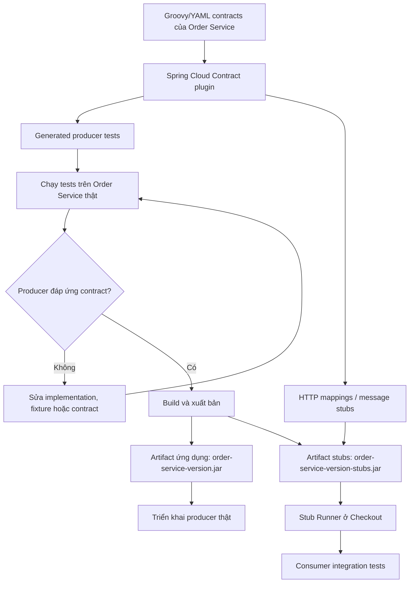
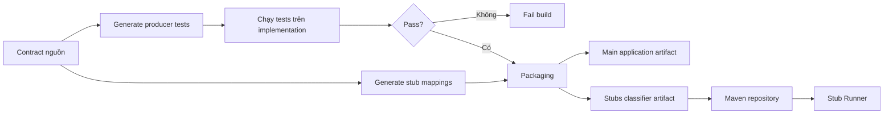
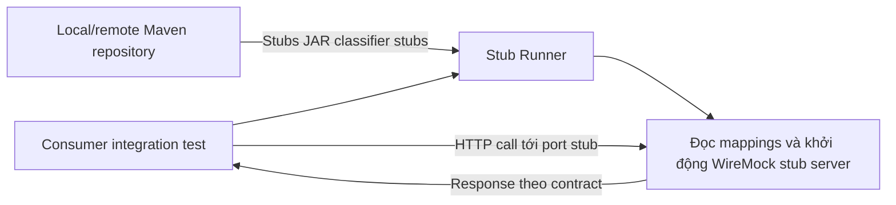
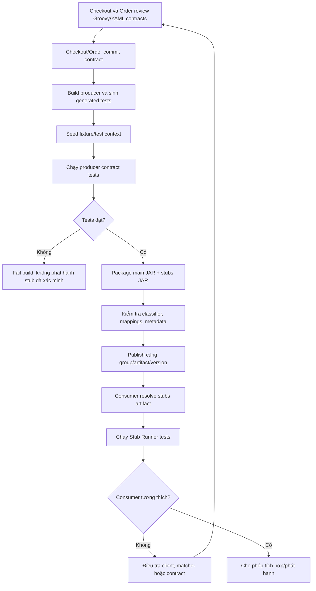

# Phân biệt artifact ứng dụng với artifact stubs

Trong kiểm thử hợp đồng giữa **producer** và **consumer**, một dịch vụ thường tạo ra **hai loại artifact có mục đích khác nhau**:

1. **Artifact ứng dụng** chứa mã và tài nguyên cần thiết để chạy hoặc phân phối producer.
2. **Artifact stubs** chứa mô tả các tương tác được mô phỏng từ contract, để consumer có thể kiểm thử mà không cần khởi chạy producer thật.

Nếu không phân biệt rõ, nhóm dễ lấy nhầm file JAR, khai báo sai Maven coordinates, khởi chạy nhầm artifact stubs như một ứng dụng, hoặc phát hành stub chưa được producer kiểm chứng. Khi đó **Stub Runner không tìm thấy mappings**, consumer dùng phiên bản sai, hoặc CI xanh dù API đã thay đổi không tương thích.

Bài này thuộc chương **Sinh và đóng gói stub** của **SPRING_CLOUD_CONTRACT**. Nội dung tập trung vào cách Spring Cloud Contract Verifier sinh producer tests và stubs từ **Groovy/YAML DSL**, cách Maven/Gradle đóng gói hai loại artifact, cách **Stub Runner** phân giải artifact `stubs`, và cách tổ chức CI để một bộ stub có thể truy vết về **producer build đã qua kiểm thử hợp đồng**.

## 1. Hai artifact được tạo cho hai người sử dụng khác nhau

Giả sử có producer **Order Service** và consumer **Checkout Service**.



Điểm then chốt là **hai JAR được dùng ở hai nơi**:

- **Application JAR** dùng để chạy dịch vụ thật trong môi trường triển khai hoặc phân phối tới hệ thống khác.
- **Stubs JAR** dùng làm **nguồn dữ liệu mô phỏng** cho Stub Runner/WireMock hoặc messaging stub infrastructure. Nó **không phải** bản rút gọn có thể chạy thay Order Service.

Một build producer có thể tạo cả hai, nhưng chúng không có cùng mục đích, nội dung hoặc tiêu chí sử dụng.

### 1.1. Bảng so sánh nhanh

| Tiêu chí | Artifact ứng dụng | Artifact stubs |
|---|---|---|
| Mục đích | Chạy hoặc phân phối implementation producer | Mô phỏng hành vi đã định nghĩa bằng contract |
| Đối tượng sử dụng | Hạ tầng triển khai, runtime, ứng dụng thực | Consumer integration tests, Stub Runner |
| Nội dung chủ yếu | Bytecode, resources, metadata, dependency đóng gói tùy cách build | Request/response mappings, contracts, metadata cần cho stub |
| Có controller/service/repository thật? | Có trong ứng dụng producer | **Không cần** và thông thường không chứa implementation để chạy |
| Có mở HTTP port khi chạy file JAR? | Có thể, nếu là executable Spring Boot JAR và được khởi động | **Không tự mở port**; Stub Runner nạp stub và tạo server mô phỏng |
| Có thể thao tác với database producer? | Có thể tùy cấu hình runtime | Không tự truy vấn database của producer |
| Có thể trả HTTP response? | Có, do mã ứng dụng xử lý | Có, thông qua WireMock/Stub Runner dựa trên mapping |
| Có kiểm tra logic nghiệp vụ ở runtime? | Chạy logic thật | Trả response mẫu/điều kiện matcher được định nghĩa |
| Dùng để triển khai production? | Có, khi đã qua release process | Không |
| Có thể phát hành cùng version? | Có | Có, thường phân biệt bằng classifier `stubs` |

**Chú ý:** một JAR “ứng dụng” có thể là JAR thư viện thông thường hoặc executable `bootJar`, tùy cách xây dựng producer. Không phải mọi main JAR đều tự chạy được bằng `java -jar`. Ngược lại, một stubs JAR có classifier `stubs` **không nên được xem như ứng dụng**.

## 2. Tọa độ Maven: groupId, artifactId, version và classifier

Trong hệ sinh thái Maven, artifact không được xác định chỉ bằng một tên file. Những thành phần quan trọng gồm:

- **`groupId`:** nhóm/tổ chức phát hành, ví dụ `com.example`.
- **`artifactId`:** tên module, ví dụ `order-service`.
- **`version`:** phiên bản build, ví dụ `1.4.0`.
- **`type/extension`:** định dạng artifact, thường là `jar`.
- **`classifier`:** phần phân biệt biến thể cùng group, artifact, version, ví dụ `stubs`.

Một producer có thể công bố:

| Thành phần | Main artifact | Stubs artifact |
|---|---|---|
| `groupId` | `com.example` | `com.example` |
| `artifactId` | `order-service` | `order-service` |
| `version` | `1.4.0` | `1.4.0` |
| `extension` | `jar` | `jar` |
| `classifier` | Không có | `stubs` |
| Filename Maven thường gặp | `order-service-1.4.0.jar` | `order-service-1.4.0-stubs.jar` |

Hai file có cùng `groupId:artifactId:version` nhưng **khác classifier**. Vì thế chúng là **hai artifact khác nhau** trong cùng một module/version.

### 2.1. Tọa độ dùng bởi Stub Runner

Một ví dụ khai báo Stub Runner phổ biến:

```text
com.example:order-service:1.4.0:stubs:8085
```

Ở **cú pháp `ids` của Stub Runner**, chuỗi trên thường có ý nghĩa:

```text
groupId  : artifactId   : version : classifier : stubPort
com.example : order-service : 1.4.0 : stubs : 8085
```

**Đừng nhầm cú pháp Stub Runner `ids` với một Maven dependency XML đầy đủ.** Trong Maven, classifier nằm ở thẻ `classifier`; trong Stub Runner `ids`, trường cuối `8085` là **cổng của stub server**, không phải packaging type. Thứ tự và các biến thể cú pháp cần đối chiếu với **đúng phiên bản Spring Cloud Contract Stub Runner** được dự án ghim.

Tọa độ Maven mở rộng có thể viết theo những quy ước khác nhau giữa các công cụ; tránh suy ra rằng mọi chuỗi có năm phần đều có ý nghĩa giống `ids`.

### 2.2. Vì sao không khai báo main JAR khi cần stubs?

Nếu Checkout yêu cầu:

```text
com.example:order-service:1.4.0
```

trong một vị trí vốn yêu cầu artifact `stubs`, trình phân giải có thể tải **main JAR** hoặc không tìm được stub mappings như mong đợi. Main JAR thường không chứa cấu trúc stub metadata dành cho Stub Runner.

Khi cấu hình một consumer test, cần xác định rõ nó tải **`order-service-1.4.0-stubs.jar`**, không phải **`order-service-1.4.0.jar`**, trừ khi dự án có chiến lược đóng gói tùy biến được kiểm chứng riêng.

## 3. Vòng đời từ contract đến hai artifact

Spring Cloud Contract không tự suy ra hành vi của producer từ source code. Thay vào đó, nhóm viết **contract** rồi plugin tạo ra những phần cần cho hai hướng kiểm thử.



Các giai đoạn khác nhau:

1. **Định nghĩa hợp đồng:** viết Groovy/YAML mô tả request, response, matcher hoặc message.
2. **Sinh producer tests:** plugin tạo kiểm thử dựa trên contract.
3. **Sinh stub mappings:** plugin tạo các định nghĩa HTTP stub hoặc message stubs theo khả năng hỗ trợ.
4. **Producer verification:** generated tests chạy trên implementation, với base class/test fixture phù hợp.
5. **Đóng gói:** build tool tạo main artifact và stubs artifact khi đã cấu hình tương ứng.
6. **Phát hành:** đưa artifact vào Maven local hoặc repository dùng chung.
7. **Consumer verification:** Stub Runner tải đúng stubs JAR; consumer test gọi client thật và kiểm tra kết quả.

**Điều kiện đảm bảo:** chỉ vì stubs JAR đã được sinh hoặc đóng gói **không có nghĩa** producer tests đã vượt qua. Nếu pipeline dùng `skipTests`, bỏ qua test task hoặc chỉ chạy pha generate, có thể vẫn tạo stub mô tả hành vi mà producer chưa thực hiện đúng. Cổng phát hành cần kiểm tra producer tests **thực sự chạy và đạt**.

## 4. Một HTTP contract được đóng gói thành stub như thế nào?

Giả sử Checkout yêu cầu Order Service đọc đơn hàng:

```http
GET /api/orders/ORDER-42
Accept: application/json
```

và kỳ vọng:

```http
HTTP/1.1 200 OK
Content-Type: application/json

{"id":"ORDER-42","status":"PAID","totalAmount":125000}
```

Groovy DSL:

```groovy
import org.springframework.cloud.contract.spec.Contract

Contract.make {
    name 'checkout_get_paid_order_200'
    description 'Checkout đọc đơn đã thanh toán'

    request {
        method GET()
        url '/api/orders/ORDER-42'
        headers {
            header 'Accept', 'application/json'
        }
    }

    response {
        status OK()
        headers {
            contentType(applicationJson())
        }
        body(
            id: 'ORDER-42',
            status: 'PAID',
            totalAmount: 125000
        )
    }
}
```

YAML DSL tương đương:

```yaml
name: checkout_get_paid_order_200
description: Checkout đọc đơn đã thanh toán
request:
  method: GET
  url: /api/orders/ORDER-42
  headers:
    Accept: application/json
response:
  status: 200
  headers:
    Content-Type: application/json
  body:
    id: ORDER-42
    status: PAID
    totalAmount: 125000
```

**Chỉ chọn một bản làm nguồn chính** cho kịch bản này trong tập contracts của build. Nạp cả hai có thể sinh test/mapping trùng hoặc khiến việc truy vết khó khăn.

### 4.1. Stub mapping HTTP là dữ liệu, không phải controller

Từ contract, Spring Cloud Contract có thể sinh một **WireMock mapping** mô tả các điều kiện:

- Request method là `GET`.
- URL là `/api/orders/ORDER-42`.
- Header `Accept` nếu được contract yêu cầu.
- Response status `200`.
- Header `Content-Type: application/json`.
- Body JSON mẫu.

Một mapping WireMock rút gọn mang ý nghĩa tương đương có thể trông như sau:

```json
{
  "request": {
    "method": "GET",
    "url": "/api/orders/ORDER-42"
  },
  "response": {
    "status": 200,
    "headers": {
      "Content-Type": "application/json"
    },
    "jsonBody": {
      "id": "ORDER-42",
      "status": "PAID",
      "totalAmount": 125000
    }
  }
}
```

Đây là **ví dụ minh họa cấu trúc WireMock**, **không phải** cam kết byte-for-byte về file generated thực tế. Plugin có thể dùng matcher, `bodyFileName`, biểu thức regex hoặc cấu trúc JSON khác tùy DSL, WireMock version và build. Ví dụ rút gọn cũng không lặp điều kiện `Accept`; khi kiểm tra bản thật, phải xác nhận plugin tạo matcher cho header được khai báo.

Một mapping như vậy có thể giúp Stub Runner trả `200` theo request, nhưng **không chạy OrderController hay truy vấn database**. Đó chính là khác biệt giữa stubs artifact và main artifact.

### 4.2. Matcher quá rộng khiến stub “đúng giả”

Nếu một contract dùng regex nhận mọi URL hoặc mọi `Authorization` token, stub có thể trả `200` cho request mà producer thật sẽ từ chối. Do vậy:

- Generated producer tests phải chạy trên implementation thực.
- Mappings phải được xem lại để khẳng định matcher đã sinh đúng.
- Consumer test phải gọi qua **HTTP client thực của consumer**, không chỉ thử trực tiếp URL của stub bằng một client khác.
- Những đặc tính không được contract mô tả cần kiểm thử riêng (security, persistence, transaction, v.v.).

Một stubs JAR **có mặt** là điều kiện kỹ thuật cần, không thay cho việc xác minh chất lượng hợp đồng.

## 5. Bên trong stubs JAR có gì?

Một cấu trúc **thường gặp** của stubs artifact được Spring Cloud Contract đóng gói theo metadata Maven:

```text
order-service-1.4.0-stubs.jar
└── META-INF/
    └── com.example/
        └── order-service/
            └── 1.4.0/
                ├── contracts/
                │   └── checkout/
                │       └── get_paid_order_200.groovy
                └── mappings/
                    └── checkout/
                        └── checkout_get_paid_order_200.json
```

**Cảnh báo:** đây là **sơ đồ minh họa** về tổ chức `META-INF/<group>/<artifact>/<version>/contracts` và `mappings`, **không phải path bắt buộc giống nhau ở mọi phiên bản/plugin**. Tên file, folder phụ, vị trí body files và metadata có thể khác theo cấu hình Maven/Gradle và phiên bản.

Những loại dữ liệu có thể xuất hiện:

| Loại dữ liệu | Ý nghĩa |
|---|---|
| **Contracts nguồn** | Groovy/YAML DSL mô tả cam kết của producer |
| **HTTP stub mappings** | Định nghĩa WireMock request matching và response |
| **Body files** | Nội dung response lớn được đặt trong file và mapping tham chiếu |
| **Message contract metadata** | Dữ liệu hỗ trợ message stub triggering khi đã cấu hình messaging |
| **JAR manifest/Maven metadata** | Thông tin đóng gói và nhận diện artifact |

Stubs JAR thường **không cần chứa** toàn bộ `BOOT-INF/classes`, dependencies, controller/service implementation hoặc executable launcher của Spring Boot.

### 5.1. Main JAR khác gì về cấu trúc?

Với **Spring Boot executable JAR**, cấu trúc thường có dạng:

```text
order-service-1.4.0.jar
├── META-INF/
├── BOOT-INF/
│   ├── classes/
│   │   └── com/example/order/...
│   └── lib/
│       └── dependency-jars...
└── org/springframework/boot/loader/...
```

Cấu trúc thực tế thay đổi theo Spring Boot version và kiểu đóng gói. Nếu producer đóng gói **ordinary library JAR** thay vì executable Boot JAR, layout khác và có thể không chứa `BOOT-INF`. Điều quan trọng không phải kiểm tra cố định path launcher, mà là **xác định artifact nào phục vụ runtime và artifact nào phục vụ stubbing**.

### 5.2. Kiểm tra nội dung JAR bằng công cụ chuẩn

Trên máy có JDK, có thể dùng lệnh liệt kê entry của file JAR:

```bash
jar tf target/order-service-1.4.0-stubs.jar
jar tf target/order-service-1.4.0.jar
```

Đây là **lệnh tham khảo để người học chạy trong dự án của mình**, không phải kết quả đã được thực thi trong bài này. Tùy Maven hay Gradle, artifact có thể nằm trong `target/` hoặc `build/libs/` và không nhất thiết có đúng tên ví dụ.

Nên tìm:

1. Tên file stubs có classifier `-stubs.jar` không?
2. Bên trong có thư mục `contracts` và `mappings` phù hợp với cấu hình của plugin không?
3. Có mapping cho đúng kịch bản `checkout_get_paid_order_200` không?
4. Request matcher và JSON body đúng không?
5. Main artifact có chứa các lớp ứng dụng cần chạy không?
6. Có thể truy vết cả hai file về **cùng một build/version producer** không?

**Đừng sao chép stubs vào main JAR thủ công** như một cách khắc phục thiếu artifact: việc đó dễ làm mờ ranh giới deploy và test, trong khi lỗi gốc có thể là plugin chưa đóng gói hoặc repository chưa nhận classifier.

## 6. Maven: sinh và đóng gói stubs theo lifecycle

Với Maven, Spring Cloud Contract Maven plugin thường tham gia quá trình tạo kiểm thử và stubs khi được cấu hình đúng.

Ví dụ phần plugin **rút gọn**:

```xml
<plugin>
    <groupId>org.springframework.cloud</groupId>
    <artifactId>spring-cloud-contract-maven-plugin</artifactId>
    <version>VERSION_PHU_HOP</version>
    <extensions>true</extensions>
    <configuration>
        <baseClassForTests>
            com.example.order.contract.OrderContractTestBase
        </baseClassForTests>
    </configuration>
</plugin>
```

`VERSION_PHU_HOP` là **placeholder**, phải được thay bằng phiên bản plugin hợp lệ hoặc property Maven do dự án quản lý. Cần ghim phiên bản Spring Boot/Spring Cloud/Contract tương thích và dependency producer tests phù hợp. `OrderContractTestBase` là lớp producer tự viết để chạy HTTP tests với fixture.

Bộ lệnh Maven Wrapper thường dùng để kiểm tra:

```bash
./mvnw clean test
./mvnw clean package
./mvnw clean verify
./mvnw clean install
```

Ý nghĩa cần phân biệt:

| Lệnh/giai đoạn | Mục tiêu chính | Điều cần quan sát |
|---|---|---|
| `test` | Biên dịch/chạy producer tests theo lifecycle đã cấu hình | Có generated contract tests trong report không? |
| `package` | Đóng gói ứng dụng và attached artifacts theo plugin/packaging | Có main JAR và stubs JAR không? |
| `verify` | Chạy các kiểm tra thuộc lifecycle đến verify | Test execution và các kiểm tra bổ sung có đạt? |
| `install` | Đưa artifact của build vào Maven local repository | Đúng main JAR, stubs classifier và POM? |

**Lưu ý:** các lệnh trên là các **cách chạy độc lập**, không cần chạy cả bốn mỗi lần. Ví dụ `./mvnw clean verify` đã đi qua các giai đoạn lifecycle phía trước phù hợp với cấu hình Maven. `./mvnw clean install` thường đi xa hơn, bao gồm install. Kết quả cụ thể phụ thuộc plugin executions, test configuration và module packaging.

Nếu sử dụng Maven Wrapper trên Windows PowerShell, lệnh thường là `.\mvnw.cmd clean verify`.

### 6.1. Kiểm tra build có tạo cả hai JAR không

Sau package, đường dẫn **thường gặp**:

```text
target/
├── order-service-1.4.0.jar
└── order-service-1.4.0-stubs.jar
```

Không nên coi sơ đồ này là bảo đảm mọi dự án đều giống nhau: có thể có Spring Boot repackaging, module multi-project, tên finalName tùy biến, hoặc attached artifacts được tạo bởi một bước khác.

Nếu chỉ thấy application JAR:

1. Kiểm tra Spring Cloud Contract Maven plugin có được kích hoạt không.
2. Kiểm tra thư mục hợp đồng và định dạng DSL.
3. Kiểm tra goal/phase packaging mà plugin phiên bản dự án hỗ trợ.
4. Xem build logs, generated mappings, test output và attachment của stubs classifier.
5. Không tự khẳng định missing stubs do dependency consumer sai, vì artifact có thể chưa được tạo từ producer.

Nếu có `-stubs.jar` nhưng bên trong **không có mappings**, phải phân biệt: contract directory trống/sai, plugin không nhận DSL, hoặc packaging path bị tùy biến. Chỉ đổi tên main JAR thành `-stubs.jar` hoàn toàn **không tạo ra stub**.

### 6.2. Maven local repository có gì?

Sau khi `install` thành công, cách bố trí Maven local repository **thường** là:

```text
~/.m2/repository/com/example/order-service/1.4.0/
├── order-service-1.4.0.pom
├── order-service-1.4.0.jar
└── order-service-1.4.0-stubs.jar
```

Cách lưu metadata, checksums và các file phụ có thể thay đổi theo Maven phiên bản/cấu hình. Điều cần quan tâm là **consumer test trong `StubsMode.LOCAL` phân giải được đúng classifier `stubs` ở tọa độ đã khai báo**.

Với Windows, local Maven repository thường nằm dưới thư mục user profile, nhưng có thể được cấu hình khác trong `settings.xml`. Đừng hard-code đường dẫn user home khi build chạy trên CI nhiều loại máy.

## 7. Gradle: phân biệt `jar`, `bootJar` và artifact `stubs`

Với Gradle, Spring Boot plugin có thể tạo **`bootJar`** cho ứng dụng chạy được. Java plugin thường có task `jar` cho ordinary JAR. Spring Cloud Contract Gradle plugin có thể sinh tests/stubs và tạo archive có classifier `stubs` theo task/extension được phiên bản hỗ trợ.

Ví dụ cấu hình **Groovy build script** ở mức ý tưởng:

```groovy
plugins {
    id 'java'
    id 'org.springframework.boot' version 'VERSION_BOOT'
    id 'org.springframework.cloud.contract' version 'VERSION_CONTRACT'
}

contracts {
    baseClassForTests =
        'com.example.order.contract.OrderContractTestBase'
}

// Dependency quản lý bằng BOM/version tương thích của dự án.
// Cần cấu hình publishing nếu muốn đưa main/stubs ra remote repository.
```

Các version trong ví dụ là **placeholder**. Cú pháp plugin management, API extension và cách tạo stubs archive phụ thuộc phiên bản và cách tổ chức project. Đừng sao chép thành build file hoàn chỉnh khi chưa có repositories, dependencies, source sets và release train phù hợp.

Những lệnh tham khảo:

```bash
./gradlew tasks --all
./gradlew clean test
./gradlew clean build
./gradlew publishToMavenLocal
```

Lệnh cuối chỉ có tác dụng mong muốn khi project có **Maven publishing plugin và publication** đã cấu hình; `publishToMavenLocal` không mặc định bảo đảm stubs artifact được đính kèm.

### 7.1. Phân biệt ba kiểu output Gradle

| Output/task thường gặp | Nội dung | Ý nghĩa |
|---|---|---|
| `jar` | Ordinary Java JAR | Phục vụ phân phối library/app, có thể không tự chạy |
| `bootJar` | Executable Spring Boot JAR | Phục vụ chạy ứng dụng |
| Stubs archive/classifier `stubs` | Mappings và contracts | Phục vụ Stub Runner |

Một project Gradle có thể sinh nhiều archive dưới `build/libs/`, nhưng **không phải tất cả tự được publish**. Trong multi-project build, phải kiểm tra **module nào sở hữu contracts và archive stubs**.

### 7.2. Publication cần chứa đúng classifier

Nếu project muốn consumer lấy stubs từ remote Maven repository, publication phải có **main artifact và stubs artifact** theo quy tắc dự án. Không chỉ khai báo `maven-publish` rồi cho rằng attached classifier tự được upload.

Khi xem Gradle output/publication, kiểm tra:

1. `group`, `name/artifactId` và `version` của producer.
2. Task sinh mappings và task đóng gói stubs thực sự được chạy.
3. Stubs artifact có **classifier `stubs`** và extension `jar`.
4. Publication Maven có đính kèm archive stubs.
5. Consumer giải được `com.example:order-service:1.4.0:stubs` trong repository.
6. Version và nội dung đều đến từ **cùng commit/build**.

Vì tên task và chi tiết Gradle plugin có thể thay đổi, nên **xem task graph và artifact publication thực tế** thay vì ghi cứng một task chưa chắc tồn tại trên phiên bản đang dùng.

## 8. Stub Runner hoạt động với stubs artifact, không chạy application artifact

Khi consumer dùng Stub Runner, quy trình khái niệm là:



**Không có bước khởi động producer application JAR** trong mô hình này. Stub Runner nạp dữ liệu mapping từ stubs artifact để mô phỏng API. Với messaging, còn cần binder/message triggering phù hợp phiên bản; stubs JAR không tự biến thành broker.

### 8.1. Ví dụ consumer test dùng Stub Runner

Ví dụ Checkout là Spring Boot application:

```java
import org.springframework.boot.test.context.SpringBootTest;
import org.springframework.cloud.contract.stubrunner.spring.AutoConfigureStubRunner;
import org.springframework.cloud.contract.stubrunner.spring.StubRunnerProperties;

@SpringBootTest(
    properties = "clients.order-service.url=http://localhost:8085"
)
@AutoConfigureStubRunner(
    ids = "com.example:order-service:1.4.0:stubs:8085",
    stubsMode = StubRunnerProperties.StubsMode.LOCAL
)
class CheckoutOrderClientContractTest {
    // Thêm @Test, inject client thật của Checkout.
    // Gọi getOrder("ORDER-42") và assert status/body được parse đúng.
}
```

Đây là **mẫu cấu hình**, chưa phải JUnit test hoàn chỉnh. `clients.order-service.url` là **property minh họa do ứng dụng Checkout tự định nghĩa**; Spring Cloud Contract không tự hiểu tên property này.

Điều kiện để chạy:

- Đã cài `order-service-1.4.0-stubs.jar` vào Maven local repository.
- Dependency Stub Runner và Spring Boot Test phù hợp phiên bản.
- Cổng `8085` chưa bị chiếm; có thể chuyển sang cổng động khi chạy song song.
- Client thật của Checkout đọc URL từ property và gọi vào Stub Runner.
- Consumer test có assertions đối với dữ liệu trả về.

Một test chỉ gọi thẳng WireMock bằng client thử nghiệm khác có thể bỏ sót lỗi trong **OrderClient adapter** của Checkout. Hãy kiểm tra qua client thật.

### 8.2. Chế độ phân giải artifact

| Chế độ Stub Runner | Nơi tải stubs | Điểm cần chú ý |
|---|---|---|
| `LOCAL` | Maven local repository | Producer phải `install` stubs trước hoặc có dữ liệu phù hợp |
| `REMOTE` | Repository từ xa được cấu hình | URL, credentials, snapshot/release và quyền truy cập |
| `CLASSPATH` | Stubs có sẵn trên test classpath theo khả năng phiên bản | Không đòi hỏi remote repository nhưng cần đúng resource/layout |

Tên enum và cấu hình cụ thể cần đối chiếu **phiên bản Spring Cloud Contract đang dùng**. Có môi trường sử dụng download cache; khi gặp lỗi stale, phải kiểm tra version và cache thay vì mặc định server đang nạp bản mới nhất.

**Không đưa credential repository trực tiếp vào test source code hoặc DSL.** Dùng secret management của CI và Maven/Gradle settings, đồng thời mask secrets trong logs.

## 9. Vì sao artifact version phải được ghim?

Giả sử Order Service phát hành version `1.4.0`. Consumer Checkout có thể chọn:

```text
com.example:order-service:1.4.0:stubs:8085
```

Nếu producer sau đó sửa contract trong `1.5.0`, test Checkout đang ghim `1.4.0` vẫn chạy trên **giao diện cũ**. Đó là hành vi hợp lệ nếu đội đang kiểm tra tương thích với version đã chọn; nhưng nó **không chứng minh** consumer tương thích với `1.5.0`.

Vì vậy cần chiến lược rõ:

- **Release immutable:** đã công bố `1.4.0` thì không overwrite nội dung artifact cùng version.
- **Snapshot phát triển:** `1.5.0-SNAPSHOT` có thể thay đổi theo build; khi cần tái hiện, ghi thêm commit/build ID hoặc dùng version snapshot duy nhất.
- **Consumer compatibility pipeline:** kiểm tra consumer với **version stub mục tiêu** hoặc các version trong ma trận hỗ trợ.
- **Promotion:** chỉ chuyển stub từ trạng thái preview/test sang release đã xác minh sau khi producer contract tests đạt.

### 9.1. Đổi artifact classifier khác đổi version

Hai trường hợp:

| Thay đổi | Hệ quả |
|---|---|
| `1.4.0` → `1.5.0`, classifier giữ `stubs` | Dùng bộ contract/stub của version mới |
| Classifier `stubs` → không classifier | Có thể tải **main artifact**, không còn stub |
| ArtifactId `order-service` → `orders-api` | Consumer cần đổi tọa độ repository |
| Extension `jar` → dạng khác | Tool phải hỗ trợ định dạng đó |
| Stub server port `8085` → `8086` | Đổi nơi consumer gửi request; **không** đổi version artifact |

Trong `ids` của Stub Runner, **port cuối chuỗi không thuộc Maven artifact identity**. Đừng phát hành một version mới chỉ vì consumer test chuyển cổng.

## 10. Kiểm thử HTTP stubs: ánh xạ request phải đủ phân biệt

Stubs artifact có thể chứa nhiều mappings:

| Contract | Request | Response mô phỏng |
|---|---|---|
| `get_paid_order_200` | `GET /api/orders/ORDER-42` | `200`, `status=PAID` |
| `get_missing_order_404` | `GET /api/orders/ORDER-MISSING` | `404`, `ORDER_NOT_FOUND` |
| `cancel_shipped_order_409` | `POST /api/orders/ORDER-SHIPPED/cancel` | `409`, `ORDER_CANNOT_CANCEL` |
| `get_order_unauthorized_401` | Request xác thực không hợp lệ theo matcher | `401` nếu contract công bố |

Nếu hai mappings có **cùng method/path/header/body matcher** nhưng response khác nhau, Stub Runner/WireMock có thể chọn mapping không như dự kiến. Artifact stubs **không tự biết trạng thái database producer** để quyết định giữa `200` và `409`.

Giải pháp:

1. Tạo fixture/request phân biệt các trường hợp.
2. Viết matcher đủ chặt cho path, header và body.
3. Kiểm tra generated WireMock mappings trong stubs JAR.
4. Thử consumer test với từng request và body lỗi dự kiến.
5. Với workflow có trạng thái, dùng integration test hoặc stateful stub được cấu hình/reset rõ ràng theo phiên bản; đừng dựa vào thứ tự chạy test.

### 10.1. “Stub trả `404`” chưa chắc là lỗi nghiệp vụ

Khi request không khớp mapping, WireMock thường có thể trả **`404` mặc định**. Điều này khác với `404 ORDER_NOT_FOUND` mà producer đã công bố trong contract.

Một consumer test kiểm tra xử lý lỗi cần xác minh **response body/header/code** của stub mapping mong đợi, không chỉ status `404`. Nếu chỉ nhìn status, test có thể “xanh giả” vì thực ra client gửi sai URL hoặc thiếu header nên không mapping nào khớp.

## 11. Message stubs cũng thuộc stubs artifact, nhưng có giới hạn riêng

Spring Cloud Contract không chỉ sinh HTTP stubs. Với message contract, artifact có thể chứa thông tin cần thiết để kích hoạt **message stub** cho consumer khi môi trường được tích hợp đúng.

Ví dụ contract message chỉ phát:

```groovy
import org.springframework.cloud.contract.spec.Contract

Contract.make {
    name 'billing_order_paid_event_v1'
    label 'billing_order_paid_v1'

    input {
        triggeredBy('publishOrderPaid()')
    }

    outputMessage {
        sentTo('orders.events')
        body(
            eventType: 'ORDER_PAID',
            orderId: 'ORDER-42',
            totalAmount: 125000
        )
    }
}
```

Producer verification cần hook `publishOrderPaid()` trong base class và message verifier/binder để kiểm tra **event producer thật phát**. Consumer có thể dùng Stub Runner và cơ chế như `StubTrigger` (nếu phiên bản hỗ trợ) để nhận event mô phỏng.

**Nhưng stubs JAR không phải Kafka/RabbitMQ broker.** Không tự có delivery guarantee, partition/offset, transaction hay retry behavior của broker thật. Nếu consumer phụ thuộc các đặc tính đó, phải chạy broker integration tests.

### 11.1. Một artifact có thể chứa cả HTTP và message contracts?

Có thể, nếu plugin/packaging hỗ trợ các loại hợp đồng đó trong cùng module và dự án đã cấu hình phù hợp. Tuy nhiên:

- HTTP mappings cần WireMock stub server.
- Message stubs cần message infrastructure/trigger tương ứng.
- Chỉ có `-stubs.jar` không đồng nghĩa mọi message contract có thể được Stub Runner trigger.
- Một số kiểu hợp đồng input-only không có output message để phát, nên không thể giả định có một response stub tự động.
- Label message nên ổn định và không trùng, khác với event ID có thể động.

Xác minh output archive và generated tests theo **version Spring Cloud Contract** thay vì tự suy ra từ tên file.

## 12. Không nhầm main artifact với API contract version

Cùng một version producer có thể chứa:

- Main JAR với implementation của các endpoint.
- Stubs JAR với những tương tác đã mô tả trong contracts.
- POM metadata về dependencies.
- Thậm chí các attached archives khác như `sources` hoặc `javadoc` nếu build cấu hình.

Sự tồn tại của cả hai JAR không có nghĩa **toàn bộ API public** đã có hợp đồng. Stubs JAR thường chỉ mô tả **các kịch bản** đã được đưa vào contract source. Nếu endpoint mới chưa có contract, Stub Runner không thể tự suy ra và phục vụ nó từ implementation JAR.

### 12.1. Phân biệt ba khái niệm version

| Khái niệm | Ví dụ | Mục đích |
|---|---|---|
| **Producer artifact version** | `1.4.0` | Nhận diện bản build Order Service và stubs cùng version |
| **API/schema version** | Header `X-Api-Version: 2` hoặc `eventVersion: 2` | Quy định giao diện dữ liệu bên ngoài |
| **Contract case version/name** | `billing_order_paid_v1` | Giúp consumer biết kịch bản được trigger/kiểm tra |

Chúng có thể liên hệ nhưng **không phải cùng một thứ**. Producer `1.4.0` có thể vẫn phục vụ API v2. Stubs `1.4.0` chứa hợp đồng mô tả API v2, nhưng không có nghĩa mọi route đều thay version theo artifact.

Khi thay đổi phá vỡ compatibility, nhóm phải thực hiện chiến lược API versioning/migration đã thống nhất, đồng thời cập nhật contract và stub artifact.

## 13. Stub Runner kiểm tra consumer, producer tests kiểm tra producer

Một nhầm lẫn phổ biến là xem consumer test chạy với stubs JAR như bằng chứng ứng dụng producer đã hoạt động đúng. Thực tế:

| Kiểm thử | Đối tượng được chạy | Kết luận phù hợp |
|---|---|---|
| **Generated producer contract test** | Implementation Order Service với fixture | Producer đáp ứng contract được kiểm tra |
| **Consumer test qua Stub Runner** | HTTP/message client của Checkout và stub mô phỏng | Consumer gọi/parse/xử lý đúng tương tác đã mô tả |
| **Producer integration/security test** | Implementation, DB, security, broker phù hợp | Các thuộc tính ngoài phạm vi contract |
| **End-to-end test** | Các dịch vụ thực + hạ tầng | Workflow liên dịch vụ vận hành đúng |

Producer contract tests có thể fail do base class cấu hình sai, dữ liệu fixture thiếu, security filters bị bypass hoặc implementation lệch. Khi đó **không nên publish stubs như một release đã xác minh**.

Consumer test dùng Stub Runner có thể fail vì stubs artifact không tìm thấy, mapping không khớp, consumer base URL sai, request header thiếu, hoặc client deserialize lỗi. Điều này không tự chứng minh producer implementation có lỗi.

Cần phân loại đúng để tránh sửa sai nơi.

## 14. CI: đóng gói cả hai nhưng phát hành có kiểm soát

Một pipeline tham khảo cho Order Service:



Một pipeline thực tế có thể có thêm security scan, release approval, image packaging hoặc deploy staging. Các bước đó **không thay thế** hai điểm chính: **producer verification trước publication** và **consumer verification sau khi tải đúng stubs artifact**.

### 14.1. Checklist release gate

- [ ] Hợp đồng được lưu đúng vị trí và được plugin nhận diện.
- [ ] Generated producer tests có số lượng như mong đợi.
- [ ] Tests **thực sự chạy** và đều đạt trên implementation.
- [ ] Fixture độc lập, không dùng dữ liệu production.
- [ ] Main JAR hoặc Boot JAR được tạo đúng module/version.
- [ ] Stubs JAR có **classifier `stubs`**, không phải main JAR đổi tên.
- [ ] Trong stubs JAR có các mappings/contracts mong đợi.
- [ ] POM/publication đính kèm đúng stubs artifact.
- [ ] Local/remote Maven repository trả đúng tọa độ/version.
- [ ] Stub Runner tải artifact thành công và startup mappings không lỗi.
- [ ] Consumer test qua client thật kiểm tra thành công và lỗi đã công bố.
- [ ] Stub version có thể truy vết về producer commit/build.
- [ ] Không có secrets, token thật hay dữ liệu khách hàng trong stub resources.

Không nên đánh dấu **“contract verified”** chỉ vì plugin chạy thành công bước sinh stub. `COMPLETED` của build packaging và **producer contract tests PASS** là hai thông tin độc lập cần được quan sát.

## 15. Khi producer và consumer dùng repository khác nhau

Trong một số tổ chức, producer và consumer không chia sẻ mã nguồn hoặc cùng build server. Khi đó **artifact stubs là hợp đồng có thể phân phối**.

Ví dụ workflow:

1. Producer Order Service build và publish `com.example:order-service:1.4.0:stubs` vào artifact repository.
2. Consumer Checkout cấu hình test resolve đúng tọa độ.
3. Stub Runner tải JAR vào môi trường consumer test.
4. Checkout gọi stub qua client thật, kiểm tra các response/hành vi được mô tả.
5. Khi producer muốn phát hành `1.5.0`, consumer pipeline chạy với stubs `1.5.0` để đánh giá tương thích.
6. Nếu fail, hai nhóm trao đổi contract hoặc điều chỉnh client trước khi deploy producer mới.

**Điều cần nhớ:** consumer không nhất thiết cần tải main application JAR của Order Service. Nó chỉ cần **stubs JAR và dependencies test** phù hợp. Không nên thêm dependency runtime vào main producer artifact chỉ để giúp Stub Runner chạy.

### 15.1. Cách quản lý repository

| Kho lưu trữ | Thường phù hợp | Rủi ro cần kiểm soát |
|---|---|---|
| **Maven local** | Developer làm producer và consumer trên cùng máy | Có thể còn stub cũ nếu chưa install lại |
| **Internal Maven repository** | CI và nhiều nhóm dùng chung | Quyền, credentials, immutability, snapshot policy |
| **Artifact cache của CI** | Tăng tốc lặp lại pipeline | Cache key sai giữ version/artifact cũ |
| **Classpath test fixture** | Một số test nhỏ hoặc môi trường không dùng repository | Không phải mặc định cho mọi dependency/stub mode |

Không upload JAR vào một URL tùy ý rồi kỳ vọng Stub Runner `REMOTE` giải Maven coordinates nếu repository layout không đúng. Cần repository tương thích với cách resolver được phiên bản Stub Runner hỗ trợ.

## 16. Chẩn đoán khi thiếu stubs artifact hoặc nạp sai file

| Triệu chứng | Nguyên nhân có thể | Hướng kiểm tra |
|---|---|---|
| Chỉ có `order-service-1.4.0.jar` | Stubs packaging chưa được kích hoạt | Plugin config, contract source, build lifecycle |
| Có `-stubs.jar` nhưng `mappings` rỗng | Không nhận DSL hoặc packaging sai path | Build logs và nội dung JAR |
| Stub Runner báo không tìm thấy artifact | Chưa `install/publish`, sai GAV/classifier | Local/remote repository và tọa độ `stubs` |
| Maven resolve được main JAR nhưng không có stubs | Publication chỉ upload main artifact | Kiểm tra attached classifier trong repository |
| Stub Runner chạy nhưng mọi request trả `404` | Mapping không được nạp hoặc client gửi request không khớp | Nội dung mapping, URL/path/header, server port |
| Test consumer trả body cũ | Stub version/cache hoặc repository dùng bản trước | Kiểm tra file JAR thực tế, version, cache |
| Có hai mappings cùng khớp | Matcher quá rộng hoặc duplicate contracts | Xem request matchers và tên scenario |
| Build producer xanh nhưng stub chưa đúng API | Generated producer tests bị skip hoặc không phát hiện DSL | Kiểm tra số test và test report |
| `java -jar *-stubs.jar` không chạy | Stubs không phải executable application | Dùng Stub Runner để nạp |
| `java -jar order-service.jar` chạy được nhưng Stub Runner không có response | Chỉ main application artifact có mặt | Publish stubs classifier |
| Gradle publish thành công nhưng thiếu `-stubs.jar` | Publication chưa attach archive stubs | Kiểm tra Maven publication/artifacts |
| Consumer không nhận được message stub | Thiếu binder/StubTrigger hoặc label không khớp | Kiểm tra messaging config và artifact content |
| CI chỉ lỗi khi chạy song song | Stub port cố định bị trùng, cache/resource dùng chung | Dùng port động, cô lập jobs |

### 16.1. Cách debug theo thứ tự ít tốn công

1. **Xác minh version:** consumer đang yêu cầu đúng `groupId:artifactId:version:stubs`?
2. **Kiểm tra artifact có tồn tại:** trong local/remote repository có `-stubs.jar` cùng version?
3. **Kiểm tra JAR:** có mappings/contracts, đúng đường dẫn nội bộ không?
4. **Kiểm tra Stub Runner:** server đã khởi động, nạp mapping nào, dùng port nào?
5. **Kiểm tra request consumer:** method, URL, path, query, headers, body có khớp mapping?
6. **Kiểm tra response từ stub:** đây là response của một mapping hay default unmatched `404`?
7. **Kiểm tra producer tests:** version stub này đã được implementation xác minh chưa?
8. **Kiểm tra publication/cache:** có khả năng lấy nhầm artifact cũ từ snapshot/cache không?
9. **Chạy lại consumer test** với đúng artifact đã được kiểm tra.

Đừng bắt đầu bằng cách sửa controller producer nếu Stub Runner chưa tìm được stubs JAR. Đó thường là lỗi packaging hoặc phân giải artifact, không phải lỗi runtime API.

## 17. Rủi ro bảo mật khi phát hành stubs JAR

Mặc dù stubs JAR **không chạy producer implementation**, nó có thể chứa **body JSON và headers mẫu** trong contracts/mappings. Nếu developer vô tình đưa dữ liệu nhạy cảm vào contract, dữ liệu đó sẽ được phân phối theo artifact.

Ví dụ cần tránh:

- Access token hay refresh token thật trong header `Authorization`.
- Email, địa chỉ, số tài khoản, thông tin cá nhân của khách hàng thật.
- API key, password, private key, credentials repository.
- Payload message production chứa dữ liệu bí mật.
- Response body lưu thông tin quản trị nội bộ không dành cho consumer.

Cách làm tốt:

1. Dùng dữ liệu fixture giả, không chứa PII thật.
2. Dùng token placeholder chỉ có ý nghĩa trong test profile.
3. Giới hạn quyền đọc repository theo nhu cầu.
4. Quét artifacts trước publish khi tổ chức yêu cầu.
5. Mask secrets trong build logs và HTTP request dumps.
6. Nếu đã phát hành credential thật, xử lý theo quy trình thu hồi/đổi khóa; không chỉ xóa JAR khỏi repository rồi xem là xong.

Một stubs JAR là **đơn vị phân phối dữ liệu**, nên cần quản lý chính sách truy cập nghiêm túc dù nó không phải executable.

## 18. Bài thực hành: tách main JAR và stubs JAR của Order Service

Bối cảnh: nhóm dùng Spring Boot producer `order-service`, consumer `checkout-service`, Spring Cloud Contract Maven/Gradle plugin và Stub Runner phiên bản tương thích.

### Giai đoạn 1 — viết contract

1. Tạo `GET /api/orders/ORDER-42` trả `200`, body `id/status/totalAmount`.
2. Tạo `GET /api/orders/ORDER-MISSING` trả `404` với body `code=ORDER_NOT_FOUND`.
3. Chọn Groovy hoặc YAML DSL, không duplicate cùng kịch bản.
4. Seed fixture producer cho cả bản ghi tồn tại và bản ghi phải vắng mặt.

### Giai đoạn 2 — producer verification

1. Cấu hình Contract Verifier plugin cùng base test class phù hợp với HTTP test mode.
2. Sinh generated producer tests, xác nhận có cả kịch bản `200` và `404`.
3. Chạy tests trên implementation producer.
4. Thử đổi `totalAmount` từ số sang chuỗi để thấy test phát hiện thay đổi nếu contract có assertion kiểu tương ứng.
5. Khôi phục implementation, chạy lại để đạt test.

### Giai đoạn 3 — đóng gói và kiểm tra

1. Build producer theo lifecycle đã cấu hình.
2. Xác nhận có **main application artifact** và **stubs classifier artifact**.
3. Dùng `jar tf` kiểm tra cấu trúc JAR, mappings/contracts và tên kịch bản.
4. Đối chiếu `groupId/artifactId/version/classifier` của hai artifacts.
5. Với Gradle, kiểm tra publication thực sự đính kèm stubs archive; với Maven, kiểm tra attached stubs classifier.
6. Cài vào local Maven repository hoặc publish lên repository test được phép.

### Giai đoạn 4 — consumer dùng Stub Runner

1. Cấu hình Checkout resolve `com.example:order-service:1.4.0:stubs:8085` (đổi version theo build thật).
2. Dùng `LOCAL` nếu artifact đã được install; dùng `REMOTE` khi có repository được cấu hình đúng.
3. Cho HTTP client thật của Checkout gọi `GET /api/orders/ORDER-42` vào stub.
4. Kiểm tra response `200` và JSON được deserialize đúng.
5. Thử kịch bản `404` và kiểm tra body `ORDER_NOT_FOUND` thay vì chỉ status.
6. Cố ý bỏ classifier `stubs`, quan sát lỗi phân giải hoặc nạp mapping, rồi khôi phục.

### Giai đoạn 5 — CI và phát hành

1. Đưa bước generate, producer tests và packaging vào CI.
2. Chặn publish nếu producer tests fail hoặc stubs JAR thiếu mappings.
3. Gắn main và stubs cùng version/commit.
4. Consumer pipeline dùng đúng stub version đã được publish.
5. Không overwrite release artifact và không dùng dữ liệu nhạy cảm trong stubs.
6. Ghi lại build/commit và artifact coordinates để tái hiện lỗi.

**Tiêu chí hoàn thành:** người học có thể chỉ rõ JAR nào để chạy producer, JAR nào cho Stub Runner; kiểm tra được classifier/metadata/nội dung; consumer test dùng đúng stubs version; và có bằng chứng producer verification đạt trước khi coi stubs là đã xác minh.

## 19. Câu hỏi tự kiểm tra

1. **Application JAR và stubs JAR khác nhau ở mục đích nào?** Một bên chạy implementation; bên kia cung cấp mappings/contracts cho consumer stubbing.
2. **Stubs JAR có phải ứng dụng Spring Boot chạy bằng `java -jar` không?** Thông thường không. Stub Runner tải JAR và khởi động server mô phỏng.
3. **Classifier `stubs` có ý nghĩa gì?** Phân biệt artifact stubs với main artifact khi có cùng groupId, artifactId và version.
4. **`com.example:order-service:1.4.0:stubs:8085` có ý nghĩa gì trong Stub Runner `ids`?** GAV producer, classifier stubs và cổng stub server.
5. **Port `8085` có thuộc version Maven artifact không?** Không. Nó là cổng phục vụ mock server.
6. **Vì sao không thể chỉ rename main JAR thành `-stubs.jar`?** Vì main JAR không tự xuất hiện stub mappings/contract metadata.
7. **Stubs JAR có thể chứa những gì?** Contract sources, WireMock mappings, response body files và message stub metadata tùy phiên bản/cấu hình.
8. **Producer tests được sinh từ đâu?** Từ Groovy/YAML DSL bởi Contract Verifier plugin.
9. **Stubs artifact đã được tạo có đồng nghĩa producer test pass không?** Không. Cần kiểm tra test execution và release gate.
10. **Stub Runner chạy implementation producer thật không?** Không. Nó dùng mappings của stubs artifact để mô phỏng.
11. **Sao consumer test có thể trả `404` dù producer có endpoint?** Vì request không khớp stub mapping hoặc Stub Runner chưa nạp mapping; đó có thể là `404` mặc định.
12. **Maven `LOCAL` và `REMOTE` khác nhau ở đâu?** Một bên lấy từ local Maven repository; bên kia resolve từ remote repository đã cấu hình.
13. **Gradle `bootJar` có giống stubs archive không?** Không. `bootJar` thường là executable ứng dụng, còn stubs archive dùng cho kiểm thử consumer.
14. **Vì sao cần ghim version stub?** Để consumer kiểm tra với bộ hợp đồng xác định và tái hiện kết quả.
15. **Có nên overwrite release `1.4.0-stubs.jar` sau publish không?** Không nên; release immutable giúp truy vết và tránh consumer lấy nội dung khác cùng version.
16. **Message contracts trong stubs JAR có tự tạo Kafka broker không?** Không. Cần cơ chế message stub triggering/binder tương ứng.
17. **Consumer stub test xanh có chứng minh producer implementation đúng không?** Chưa; cần generated producer contract tests trên implementation.
18. **Stubs JAR có thể chứa thông tin nhạy cảm không?** Có, nếu contract/fixture chứa token hay PII; cần dữ liệu test giả và kiểm soát repository.
19. **Nếu consumer cần stub của `1.5.0` nhưng đang dùng `1.4.0` thì sao?** Test xanh với bản cũ không chứng minh tương thích bản mới; phải đổi version mục tiêu.
20. **CI cần kiểm tra gì trước khi publish?** Producer tests chạy và đạt, JAR có classifier/mappings, publication đúng coordinates và artifact truy vết được.

## Kết luận

**Artifact ứng dụng và artifact stubs có thể cùng xuất phát từ một producer build, nhưng phục vụ hai mục đích hoàn toàn khác nhau.** Main artifact chứa implementation để chạy Order Service; stubs artifact thường có classifier `stubs`, chứa **contracts và mappings** để Stub Runner mô phỏng hành vi producer cho Checkout. Nhận diện đúng **groupId, artifactId, version, classifier, extension và cổng stub server**, kiểm tra cấu trúc JAR, ghim version, và phân biệt `LOCAL/REMOTE/CLASSPATH` giúp tránh lỗi phân giải hoặc dùng nhầm artifact. Khi **generated producer contract tests** thực sự đạt trước khi publish, còn **consumer integration tests** chạy với đúng stubs JAR trong CI, hai nhóm có thể phát hiện sớm thay đổi API không tương thích mà không cần triển khai producer thật cho mỗi vòng kiểm thử.
