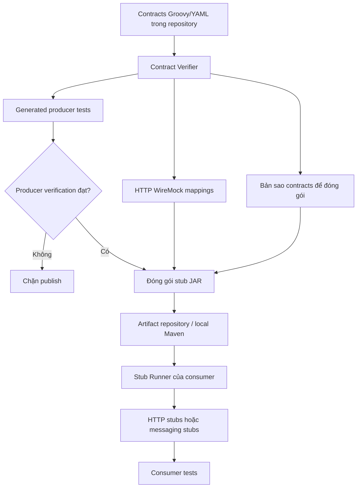
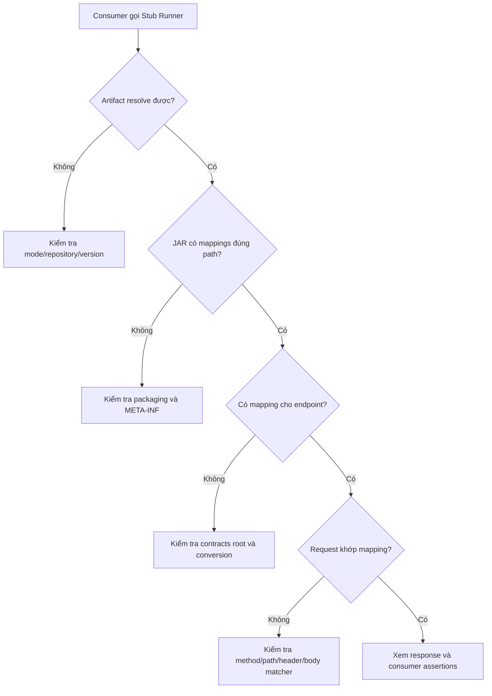
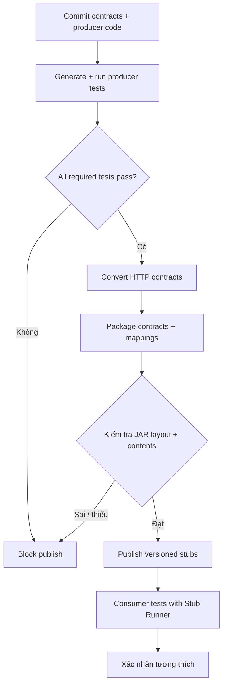

# Tổ chức thư mục contracts và mappings trong artifact

## 1. Vì sao cấu trúc của stub artifact là một phần của hợp đồng tích hợp?

Trong **Spring Cloud Contract** (module `SPRING_CLOUD_CONTRACT`), producer và consumer kiểm thử sự tương thích dựa trên những hợp đồng HTTP hoặc thông điệp viết bằng **Groovy/YAML DSL**. Contract Verifier có thể sinh test cho phía producer; cùng bộ hợp đồng được chuyển đổi thành stub, đóng gói và phát hành theo phiên bản. Consumer dùng **Stub Runner** để tải đúng artifact và kiểm tra logic của mình trong CI mà không cần khởi động producer thật.

Một khó khăn thường gặp là producer đã chạy test thành công, thậm chí đã tạo file `.jar`, nhưng **consumer không tìm thấy stub**. Nguyên nhân có thể không nằm ở HTTP contract: JAR có thể thiếu thư mục `mappings`, thiếu `contracts`, dùng sai tọa độ group/artifact/version hoặc chứa file ở vị trí Stub Runner không quét.

Bài học này tập trung vào câu hỏi: **Một hợp đồng đi từ thư mục nguồn đến đâu trong stub artifact, và Stub Runner cần nhìn thấy gì để sử dụng nó?**

Sau bài này, bạn có thể:

1. Phân biệt `contracts` nguồn, `mappings` đã chuyển đổi và **stub JAR** đã đóng gói.
2. Tổ chức hợp đồng theo miền nghiệp vụ/consumer và giữ cấu trúc dễ truy vết.
3. Giải thích bố cục thường dùng `META-INF/<groupId>/<artifactId>/<version>/contracts` và `.../mappings`.
4. Nhận biết mapping **HTTP WireMock** khác với dữ liệu cần cho **messaging stub**.
5. Tạo artifact bằng quy trình Maven/Gradle, đọc nội dung JAR và kiểm tra các file mong đợi.
6. Phát hành artifact phiên bản rõ ràng, cấu hình Stub Runner ở consumer và chẩn đoán các lỗi thiếu mapping.
7. Thiết kế kiểm tra trong CI để không publish một stub artifact rỗng, thiếu hợp đồng hoặc chưa qua producer verification.

> **Phạm vi:** các đường dẫn trong bài là **cấu trúc minh họa theo quy ước Spring Cloud Contract**. Đường dẫn build output, tên mapping JSON, tên task/goal và bố cục chính xác có thể thay đổi theo phiên bản plugin hoặc cấu hình riêng. Cần kiểm tra **nội dung JAR thực tế** thay vì chỉ suy đoán từ cây thư mục ví dụ.

## 2. Ba dạng dữ liệu không được nhầm lẫn

| Khái niệm | Nó là gì? | Nguồn tạo | Ai sử dụng? |
| --- | --- | --- | --- |
| **Contracts nguồn** | File `.groovy`, `.yml` hoặc `.yaml` mô tả hành vi | Producer/consumer thống nhất, đưa vào repository | Contract Verifier, generator, review và một số messaging stub workflows |
| **HTTP mappings** | File JSON theo định dạng **WireMock stub mapping** | Converter của Spring Cloud Contract tạo từ HTTP contract | WireMock/Stub Runner dùng để khớp HTTP request và trả HTTP response |
| **Stub artifact** | JAR chứa contracts, mappings và tài nguyên cần thiết theo bố cục có thể nhận diện | Bước packaging của Maven/Gradle | Consumer tests, Stub Runner, artifact repository |

**Contracts là nguồn mô tả**, còn **mappings là biểu diễn thực thi của HTTP stub**. Không nên sửa file JSON mapping được sinh rồi xem đó là nguồn chân lý lâu dài: một lần chạy generator tiếp theo có thể ghi đè thay đổi. Nếu yêu cầu API đổi, hãy sửa hợp đồng nguồn và sinh lại.

### 2.1. Luồng từ hợp đồng đến consumer



**Không phải hai thư mục có vai trò giống nhau:** với HTTP, các mapping JSON được WireMock nạp để phục vụ endpoint stub. Với messaging, dữ liệu hợp đồng như `label`, `outputMessage` và các thông tin chuyển đổi liên quan vẫn có vai trò quan trọng; **không mặc định một message sẽ sinh ra một HTTP WireMock mapping JSON tương ứng**.

## 3. Thư mục contracts nguồn nên được tổ chức thế nào?

Với Maven, Spring Cloud Contract thường đọc từ `src/test/resources/contracts` khi dùng cấu hình mặc định. Ví dụ một producer tích hợp nhiều nhánh:

```text
orders-producer/
  pom.xml
  src/
    test/
      resources/
        contracts/
          http/
            orders/
              get_order_success.groovy
              get_order_not_found.groovy
              create_order_success.yml
              create_order_invalid_quantity.yml
            customers/
              get_customer_success.groovy
          messaging/
            orders/
              order_created_event.groovy
              order_cancelled_event.yml
```

Các cấp `http/orders` và `messaging/orders` là **quy ước của nhóm**, không phải bắt buộc của DSL. Chúng giúp:

- Nhận diện giao thức và miền nghiệp vụ.
- Tìm lại hợp đồng từ log test hoặc mapping.
- Giữ các nhánh thành công/thất bại gần nhau.
- Ánh xạ các nhóm hợp đồng đến base test class phù hợp.
- Giảm nguy cơ đặt trùng tên file ở một nhóm.

### 3.1. Maven và Gradle có thể có contracts root khác nhau

| Build | Ví dụ contracts root | Điều cần lưu ý |
| --- | --- | --- |
| Maven | `src/test/resources/contracts` | Có thể đổi bằng cấu hình plugin như `contractsDirectory` |
| Gradle | `src/contractTest/resources/contracts` trong thiết lập Gradle plugin thường gặp | Có thể đổi bằng `contractsDslDir` |
| Contracts repository độc lập | Thư mục trong một JAR hoặc Git repository | Cần cấu hình dependency, path và mode để producer lấy đúng hợp đồng |

Đừng mặc định dự án Gradle phải có đúng cấu trúc Maven. Khi muốn giữ cùng layout cho cả hai hệ thống, **cấu hình contracts root tường minh** rồi xác minh plugin đã quét đủ files.

### 3.2. Đặt tên file theo nhánh tương tác

| Tên tốt | Hành vi phản ánh |
| --- | --- |
| `get_order_success.groovy` | `GET` trả `200` |
| `get_order_not_found.groovy` | `GET` trả `404 ORDER_NOT_FOUND` |
| `create_order_invalid_quantity.yml` | `POST` trả lỗi validation |
| `order_created_event.groovy` | Producer phát sự kiện tạo đơn |

Không nên đặt mọi hợp đồng là `test1.groovy`, `test2.groovy`. Cũng nên tránh **hai hợp đồng có điều kiện request chồng lấp** nhưng response khác nhau: việc tách thành hai file chỉ giúp tổ chức, không tự làm Stub Runner phân biệt đúng nhánh.

### 3.3. Dùng thư mục theo consumer khi cần

Một producer có thể phục vụ nhiều consumer, mỗi consumer quan tâm những hành vi khác nhau. Có thể tổ chức các thư mục theo nhóm consumer, ví dụ:

```text
contracts/
  shopping-web/
    get_order_success.groovy
    create_order_success.groovy
  backoffice/
    get_order_not_found.groovy
    cancel_order_success.groovy
```

Cách này giúp truy vết thay đổi ảnh hưởng nhóm nào. Tuy nhiên, nếu các hợp đồng khác thư mục có **cùng method/path/header/body matcher** nhưng trả response khác nhau, các mappings vẫn có thể chồng lấp. **Thư mục không phải điều kiện khớp HTTP**.

## 4. Một hợp đồng HTTP trở thành mapping như thế nào?

Giả sử file `http/orders/get_order_success.groovy` chứa:

```groovy
import org.springframework.cloud.contract.spec.Contract

Contract.make {
    name 'get_order_success'
    description 'Đọc một đơn hàng tồn tại'

    request {
        method GET()
        url '/api/orders/ord-1001'
    }

    response {
        status 200
        headers {
            contentType(applicationJson())
        }
        body([
            id    : 'ord-1001',
            status: 'CREATED'
        ])
    }
}
```

Converter đọc DSL và tạo mapping HTTP để WireMock biết **request nào khớp** và **response nào được trả**. Ví dụ biểu diễn JSON có cùng ý nghĩa:

```json
{
  "request": {
    "method": "GET",
    "url": "/api/orders/ord-1001"
  },
  "response": {
    "status": 200,
    "headers": {
      "Content-Type": "application/json"
    },
    "jsonBody": {
      "id": "ord-1001",
      "status": "CREATED"
    }
  }
}
```

Đây là **mapping WireMock tương đương về hành vi để giải thích**, không phải cam kết rằng generated JSON của mọi phiên bản luôn dùng chính xác thuộc tính `jsonBody`, thứ tự fields hay cùng tên file. Trong output thực, plugin có thể chọn biểu diễn `body`, matcher, metadata và định dạng JSON khác; cần kiểm tra mapping được tạo.

### 4.1. Contract nguồn khác mapping JSON

| Phần | Groovy contract | Mapping runtime |
| --- | --- | --- |
| Method | `method GET()` | `"method": "GET"` |
| URL | `url '/api/orders/ord-1001'` | `"url": "/api/orders/ord-1001"` |
| Response status | `status 200` | `"status": 200` |
| Header | `contentType(applicationJson())` | `Content-Type: application/json` |
| JSON body | Groovy map/list | JSON/string biểu diễn body |
| Matcher động | `consumer/producer` hoặc `bodyMatchers` | WireMock matcher phù hợp phía consumer |

Nếu contract mô tả `request` có regex hoặc JSONPath matcher, converter phải đưa **điều kiện nhận request** vào mapping theo cú pháp WireMock. Việc mapping dùng regex không đồng nghĩa generated producer test sẽ gửi chuỗi regex như dữ liệu HTTP thật.

### 4.2. Vì sao phải đọc mapping thật?

Giả sử hai file:

```text
get_order_success.groovy    -> GET /api/orders/ord-1001 -> 200
get_order_not_found.groovy  -> GET /api/orders/ord-missing -> 404
```

Khi converter sinh mappings, cần thấy chúng có **điều kiện request tách biệt**. Nếu mapping `200` dùng regex quá rộng `/api/orders/.*`, nó có thể nhận cả ID của nhánh `404`. WireMock không tự truy vấn database của producer để quyết định trạng thái đơn.

**Đọc mapping giúp phát hiện:** request matcher sai chiều, path regex quá rộng, thiếu header ràng buộc, body matcher không đúng kiểu và các kịch bản chồng lấp.

## 5. Cấu trúc thường dùng bên trong stub JAR

Với tọa độ:

```text
groupId    = com.example
artifactId = orders-producer
version    = 1.4.2
classifier = stubs
```

Một artifact được tổ chức theo cấu trúc phổ biến:

```text
orders-producer-1.4.2-stubs.jar
└── META-INF/
    └── com.example/
        └── orders-producer/
            └── 1.4.2/
                ├── contracts/
                │   ├── http/
                │   │   └── orders/
                │   │       ├── get_order_success.groovy
                │   │       ├── get_order_not_found.groovy
                │   │       └── create_order_success.yml
                │   └── messaging/
                │       └── orders/
                │           └── order_created_event.groovy
                └── mappings/
                    └── http/
                        └── orders/
                            ├── get_order_success.json
                            ├── get_order_not_found.json
                            └── create_order_success.json
```

**Chú thích cực kỳ quan trọng:**

- `com.example` là **groupId được hiển thị như một thành phần thư mục** trong sơ đồ này. Nó không bị bắt buộc chuyển thành hai thư mục `com/example` theo Java package. Đừng tự thay đổi cấu trúc mà plugin/Stub Runner đang chờ.
- `orders-producer` là artifactId, `1.4.2` là version. Bộ ba này phải khớp với artifact mà consumer đang yêu cầu.
- Các tên `get_order_success.json` trong sơ đồ chỉ là **minh họa về việc phân nhóm mapping**. Generator có thể dùng tên file/mã định danh khác hoặc cấu trúc thư mục khác.
- Thư mục `contracts` có thể chứa Groovy/YAML nguồn; `mappings` chứa **HTTP mappings**. Với message `order_created_event`, không nên kỳ vọng một file WireMock HTTP JSON tên `order_created_event.json`.
- Một JAR thực còn có thể chứa `META-INF/MANIFEST.MF` hoặc tài nguyên khác. Mục tiêu ở đây là phân biệt **vùng contracts** và **vùng mappings** có thể được Stub Runner nhận diện.

### 5.1. Tại sao cấu trúc `META-INF` lại quan trọng?

Stub Runner cần định vị đúng tập stub theo **groupId, artifactId và version**. Khi chạy ở chế độ **CLASSPATH**, cơ chế quét tìm các vị trí quy ước như:

```text
/META-INF/com.example/orders-producer/<version>/...
/contracts/com.example/orders-producer/<version>/...
/mappings/com.example/orders-producer/<version>/...
```

Đây là các **hình thức vị trí có thể được quét**, không phải yêu cầu JAR nhất thiết phải chứa cả ba bố cục song song. Cấu trúc `META-INF` phía trên là một lựa chọn điển hình được tài liệu Spring Cloud Contract mô tả. Với tùy chọn tải từ Maven repository, Stub Runner giải nén artifact và định vị nội dung tương ứng theo cấu hình/version.

Đừng đóng gói kiểu:

```text
orders-producer-1.4.2-stubs.jar
└── my-workspace/
    └── src/test/resources/contracts/
        └── get_order_success.groovy
```

rồi giả định Stub Runner sẽ tìm được. Đây chỉ là **đường dẫn nguồn của workspace**, không phải cấu trúc stub artifact thường được công cụ tìm kiếm.

### 5.2. Contracts và mappings đều phải đi cùng phiên bản

Ví dụ producer `1.5.0` đổi API để thêm trường `currency`:

- Contract nguồn mới có `currency`.
- Generated producer test của bản mới kiểm chứng response thật.
- Mapping stub mới trả `currency` khi consumer dùng artifact `1.5.0`.
- Artifact `1.4.2` vẫn chứa hợp đồng/mapping cũ.

**Không nên** xuất bản hai nội dung khác nhau dưới cùng tọa độ release `com.example:orders-producer:1.4.2:stubs`. Việc ghi đè làm mất khả năng tái lập consumer tests và khiến một máy vẫn dùng artifact cache cũ trong khi máy khác tải nội dung mới.

## 6. Source contracts và HTTP mappings không phải bản sao của nhau

Trong trường hợp HTTP, một contract có thể được chuyển thành một hoặc nhiều mapping, tùy cấu trúc và plugin. Hãy xem đây là **quá trình chuyển đổi**, không phải thao tác đổi phần mở rộng file từ `.groovy` sang `.json`.

Một mapping có thể chứa:

- `request.method`, `url` hoặc `urlPath`.
- Header, query parameter, cookie, body matcher.
- Quy tắc JSONPath/regex hoặc các điều kiện khớp tương ứng.
- `response.status`, headers, body.
- Các thông tin giúp phân biệt hoặc ưu tiên mapping nếu plugin tạo.

Ví dụ một contract request có matcher:

```groovy
request {
    method GET()
    urlPath($(consumer(regex('/api/items/SKU-[0-9]{3}/format')),
               producer('/api/items/SKU-001/format')))
}
response {
    status 200
    body([valid: true])
}
```

Trong mapping HTTP, **consumer** có thể gửi `/api/items/SKU-002/format` nếu path khớp regex; generated producer test chỉ gọi đường dẫn mẫu `/api/items/SKU-001/format`. Đây là API **kiểm tra định dạng**, nơi mọi ID đúng dạng được giả định có cùng hành vi. Không dùng kiểu regex tương tự cho `GET /api/orders/{id}` nếu một số ID trả `200` và ID khác trả `404`.

Nếu converter bỏ sót matcher hoặc đặt sai phía, mapping có thể quá rộng/quá hẹp dù producer test của một mẫu cố định vẫn đạt. **Kiểm tra mapping thực** là cách xác nhận phần được consumer sử dụng.

## 7. Messaging contracts được đóng gói khác thế nào?

Giả sử hợp đồng `messaging/orders/order_created_event.groovy`:

```groovy
import org.springframework.cloud.contract.spec.Contract

Contract.make {
    name 'order_created_event'
    label 'order_created'

    input {
        triggeredBy('publishOrderCreated()')
    }

    outputMessage {
        sentTo('orders.events')
        body([
            eventType: 'ORDER_CREATED',
            orderId  : 'ord-1001'
        ])
        headers {
            header('eventType', 'ORDER_CREATED')
            messagingContentType(applicationJson())
        }
    }
}
```

Đối với message stub, thông tin như `label`, `outputMessage.sentTo`, `body` và `headers` được Stub Runner/messaging integration sử dụng để phát message mẫu. Nó **không nhất thiết sinh một mapping WireMock HTTP** cho hợp đồng event.

| Thành phần | HTTP stubs | Messaging stubs |
| --- | --- | --- |
| Runtime thông dụng | WireMock HTTP server | Message integration/binder/verifier phù hợp |
| Biểu diễn quan trọng | JSON `mappings` | Hợp đồng/message definition và metadata liên quan |
| Cách consumer kích hoạt | Gửi HTTP request khớp mapping | Dùng `StubTrigger.trigger(label)` khi contract có label và integration hỗ trợ |
| Output tới consumer | HTTP status, headers, body | Destination, message body, headers/content type |
| Điều kiện để chạy | HTTP stub mappings được nạp | Messaging support được cấu hình, consumer có binding/subscriber |

Vì thế, một artifact có thể chứa **cả contracts và mappings**, nhưng **không phải số lượng HTTP mapping JSON luôn bằng tổng số contract HTTP + messaging**. Nếu chỉ đếm JSON trong `mappings` rồi kết luận “thiếu hợp đồng message”, có thể đánh giá sai. Phải kiểm tra loại hợp đồng và cách Stub Runner đang chạy.

### 7.1. Khi đóng gói contracts nguồn để phục vụ messaging

Đừng cố rút gọn JAR thành chỉ `mappings/*.json` nếu consumer cần kích hoạt event qua label. Điều đó có thể làm mất định nghĩa message và metadata cần thiết cho messaging stub. Kiểm tra rằng artifact của phiên bản đang dùng chứa dữ liệu message contract theo cấu trúc plugin yêu cầu.

Với YAML DSL, cũng cần giữ các file YAML được sử dụng, không chỉ những file `.groovy`. Khi dùng cấu hình đóng gói tùy biến, phải kiểm tra file pattern thực tế có bao gồm cả `*.yml`/`*.yaml` nếu repository chứa loại đó.

## 8. Maven: chuyển đổi, sinh stub và đóng gói

Với dự án Maven có `spring-cloud-contract-maven-plugin`, các mục tiêu quan trọng là:

| Goal | Tác dụng |
| --- | --- |
| `spring-cloud-contract:generateTests` | Sinh producer tests từ contract |
| `spring-cloud-contract:convert` | Chuyển hợp đồng thành HTTP stub mappings |
| `spring-cloud-contract:generateStubs` | Đóng gói stub JAR từ output đã chuyển đổi; cần bước convert trước |
| `mvn verify` | Chạy lifecycle producer theo cấu hình, trong đó có biên dịch và thực thi test phù hợp |
| `mvn install` / `deploy` | Cài artifact vào local Maven repo hoặc phát hành theo repository configuration |

Ví dụ một đoạn `pom.xml` rút gọn:

```xml
<build>
  <plugins>
    <plugin>
      <groupId>org.springframework.cloud</groupId>
      <artifactId>spring-cloud-contract-maven-plugin</artifactId>
      <version>VERSION_PHU_HOP</version>
      <extensions>true</extensions>
      <configuration>
        <baseClassForTests>
          com.example.orders.contract.OrdersContractBase
        </baseClassForTests>
      </configuration>
    </plugin>
  </plugins>
</build>
```

`VERSION_PHU_HOP` là **placeholder**, cần thay bằng phiên bản Spring Cloud Contract tương thích với dự án. Đây chưa phải `pom.xml` hoàn chỉnh; còn phải có dependency test, lớp nền, repository và phần lifecycle cần thiết.

### 8.1. Ví dụ lệnh Maven

Trong dự án đã cấu hình plugin và Maven Wrapper:

```bash
# Sinh/đọc producer tests
./mvnw -B spring-cloud-contract:generateTests

# Chuyển đổi hợp đồng sang HTTP mappings rồi đóng gói stubs
./mvnw -B spring-cloud-contract:convert spring-cloud-contract:generateStubs

# Chạy vòng đời kiểm thử producer trước khi phát hành
./mvnw -B clean verify

# Cài bản producer/stubs vào Maven repository cục bộ khi build đúng
./mvnw -B install
```

Các lệnh này là **hướng dẫn**, chưa được chạy trong bài. Nếu plugin được gắn vào lifecycle, một số goal có thể đã tự thực thi trong `verify` hoặc `install`; không cần gọi trùng trong CI. Hãy xem build configuration và log thực tế. Không nên chỉ chạy `generateStubs` rồi publish mà **không chạy producer verification**.

### 8.2. Output Maven thường được xem ở đâu?

Trong cấu hình thông dụng, plugin tạo thư mục trung gian:

```text
target/
  generated-test-sources/
    contracts/
      ... generated producer tests ...
  stubs/
    META-INF/
      com.example/
        orders-producer/
          1.4.2/
            contracts/
            mappings/
  orders-producer-1.4.2-stubs.jar
```

Đây là **đường dẫn thường thấy**, không khẳng định mọi build Maven dùng chính xác các thư mục trên. Tên output có thể tùy phiên bản plugin, cấu hình `stubsDirectory` và các tùy chọn đóng gói. Đọc log hoặc tham số plugin để xác định nơi thực tế.

**Lỗi điển hình:** người phát triển nhìn thấy `target/stubs/.../mappings/*.json` và cho rằng artifact đã được xuất bản. Chưa chắc! Đây có thể mới là **thư mục staging**. Phải kiểm tra file JAR được tạo, classifier/version và thao tác `install` hoặc `deploy`.

## 9. Gradle: `generateClientStubs` và `verifierStubsJar`

Với **Spring Cloud Contract Gradle plugin**, cơ chế tương tự nhưng tên task và contracts root có thể khác Maven. Một số task thường gặp:

| Task | Mục đích |
| --- | --- |
| `generateContractTests` | Sinh producer tests |
| `contractTest` | Thực thi producer contract tests |
| `generateClientStubs` | Sinh các stub/mappings dành cho consumer |
| `copyContracts` | Sao chép contracts vào staging directory của artifact |
| `verifierStubsJar` | Đóng gói stub JAR theo cấu hình plugin |

Ví dụ `build.gradle` rút gọn, giả sử dự án chủ động dùng cùng contracts root như Maven:

```groovy
plugins {
    id 'java'
    id 'maven-publish'
    id 'org.springframework.cloud.contract' version 'VERSION_PHU_HOP'
}

contracts {
    contractsDslDir = file('src/test/resources/contracts')
    baseClassForTests = 'com.example.orders.contract.OrdersContractBase'
}

publishing {
    publications {
        mavenJava(MavenPublication) {
            from components.java
            artifact verifierStubsJar
        }
    }
}
```

`VERSION_PHU_HOP` là placeholder. Cần xác nhận plugin version, Gradle/Java compatibility và rằng task `verifierStubsJar` đã được plugin tạo trong phiên bản hiện dùng. Việc gắn `artifact verifierStubsJar` vào publication là **cấu hình quan trọng** trong các phiên bản Gradle plugin hiện đại: không nên giả định plugin tự xuất bản mọi stub JAR nếu chưa khai báo publication phù hợp.

### 9.1. Ví dụ các bước Gradle

```bash
./gradlew generateContractTests
./gradlew contractTest
./gradlew verifierStubsJar
./gradlew publishToMavenLocal
```

Thứ tự này cho thấy mục đích từng bước. Pipeline thực cần **dừng khi `contractTest` thất bại**, bảo đảm `verifierStubsJar` chứa contracts/mappings đã được sinh và chỉ publish khi producer verification đạt. Các task dependency thực tế phụ thuộc plugin và build script; cần xác nhận từ output/build graph.

### 9.2. Gradle thường có contracts root riêng

Trong cấu hình Gradle plugin thông dụng, `contractsDslDir` có thể trỏ tới:

```text
src/contractTest/resources/contracts/
```

Ví dụ `build.gradle` ở trên chủ động đổi sang `src/test/resources/contracts`. Nếu không cấu hình và đặt file theo đường dẫn Maven, build có thể không tìm thấy hợp đồng nào. Đây là **lỗi contracts root**, không phải lỗi DSL.

## 10. Kiểm tra bên trong file JAR thay vì nhìn tên file

Một file `orders-producer-1.4.2-stubs.jar` có thể tồn tại nhưng vẫn bị đóng gói sai. Để xác minh, dùng công cụ `jar` có trong JDK:

```bash
jar tf target/orders-producer-1.4.2-stubs.jar
```

Hoặc dùng `unzip -l` ở hệ thống có sẵn lệnh đó:

```bash
unzip -l target/orders-producer-1.4.2-stubs.jar
```

**Ví dụ những entry cần thấy** (tên mapping ở đây chỉ minh họa):

```text
META-INF/MANIFEST.MF
META-INF/com.example/orders-producer/1.4.2/contracts/http/orders/get_order_success.groovy
META-INF/com.example/orders-producer/1.4.2/contracts/http/orders/get_order_not_found.groovy
META-INF/com.example/orders-producer/1.4.2/contracts/messaging/orders/order_created_event.groovy
META-INF/com.example/orders-producer/1.4.2/mappings/http/orders/get_order_success.json
META-INF/com.example/orders-producer/1.4.2/mappings/http/orders/get_order_not_found.json
```

Đừng chỉ kiểm tra chuỗi `META-INF/` xuất hiện; phải xác nhận:

1. Có **groupId** và **artifactId** đúng.
2. Có **version** khớp artifact đã chọn.
3. Thư mục `contracts` có các hợp đồng nguồn cần thiết.
4. Thư mục `mappings` có HTTP mappings cho những endpoint dự kiến.
5. File JSON có request matcher/response đúng, không phải mapping của bản cũ.
6. Có hợp đồng messaging với `label` khi consumer cần gọi `StubTrigger`.
7. Các file phụ trợ mà mapping tham chiếu (nếu có) cũng nằm trong artifact và đúng vị trí mà stub runtime tìm kiếm.

### 10.1. Kiểm tra mapping theo request/response

Với endpoint `GET /api/orders/ord-1001`, mapping phải mô tả:

```text
request.method = GET
request.url    = /api/orders/ord-1001
response.status = 200
response.Content-Type = application/json
response.body.id = ord-1001
response.body.status = CREATED
```

Nếu mapping chỉ có `request.url = /api/orders/.*` và không có điều kiện khác, có thể vô tình khớp cả nhánh `404`. Nếu mapping không có `Content-Type` nhưng consumer dùng header này để chọn JSON deserializer, consumer test cũng có thể hành xử khác producer thực.

**Đừng sửa JSON mapping bên trong JAR bằng tay** để khắc phục lỗi. Sửa hợp đồng nguồn hoặc cấu hình converter, chạy lại producer verification và đóng gói một artifact phiên bản mới.

### 10.2. Vì sao không nên chỉ đếm file?

Không có quy tắc chung “mỗi hợp đồng sẽ sinh một file JSON” áp dụng cho mọi hình thức HTTP/messaging, mọi phiên bản plugin và mọi cấu hình. Một vài nguyên nhân:

- Hợp đồng message không nhất thiết tương ứng với HTTP mapping JSON.
- Một file nguồn có thể chứa nhiều định nghĩa hợp đồng theo cách tổ chức DSL.
- Converter có thể sinh tên file khác kỳ vọng hoặc dùng cấu trúc nested directory.
- Plugin có thể lọc một số file bằng cấu hình.

Do đó, hãy kiểm tra **từng tình huống cần bảo vệ**, không chỉ số file `.groovy`, `.yml` hoặc `.json`.

## 11. Consumer tải stub artifact qua Stub Runner

Một consumer có thể cấu hình Stub Runner dùng artifact:

```text
com.example:orders-producer:1.4.2:stubs
```

Đây là tọa độ gồm **groupId, artifactId, version, classifier**. Với HTTP stubs, có thể thêm cổng khi khai báo IDs:

```java
import org.junit.jupiter.api.Test;
import org.springframework.boot.test.context.SpringBootTest;
import org.springframework.cloud.contract.stubrunner.StubRunnerProperties;
import org.springframework.cloud.contract.stubrunner.spring.AutoConfigureStubRunner;

@SpringBootTest
@AutoConfigureStubRunner(
    ids = "com.example:orders-producer:1.4.2:stubs:8090",
    stubsMode = StubRunnerProperties.StubsMode.LOCAL
)
class OrdersConsumerContractTest {

    @Test
    void consumesGetOrderStub() {
        // Gọi HTTP client của consumer tới base URL stub cổng 8090.
        // Assert dữ liệu và hành vi consumer sau khi nhận JSON mẫu.
    }
}
```

Đây là **khung minh họa**, chưa chạy được độc lập: dự án cần dependency `spring-cloud-starter-contract-stub-runner`, cấu hình HTTP client trỏ đến stub, test assertion và artifact đã cài trong local Maven repository. Để CI tải stub từ kho từ xa, dùng `REMOTE` cùng `repositoryRoot` và cơ chế xác thực an toàn.

### 11.1. Chế độ lấy stub

| Mode | Nguồn được dùng | Lưu ý |
| --- | --- | --- |
| `CLASSPATH` | Quét stub có trên classpath | Cần đóng gói đúng bố cục và đưa artifact vào test dependencies |
| `LOCAL` | Local Maven repository, thường là `.m2` | Artifact/version phải được cài vào local repo |
| `REMOTE` | Maven-compatible repository như Nexus/Artifactory | Cấu hình URL, quyền và version phù hợp |

Các mode này **chỉ quyết định cách Stub Runner tìm artifact**. Chúng không thay đổi điều kiện HTTP matcher hoặc khiến message event tự được phát nếu thiếu messaging support.

### 11.2. Classpath không tìm thấy mappings

Nếu JAR có mappings nhưng Stub Runner **không nhận**, kiểm tra:

- Artifact có thực sự nằm trong test classpath?
- `groupId/artifactId/version` trong đường dẫn `META-INF` có khớp không?
- File mapping JSON có được đóng gói dưới vị trí được quét không?
- Có thay đổi classifier khi publish không? Consumer đang yêu cầu đúng classifier chưa?
- Có một bản JAR khác của cùng artifact đang được chọn do dependency conflict không?

Trong chế độ `LOCAL`/`REMOTE`, cũng cần kiểm tra version được resolve; một stub `1.4.1` có thể không chứa mapping vừa thêm vào `1.4.2`.

## 12. Những thay đổi cấu trúc có thể làm hợp đồng “biến mất”

| Thay đổi | Vấn đề phát sinh | Điều cần kiểm tra |
| --- | --- | --- |
| Đổi `src/test/resources/contracts` sang thư mục khác | Plugin không quét hợp đồng nếu không đổi config | `contractsDirectory`/`contractsDslDir` |
| Đổi tên thư mục `http/orders` | Generated tests/base class mapping có thể đổi | Contracts root, regex base class mappings |
| Đổi groupId trong POM | Artifact có tọa độ/path khác | Thư mục `META-INF` và Stub Runner IDs |
| Đổi artifactId khi publish | Consumer tìm sai artifact | Dependency coordinates và repository |
| Đổi version nhưng chỉ publish mapping cũ | Stub không phản ánh hợp đồng mới | So bản source và generated mappings trong JAR |
| Chỉ đóng gói `mappings` | Messaging contracts/label có thể bị mất | Kiểm tra `contracts` và messaging scenario |
| Chỉ đóng gói `contracts` | HTTP Stub Runner không có mappings để phục vụ request | Kiểm tra HTTP JSON mappings |
| Chỉ include `*.groovy` khi copy | Bỏ sót YAML contracts | Include cả `*.yml`, `*.yaml` khi cần |
| Tạo mapping JSON rồi sửa tay | Lệch khỏi DSL và producer tests | Regenerate từ hợp đồng nguồn |
| Đóng gói trong thư mục lồng thêm một cấp | Stub Runner quét sai path | Kiểm tra entry names bằng `jar tf` |
| Publish trước khi producer verification | Stub có thể đại diện cho hành vi producer không còn đáp ứng | Gate publish theo test result |

### 12.1. Dấu hiệu khi build xanh nhưng artifact rỗng

Một trường hợp nguy hiểm:

```text
Build SUCCESS
No contracts found
Generated tests: 0
Mappings: 0
Stub JAR created
```

Đây là **log giả lập**. Nếu đường dẫn contracts root sai hoặc quá trình sinh bị bỏ qua, pipeline có thể xanh mà không kiểm chứng hành vi nào; việc một JAR tồn tại không đủ chứng minh có stub sử dụng được.

Trong Maven plugin có tùy chọn `failOnNoContracts` ở một số goal/phiên bản, giúp báo lỗi khi không tìm thấy hợp đồng. Dù tùy chọn này được bật, vẫn nên kiểm tra **danh sách kịch bản kỳ vọng** và nội dung artifact; một artifact có một hợp đồng không liên quan vẫn không bảo vệ đầy đủ các API cần thiết.

## 13. Cách chẩn đoán khi Stub Runner không phục vụ đúng mapping

Kiểm tra theo thứ tự, từ **artifact** đến **hành vi**:

1. **Đúng tọa độ?** groupId, artifactId, version, classifier và port/test config.
2. **Tải được artifact?** Chế độ CLASSPATH/LOCAL/REMOTE có nguồn phù hợp không?
3. **Đúng bố cục?** `META-INF/<groupId>/<artifactId>/<version>/mappings` có HTTP JSON mappings không?
4. **Đúng tập hợp?** Mapping của endpoint cần kiểm tra có xuất hiện không?
5. **Đúng request matcher?** Method, URL, headers, query, cookie, body có khớp request thực không?
6. **Đúng response?** Status, headers, body có chứa giá trị mới nhất không?
7. **Consumer xử lý được?** Client có parse và xử lý đúng response không?



**Không đồng nhất** response `404` do WireMock **không tìm thấy mapping** với `404 ORDER_NOT_FOUND` do **hợp đồng nghiệp vụ** mô tả. Hai trường hợp có thể có cùng HTTP status nhưng body/headers khác nhau; consumer test nên assert đúng thông tin mà API công bố.

### 13.1. Trường hợp contract message nhưng không tìm thấy label

Nếu consumer test gọi `StubTrigger.trigger('order_created')` nhưng không có kịch bản:

- Kiểm tra trong JAR có contract message `order_created_event` với `label 'order_created'`.
- Kiểm tra đã nạp đúng stub version.
- Kiểm tra Stub Runner có messaging integration phù hợp để kích hoạt message không.
- Không tìm file WireMock `order_created_event.json` rồi kết luận contract message bị mất; messaging không nhất thiết sinh mapping HTTP kiểu đó.

## 14. Đóng gói đúng nhưng vẫn phải kiểm thử tương thích

Giả sử producer thêm trường `currency` vào response của `GET /api/orders/ord-1001`:

1. Cập nhật hợp đồng nguồn ở `contracts/http/orders/...`.
2. Sinh và chạy producer tests, bảo đảm producer thật trả trường mới.
3. Tạo mapping HTTP mới và đóng gói vào JAR có **version mới**.
4. Consumer A chạy Stub Runner với bản mới, xác nhận DTO cũ chấp nhận thuộc tính thêm.
5. Consumer B chạy Stub Runner với bản mới, xác nhận logic hiển thị/tính toán sử dụng `currency` đúng.
6. Khi rollout nhiều phiên bản, kiểm thử consumer mới với producer cũ nếu vẫn có thể xảy ra.

**Artifact đúng thư mục mới chỉ là điều kiện để stub được nạp.** Nó chưa chứng minh consumer cũ tương thích với schema/body mới. Phải chạy consumer tests với chính artifact ứng viên sẽ được phát hành.

## 15. CI: kiểm tra cả hợp đồng, mappings và JAR trước khi publish

Một pipeline có thể chia thành các cổng kiểm tra sau:

| Giai đoạn | Bằng chứng cần có | Không nên xem là đủ |
| --- | --- | --- |
| Khám phá contract | Danh sách các hợp đồng cần quét | Thư mục contracts tồn tại |
| Sinh test | Generated producer tests cho những kịch bản quan trọng | Lệnh generator trả 0 nhưng không có test |
| Chạy producer tests | Tests đã thực thi và assertions đạt | Test chỉ được compile |
| Chuyển đổi HTTP | Mapping JSON có request/response đúng | Chỉ kiểm tra số lượng JSON |
| Đóng gói JAR | `META-INF/.../contracts`, `.../mappings` đúng tọa độ | File `-stubs.jar` tồn tại nhưng không mở nội dung |
| Publish | Artifact version được lưu bất biến, có provenance | Ghi đè bản release cũ |
| Consumer tests | Stub Runner tải đúng version và client xử lý đúng | Chỉ khởi động Spring context |



### 15.1. Kiểm tra chất lượng artifact trong CI

Thay vì chỉ kiểm tra có file JAR, CI có thể yêu cầu:

- Không có hợp đồng được trông đợi bị bỏ qua.
- HTTP contract cần thiết có mapping được tạo và được đóng gói.
- Tất cả contracts messaging cần thiết còn ở trong artifact.
- Không có file nguồn nhạy cảm, token, khóa bí mật hoặc dữ liệu người dùng thật.
- Version trong path, tên artifact và publication metadata nhất quán.
- Producer tests đạt trước khi mở quyền publish.
- Consumer contract tests chạy với **chính version** sắp triển khai.

Trong một số quy trình, Gradle/Maven có thể tự đính kèm artifact vào publication. Hãy kiểm tra **publication configuration** và artifact thực tế trong repository, thay vì suy rằng lệnh `publish` luôn kèm classifier `stubs`.

## 16. Bài tập thực hành: từ contracts đến stub JAR

### 16.1. Bối cảnh

Producer `inventory-producer` có hai API HTTP và một sự kiện:

| Kịch bản | File hợp đồng | Kết quả |
| --- | --- | --- |
| Tra sản phẩm còn hàng | `http/products/get_product_success.groovy` | `GET /api/products/SKU-001 -> 200` |
| Tra sản phẩm không tồn tại | `http/products/get_product_not_found.yml` | `GET /api/products/SKU-MISSING -> 404` |
| Hàng đã được giữ | `messaging/inventory/inventory_reserved_event.groovy` | Event `INVENTORY_RESERVED` tới `inventory.events` |

Nhóm dự kiến phát hành:

```text
com.example:inventory-producer:2.1.0:stubs
```

### 16.2. Yêu cầu thực hành

1. Tạo ba hợp đồng trong contracts root phù hợp với Maven hoặc Gradle.
2. Viết rõ nhánh `200` và `404 PRODUCT_NOT_FOUND`, tránh tạo một regex URL nhận cả hai tình huống.
3. Với event, thêm `label 'inventory_reserved'` và `outputMessage` gồm `sentTo`, body, headers.
4. Sinh producer tests, tạo fixture `SKU-001` tồn tại và `SKU-MISSING` vắng mặt; chạy producer verification.
5. Chuyển đổi HTTP contracts thành mappings, đóng gói stub artifact.
6. Dùng `jar tf` hoặc công cụ tương đương để liệt kê entries trong JAR.
7. Xác nhận **hai HTTP mappings** tương ứng hai nhánh và **một messaging contract** chứa label, thay vì chỉ tìm tổng cộng ba JSON mappings.
8. Cài/publish stub với tọa độ `com.example:inventory-producer:2.1.0:stubs`.
9. Consumer HTTP test dùng Stub Runner trả `200` và `404` đúng body. Consumer message test dùng `StubTrigger.trigger('inventory_reserved')` khi messaging integration được cấu hình.
10. Cố ý chuyển file YAML khỏi contracts root và quan sát output thay đổi; đưa file về đúng vị trí, regenerate và kiểm tra lại.

### 16.3. Cây JAR mong đợi (mang tính minh họa)

```text
META-INF/
  com.example/
    inventory-producer/
      2.1.0/
        contracts/
          http/products/
            get_product_success.groovy
            get_product_not_found.yml
          messaging/inventory/
            inventory_reserved_event.groovy
        mappings/
          http/products/
            get_product_success.json
            get_product_not_found.json
```

Tên các file JSON chính xác có thể do generator quyết định. Quan trọng là **có mappings HTTP đại diện cho hai nhánh**, đồng thời **giữ message contract** theo cấu trúc mà Stub Runner phiên bản dự án có thể nạp.

### 16.4. Câu hỏi tự kiểm tra

**Câu 1.** Stub JAR chỉ chứa `contracts/*.groovy` và không có `mappings` thì đủ cho HTTP Stub Runner không?

**Đáp án:** Thông thường không. Với cơ chế HTTP WireMock, Stub Runner cần HTTP mappings có thể nạp được; file hợp đồng nguồn không tự thay thế bước chuyển đổi trong artifact.

**Câu 2.** Vì sao một messaging contract có thể không xuất hiện như file `.json` dưới `mappings`?

**Đáp án:** Messaging stub hoạt động theo message definition/transport và nhãn hợp đồng; nó không nhất thiết được biểu diễn bằng HTTP WireMock mapping JSON.

**Câu 3.** Đổi `groupId` từ `com.example` sang `com.acme` có thể ảnh hưởng gì?

**Đáp án:** Tọa độ artifact và bố cục được tìm trong JAR thay đổi; consumer phải dùng ID/dependency đúng và artifact phải đóng gói theo vị trí mà Stub Runner quét.

**Câu 4.** Có `target/stubs/.../mappings/get_product_success.json` có chứng minh đã publish `-stubs.jar` không?

**Đáp án:** Không. Đó có thể chỉ là output trung gian. Cần xác nhận JAR được đóng gói và đã cài/publish vào repository mong muốn.

**Câu 5.** Consumer test pass với `inventory-producer:2.0.0:stubs` có chứng minh tương thích với bản `2.1.0` mới không?

**Đáp án:** Không. Consumer cần được chạy với stub artifact của chính bản thay đổi, hoặc có bằng chứng riêng về tương thích.

## 17. Checklist cuối trước khi phát hành stub artifact

- [ ] Contracts root được cấu hình đúng với Maven/Gradle.
- [ ] Mỗi file hợp đồng có tên và thư mục rõ nghĩa, không ghi đè/trùng nội dung ngoài ý muốn.
- [ ] Producer tests được sinh **và chạy**, không chỉ có output source.
- [ ] Các HTTP mappings được converter tạo đúng method, URL, headers, body và status.
- [ ] Những tình huống HTTP thành công/thất bại không có matcher chồng lấp sai.
- [ ] Messaging contracts cần thiết, gồm `label` và `outputMessage`, còn trong artifact.
- [ ] Stub JAR có bố cục `META-INF/<groupId>/<artifactId>/<version>/contracts` và `mappings` theo quy ước của plugin.
- [ ] Tên file JAR, classifier `stubs` và publication tọa độ khớp với consumer.
- [ ] Đã mở nội dung JAR, không chỉ nhìn filename hoặc staging directory.
- [ ] Các file YAML/Groovy đều được bao gồm theo pattern đóng gói.
- [ ] Không có credential hoặc dữ liệu nhạy cảm trong contract/mapping/artifact.
- [ ] CI chặn publish khi thiếu hợp đồng, thiếu mapping quan trọng hoặc producer verification thất bại.
- [ ] Consumer test dùng Stub Runner lấy đúng phiên bản và assert hành vi của client thật.
- [ ] Artifact release không bị ghi đè; có thể tái lập kết quả với cùng tọa độ.

### Tài liệu tham khảo

- [Spring Cloud Contract — Stub Runner Core](https://docs.spring.io/spring-cloud-contract/reference/project-features-stubrunner/stub-runner-core.html): cấu trúc classpath, `META-INF`, contracts và mappings trong stub JAR.
- [Spring Cloud Contract — Maven Project](https://docs.spring.io/spring-cloud-contract/reference/maven-project.html): đường dẫn contracts, goal sinh test và cấu hình plugin.
- [Spring Cloud Contract Maven Plugin — Goals](https://docs.spring.io/spring-cloud-contract/docs/current/spring-cloud-contract-maven-plugin/plugin-info.html): `convert`, `generateStubs`, `generateTests`.
- [Spring Cloud Contract — Gradle Project](https://docs.spring.io/spring-cloud-contract/reference/gradle-project.html): `contractsDslDir`, `generateClientStubs`, `copyContracts`, `verifierStubsJar` và publication.

**Ghi nhớ:** **`contracts` là nguồn cam kết**, **`mappings` là biểu diễn HTTP stub để runtime khớp request**, còn **stub JAR** là gói phân phối theo groupId/artifactId/version cho consumer. Muốn Stub Runner tìm được và chạy đúng, phải đóng gói đúng đường dẫn, đúng loại dữ liệu và đúng phiên bản; muốn stub đáng tin, phải sinh và chạy producer verification trước khi publish, rồi kiểm tra consumer với chính artifact đó.
