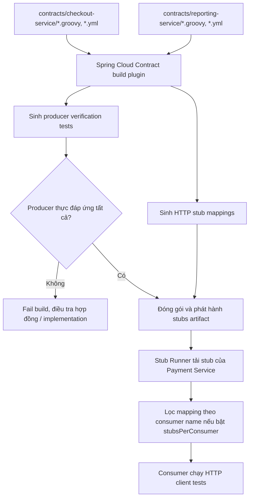
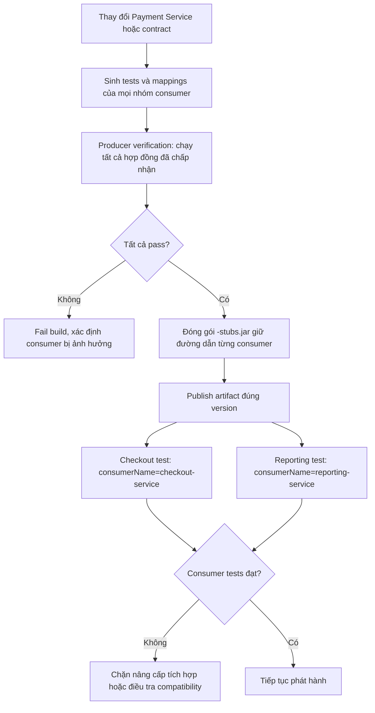

# Chỉ định hợp đồng thuộc từng consumer

## 1. Vì sao một producer cần biết hợp đồng nào dành cho consumer nào?

Trong hệ thống nhiều dịch vụ, một **producer** có thể cung cấp API HTTP hoặc thông điệp cho nhiều **consumer**. Ví dụ, `Payment Service` cung cấp dữ liệu cho:

- `Checkout Service`: cần trạng thái thanh toán để hoàn tất đơn hàng.
- `Reporting Service`: cần số tiền và đơn vị tiền tệ để lập báo cáo.
- `Notification Service`: cần sự kiện thanh toán thành công để gửi thông báo.

Nếu tất cả hợp đồng và stub được đặt chung một thư mục phẳng, nhóm phát triển khó trả lời câu hỏi: **Consumer nào đang phụ thuộc trường hoặc hành vi nào?** Khi một endpoint thay đổi, việc đánh giá tương thích trở nên khó khăn. Hơn nữa, nếu nhiều consumer có các hợp đồng dành riêng cho mình cùng xuất hiện trên một stub server, những mapping HTTP trùng hoặc gần trùng có thể gây kết quả khó đoán.

**Spring Cloud Contract** hỗ trợ tổ chức hợp đồng theo **thư mục tên consumer**. Khi sinh và đóng gói stub, cấu trúc thư mục có thể được bảo toàn để **Stub Runner** chọn những stub phù hợp với ứng dụng tiêu thụ. Tính năng quan trọng là **`stubsPerConsumer`** (cấu hình `spring.cloud.contract.stubrunner.stubs-per-consumer`).

Bài học thuộc chương **Sinh và đóng gói stub**, giúp bạn:

1. Phân biệt vai trò của producer, consumer, hợp đồng và stub artifact.
2. Tổ chức tệp hợp đồng theo consumer và hiểu ý nghĩa **consumer name**.
3. Sử dụng `stubsPerConsumer`, `consumerName` và `spring.application.name` đúng nơi.
4. Hiểu hợp đồng được sinh thành producer tests và các mapping được đóng gói trong `-stubs.jar`.
5. Kiểm tra producer–consumer compatibility và tránh mapping xung đột.
6. Áp dụng versioning, review thay đổi và CI cho mô hình consumer-driven contracts.

## 2. Một hợp đồng thuộc consumer có nghĩa là gì?

**Consumer-driven contract** ghi lại những gì một consumer thực sự cần ở producer. Trong cách tổ chức theo thư mục:

```text
Payment Service (producer)
├── Hợp đồng của Checkout Service
├── Hợp đồng của Reporting Service
└── Hợp đồng của Notification Service
```

Mỗi nhóm mô tả các tương tác quan trọng đối với consumer tương ứng. Chẳng hạn, `Checkout Service` cần `GET /api/payments/42` trả trạng thái; `Reporting Service` cần một endpoint báo cáo; `Notification Service` cần sự kiện `PaymentCompleted`.

**Chỉ định consumer** là cách **phân loại quyền sở hữu yêu cầu tích hợp**, không phải cơ chế đăng nhập, phân quyền hay bảo vệ dữ liệu. Một thư mục tên `checkout-service` **không** tự chứng minh request trên mạng thật đến từ Checkout Service. Authentication/authorization phải được xử lý riêng ở tầng ứng dụng hoặc hạ tầng.

### 2.1. Ba định danh không được nhầm

| Định danh | Ví dụ | Vai trò |
| --- | --- | --- |
| **Producer artifact** | `com.example:payment-service:1.0.0` | Xác định dịch vụ cung cấp và version của stub artifact |
| **Consumer name** | `checkout-service` | Chọn nhóm stub dành cho ứng dụng tiêu thụ |
| **Contract file name** | `payment_paid.groovy` | Phân biệt một tình huống giao tiếp cụ thể |

Tên consumer không thay thế `groupId`/`artifactId` của producer. Ngược lại, `ids = "com.example:payment-service:..."` chỉ xác định **producer cần tải stub**, không tự nói consumer hiện tại là ai.

## 3. Tổ chức hợp đồng trong repository của producer

Một cấu trúc dễ đọc:

```text
payment-service/
└── src/
    └── test/
        └── resources/
            └── contracts/
                ├── checkout-service/
                │   ├── payment_paid.groovy
                │   └── payment_not_found.yml
                ├── reporting-service/
                │   ├── payment_report.groovy
                │   └── daily_summary.yml
                └── notification-service/
                    └── payment_completed.groovy
```

**Thư mục cấp dưới `contracts` mang tên consumer** là điểm quan trọng nhất cho chế độ stubs-per-consumer. Có thể chia tiếp thành thư mục con theo nghiệp vụ:

```text
contracts/
  checkout-service/
    payments/
      payment_paid.groovy
      payment_not_found.yml
  reporting-service/
    daily/
      daily_summary.yml
```

Các cấp con là cách tổ chức nội bộ; hãy giữ **một đoạn đường dẫn nhận diện consumer ổn định**, và xác minh quá trình đóng gói không làm mất cấp thư mục này.

### 3.1. Cách đặt tên có chủ đích

Nên thống nhất quy tắc:

- Dùng đúng một tên consumer như `checkout-service` trong thư mục hợp đồng, cấu hình ứng dụng và test.
- Không dùng lẫn `checkout`, `checkout-api`, `CheckoutService` nếu chưa có quy ước chuyển đổi rõ ràng.
- Tránh tên thư mục quá chung như `service` hay `client` vì có thể khó phân biệt khi lọc đường dẫn.
- Không đặt contract vào thư mục theo team sở hữu nếu **team name không phải consumer application name**.
- Khi đổi tên consumer, xem đó là thay đổi cấu hình stub có tác động đến CI.

**Lưu ý về thuật toán lọc:** Stub Runner duyệt đường dẫn stub và chọn những mapping có nhánh thư mục ứng với consumer name. Không nên coi đây là một cơ chế ACL hoặc dựa vào tên tệp chứa một chuỗi tình cờ giống consumer. Hãy kiểm tra mapping nào được đăng ký trong test thực.

## 4. Hai ví dụ hợp đồng cho hai consumer khác nhau

### 4.1. Hợp đồng dành cho `checkout-service`

Tệp `contracts/checkout-service/payment_paid.groovy`:

```groovy
import org.springframework.cloud.contract.spec.Contract

Contract.make {
    description 'Checkout xem trang thai thanh toan da hoan tat'

    request {
        method GET()
        url '/api/payments/42'
    }

    response {
        status OK()
        headers {
            contentType(applicationJson())
        }
        body(
            paymentId: 42,
            status: 'PAID'
        )
    }
}
```

Consumer cần biết thanh toán có hoàn tất hay chưa. Vì vậy hợp đồng tập trung vào `paymentId`, `status`, HTTP status và media type.

### 4.2. Hợp đồng dành cho `reporting-service`

Tệp `contracts/reporting-service/payment_report.groovy`:

```groovy
import org.springframework.cloud.contract.spec.Contract

Contract.make {
    description 'Reporting lay du lieu bao cao thanh toan'

    request {
        method GET()
        url '/api/payments/42/report'
    }

    response {
        status OK()
        headers {
            contentType(applicationJson())
        }
        body(
            paymentId: 42,
            amount: 125000,
            currency: 'VND'
        )
    }
}
```

Reporting quan tâm số tiền và tiền tệ. Hai ví dụ dùng **đường dẫn HTTP khác nhau** để dễ phân biệt tương tác, nhưng đều được producer xác minh như các nghĩa vụ của `Payment Service`.

### 4.3. Một consumer có thể dùng YAML DSL

Tệp `contracts/checkout-service/payment_not_found.yml`:

```yaml
description: Checkout nhan 404 khi thanh toan khong ton tai
request:
  method: GET
  url: /api/payments/999
response:
  status: 404
  headers:
    Content-Type: application/json
  body:
    code: PAYMENT_NOT_FOUND
```

Việc một thư mục consumer có cả Groovy và YAML DSL không làm thay đổi consumer name. **Vị trí tệp** là cách xác định nhóm; **nội dung DSL** mô tả tương tác mà producer phải đáp ứng.

## 5. Luồng từ thư mục hợp đồng đến stub jar

Trong một producer dùng Spring Cloud Contract, quá trình tổng quát:



Có **hai kết quả** cần phân biệt:

1. **Producer test**: do Verifier sinh từ các hợp đồng để kiểm tra implementation thật. Producer vẫn cần đáp ứng **tất cả hợp đồng được áp dụng**, dù từng consumer về sau chỉ dùng một phần stub.
2. **Stub mappings**: được tạo để giả lập các tương tác cho consumer. Khi lọc ở phía consumer, Stub Runner chỉ đăng ký mapping của **nhóm consumer đó** nếu cấu hình đúng.

`stubsPerConsumer` chủ yếu là **tùy chọn ở bước Stub Runner nạp stub**, không phải lệnh “producer chỉ cần kiểm thử hợp đồng của một consumer” hoặc “mỗi consumer tự động có một phiên bản producer riêng”.

## 6. Cấu trúc đóng gói trong artifact `-stubs.jar`

Thông thường plugin sinh và đóng gói các hợp đồng cùng stub mappings vào artifact có **classifier `stubs`**. Với producer `com.example:payment-service:1.0.0`, tên tệp minh họa có dạng:

```text
payment-service-1.0.0-stubs.jar
```

Cấu trúc logic trong JAR có thể như sau:

```text
META-INF/
  com.example/
    payment-service/
      1.0.0/
        contracts/
          checkout-service/
            payment_paid.groovy
            payment_not_found.yml
          reporting-service/
            payment_report.groovy
        mappings/
          checkout-service/
            payment_paid.json
            payment_not_found.json
          reporting-service/
            payment_report.json
```

**Đây là sơ đồ minh họa cấu trúc**, không cam kết chính xác tên JSON mapping do plugin sinh. Tên tệp, các nhánh phụ và cách layout có thể khác theo phiên bản/cấu hình hoặc nguồn hợp đồng, nhưng điều thiết yếu đối với stubs-per-consumer là **mapping vẫn giữ được một nhánh đường dẫn nhận diện consumer**.

| Đường dẫn logic | Ý nghĩa |
| --- | --- |
| `META-INF/com.example/payment-service/1.0.0/` | Namespace artifact producer: group, artifact, version |
| `contracts/checkout-service/` | Các hợp đồng gắn với Checkout Service |
| `mappings/checkout-service/` | HTTP stub mappings của Checkout Service |
| `contracts/reporting-service/` | Các hợp đồng gắn với Reporting Service |
| `mappings/reporting-service/` | HTTP stub mappings của Reporting Service |

Nếu một cấu hình đóng gói tùy chỉnh **dồn tất cả mapping vào một thư mục phẳng**, thông tin nhóm consumer có thể mất và tính năng lọc không còn hoạt động theo ý định. Khi tùy chỉnh Maven Assembly hoặc Gradle Jar task, phải kiểm tra cấu trúc artifact thực tế.

### 6.1. GAV, classifier và consumer name

Đừng nhầm:

```text
com.example : payment-service : 1.0.0 : stubs
  groupId       artifactId     version  classifier
```

với:

```text
consumerName = checkout-service
```

Stub Runner **tải artifact producer** theo tọa độ Maven, rồi **lọc mapping trong artifact** theo consumer name. Không cần biến mỗi consumer thành một `artifactId` producer khác nếu chỉ muốn chọn nhóm stub trong cùng một JAR.

## 7. Bật `stubsPerConsumer` ở phía consumer

Tính năng `stubs-per-consumer` **không bật mặc định**. Nếu không bật, Stub Runner thường đăng ký tất cả mappings khả dụng cho producer; điều này có thể làm các mapping cùng HTTP request trùng lấn hoặc consumer chạy phải stub không liên quan.

### 7.1. Cấu hình bằng Spring Boot properties

Ví dụ cho `Checkout Service`:

```yaml
spring:
  application:
    name: checkout-service
  cloud:
    contract:
      stubrunner:
        ids:
          - "com.example:payment-service:1.0.0:stubs:8090"
        stubs-mode: LOCAL
        stubs-per-consumer: true
```

Ý nghĩa:

- `spring.application.name: checkout-service`: tên ứng dụng dùng làm consumer name khi không override.
- `ids`: stub artifact của `Payment Service`; ví dụ cố định WireMock port `8090` để test dễ đọc.
- `stubs-mode: LOCAL`: chỉ tìm stub trong nguồn local theo cơ chế của Stub Runner; cần cài đặt artifact tương ứng vào Maven local repository trước khi chạy.
- `stubs-per-consumer: true`: chỉ đăng ký mappings gắn với consumer hiện tại.

Các thuộc tính cần có hiệu lực trong **test context** của consumer. Nếu dự án có nhiều profile hoặc property override bằng environment variable, hãy kiểm tra cấu hình được Spring Boot thực sự nạp.

### 7.2. Override tên consumer

Không phải lúc nào `spring.application.name` cũng trùng với tên thư mục hợp đồng. Ví dụ app chính tên `checkout-api`, nhưng nhóm hợp đồng từ trước đặt là `checkout-service`.

Thay vì đổi tên app production, consumer có thể override:

```yaml
spring:
  application:
    name: checkout-api
  cloud:
    contract:
      stubrunner:
        consumer-name: checkout-service
        stubs-per-consumer: true
```

`consumer-name` là cấu hình dùng để **chọn nhóm stub**. Nó không tự thay `spring.application.name`, cũng không thay tên artifact hoặc danh tính xác thực của ứng dụng trên mạng.

### 7.3. Cấu hình bằng `@AutoConfigureStubRunner`

Ví dụ một test consumer sử dụng Spring Boot:

```java
import org.junit.jupiter.api.Test;
import org.springframework.boot.test.context.SpringBootTest;
import org.springframework.cloud.contract.stubrunner.spring.AutoConfigureStubRunner;
import org.springframework.cloud.contract.stubrunner.spring.StubRunnerProperties;

@SpringBootTest
@AutoConfigureStubRunner(
    ids = "com.example:payment-service:1.0.0:stubs:8090",
    stubsMode = StubRunnerProperties.StubsMode.LOCAL,
    stubsPerConsumer = true,
    consumerName = "checkout-service"
)
class CheckoutPaymentClientContractTest {

    @Test
    void readsPaymentStatusFromStub() {
        // Gọi HTTP client thật của Checkout Service tới stub port 8090.
        // Kiểm tra JSON status = PAID và ánh xạ DTO của consumer.
    }
}
```

Test trên là **bộ khung**; cần cấu hình URL cho HTTP client, Stub Runner dependency và assertion. Chỉ tạo test class và annotation không đủ để kiểm tra logic consumer khi phần thân chưa thực thi HTTP client.

`consumerName` trong annotation có thể được bỏ nếu `spring.application.name` đã đúng. Việc khai báo tường minh giúp test có thể ổn định ngay cả khi tên ứng dụng ngoài test thay đổi.

## 8. Kiểm tra rằng chỉ đúng nhóm stub được đăng ký

Đừng dừng ở việc test khởi động được. Phải kiểm chứng chính sách lọc bằng các tình huống **dương tính và âm tính**:

| Consumer đang chạy test | Mapping phải có | Mapping không nên có khi lọc |
| --- | --- | --- |
| `checkout-service` | `/api/payments/42`, `/api/payments/999` | `/api/payments/42/report` chỉ thuộc `reporting-service` |
| `reporting-service` | `/api/payments/42/report` | Các tình huống chỉ dành cho Checkout |
| `notification-service` | Những message/HTTP stubs thuộc nhóm đó | Các tương tác thuộc consumer khác |

**Cách kiểm tra thực hành:**

1. Đọc cấu hình consumer name có hiệu lực.
2. Đảm bảo stub artifact được tải đúng version.
3. Xem mapping nào Stub Runner đã đăng ký (qua diagnostic log hoặc cấu hình xuất mappings theo phiên bản).
4. Gửi request phù hợp consumer, xác minh nhận response mong đợi.
5. Gửi request chỉ thuộc consumer khác và xác minh **không bị mapping của nhóm khác bắt nhầm**.

Nếu một request không khớp mapping, WireMock có thể trả lỗi/default response tùy cấu hình; đừng biến một status code cụ thể của WireMock thành nghĩa vụ nghiệp vụ của API producer. Điều cần chứng minh là **mapping ngoài nhóm không được đăng ký hoặc không được sử dụng**.

### 8.1. Phân biệt không tìm thấy stub và response `404` của producer

Nếu stub server trả HTTP `404`, có thể có hai nguyên nhân hoàn toàn khác:

- **Hợp đồng có chủ đích:** request khớp mapping `payment_not_found.yml` và stub trả `404` với `code: PAYMENT_NOT_FOUND`.
- **Stub không khớp:** không có mapping nào đáp ứng request vì consumer name sai, URL/header khác hoặc artifact chưa chứa tương tác đó.

Hãy xem body/header và log so khớp của WireMock trước khi kết luận producer đang trả lỗi nghiệp vụ.

## 9. Vấn đề cùng endpoint nhưng nhiều consumer mong đợi phản hồi khác nhau

Một động cơ của stubs-per-consumer là **tránh đăng ký đồng thời nhiều stub dành riêng cho các consumer khác nhau** có thể cùng khớp một request.

Giả sử hai nhóm đều kiểm thử:

```http
GET /api/payments/42
```

Nhưng mỗi nhóm đặt một response stub khác nhau. Nếu tất cả mapping cùng được đăng ký trên một WireMock server, thứ tự/mức độ ưu tiên có thể khiến test nhận phản hồi không mong đợi. Khi bật stubs-per-consumer, mỗi consumer chỉ thấy mapping được nhóm của mình định nghĩa.

**Giới hạn rất quan trọng:** Producer thật **không thể mặc nhiên trả hai response mâu thuẫn cho cùng một HTTP request giống hệt nhau**. Việc tách mapping chỉ cô lập dữ liệu mock trong consumer test; nó không thay đổi hành vi hoặc “nhận diện consumer” tự động ở producer.

Có ba cách thiết kế đúng hơn:

1. **Một response chung** đáp ứng nhu cầu của cả hai consumer (có các trường đủ cho các nhóm, theo chính sách tương thích).
2. **Request có sự khác biệt đã công bố**, ví dụ đường dẫn, query hoặc `Accept` media type khác nhau, để producer biết phải trả biến thể nào.
3. **Version API rõ ràng** khi hai giao diện thật sự không thể tương thích.

Không nên giải quyết mâu thuẫn nghiệp vụ chỉ bằng cách bật `stubsPerConsumer`, rồi bỏ qua việc producer verification có đáp ứng được **tất cả các hợp đồng** hay không.

### 9.1. Ví dụ phân biệt request bằng media type

Consumer A có thể yêu cầu:

```http
GET /api/payments/42
Accept: application/vnd.example.payment.checkout+json
```

Consumer B yêu cầu:

```http
GET /api/payments/42
Accept: application/vnd.example.payment.reporting+json
```

Nếu producer **thật sự triển khai content negotiation** và công bố hai media type này, các response khác nhau là hợp lệ vì request không giống nhau. Không nên thêm header giả `X-Consumer-Name` chỉ để làm WireMock chọn mapping và coi đó là authentication hoặc contract tốt, nếu producer không thực sự dùng header đó.

## 10. Hợp đồng thuộc consumer nào không đồng nghĩa producer chỉ kiểm tra consumer đó

Các tệp dưới `checkout-service`, `reporting-service` và `notification-service` **đều là cam kết của Payment Service** nếu chúng được đưa vào nguồn hợp đồng của producer.

Trong producer CI:

- Generated tests cần kiểm tra những tương tác được khai báo cho **tất cả consumer có hợp đồng được chấp nhận**.
- Nếu thay đổi xóa `status` khiến Checkout fail, build producer phải phản ánh thay đổi không tương thích.
- Nếu thay đổi làm sai báo cáo của Reporting, test thuộc nhóm Reporting cũng phải fail.
- Consumer test với `stubsPerConsumer` không tự xác minh producer code hiện tại; nó chỉ dùng stub artifact đã được đóng gói.

Do đó, lợi ích lớn của việc gắn hợp đồng theo consumer là **khả năng truy vết tác động thay đổi**. Khi producer muốn bỏ một trường hoặc endpoint, có thể xem những nhóm contract nào đang bảo vệ trường/endpoint đó và trao đổi với consumer liên quan.

### 10.1. Contract thuộc consumer cũng phải được review

Một cách vận hành consumer-driven contracts:

1. Consumer mô tả một tương tác họ cần và gửi thay đổi contract.
2. Producer xác nhận API có thể thực hiện tương tác đó; nếu chưa, hai nhóm thống nhất kế hoạch.
3. Producer chạy generated contract tests. Nếu test fail, implementation hoặc contract cần được điều chỉnh hợp lý.
4. Sau khi verification đạt, producer phát hành stub artifact.
5. Consumer dùng stub đã xác minh trong test của mình và có thể nâng cấp integration theo version.

Hợp đồng trong thư mục của consumer không tự động có nghĩa consumer được phép sửa API producer không cần review. **Quyền đồng thuận kỹ thuật và sở hữu implementation** vẫn cần quy trình làm việc của hai nhóm.

## 11. Cấu hình sinh và đóng gói stub trong Maven

Một đoạn cấu hình Maven plugin của producer có thể như sau:

```xml
<plugin>
    <groupId>org.springframework.cloud</groupId>
    <artifactId>spring-cloud-contract-maven-plugin</artifactId>
    <version>${spring-cloud-contract.version}</version>
    <extensions>true</extensions>
    <configuration>
        <testFramework>JUNIT5</testFramework>
        <testMode>MOCKMVC</testMode>
        <baseClassForTests>com.example.payment.contract.PaymentContractBase</baseClassForTests>
    </configuration>
</plugin>
```

Trong `pom.xml`, `${spring-cloud-contract.version}` phải được xác định rõ và tương thích với các dependency Spring Cloud Contract Verifier/Stub Runner. BOM quản lý **dependency versions**, không tự quyết định mọi phiên bản Maven plugin.

Khi hợp đồng nằm dưới nguồn mặc định hoặc nguồn đã cấu hình, plugin có thể sinh test và stub mappings, rồi đóng gói artifact classifier `stubs` theo lifecycle phù hợp. Cần kiểm tra cấu hình plugin và các goal thực tế của dự án; không suy rằng một tệp contract tự tạo ra JAR nếu plugin chưa được tích hợp vào build.

Ví dụ lệnh minh họa để chạy trong **dự án thật**:

```bash
./mvnw clean verify
./mvnw install
```

`verify` phải thực thi được các producer contract tests, còn `install` giúp đưa artifact vào Maven local repository khi build được cấu hình đúng. Lệnh này chỉ để hướng dẫn thực hành, **không được chạy trong quá trình viết bài**.

## 12. Đóng gói trong Gradle và phát hành artifact

Với Gradle plugin của Spring Cloud Contract, dự án có thể dùng task sinh/đóng gói stub. Trong các phiên bản hiện đại, task `verifierStubsJar` có thể được đưa vào Maven publication:

```groovy
plugins {
    id 'maven-publish'
    // Spring Cloud Contract Gradle plugin cần được áp dụng
    // và có version tương thích với Spring Boot / Spring Cloud.
}

publishing {
    publications {
        maven(MavenPublication) {
            // Các artifact khác của project được cấu hình tùy nhu cầu.
            artifact verifierStubsJar
        }
    }
}
```

Đây là **đoạn ví dụ**, không phải `build.gradle` hoàn chỉnh. Producer cần thêm dependency, plugin Spring Cloud Contract, cấu hình test base và thông tin repository.

**Đừng giả định nhiệm vụ “đóng gói per consumer” đòi tạo một JAR riêng cho từng consumer.** Trong cách tổ chức phổ biến, producer phát hành **một** stub artifact chứa nhiều nhóm mappings; Stub Runner lọc đúng nhóm khi consumer tải. Dùng các artifact riêng là một lựa chọn vận hành khác nhưng không phải yêu cầu của `stubsPerConsumer`.

### 12.1. Không làm mất cấu trúc thư mục khi tùy chỉnh packaging

Nếu cần tự tùy chỉnh Jar/Assembly, hãy kiểm tra:

- Artifact giữ đường dẫn `META-INF/<groupId>/<artifactId>/<version>/...` theo quy ước Stub Runner sử dụng.
- Có cả `contracts` và `mappings` phù hợp với cách tải artifact của dự án.
- Các mappings nằm trong nhánh tương ứng với consumer name.
- Classifier, version, `groupId`, `artifactId` của artifact tải về khớp test consumer.
- Không trộn mapping của consumer khác vào nhánh của một consumer do copy thủ công.

Đừng chỉ kiểm tra rằng `payment-service-1.0.0-stubs.jar` có tồn tại. JAR có thể **thiếu đúng những mapping** mà Stub Runner cần dù tệp được tạo thành công.

## 13. Hợp đồng lưu trong repository chung thì đặt consumer ở đâu?

Không phải tổ chức nào cũng lưu hợp đồng trong repository mã nguồn producer. Một mô hình khác là repository chung chứa hợp đồng của nhiều producer.

Ví dụ:

```text
contracts-repository/
└── src/
    └── main/
        └── resources/
            └── contracts/
                ├── payment-service/
                │   ├── checkout-service/
                │   │   └── payment_paid.groovy
                │   └── reporting-service/
                │       └── payment_report.groovy
                └── order-service/
                    └── inventory-service/
                        └── order_created.groovy
```

Ở đây cần **hai cấp định danh**:

1. **Producer**: `payment-service` hoặc `order-service`, để các build tìm đúng nhóm hợp đồng của dịch vụ cung cấp.
2. **Consumer**: `checkout-service`, `reporting-service`, `inventory-service`, để phân loại yêu cầu tích hợp và lọc stub.

Tùy cách lưu trữ (Maven artifact, Git/SCM hoặc custom repository), cấu hình plugin như `contractsPath`, `contractsMode`, `contractsRepositoryUrl`, nhóm artifact và đường dẫn cần được điều chỉnh theo **mô hình repository**. Không sao chép nguyên một cấu hình `src/test/resources/contracts` của repository producer sang repository chung nếu đường dẫn thực khác nhau.

**Nguyên tắc không đổi:** Khi hợp đồng được lấy về cho một producer, cấu trúc nhóm consumer phải còn được nhận diện để quá trình sinh/đóng gói stub phục vụ `stubsPerConsumer`.

## 14. HTTP stubs và messaging stubs có gì khác khi gắn theo consumer?

Ví dụ `Notification Service` cần nhận sự kiện thanh toán hoàn tất. Hợp đồng được đặt trong:

```text
contracts/notification-service/payment_completed.groovy
```

Một contract Groovy đơn giản:

```groovy
import org.springframework.cloud.contract.spec.Contract

Contract.make {
    description 'Notification nhan su kien thanh toan thanh cong'
    label 'payment_completed'

    input {
        triggeredBy('completePaymentAndPublish()')
    }

    outputMessage {
        sentTo('payments.completed')
        body(
            eventType: 'PaymentCompleted',
            paymentId: 42,
            status: 'PAID'
        )
        headers {
            header('eventType', 'PaymentCompleted')
        }
    }
}
```

Producer verification cần một test base class có phương thức `completePaymentAndPublish()` thực sự kích hoạt publisher và cấu hình message verifier/binder. Phía consumer dùng Stub Runner cùng `StubTrigger`/binding phù hợp để nhận sự kiện mẫu.

Điểm cần lưu ý:

- Với **HTTP**, stubs-per-consumer có thể lọc WireMock request/response mappings theo thư mục consumer.
- Với **messaging**, việc trigger, label và tích hợp binder/transport còn phụ thuộc cấu hình Stub Runner và phiên bản framework.
- Không được suy rằng bật `stubsPerConsumer` cho HTTP tự kiểm tra được Kafka/RabbitMQ ACL, retry hoặc consumer handling.

Đối với message broker thật, việc phân loại hợp đồng theo consumer giúp truy vết schema, nhưng **quyền subscribe topic và định tuyến thực tế** vẫn phải được quản lý ở hạ tầng.

## 15. Versioning: quản lý consumer-specific contracts qua thời gian

Một stub artifact có version của **producer**:

```text
com.example:payment-service:1.0.0:stubs
```

Một consumer có thể chạy integration tests với bản `1.0.0` trong khi nhánh phát triển producer đang thay đổi. Nên xác định version rõ ràng trong CI; tránh mặc định dùng `+` hoặc `latest` khi cần build tái lập.

| Thay đổi | Việc cần xem xét |
| --- | --- |
| Producer thêm trường response không bắt buộc | Consumer có bỏ qua trường lạ không; test có so sánh quá chặt không? |
| Producer xóa `status` | Hợp đồng `checkout-service` có bị phá vỡ không? |
| Reporting cần endpoint mới | Thêm contract ở `reporting-service`, xác minh implementation |
| Consumer đổi tên ứng dụng | Cập nhật consumer name hoặc override để không mất mapping |
| Đổi API không tương thích | Thỏa thuận version/migration với các consumer liên quan |
| Đổi version Spring Cloud Contract | Kiểm tra cú pháp DSL, plugin, mappings và cách Stub Runner lọc |

`schemaVersion` trong một message, version artifact producer và **consumer name** là ba khái niệm độc lập. Không nên đổi consumer name theo mỗi lần release nếu mục tiêu chỉ là nâng version của Payment Service.

## 16. Kiểm thử CI cho nhiều consumer

Một pipeline mẫu:



Các bước kiểm soát chất lượng đáng có:

1. **Kiểm tra tính đầy đủ của hợp đồng:** mỗi nhóm consumer quan trọng có file và test tương ứng.
2. **Chạy producer contract tests trước khi publish stub:** đừng coi stub được sinh là bằng chứng producer đã đáp ứng API.
3. **Kiểm tra artifact:** chứa `contracts` và `mappings` trong đường dẫn phù hợp; không mất nhánh consumer.
4. **Chạy ít nhất một test cho mỗi consumer name:** xác minh mapping đúng nhóm và mapping ngoài nhóm không được đăng ký.
5. **Kiểm tra số lượng test thực thi:** CI xanh khi tất cả generated tests bị skip không mang lại bảo vệ.
6. **Ghim version artifact:** mỗi consumer chạy với stub version được ghi nhận, tránh thay đổi không kiểm soát.
7. **Bảo vệ thay đổi tương thích:** review contract với các consumer bị ảnh hưởng và lập kế hoạch migration khi có thay đổi phá vỡ.

Nếu có hàng chục consumer, có thể xây dựng ma trận CI cho từng consumer; nhưng vẫn cần đảm bảo **mọi contract producer đã chấp nhận đều được xác minh** trong pipeline của producer.

## 17. Các lỗi thường gặp

| Triệu chứng | Nguyên nhân có thể | Hướng xử lý |
| --- | --- | --- |
| Checkout test tải được JAR nhưng không có stub phù hợp | Consumer name khác tên thư mục | Kiểm tra `spring.application.name`, `consumer-name`, đường dẫn mapping |
| Stub Runner đăng ký mọi mapping | Chưa bật `stubs-per-consumer` | Đặt `true` và xác minh property có hiệu lực |
| Test nhận response của consumer khác | Mapping xung đột, lọc sai hoặc artifact mất cấu trúc | Kiểm tra mapping đã đăng ký và layout JAR |
| HTTP request không khớp stub | URL, method, query, headers hoặc body khác | Xem diagnostic/near-miss của WireMock |
| Stub `404` gây nhầm với lỗi nghiệp vụ | Không rõ mapping nào được khớp | Xem body/header/log và mapping tương ứng |
| Producer test pass nhưng consumer fail | Consumer chọn sai version/stub hoặc client dùng giao diện khác | Kiểm tra artifact version, request thực, consumer name |
| Consumer test pass nhưng producer không tương thích | Đang dùng stub cũ hoặc producer tests bị bỏ qua | Chạy producer verification trên code/version hiện tại |
| `-stubs.jar` có mà không lọc được | Artifact tùy chỉnh làm phẳng thư mục mappings | Giữ cấu trúc `mappings/<consumer>/...` |
| Cùng HTTP request có hai response kỳ vọng mâu thuẫn | Hợp đồng không phản ánh một API duy nhất | Thiết kế response chung, điều kiện phân biệt request hoặc API version |
| Thay tên thư mục consumer khiến CI đỏ | Tên nhóm không khớp tên consumer runtime | Đồng bộ tên, hoặc cấu hình override rõ ràng |

### 17.1. Không nên “sửa lỗi” bằng cách bỏ lọc

Nếu consumer không tìm thấy mapping, đặt `stubsPerConsumer = false` có thể làm một test tạm xanh nhưng đồng thời đưa toàn bộ mapping khác vào stub server, che giấu cấu hình sai. Hãy tìm nguyên nhân gốc: tên consumer, source contract, version artifact hoặc đường dẫn mapping.

### 17.2. Không nên “sửa lỗi” bằng cách đổi response stub tùy tiện

Khi consumer không xử lý được response mẫu, cần phân biệt:

- Stub fixture có giá trị bất hợp lý nhưng API vẫn tương thích.
- Consumer không đáp ứng được schema đã thỏa thuận.
- Producer thật đã thay đổi API và hợp đồng cần được bàn lại.

Không đổi contract chỉ để làm test pass nếu làm mất một cam kết mà consumer đang dựa vào.

## 18. Bài tập: phân nhóm cho ba consumer

Giả sử `Shipping Service` là producer cho:

- `storefront-service`: gọi `GET /api/shipments/12` cần `status`.
- `warehouse-service`: gọi `GET /api/shipments/12/labels` cần danh sách nhãn.
- `analytics-service`: gọi `GET /api/shipments/12/metrics` cần thời gian giao dự kiến.

### Yêu cầu

1. Đề xuất cấu trúc `src/test/resources/contracts` để phân nhóm rõ ràng.
2. Viết một hợp đồng YAML cho `storefront-service` với phản hồi `200` và `{"shipmentId":12,"status":"IN_TRANSIT"}`.
3. Viết cấu hình test Stub Runner cho `warehouse-service` với `stubsPerConsumer=true`.
4. Giải thích vì sao `ids` phải trỏ tới **Shipping Service** chứ không phải `warehouse-service`.
5. Nếu `analytics-service` dùng `spring.application.name=analytics-api`, làm sao để Stub Runner nạp nhóm `analytics-service`?
6. Nếu producer xóa `status`, làm sao biết consumer nào có nguy cơ bị ảnh hưởng?

### Gợi ý cấu trúc

```text
src/test/resources/contracts/
  storefront-service/
    get_shipment.yml
  warehouse-service/
    get_labels.groovy
  analytics-service/
    get_metrics.yml
```

### Gợi ý hợp đồng YAML

```yaml
description: Storefront xem trang thai van don
request:
  method: GET
  url: /api/shipments/12
response:
  status: 200
  headers:
    Content-Type: application/json
  body:
    shipmentId: 12
    status: IN_TRANSIT
```

### Gợi ý cấu hình Stub Runner

```java
@SpringBootTest
@AutoConfigureStubRunner(
    ids = "com.example:shipping-service:1.0.0:stubs:8091",
    stubsMode = StubRunnerProperties.StubsMode.LOCAL,
    stubsPerConsumer = true,
    consumerName = "warehouse-service"
)
class WarehouseShippingClientTest {
    // Gọi client thật và kiểm tra nội dung labels.
}
```

Đây là **khung code minh họa**. Test thật cần import và cấu hình HTTP client để gọi Stub Runner. `ids` trỏ đến artifact của producer vì producer phát hành stub; `consumerName` chọn thư mục nhóm cần dùng. Với Analytics, có thể cấu hình `spring.cloud.contract.stubrunner.consumer-name=analytics-service` mà không phải đổi tên app production. Khi producer xóa `status`, generated test thuộc `storefront-service` sẽ cho biết nghĩa vụ nào bị phá vỡ nếu assertion đó đã được khai báo và test thực sự chạy.

## 19. Checklist trước khi merge hoặc phát hành

- Mỗi consumer quan trọng có tên thư mục ổn định và khác biệt?
- Thư mục consumer được giữ trong cả nguồn hợp đồng và cấu trúc `mappings` của stub artifact?
- `ids` trỏ đúng producer artifact và classifier `stubs`, có version tái lập?
- `stubsPerConsumer` có được bật ở test consumer cần lọc stub?
- `consumerName` hoặc `spring.application.name` có khớp đúng tên thư mục?
- Các mappings trùng method/URL có được kiểm tra tránh xung đột và mâu thuẫn behavior?
- Producer CI chạy tất cả hợp đồng đã chấp nhận thay vì chỉ hợp đồng của một consumer?
- Consumer tests xác minh cả mapping đúng nhóm và không dùng nhầm nhóm khác?
- CI chỉ publish stub sau producer verification pass và ghi lại artifact version?
- Khi xóa/chỉnh field hoặc đổi endpoint, đã xác định consumer bị ảnh hưởng và có kế hoạch tương thích?

**Tài liệu tham khảo chính thức:**

- [Spring Cloud Contract — Consumer-Driven Contracts: Stubs Per Consumer](https://docs.spring.io/spring-cloud-contract/reference/project-features-stubrunner/stub-runner-stubs-per-consumer.html).
- [Spring Cloud Contract — Stub Runner Core](https://docs.spring.io/spring-cloud-contract/reference/project-features-stubrunner/stub-runner-core.html).
- [Spring Cloud Contract — Publishing Stubs as JARs](https://docs.spring.io/spring-cloud-contract/reference/project-features-stubrunner/stub-runner-publishing-stubs-as-jars.html).
- [Spring Cloud Contract — Gradle Project](https://docs.spring.io/spring-cloud-contract/reference/gradle-project.html).

**Ghi nhớ:** Trong Spring Cloud Contract, **chỉ định hợp đồng thuộc consumer nào chủ yếu bằng cách tổ chức thư mục theo tên consumer**. Producer vẫn phải xác minh mọi hợp đồng đã cam kết và phát hành stub artifact theo version của mình. Consumer bật `stubsPerConsumer`, sử dụng `spring.application.name` hoặc `consumerName` để Stub Runner đăng ký đúng nhóm mappings. Cơ chế này giúp cô lập stub, truy vết phụ thuộc và giảm xung đột, nhưng **không cho phép một producer phá vỡ cam kết HTTP hoặc bỏ qua các consumer còn lại**.
