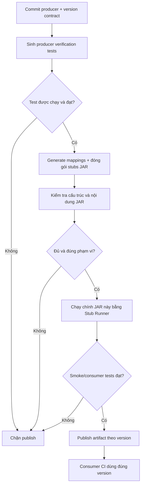

# Kiểm tra nội dung gói stub trước khi công bố

## 1. Tại sao build xanh chưa đủ để phát hành stub?

Một hệ thống có `checkout-service` (consumer) gọi `payment-service` (producer) để tra cứu hoặc tạo thanh toán. Hai nhóm mô tả hành vi HTTP qua **Spring Cloud Contract** bằng **Groovy/YAML DSL**. Spring Cloud Contract Verifier sinh kiểm thử để xác minh producer; sau đó hệ thống đóng gói **stub** cho Checkout dùng qua **Stub Runner** và chạy các bước này trong CI.

Vấn đề là một lệnh build thành công **không tự bảo đảm gói stub chứa đúng những hành vi đã được xác minh**. Một số ví dụ:

- Hợp đồng tra cứu `PAY-1001` yêu cầu trả `PAID`, nhưng artifact đang chuẩn bị phát hành lại chứa mapping cũ trả `PENDING`.
- File `.jar` có tên đúng nhưng không có mapping HTTP nào vì cấu hình nguồn contract hoặc filter sai.
- Gói có một mapping sử dụng `bodyFileName` nhưng thiếu file body tương ứng; stub chỉ báo lỗi khi consumer gọi.
- Producer đã kiểm tra nhóm HTTP, nhưng gói được xuất bản có cả messaging contract đang `inProgress` và chưa có producer verification.
- Artifact được đặt dưới sai `groupId/artifactId/version` khiến Stub Runner không tìm được mapping dù JAR tồn tại.
- Payload stub chứa email, token hoặc thông tin thanh toán thật vốn không được phép phát hành cho consumer khác.

Bởi vậy, trước khi **công bố (publish)** stub lên Maven repository, Artifactory/Nexus hoặc kho SCM, cần kiểm tra **nội dung thực của artifact cuối cùng**, không chỉ tên file hoặc kết quả bước tạo JAR.

**Mục tiêu bài học:**

1. Phân biệt contract nguồn, generated producer test, generated mapping, stub JAR và artifact đã công bố.
2. Nhận diện cấu trúc gói stub mà Spring Cloud Contract/Stub Runner sử dụng.
3. Kiểm tra request matcher, HTTP response, body file, messaging contract và metadata/version bên trong JAR.
4. Dùng Stub Runner để chạy **chính gói JAR dự định phát hành**, thực hiện smoke/consumer test và kiểm tra trường hợp request không hợp lệ.
5. Thiết lập release gate trong CI để chặn gói thiếu, sai, cũ, chưa được xác minh hoặc chứa dữ liệu nhạy cảm.

## 2. Phân biệt năm sản phẩm của quy trình

| Thành phần | Nội dung | Được dùng ở đâu? |
| --- | --- | --- |
| **Contract nguồn** | Groovy/YAML DSL định nghĩa HTTP hoặc messaging. | Repository producer hoặc contract repository chung. |
| **Generated producer tests** | Test được Verifier sinh ra từ contract. | Chạy trên mã producer thật, xác minh hành vi đã cam kết. |
| **Generated stubs/mappings** | Định nghĩa mà stub runtime hiểu, thường là **WireMock JSON mappings** cho HTTP. | Nguồn đầu vào để đóng gói stub. |
| **Stub artifact** | JAR có `classifier=stubs` hoặc hình thức lưu trữ khác chứa các định nghĩa stub. | Stub Runner tải hoặc quét để mô phỏng producer cho consumer. |
| **Published artifact** | Artifact được lưu trong kho, có tọa độ/version và quyền truy cập xác định. | Consumer CI chọn đúng bản để kiểm thử. |

Một nguồn contract có thể sinh ra một hay nhiều cấu phần test/stub tùy DSL và phiên bản; **không mặc định một file contract = một test method = một mapping JSON**. Đặc biệt, contract messaging còn được Stub Runner sử dụng để kích hoạt thông điệp; không phải mọi hành vi đều thể hiện thành một mapping HTTP thông thường.

Điều cần đảm bảo là **tính truy xuất**:



**Không phát hành từ một thư mục mappings tạm đã được chỉnh tay**, rồi dùng một JAR khác cho consumer. Phần được kiểm tra trước publish phải là chính những byte sẽ được công bố, hoặc phải có cách xác minh artifact sau publish có nội dung đồng nhất.

## 3. Cấu trúc gói stub JAR chuẩn thường gặp

Theo tài liệu Spring Cloud Contract Stub Runner, một bố cục có thể được quét từ classpath là:

```text
payment-service-1.4.2-stubs.jar
└── META-INF/
    └── com.example/
        └── payment-service/
            └── 1.4.2/
                ├── contracts/
                │   ├── http/
                │   │   ├── get-paid-payment.groovy
                │   │   └── create-payment.yml
                │   └── messaging/
                │       └── payment-captured.groovy
                └── mappings/
                    └── http/
                        ├── get-paid-payment.json
                        └── create-payment.json
```

Đây là **cây minh họa**, không phải cấu trúc của một JAR thực đã được tạo. Các tên file, nhánh con và việc giữ cả Groovy lẫn YAML phụ thuộc vào cách đóng gói. Ý nghĩa chung:

- `META-INF/com.example/payment-service/1.4.2/` gắn định nghĩa với **groupId**, **artifactId**, **version**.
- `contracts/` chứa các hợp đồng nguồn (hữu ích cho messaging và tra cứu). Giữ đúng bản contract mà producer đã xác minh.
- `mappings/` chứa những định nghĩa stub HTTP đã chuyển đổi từ DSL.
- Nếu mapping tham chiếu body hoặc tài nguyên ngoài mapping, artifact phải mang tài nguyên ở **vị trí runtime thực sự đọc được**.

Đường dẫn ví dụ dùng dấu chấm trong `com.example` đúng như các ví dụ cấu trúc `META-INF/<groupId>/<artifactId>/<version>` của Stub Runner; đừng tự đổi thành `com/example` nếu cách loader đang dùng yêu cầu một thư mục tên `com.example`. Với cấu hình tải đặc thù, Gradle/Maven plugin có thể tạo layout khác; **kiểm tra theo phiên bản và cơ chế Stub Runner đang sử dụng**.

Đối chiếu với artifact coordinates:

```text
groupId    = com.example
artifactId = payment-service
version    = 1.4.2
classifier = stubs
type       = jar

Ví dụ tên file Maven:
payment-service-1.4.2-stubs.jar

Ví dụ Stub Runner ID:
com.example:payment-service:1.4.2:stubs
```

Nếu artifact được xuất bản nhầm `classifier=sources` hoặc với một version khác, consumer có thể không tải được **đúng stub**. Ngược lại, tên JAR đúng chưa chứng minh nội dung nằm ở layout có thể quét được.

## 4. Từ hợp đồng HTTP đến mapping trong gói

Xét tình huống Checkout tra cứu thanh toán:

```http
GET /api/payments/PAY-1001 HTTP/1.1
Accept: application/json
```

Producer cam kết:

```json
{
  "paymentId": "PAY-1001",
  "orderId": "ORD-2001",
  "status": "PAID",
  "amount": 250000,
  "currency": "VND"
}
```

### 4.1. Contract Groovy nguồn

```groovy
import org.springframework.cloud.contract.spec.Contract

Contract.make {
    name 'get_paid_payment'

    request {
        method 'GET'
        urlPath '/api/payments/PAY-1001'
        headers {
            header 'Accept': 'application/json'
        }
    }

    response {
        status 200
        headers {
            contentType(applicationJson())
        }
        body([
            paymentId: 'PAY-1001',
            orderId: 'ORD-2001',
            status: 'PAID',
            amount: 250000,
            currency: 'VND'
        ])
    }
}
```

### 4.2. Mapping JSON có thể trông như thế nào?

Ví dụ WireMock mapping **minh họa**, được rút gọn để làm rõ cấu trúc; không coi là output byte-for-byte của mọi phiên bản generator:

```json
{
  "request": {
    "method": "GET",
    "urlPath": "/api/payments/PAY-1001",
    "headers": {
      "Accept": {
        "equalTo": "application/json"
      }
    }
  },
  "response": {
    "status": 200,
    "headers": {
      "Content-Type": "application/json"
    },
    "jsonBody": {
      "paymentId": "PAY-1001",
      "orderId": "ORD-2001",
      "status": "PAID",
      "amount": 250000,
      "currency": "VND"
    }
  }
}
```

Generated mapping có thể biểu diễn body bằng `body`, `jsonBody`, `base64Body`, `bodyFileName` hoặc các biến thể khác tùy cách chuyển đổi và loại nội dung. **Đừng bắt CI chỉ chấp nhận một cách serialize duy nhất** nếu chúng tương đương về ngữ nghĩa. Điều bắt buộc là WireMock/Stub Runner tải được và phản hồi đúng.

Một reviewer cần kiểm tra:

1. `request.method` đúng `GET`, không nhầm `POST`.
2. `request.urlPath` đúng; không gắn host hay port staging vào mapping.
3. Header và query matcher đủ để phân biệt những request mang ý nghĩa khác nhau.
4. `response.status` đúng `200` và Content-Type là JSON.
5. Body chứa `paymentId`, `orderId`, `status`, `amount`, `currency` đúng kiểu và giá trị nghiệp vụ.
6. Mapping không vô tình đáp ứng mọi path/ID bằng regex `.*`.

### Cẩn thận với query parameters và các matcher

Ví dụ contract khác cho danh sách giao dịch yêu cầu:

```text
GET /api/payments?status=PAID&limit=20
```

Khi dùng `urlPath('/api/payments')` và `queryParameters` trong Groovy DSL, generated mapping cần phản ánh các điều kiện về `status` và `limit`. Nếu mapping chỉ còn `"urlPath": "/api/payments"` mà không ràng buộc query, stub có thể trả dữ liệu `PAID` cho cả request `status=PENDING`, che lỗi phía consumer.

Tương tự, regex cho ID sinh động có thể là hợp lệ, nhưng cần có giới hạn rõ. `PAY-[0-9]{4}` khác với `.*`. Nếu stub chấp nhận nhiều `orderId` nhưng body luôn trả `ORD-2001`, phải xác minh có **phản chiếu request** hoặc kịch bản riêng; một mapping JSON hợp lệ về cú pháp vẫn có thể sai nghiệp vụ.

## 5. Kiểm tra JAR bằng công cụ JDK

Với JDK đã được cài đặt, lệnh `jar tf` liệt kê tên entry trong JAR mà **không giải nén**. Trong ví dụ Maven, artifact có tên giả định:

```bash
./mvnw -B clean verify

jar tf target/payment-service-1.4.2-stubs.jar
```

Lệnh thứ nhất giả định project đã cấu hình Maven plugin và lifecycle để sinh/chạy producer tests và tạo JAR; đường dẫn JAR thứ hai phải **được thay bằng output thật của build**, không đoán tên nếu classifier, finalName hoặc plugin đã tùy chỉnh. Kiểm tra `target/` để xác định file chính xác.

Khi liệt kê, hãy tìm các entry theo layout:

```text
META-INF/com.example/payment-service/1.4.2/contracts/...
META-INF/com.example/payment-service/1.4.2/mappings/...
```

Không chỉ dùng lệnh `jar tf` rồi kết luận “JAR tốt”. Đây mới là kiểm tra **danh sách tệp**, chưa xác minh:

- JSON trong mapping có hợp lệ không.
- Mapping có đúng request/response đã thỏa thuận không.
- File body được tham chiếu có thể tìm thấy khi chạy stub không.
- Messaging contract có label/destination đúng không.
- Artifact có được lấy từ commit producer đã qua verification không.

### Xem nội dung mà không sửa JAR gốc

Một lựa chọn là giải nén **vào thư mục kiểm tra tạm sạch** rồi mở mapping/contract:

```bash
mkdir stub-inspection
cd stub-inspection
jar xf ../target/payment-service-1.4.2-stubs.jar

# Sau đó đọc các tệp trong META-INF/.../mappings/
# và META-INF/.../contracts/ bằng editor hoặc công cụ JSON.
```

Đoạn lệnh trên minh họa shell tương thích Unix; trên PowerShell, tạo thư mục bằng `New-Item -ItemType Directory` và chạy `jar xf` với đường dẫn tương ứng. **Không giải nén đè vào source tree của dự án** hoặc xóa thư mục khác chỉ vì trùng tên. Trong pipeline, tạo workspace tạm riêng, dọn theo vòng đời build và chỉ đọc những entry thuộc artifact dự định phát hành.

Đối với JAR không tin cậy, không thực thi mã bên trong; kiểm tra tên entry bất thường, đường dẫn có `../` hoặc nội dung không phù hợp chính sách. JAR là một dạng ZIP: nếu cần kiểm tra programmatic, có thể dùng `java.util.zip.ZipFile` để đọc trực tiếp mà không phải giải nén.

## 6. Kiểm tra tự động bằng danh sách entry của JAR

Một gate đơn giản có thể dùng Java để kiểm tra **ít nhất một mapping HTTP tồn tại** và các đường dẫn thuộc namespace đã định. Ví dụ rút gọn:

```java
import java.nio.file.Path;
import java.util.zip.ZipFile;

public class StubJarStructureCheck {
    public static void main(String[] args) throws Exception {
        Path jar = Path.of(args[0]);
        String prefix =
            "META-INF/com.example/payment-service/1.4.2/";

        try (ZipFile zip = new ZipFile(jar.toFile())) {
            long mappingCount = zip.stream()
                .filter(e -> !e.isDirectory())
                .filter(e -> e.getName().startsWith(
                    prefix + "mappings/"))
                .filter(e -> e.getName().endsWith(".json"))
                .count();

            if (mappingCount == 0) {
                throw new IllegalStateException(
                    "Stub JAR khong co HTTP mapping"
                );
            }

            System.out.println("HTTP mappings: " + mappingCount);
        }
    }
}
```

Đây là mã **minh họa**, không phải utility đã được cài vào repository. Nó giả định producer **phải có HTTP mappings**; không dùng tiêu chí này để từ chối một artifact **chỉ chứa messaging contracts**. Đầu vào `args[0]` là đường dẫn file JAR cần kiểm tra; trong CI thực phải kiểm tra đối số, metadata và lỗi I/O.

Gate đủ tin cậy hơn cần có **manifest kỳ vọng về phạm vi** từ cấu hình build hoặc chính sách phát hành (ví dụ bắt buộc có `get_paid_payment`, `create_payment`, `payment_captured_event`). Đừng dựa vào một con số cứng trong khi số contract có thể thay đổi:

- Nếu thêm một contract được review, cập nhật kỳ vọng trong thay đổi có kiểm soát.
- Nếu xóa một contract đang có consumer dùng, release gate phải phát hiện thay đổi phạm vi.
- Không bắt số mapping JSON bằng số file contract trong mọi tình huống; sử dụng **danh sách hành vi kỳ vọng** và thông tin generator đã tạo.

## 7. Kiểm tra mapping HTTP ở cấp ngữ nghĩa

Ngoài JSON syntax hợp lệ, mỗi mapping cần được kiểm tra theo hành vi. Một checklist:

| Nội dung | Đúng | Nguy cơ khi sai |
| --- | --- | --- |
| Method | `GET /api/payments/{id}` hoặc `POST /api/payments` đúng API. | Stub nhận sai loại request hoặc bỏ sót endpoint. |
| URL path | Path đúng và không khóa hostname của CI. | Consumer gọi đường dẫn thật không khớp. |
| Query parameters | Có điều kiện với những query ảnh hưởng nghiệp vụ. | `status=PENDING` cũng nhận response của `PAID`. |
| Headers | `Content-Type`, `Accept`, version header nếu thực sự được cam kết. | Client gửi sai MIME nhưng stub vẫn trả thành công. |
| Request body | `orderId`, `amount`, `currency` và các matcher đúng phạm vi. | Stub chấp nhận dữ liệu sai nhưng test consumer xanh. |
| Response status | Phân biệt `200`, `201`, `204`, `400`, `409`, `503` theo API. | Consumer rẽ nhánh sai. |
| Response body | Đúng field, kiểu, mã trạng thái nghiệp vụ. | Client parse lỗi hoặc xử lý nhầm giao dịch. |
| Response header | Content-Type, Location, Retry-After nếu đã thỏa thuận. | Thiếu thông tin consumer cần để tiếp tục workflow. |
| Giá trị động | Stub dùng mẫu ổn định, matcher producer đủ chặt. | Stub chứa regex thô hoặc kiểm thử bỏ lọt lỗi. |

**Ví dụ kiểm tra âm tính:** stub của contract `GET /api/payments/PAY-1001` phải trả kết quả đúng khi consumer gọi `PAY-1001`, nhưng không được vô tình trả cùng dữ liệu khi gọi `PAY-9999` nếu không có contract nào yêu cầu như vậy.

Nếu WireMock trả `404` vì **không có mapping**, đây là phản hồi của **stub server**, không tự động chứng minh producer thật cam kết `404 PAYMENT_NOT_FOUND`. Muốn test hành vi lỗi nghiệp vụ của producer, cần một contract `404` riêng và producer verification chạy trên code thật.

### Matchers quá rộng hoặc quá chặt

Một mapping có `"urlPathPattern": ".*"` có thể khớp nhiều endpoint ngoài dự kiến. Một mapping bắt chính xác header request ID `REQ-ABC12345` trong khi consumer được phép sinh ID khác lại quá chặt. Khi review artifact, hãy so sánh cặp giá trị:

- **Request phía consumer:** điều kiện stub phải nhận, có thể là regex hợp lệ.
- **Request phía producer:** giá trị cụ thể generated producer test gửi.
- **Response phía consumer:** dữ liệu mẫu stub trả, nên ổn định.
- **Response phía producer:** điều kiện generated producer test kiểm tra trên response thật.

Đây là quy tắc giá trị hai phía của Spring Cloud Contract. Khi chuyển DSL sang mapping, những giá trị ở phía consumer cần được phản ánh đúng trong stub; không thể chỉ nhìn test producer rồi suy ra mapping đã ổn.

## 8. File body và tài nguyên đi kèm

Contract đôi khi dùng file JSON ngoài hoặc body nhị phân:

```groovy
response {
    status 200
    headers {
        contentType(applicationJson())
    }
    body(file("payment-response.json"))
}
```

Với trường hợp khác:

```groovy
response {
    status 200
    headers {
        contentType(applicationOctetStream())
    }
    body(fileAsBytes("receipt.pdf"))
}
```

Đường dẫn trong **Groovy DSL** được tính tương đối với tệp contract. Generator có thể đưa nội dung vào mapping trực tiếp (text/JSON/Base64) hoặc sử dụng tài nguyên riêng tùy loại body/cấu hình. **Không được khẳng định mọi `file(...)` sẽ sinh `bodyFileName`**, cũng không được giả định mọi mapping độc lập với file ngoài.

Khi mapping WireMock chứa:

```json
{
  "response": {
    "status": 200,
    "bodyFileName": "payloads/payment-response.json"
  }
}
```

thì runtime phải tìm được file body theo **file root của WireMock** hoặc cơ chế resolver mà Stub Runner đã cấu hình. Với WireMock thuần, `bodyFileName` thường được giải quyết dưới `__files` của file root; với stub JAR và Spring Cloud Contract, layout/loader có thể được tùy chỉnh. Kiểm tra tệp đó **thực sự nằm trong artifact ở nơi loader đọc được**. Nếu file bị thiếu, JAR có thể vẫn hợp lệ theo định dạng ZIP nhưng stub không phản hồi được.

### Kiểm tra cho nội dung nhị phân

Với PDF, ảnh hoặc `application/octet-stream`:

1. Header Content-Type phải đúng API.
2. Dữ liệu phải còn nguyên byte; không được biến PDF thành string UTF-8 hoặc JSON string một cách vô ý.
3. Stub runtime phải trả đúng byte length/hash kỳ vọng nếu đó là cam kết.
4. File fixture không chứa dữ liệu khách hàng thật, mật khẩu hoặc tài liệu nội bộ không được phép chia sẻ.
5. Nếu payload có metadata thay đổi (timestamp, UUID), xác định rõ các byte nào phải cố định và các thuộc tính nào được phép biến động.

Khi kiểm tra file body, **không dùng grep tìm một vài từ thay cho so sánh byte** nếu mục tiêu là kiểm tra binary. Có thể tính checksum trên file mẫu và byte response mà Stub Runner trả để xác nhận toàn vẹn.

## 9. Messaging contract cũng là nội dung cần kiểm tra

Producer có thể phát `PaymentCaptured` đến destination `payments.captured`, và Fulfillment dùng Stub Runner để kiểm thử việc tiêu thụ.

Ví dụ Groovy:

```groovy
import org.springframework.cloud.contract.spec.Contract

Contract.make {
    name 'payment_captured_event'
    label 'payment_captured_1001'

    input {
        triggeredBy('emitPaymentCaptured()')
    }

    outputMessage {
        sentTo('payments.captured')
        body([
            eventId: 'EVT-1001',
            eventType: 'PaymentCaptured',
            paymentId: 'PAY-1001',
            orderId: 'ORD-2001',
            amount: 250000,
            currency: 'VND'
        ])
        headers {
            messagingContentType(applicationJson())
        }
    }
}
```

Trước publish, kiểm tra:

- Có định nghĩa messaging contract và `label` được Stub Runner sử dụng khi kích hoạt message.
- `sentTo('payments.captured')` đúng destination mà consumer đã bind.
- Schema payload có đúng `eventType`, `paymentId`, `orderId`, `amount` và `currency`.
- Contract đã có **producer verification** chạy trên code thật qua Spring Cloud Stream/messaging verifier phù hợp; không chỉ có stub tạm.
- Nếu producer sử dụng `Supplier`, `Function`, `Consumer` hay `StreamBridge`, test binder/adapter đã được cấu hình phù hợp với **phiên bản hỗ trợ**.

Một gói stub chỉ có HTTP mappings **không chứng minh** messaging contracts được đóng gói và có thể kích hoạt. Ngược lại, một artifact chỉ có messaging contracts có thể **không có HTTP mapping nào** nhưng vẫn hoàn toàn hợp lệ cho mục tiêu của nó.

### Hợp đồng đang in progress

Spring Cloud Contract hỗ trợ trạng thái `inProgress()` (Groovy) hoặc thuộc tính tương đương khi phiên bản cho phép. Một contract như vậy **có thể sinh stub nhưng chưa sinh producer verification test**. Gói vẫn “đủ file” nhưng chưa phải bằng chứng producer đã thực hiện hành vi tương ứng.

Đối với kênh phát hành chính thức, cần có chính sách chặn các contract chưa được xác minh hoặc công bố rõ rằng chúng chỉ là stub phục vụ phát triển thử nghiệm. **Không gọi một stub in-progress là verified stub** chỉ vì JAR được đóng gói thành công.

## 10. Maven: tạo gói và kiểm tra trước publish

Với Spring Cloud Contract Maven plugin, quy trình thông thường là:

```text
Đọc Groovy/YAML DSL
   -> generateTests
   -> chạy producer verification tests
   -> convert/generate stubs
   -> tạo stubs JAR với classifier stubs
   -> kiểm tra artifact
   -> publish
```

Các goal của Maven plugin và thứ tự chính xác phụ thuộc phiên bản/lifecycle, nhưng tài liệu chính thức có goal `generateStubs` mặc định gắn với pha `package`, dùng nội dung đã được chuyển đổi từ contract. Tùy cấu hình plugin, có thể cần `convert` trước khi tạo JAR.

Ví dụ build producer **trong một dự án đã cấu hình đầy đủ**:

```bash
./mvnw -B clean verify
jar tf target/payment-service-1.4.2-stubs.jar
```

Đừng thêm `-DskipTests` rồi tuyên bố JAR đã qua verification. Kiểm tra:

- Maven Surefire/Failsafe có chạy các test sinh từ contract không.
- Kết quả producer test đã đạt, không bị skip.
- Plugin không bị đặt `skip=true`, `jarSkip=true` hoặc cấu hình filter khiến số contract bằng 0.
- JAR mới được tạo từ workspace sạch, không phải artifact còn sót từ lần build trước.
- Artifact đúng classifier và version mong muốn.

Nếu không có contract/stub do cấu hình sai, sử dụng cơ chế fail như `failOnNoContracts` **theo goal và phiên bản plugin hiện có**. Đừng đơn giản bỏ qua trường hợp không sinh được mapping vì pipeline đang cần đóng gói một producer thực sự có HTTP API.

### Không nhầm JAR ứng dụng và JAR stub

`payment-service-1.4.2.jar` thường là artifact ứng dụng, có class/runtime để khởi động producer. `payment-service-1.4.2-stubs.jar` là artifact kiểm thử có classifier `stubs`, chứa contracts/mappings. Consumer thông thường **không cần chạy producer JAR**; Stub Runner dùng JAR stub để mô phỏng giao tiếp.

Hai artifact cùng version **không có nghĩa đồng nhất về nội dung hoặc mục đích**. Hãy xác minh đúng artifact được tải từ repository.

## 11. Gradle: verifierStubsJar và bước xuất bản

Trong Gradle plugin Spring Cloud Contract, tài liệu mô tả task `generateClientStubs` và task JAR `verifierStubsJar`. Khi dùng `maven-publish`, cần đưa chính artifact stub vào publication thích hợp.

Ví dụ Groovy DSL **chỉ là mảnh cấu hình**:

```groovy
plugins {
    id 'java'
    id 'maven-publish'
    id 'org.springframework.cloud.contract' version 'REPLACE_WITH_COMPATIBLE_VERSION'
}

publishing {
    publications {
        maven(MavenPublication) {
            from components.java
            artifact verifierStubsJar
        }
    }
}
```

Dự án cần cấu hình group/version, dependencies, repositories, Spring Cloud BOM và plugin tương thích. Các bản plugin có thể khác về task API hoặc cách khai báo `verifierStubsJar`, vì vậy phải kiểm tra tài liệu **đúng phiên bản**. Từ một số phiên bản, publication stubs nội bộ được khuyến nghị thay bằng việc khai báo artifact `verifierStubsJar` trong publication tự quản lý.

Ví dụ lệnh trên project có Gradle Wrapper:

```bash
./gradlew clean contractTest verifierStubsJar
```

`contractTest` phải là task thực sự chạy generated tests trong cấu hình đó. Sau khi build xong, xác định đường dẫn JAR thực dưới `build/libs/` hoặc thư mục do plugin tùy chỉnh, rồi chạy `jar tf`. **Chưa chạy `publish` cho đến khi artifact inspection và consumer smoke test đạt.**

Trong CI, nếu task `verifierStubsJar` được chạy riêng mà không phụ thuộc vào test task, phải **thiết lập release gate** bảo đảm test được chạy thành công ở cùng commit trước publish. Không suy ra mọi task đóng gói đều tự động chạy toàn bộ producer verification.

## 12. Chạy chính artifact dự định công bố bằng Stub Runner

Kiểm tra tệp trong JAR chưa đủ. Một cách xác nhận mạnh hơn là sử dụng **chính artifact vừa đóng gói** để chạy Stub Runner trong môi trường kiểm thử, rồi phát request HTTP/trigger messaging giống consumer.

Ví dụ consumer test bằng Spring Boot:

```java
@SpringBootTest(properties = {
    "payment.base-url=http://localhost:6565"
})
@AutoConfigureStubRunner(
    ids = "com.example:payment-service:1.4.2:stubs:6565",
    stubsMode = StubRunnerProperties.StubsMode.LOCAL
)
class PaymentStubSmokeTest {

    @Autowired
    PaymentClient client;

    @Test
    void returnsPaymentFromPackagedStub() {
        PaymentView payment = client.getPayment("PAY-1001");

        assertThat(payment.paymentId()).isEqualTo("PAY-1001");
        assertThat(payment.orderId()).isEqualTo("ORD-2001");
        assertThat(payment.status()).isEqualTo("PAID");
        assertThat(payment.currency()).isEqualTo("VND");
    }
}
```

Đây là test **minh họa**, cần import/dependency, `PaymentClient`, `PaymentView` và cấu hình thật. Nó chỉ kiểm tra JAR dự định phát hành nếu artifact `com.example:payment-service:1.4.2:stubs` trong local Maven repository **chính là artifact vừa build**. Nếu local repository đang có bản cũ cùng version, test có thể xanh giả.

**Biện pháp bảo đảm đúng byte artifact:**

1. Dùng version duy nhất cho mỗi candidate, hoặc cài artifact vừa build vào một **local repository cô lập** chỉ phục vụ smoke test.
2. Kiểm tra đường dẫn/tọa độ artifact mà Stub Runner đã resolve.
3. Tính checksum JAR trước test và đối chiếu với file artifact dùng để publish.
4. Nếu hệ thống hỗ trợ nạp stub từ thư mục/file local thông qua downloader riêng, hãy chọn đường dẫn cụ thể và kiểm chứng đúng hành vi theo phiên bản Stub Runner.
5. Tránh dùng version `+` hoặc `latest` trong release smoke test, vì có thể vô tình chạy artifact khác.

### Không chỉ kiểm tra happy path

Một smoke suite tối thiểu:

| Thao tác | Kỳ vọng |
| --- | --- |
| Gọi `GET /api/payments/PAY-1001` | HTTP 200, body có `PAID`, đúng order/currency. |
| Gửi sai ID vào stub chỉ dành cho `PAY-1001` | Không khớp mapping thành công nếu contract không chấp nhận ID đó. |
| Gọi `POST /api/payments` với body tạo hợp lệ | Nhận `201` và payment ID mẫu đã cam kết. |
| Thay `currency=VND` bằng `USD` trong request cụ thể | Không khớp contract thành công đó, trừ khi có contract khác cho USD. |
| Gọi request gây lỗi nghiệp vụ `409` | Nhận status và `error.code` chính xác nếu producer có contract lỗi này. |
| Đọc body nhị phân | Content-Type và byte content đúng khi có contract hỗ trợ. |
| Trigger `payment_captured_1001` | Consumer nhận sự kiện đến đúng destination nếu có messaging contract. |

**Lưu ý quan trọng:** nếu request không khớp và WireMock trả `404`, đó là tình trạng **không có mapping phù hợp**, không chứng minh producer thật trả một JSON `PAYMENT_NOT_FOUND`. Muốn khẳng định lỗi nghiệp vụ, phải có một contract cho chính hành vi `404` được producer xác minh.

### Quan sát các mapping đã nạp

Với stub HTTP dựa trên WireMock, endpoint quản trị thường có:

```http
GET /__admin/mappings HTTP/1.1
Host: localhost:6565
```

Trên môi trường test **được kiểm soát**, việc xem danh sách mappings đã được đăng ký giúp xác minh rằng Stub Runner đọc những mapping trong JAR, không chỉ khởi động một HTTP server rỗng. Endpoint admin thuộc WireMock, không phải API nghiệp vụ của `payment-service` và không nên phơi ra internet/truy cập công khai.

## 13. Các tình huống đóng gói đặc biệt

### 13.1. Stub theo từng consumer

Một producer có thể cung cấp các contract riêng cho Checkout và Reporting. Nếu sử dụng tính năng **stubs-per-consumer**, layout contract/mapping có thể chứa thư mục mang tên consumer. Khi công bố hoặc chạy test, cần xác định **consumerName**/đường dẫn lựa chọn đúng theo Stub Runner được cấu hình.

Tránh:

- Checkout tải gói chỉ chứa contract của Reporting.
- Một gói hợp nhất vô ý để mapping hai consumer khớp cùng request nhưng trả response khác nhau.
- Xóa contract cũ vì không còn người duy trì, dù consumer ngoài nhóm vẫn đang sử dụng.

Trước publish, kiểm kê **những consumer đang được hỗ trợ** và các contract của họ. Nếu một artifact cố ý chỉ dành cho một consumer, ghi rõ phạm vi đó trong tọa độ/tài liệu phát hành.

### 13.2. Source contract nằm ngoài repository producer

Trong mô hình contract repository chung, producer có thể tải artifact contract theo version rồi sinh test/stub. Khi đóng gói, phải lưu nguồn gốc:

```text
Producer commit       : abc1234 (ví dụ)
Contract artifact     : com.example.contracts:payment-contracts:1.4.2
Selected contract set : http + messaging còn được hỗ trợ
Generated stub version: 1.4.2
```

Đây là metadata minh họa, không phải thông tin về dự án thật. Nếu producer dùng contract version A để kiểm tra nhưng đóng gói từ contract version B, gói stub không còn chứng minh được sự tương thích của code đã test.

### 13.3. Stub từ REST Docs hoặc mapping viết tay

Không phải mọi mapping đều bắt nguồn trực tiếp từ Groovy/YAML DSL. Một số nhóm dùng Spring REST Docs hoặc các mapping WireMock viết tay. Trong trường hợp đó, **đừng mặc định có số lượng contract file Groovy/YAML bằng số mappings**. Tuy nhiên vẫn phải chứng minh mapping được tạo từ bài kiểm thử provider đã chạy đạt và nằm trong layout mà Stub Runner tải được.

### 13.4. Một artifact có cả HTTP và messaging

HTTP mappings phục vụ stub server, còn messaging thường cần contract definition để Stub Runner cấu hình trigger/destination. Vì vậy một artifact vừa chứa `mappings/` vừa chứa `contracts/` không có nghĩa mọi entry ở hai nơi phải ghép một-một. Hãy kiểm tra cả hai luồng theo **kịch bản được hỗ trợ**, thay vì chỉ đếm file `.json`.

## 14. Chống việc phát hành stub chưa được xác minh

Một rủi ro lớn là **contract in-progress**: có thể sinh stub để consumer phát triển trước nhưng chưa sinh producer test. Rủi ro khác là producer verification tests bị skip, hoặc CI chỉ chạy một subset HTTP nhưng publish gói có cả messaging.

Hãy kiểm tra:

| Kiểm soát | Phát hiện được |
| --- | --- |
| Số contract nguồn được chọn | Include/exclude/filter sai hoặc contract mất khỏi build. |
| Generated test inventory | Contract không sinh producer test, in-progress hoặc plugin bị skip. |
| Test report executed/passed/skipped | Build xanh khi không test nào chạy hoặc test bị bỏ qua. |
| Generated mappings và contract files | Gói rỗng hoặc thiếu các tình huống được cam kết. |
| Source commit và contract version | Mappings/stub không tương ứng code đã verify. |
| Smoke test từ đúng JAR | Layout/load failure, body file thiếu, matcher sai, stub cũ. |
| Nội dung bảo mật | Token/PII hoặc tài nguyên không được phép phát hành. |

Tại **release gate**, đề xuất:

1. Mọi contract **đang được công bố hỗ trợ** đều có producer verification chạy đạt, hoặc có một ngoại lệ được duyệt và công khai rõ phạm vi.
2. Không có contract quan trọng bị `ignored()`/`inProgress()`, không có generated tests bị skip ngoài danh sách ngoại lệ.
3. Gói stub có đủ behavior HTTP/messaging dự kiến theo **cùng source/version**.
4. Smoke test sử dụng **chính artifact candidate** trước publish.
5. Chỉ đưa artifact có version bất biến lên kho phát hành; không ghi đè một release đã được consumer sử dụng.

Một build nhanh của pull request có thể chỉ kiểm tra những hợp đồng liên quan để phản hồi sớm. Nhưng **artifact phát hành chính thức phải qua gate bao phủ đầy đủ** theo phạm vi sản phẩm đã cam kết.

## 15. Quét dữ liệu nhạy cảm trong stub

Stub JAR thường được phân phối rộng hơn repository producer: nhiều nhóm consumer, CI runners và artifact repositories có thể tải về. Vì vậy nội dung ví dụ **không được chứa secret hoặc dữ liệu khách hàng thật**.

Các vị trí cần quét:

- Body JSON trong `mappings/*.json`.
- File JSON/YAML/Groovy dưới `contracts/`, kể cả trường đang không dùng ở runtime.
- File body ngoài/nhị phân, ảnh, PDF hoặc bản ghi dữ liệu test.
- Headers trong mapping, ví dụ `Authorization`, `Cookie`, API key.
- Đường dẫn, URL, thông tin hostname nội bộ hoặc endpoint thật nếu chúng nhạy cảm.

Ví dụ cần loại bỏ:

```json
{
  "request": {
    "headers": {
      "Authorization": {
        "equalTo": "Bearer REAL_SECRET_TOKEN"
      }
    }
  }
}
```

Không đưa secret thực vào fixture rồi chỉ che nó trong log: nếu đã nằm trong JAR, người có quyền tải artifact vẫn có thể giải nén. Thay bằng token tổng hợp không thể dùng với hệ thống thật; dùng dữ liệu giả như `PAY-1001`, `ORD-2001` thay ID tài khoản production. Nếu phát hiện secret đã công bố, thực hiện quy trình xử lý sự cố/thu hồi và xoay vòng secret theo chính sách tổ chức; không chỉ xóa nó khỏi bản phát hành kế tiếp.

## 16. Checklist CI trước khi phát hành

Có thể dùng bảng kiểm có điều kiện rõ ràng:

| Gate | Câu hỏi | Điều kiện đạt |
| --- | --- | --- |
| **G1 — Source** | Đã khóa commit producer + version nguồn contract chưa? | Nguồn xác định, không tải bản latest ngầm định. |
| **G2 — Producer verification** | Generated tests có chạy trên producer thực không? | Test report có test thực thi; tất cả contract bắt buộc đạt. |
| **G3 — Package** | JAR đúng group/artifact/version/classifier và layout không? | Artifact tồn tại, đúng metadata, entry đúng namespace. |
| **G4 — Coverage** | Có đủ mappings/contracts cho các kịch bản đã cam kết? | Danh sách behavior tương ứng nguồn và policy, không thiếu nhóm. |
| **G5 — Semantics** | Method, path, matcher, status, headers, body có đúng không? | Mapping/hợp đồng được review và kiểm tra tự động khi khả thi. |
| **G6 — Resources** | File body và tài nguyên referenced có tìm được không? | Không có missing body file, binary giữ nguyên. |
| **G7 — Security** | Có token, PII, dữ liệu live hoặc endpoint nhạy cảm không? | Không có dữ liệu không được phép phát hành. |
| **G8 — Runtime** | Stub Runner đọc đúng candidate JAR và test chạy đạt không? | HTTP + messaging smoke tests đạt theo phạm vi. |
| **G9 — Publish identity** | Artifact công bố có đúng byte/version đã test? | Checksum/tọa độ khớp; version bất biến. |

Ví dụ **pseudocode CI**, không phải YAML GitHub Actions/GitLab/Jenkins có thể chạy nguyên văn:

```yaml
pipeline:
  producer-verify:
    command: "./mvnw -B clean verify"
    require_executed_contract_tests: true

  inspect-candidate-stub:
    needs: producer-verify
    checks:
      - expected_coordinates_and_classifier
      - jar_layout_and_required_contracts
      - mapping_semantics_and_body_resources
      - no_unverified_or_in_progress_contracts
      - no_secrets_or_private_test_data

  smoke-with-stub-runner:
    needs: inspect-candidate-stub
    artifact: same_candidate_jar
    checks:
      - positive_request_and_response
      - negative_request_nonmatch
      - messaging_trigger_if_supported

  publish:
    needs: smoke-with-stub-runner
    artifact: same_candidate_jar
    require_matching_checksum: true
```

**Điểm mấu chốt:** bước `publish` chỉ được chạy sau gate xác minh và inspect; nếu một điều kiện thất bại, dừng workflow. Nếu CI muốn tiết kiệm thời gian, có thể chạy một phần gate sớm song song, nhưng phải hợp nhất kết quả trước khi công bố.

### Ghi nhận bằng chứng phát hành

Một bản ghi ngắn giúp truy cứu khi consumer gặp lỗi:

```text
Producer                    com.example:payment-service
Producer source commit      abc1234 (minh họa)
Contract source/version     payment-contracts:1.4.2
Stub coordinates            com.example:payment-service:1.4.2:stubs
Artifact checksum           SHA-256 của candidate JAR
Verifier executed           số test đã chạy/đạt
Included behavior list      HTTP + messaging đã cam kết
Stub Runner smoke           PASS
Published artifact checksum trùng candidate
```

Không cần nhét toàn bộ bản ghi vào file JAR, nhưng CI/release records phải cho phép truy lại chứng cứ producer và artifact. Tọa độ/version chỉ là danh tính logic; **checksum cho biết byte thực tế có trùng không**.

## 17. Các lỗi thực tế cần chẩn đoán

| Triệu chứng | Nguyên nhân có thể | Cách xử lý |
| --- | --- | --- |
| `jar tf` chỉ có manifest, không có mapping | Không chạy convert/generate, filter sai, sai nguồn hoặc plugin skip. | Kiểm tra pipeline generator và failOnNoContracts. |
| JAR có mappings nhưng Stub Runner báo không tìm thấy | Sai `META-INF/groupId/artifactId/version`, classifier hoặc chế độ tải. | Đối chiếu entry và tọa độ đang dùng. |
| Consumer nhận body sai dù contract mới đúng | Dùng stub JAR cũ, local repository cache, version bị ghi đè. | Pin version duy nhất và so checksum. |
| HTTP stub 500 khi trả file | Mapping có `bodyFileName` nhưng không đóng gói đúng file root. | Kiểm tra referenced resource và chạy smoke test từ JAR. |
| Stub nhận quá nhiều request | Matcher quá rộng hoặc thiếu query/header/body constraints. | Review JSON mapping và chạy negative tests. |
| Stub không nhận request hợp lệ | Matcher quá chặt hoặc URL/header khác cách consumer dùng. | So contract, generated mapping và HTTP request thật của client. |
| Có HTTP mapping nhưng không trigger được event | Thiếu messaging contract/label hoặc destination sai. | Kiểm tra `contracts/`, label, Stream binding và message verifier. |
| Artifact chứa contract inProgress | Stub đã sinh dù producer chưa được verify. | Đánh dấu kênh thử nghiệm hoặc chặn release chính thức. |
| Build xanh với 0 tests | Plugin/test engine không chạy generated tests hoặc test bị skip. | Guard số executed tests và kiểm tra report. |
| Release có API v1 bị thiếu | Filter chỉ chọn contract mới, quên consumer legacy. | Kiểm kê mọi contract còn được hỗ trợ. |
| Artifact lộ token | Secret được hard-code trong fixture/mapping. | Chặn publish, xử lý sự cố và thay dữ liệu mẫu. |

## 18. Bài tập thực hành: kiểm tra JAR trước khi công bố

Một ứng dụng `payment-service` có các hợp đồng:

```text
contracts/
├── http/
│   ├── get-paid-payment.groovy
│   ├── create-payment.yml
│   └── payment-not-found.groovy
├── messaging/
│   └── payment-captured.groovy
└── draft/
    └── refund-payment-v2.groovy
```

Quy tắc API:

- `GET /api/payments/PAY-1001` trả `200` và `status=PAID`, `currency=VND`.
- `POST /api/payments` trả `201` với body giao dịch mới nếu input hợp lệ.
- `GET /api/payments/PAY-9999` trả `404` với `error.code=PAYMENT_NOT_FOUND`.
- Messaging phát `PaymentCaptured` đến `payments.captured` với `paymentId=PAY-1001` và `orderId=ORD-2001`.
- Contract refund v2 còn `inProgress`, chưa được producer thực hiện.

CI tạo artifact candidate `com.example:payment-service:1.4.2:stubs`. Có sáu tình huống phát hiện trong bước review: (A) thiếu `payment-not-found` mapping; (B) `GET /api/payments` có URL matcher `.*`; (C) response `currency=USD`; (D) body PDF được tham chiếu nhưng không đóng gói; (E) `refund-payment-v2` inProgress được đưa vào JAR chính thức; (F) test runner báo 0 generated test được chạy.

**Nhiệm vụ:**

1. Vẽ cây thư mục JAR dự kiến dưới `META-INF/com.example/payment-service/1.4.2/`, chỉ rõ `contracts/` và `mappings/`.
2. Viết lệnh dùng `jar tf` để liệt kê entry và nêu cách kiểm tra JSON mappings mà **không sửa JAR gốc**.
3. Lập bảng kiểm cho method, path, headers, status, body của ba tình huống HTTP.
4. Với từng lỗi A–F, xác định gate nào phải fail, vì sao JAR có thể vẫn được tạo thành công, và bước sửa cần thiết.
5. Với contract messaging, xác minh `label` và `sentTo('payments.captured')`, rồi mô tả cách chạy Stub Runner và kích hoạt event.
6. Tạo một smoke test tích cực cho `PAY-1001` và một negative test gọi `PAY-9999`. Phân biệt WireMock “không khớp mapping” với **contract nghiệp vụ trả 404**.
7. Chứng minh candidate artifact đã smoke test **cùng byte** với artifact publish bằng version duy nhất/checksum.
8. Đề xuất một policy với contract `inProgress`: phát hành ở kênh preview có cảnh báo hay chặn hoàn toàn ở release chính thức?
9. Giải thích vì sao kiểm tra “có ít nhất một mapping JSON” không đủ nếu artifact còn có messaging và API legacy.
10. Thiết kế job CI `verify → inspect → smoke → publish`, trong đó không job nào publish nếu producer verification chưa đạt.

**Tự đánh giá:** kết quả tốt phải phân biệt được contract nguồn, test được sinh, test được chạy, mapping, stub JAR và artifact đã công bố; phải xác minh **nội dung thật** của JAR chứ không chỉ tên file; đồng thời ngăn việc một stub chưa được producer xác minh đến tay consumer dưới nhãn release chính thức.

## 19. Ghi nhớ

- **Stub JAR là artifact giao tiếp**, không phải bằng chứng tự thân rằng producer đã đúng; chỉ được tin khi có producer verification đạt và đầy đủ.
- Layout Stub Runner thường dùng `META-INF/<groupId>/<artifactId>/<version>/contracts/` và `mappings/`; kiểm tra tọa độ, classifier và entry thật trong JAR.
- Kiểm tra **request matcher, status, headers, body, bodyFileName/resources**, cùng messaging `label` và destination; số file không thể thay thế các kiểm tra ngữ nghĩa.
- Dùng `jar tf` để kiểm tra cấu trúc, rồi **chạy chính candidate JAR bằng Stub Runner** để xác minh runtime; chú ý tránh nhầm artifact cũ trong local repository.
- Hợp đồng `inProgress` có thể tạo stub dù chưa sinh producer verification test; cần chính sách chặn hoặc phân biệt rõ kênh preview.
- Kiểm tra bảo mật để không phát hành token, PII, chứng từ hoặc tài nguyên nhạy cảm dưới dạng dữ liệu mẫu.
- CI phải có release gate **source → producer verification → package inspection → runtime smoke → publish**, ghi lại version/checksum để consumer dùng stub có thể tái hiện.

### Tài liệu tham khảo

- [Spring Cloud Contract — Publishing Stubs as JARs](https://docs.spring.io/spring-cloud-contract/reference/project-features-stubrunner/stub-runner-publishing-stubs-as-jars.html): quy trình và lựa chọn đóng gói Maven/Gradle.
- [Spring Cloud Contract — Stub Runner Core](https://docs.spring.io/spring-cloud-contract/reference/project-features-stubrunner/stub-runner-core.html): cấu trúc classpath, `META-INF`, `contracts`, `mappings` và cách chạy stub.
- [Spring Cloud Contract — Maven Project](https://docs.spring.io/spring-cloud-contract/reference/maven-project.html): Maven plugin, producer test generation và stub artifacts.
- [Spring Cloud Contract — Gradle Project](https://docs.spring.io/spring-cloud-contract/reference/gradle-project.html): `generateClientStubs`, `verifierStubsJar`, `contractTest` và publication.
- [Spring Cloud Contract — HTTP Contracts](https://docs.spring.io/spring-cloud-contract/reference/project-features-contract/http.html): method, URL, request/response body và matcher.
- [Spring Cloud Contract — Messaging](https://docs.spring.io/spring-cloud-contract/reference/project-features-messaging.html): `label`, `triggeredBy`, `outputMessage.sentTo` và messaging stubs.
- [Spring Cloud Contract — WireMock Integration](https://docs.spring.io/spring-cloud-contract/reference/project-features-wiremock.html): mappings, `bodyFileName` và cách WireMock đọc body ngoài.
