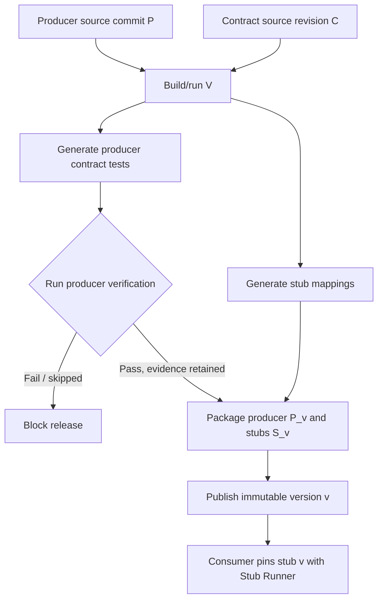
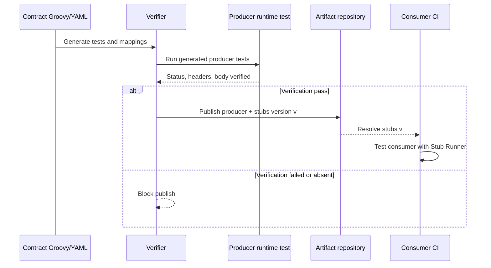

# Liên kết phiên bản stub với mã producer đã được xác minh

Một consumer có thể chạy tất cả kiểm thử với **stub** và nhận kết quả xanh, nhưng khi gọi API thật lại gặp lỗi. Điều này xảy ra, chẳng hạn, khi stub mô phỏng `201 Created` nhưng phiên bản producer đang triển khai trả `200 OK`; hoặc stub chứa trường `reservationId` mà implementation đã đổi thành `holdId`. Lỗi không hẳn ở consumer test: **stub và mã producer chưa được ràng buộc vào cùng một bản build đã xác minh**.

Bài học thuộc chương **Sinh và đóng gói stub** của module **SPRING_CLOUD_CONTRACT**. Spring Cloud Contract cho phép mô tả hành vi HTTP hoặc message qua **Groovy/YAML DSL**, sinh test để kiểm chứng phía producer, rồi đóng gói stub cho consumer dùng với **Stub Runner**. Ta sẽ đi sâu vào **liên kết phiên bản giữa mã producer, contract nguồn, test đã chạy và artifact stub**; cách áp dụng trong Maven/Gradle, phát hành qua kho artifact và thiết lập CI để ngăn các thay đổi API không tương thích lọt qua.

Mục tiêu sau bài học:

- Phân biệt source commit của producer, phiên bản contract và phiên bản stub.
- Giải thích vì sao **sinh stub thành công** không đồng nghĩa **producer đã đáp ứng contract**.
- Biết cách tạo và kiểm tra artifact có classifier `stubs`.
- Thiết kế quy trình đảm bảo stub phát hành được tạo từ **đúng commit đã vượt qua producer verification**.
- Quản lý SNAPSHOT, release bất biến, semantic version và trường hợp contract nằm ở repository riêng.
- Cấu hình consumer test dùng **phiên bản stub xác định**, tránh phụ thuộc vào `+` hoặc `latest` không kiểm soát.
- Phát hiện pipeline xanh giả do **0 generated tests**, test bị skip hoặc stub được đóng gói từ output cũ.
- Tạo quy tắc truy vết artifact, rollback và nâng cấp tương thích trong CI/CD.

## 1. Hai lời hứa phải cùng đúng

Giả sử `OrderService` (consumer) gọi `InventoryService` (producer) để giữ hàng:

```http
POST /api/v1/reservations HTTP/1.1
Content-Type: application/json

{"sku":"SKU-001","quantity":2}
```

Theo contract, producer phải trả:

```http
HTTP/1.1 201 Created
Content-Type: application/json

{"reservationId":"RES-100","status":"HELD"}
```

Có **hai khẳng định khác nhau**:

1. **Stub assertion ở phía consumer:** khi consumer gửi request phù hợp, stub trả response đã mô tả; consumer xử lý response này đúng.
2. **Producer verification:** khi test gửi request mẫu tới mã producer thật, response thực tế thỏa contract; generated test đã chạy và pass.

Nếu chỉ làm (1), ta kiểm tra consumer với một **lời hứa chưa được xác thực**. Nếu chỉ làm (2), ta biết producer có thể đáp ứng contract nhưng chưa biết consumer có deserialize đúng, xử lý nhánh lỗi hoặc gắn đúng endpoint hay không.

Để phát hành đáng tin cậy, **stub phải bắt nguồn từ cùng tập contract mà mã producer phát hành đã được xác minh**.

## 2. Bốn thứ cần truy vết cùng nhau

| Thành phần | Ví dụ | Câu hỏi cần trả lời |
| --- | --- | --- |
| **Producer code revision** | Git commit `f62c3ab` | Mã producer nào đã được kiểm và chuẩn bị deploy? |
| **Contract source revision** | Cùng commit hoặc revision contract `c91b2d0` | Contract nào được dùng để sinh test và stub? |
| **Verification evidence** | CI run `build-8421`, producer contract tests pass | Test nào chạy, với fixture/công cụ phiên bản nào? |
| **Stub artifact** | `inventory-service-1.4.2-stubs.jar` | JAR này được sinh từ contract nào, có cùng bản build đã kiểm không? |

Một version như `1.4.2` rất hữu ích, nhưng **version string một mình chưa phải bằng chứng**. Nếu pipeline có thể ghi đè artifact cùng version, hoặc tạo stub và producer từ hai commit khác nhau, tên file vẫn giống nhau trong khi nội dung không còn liên kết.

### Sơ đồ ràng buộc



**Bất biến cần bảo vệ:** `P_v` phải được kiểm với `C_v` và `S_v` phải được sinh từ **chính `C_v`** đó, bằng một build/chuỗi bước có thể truy vết. Nếu contract nằm ngoài repository producer, cần ghi rõ revision độc lập `C_v`, không mặc nhiên coi nó bằng commit của producer.

## 3. Stub JAR và tọa độ artifact

Trong quy trình Spring Cloud Contract thông dụng, stub có thể được đóng gói thành **JAR riêng với classifier `stubs`** bên cạnh JAR chính của producer.

Ví dụ tọa độ Maven:

```text
groupId    = com.example
artifactId = inventory-service
version    = 1.4.2
classifier = stubs
type       = jar
```

Hai artifact có liên hệ:

```text
com.example:inventory-service:1.4.2          # Producer artifact
com.example:inventory-service:1.4.2:stubs    # Stub artifact

inventory-service-1.4.2.jar
inventory-service-1.4.2-stubs.jar
```

**Lưu ý:** cách biểu diễn tọa độ có thể khác giữa Maven dependency, tên file và cú pháp `ids` của Stub Runner. Trong `@AutoConfigureStubRunner`, thường dùng dạng `group:artifact:version:classifier:port`; số cổng là tham số chạy stub, **không phải một phần của Maven artifact coordinates**.

Một stub JAR thường chứa những **HTTP mappings** và **contract definitions** cần thiết cho Stub Runner/WireMock hoặc messaging. Cấu trúc bên trong có thể theo đường dẫn tương tự:

```text
META-INF/
  com.example/
    inventory-service/
      1.4.2/
        mappings/
          ... request/response stubs ...
        contracts/
          ... Groovy/YAML contract definitions ...
```

Đây là bố cục **mang tính minh họa theo quy ước plugin**. Hãy xem nội dung JAR thật của dự án, vì cách chia thư mục phụ thuộc plugin/configuration và loại contract.

### Tránh nhầm producer artifact với stubs artifact

Consumer không nên dùng trực tiếp JAR ứng dụng `inventory-service-1.4.2.jar` chỉ để mô phỏng giao tiếp. Mục tiêu của Stub Runner là dùng **stub artifact**; nó không cần chạy database hoặc service nội bộ của producer để test consumer.

Ngược lại, **stub JAR không phải producer triển khai được**: việc có mapping trả `201` không chứng minh controller thật hiện trả `201`. Producer verification phải chạy trước publish.

## 4. Cùng contract sinh test và stub

Giả sử nguồn Groovy DSL:

```groovy
import org.springframework.cloud.contract.spec.Contract

Contract.make {
    name 'create_reservation_success'
    description 'OrderService cần tạo lượt giữ hàng trước thanh toán'

    request {
        method 'POST'
        url '/api/v1/reservations'
        headers {
            contentType(applicationJson())
        }
        body([
            sku     : 'SKU-001',
            quantity: 2
        ])
    }

    response {
        status 201
        headers {
            contentType(applicationJson())
        }
        body([
            reservationId: $(consumer('RES-100'),
                             producer(regex('RES-[0-9]+'))),
            status: 'HELD'
        ])
    }
}
```

Trong response:

- `consumer('RES-100')` cung cấp ID **ổn định** để stub trả về.
- `producer(regex('RES-[0-9]+'))` mô tả điều generated test phải kiểm trên ID do producer thật sinh.
- `status = HELD` vẫn là giá trị nghiệp vụ cụ thể cho kịch bản.

Nếu implementation producer đổi `status` sang `PENDING`, một producer test chạy đúng phải phát hiện sai lệch. Nhưng stub vẫn có thể trả `HELD` nếu được đóng gói mà **không chạy hoặc không kiểm kết quả producer test**. Vì vậy không thể coi trạng thái “JAR build thành công” là điều kiện đủ để phát hành stubs.

### Vì sao phải kiểm producer trước khi phát hành?



Không phải plugin tự quyết định toàn bộ điều kiện release. **CI/CD phải thực sự áp đặt gate**: nếu verifier không chạy, chạy thiếu test hoặc fail, không cho phép bước publish đánh dấu thành công.

## 5. Quy trình Maven: từ source đến `*-stubs.jar`

Với producer dùng Maven, Spring Cloud Contract có plugin `spring-cloud-contract-maven-plugin` để sinh producer tests và stubs. Cấu hình điển hình cần được **ghép với POM, BOM và version management của dự án**:

```xml
<build>
  <plugins>
    <plugin>
      <groupId>org.springframework.cloud</groupId>
      <artifactId>spring-cloud-contract-maven-plugin</artifactId>
      <version>VERSION_COMPATIBLE_WITH_PROJECT</version>
      <extensions>true</extensions>
      <configuration>
        <testFramework>JUNIT5</testFramework>
        <testMode>MOCKMVC</testMode>
        <baseClassForTests>
          com.example.inventory.ContractVerifierBase
        </baseClassForTests>
      </configuration>
    </plugin>
  </plugins>
</build>
```

`VERSION_COMPATIBLE_WITH_PROJECT` là placeholder; không copy vào build thực mà không thay bằng version tương thích Spring Boot/Spring Cloud. `MOCKMVC` chỉ phù hợp nếu producer dùng **Spring MVC**; với WebFlux hoặc messaging, test mode và base class cần điều chỉnh.

Trong dự án có plugin và dependency kiểm thử thích hợp:

```bash
mvn -B -ntp clean verify
```

Lệnh này đi qua các bước Maven như generation, test compilation, test execution và `verify` theo cấu hình đang có. Kết quả mong muốn là:

1. Plugin tìm đúng tập contract.
2. Generated producer tests được tạo.
3. Các test được biên dịch và thực thi.
4. Kết quả test pass.
5. Stub mappings và JAR stubs được tạo/đính kèm theo plugin/lifecycle được cấu hình.

**Không suy ra bước 5 chỉ từ lệnh trên**. Cần kiểm log và sản phẩm build: một số dự án thay đổi plugin executions, vị trí contract hoặc cách đóng gói. `mvn verify` cũng **không tự upload JAR lên artifact repository**; phát hành đòi hỏi bước và credentials riêng.

### Kiểm output thật thay vì đoán

Giả sử Maven tạo `target/inventory-service-1.4.2-stubs.jar`, có thể liệt kê nội dung:

```bash
jar tf target/inventory-service-1.4.2-stubs.jar
```

Kiểm rằng có các mapping/contract mong đợi, không chỉ tồn tại một file ZIP/JAR rỗng. Với HTTP contract, xem URL, method và response mapping thực sự; với message contract, xác nhận label và contract definition được đóng gói cho Stub Runner.

**Đường dẫn và tên file chỉ là ví dụ.** Dự án có thể có khác tên, output location hoặc packaging tùy plugin. Đừng viết script CI chỉ tìm đúng một tên file tưởng tượng rồi bỏ qua lỗi khi cấu hình thay đổi.

## 6. Quy trình Gradle có cùng mục tiêu nhưng khác task graph

Spring Cloud Contract cũng hỗ trợ Gradle plugin. Thay vì Maven lifecycle phases, Gradle dùng **tasks** và **source sets**. Một mẫu định hướng:

```groovy
plugins {
    id 'java'
    id 'org.springframework.cloud.contract' version 'VERSION_COMPATIBLE'
}

dependencies {
    testImplementation 'org.springframework.boot:spring-boot-starter-test'
    testImplementation 'org.springframework.cloud:spring-cloud-starter-contract-verifier'
}

contracts {
    baseClassForTests = 'com.example.inventory.ContractVerifierBase'
    testFramework = 'JUNIT5'
    testMode = 'MOCKMVC'
}
```

Đây là **mảnh cấu hình cần điều chỉnh theo phiên bản**, không phải một build.gradle đầy đủ. Các task tạo contract tests, tạo stubs và publish artifact có thể khác giữa các phiên bản Gradle plugin.

Trong một dự án đã cấu hình, các lệnh khảo sát:

```bash
./gradlew tasks --all
./gradlew clean check
```

Trên Windows dùng `gradlew.bat`. Điều cần bảo đảm là task sinh contract test **nằm trong đồ thị task mà CI thực sự chạy**, generated sources được đưa vào source set để compile, và test runner làm build fail khi assertion không đạt. Đối với stub publishing, phải xác minh publication mang đúng **version/classifier** và được tạo từ cùng build inputs.

| Bất biến | Maven | Gradle |
| --- | --- | --- |
| Nguồn contract đã version hóa | Contract source directory | Contract source directory |
| Sinh producer tests | Plugin goals/lifecycle | Generator tasks |
| Biên dịch và chạy test | Test compilation/Surefire hoặc runner | `test`/`check` và runner |
| Sinh và đóng gói stub | Plugin packaging, attached artifact | Stub tasks/publication configuration |
| Phát hành | Deploy/plugin repository config | Publishing plugin/repository config |
| Chặn publish khi test fail | Job gate và dependency giữa các bước | Task/job dependency và CI gate |

Kết quả cần đo không phải tên task giống nhau mà là **mã producer được kiểm rồi stub tương ứng mới được phát hành**.

## 7. Đừng đánh đồng `clean verify` với bằng chứng verification đầy đủ

Một lệnh build xanh có thể che nhiều lỗi cấu hình:

| Tình huống | Build có thể xanh? | Rủi ro |
| --- | --- | --- |
| Đặt contract sai thư mục | Có | Generator không đọc contract nào |
| Plugin không áp dụng vào module producer | Có | Không sinh generated tests |
| Có test source nhưng JUnit không phát hiện | Có | Không có test nào được thực thi |
| Cấu hình `skipTests` hoặc filter loại bỏ generated tests | Có | Stub được sinh dù không có xác minh |
| Base class trả sẵn mock response giống contract | Có | Không thực sự kiểm implementation cần bảo vệ |
| Build cache dùng output từ contract cũ | Có thể | Test/stub không phản ánh contract mới |
| Producer test thực sự chạy và fail | Không nên | CI phải chặn publish |

**Ba dấu hiệu cần phân biệt**:

1. **Generated test exists:** có file/lớp được sinh.
2. **Generated test executed:** test runner thực sự chạy các lớp đó.
3. **Producer behavior verified:** test đi qua đường xử lý đúng của producer, fixture thích hợp và assertions pass.

Một pipeline chỉ kiểm dấu hiệu 1 **chưa đủ**. Cần xem báo cáo test (ví dụ Surefire XML/HTML trong Maven hoặc báo cáo Gradle) và có chính sách phát hiện số contract tests bằng 0 hay giảm bất thường.

### Ví dụ cổng kiểm tra minh họa

```bash
mvn -B -ntp clean verify

# Chỉ áp dụng nếu output của dự án thật nằm tại đây:
test -d target/generated-test-sources/contracts
find target/generated-test-sources/contracts -type f -name '*.java' | grep -q .
```

Check file chỉ giúp xác nhận **có mã sinh**, không chứng minh generated tests đã được chạy. Trong CI, phải kết hợp kiểm báo cáo JUnit, số lượng test được thực thi và trạng thái fail/skip. Đừng lấy lệnh minh họa này làm bộ kiểm hoàn chỉnh cho mọi Maven project.

## 8. Fixture và matcher phải đại diện đúng mã producer

Trong contract thành công, producer test có thể gửi request chứa `sku: SKU-001`, `quantity: 2` và chờ `201`. Nếu database test không có SKU hoặc hết hàng, implementation có thể trả `409` đúng nghiệp vụ nhưng generated test fail. Điều này cần **chuẩn bị fixture**, không phải bỏ assertion hoặc ngừng chạy test.

Nguyên tắc:

- Test phải có dữ liệu xác định trước mỗi lần chạy; không phụ thuộc thứ tự.
- ID/timestamp động nên dùng matcher phía producer nếu không có yêu cầu chính xác.
- Những trạng thái `200/201`, `400`, `404`, `409` quan trọng nên có contract riêng và fixture phân biệt.
- Nếu producer đã đổi nghiệp vụ, cần trao đổi với consumer để quyết định có sửa contract hay không.
- Khi tạo lại stub, bảo đảm matcher của trường hợp thành công **không nuốt nhầm** request lỗi.

**Ví dụ xung đột:** stub thành công có regex chấp nhận mọi SKU, còn stub thiếu hàng cũng nhận một SKU trong regex đó. Consumer có thể nhận kết quả tùy cách chọn mapping dù producer thật kiểm trạng thái tồn kho. Cần thiết kế matcher/stub có phạm vi rõ ràng và kiểm artifact.

## 9. Contract nằm chung repository hoặc riêng repository

Có hai mô hình tổ chức hay gặp:

| Mô hình | Nguồn contract | Điều phải liên kết |
| --- | --- | --- |
| **Contracts cùng producer repo** | Thường ở `src/test/resources/contracts` | Commit producer chứa contract + code; build và version phát hành |
| **Contracts ở repo/artifact riêng** | Một repo hoặc artifact contracts độc lập | Producer source revision **và** contract revision/version dùng để verification |

Với monorepo hoặc producer repo, liên kết tương đối đơn giản: cùng commit bao gồm implementation và contract; CI kiểm commit đó và phát hành producer/stubs version thống nhất.

Với contracts repo độc lập, producer CI phải ghi lại **đúng revision** đã tải. Nếu mỗi lần build tự lấy branch `main` hoặc version `latest`, cùng commit producer có thể được kiểm với hai nội dung contract khác nhau ở hai lần chạy.

### Ví dụ ma trận liên kết

| Producer release | Producer commit | Contract revision | Stub version |
| --- | --- | --- | --- |
| `1.4.1` | `a102b3c` | `contracts-2026-11-01` | `1.4.1` |
| `1.4.2` | `f62c3ab` | `contracts-2026-11-20` | `1.4.2` |
| `1.5.0` | `c90d11e` | `contracts-2026-12-05` | `1.5.0` |

Đây là **ví dụ minh họa**, không phải phiên bản ứng dụng có thật. Quan trọng là **bất biến truy vết**: người điều tra có thể tìm chính xác contract được dùng khi kiểm một producer release và sinh một stub artifact, không dựa vào thời điểm ước đoán.

Nếu contract được các consumer chủ trì, quy trình review cũng cần làm rõ **consumer nào chấp nhận thay đổi**. Không nên chỉ tăng version stub để che việc hợp đồng đã mất đi một điều kiện mà consumer phụ thuộc.

## 10. Một version không có nghĩa một build nếu có thể ghi đè

Đặc biệt nguy hiểm khi pipeline cho phép hai build khác nhau xuất bản cùng:

```text
com.example:inventory-service:1.4.2:stubs
```

Giả sử build A chạy trên commit `f62c3ab` và pass; build B trên commit `ff81aa0` chỉ sửa stub mapping nhưng **không chạy producer tests**, rồi ghi đè artifact `1.4.2`. Consumer vẫn đang trỏ tới version `1.4.2`, nhưng nội dung stub đã đổi. Việc truy vết thành công của build A không còn bảo đảm artifact hiện tại đại diện cho commit đó.

Quy tắc cho **release version ổn định**:

1. **Không ghi đè artifact release đã publish**.
2. Cùng version producer và stub phải được phát hành như **một tập artifact có nguồn gốc truy vết được**.
3. Nếu cần sửa contract hoặc mapping, tạo release mới với version mới.
4. Lưu checksum/digest và build provenance để phát hiện artifact bị thay thế.
5. Chỉ cho phép publish sau khi **chính build inputs** đã vượt qua verification.

Với `-SNAPSHOT`, một repository có thể hỗ trợ nội dung thay đổi giữa các lần upload, thậm chí dùng unique snapshot timestamp. SNAPSHOT hữu ích trong phát triển nhưng **không tương đương release bất biến**: để tái lập consumer test, cần ghi lại snapshot thực sự được resolve thay vì chỉ ghi chuỗi `1.4.3-SNAPSHOT`.

## 11. Chọn phiên bản stub ở từng môi trường

Không có một chính sách version phù hợp cho mọi mục tiêu. Cách chọn cần dựa vào việc consumer đang thử **mã producer dự kiến phát hành**, một snapshot đang phát triển, hay một producer đã triển khai.

| Môi trường / mục tiêu | Phiên bản stub phù hợp | Rủi ro cần quản lý |
| --- | --- | --- |
| Local developer, đang thử thay đổi mới | Version local hoặc snapshot đã xác định | Local cache chứa bản cũ, metadata chưa cập nhật |
| Pull request consumer | Stub release đã biết; có thể thêm phiên bản candidate cần tương thích | Candidate thay đổi trước khi PR chạy lại |
| Integration CI cho release candidate | Artifact stub gắn đúng producer candidate/build | Không dùng nhầm stub từ commit khác |
| Release test trước triển khai | Phiên bản immutable mà producer release sẽ dùng | Test chạy một artifact, deploy artifact khác |
| Regression khi điều tra lỗi | Version và checksum đã xuất hiện trong báo cáo CI cũ | Repository ghi đè hoặc đã dọn bản snapshot |
| Production smoke test | Stub có thể tham chiếu để đối chiếu kỳ vọng, nhưng phải gọi **producer thực đang deploy** | Stub xanh không chứng minh runtime production đúng |

### Cần hiểu khác biệt giữa release và deployment

Một JAR producer `1.4.2` có thể đã được xác minh nhưng cluster production vẫn đang chạy `1.4.1`. Khi consumer triển khai, điều quan trọng là **phiên bản producer thực sự phục vụ request tại môi trường đích**.

Vì vậy có hai kiểm tra khác nhau:

1. **Build compatibility:** consumer code chạy được với stub của producer version `1.4.2`.
2. **Deployment compatibility:** môi trường tích hợp/production có đang phục vụ đúng producer version mà consumer dự kiến dùng không?

Stub Runner hỗ trợ bước 1, còn bước 2 thường cần deployment metadata và smoke/integration test có kiểm soát trên endpoint thật.

## 12. Consumer khóa phiên bản stub trong Stub Runner

Ví dụ `OrderService` sử dụng Spring Cloud Contract Stub Runner với một stub đã được cài vào Maven repository local:

```java
package com.example.order;

import io.restassured.RestAssured;
import org.junit.jupiter.api.Test;
import org.springframework.boot.test.context.SpringBootTest;
import org.springframework.cloud.contract.stubrunner.spring.AutoConfigureStubRunner;
import org.springframework.cloud.contract.stubrunner.spring.StubRunnerProperties;

import static org.hamcrest.Matchers.equalTo;

@SpringBootTest
@AutoConfigureStubRunner(
    ids = "com.example:inventory-service:1.4.2:stubs:8090",
    stubsMode = StubRunnerProperties.StubsMode.LOCAL
)
class ReservationConsumerContractTest {

    @Test
    void shouldReadReservationCreatedResponse() {
        RestAssured.given()
            .port(8090)
            .contentType("application/json")
            .body("{\"sku\":\"SKU-001\",\"quantity\":2}")
            .when()
            .post("/api/v1/reservations")
            .then()
            .statusCode(201)
            .body("status", equalTo("HELD"));
    }
}
```

Đoạn này là **một minh họa cần ghép dependency/config theo phiên bản**, không phải dự án độc lập. Nó giả định có artifact `1.4.2:stubs` trong Maven local và cổng `8090` còn trống. Nếu Stub Runner không thể phân giải đúng JAR hoặc cổng bị chiếm, test sẽ fail trước khi kiểm business code.

Đối với consumer thật, nên gửi request qua **client/service adapter của consumer**, thay vì để tất cả test gọi RestAssured trực tiếp như một API smoke test. Như thế mới xác minh consumer serialize request, parse response và xử lý kết quả đúng. Ví dụ trên chỉ làm rõ **stub version và cách nó được phục vụ**.

### Tại sao không dùng version động ở CI bắt buộc?

Ví dụ:

```java
// Minh họa anti-pattern khi cần build tái lập:
@AutoConfigureStubRunner(
    ids = "com.example:inventory-service:+:stubs:8090"
)
```

Dấu `+` có thể yêu cầu Stub Runner resolve một phiên bản mới nhất thỏa điều kiện. Khi cùng commit consumer chạy ở hai thời điểm, nó có thể lấy **hai stub versions khác nhau**. Nếu producer mới thay đổi không tương thích, consumer CI đỏ dù code consumer không đổi; hoặc ngược lại, một stub cũ trong cache làm CI xanh khi producer đã thay đổi.

Với pipeline release, **pin version cụ thể** và ghi lại resolved coordinates. Dùng version động trong một **job thăm dò tương thích mới nhất** riêng có thể hữu ích, nhưng không nên coi job đó là bằng chứng tái lập được cho một release.

### LOCAL, REMOTE và classpath

| Cách lấy stub | Khi phù hợp | Điều cần kiểm |
| --- | --- | --- |
| `LOCAL` | Maven local đã có stub artifact đã install | Không dùng nhầm bản local cũ; kiểm tọa độ và checksum |
| `REMOTE` | CI giải artifact từ repository nội bộ | `repositoryRoot`, credentials, quyền đọc, version được pin |
| Classpath mode | Dự án đã đưa stubs trực tiếp vào test classpath | Artifact và phiên bản được chọn rõ; tránh dependency transitively kéo sai |

Các enum, cấu hình property và annotation có thể thay đổi theo phiên bản Spring Cloud Contract; hãy dùng **tài liệu tương ứng với dependency thật**. Đừng lẫn `repositoryRoot` (nơi lấy artifact) với địa chỉ HTTP cổng stub đang chạy.

## 13. Tương thích API và cách tăng version

Không phải mọi thay đổi producer đều là breaking change. Tuy nhiên, tăng version mà không kiểm người dùng hiện tại vẫn có thể làm consumer hỏng.

| Thay đổi | Tác động thường gặp | Hành động cần làm |
| --- | --- | --- |
| Thêm field JSON response mà consumer bỏ qua | Có thể tương thích, tùy schema strictness | Kiểm các consumer đang dùng |
| Đổi `reservationId` thành `holdId` | Có thể breaking nếu consumer phụ thuộc field cũ | Giữ tương thích hoặc phối hợp migration |
| Đổi `201` thành `200` | Có thể breaking nếu consumer kiểm status | Đối chiếu contract và test consumer |
| Bỏ endpoint `/api/v1/reservations` | Breaking đối với consumer đang gọi | Có version/migration plan |
| Thu hẹp request matcher hợp lệ | Có thể breaking | Kiểm traffic/contract của consumer hiện tại |
| Nới định dạng ID có kiểm soát | Có thể tương thích, nhưng chưa chắc với parser strict | Test consumer trên dữ liệu mới |
| Đổi AMQP routing key | Có thể làm message không tới queue | Kiểm broker contract và topology |
| Bổ sung thông điệp mới | Có thể tương thích nếu consumer bỏ qua được | Kiểm event handler/consumer policy |

**Semantic Versioning** là một quy ước hữu ích: tăng major khi thay đổi phá vỡ API công khai; minor cho tính năng tương thích; patch cho sửa lỗi tương thích. Tuy vậy, Spring Cloud Contract **không tự suy version major/minor từ DSL**. Tổ chức phải có chính sách version và quy tắc xét ảnh hưởng đến consumer.

### Consumer-driven contract thay đổi theo chiều nào?

Khi consumer yêu cầu một field mới, producer có thể thêm field mà không làm hỏng consumer cũ. Nhưng khi producer muốn **xóa** field cũ, cần biết có consumer nào còn cần nó.

Một quá trình migration phổ biến:

1. Thêm hỗ trợ field hoặc endpoint mới **song song** với phiên bản cũ.
2. Viết/điều chỉnh contract và producer tests cho cả hai đường.
3. Phát hành producer/stub version mới đã được xác minh.
4. Consumer nâng version stub và đổi code theo kế hoạch.
5. Xác nhận không còn consumer phụ thuộc giao diện cũ.
6. Sau đó mới loại bỏ phần cũ trong release breaking phù hợp.

**Không sửa contract để test xanh mà không trao đổi với consumer.** Việc xóa assertion có thể làm producer test xanh nhanh hơn, nhưng đồng thời gỡ bỏ chính bảo vệ mà consumer cần.

## 14. Thiết kế cổng CI/CD bảo đảm cùng commit

Một release pipeline cần xử lý ít nhất ba rủi ro:

- Contract test bị bỏ qua nhưng stub vẫn được đóng gói.
- Build A được verify, nhưng build B từ **commit hoặc dependency khác** được publish.
- Artifact phát hành bị ghi đè sau khi consumer đã dùng.

### Mô hình hai chặng rõ ràng

**Chặng 1 — Verify**

1. Checkout **commit xác định**.
2. Khóa dependencies, contract revision và toolchain.
3. Generate producer tests và stub mappings.
4. Compile và chạy producer contract tests.
5. Xác nhận có **expected tests**, không bị skip hoặc thiếu module.
6. Chạy integration/security tests bắt buộc.
7. Kiểm stub JAR có mappings/contracts mong đợi.
8. Lưu báo cáo, checksum và metadata build.

**Chặng 2 — Publish**

1. Chỉ chạy nếu chặng verify pass và release được cho phép.
2. Phát hành **cùng artifact đã được kiểm**, hoặc tái build từ **cùng revision và đầu vào cố định** theo chính sách đã xác định.
3. Dùng một version release chưa tồn tại trong kho; không ghi đè.
4. Publish producer artifact và stub artifact với quan hệ version rõ ràng.
5. Ghi nhận thông tin repo, checksum, Git commit và CI run ID.
6. Consumer CI nâng cấp có chủ đích lên stub version đã publish.

### Vì sao kiểm artifact đã được build tốt hơn tự build phiên bản khác?

Giả sử job verify chạy từ commit `f62c3ab`, nhưng job publish checkout branch `main` vào ngày hôm sau và nhận commit `ff81aa0`. Dù cả hai cùng đặt `project.version = 1.4.2`, **không có bằng chứng** test của build trước đã xác minh artifact mới.

Một pipeline tốt sử dụng immutable commit SHA/tag và lưu artifact giữa các job có trust boundary phù hợp. Nếu cần tái build vì thiết kế release, hãy bảo đảm producer sources, contract revision, dependencies, toolchain và build flags không đổi; chạy lại mọi verification bắt buộc.

## 15. Workflow CI minh họa với Maven

Đây là ví dụ job **verify trên pull request** (chưa có publishing):

```yaml
name: Verify producer and contract stubs

on:
  pull_request:
  push:
    branches: [main]

jobs:
  verify:
    runs-on: ubuntu-latest
    steps:
      - uses: actions/checkout@v4
      - uses: actions/setup-java@v4
        with:
          distribution: temurin
          java-version: '21'
          cache: maven

      - name: Generate, compile and run tests
        run: mvn -B -ntp clean verify

      - name: Check a stub JAR exists
        shell: bash
        run: |
          # Chỉnh mẫu tên file theo artifact thực tế.
          artifact=$(find target -maxdepth 1 -type f -name '*-stubs.jar' -print -quit)
          test -n "$artifact"
          jar tf "$artifact" | grep -q 'mappings'

      - name: Retain test reports
        if: always()
        uses: actions/upload-artifact@v4
        with:
          name: producer-test-reports
          path: target/surefire-reports/
```

**Đoạn YAML có mục đích minh họa.** Cần điều chỉnh JDK, working directory nếu là multi-module, output JAR, plugin và lệnh test theo dự án thật. Nếu chỉ có messaging contract, stub có thể không có thư mục `mappings` như HTTP stub; khi đó đổi điều kiện kiểm artifact cho phù hợp.

Job trên **chưa phải cổng release hoàn chỉnh**:

- Nó kiểm có stub JAR, nhưng cần thêm bước kiểm **số generated tests thực sự chạy**, số skipped và các integration tests bắt buộc.
- Nó chưa xác minh rằng tất cả contract đều được đóng gói.
- Nó không có bước publish; điều này là có chủ đích để tránh vô tình phát hành artifact từ một PR chưa được kiểm soát.

### Khi thêm bước publish

Ở một job release có quyền publish và branch/tag được bảo vệ, tổ chức có thể dùng cơ chế `mvn deploy` sau khi xác minh mọi điều kiện. Maven deploy goal cần cấu hình `distributionManagement`, server credentials và repository phù hợp.

```bash
# Chạy trên đúng commit/tag release, với test không bị bỏ qua:
mvn -B -ntp clean deploy
```

Lệnh này có thể chạy lại các pha kiểm thử trước khi deploy nếu lifecycle được cấu hình đúng. **Không mặc định nó có kiểm số test > 0**: kiểm test count và artifact provenance vẫn phải là điều kiện chặn release.

Không dùng `-DskipTests` hay `-Dmaven.test.skip=true` như cách “tối ưu” một job publish độc lập mà không có bảo đảm artifact đó là **chính output đã qua verification**. Với Gradle, áp dụng logic tương tự cho publishing task và source revision.

## 16. Bằng chứng nguồn gốc artifact (provenance)

Một đội phát triển có thể lưu metadata theo từng release:

```yaml
producer:
  coordinates: com.example:inventory-service:1.4.2
  gitCommit: f62c3ab
contract:
  revision: contracts-2026-11-20
verification:
  ciRun: build-8421
  generatedTests: 12
  executedTests: 12
  skippedTests: 0
  result: PASS
stubs:
  coordinates: com.example:inventory-service:1.4.2:stubs
  sha256: EXAMPLE_DIGEST_REPLACE_WITH_REAL_VALUE
```

Đây là **metadata minh họa**, không phải schema tiêu chuẩn mà Spring Cloud Contract tự sinh. Thông tin phiên bản, số test, digest phải lấy từ tool thật; không copy số `12` hoặc hash giả vào báo cáo release. Có thể lưu nó trong CI artifacts, release manifest hoặc hệ thống quản lý phát hành; không nhất thiết phải tạo thêm file trong repository producer.

### Một số thông tin cần lưu

| Dữ liệu | Dùng để làm gì? |
| --- | --- |
| Git commit SHA đầy đủ | Tái lập mã nguồn producer |
| Contract artifact/revision | Tái lập tập điều kiện đã kiểm |
| Build tool + plugin version | Giải thích khác biệt generated tests/stubs |
| JDK, Spring Boot/Cloud versions | Tái lập môi trường generator và runner |
| CI run URL/ID | Tìm test logs, warnings, skip count |
| Stub artifact coordinates | Consumer biết chính xác phiên bản cần dùng |
| SHA-256 checksum | Phát hiện nội dung JAR khác dù cùng tên |
| Test report summary | Chứng minh số test thực thi và kết quả |

Nếu cần kiểm checksum bằng công cụ phù hợp, có thể dùng:

```bash
sha256sum target/inventory-service-1.4.2-stubs.jar
```

Trên PowerShell có thể dùng `Get-FileHash` với thuật toán `SHA256`. Chỉ số checksum giúp **đối chiếu nội dung**, không thay thế quyền repository, chữ ký artifact hoặc các kiểm soát supply-chain khác khi tổ chức yêu cầu.

## 17. Cẩn thận với cache và bản build cũ

Khi build dùng cache hoặc repository local, có thể vô tình sử dụng **stale generated output**.

Ví dụ:

1. Developer sửa contract từ `status 201` thành `status 200`.
2. Task sinh test không nhận contract mới là input, cache trả output cũ.
3. Build test/pass trên generated test cũ.
4. Stub JAR lại được build bằng nguồn/đầu ra không nhất quán.

Hoặc consumer vừa yêu cầu stub `1.4.2`, nhưng Maven local đang có bản `1.4.2` đã từng được install từ một commit thử nghiệm khác.

Các biện pháp:

- Khai báo contract sources và generator config là input của build task.
- Khi nghi stale output, chạy **clean build** rồi xem test/mapping vừa sinh.
- Với snapshot, kiểm resolved timestamp/build version hoặc clear cache có chọn lọc khi cần điều tra.
- Không cho phép release repository ghi đè version đã phát hành.
- Không upload bằng tay một JAR chưa biết được sinh từ commit nào.
- Tách cache Maven/Gradle theo ngữ cảnh và chính sách CI phù hợp.

**Clean không tự sửa một build pipeline sai.** Nó chỉ xóa output cũ; vẫn phải kiểm lifecycle/task graph và số test thực thi.

## 18. Rollback và hỗ trợ nhiều consumer versions

Giả sử producer đã triển khai `1.4.2`, consumer A dùng hợp đồng mới còn consumer B vẫn kỳ vọng giao diện `1.4.1`. Nếu `1.4.2` loại field mà B đang dùng, một consumer test chỉ chạy với `1.4.2-stubs` chưa bảo đảm B được hỗ trợ.

Cách tiếp cận:

1. Lập danh sách consumer và dải producer versions họ được hỗ trợ.
2. Trong giai đoạn migration, duy trì những contract tương thích còn cần thiết.
3. Chạy consumer tests với stub version **được chọn cho từng môi trường**.
4. Chạy producer verification đối với các điều khoản legacy cần duy trì.
5. Khi muốn rollback producer, kiểm rằng consumer đang deploy vẫn tương thích với bản rollback.
6. Không xóa các artifact release cần thiết để tái lập hoặc rollback theo chính sách retention.

Một ma trận giả định:

| Consumer | Đã thử với stub | Producer triển khai dự kiến | Quyết định |
| --- | --- | --- | --- |
| `OrderService 2.3` | `inventory-service:1.4.2:stubs` | `1.4.2` | Cho tiếp tục nếu verification đủ |
| `BillingService 1.8` | `inventory-service:1.4.1:stubs` | `1.4.2` | Cần kiểm tương thích ngược hoặc test thêm |
| `LegacyApp 0.9` | `inventory-service:1.3.9:stubs` | `1.4.2` | Cần đánh giá migration/breaking changes |

**Không giả định version lớn hơn luôn tương thích với version nhỏ hơn**. Việc cần duy trì nhiều hợp đồng phụ thuộc chính sách API, consumer thực tế và thời gian deprecation.

## 19. Chẩn đoán các lỗi liên kết phiên bản thường gặp

| Triệu chứng | Nguyên nhân khả dĩ | Cách xác minh |
| --- | --- | --- |
| Consumer stub trả `201`, production trả `200` | Producer chưa được verify hoặc môi trường chạy version khác | Đối chiếu deploy version, CI test logs và contract revision |
| Stub artifact có version `1.4.2` nhưng response cũ | Artifact bị overwrite hoặc local cache cũ | Kiểm checksum, timestamp, source commit, repository policy |
| Build xanh nhưng không có generated tests | Plugin không đọc contract hoặc tests bị skip | Kiểm số test sinh và executed test count |
| JAR `*-stubs.jar` có nhưng không có mapping mong muốn | Sai source path, plugin/packaging hoặc contract filter | Liệt kê JAR và đối chiếu contract sources |
| Maven `deploy` publish nhưng test không được chạy | Skip flags hoặc lifecycle bị chỉnh | Kiểm effective build, CI log, Surefire/Gradle reports |
| Local Stub Runner pass, CI remote fail | Cùng coordinates nhưng local/remote khác artifact | So SHA-256 và cấu hình repositoryRoot |
| Consumer dùng version `+` lúc xanh lúc đỏ | Resolved version thay đổi | Pin version và lưu resolved coordinates |
| Contract repo ngoài thay đổi làm build khó tái lập | Lấy branch/latest thay vì revision cố định | Khóa revision/hash và ghi vào provenance |
| Producer code mới và stub cũ được deploy cùng nhau | Build/CI jobs lấy đầu vào khác revision | Ràng buộc commit và artifacts theo cùng release run |
| Stub test xanh nhưng workflow thật fail | Contract chỉ mô tả một HTTP interaction hoặc fixture không giống thật | Thêm integration test nhiều bước |
| Có hai mappings cùng match request nhưng trả khác status | Matcher quá rộng hoặc lẫn các kịch bản | Kiểm mapping WireMock và phân biệt đầu vào |
| Rollback producer làm consumer mới lỗi | Consumer chỉ test với version mới | Kiểm ma trận tương thích/rollback |

## 20. Những anti-pattern cần tránh

**Anti-pattern 1: “Sinh stub rồi deploy luôn.”** Plugin có thể tạo mapping từ DSL ngay cả khi producer implementation không đáp ứng hợp đồng. Luôn có gate producer verification và kiểm report.

**Anti-pattern 2: “Đổi response trong stub để consumer test xanh.”** Sửa mapping thủ công mà không sửa contract/producer phá quan hệ nguồn sự thật. Nếu consumer kỳ vọng khác, cần thống nhất contract và chạy verification lại.

**Anti-pattern 3: “CI chỉ kiểm file JAR tồn tại.”** Một JAR rỗng hoặc chứa mapping cũ vẫn có thể tồn tại. Cần kiểm nội dung stub và số test thực sự chạy.

**Anti-pattern 4: “Publish cùng version cho nhiều commit.”** Bản phát hành mất tính tái lập; consumer có thể resolve hai nội dung cùng tọa độ. Tạo version mới hoặc dùng snapshot policy phù hợp.

**Anti-pattern 5: “Consumer luôn tải latest.”** Build consumer không ổn định theo thời gian. Khóa version ở gate release, dùng job thử nghiệm mới nhất tách riêng nếu muốn.

**Anti-pattern 6: “Verify trên PR, publish lại từ main đang di chuyển.”** Test và release không cùng source commit. Khóa SHA/tag và quản lý artifact provenance.

**Anti-pattern 7: “Contract tests pass nên hệ thống phân tán hoạt động đúng.”** Contract tests kiểm những hành vi đã mô tả; không tự bảo đảm idempotency, queue binding, database transaction, retry hoặc cân bằng tải. Chạy các test bổ sung theo rủi ro.

## 21. Checklist trước khi cho phép phát hành stub

- [ ] Contract Groovy/YAML được version hóa, xác định rõ consumer nào cần.
- [ ] Producer commit và contract revision được ghi vào CI build.
- [ ] Plugin Spring Cloud Contract đúng phiên bản và cấu hình source path hợp lệ.
- [ ] Generated producer tests được tạo **và** được thực thi.
- [ ] Không có skip ngoài ý muốn, 0 tests hoặc lớp test không được runner phát hiện.
- [ ] Fixture/bộ dữ liệu đảm bảo test đi qua producer implementation có ý nghĩa.
- [ ] Contract matcher không quá rộng, không có mapping xung đột quan trọng.
- [ ] Các integration/security/messaging tests bắt buộc đã đạt.
- [ ] Stub JAR chứa các mappings/contracts dự kiến, kiểm được sau packaging.
- [ ] Stub version và producer version liên kết minh bạch; không có publish từ commit khác.
- [ ] Release artifact bất biến; SNAPSHOT có chính sách xác định bản đã resolve.
- [ ] Có Git SHA, build ID, kết quả test và checksum để truy vết.
- [ ] CI chặn publish nếu verification hoặc kiểm tra artifact fail.
- [ ] Consumer dùng Stub Runner với **version cụ thể** tại release gate.
- [ ] Có smoke/integration test với producer triển khai thật khi cần xác minh deployment.
- [ ] Có kế hoạch rollback và kiểm tương thích với consumer còn ở version cũ.
- [ ] Credentials publish được giữ trong secret của CI, không ghi vào contract.

### Bài tập thực hành

Giả sử `InventoryService` phát hành release `1.4.2` cho `OrderService`. Các thành phần:

```text
Producer:     com.example:inventory-service:1.4.2
Stub:         com.example:inventory-service:1.4.2:stubs
Producer SHA: f62c3ab
Contract SHA: c91b2d0
Consumer:     com.example:order-service:2.3.0
```

Contract quy định `POST /api/v1/reservations` phải trả `201`, `status: HELD` và `reservationId` đúng mẫu.

**Hãy thực hiện:**

1. Vẽ sơ đồ từ **Git commit → contract test generation → producer verification → stub packaging → repository → Stub Runner consumer test**.
2. Viết một contract Groovy cho kịch bản thành công; dùng response matcher cho `reservationId` động và giá trị mẫu cho stub.
3. Cấu hình plugin Contract Verifier trong Maven (hoặc Gradle tương đương) và kiểm generated tests có chạy không.
4. Chạy `mvn -B -ntp clean verify` trên producer đã cấu hình; ghi lại số test sinh, số test chạy, kết quả và đường dẫn stub JAR.
5. Dùng `jar tf` để tìm mapping `POST /api/v1/reservations` trong artifact; không chỉ kiểm file tồn tại.
6. Cố ý đổi implementation trả `200` thay vì `201`. Chứng minh producer test fail và **publish stub bị chặn**.
7. Cố ý bật skip tests hoặc làm đường dẫn contract sai. Viết thêm cổng CI phát hiện build xanh giả.
8. Cấu hình consumer test `@AutoConfigureStubRunner` dùng chính xác `1.4.2:stubs`; so sánh với version `+` và giải thích rủi ro.
9. Phát hành một stub release mới `1.4.3` thay vì ghi đè `1.4.2`. Lưu Git commit, contract revision, test report và checksum.
10. Mô phỏng consumer A vẫn dùng `1.4.1` trong khi producer sắp deploy `1.4.3`; lập danh sách các cam kết cần giữ tương thích.
11. Thiết kế quy trình rollback từ producer `1.4.3` về `1.4.2` sao cho consumer không bị bất ngờ.
12. Trình bày khi nào cần thêm integration test với producer thật và vì sao stub test không thay thế được nó.

**Tiêu chí hoàn thành:** bạn có thể chỉ ra **mã producer nào đã được xác minh bởi tập contract nào**, **stub artifact nào được sinh từ tập contract đó**, **CI đã chạy test nào**, và **consumer đang dùng chính xác version stub nào**. Khi những mối liên hệ này không chứng minh được, release chưa đủ điều kiện phát hành dù JAR đã được tạo thành công.

## Tài liệu tham khảo

- [Spring Cloud Contract — Reference](https://docs.spring.io/spring-cloud-contract/reference/): producer verification, Groovy/YAML contracts, stub generation và Stub Runner.
- [Spring Cloud Contract — HTTP Contracts](https://docs.spring.io/spring-cloud-contract/reference/project-features-contract/http.html): request/response DSL và matcher.
- [Apache Maven — Build Lifecycle](https://maven.apache.org/guides/introduction/introduction-to-the-lifecycle.html): các pha generate, test, package, verify, install và deploy.
- [Apache Maven Deploy Plugin](https://maven.apache.org/plugins/maven-deploy-plugin/): publishing artifact qua Maven repository.
- [Gradle — Maven Publish Plugin](https://docs.gradle.org/current/userguide/publishing_maven.html): publishing tasks, versions và Maven coordinates.
- [Semantic Versioning](https://semver.org/): cách phân biệt thay đổi tương thích và breaking changes theo quy ước version.
