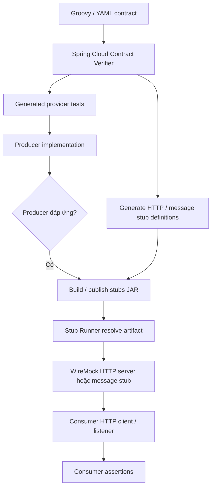
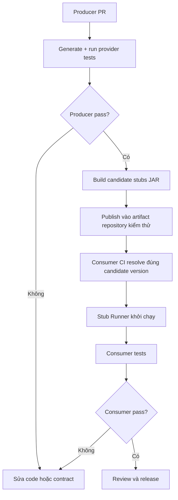

# Vai trò Stub Runner trong kiểm thử consumer với Spring Cloud Contract

Trong một hệ thống microservices, `checkout-consumer` có thể gọi `order-producer` qua HTTP, còn `notification-consumer` có thể nhận sự kiện `OrderCreated`. Để kiểm thử consumer, nhóm không muốn lúc nào cũng phải khởi động producer thật, database, broker và các dịch vụ phụ thuộc. Nhưng nếu consumer tự viết mock không liên quan đến giao diện producer, test có thể xanh dù hai bên đã không còn tương thích.

**Spring Cloud Contract (SCC)** giúp khép kín khoảng trống đó bằng **hợp đồng có thể dùng để sinh test và stub**. Producer định nghĩa hành vi HTTP hoặc thông điệp trong **Groovy DSL/YAML DSL**; Contract Verifier sinh test kiểm tra implementation producer và tạo stubs. **Stub Runner** giúp consumer **tìm, tải và khởi chạy stubs do producer phát hành**, để client/listener consumer kiểm tra được giao tiếp mà **không cần chạy ứng dụng producer thật**.

Bài thuộc chương **Stub Runner** tập trung vào **vai trò Stub Runner trong kiểm thử consumer**: nó giải quyết vấn đề gì, lấy artifact từ đâu, cách cấu hình HTTP và messaging, cách tránh test nhầm phiên bản, và ranh giới với producer verification hoặc integration test. Ví dụ xuyên suốt là ứng dụng `order-producer` và `checkout-consumer`.

## 1. Nhu cầu của consumer: kiểm tra giao diện trước khi tích hợp thật

Giả sử consumer gọi:

```http
GET /api/orders/1001 HTTP/1.1
Accept: application/json
```

Producer cam kết:

```http
HTTP/1.1 200 OK
Content-Type: application/json

{"id":1001,"status":"CREATED","currency":"VND"}
```

Consumer phải xử lý đúng cả **request gửi đi** và **response nhận về**:

- Dùng chính xác `GET`, path `/api/orders/1001` và header cần thiết.
- Giải mã JSON thành DTO đúng kiểu dữ liệu.
- Hiểu `CREATED` là trạng thái đã được cam kết.
- Dùng `currency` đúng ngữ nghĩa.
- Phân biệt response thành công với `404`, `400`, `503` nếu các nhánh đó thuộc hợp đồng.
- Áp dụng timeout, xử lý lỗi hoặc retry riêng của ứng dụng khi cần.

Nếu consumer tự dựng một fake endpoint trả `{"status":"OK"}` trong khi producer đã công bố `{"status":"CREATED"}`, test của consumer sẽ không phát hiện lỗi tương thích thật. Nếu chạy producer thật mỗi lần test, bộ kiểm thử có thể phụ thuộc database, migrations, auth, network và quá nhiều hạ tầng.

**Stub Runner giảm phụ thuộc runtime producer nhưng vẫn giữ nguồn hành vi từ contract của producer.** Đây là khác biệt quan trọng so với việc consumer tự nghĩ ra một mock response.

## 2. Stub Runner ở đâu trong vòng đời Spring Cloud Contract?



Giải thích từng vai trò:

| Thành phần | Trách nhiệm | Bằng chứng thu được |
| --- | --- | --- |
| Contract | Mô tả request/response hoặc message input/output | Một thỏa thuận có cấu trúc |
| Contract Verifier | Xử lý DSL và sinh test/stub | Generated tests và stub mappings |
| Provider verification | Gọi code producer thật theo hợp đồng | Producer có đáp ứng các trường hợp được khai báo không |
| Stubs JAR | Đóng gói hành vi mô phỏng đã sinh | Artifact có định danh và version |
| Stub Runner | Tải/đọc stubs JAR và khởi chạy stub | Consumer có endpoint/message mẫu để kiểm thử |
| WireMock | Match HTTP request và trả response mẫu | Consumer gọi đúng các điều kiện request không |
| StubTrigger | Kích hoạt message stub theo label | Consumer listener nhận/xử lý event mẫu không |
| Consumer tests | Chạy code consumer với stub | Consumer hiểu và sử dụng đúng contract không |

**Hai phép kiểm tra bổ sung cho nhau:** provider verification kiểm tra phía tạo ra hợp đồng; consumer test qua Stub Runner kiểm tra phía sử dụng hợp đồng. Một bên pass không thể tự động chứng minh bên kia đúng.

### 2.1. Câu hỏi mà Stub Runner thực sự trả lời

> Nếu producer cung cấp đúng những hành vi đã cam kết, phiên bản consumer hiện tại có tương tác được với nó không?

Stub Runner **không** tự trả lời câu hỏi “producer hiện đang triển khai trên production có thực sự đáp ứng hợp đồng không?”. Nó chạy một bản mô phỏng sinh từ contract, **không phải controller, database hay broker production**.

## 3. Phân biệt stub, WireMock và Stub Runner

**Stub:** mô tả một hoặc nhiều hành vi giao tiếp mẫu. Với HTTP, một mapping chứa điều kiện match request và response cần trả. Với messaging, stub có thông tin sự kiện mẫu và cách kích hoạt.

**WireMock:** công cụ HTTP server giả lập, nhận request, chọn mapping phù hợp, trả status, header và body đã định nghĩa.

**Stub Runner:** thành phần của Spring Cloud Contract hỗ trợ **tìm và chạy bộ stub của producer theo tọa độ artifact**, thường sử dụng WireMock cho HTTP và tích hợp messaging khi được cấu hình.

Ví dụ ý định của một mapping HTTP:

```text
Request:
  method: GET
  url: /api/orders/1001
  Accept: application/json

Response:
  status: 200
  Content-Type: application/json
  body: {"id":1001,"status":"CREATED","currency":"VND"}
```

Đây là **mô tả logic**, không phải file WireMock mapping thực tế. Một mapping được SCC sinh ra có cấu trúc JSON riêng tùy phiên bản và matcher.

### 3.1. Tại sao không tự viết WireMock ở consumer?

Bạn có thể viết WireMock trực tiếp cho một bài test đơn lẻ. Tuy nhiên, nếu producer đổi field `status` thành `state` nhưng consumer vẫn giữ mock cũ, consumer test không biết API đã thay đổi.

Với Stub Runner, nguồn stub lý tưởng là **artifact sinh từ contract của producer đang được kiểm thử**. Điều này giảm tình trạng consumer bảo trì một “API giả” không đồng bộ. Tính đúng đắn vẫn phụ thuộc việc:

1. Producer có kiểm chứng contract bằng generated tests.
2. Stubs JAR được build từ đúng phiên bản code/contract.
3. Consumer dùng đúng candidate artifact.
4. Các ca cần kiểm tra có thực sự được mô tả trong contract.

## 4. Producer viết một HTTP contract

Tạo file `src/test/resources/contracts/http/get-order-created.groovy` ở dự án producer:

```groovy
import org.springframework.cloud.contract.spec.Contract

Contract.make {
    description 'GET đơn hàng tồn tại trả 200 và JSON đúng schema'

    request {
        method GET()
        url '/api/orders/1001'
        headers {
            header('Accept', 'application/json')
        }
    }

    response {
        status OK()
        headers {
            contentType(applicationJson())
        }
        body(
            id: 1001,
            status: 'CREATED',
            currency: 'VND'
        )
    }
}
```

Contract nói rằng khi nhận một request phù hợp, producer phải trả response 200 JSON đúng dữ liệu đã thỏa thuận.

Tệp YAML biểu đạt kịch bản tương đương:

```yaml
description: "GET đơn hàng tồn tại trả 200 và JSON đúng schema"
request:
  method: GET
  url: /api/orders/1001
  headers:
    Accept: application/json
response:
  status: 200
  headers:
    Content-Type: application/json
  body:
    id: 1001
    status: CREATED
    currency: VND
```

**Chọn một trong hai bản Groovy/YAML cho cùng kịch bản trong build thực tế.** Nếu cả hai được quét, chúng có thể sinh test và stub trùng nhau.

### 4.1. Contract liên quan thế nào đến hành vi stub?

| Khai báo | Điều Stub Runner/WireMock mô phỏng |
| --- | --- |
| `request.method` | Phải nhận đúng HTTP method |
| `request.url` hoặc `urlPath` | So khớp đường dẫn và query theo mapping |
| `request.headers` | Có thể ràng buộc header consumer cần gửi |
| `request.body` / matcher | Có thể kiểm tra JSON/body request |
| `response.status` | Trả status cho client consumer |
| `response.headers` | Trả media type và metadata |
| `response.body` | Trả JSON hoặc payload mẫu |

Khi consumer gọi sai URL, method hoặc body, HTTP stub có thể **không match**, chứ không tự sửa request cho đúng. Nhờ vậy, bài test kiểm tra cả **đầu vào consumer tạo ra** lẫn **phản hồi consumer xử lý**.

## 5. Producer verification phải đi trước việc tin vào stubs JAR

Từ contract, SCC Contract Verifier có thể sinh bài test gọi API producer thật. Một phần cấu hình Maven thường gặp:

```xml
<plugin>
    <groupId>org.springframework.cloud</groupId>
    <artifactId>spring-cloud-contract-maven-plugin</artifactId>
    <extensions>true</extensions>
    <configuration>
        <baseClassForTests>com.example.order.contract.OrderContractBase</baseClassForTests>
    </configuration>
</plugin>
```

Đây là đoạn cấu hình **minh họa**, không phải `pom.xml` hoàn chỉnh. Dự án cần dependency Contract Verifier, phiên bản Spring Boot/SCC tương thích, test base và HTTP test mode phù hợp.

Ví dụ base test với MockMvc:

```java
import io.restassured.module.mockmvc.RestAssuredMockMvc;
import org.junit.jupiter.api.BeforeEach;
import org.springframework.beans.factory.annotation.Autowired;
import org.springframework.boot.test.autoconfigure.web.servlet.AutoConfigureMockMvc;
import org.springframework.boot.test.context.SpringBootTest;
import org.springframework.test.web.servlet.MockMvc;

@SpringBootTest
@AutoConfigureMockMvc
public abstract class OrderContractBase {
    @Autowired
    private MockMvc mockMvc;

    @BeforeEach
    public void setUp() {
        RestAssuredMockMvc.mockMvc(mockMvc);
    }
}
```

Khi đã cấu hình đúng, có thể chạy:

```bash
mvn clean verify
```

Cần xác minh **generated provider tests thật sự được sinh và chạy**, chứ không chỉ nhìn dòng `BUILD SUCCESS`. Nếu test không chạy hoặc base class gọi sai controller, stub có thể được sinh từ một hợp đồng không phản ánh implementation thực.

### 5.1. Vì sao không thể chỉ dùng Stub Runner?

Giả sử contract vẫn yêu cầu `status: CREATED`, nhưng một developer đổi producer thực tế trả `status: PAID`. Stub Runner vẫn có thể trả mẫu `CREATED` từ contract, khiến consumer test xanh. **Provider verification** mới là nơi chặn sự không nhất quán đó.

### 5.2. Cần kiểm tra gì trước khi phát hành stub?

- Tệp contract nằm đúng thư mục plugin quét.
- Số lượng generated tests phù hợp với số kịch bản quan trọng.
- HTTP test setup thực thi logic producer cần thiết.
- Không vô hiệu hóa filter/security quan trọng rồi coi test là kiểm tra API thực.
- Các response status, headers, body và matcher được test thật.
- Stubs được đóng gói **sau khi** producer verification phù hợp đã pass.

Nếu API phụ thuộc gateway, token service, database transaction hoặc HTTP network layer, vẫn cần integration test riêng ở phạm vi đó.

## 6. Stubs JAR là artifact có version, không phải process producer

Một cách phân phối thông dụng là JAR classifier `stubs` trong Maven repository.

Ví dụ:

```text
groupId    = com.example
artifactId = order-producer
version    = 1.0.0
classifier = stubs
```

File trong Maven local repository có thể có đường dẫn:

```text
~/.m2/repository/com/example/order-producer/1.0.0/
    order-producer-1.0.0-stubs.jar
```

Sau khi producer được cấu hình packaging, chạy lệnh minh họa:

```bash
mvn clean install
```

Điều này chỉ có tác dụng khi build thật sự đóng gói stubs JAR và cài artifact vào repository local. Hãy kiểm tra artifact thực tế thay vì giả định mọi dự án đã được cấu hình sẵn.

### 6.1. Các phần của định danh artifact

| Trường | Ý nghĩa |
| --- | --- |
| `groupId` | Nhóm của producer artifact |
| `artifactId` | Dịch vụ phát hành stub |
| `version` | Bản build/contract cụ thể |
| `classifier` | `stubs` để chọn JAR mô phỏng thay vì application JAR |
| Repository | Nơi client Stub Runner có thể resolve artifact |

**Không nhầm version stubs với API schema version trong payload.** Một release producer 1.0.1 có thể vẫn phát event `schemaVersion=1`. Ngược lại, việc thay đổi payload có thể yêu cầu migration dù artifact version tăng không lớn.

## 7. Consumer khởi động Stub Runner bằng annotation

Ví dụ consumer test dùng cổng cố định 8085 để minh họa:

```java
import static org.junit.jupiter.api.Assertions.assertEquals;

import org.junit.jupiter.api.Test;
import org.springframework.beans.factory.annotation.Autowired;
import org.springframework.boot.test.context.SpringBootTest;
import org.springframework.cloud.contract.stubrunner.spring.AutoConfigureStubRunner;
import org.springframework.cloud.contract.stubrunner.spring.StubRunnerProperties;

@SpringBootTest(properties = {
    "order.api.base-url=http://localhost:8085"
})
@AutoConfigureStubRunner(
    ids = "com.example:order-producer:1.0.0:stubs:8085",
    stubsMode = StubRunnerProperties.StubsMode.LOCAL
)
class OrderClientContractTest {

    @Autowired
    private OrderClient orderClient;

    @Test
    void readsOrder() {
        OrderDto order = orderClient.getOrder(1001L);

        assertEquals(1001L, order.id());
        assertEquals("CREATED", order.status());
        assertEquals("VND", order.currency());
    }
}
```

`OrderClient` và `OrderDto` là **lớp ứng dụng do nhóm tạo**, không phải kiểu được Spring Cloud Contract cung cấp. Test dùng `spring-cloud-starter-contract-stub-runner` hoặc dependency tương thích theo phiên bản dự án.

Giải thích:

- `@AutoConfigureStubRunner` yêu cầu Stub Runner resolve các stubs được chỉ định.
- `ids` trong ví dụ nêu `groupId:artifactId:version:classifier:port`.
- `StubsMode.LOCAL` tìm artifact trong Maven local repository.
- `8085` là cổng HTTP stub ở kịch bản học tập.
- Property `order.api.base-url` giúp **HTTP client thật của consumer** gọi stub thay vì môi trường production.
- `orderClient.getOrder` kiểm tra logic parse/mapping trong code consumer.

### 7.1. Ví dụ HTTP client thật phía consumer

Một implementation sử dụng Spring `RestClient` trong các phiên bản có hỗ trợ:

```java
import org.springframework.beans.factory.annotation.Value;
import org.springframework.stereotype.Component;
import org.springframework.web.client.RestClient;

@Component
public class OrderClient {

    private final RestClient restClient;

    public OrderClient(
            @Value("${order.api.base-url}") String baseUrl) {
        this.restClient = RestClient.builder()
            .baseUrl(baseUrl)
            .build();
    }

    public OrderDto getOrder(long id) {
        return restClient.get()
            .uri("/api/orders/{id}", id)
            .header("Accept", "application/json")
            .retrieve()
            .body(OrderDto.class);
    }
}

record OrderDto(long id, String status, String currency) {}
```

Ở đây `@Value("${order.api.base-url}")` đọc property `order.api.base-url` từ Spring. Với URL stub của bài thực hành, client thực gửi HTTP tới:

```text
GET http://localhost:8085/api/orders/1001
Accept: application/json
```

Sau đó stub trả JSON và `OrderClient` dùng decoder thật của consumer để tạo DTO.

**Lợi ích của bài test phụ thuộc vào việc nó dùng client thực.** Nếu production code dùng retry interceptor, headers, error decoder và serializer riêng, nhưng test lại dùng một `RestTemplate` mới hoàn toàn khác, lỗi trong các thành phần ấy có thể không bị phát hiện.

### 7.2. Không cần chạy producer

Test trên chỉ cần stubs artifact, Stub Runner và consumer app context. Nó không khởi động `order-producer`, database hay internal services của producer. Chính tính độc lập này giúp chạy consumer tests nhanh và ổn định hơn trong những hệ thống nhiều dịch vụ.

## 8. Cổng cố định và cổng động

Cổng `8085` dễ hiểu trong ví dụ nhưng dễ xung đột nếu nhiều test hoặc job CI chạy song song. Trong môi trường thực, có thể cho Stub Runner dùng cổng động rồi **hỏi nó stub URL đã khởi động**.

Ví dụ sử dụng `StubFinder`:

```java
import java.net.URL;
import org.springframework.beans.factory.annotation.Autowired;
import org.springframework.cloud.contract.stubrunner.StubFinder;

class StubUrlExample {

    @Autowired
    private StubFinder stubFinder;

    URL findOrderStubUrl() {
        return stubFinder.findStubUrl(
            "com.example", "order-producer");
    }
}
```

Hình dạng API và cách chỉ định cổng có thể thay đổi giữa các phiên bản Stub Runner. Hãy kiểm tra bản đang dùng; ý quan trọng là **không tự suy ra cổng cố định khi đang bật cấp cổng động**.

Đối với consumer Spring bean đã khởi tạo, cần đưa stub URL vào cấu hình **trước khi client được tạo**. Cập nhật một biến Java trong test sau khi `OrderClient` đã giữ `baseUrl` bất biến không khiến client tự đổi đích.

| Lựa chọn | Ưu điểm | Rủi ro hoặc chi phí |
| --- | --- | --- |
| Cổng cố định | Dễ viết ví dụ, dễ quan sát request | Xung đột khi chạy song song |
| Cổng động | Hạn chế collision | Cần injection/lookup URL đúng thời điểm |
| Stub Runner dạng service riêng | Nhiều consumer có thể chia sẻ stub environment | Cần version/lifecycle/isolation rõ ràng |

## 9. LOCAL và REMOTE: cách Stub Runner tìm artifact

Hai mode phổ biến:

**LOCAL:** dùng Maven local repository. Hữu ích khi producer đã được build/install trên máy đang chạy consumer test.

**REMOTE:** tải từ Maven-compatible repository được cấu hình. Hữu ích với hệ thống nhiều repository hoặc CI giữa các nhóm.

Ví dụ annotation cho local:

```java
@AutoConfigureStubRunner(
    ids = "com.example:order-producer:1.0.0:stubs:8085",
    stubsMode = StubRunnerProperties.StubsMode.LOCAL
)
```

Ví dụ dùng remote repository minh họa:

```java
@AutoConfigureStubRunner(
    ids = "com.example:order-producer:1.0.0:stubs:8085",
    stubsMode = StubRunnerProperties.StubsMode.REMOTE,
    repositoryRoot = "https://repo.example.org/maven-releases"
)
```

Địa chỉ `repo.example.org` là domain ví dụ, không phải repository đang tồn tại. Với repository private, truyền credentials qua cơ chế bảo mật của môi trường CI thay vì hardcode vào source hoặc in log.

| Tiêu chí | LOCAL | REMOTE |
| --- | --- | --- |
| Nguồn artifact | `~/.m2` | Repository cấu hình |
| Khi nào phù hợp | Phát triển local, build liền nhau | CI nhiều repository, consumer độc lập |
| Lỗi hay gặp | Chưa install, còn JAR cũ | Sai URL/credential/version/permission |
| Điều phải ghi nhận | Phiên bản thực đã được cài | Phiên bản và repository đã resolve |
| Nguy cơ test sai | Cache local cũ | Candidate version không được publish |

Một số phiên bản Stub Runner còn hỗ trợ classpath mode. Cấu hình khả dụng phải đối chiếu với phiên bản dependency đang dùng, không suy ra bằng cách đổi tên mode.

### 9.1. Vì sao pin version quan trọng hơn “dùng bản mới nhất”?

Một consumer đang chạy stub release `1.0.0` có thể pass, nhưng producer candidate `1.1.0` đã đổi `status` thành `state`. Nếu consumer CI không được cấp **candidate stubs của 1.1.0**, nó sẽ không phát hiện breaking change đó.

Với release gate, pin và ghi nhận rõ `groupId/artifactId/version/classifier` của artifact; hạn chế dùng wildcard hoặc version động không có kiểm soát.

## 10. Kiểm tra các response lỗi, không chỉ 200

Ngoài contract thành công, producer có thể có contract cho `GET /api/orders/9999`:

```groovy
import org.springframework.cloud.contract.spec.Contract

Contract.make {
    description 'Đơn hàng không tồn tại trả 404 và mã lỗi'

    request {
        method GET()
        url '/api/orders/9999'
        headers {
            header('Accept', 'application/json')
        }
    }

    response {
        status NOT_FOUND()
        headers {
            contentType(applicationJson())
        }
        body(
            code: 'ORDER_NOT_FOUND',
            message: 'Order does not exist'
        )
    }
}
```

Consumer test nên kiểm tra code thật của mình map HTTP 404 và `ORDER_NOT_FOUND` thành domain error hoặc kết quả tương ứng. Nếu chỉ assert status 404 từ WireMock bằng HTTP client tạm, vẫn chưa chứng minh logic của consumer được thực hiện.

| Kịch bản | Response stub | Điều consumer test nên kiểm tra |
| --- | --- | --- |
| Đọc thành công | 200 + JSON | DTO và business logic |
| Tạo tài nguyên | 201 + `Location` | URI resource và dữ liệu |
| Input sai | 400 + error code | Validation error mapping |
| Chưa xác thực | 401 | Auth handling, tránh retry vô hạn |
| Không có quyền | 403 | Authorization failure handling |
| Không tìm thấy | 404 | Domain not-found |
| Conflict | 409 | Nhánh xử lý nghiệp vụ |
| Rate limit | 429 + `Retry-After` | Retry policy/điều kiện dừng nếu có |
| Tạm không sẵn sàng | 503 | Fallback, error mapping và retry hữu hạn |

**Một response stub tĩnh 503 không tự chứng minh retry đúng số lần hoặc backoff.** Cần test policy/stateful behavior riêng nếu những điều đó là yêu cầu.

## 11. Request matcher: tránh stub quá cứng hoặc quá lỏng

Nếu consumer gửi request có giá trị động, một mapping chỉ nhận literal cụ thể có thể không đủ. Ví dụ POST tạo đơn với mã tham chiếu do consumer sinh:

```http
POST /api/orders HTTP/1.1
Content-Type: application/json

{"externalRef":"EXT-100001","quantity":2}
```

Groovy DSL hỗ trợ matcher cho field request:

```groovy
import org.springframework.cloud.contract.spec.Contract

Contract.make {
    description 'Tạo đơn với externalRef đúng mẫu'

    request {
        method POST()
        url '/api/orders'
        headers {
            contentType(applicationJson())
        }
        body(
            externalRef: 'EXT-100001',
            quantity: 2
        )
        bodyMatchers {
            jsonPath('$.externalRef',
                byRegex('^EXT-[0-9]{6}$'))
        }
    }

    response {
        status CREATED()
        headers {
            contentType(applicationJson())
        }
        body(id: 1001, status: 'CREATED')
    }
}
```

YAML tương đương:

```yaml
description: "Tạo đơn với externalRef đúng mẫu"
request:
  method: POST
  url: /api/orders
  headers:
    Content-Type: application/json
  body:
    externalRef: EXT-100001
    quantity: 2
  matchers:
    body:
      - path: $.externalRef
        type: by_regex
        value: '^EXT-[0-9]{6}$'
response:
  status: 201
  headers:
    Content-Type: application/json
  body:
    id: 1001
    status: CREATED
```

Phân biệt hai hướng:

- **Request matcher** hỗ trợ WireMock xác định những request nào từ consumer được chấp nhận theo mẫu.
- **Generated provider test** thường gửi một request mẫu để kiểm tra producer xử lý đúng kịch bản.
- **Response matcher** có thể cho provider test chấp nhận output động, trong khi consumer stub vẫn dùng một response mẫu.

Không đặt regex `.*` ở mọi field chỉ để stub dễ match: làm vậy có thể che request sai đã phá vỡ giao diện thật. Hãy xem generated WireMock mapping để chắc chắn công cụ đã diễn giải matcher như mong đợi.

## 12. Messaging: Stub Runner phát message stub qua label

Ngoài HTTP, Stub Runner có thể hỗ trợ **consumer messaging tests** khi Spring Cloud Contract và transport/test binder được cấu hình tương thích.

Ví dụ producer contract:

```groovy
import org.springframework.cloud.contract.spec.Contract

Contract.make {
    description 'Khi tạo đơn, phát OrderCreated v1'
    label 'order_created_v1'

    input {
        triggeredBy('publishOrderCreated()')
    }

    outputMessage {
        sentTo('orders.created')
        headers {
            messagingContentType(applicationJson())
        }
        body(
            eventId: 'EVT-1001',
            eventType: 'OrderCreated',
            schemaVersion: 1,
            orderId: 'ORD-1001',
            status: 'CREATED'
        )
    }
}
```

Trong consumer test:

```java
import org.springframework.beans.factory.annotation.Autowired;
import org.springframework.cloud.contract.stubrunner.StubTrigger;

class NotificationConsumerContractTest {

    @Autowired
    private StubTrigger trigger;

    void emitExampleEvent() {
        trigger.trigger("order_created_v1");
    }
}
```

Đây là **đoạn minh họa cách kích hoạt**, chưa phải JUnit test hoàn chỉnh. Test cần cấu hình Stub Runner, message binder/transport thích hợp, listener của consumer và assertion thực tế về việc xử lý sự kiện.

### 12.1. Label khác destination và artifact version

| Tên | Ví dụ | Ý nghĩa |
| --- | --- | --- |
| Contract label | `order_created_v1` | Tên dùng cho `StubTrigger` |
| Message destination | `orders.created` | Nơi message phải được phát |
| Event type | `OrderCreated` | Loại dữ liệu nghiệp vụ |
| Stubs artifact version | `1.0.0` | Bản stub consumer được kiểm thử |

`trigger.trigger(...)` hoạt động không đồng nghĩa listener đã nhận message. Với xử lý bất đồng bộ, hãy chờ có deadline và assert một side effect quan sát được, tránh `Thread.sleep` dài.

### 12.2. Giới hạn với broker thực

Message stub không tự kiểm chứng Kafka offsets, RabbitMQ ack/nack, redelivery, DLQ/DLT, partition ordering, retention hoặc database transaction. Các thành phần đó cần listener/broker integration tests riêng nếu quan trọng với sản phẩm.

## 13. Những giới hạn của Stub Runner

| Stub Runner giúp kiểm thử | Stub Runner không tự chứng minh |
| --- | --- |
| Consumer gọi đúng method, URL, header/body được contract mô tả | Producer thật hiện tại trả response đó |
| Consumer parse được response mẫu | Mọi response chưa được mô tả đều tương thích |
| Consumer map đúng lỗi mẫu | Retry, backoff và circuit breaker thực hiện đúng mọi trường hợp |
| Consumer xử lý message stub | Broker thực redeliver, ack và DLQ chính xác |
| Consumer độc lập với runtime producer | Gateway, TLS, ingress, security filters ở deployment đúng |
| Artifact contract giữa hai nhóm | Provider verification đã chạy nếu pipeline bỏ qua |
| Thử nhiều producer theo artifact riêng | Distributed transaction/saga của cả hệ thống |

Một số giới hạn cụ thể:

**Không chạy logic nghiệp vụ producer.** WireMock trả response mô phỏng; nó không thực thi controller, database, authorization hoặc transaction.

**Không tự xác minh security.** Stub có thể match `Authorization` header hoặc trả 401/403 nhưng không tự kiểm tra JWT signature, roles hay phân quyền trên hệ thống producer.

**Không mô phỏng stateful behavior mặc định.** Hai contract có request giống hệt nhưng response khác nhau không tạo thành một chuỗi retry có thứ tự. Nếu cần `503 → 200` trên cùng URL, dùng WireMock scenario hoặc test double có trạng thái.

**Không đảm bảo mọi thay đổi API được phát hiện.** Chỉ những hành vi có contract và assertion liên quan mới được bảo vệ.

**Không có nghĩa consumer gọi đúng server.** Client phải nhận URL/binder từ cấu hình test; nếu vẫn gọi production, test có thể không thực sự sử dụng stub.

## 14. Consumer test tốt nên gọi client thật và assert kết quả thật

Một cách tư duy theo Arrange–Act–Assert:

**Arrange:** Stub Runner chạy artifact đúng version; consumer được cấu hình trỏ tới stub server; fixture sạch và test độc lập.

**Act:** Gọi `OrderClient` hoặc use case của consumer có đi qua HTTP client thực, không chỉ gọi `curl` vào stub.

**Assert:** Kiểm tra DTO, mapping trạng thái, domain error, side effect hoặc kết quả nghiệp vụ mà consumer thực sự cam kết.

Ví dụ:

```text
Given:
  order-producer:1.0.0:stubs đã được Stub Runner chạy
  GET /api/orders/1001 có mapping trả 200 JSON

When:
  CheckoutService.loadOrder(1001) chạy qua OrderClient

Then:
  CheckoutService nhận id=1001, status=CREATED, currency=VND
  Không gửi request sai đường dẫn/header
```

Nếu dự án dùng Feign, WebClient, RestClient hoặc RestTemplate có interceptor, hãy dùng **cấu hình tương ứng trong consumer tests**. Tạo một client khác trong test có thể bỏ qua chính đoạn code cần bảo vệ.

### 14.1. Dùng cổng động để test song song

Ở CI nhiều job, cổng cố định dễ xung đột. Nếu chuyển sang dynamic ports, đảm bảo client nhận đúng URL trước khi được khởi tạo. Khi cần, tra cứu Stub Runner qua `StubFinder` hoặc tích hợp property dành cho phiên bản đang dùng.

### 14.2. Không chỉ kiểm tra “không ném exception”

Một test chỉ gọi `orderClient.getOrder(...)` mà không assert kết quả có thể bỏ lọt logic parse sai. Hãy kiểm tra các field consumer thực sự sử dụng và cả nhánh lỗi quan trọng.

## 15. CI: producer candidate stubs phải đến đúng consumer



Khi hai repository độc lập, cần cơ chế trigger consumer job hoặc chia sẻ version artifact chính xác. Không nhất thiết phải deploy producer mới để consumer kiểm tra compatibility; đó chính là lợi thế của stubs.

### 15.1. CI cần xác minh những gì?

- Provider verification đã sinh và chạy generated tests trên producer candidate.
- Stubs JAR không rỗng, chứa mappings/message stubs cần thiết.
- Artifact có group/artifact/version/classifier được ghi lại.
- Consumer chạy **candidate stubs** chứ không dùng artifact cũ trong cache.
- Consumer HTTP client/listener thật trỏ tới stub environment.
- Test assert đúng cả happy path và error path quan trọng.
- Thay đổi contract không tương thích làm cổng kiểm tra phù hợp thất bại.
- Những rủi ro gateway, broker, auth, retry hoặc transaction có các bài test khác bao phủ.

### 15.2. Các thay đổi thử phá vỡ

| Thay đổi | Tín hiệu mong đợi |
| --- | --- |
| Xóa endpoint consumer còn gọi | Stub không match, consumer test fail |
| Đổi URL `/api/orders` thành `/v2/orders` | Client cũ gọi sai path |
| Đổi `status` thành `state` | Consumer deserialize/mapping hoặc assertion fail |
| Đổi ID từ number thành string | Consumer DTO không còn tương thích |
| Đổi mã lỗi `ORDER_NOT_FOUND` | Consumer error mapping cần fail hoặc được cập nhật |
| Thêm header request bắt buộc | Consumer chưa gửi header bị mapping từ chối |
| Đổi schema message v1 | Consumer listener cần được test với candidate event |
| Dùng artifact release cũ | Pipeline phải phát hiện sai version trước khi kết luận |

Một số thay đổi chỉ làm provider verification fail; một số khác xuất hiện khi consumer dùng contract mới. Vì vậy cần **cả hai cổng** chứ không chỉ một loại test.

## 16. Consumer phụ thuộc nhiều producer

Một consumer có thể gọi nhiều dịch vụ: `order-producer`, `inventory-producer` và `payment-producer`. Stub Runner có thể quản lý nhiều stub artifacts, nhưng mỗi HTTP client cần **đúng base URL của producer tương ứng**.

Chú ý:

1. Pin version từng producer, không dùng “mới nhất” một cách không kiểm soát.
2. Dùng cổng khác nhau hoặc dynamic ports để tránh trùng.
3. Tách namespace/fixture của các mapping.
4. Không để một stub trả response thay cho producer khác.
5. Test cả trường hợp một dependency thất bại còn dependency khác bình thường.
6. Không coi nhiều stub 200 là bằng chứng transaction phân tán/saga đúng.

Stub Runner tạo dependency giả lập ở ranh giới giao tiếp; nó **không tự điều phối** một workflow nhiều dịch vụ hoặc tự cung cấp rollback/compensation nghiệp vụ.

## 17. Xử lý sự cố khi Stub Runner không chạy đúng

| Triệu chứng | Nguyên nhân thường gặp | Cách kiểm tra |
| --- | --- | --- |
| Không tải được stubs JAR | Sai group/artifact/version/classifier | Kiểm tra tọa độ và repository |
| LOCAL không có artifact | Producer chưa `install` hoặc có bản cũ | Kiểm tra Maven local |
| REMOTE không resolve | Sai URL, credentials, permission | Kiểm tra repository config |
| Cổng đã được sử dụng | Test dùng port cố định trùng | Chọn cổng động hoặc cô lập job |
| Consumer gọi server thật | Base URL không override | Kiểm tra target URL của client test |
| WireMock trả 404 | Request không match URL/method/header/body | Xem generated mapping và request thực |
| JSON parse lỗi | DTO khác body mẫu, media type sai | So sánh response và serialization |
| Test chỉ pass với version cũ | Candidate artifact chưa được dùng | Ghi lại exact stub artifact đã resolve |
| Messaging trigger không đến listener | Sai label/destination/test binder | Kiểm tra `StubTrigger` và listener |
| Producer thật trả khác stub | Contract cũ hoặc provider test bị skip | Chạy producer verification |
| Test flaky | Shared port, shared state, race | Isolation, dynamic port và fixture sạch |

Quy trình debug có thứ tự:

```text
1. Xác định stubs artifact được resolve thực tế.
2. Xác nhận JAR có mapping cho kịch bản cần test.
3. Kiểm tra Stub Runner đã khởi động HTTP/message stub.
4. Xem URL/port và request mà client thật gửi.
5. So sánh request với điều kiện WireMock mapping.
6. Đọc status/header/body stub đã trả.
7. Xác minh consumer mapping/error handling.
8. Nếu producer implementation khác stub, kiểm tra provider tests.
```

Tránh sửa mapping thành wildcard `.*` ngay khi request không match, vì có thể làm test xanh giả và che lỗi giao diện.

## 18. Hiểu lầm phổ biến

**“Stub Runner chính là producer.”** Sai: nó chạy artifact mô phỏng, không khởi động implementation producer.

**“Có Stub Runner thì không cần Contract Verifier.”** Sai: provider tests mới kiểm chứng implementation có tuân thủ hợp đồng.

**“Producer đã pass thì consumer chắc chắn pass.”** Không: consumer có thể gọi sai URL, parse sai DTO hoặc không xử lý được error code.

**“Một response 200 stub là đủ.”** Không: cần các kịch bản lỗi mà consumer phải xử lý.

**“Dùng stub version nào cũng như nhau.”** Sai: bản cũ có thể che breaking change mới.

**“StubTrigger phát message tức là broker đã hoạt động đúng.”** Không: cần test listener assertion và broker integration cho ack/DLQ.

**“WireMock trả 503 chứng minh retry hoạt động đúng.”** Không: một stub tĩnh không tự kiểm tra attempts/backoff/deadline.

**“Port 8085 luôn có sẵn.”** Không: CI có thể chạy song song. Cân nhắc cổng động và injection phù hợp.

**“Stub không match thì cứ bỏ hết headers và matchers.”** Không: cần xem consumer đang gửi sai hay contract quá cứng trước khi nới điều kiện.

## 19. Bài thực hành end-to-end theo vòng đời contract

Chuẩn bị producer Spring Boot và consumer đã tích hợp Spring Cloud Contract tương thích. Thực hiện các bài sau:

1. **Định nghĩa contract:** Viết Groovy hoặc YAML cho `GET /api/orders/1001` trả 200 JSON.
2. **Provider verification:** Chạy generated tests với producer implementation; đổi response `CREATED` thành `PAID` để thấy test fail.
3. **Đóng gói stub:** Build/install artifact `com.example:order-producer:1.0.0:stubs` và xem nội dung mapping.
4. **Consumer setup:** Thêm `@AutoConfigureStubRunner` ở mode LOCAL, trỏ `OrderClient` vào HTTP stub.
5. **Happy path:** Assert `OrderDto` và kết quả nghiệp vụ của consumer.
6. **Error path:** Thêm contract 404 và kiểm tra consumer mapping lỗi.
7. **Request matcher:** Thêm POST có `externalRef` regex; thử request hợp lệ và không hợp lệ qua stub.
8. **Dynamic port:** Tra stub URL thay vì hardcode cổng trong suite chạy song song.
9. **Messaging:** Viết `OrderCreated` contract, trigger bằng `StubTrigger` và assert listener thật.
10. **Breaking change:** Đổi URL hoặc field name trong candidate contract, rebuild stubs và chạy lại consumer tests.
11. **REMOTE:** Trong môi trường test có repository, publish và resolve candidate stubs theo version chính xác.
12. **CI:** Nối provider tests, candidate artifact và consumer tests; ghi lại revision/artifact đã kiểm tra.

Bảng tự đánh giá:

| Tiêu chí | Bằng chứng |
| --- | --- |
| Hiểu vai trò Stub Runner | Phân biệt Verifier, stubs JAR, WireMock, consumer test |
| Nắm nguồn stub | Artifact sinh từ producer contract, có version rõ |
| Kiểm tra producer | Generated provider tests chạy thực sự |
| Cấu hình consumer | Stub Runner resolve và khởi chạy artifact |
| Dùng client thật | Test gọi đúng `OrderClient` của ứng dụng |
| Xử lý lỗi | Consumer có assertion với 4xx/5xx quan trọng |
| Messaging | Phân biệt label/destination và assert listener |
| Giới hạn | Không nhầm stub với broker, gateway, security hoặc producer thật |
| CI | Consumer sử dụng candidate stubs và kết quả tương thích có thể truy vết |

## 20. Kết luận: khi nào Stub Runner thực sự tạo giá trị?

**Stub Runner biến một stubs artifact của producer thành dependency giả lập để consumer kiểm tra logic giao tiếp của mình.** Nó cho phép consumer chạy độc lập và tái lập tốt hơn, nhưng chỉ đáng tin khi stubs được sinh từ contract đã được producer xác minh và khi consumer tests thực sự chạy với **đúng artifact/version**.

Trước khi tin một test xanh, hãy kiểm tra:

- **Nguồn:** Stub có đến từ đúng producer candidate không?
- **Producer:** Generated provider tests của cùng revision có pass không?
- **Consumer:** Client/listener thật có đang gọi/nhận từ Stub Runner không?
- **Assertion:** Test đã kiểm tra những giá trị và lỗi consumer thực sự phụ thuộc chưa?
- **Giới hạn:** Broker, gateway, auth, retry và transaction đã có bài test đúng tầng chưa?

Kết hợp **Groovy/YAML DSL, Contract Verifier, stubs JAR, Stub Runner và CI có version rõ ràng** giúp phát hiện sớm nhiều thay đổi API không tương thích mà không cần khởi động toàn bộ hệ sinh thái cho mỗi lần kiểm thử consumer.
