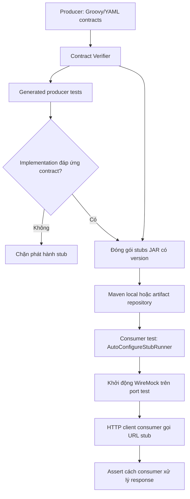
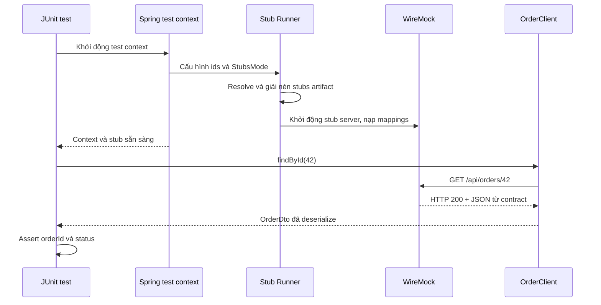
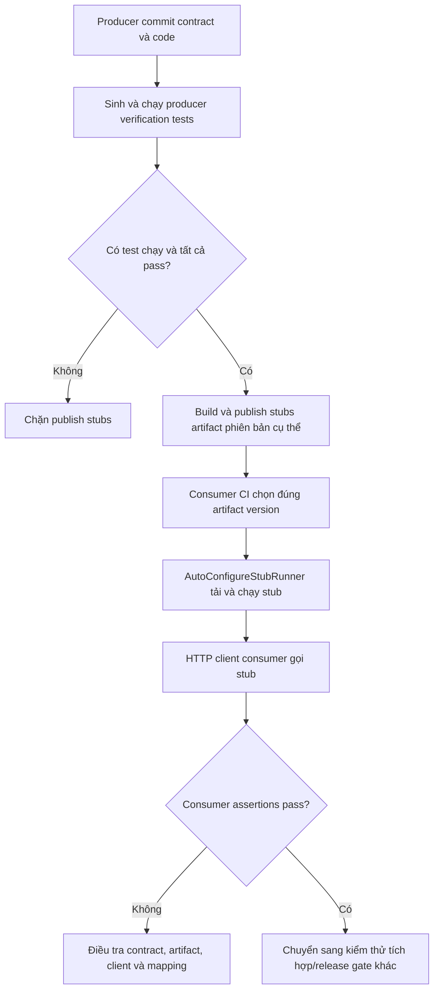

# Khởi động bằng @AutoConfigureStubRunner

## 1. Tại sao consumer cần tự khởi động stub?

Trong **Spring Cloud Contract**, một hợp đồng (*contract*) mô tả hành vi HTTP hoặc thông điệp mà **producer** cam kết với **consumer**. Hợp đồng có thể viết bằng Groovy/YAML DSL; công cụ sinh **producer verification tests** và **stubs artifact**. Consumer dùng những stub ấy để thử logic gọi dịch vụ mà không cần khởi động producer thật. CI có thể phát hiện API không tương thích trước khi phát hành.

Giả sử ứng dụng `checkout-service` cần gọi `order-service`:

```http
GET /api/orders/42
Accept: application/json
```

Và xử lý:

```http
HTTP/1.1 200 OK
Content-Type: application/json

{"orderId":42,"status":"CONFIRMED"}
```

Consumer có thể viết một HTTP mock thủ công trả đúng JSON, nhưng mock đó dễ **lệch khỏi hợp đồng mà producer đang thực sự kiểm chứng**. `@AutoConfigureStubRunner` giúp Spring Boot test tự động **tìm, tải/nạp, chạy và quản lý** những stub mà producer phát hành theo cấu hình test, thường phục vụ HTTP qua WireMock.

Đây là điểm khác biệt cốt lõi: **consumer vẫn gọi HTTP qua client của ứng dụng**, nhưng địa chỉ được đổi sang server stub; contract và producer implementation được đối chiếu ở pipeline producer riêng.

Sau bài học, bạn có thể:

1. Hiểu vai trò và vòng đời của `@AutoConfigureStubRunner` trong Spring Boot integration test.
2. Chuẩn bị stubs JAR và khai báo đúng `ids`, `stubsMode`, port, repository.
3. Kết nối **HTTP client thật của consumer** tới stub và viết assertion có ý nghĩa.
4. Chọn `LOCAL`, `REMOTE` hoặc `CLASSPATH` theo môi trường.
5. Debug lỗi “không tải được stub”, “khởi động nhưng client vẫn gọi dịch vụ thật”, “WireMock trả 404”, và cổng bị xung đột.
6. Đưa consumer tests vào CI mà không nhầm một stub test pass với producer đã đúng.

## 2. Luồng chạy từ hợp đồng producer tới consumer



| Phía | Thành phần chạy thật | Kết quả kiểm chứng |
| --- | --- | --- |
| **Producer** | Controller/HTTP server hoặc message publisher của producer trong môi trường test | Implementation tạo response/message đúng hợp đồng |
| **Stub Runner** | Mapping WireMock hoặc messaging stub từ artifact | Trả/phát dữ liệu mẫu mà contract mô tả |
| **Consumer** | HTTP client, deserializer và logic nghiệp vụ của consumer | Consumer xử lý đúng một tình huống hợp lệ hoặc lỗi mô phỏng |

**Stub Runner không khởi động toàn bộ `order-service`** và không thay producer verification. Nó khởi động một lớp mô phỏng theo những stub đã có. Nếu producer đổi API sau khi artifact cũ được phát hành, consumer test dùng stub cũ vẫn có thể xanh. Vì vậy phải kết nối kết quả producer test và version stubs JAR trong CI.

## 3. Điều kiện trước khi thêm annotation

Để `@AutoConfigureStubRunner` hoạt động có ý nghĩa, cần đủ các điều kiện:

- **Producer có contract:** request/response, method, URL, header, body và matcher được định nghĩa, có ít nhất một kịch bản phù hợp.
- **Producer đã sinh và chạy generated tests:** không chỉ có source DSL mà chưa biết implementation có tuân thủ hay không.
- **Stubs artifact được đóng gói:** với HTTP, thường là một JAR có classifier `stubs` chứa WireMock mappings và những file response cần thiết.
- **Artifact có thể tìm được:** trong Maven local repository, kho artifact từ xa hoặc classpath tùy `StubsMode`.
- **Consumer có dependency test phù hợp:** bản Spring Cloud Contract/Stub Runner tương thích với Spring Boot/Spring Cloud đang sử dụng.
- **Consumer client có thể chuyển base URL:** test phải trỏ tới stub thay vì gọi producer thật hoặc localhost sai cổng.
- **Test context có lifecycle rõ ràng:** Stub Runner được khởi tạo trước khi consumer test gửi request, tài nguyên và port không đụng suite khác.

Tên artifact minh họa:

```text
groupId:    com.example
artifactId: order-service
version:    1.5.0
classifier: stubs
file:       order-service-1.5.0-stubs.jar
```

Đây là **tọa độ mẫu**; `1.5.0` không phải phiên bản Spring Cloud Contract mà là **phiên bản producer artifact**. Trong một dự án thật, producer và consumer phải thống nhất version được phát hành/test. Nếu producer chưa attach stubs JAR vào Maven/Gradle publication, việc consumer có dependency Stub Runner **không tự tạo ra** artifact đó.

### Tạo stub ở producer (ví dụ Maven)

Với producer **đã cấu hình** `spring-cloud-contract-maven-plugin`, test base class và quyền đóng gói/publish:

```bash
./mvnw clean verify
./mvnw install
```

Lệnh `install` đặt artifact vào Maven local repository; stubs JAR chỉ có mặt nếu plugin được cấu hình attach/đóng gói đúng. Hãy kiểm tra output build, test report và artifact trong local repository. Không suy rằng một `BUILD SUCCESS` luôn có nghĩa generated contract tests được chạy hoặc stubs JAR đã tồn tại. Với Gradle, nhiệm vụ generate, verify và publish phụ thuộc plugin/version và publication được cấu hình.

## 4. Thêm dependency Stub Runner cho consumer test

Ứng dụng Spring Boot consumer thường khai báo starter dành cho test:

```xml
<!-- pom.xml: đặt trong dependencies của consumer -->
<dependency>
    <groupId>org.springframework.cloud</groupId>
    <artifactId>spring-cloud-starter-contract-stub-runner</artifactId>
    <scope>test</scope>
</dependency>
```

Hoặc Gradle:

```groovy
dependencies {
    testImplementation 'org.springframework.cloud:spring-cloud-starter-contract-stub-runner'
}
```

Các ví dụ dựa trên việc project đã quản lý **Spring Boot/Spring Cloud dependency versions** bằng BOM hoặc phiên bản tương thích. Không trộn Spring Cloud Contract đời cũ với Spring Boot mới tùy ý; có thể gặp lỗi auto-configuration, Java classpath hoặc test runtime trước khi stub được khởi động. Với ứng dụng không dùng Spring Boot, có thể cần `StubRunnerExtension`, `StubRunnerRule` hoặc API tương ứng thay cho `@AutoConfigureStubRunner`.

### Annotation thuộc giai đoạn kiểm thử

`@AutoConfigureStubRunner` thường nằm ở **lớp integration test consumer**, không phải annotation dùng để khởi động stub trong production. Import phổ biến:

```java
import org.springframework.cloud.contract.stubrunner.spring.AutoConfigureStubRunner;
import org.springframework.cloud.contract.stubrunner.StubRunnerProperties;
```

Các API và tên package phải được kiểm tra với phiên bản Spring Cloud Contract project dùng. Đừng thêm Stub Runner vào runtime production chỉ vì test cần một mock server.

## 5. Ví dụ tối thiểu: khởi động một HTTP stub bằng annotation

Đây là cấu hình trung tâm của bài:

```java
import org.junit.jupiter.api.Test;
import org.springframework.beans.factory.annotation.Autowired;
import org.springframework.boot.test.context.SpringBootTest;
import org.springframework.cloud.contract.stubrunner.StubRunnerProperties;
import org.springframework.cloud.contract.stubrunner.spring.AutoConfigureStubRunner;

import static org.assertj.core.api.Assertions.assertThat;

@SpringBootTest(properties = {
    "clients.order.base-url=http://localhost:9090"
})
@AutoConfigureStubRunner(
    ids = "com.example:order-service:1.5.0:stubs:9090",
    stubsMode = StubRunnerProperties.StubsMode.LOCAL
)
class CheckoutOrderContractTest {

    @Autowired
    OrderClient orderClient;

    @Test
    void shouldUseOrderServiceStub() {
        OrderDto result = orderClient.findById(42);
        assertThat(result.orderId()).isEqualTo(42L);
        assertThat(result.status()).isEqualTo("CONFIRMED");
    }
}
```

Ví dụ này giả định **ứng dụng consumer có bean `OrderClient` và DTO `OrderDto`** như phần tiếp theo, cùng contract được nạp cho `GET /api/orders/42`. Test gửi HTTP qua client thật rồi kiểm tra dữ liệu đã deserialize. Cần có cấu hình và dependencies phù hợp để thực thi; chỉ thêm annotation mà không có client thực hoặc artifact stub sẽ không tự tạo ra một bài kiểm thử có ý nghĩa.

Phần annotation:

| Cấu hình | Vai trò |
| --- | --- |
| `@SpringBootTest` | Khởi tạo Spring Boot application context của consumer |
| `@AutoConfigureStubRunner` | Thêm cấu hình tự động chạy/nạp stub vào context |
| `ids` | Chọn stubs artifact và cổng WireMock tương ứng |
| `stubsMode = LOCAL` | Tìm artifact trong Maven local repository |
| `clients.order.base-url` | Thuộc tính ví dụ do ứng dụng consumer tự định nghĩa để client trỏ về stub |

**Chú ý:** `clients.order.base-url` không phải property bắt buộc của Spring Cloud Contract. Đây là một **cấu hình ứng dụng giả định** để minh họa việc thay endpoint thật bằng stub. Nếu HTTP client trong project dùng property khác (ví dụ `order.api.url`), phải đặt đúng property mà client thực sự đọc.

## 6. Để test gọi thật: triển khai HTTP client đơn giản

Một annotation đúng nhưng test không gọi gì sẽ không kiểm tra hợp đồng. Ta cần bảo đảm **đường HTTP outbound của ứng dụng consumer** thực sự dùng `clients.order.base-url`.

Ví dụ một client nhỏ với `RestTemplate`:

```java
package com.example.checkout;

import org.springframework.beans.factory.annotation.Value;
import org.springframework.boot.web.client.RestTemplateBuilder;
import org.springframework.stereotype.Component;
import org.springframework.web.client.RestTemplate;

@Component
public class OrderClient {
    private final RestTemplate restTemplate;

    public OrderClient(
            RestTemplateBuilder builder,
            @Value("${clients.order.base-url}") String baseUrl) {
        this.restTemplate = builder.rootUri(baseUrl).build();
    }

    public OrderDto findById(long id) {
        return restTemplate.getForObject(
            "/api/orders/{id}", OrderDto.class, id);
    }
}

record OrderDto(long orderId, String status) {}
```

Ví dụ này hướng tới Java có hỗ trợ `record`; nếu dự án dùng Java cũ hơn, hãy thay DTO bằng class có constructor/getter phù hợp cho JSON deserializer. Lớp `OrderClient` và `OrderDto` là mã minh họa cần đặt đúng package và cấu hình component scanning của project, **không phải lớp có sẵn trong Spring Cloud Contract**.

Trong test ở mục 5, property `clients.order.base-url=http://localhost:9090` khiến `RestTemplate` gọi WireMock được khởi động bởi Stub Runner. Khi response JSON chứa `orderId = 42` và `status = CONFIRMED`, assertions chứng minh consumer đọc đúng hai field từ response mẫu.

### Kiểm thử nhánh lỗi 404

Nếu producer có một contract riêng cho `GET /api/orders/999` trả:

```json
{
  "code": "ORDER_NOT_FOUND",
  "message": "Đơn hàng không tồn tại"
}
```

thì `RestTemplate` theo cấu hình mặc định sẽ ném `HttpClientErrorException.NotFound`. Test consumer có thể đọc response body và xác minh mã lỗi, thay vì coi mọi 404 là một tình huống hợp lệ:

```java
@Autowired
OrderClient orderClient;

@Autowired
ObjectMapper objectMapper;

@Test
void shouldHandleMissingOrder() throws Exception {
    HttpClientErrorException.NotFound exception = assertThrows(
        HttpClientErrorException.NotFound.class,
        () -> orderClient.findById(999)
    );
    JsonNode error =
        objectMapper.readTree(exception.getResponseBodyAsString());
    assertThat(error.path("code").asText())
        .isEqualTo("ORDER_NOT_FOUND");
}
```

Đoạn test trên cần các import JUnit/Jackson/Spring phù hợp với dự án và đặt trong lớp đã được cấu hình `@SpringBootTest`, `@AutoConfigureStubRunner`. Nếu client thật của ứng dụng chuyển exception thành `Optional`, sealed result hoặc exception nghiệp vụ khác, hãy assert **hành vi client thật** đó, thay vì tạo một client thứ hai chỉ dành cho test.

**Điểm quan trọng:** WireMock có thể trả **404 mặc định khi không tìm thấy mapping**, và 404 ấy không nhất thiết chứa JSON `ORDER_NOT_FOUND`. Chỉ assert status 404 có thể tạo pass giả. Hãy kiểm tra `Content-Type` và body/mã lỗi mà consumer thực sự phụ thuộc.

## 7. Hiểu cú pháp `ids`: artifact nào, port nào?

Với Stub Runner, một chuỗi phổ biến trong `ids` có dạng:

```text
groupId:artifactId:version:classifier:port
```

Ví dụ:

```text
com.example:order-service:1.5.0:stubs:9090
```

| Thành phần | Giá trị | Ý nghĩa |
| --- | --- | --- |
| `groupId` | `com.example` | Nhóm Maven/Gradle của producer |
| `artifactId` | `order-service` | Tên artifact |
| `version` | `1.5.0` | Version producer/stubs đã phát hành |
| `classifier` | `stubs` | Chọn stubs artifact, không phải JAR chạy ứng dụng |
| `port` | `9090` | Yêu cầu Stub Runner chạy HTTP stub trên cổng này |

Không lẫn `version` ở đây với phiên bản Spring Cloud Contract. Dự án có thể dùng Spring Cloud Contract 4.x nhưng tải stubs JAR của `order-service` phiên bản `1.5.0` nếu bộ dependency tương thích.

### Nạp nhiều producer stubs

Một consumer có thể gọi nhiều dịch vụ:

```java
@AutoConfigureStubRunner(
    ids = {
        "com.example:order-service:1.5.0:stubs:9090",
        "com.example:inventory-service:2.1.0:stubs:9091"
    },
    stubsMode = StubRunnerProperties.StubsMode.LOCAL
)
```

Khi đó cần cấu hình **từng HTTP client** trỏ đúng cổng: client gọi đơn hàng tới `9090`, client tồn kho tới `9091`. Nếu cả hai cùng dùng `localhost:9090`, một request có thể không match mapping và trả 404 giả hoặc nhận response sai nguồn. Cần tránh sử dụng cùng một cổng cho hai WireMock server khác nhau.

### Khi thiếu port

Stub Runner hỗ trợ lựa chọn **cổng động** trong các cấu hình phù hợp. Đây là lựa chọn tốt khi CI chạy nhiều job hoặc test song song và cổng cố định có thể bị chiếm. Tuy nhiên, **client cũng phải nhận cổng thực tế sau khi stub được khởi động**: nếu vẫn hard-code `9090` thì việc server chọn cổng động vô nghĩa.

Với Spring integration của Stub Runner, có thể xem cơ chế `@StubRunnerPort` hoặc bean/API tìm địa chỉ stub (`StubFinder`, tùy phiên bản). Khi sử dụng hãy xác minh cách định danh stub trong annotation và thời điểm lấy port từ test context; không đoán URL trước khi stub khởi tạo. Ví dụ, thay vì dùng một cổng trong toàn bộ project, test setup có thể lấy port của `order-service` từ Stub Runner và truyền cho HTTP client.

**Quy tắc thực hành:** Bắt đầu với cổng cố định ở lab để nhìn rõ request. Khi đưa vào suite chạy song song, chuyển sang cấp cổng động và cấu hình client theo địa chỉ được Stub Runner công bố.

## 8. Ba chế độ lấy stub: LOCAL, REMOTE và CLASSPATH

`StubRunnerProperties.StubsMode` quyết định Stub Runner tìm dữ liệu mô phỏng ở đâu.

| Chế độ | Nguồn stub | Khi nên dùng | Rủi ro |
| --- | --- | --- | --- |
| **LOCAL** | Maven local repository của môi trường chạy test | Producer và consumer phát triển trên một máy; CI có bước install artifact cục bộ | Artifact chưa được install, bị stale hoặc khác version |
| **REMOTE** | Artifact repository được cấu hình | CI producer publish, consumer tải artifact có version độc lập | Sai URL, quyền truy cập, thiếu artifact/version, network |
| **CLASSPATH** | Stub resources có trên classpath test | Bộ test tự mang theo dữ liệu stub, demo hoặc trường hợp được đóng gói sẵn | Dễ dùng fixture cũ nếu không quản lý revision và nguồn |

### 8.1. LOCAL: phù hợp bài thực hành đầu tiên

Quy trình tối thiểu:

```text
Producer:
  viết Groovy/YAML contract
  → chạy generated producer tests
  → đóng gói và install stubs artifact version 1.5.0

Consumer:
  @AutoConfigureStubRunner(ids=...:1.5.0:stubs:9090, LOCAL)
  → Stub Runner tìm stubs artifact trong Maven local
  → chạy WireMock stub
  → consumer client gọi localhost:9090
```

`LOCAL` **không tự chạy producer build**. Nếu thiếu `order-service-1.5.0-stubs.jar` ở local repository, hoặc producer build mới thay đổi nhưng chưa install lại artifact, consumer có thể dùng bản cũ hoặc test không tải được stub.

### 8.2. REMOTE: phù hợp CI nhiều repository

Một ví dụ cấu hình annotation khi project tải từ kho Maven tương thích:

```java
@AutoConfigureStubRunner(
    ids = "com.example:order-service:1.5.0:stubs:9090",
    stubsMode = StubRunnerProperties.StubsMode.REMOTE,
    repositoryRoot = "https://repo.example.org/maven-releases"
)
```

`repositoryRoot` là URL ví dụ, phải thay bằng địa chỉ kho artifact thực tế. Tài khoản/credential nên được đưa qua biến môi trường hoặc cơ chế quản lý secrets của CI, không hard-code trong annotation hoặc commit vào repository. Với release pipeline, dùng **version cố định được kiểm chứng**, không dùng một giá trị có thể thay đổi âm thầm khiến test hôm nay tải artifact khác hôm qua.

Nếu repository không có classifier `stubs` hoặc consumer dùng sai group/artifact/version, Stub Runner sẽ không tự suy ra cách sửa tọa độ. Cần đọc log phân giải artifact và đối chiếu publication của producer.

### 8.3. CLASSPATH: khi stub đi cùng test

`CLASSPATH` sử dụng dữ liệu stub đã có trong classpath của test theo cấu trúc mà Stub Runner/plugin phiên bản đang chạy hỗ trợ. Đây có thể là lựa chọn cho demo hoặc bộ kiểm thử đóng gói fixture riêng.

Tuy nhiên, **đặt một tệp JSON bất kỳ dưới `src/test/resources` chưa chắc đủ** để Stub Runner nhận diện một artifact/mapping hợp lệ. Hãy kiểm tra cách bố trí resource theo đúng phiên bản Stub Runner, và xác minh mapping được nạp thực tế. Nếu team dùng CLASSPATH để bỏ qua producer publication, cần có cơ chế cập nhật fixture theo contract mới, tránh drift.

## 9. Cấu hình bằng annotation hay property?

`@AutoConfigureStubRunner` mô tả cấu hình ngay tại lớp test, rất tiện khi bài kiểm thử chỉ cần một hoặc hai dịch vụ giả lập. Với suite lớn, có thể tách cấu hình qua `application-test.yml` hoặc test properties theo các tên mà phiên bản Stub Runner hỗ trợ.

Ví dụ định hướng cho application test profile:

```yaml
stubrunner:
  ids:
    - "com.example:order-service:1.5.0:stubs:9090"
  stubs-mode: LOCAL

clients:
  order:
    base-url: http://localhost:9090
```

Tên property `stubrunner.ids` và `stubrunner.stubs-mode` ở ví dụ cần được xác nhận với cấu hình của phiên bản Spring Cloud Contract, và test phải thật sự **bật auto-configuration của Stub Runner**. Không giả định chỉ khai báo YAML là có server stub chạy khi test không sử dụng annotation/extension/cơ chế kích hoạt tương ứng.

Một nguyên tắc cấu hình hữu ích: **định nghĩa port và base URL ở cùng một nơi dễ đối chiếu**. Tránh `ids` chỉ 9090 nhưng `clients.order.base-url` vẫn trỏ 8080 trong một profile cũ.

## 10. Vòng đời khởi động: từ test context đến request

Trong một `@SpringBootTest` có `@AutoConfigureStubRunner`, các bước về ý nghĩa diễn ra như sau:



Sơ đồ nhấn mạnh rằng consumer test **không nhất thiết nói chuyện với producer thật**. Điều cần chứng minh tại thời điểm test chạy là WireMock đã nạp đúng mapping và client đã được cấu hình đến đúng địa chỉ của nó.

### Thứ tự setup có quan trọng không?

Có. Nếu một HTTP client chốt base URL trong constructor khi Spring context được tạo, nhưng bạn định lấy cổng động **sau** thời điểm client đã khởi tạo, client có thể giữ địa chỉ cũ. Cần chọn một chiến lược nhất quán:

- **Cổng cố định trong lab:** `ids` và property base URL cùng dùng một cổng đã biết.
- **Cổng động ở CI:** tích hợp cấu hình lấy port từ Stub Runner theo lifecycle và cách injection mà phiên bản hỗ trợ; tránh gán một giá trị quá muộn.
- **Client tạo request động:** nếu có cơ chế truyền URL cho HTTP client ở mỗi test, có thể lấy port từ bean Stub Runner trước khi gửi.

Đừng tự khởi chạy thêm một WireMock server trên cùng cổng nếu `@AutoConfigureStubRunner` đã quản lý stub server. Hai cơ chế cùng sở hữu port/lifecycle thường dẫn tới xung đột hoặc mappings được nạp vào sai instance.

### Context caching và isolation

Spring test context có thể được cache và tái sử dụng giữa các lớp test. Khi các lớp có cấu hình stub khác nhau, cần kiểm tra test context có được tách đúng không, mappings/state của WireMock có được reset khi cần không, và fixture có làm test phụ thuộc thứ tự không.

Nếu dùng **WireMock scenarios** có trạng thái, một test có thể để scenario ở `Paid`, khiến test sau mong `Started` nhận response khác. Không giả định mọi test có `@AutoConfigureStubRunner` đều khởi động một server mới biệt lập hoặc tự reset mọi trạng thái ứng dụng. Cần reset/isolation theo khả năng và test lifecycle đã cấu hình.

## 11. Kiểm tra stub có được nạp và request có match hay không

Sau khi test khởi động, có thể gọi stub bằng HTTP client hoặc lệnh thủ công trong một bài lab:

```bash
curl -i -H 'Accept: application/json' \
  http://localhost:9090/api/orders/42
```

Kỳ vọng một **mapping được sinh từ contract** match request và trả:

```http
HTTP/1.1 200 OK
Content-Type: application/json

{"orderId":42,"status":"CONFIRMED"}
```

Đây là ví dụ output theo hợp đồng. Nếu provider/stub configuration trả thêm header hoặc format JSON khác nhưng vẫn đúng schema, cần đối chiếu điều mà consumer thực sự dùng. Thứ tự khóa object JSON và khoảng trắng không phải ràng buộc nghiệp vụ nếu contract không quy định.

### Hai kiểu 404 có vẻ giống nhau

| Tình huống | Vì sao xảy ra? | Cách phân biệt |
| --- | --- | --- |
| **404 của API đã cam kết** | Mapping cho `GET /api/orders/999` chủ động trả `404 ORDER_NOT_FOUND` | Body/header có mã lỗi nghiệp vụ được contract bảo vệ |
| **404 do stub không match** | Không có mapping cho path/method/header/body đang gọi | Body có thể là diagnostic/default WireMock; xem mappings và request journal |

Khi test `GET /api/orders/42` mong 200 nhưng nhận 404, kiểm tra **method, URL, query parameters, headers, request body** mà HTTP client thực sự gửi. Nếu contract yêu cầu `Accept: application/json` nhưng client bỏ header, mapping có thể không match. Nếu client gọi `/orders/42` thay vì `/api/orders/42`, sửa cấu hình path/client phù hợp; đừng sửa contract tùy tiện.

### Header và body có thể gây mismatch

Một contract cho `POST /api/orders` có thể yêu cầu:

```http
POST /api/orders HTTP/1.1
Content-Type: application/json

{"customerId":"cust-123","quantity":2}
```

Nếu client gửi `quantity` dạng chuỗi `"2"`, hoặc Content-Type sai, mapping có thể không match mặc dù URL đúng. Kiểm tra **actual HTTP request**, không chỉ method đang được gọi trong code. Trong một số mode, Stub Runner log mapping và WireMock diagnostic có thể giúp so “closest match” với request; cách xem log phụ thuộc phiên bản.

### Đừng sửa generated mappings trực tiếp

Nếu producer đã phát hành contract có `status`, nhưng consumer muốn `state`, đừng sửa thủ công mappings bên trong JAR local để khiến test xanh. Sửa đúng chỗ thường là:

1. Làm rõ thỏa thuận API với producer/consumer.
2. Sửa producer implementation hoặc contract đã được đồng thuận.
3. Chạy lại producer verification.
4. Đóng gói/publish artifact mới.
5. Consumer cập nhật version và chạy lại tests.

Việc thay mapping viết tay không được version hóa làm mất ý nghĩa “stubs được sinh từ nguồn hợp đồng chung”.

## 12. Xử lý những lỗi khởi động Stub Runner thường gặp

| Triệu chứng | Nguyên nhân khả dĩ | Cách kiểm tra |
| --- | --- | --- |
| Test context fail khi tạo Stub Runner | Version Spring Boot/Spring Cloud Contract không tương thích hoặc auto-config thiếu bean | Xem root cause, dependency tree và BOM |
| `Cannot resolve stubs` / không tìm thấy artifact | Sai group/artifact/version/classifier hoặc artifact chưa install/publish | Đối chiếu `ids`, local repository hay remote repository |
| `LOCAL` dùng stub cũ | Producer đã đổi contract nhưng chưa install lại cùng version | Kiểm tra timestamp, metadata và hash artifact; ưu tiên version mới |
| `REMOTE` bị 401/403 | Repository credentials/quyền sai | Kiểm tra secrets/permission; không log token |
| `REMOTE` bị 404 | Repository không có version `stubs` được yêu cầu | Kiểm tra publication và repositoryRoot |
| `Address already in use` | Cổng `9090` đã bị dùng bởi test khác hoặc ứng dụng thật | Chọn cổng khác hoặc port động, cô lập test |
| WireMock chạy nhưng consumer gọi production | Base URL/profiles của client không được override | Kiểm tra endpoint cuối cùng từ HTTP client |
| WireMock trả 404 | Request không match stub mapping | So path, method, query, headers, body và artifact version |
| Consumer decode JSON thất bại | Response schema/Content-Type, DTO, deserializer không tương thích | Đối chiếu actual body với contract |
| Test pass local nhưng fail trên CI | Chế độ LOCAL không có artifact, cổng xung đột hoặc profile khác | Pin version, dùng REMOTE/CI install đúng, log port |
| Test fail ngẫu nhiên | Shared WireMock scenario/request state, test song song hoặc fixture cũ | Reset/isolate server, kiểm soát lifecycle |
| Build xanh nhưng không có kịch bản cần thiết | Generated stub thiếu contract do filter/source root hoặc stale version | Kiểm tra nguồn và số mappings thực nạp |

### Mẫu quy trình debug từ ngoài vào trong

1. **Artifact:** Có stubs JAR đúng version và classifier không?
2. **Startup:** Test context có khởi động Stub Runner thành công không?
3. **Port:** Stub server đang nghe cổng nào? Client của consumer trỏ cổng nào?
4. **Mapping:** Artifact có mapping cho request cần thử không?
5. **Request:** Method, path, query, header và body thực tế có match mapping không?
6. **Response:** Status/header/body được phục vụ có đúng contract không?
7. **Consumer:** Client deserialize và xử lý kết quả đúng logic ứng dụng không?

Đi theo thứ tự này sẽ tránh việc thay đổi code consumer hoặc producer chỉ vì một lỗi kết nối/đóng gói.

## 13. Tích hợp vào CI: artifact nào được xem là đã xác minh?

Một pipeline có thể chạy consumer tests với Stub Runner mà không biết artifact đó có còn đại diện cho producer hiện tại hay không. Để bảo vệ tương thích API, cần nối hai luồng:



### CI producer

Job producer nên:

- Đọc đúng nguồn Groovy/YAML contracts và generate test/stub.
- Xác minh **generated producer tests đã thực sự chạy** và pass; một build success với `0 contract tests` không đạt điều kiện.
- Đảm bảo artifact `stubs` được tạo từ **cùng revision** đang được kiểm tra.
- Ghi tọa độ artifact và commit nguồn vào build metadata.
- Chỉ publish phiên bản dùng cho consumer sau khi verification pass.

Ví dụ producer Maven (khi plugin đã tích hợp vào lifecycle):

```bash
./mvnw -B clean verify
./mvnw -B deploy
```

`deploy` có thể chạy các giai đoạn lifecycle trước đó theo Maven, nhưng CI vẫn phải kiểm tra report và artifact publication. Nếu `deploy` không attach stubs artifact vì cấu hình plugin thiếu, `REMOTE` sẽ không tìm thấy `:stubs`. Với Gradle, nhiệm vụ publish và task contract-test phải được nối theo cấu hình project.

### CI consumer

Job consumer nên:

- Chọn **version stub cố định**, không vô tình dùng một snapshot thay đổi giữa hai lần chạy.
- Cấu hình `REMOTE` với repository được phép truy cập, hoặc `LOCAL` nếu pipeline có bước install artifact từ producer.
- Dùng annotation `@AutoConfigureStubRunner` cùng HTTP base URL của client tại profile test.
- Chạy integration tests qua **client của ứng dụng** và assert success/error nghiệp vụ.
- Ghi lại stubs version, port, số tests thực thi và artifact thực đã tải.

Nếu pipeline chỉ test một response thành công mà consumer còn phụ thuộc vào `404`, `409` hay request validation `400`, cần thêm kịch bản contract và consumer tests. Stub Runner **không tự tạo các tình huống lỗi mà producer không mô tả**.

### Giữ bí mật và ổn định mạng

Khi dùng REMOTE repository, không đưa user/password hoặc token vào `ids` hay code Java. Dùng secrets manager của CI hoặc cấu hình Maven/Gradle credentials an toàn. Cấu hình proxy, TLS, mạng nội bộ và cache artifact có thể khác local; nếu cần debug, chỉ ghi tọa độ artifact và HTTP status khi tải, không in header authorization.

## 14. Khi nào cần stub động hoặc scenario có trạng thái?

`@AutoConfigureStubRunner` khởi động/nạp **những stub đã có**, chứ không tự suy ra workflow nghiệp vụ hay trạng thái dữ liệu của producer. Một mapping mặc định thường trả response mẫu khi request match.

Ví dụ:

- `GET /api/orders/42` trả `200 CONFIRMED` ở mọi lần gọi.
- `GET /api/orders/999` trả `404 ORDER_NOT_FOUND` ở mọi lần gọi.

Nếu consumer cần kiểm tra **tạo đơn → xem đơn → thanh toán**, có thể cần WireMock scenario hoặc fake service mô phỏng trạng thái. Nhưng các scenario phải được **khai báo và nạp có chủ đích**; chỉ đặt nhiều contract có cùng method/path trong stubs artifact không làm WireMock hiểu thứ tự nghiệp vụ.

### Cái Stub Runner không chứng minh

| Câu hỏi | Stub Runner có thể giúp? | Cần thêm gì? |
| --- | --- | --- |
| Consumer parse response theo contract đúng không? | **Có** | Consumer integration test |
| Consumer xử lý `404`, `409` đúng nhánh không? | **Có** nếu có các mapping tương ứng | Assertions về logic client |
| Producer thực sự trả đúng response hiện tại không? | **Không** | Generated producer tests |
| Đơn hàng được lưu vào DB và đọc lại đúng không? | **Không** | Producer integration test với DB |
| Giao dịch thanh toán không bị thực hiện hai lần không? | **Không** | Idempotency/concurrency tests |
| Gateway/security/filter ở production xử lý đúng không? | Không tự động | HTTP integration/E2E thích hợp |
| Retry, timeout, circuit breaker có đúng trong sự cố mạng không? | Chỉ với mô phỏng có cấu hình | Fault-injection/resilience tests |

Việc chạy consumer test với stub là một **lớp bảo vệ giao diện**, không phải một sự thay thế cho toàn bộ kiểm thử nghiệp vụ.

### Thông điệp bất đồng bộ

Spring Cloud Contract còn có messaging stubs. Trong các tích hợp được hỗ trợ, Stub Runner có thể phối hợp `StubTrigger` để phát message mẫu theo `label` của contract, nhưng cần **messaging adapter/binder** phù hợp và listener consumer thực sự nhận được. Đây là luồng khác WireMock HTTP:

```text
HTTP:
  client gọi WireMock → WireMock trả status, headers, body

Messaging:
  test gọi StubTrigger → adapter phát message → listener xử lý
```

Không giả định chỉ thêm `@AutoConfigureStubRunner` là Kafka/RabbitMQ đã được tạo và cấu hình. Nếu ứng dụng không sử dụng messaging, không cần bổ sung adapter messaging cho bài HTTP này.

## 15. Bài thực hành: từ stubs JAR đến test consumer xanh

### Bối cảnh

`order-service` cung cấp API:

- `GET /api/orders/42` trả HTTP `200`, JSON `{"orderId":42,"status":"CONFIRMED"}`.
- `GET /api/orders/999` trả HTTP `404`, JSON có `code = ORDER_NOT_FOUND`.

`checkout-service` có `OrderClient` gọi API để hiển thị trạng thái đơn hàng hoặc thông báo “không tìm thấy”. Mục tiêu là **không khởi động order-service trong test consumer**.

### Nhiệm vụ A — Khai báo contract phía producer

Một YAML hợp đồng cho trường hợp thành công:

```yaml
description: Đơn hàng 42 đã xác nhận
request:
  method: GET
  url: /api/orders/42
  headers:
    Accept: application/json
response:
  status: 200
  headers:
    Content-Type: application/json
  body:
    orderId: 42
    status: "CONFIRMED"
```

Một YAML khác cho trường hợp không tìm thấy:

```yaml
description: Không tìm thấy đơn hàng 999
request:
  method: GET
  url: /api/orders/999
response:
  status: 404
  headers:
    Content-Type: application/json
  body:
    code: "ORDER_NOT_FOUND"
    message: "Đơn hàng không tồn tại"
```

Đặt chúng thành **hai tệp contract riêng** trong source root mà plugin nhận diện, kiểm tra generated producer tests thật sự chạy. Đừng dùng một đường dẫn giống hệt cho cả response 200 và 404 nếu không có điều kiện request/state phân biệt.

### Nhiệm vụ B — Build artifact

Ở producer, cấu hình Contract Verifier plugin và base class, seed dữ liệu cần thiết, chạy verification rồi install/publish stubs JAR. Kiểm tra artifact được nạp có classifier `stubs` và version `1.5.0` theo ví dụ; version thực tế phải khớp build producer.

### Nhiệm vụ C — Khởi động Stub Runner ở consumer

Đặt `@SpringBootTest` và `@AutoConfigureStubRunner` như mục 5:

```java
@SpringBootTest(properties =
    "clients.order.base-url=http://localhost:9090")
@AutoConfigureStubRunner(
    ids = "com.example:order-service:1.5.0:stubs:9090",
    stubsMode = StubRunnerProperties.StubsMode.LOCAL
)
```

Trong test, inject **`OrderClient` thật** và kiểm tra:

1. Gọi `findById(42)` được `OrderDto` có `orderId = 42` và `status = CONFIRMED`.
2. Gọi `findById(999)` sinh lỗi/client result chứa mã `ORDER_NOT_FOUND`.
3. Gọi request sai đường dẫn/thiếu header bắt buộc (nếu contract có ràng buộc) và xác nhận mapping không nhận như request hợp lệ.
4. Cố tình đổi property client thành `http://localhost:8080` để quan sát lỗi khi không gọi đúng stub (nếu trên cổng đó không có dịch vụ).
5. Nếu có nhiều service, thêm inventory stub ở cổng khác và kiểm tra client chọn đúng server.

### Nhiệm vụ D — Đối chứng breaking change

Cho producer thật đổi field response `status` thành `state` **mà không đổi hợp đồng**. Generated producer test phải phát hiện vì consumer cũ phụ thuộc `status`. Nếu chỉ cập nhật stub để trả `state` và sửa consumer theo, test có thể xanh nhưng **không chứng minh producer hiện tại đã tương thích với contract mới**.

Khi muốn thay đổi giao diện thực sự, producer và những consumer còn được hỗ trợ phải thống nhất chuyển đổi, cập nhật contract, build/verify stubs artifact mới, rồi chạy consumer tests với version mới. Không tự sửa file trong local repository để che thay đổi.

### Kết quả mong đợi

| Thử nghiệm | Kết quả mong đợi | Ý nghĩa |
| --- | --- | --- |
| Stub Runner nạp đúng `1.5.0:stubs` | Server sẵn sàng tại `9090` | Artifact/port đúng |
| Consumer gọi `GET /api/orders/42` | Đọc `orderId=42`, `status=CONFIRMED` | Client hiểu response mẫu |
| Consumer gọi `GET /api/orders/999` | Nhận xử lý lỗi có `ORDER_NOT_FOUND` | Phân biệt 404 nghiệp vụ |
| Client gọi sai base URL | Không nhận response stub dự kiến | Chứng minh override URL là quan trọng |
| Producer đổi `status` thành `state` | Producer verification fail | Contract phát hiện breaking change |
| Consumer dùng artifact cũ dù producer mới đã đổi | Consumer có thể vẫn pass | Stale stub không chứng minh producer mới |
| CI có 0 generated tests ở producer | Cổng release phải chặn | Không để bỏ sót vùng bảo vệ |

## 16. Những sai lầm về phạm vi kiểm thử

### Sai lầm 1 — “Có annotation tức là producer đã được test”

`@AutoConfigureStubRunner` chỉ giúp **consumer test nạp và dùng stub**. Nó không khởi chạy producer thật, không chạy generated producer tests và không kiểm tra trạng thái DB/broker của producer. Với các service triển khai độc lập, cần giữ pipeline producer verification và stubs publication riêng.

### Sai lầm 2 — “Stub trả 200 nên mọi endpoint production đều đúng”

Một stub mapping trả JSON mẫu theo contract. Nó không có cơ sở dữ liệu, service implementation hay dữ liệu thật. Ví dụ test consumer đọc `ord-42` thành công chỉ chứng minh client có thể xử lý **ví dụ này**; để kiểm tra các trạng thái như `PAID`, `CANCELLED`, hoặc giá trị null/optional, hãy thêm các kịch bản hợp đồng và consumer tests phù hợp.

### Sai lầm 3 — “Có một stub 404 nên test nhánh lỗi nào cũng pass”

HTTP `404` không đủ phân biệt lỗi nghiệp vụ với **request không match mapping**. Nếu consumer cần `ORDER_NOT_FOUND`, phải assert mã đó; nếu error client chỉ xem HTTP status, cần xem lại tính rõ ràng của API contract và những nhánh mà ứng dụng dựa vào.

### Sai lầm 4 — “Có thể dùng version tùy ý vì JSON giống nhau”

Một artifact `order-service:1.4.0:stubs` có thể không bao gồm error response hoặc header mới đã có ở `1.5.0`. Chọn đúng version và ghi rõ artifact trong CI là điều kiện để kiểm thử có khả năng truy vết. Với consumer deployment hỗ trợ nhiều producer versions, cần xác định **ma trận tương thích** thay vì chỉ chạy bản mới nhất.

### Sai lầm 5 — “Chỉ cần đổi cổng stub, client sẽ tự theo”

Port của WireMock và base URL của HTTP client là **hai cấu hình khác nhau**. Một client chốt URL lúc tạo bean có thể tiếp tục gọi địa chỉ cũ, dù Stub Runner đã mở cổng khác. Khi dùng cổng động, việc injection phải dựa vào lifecycle của test context, và cần xác nhận bằng request thực tế.

### Sai lầm 6 — “Kết quả consumer test pass chứng minh server gửi response tương tự trong production”

Generated producer tests chỉ có độ tin cậy trong **môi trường producer test đã cấu hình**. Nếu dùng mock dependency hoặc bỏ security/gateway, những phần đó chưa được xác minh. Stub Runner còn là một lớp mô phỏng khác. Muốn biết transaction, persistence, authorization, retry hay cross-service behavior, cần integration/E2E tests đúng phạm vi.

## 17. Checklist khởi động và dùng @AutoConfigureStubRunner

- [ ] Đã có Groovy/YAML contracts đủ các kịch bản HTTP mà consumer dựa vào.
- [ ] Producer generated tests đã được **sinh và chạy**, không bị skip hoặc 0 test ngoài ý muốn.
- [ ] Stubs JAR có classifier `stubs` và được install/publish từ revision đã kiểm chứng.
- [ ] Consumer có dependency Stub Runner phù hợp với Spring Boot/Spring Cloud versions.
- [ ] `@AutoConfigureStubRunner` nằm trong test context thích hợp, không chạy ở production.
- [ ] `ids` chứa group, artifact, version, classifier và port đúng với artifact được phát hành.
- [ ] `StubsMode.LOCAL`, `REMOTE` hay `CLASSPATH` được chọn theo nơi artifact thực sự tồn tại.
- [ ] Nếu dùng `REMOTE`, repositoryRoot và credentials được cấu hình an toàn.
- [ ] WireMock server đã khởi động và nạp mappings cần thiết, không có port conflict.
- [ ] HTTP client **thật của consumer** gọi đúng stub host/port/path.
- [ ] Test có assertions về response và logic consumer, không chỉ kiểm tra annotation được load.
- [ ] Các lỗi nghiệp vụ được kiểm tra cả HTTP status lẫn error code/body quan trọng.
- [ ] Request matchers về method, URL, query, headers và body được giữ đúng.
- [ ] Nếu dùng cổng động hoặc nhiều stubs, URL từng client được truyền theo đúng server.
- [ ] Nếu test có scenario state, đã kiểm tra reset/isolation và tránh nhiễu khi chạy song song.
- [ ] CI dùng đúng stubs artifact version, lưu test reports và chặn phát hành khi producer verification fail.
- [ ] Những bảo đảm ngoài contract (DB, broker, security, concurrency, timeout) có test bổ sung khi cần.

**Ghi nhớ:** `@AutoConfigureStubRunner` là cách gọn để **khởi động stub trong Spring Boot consumer tests** từ những hợp đồng mà producer đã kiểm chứng. Muốn test có giá trị, phải có **artifact đúng version**, **WireMock chạy đúng port**, **consumer client gọi đúng stub**, và **assertion thực sự kiểm tra hành vi**. Kết hợp producer verification, Stub Runner consumer tests và CI sẽ giúp phát hiện thay đổi API không tương thích mà không phụ thuộc vào việc khởi động toàn bộ producer trong mỗi bài kiểm thử consumer.
