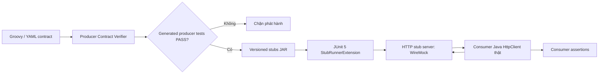
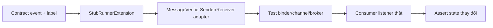
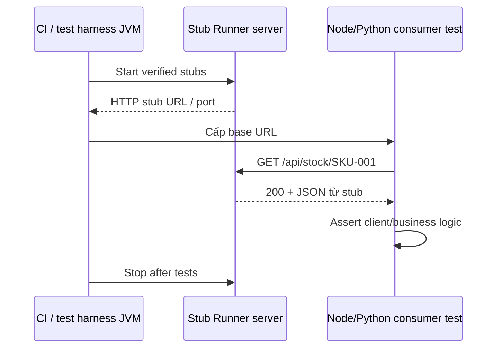
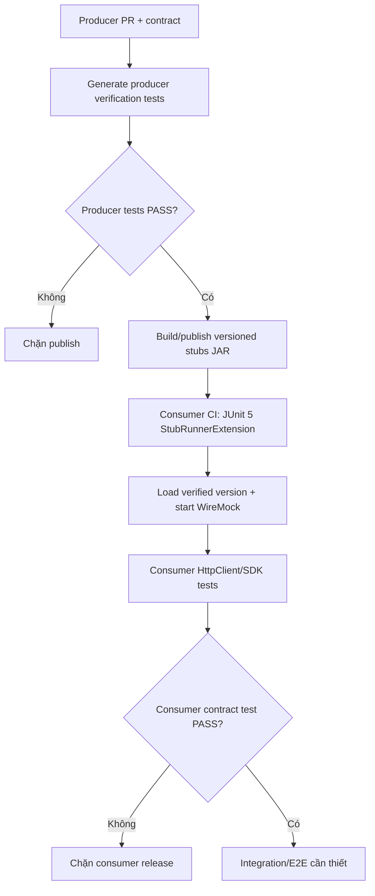

# StubRunnerExtension và cách dùng ngoài Spring test khi được hỗ trợ

> **Chương:** Stub Runner  
> **Module:** Spring Cloud Contract (`SPRING_CLOUD_CONTRACT`) — kiểm thử hợp đồng giữa producer và consumer bằng Groovy/YAML DSL cho HTTP hoặc thông điệp, sinh test phía producer, phát hành stub, dùng Stub Runner và tích hợp CI để phát hiện thay đổi API không tương thích.

## Mục tiêu học tập

Sau bài này, bạn có thể:

1. Giải thích **StubRunnerExtension** làm gì trong JUnit 5, khác gì với `@AutoConfigureStubRunner` và `StubRunnerRule`.
2. Phân biệt **không cần Spring ApplicationContext trong test** với **không cần thư viện Spring Cloud Contract** hoặc **chạy bên ngoài JVM**.
3. Chuẩn bị stub JAR do producer đã xác minh, khai báo tọa độ Maven và dùng chế độ `LOCAL` hoặc `REMOTE` phù hợp.
4. Viết consumer test JUnit 5 bằng **Java HttpClient** và `StubRunnerExtension`, không dùng `@SpringBootTest` hoặc Spring DI.
5. Tìm URL/cổng thực của stub bằng `findStubUrl(...)` thay vì hard-code một port cố định.
6. Hiểu cách khởi động và dừng stub theo vòng đời extension, cách debug mapping, xử lý lỗi thiếu artifact và các giới hạn của messaging stubs.
7. Đặt extension vào pipeline CI sao cho consumer test sử dụng **đúng phiên bản stub**, trong khi producer verification vẫn chạy độc lập và không bị bỏ qua.

## 1. Vì sao lại cần một Stub Runner không cần Spring test?

Tưởng tượng `checkout-service` gọi `inventory-service`:

```http
GET /api/stock/SKU-001 HTTP/1.1
Accept: application/json
```

Producer `inventory-service` cam kết trả:

```http
HTTP/1.1 200 OK
Content-Type: application/json

{
  "sku": "SKU-001",
  "available": true,
  "quantity": 4
}
```

Consumer có thể là:

- Một ứng dụng Spring Boot với `@SpringBootTest`.
- Một thư viện Java dùng `java.net.http.HttpClient`.
- Một ứng dụng JVM khác **không khởi động Spring ApplicationContext trong test**.
- Một ứng dụng không chạy trên JVM, chẳng hạn Node.js hoặc Python, có thể gọi **stub HTTP server được khởi động bằng quy trình bên ngoài**.

Không phải mọi consumer test đều cần dựng context Spring Boot, autowire `StubFinder` hoặc dùng `@AutoConfigureStubRunner`. Với JUnit 5, Spring Cloud Contract cung cấp `StubRunnerExtension` để test tự quản lý stub lifecycle theo cơ chế **JUnit extension**.

**Ranh giới thuật ngữ quan trọng:**

- **"Ngoài Spring test"** ở đây nghĩa là test **không phụ thuộc Spring TestContext/`@SpringBootTest`** để khởi động stubs.
- `StubRunnerExtension` **vẫn là API Java/JUnit thuộc Spring Cloud Contract**, và có các thư viện phụ thuộc ở runtime.
- Một chương trình Node.js/Python không thể trực tiếp gắn Java `@RegisterExtension`; nếu cần stub dùng chung từ những ứng dụng đó, hãy khởi động một **Stub Runner server/Boot application hoặc HTTP mock service bên ngoài** và gọi nó qua mạng.
- Producer có thể được viết bằng Spring hoặc một framework khác; điều cần thiết phía consumer là có **stub artifact tương thích**.

## 2. StubRunnerExtension nằm ở đâu trong luồng hợp đồng?

Producer định nghĩa request/response trong DSL, chạy Contract Verifier để đảm bảo code thật tuân thủ hợp đồng, rồi phát hành stub. Consumer lấy stub đã phát hành và test client của mình.



Các vai trò phải tách bạch:

| Thành phần | Chức năng | Điều nó không tự làm |
| --- | --- | --- |
| **Contract DSL** | Mô tả request/response hoặc message được cam kết | Không chạy code producer |
| **Contract Verifier** | Sinh và chạy test kiểm chứng producer | Không tự kiểm thử mọi client consumer |
| **Stub JAR** | Đóng gói hợp đồng/mapping mô phỏng để sử dụng lại | Không chứng minh producer pass nếu test đã bị skip |
| **StubRunnerExtension** | Tải/giải nén stubs, khởi động HTTP stub và quản lý vòng đời JUnit 5 | Không cần Spring context, nhưng cũng **không gọi producer thật** |
| **Consumer test** | Gửi request bằng client thật và kiểm tra xử lý response | Không kiểm tra kết nối tới production upstream |
| **Integration/E2E tests** | Bảo vệ thêm hạ tầng, service discovery, DB, broker, TLS | Không thay thế kiểm tra contract chi tiết |

Một consumer test xanh với stub version `1.0.0` chỉ chứng minh consumer có thể xử lý **hợp đồng của version ấy**. Producer version mới hơn vẫn phải được verification riêng.

## 3. So sánh ba cách khởi động Stub Runner

| Cách dùng | Test framework | Có cần Spring test context? | Cách quản lý lifecycle |
| --- | --- | --- | --- |
| `@AutoConfigureStubRunner` | Spring Boot/Spring Test + JUnit | **Thường có** | Spring test infrastructure |
| `StubRunnerExtension` + `@RegisterExtension` | **JUnit Jupiter (JUnit 5)** | **Không** | JUnit extension |
| `StubRunnerRule` + `@Rule` / `@ClassRule` | JUnit 4 | **Không** | JUnit rule |
| Stub Runner server bên ngoài test JVM | HTTP client bất kỳ | **Không trong consumer test** | Process/container/service riêng |

Bài học tập trung vào **dòng thứ hai**.

`StubRunnerExtension` là lựa chọn phù hợp khi test dùng Java/JUnit 5 mà **không cần tạo một Spring application context chỉ để chạy WireMock stubs**. Ví dụ bạn đang test một Java SDK, một module client độc lập hoặc code sử dụng `HttpClient` và DTO riêng.

Nó **không có nghĩa** mọi integration tự động của Spring Cloud đều hiện diện:

- Không tự autowire `@StubRunnerPort` vào POJO thông thường.
- Không tự thay địa chỉ của `RestTemplate`/`WebClient`/Feign client mà bạn khởi tạo bằng tay.
- Không tự tạo Spring `DiscoveryClient` hoặc bean/service discovery của ứng dụng nếu không có context tương ứng.
- Không tự dựng message binder/channel nếu chỉ thêm JUnit extension.

Bạn phải **lấy URL stub và đưa nó vào HTTP client đang kiểm thử**.

## 4. Chuẩn bị stub từ phía producer

Giả sử producer `inventory-producer` có Maven coordinates:

```text
groupId:    com.example
artifactId: inventory-producer
version:    1.0.0
classifier: stubs
```

Một contract YAML tối thiểu tại `src/test/resources/contracts/stock_available.yml`:

```yaml
name: stock_available
request:
  method: GET
  url: /api/stock/SKU-001
  headers:
    Accept: application/json

response:
  status: 200
  headers:
    Content-Type: application/json
  body:
    sku: SKU-001
    available: true
    quantity: 4
```

Cùng tình huống có thể biểu diễn bằng Groovy DSL:

```groovy
org.springframework.cloud.contract.spec.Contract.make {
    name 'stock_available'

    request {
        method 'GET'
        url '/api/stock/SKU-001'
        headers {
            header 'Accept': 'application/json'
        }
    }

    response {
        status 200
        headers {
            contentType(applicationJson())
        }
        body(
            sku: 'SKU-001',
            available: true,
            quantity: 4
        )
    }
}
```

**Chỉ lưu một trong hai phiên bản khi chạy build** nếu chúng biểu diễn cùng một scenario.

Producer cần cấu hình Spring Cloud Contract Maven/Gradle plugin để sinh test và stubs. Tại producer:

```bash
mvn clean verify
```

Sau khi generated producer tests **thực sự chạy và PASS**, cài artifact vào Maven local để consumer chạy `LOCAL`:

```bash
mvn clean install
```

Artifact thường có dạng:

```text
~/.m2/repository/com/example/inventory-producer/1.0.0/
  inventory-producer-1.0.0.pom
  inventory-producer-1.0.0.jar
  inventory-producer-1.0.0-stubs.jar
```

Đây là đường dẫn minh họa theo layout Maven local thông thường; thực tế `maven.repo.local` có thể thay đổi vị trí. Nếu thiếu `*-stubs.jar`, hãy xem cấu hình plugin và kết quả packaging.

**Điểm bảo vệ quan trọng:** không dùng `-DskipTests` rồi gọi artifact vừa tạo là **stub đã được producer xác minh**. Stub Runner không kiểm tra lại code producer ở phía consumer.

## 5. Dependencies trong dự án consumer JUnit 5

Ở consumer, bạn cần thư viện Stub Runner và JUnit Jupiter tương thích. Ví dụ fragment `pom.xml`:

```xml
<dependencies>
    <dependency>
        <groupId>org.springframework.cloud</groupId>
        <artifactId>spring-cloud-starter-contract-stub-runner</artifactId>
        <scope>test</scope>
    </dependency>

    <dependency>
        <groupId>org.junit.jupiter</groupId>
        <artifactId>junit-jupiter</artifactId>
        <scope>test</scope>
    </dependency>

    <!-- Khi InventoryClient nằm ở src/main/java, Jackson cần ở compile scope -->
    <dependency>
        <groupId>com.fasterxml.jackson.core</groupId>
        <artifactId>jackson-databind</artifactId>
    </dependency>
</dependencies>
```

Đây chỉ là **fragment**; project phải quản lý phiên bản dependency bằng BOM, parent hoặc version tường minh phù hợp. Spring Cloud Contract 5.x phù hợp với hệ Spring tương ứng; không trộn tùy tiện các version Boot/Cloud/Contract. Nếu BOM hiện dùng Jackson 3 thay vì Jackson 2, thay code/dependency JSON parser theo stack thực tế; phần test không bắt buộc dùng Jackson.

Để JUnit Jupiter phát hiện `@RegisterExtension`, cần test runner phù hợp (ví dụ Maven Surefire hỗ trợ JUnit Platform). Chạy `mvn test` và kiểm tra báo cáo thực sự có test, không chỉ thấy `BUILD SUCCESS`.

**Không cần đặt `@SpringBootTest` hay `@ExtendWith(SpringExtension.class)` trong lớp test dưới đây.** Spring Cloud Contract vẫn được dùng như một **thư viện test**; chỉ Spring application context không được khởi động.

## 6. Ví dụ cốt lõi: @RegisterExtension + HttpClient thuần Java

JUnit 5 cung cấp `@RegisterExtension` để đăng ký extension trong class test. Spring Cloud Contract cung cấp `StubRunnerExtension`; cách cấu hình cụ thể dùng **fluent API**.

### 6.1. Extension lấy stub từ Maven local

```java
@RegisterExtension
static StubRunnerExtension stubs = new StubRunnerExtension()
    .downloadStub("com.example:inventory-producer:1.0.0:stubs")
    .stubsMode(StubRunnerProperties.StubsMode.LOCAL);
```

Giải thích:

- `@RegisterExtension` là annotation **JUnit Jupiter**, không phải Spring Boot.
- `static` tạo extension ở cấp class; JUnit quản lý việc khởi động/dừng theo vòng đời extension class.
- `downloadStub(...)` chọn artifact bằng group, artifact, version và classifier.
- `LOCAL` tìm artifact trong Maven local đã được cài, không cần Nexus/Artifactory trong thử nghiệm offline.
- Nếu stub không tìm thấy, mặc định Stub Runner sẽ **fail** thay vì để test chạy qua mà không có mapping.

### 6.2. Tìm URL stub đã khởi động

Một sai lầm là hard-code `http://localhost:8090` rồi mặc định extension chạy đúng cổng đó.

Trong thực tế, Stub Runner có thể chọn cổng ngẫu nhiên trong khoảng được cấu hình. Hãy hỏi extension:

```java
URL baseUrl = stubs.findStubUrl(
    "com.example", "inventory-producer"
);
```

`findStubUrl(...)` là API của `StubFinder`, được `StubRunnerExtension` hỗ trợ. Nó trả URL như `http://localhost:12345` cho stub server đang chạy hoặc báo lỗi nếu không tìm thấy.

Bạn cũng có thể tìm bằng artifact ID khi tên duy nhất:

```java
URL baseUrl = stubs.findStubUrl("inventory-producer");
```

Nếu suite chạy nhiều artifact có cùng `artifactId` ở các group khác nhau, hãy **dùng hai đối số `groupId, artifactId`** để tránh nhầm stub.

### 6.3. Java HTTP client thật, không có Spring context

Đây là một consumer class nhỏ sử dụng Java 11+ `HttpClient`. Khi test, base URL được truyền từ extension; trong production, base URL đến từ cấu hình ứng dụng.

```java
package com.example.checkout;

import java.net.URI;
import java.net.http.HttpClient;
import java.net.http.HttpRequest;
import java.net.http.HttpResponse;
import java.nio.charset.StandardCharsets;
import java.time.Duration;

import com.fasterxml.jackson.databind.JsonNode;
import com.fasterxml.jackson.databind.ObjectMapper;

public final class InventoryClient {

    private final HttpClient http = HttpClient.newHttpClient();
    private final ObjectMapper mapper = new ObjectMapper();
    private final URI baseUri;

    public InventoryClient(URI baseUri) {
        this.baseUri = baseUri;
    }

    public Stock getStock(String sku) throws Exception {
        // Ví dụ tối giản dùng một SKU không chứa ký tự đặc biệt.
        URI endpoint = baseUri.resolve("/api/stock/" + sku);

        HttpRequest request = HttpRequest.newBuilder(endpoint)
            .GET()
            .header("Accept", "application/json")
            .timeout(Duration.ofSeconds(5))
            .build();

        HttpResponse<String> response = http.send(
            request,
            HttpResponse.BodyHandlers.ofString(StandardCharsets.UTF_8)
        );

        if (response.statusCode() != 200) {
            throw new IllegalStateException(
                "Inventory API status: " + response.statusCode()
            );
        }

        JsonNode body = mapper.readTree(response.body());
        return new Stock(
            body.path("sku").asText(),
            body.path("available").asBoolean(),
            body.path("quantity").asInt()
        );
    }

    public record Stock(
        String sku, boolean available, int quantity
    ) {}
}
```

**Giới hạn ví dụ:** với SKU chứa dấu cách, dấu `/` hoặc ký tự đặc biệt, client production cần **URI/path encoding** đúng cách. Việc dùng `JsonNode.path(...).asBoolean()/asInt()` ở đây giúp học luồng dữ liệu, nhưng có thể âm thầm chuyển một số giá trị sai kiểu; client production nên validate JSON schema hoặc dùng DTO mapping strict khi cần bảo vệ kiểu dữ liệu.

Nếu lớp client nằm trong `src/main/java` như ví dụ này, JSON parser là một dependency lúc biên dịch/chạy ứng dụng, không được khai báo chỉ ở `<scope>test</scope>`. Nếu chỉ dùng parser bên trong test code, mới có thể hạ dependency đó xuống phạm vi test.

### 6.4. JUnit test dùng extension để kiểm thử client

```java
package com.example.checkout;

import org.junit.jupiter.api.Test;
import org.junit.jupiter.api.extension.RegisterExtension;

import org.springframework.cloud.contract.stubrunner.spring.StubRunnerProperties;

import java.net.URI;

import static org.junit.jupiter.api.Assertions.assertEquals;
import static org.junit.jupiter.api.Assertions.assertTrue;

// Import StubRunnerExtension từ thư viện spring-cloud-contract-stub-runner
// theo package của phiên bản đang sử dụng.
class InventoryClientContractTest {

    @RegisterExtension
    static StubRunnerExtension stubs = new StubRunnerExtension()
        .downloadStub("com.example:inventory-producer:1.0.0:stubs")
        .stubsMode(StubRunnerProperties.StubsMode.LOCAL);

    @Test
    void checkoutDocDuocTonKhoTuStub() throws Exception {
        URI baseUri = stubs
            .findStubUrl("com.example", "inventory-producer")
            .toURI();

        InventoryClient client = new InventoryClient(baseUri);
        InventoryClient.Stock stock = client.getStock("SKU-001");

        assertEquals("SKU-001", stock.sku());
        assertTrue(stock.available());
        assertEquals(4, stock.quantity());
    }
}
```

Test này không có `@SpringBootTest`, không autowire Spring bean và không khởi động ứng dụng producer. Khi JUnit chạy:

1. `StubRunnerExtension` tìm artifact `inventory-producer:1.0.0:stubs`.
2. Stub Runner đọc mapping HTTP và khởi chạy WireMock stub server ở cổng được chọn.
3. Test lấy URL từ `findStubUrl(...)`.
4. **`InventoryClient` thật** gửi `GET /api/stock/SKU-001` cùng `Accept: application/json`.
5. WireMock trả response theo contract.
6. Test kiểm tra consumer đọc SKU, availability và quantity đúng.

**Lưu ý tích hợp:** đoạn import cho `StubRunnerExtension` được mô tả bằng chú thích vì package chính xác có thể khác giữa các dòng thư viện; IDE cần resolve class từ dependency phù hợp. Các đoạn code giả định cùng version Spring Cloud Contract và JUnit Jupiter đã được quản lý. Đây là ví dụ học thuật về cấu hình và luồng kiểm thử, chưa phải project build hoàn chỉnh.

### 6.5. Khác biệt quan trọng giữa kiểm tra stub và kiểm tra logic consumer

Nếu chỉ viết:

```java
assertEquals(200, httpResponse.statusCode());
```

thì bạn biết mock server trả `200`, **chưa chứng minh** consumer parse đúng JSON và xử lý hành vi kinh doanh. Trong bài trên, `InventoryClient` chuyển response thành `Stock`, test kiểm tra các field quan trọng.

Một test consumer chất lượng thường thử thêm:

- Trường `available: false` và logic hết hàng.
- `404` khi SKU không tồn tại.
- JSON lỗi hoặc thiếu field bắt buộc.
- Timeout hoặc lỗi mạng theo chính sách retry/fallback.
- Đổi kiểu `quantity` từ number sang string phải được phát hiện nếu đó là cam kết API.

Những tình huống ấy cần **contract/stub tương ứng** hoặc unit/integration test bổ sung; một contract thành công không tự bao phủ tất cả nhánh lỗi.

## 7. Vòng đời extension: static và instance

JUnit 5 cho phép `@RegisterExtension` trên field static hoặc instance, với vòng đời có thể khác nhau theo các callback được extension triển khai.

### Static extension

```java
@RegisterExtension
static StubRunnerExtension stubs = new StubRunnerExtension()
    .downloadStub("com.example:inventory-producer:1.0.0:stubs")
    .stubsMode(StubRunnerProperties.StubsMode.LOCAL);
```

Thích hợp khi các test trong class dùng **cùng tập stub**. Thường giảm chi phí khởi động so với việc tạo mới ở từng phương thức. Cần đảm bảo các test không sửa mapping/HTTP state của cùng WireMock server theo cách gây phụ thuộc thứ tự.

### Instance extension

```java
@RegisterExtension
StubRunnerExtension stubs = new StubRunnerExtension()
    .downloadStub("com.example:inventory-producer:1.0.0:stubs")
    .stubsMode(StubRunnerProperties.StubsMode.LOCAL);
```

Một số ví dụ tài liệu sử dụng field instance. Khi dùng instance, vòng đời cụ thể được JUnit/extension quyết định; có thể có chi phí startup cho từng test instance. Hãy kiểm tra hành vi thực tế của phiên bản đang dùng và lựa chọn tương ứng.

**Đừng đặt extension ngoài JUnit rồi giả định tự quản lý lifecycle.** `@RegisterExtension` cho JUnit biết nó cần gọi callback của extension; chỉ khởi tạo `new StubRunnerExtension()` trong một hàm thông thường chưa chắc tự động tải stubs hoặc dừng server.

### 7.1. Những rủi ro khi chạy song song

- Hai suite cùng yêu cầu **fixed port** có thể tranh cổng.
- Hai test cùng chỉnh WireMock mapping/state có thể ảnh hưởng nhau.
- Consumer test dùng một base URL global mutable có thể gửi nhầm stub giữa các test.
- Static extension trong class chia sẻ server; test cần tự tránh phụ thuộc vào state mutable.

Ưu tiên cổng được Stub Runner chọn, lấy bằng `findStubUrl(...)` và khởi tạo client với URL **riêng cho test**. Chỉ đặt fixed port khi tích hợp bắt buộc và đã có chiến lược tránh xung đột.

## 8. LOCAL, REMOTE và CLASSPATH: chọn đúng nguồn stubs

Stub Runner hỗ trợ nhiều chế độ tải stub. Tên enum trong API Spring Cloud Contract là `StubRunnerProperties.StubsMode`.

| Chế độ | Nguồn stub điển hình | Khi nào phù hợp | Rủi ro thường gặp |
| --- | --- | --- | --- |
| `LOCAL` | Maven local repository | Developer chạy producer `mvn install` trên cùng máy, test offline | Không có đúng artifact/version |
| `REMOTE` | Maven-compatible repository, hoặc URL/protocol được Stub Runner hỗ trợ | CI tách máy, Nexus/Artifactory hoặc repository riêng | Sai `repoRoot`, xác thực, network, version |
| `CLASSPATH` | Stub mappings/artifacts tìm thấy trên test classpath | Test có stubs được đưa vào classpath chủ động | Classpath thiếu hoặc có bản không mong muốn |

### 8.1. LOCAL

```java
@RegisterExtension
static StubRunnerExtension stubs = new StubRunnerExtension()
    .downloadStub("com.example:inventory-producer:1.0.0:stubs")
    .stubsMode(StubRunnerProperties.StubsMode.LOCAL);
```

Không gọi `repoRoot` khi chỉ muốn Maven local theo cấu hình mặc định. Nếu Maven đã dùng `-Dmaven.repo.local=...` hoặc custom settings, phải bảo đảm Stub Runner cũng nhìn vào cùng local repository.

### 8.2. REMOTE với Maven repository

```java
@RegisterExtension
static StubRunnerExtension stubs = new StubRunnerExtension()
    .downloadStub("com.example:inventory-producer:1.0.0:stubs")
    .repoRoot("https://repo.example.org/repository/verified-stubs/")
    .stubsMode(StubRunnerProperties.StubsMode.REMOTE);
```

Địa chỉ repository ở đây chỉ để minh họa. Trong CI, thay bằng địa chỉ kho thật do nhóm kiểm soát. Không đưa username/password hoặc bearer token thật vào source code hay log; truyền thông tin xác thực qua secret management và cơ chế cấu hình hỗ trợ.

`repoRoot(...)` là URL **kho chứa artifact/contract**, không phải URL của WireMock server. Stub Runner sẽ khởi chạy server **local** sau khi tải artifact; test lấy URL server từ `findStubUrl(...)`.

### 8.3. CLASSPATH

`CLASSPATH` dùng khi bạn đã bố trí stubs trên classpath theo layout và convention mà Stub Runner có thể nhận diện. Nó không có nghĩa `downloadStub(...)` tự tải một JAR từ Maven repository; với classpath mode, phần **đóng gói/đưa dependency vào test runtime** phải được chuẩn bị từ trước.

**Không dựa vào một default ngầm định** nếu test cần chạy tái lập trên máy khác. Khai báo mode và version rõ ràng để log CI dễ đọc.

## 9. Tọa độ stub và chọn phiên bản

Stub Runner hỗ trợ ký pháp kiểu Ivy:

```text
groupId:artifactId:version:classifier:port
```

Một số phần là tùy chọn trong API. Ví dụ:

```text
com.example:inventory-producer:1.0.0:stubs
com.example:inventory-producer:1.0.0:stubs:8090
com.example:inventory-producer
```

| Thành phần | Vai trò |
| --- | --- |
| `groupId` | Nhóm Maven của producer |
| `artifactId` | Tên artifact dịch vụ producer |
| `version` | Version stub cần dùng |
| `classifier` | Thường là `stubs` |
| `port` | Cổng WireMock nếu muốn cấu hình cố định |

Khi bỏ `version`, Stub Runner có thể dùng một version động như `+` để tìm bản phù hợp mới nhất. Điều đó hữu ích ở một số pipeline kiểm tra tương thích **mới nhất**, nhưng khiến test không tái lập hoàn toàn nếu artifact mới xuất hiện trong repository.

**Với CI release, nên pin version** và lưu lại tọa độ artifact được dùng. Khi nâng producer, consumer có thể chọn kiểm tra thêm một version candidate bên cạnh bản đang chạy.

### 9.1. Không nhầm số version với số cổng

Trong:

```text
com.example:inventory-producer:1.0.0:stubs:8090
```

`1.0.0` là version, `stubs` là classifier, `8090` là cổng HTTP mong muốn. Khi sử dụng `findStubUrl(...)`, test không cần biết trước port nên thường **không cần** thêm trường cổng.

## 10. Nhiều stub trong cùng một JUnit extension

Giả sử `checkout-service` gọi `inventory-producer` và `pricing-producer`. Có thể cấu hình một extension quản lý cả hai:

```java
@RegisterExtension
static StubRunnerExtension stubs = new StubRunnerExtension()
    .downloadStub("com.example:inventory-producer:1.0.0:stubs")
    .downloadStub("com.example:pricing-producer:1.0.0:stubs")
    .stubsMode(StubRunnerProperties.StubsMode.LOCAL);
```

Trong test:

```java
URI inventoryBase = stubs
    .findStubUrl("com.example", "inventory-producer")
    .toURI();

URI pricingBase = stubs
    .findStubUrl("com.example", "pricing-producer")
    .toURI();
```

Mỗi dependency thường có **một HTTP stub server riêng**, cổng được cấp riêng. Đừng lấy URL `inventory-producer` rồi gửi request pricing vào đó.

`StubRunnerExtension` cung cấp thêm API:

```java
stubs.findAllRunningStubs();
```

Nó giúp kiểm tra tập stub đang được khởi động. Nếu test không tìm thấy artifact mong đợi, xem thông tin này trước khi giả định URL cố định đúng.

### 10.1. Chỉ định port cố định khi thật sự cần

Fluent API còn hỗ trợ:

```java
@RegisterExtension
static StubRunnerExtension stubs = new StubRunnerExtension()
    .downloadStub("com.example:inventory-producer:1.0.0:stubs")
    .withPort(8090)
    .stubsMode(StubRunnerProperties.StubsMode.LOCAL);
```

`withPort(...)` gắn cổng cho stub vừa khai báo. Nếu port 8090 bị chiếm bởi một service khác, extension có thể không khởi động được. Đó là lý do test tự động thường **ưu tiên port động**.

## 11. Tìm và debug những mapping thật sự được nạp

Một lỗi hay gặp: `findStubUrl(...)` trả URL hợp lệ, test gọi HTTP vẫn nhận `404`. Điều này có thể là vì WireMock **không có mapping nào khớp request**, không nhất thiết vì server không chạy.

Các yếu tố thường là điều kiện matching:

- HTTP method (GET/POST/PUT).
- URL/path/query parameters.
- `Accept`, `Content-Type` và header nghiệp vụ.
- Request JSON body và các matcher JSONPath/regex.
- Stub artifact/version chứa đúng scenario hay không.

### 11.1. Xuất mappings để điều tra

Theo tài liệu chính thức, extension có fluent method `withMappingsOutputFolder(...)`:

```java
@RegisterExtension
static StubRunnerExtension stubs = new StubRunnerExtension()
    .downloadStub("com.example:inventory-producer:1.0.0:stubs")
    .stubsMode(StubRunnerProperties.StubsMode.LOCAL)
    .withMappingsOutputFolder("target/stub-runner-mappings");
```

Sau khi chạy, kiểm tra thư mục output tương ứng: Stub Runner có thể ghi lại các WireMock mappings và thông tin cổng cho artifact. Tên thư mục con và file phụ thuộc plugin/version.

**Trong bài này, chỉ đọc mapping từ output khi bạn thực hành ở project thật.** Cần so method, path, headers, body với HTTP request consumer thực sự gửi.

### 11.2. Quan sát request thực

Ngoài mappings, có thể:

- Log URI cuối cùng do Java HttpClient gọi (tránh ghi token/secret).
- Ghi status/header/body response của stub khi test thất bại.
- Sử dụng endpoint quản trị/debugging của WireMock **trên server local do test sở hữu**, nếu được bật và chính sách bảo mật cho phép.
- So sánh với DSL gốc, không tự sửa matcher quá rộng chỉ để 404 biến mất.

Nếu producer trả JSON đúng nhưng consumer gửi `Accept: text/plain` còn stub đòi `Accept: application/json`, WireMock có thể trả `404`. Điều này là tín hiệu test client gửi request không khớp contract, dù application thật có thể xử lý một số biến thể khác. Hãy quyết định **hợp đồng nào thực sự được cam kết** trước khi nới header.

## 12. Không có Spring context: những gì bạn phải tự cấu hình

So với `@AutoConfigureStubRunner` trong Spring Boot test, JUnit extension cho bạn ít "phép màu" hơn nhưng kiểm soát rõ ràng hơn.

| Mối quan tâm | Spring test với annotation | JUnit 5 extension thuần |
| --- | --- | --- |
| Khởi động Stub Runner | `@AutoConfigureStubRunner` | `@RegisterExtension` |
| Tìm cổng stub | Có thể qua `@StubRunnerPort`/Spring Environment | `stubs.findStubUrl(...)` |
| Cấu hình HTTP client | Bean/property injection | Truyền `URI` vào constructor/client |
| Spring `DiscoveryClient`/LoadBalancer | Có thể được Stub Runner Spring Cloud tích hợp | Không tự xuất hiện |
| Quản lý application context | Spring TestContext | Không cần |
| HTTP mappings | WireMock stubs | WireMock stubs |
| Messaging | Cấu hình broker/binder/Spring integration tương ứng | Cần wiring verifier sender/receiver rõ ràng |

Đây là lý do nên dùng **dependency injection bằng constructor**, ngay cả khi không dùng Spring. Một client với constructor `InventoryClient(URI baseUri)` dễ test hơn client hard-code URL production hoặc đọc một global system property bất kỳ.

### 12.1. Khi nào nên quay lại Spring Boot test?

Nếu mục tiêu là kiểm tra chính **bean wiring**, Feign client qua discovery, filter, load balancer hoặc application configuration của consumer, test JUnit thuần không bao phủ đủ. Khi ấy hãy dùng `@SpringBootTest`/`@AutoConfigureStubRunner` hoặc một integration test consumer phù hợp.

Ngược lại, nếu chỉ muốn kiểm tra một Java SDK HTTP client và cách parse response, dựng toàn bộ Spring Boot context có thể tốn thời gian mà không bổ sung nhiều giá trị.

## 13. Messaging với StubRunnerExtension: không tự động giống HTTP

Phần HTTP của extension tương đối trực tiếp: Stub Runner đọc mappings và chạy HTTP stub servers. Với **messaging**, contract có thể có `input`, `outputMessage`, destination và `label` để kích hoạt message.

Tài liệu Stub Runner JUnit Rule/Extension yêu cầu cung cấp **implementation của `MessageVerifierSender` và `MessageVerifierReceiver`** khi sử dụng messaging theo tích hợp tương ứng.

Điểm cần hiểu:

- JUnit extension **không tự tạo Kafka broker, RabbitMQ exchange, Spring Cloud Stream binder hay consumer listener**.
- Nếu bạn gọi trigger message mà chưa cung cấp sender/receiver hoặc message infrastructure tương thích, thao tác có thể ném exception.
- Các loại integration hỗ trợ và chữ ký builder cần được kiểm tra theo phiên bản Spring Cloud Contract đang dùng; tài liệu có ví dụ như `messageVerifierSender(new MyMessageVerifierSender())`.
- Stub Runner phải biết **đưa event vào đâu**, còn consumer test phải kiểm chứng listener/handler thật đã xử lý payload.
- Chỉ thấy `stubTrigger.trigger(label)` trả thành công **không** chứng minh consumer đã thực hiện nghiệp vụ.

`StubFinder` kế thừa `StubTrigger`, vì vậy extension có thể hỗ trợ gọi `stubs.trigger("order_accepted")` khi các message stubs và adapter tương ứng đã được thiết lập. Cần xác minh listener/handler thật của consumer đã nhận message và cập nhật trạng thái mong đợi; chỉ gọi `trigger` chưa phải một assertion nghiệp vụ. Ví dụ này **không chạy được với HTTP-only configuration** nếu chưa có sender/receiver và message infrastructure.

Ví dụ sơ đồ:



Đây là trường hợp **"khi được hỗ trợ"** của tiêu đề: ngoài Spring TestContext, HTTP stubs là ứng dụng điển hình. Messaging cần **tích hợp bổ sung**; không giả định chỉ đổi JUnit annotation là đủ.

## 14. Không phải JVM consumer? Cách tiếp cận khác

`StubRunnerExtension` không được import trực tiếp trong Node.js/Python. Tuy nhiên, **stub HTTP endpoint** của Spring Cloud Contract có thể được sử dụng bởi ứng dụng ở ngôn ngữ khác, nếu một JVM process chịu trách nhiệm khởi động stubs.

Các lựa chọn:

1. Chạy một JUnit test harness hoặc chương trình JVM điều phối stub HTTP server theo lifecycle test — cần quản lý URL/port, startup/shutdown rõ ràng.
2. Dùng **Stub Runner Boot/Standalone server** theo tài liệu, khởi động như một test utility riêng rồi cho consumer ngoài JVM gọi địa chỉ HTTP của các WireMock stubs.
3. Nếu đã có JSON WireMock mappings, sử dụng WireMock standalone/container tương thích để mô phỏng endpoint, theo chính sách quản lý artifact của nhóm.



**Bảo mật:** Stub Runner Boot là tiện ích phục vụ test, không được thiết kế như một public production API. Không mở stub admin/server trên mạng không tin cậy hoặc để bản không bảo vệ truy cập tới artifact nội bộ.

Với producer không dùng Spring Boot, một producer JVM/non-JVM vẫn có thể phát hành stubs tương thích với WireMock và cung cấp hợp đồng để consumer test. Tuy nhiên cần có **bước verification của producer thật** trong framework/ngôn ngữ tương ứng, không đơn giản coi JAR stub tồn tại là đủ.

## 15. Fail khi không có stub: một cổng kiểm soát quan trọng

Theo tài liệu Spring Cloud Contract, mặc định Stub Runner **thất bại khi không có stub**. Có thể vô hiệu hóa:

```java
.withFailOnNoStubs(false)
```

Nhưng với consumer contract test trong CI, **không nên** chọn `false` chỉ để build xanh khi artifact chưa được publish. Hậu quả có thể là consumer test chạy mà không kiểm chứng được hợp đồng với producer.

Quy tắc:

- Bật/giữ fail on no stubs khi thiếu artifact có nghĩa là **thiếu điều kiện kiểm thử**.
- Nếu project thật sự có scenario tùy chọn, mô tả rõ lý do và tách test optional khỏi quality gate bắt buộc.
- Kiểm tra log xem WireMock mappings **thật sự được nạp**, không chỉ thấy HTTP server khởi động.
- Thử cố ý đổi version sang một version không tồn tại và xác nhận test FAIL thay vì âm thầm bỏ qua.

## 16. Những lỗi thường gặp khi dùng extension

| Triệu chứng | Nguyên nhân có thể | Cách xử lý |
| --- | --- | --- |
| Compiler không tìm thấy `StubRunnerExtension` | Thiếu dependency hoặc import/version không đúng | Kiểm tra starter stub runner, JUnit Jupiter và class có sẵn trong phiên bản đang dùng |
| `@RegisterExtension` không kích hoạt | JUnit Vintage/JUnit 4 runner, thiếu JUnit Platform | Bảo đảm test chạy bằng JUnit Jupiter |
| Không tìm thấy `*-stubs.jar` ở `LOCAL` | Producer chưa install, sai tọa độ, Maven repo local khác | Kiểm tra group/artifact/version/classifier và location |
| `REMOTE` không tải được artifact | Sai `repoRoot`, credentials, SSL, network | Kiểm tra repository URL và secrets CI |
| `findStubUrl` không tìm được | Không tải stub, nhầm artifactId/groupId | Kiểm tra `findAllRunningStubs()` |
| Cổng bị chiếm | Dùng `withPort(...)` trùng service khác | Dùng port động và `findStubUrl` |
| Stub trả `404` | Mapping không khớp method/path/header/body | Xuất mappings, so HTTP request thật |
| `200` nhưng consumer parse lỗi | DTO/JSON typing sai hoặc client parse chưa strict | Assert body/DTO và dữ liệu nghiệp vụ |
| Test xanh với stub cũ, production hỏng | Consumer pin version cũ hoặc producer chưa verifier | Chạy producer verification, kiểm soát release/version |
| Test không chạy, build vẫn xanh | Test bị skip hoặc runner không phát hiện | Kiểm tra Surefire reports và số tests |
| Messaging trigger thất bại | Thiếu sender/receiver/binder | Cấu hình messaging integration đúng version |
| Test liên quan discovery khác hành vi Spring app | Không có Spring context/discovery integration | Nâng lên Spring test với annotation khi cần |
| Test chạy song song flaky | Fixed port/shared state | Cô lập lifecycle và port động |

## 17. Thiết kế CI với StubRunnerExtension

Một pipeline hai phía minh họa:



Các nguyên tắc triển khai:

1. **Producer**: chạy Contract Verifier và các test cần thiết trước khi publish; không phát hành stub như bằng chứng tương thích nếu producer tests bị skip.
2. **Artifact**: dùng tọa độ version cụ thể; lưu thông tin artifact đã verify và repository đích.
3. **Consumer**: gọi extension ở JUnit 5, lấy URL động, tạo HTTP client với URL đó; test phải có assertions trên output nghiệp vụ.
4. **CI độc lập**: runner consumer thường không chia sẻ `~/.m2` với producer. Publish lên repository và dùng `REMOTE` hoặc chuyển artifact hợp lệ giữa các job.
5. **Test reports**: kiểm tra số test JUnit thực thi; không để build `0 tests` được coi như kết quả chấp nhận.
6. **Debug**: lưu log/mapping khi lỗi, tránh ghi secret, không tự sửa contract theo implementation sai chỉ để test xanh.
7. **Kết quả**: Stub Runner test xanh là bằng chứng **consumer phù hợp stub đã chọn**, không phải chứng cứ toàn bộ hệ thống production vẫn kết nối được.

Ví dụ các bước Maven:

```bash
# Producer: khi plugin và verification tests đã được cấu hình
mvn clean verify
mvn clean install

# Consumer: sau khi stub artifact đã được cài/tải đúng version
mvn test
```

Không phải cứ chạy các lệnh trên là tự tạo được project mẫu; cần project producer có controller/service, Contract Verifier và dữ liệu test tương ứng. Bài này chủ yếu minh họa **consumer-side extension**.

## 18. Bài tập thực hành

**Bài 1 — Nhận diện đúng cơ chế.** Một thư viện Java không có Spring Boot context nhưng dùng JUnit 5 cần gọi API tồn kho. Nên chọn `@AutoConfigureStubRunner` hay `StubRunnerExtension`? Giải thích dependency nào vẫn cần và dependency nào không cần khởi động.

**Bài 2 — Chạy offline.** Producer đã chạy `mvn clean install` và có `com.example:inventory-producer:1.0.0:stubs` trong Maven local. Viết `@RegisterExtension` dạng `LOCAL` và lấy `URI` qua `findStubUrl`.

**Bài 3 — Cố ý phá contract.** Producer mới trả `quantity: "4"` thay vì `quantity: 4`. Nếu consumer dùng JSON parser permissive, có thể test vẫn xanh không? Nêu cách nâng assertion để phát hiện sai kiểu trước khi release.

**Bài 4 — Hai dependencies.** Consumer đồng thời gọi inventory và pricing. Cấu hình một extension tải cả hai stubs; lấy URL riêng từng service, không hard-code port.

**Bài 5 — Chẩn đoán 404.** `findStubUrl` trả một địa chỉ nhưng `GET /api/stock/SKU-001` nhận 404. Nêu ít nhất năm chi tiết cần đối chiếu giữa request và WireMock mappings.

**Bài 6 — LOCAL so với REMOTE.** CI producer và CI consumer ở hai container độc lập. Vì sao `LOCAL` có thể fail dù producer build thành công ở job khác? Thiết kế cách chuyển artifact hoặc dùng `REMOTE`.

**Bài 7 — Không có stub.** Một developer thêm `withFailOnNoStubs(false)` để CI không đỏ. Phân tích rủi ro và cách kiểm chứng test đã nạp đúng artifact.

**Bài 8 — Không phải JVM.** Ứng dụng Node.js muốn kiểm thử HTTP client với stubs do Spring Cloud Contract sinh ra. Giải thích tại sao không thể dùng `@RegisterExtension` trực tiếp và mô tả một phương án chạy stub server bên ngoài.

**Bài 9 — Messaging.** Contract có `label: order_accepted`. Nếu chỉ có `StubRunnerExtension` với HTTP setup, còn thiếu những thành phần nào để consumer listener nhận event? Nêu lý do cần `MessageVerifierSender`/`MessageVerifierReceiver` và binder/broker adapter.

### Đáp án gợi ý

1. Dùng `StubRunnerExtension` của JUnit 5, không cần `@SpringBootTest`; vẫn có thư viện Stub Runner và JUnit Jupiter.
2. `@RegisterExtension static StubRunnerExtension ...` với `downloadStub("com.example:inventory-producer:1.0.0:stubs")`, `LOCAL` và `findStubUrl("com.example", "inventory-producer")`.
3. Có thể nếu parser âm thầm ép kiểu; dùng JSON parser/DTO mapping strict hoặc assertion kiểm tra kiểu của field `quantity`.
4. Gọi `downloadStub(...)` hai lần, dùng `findStubUrl(...)` cho từng artifact.
5. Method, path, query, `Accept`, `Content-Type`, body request, version/classifier và mapping được nạp.
6. Mỗi container có local repo riêng; publish artifact ra Maven repository hoặc truyền artifact qua job theo cơ chế CI.
7. Không có stub có thể đồng nghĩa test mất ý nghĩa; giữ fail mặc định, kiểm tra mapping và request thực.
8. Chạy Stub Runner Boot/HTTP server hoặc WireMock standalone dưới test harness/container, cung cấp base URL cho client Node.js.
9. Cần wiring messaging và adapter sender/receiver, listener/handler test, destination/label tương ứng; extension không tự dựng broker.

## 19. Tổng kết

`StubRunnerExtension` là giải pháp **JUnit 5** để tải, giải nén và chạy **stub artifact** từ Spring Cloud Contract mà **không yêu cầu Spring application context trong consumer test**. Nó phù hợp cho Java SDK, HTTP client thuần JVM hoặc component test cần WireMock từ hợp đồng đã phát hành.

Điểm trọng tâm là **`@RegisterExtension` + `downloadStub(...)` + `stubsMode(...)` + `findStubUrl(...)`**. Dùng `LOCAL` khi stub có trong Maven local, `REMOTE` khi artifact nằm ở kho có thể truy cập, và chọn version cố định để CI tái lập. JUnit extension không tự inject Spring beans hay kết nối message broker; với messaging và hệ không phải JVM cần cấu hình/tiện ích ngoài phù hợp.

Trong quy trình **producer–consumer contract testing**, producer phải được kiểm chứng trước khi phát hành stub; consumer dùng StubRunnerExtension để test HTTP client trên **stub đã chọn**, sau đó integration/E2E tests tiếp tục kiểm tra những đặc tính ngoài phạm vi hợp đồng.

## Tài liệu tham khảo

- [Spring Cloud Contract — Stub Runner JUnit Rule and JUnit5 Extension](https://docs.spring.io/spring-cloud-contract/reference/project-features-stubrunner/stub-runner-junit.html): `@RegisterExtension`, fluent API, `StubFinder`, messaging và vòng đời stub.
- [Spring Cloud Contract — Stub Runner Core](https://docs.spring.io/spring-cloud-contract/reference/project-features-stubrunner/stub-runner-core.html): nguồn stub, HTTP servers, mapping và cách chạy.
- [Spring Cloud Contract — Non-Spring Applications](https://docs.spring.io/spring-cloud-contract/reference/using/provider-contract-testing-non-spring.html): producer/consumer không cần Spring test context, JUnit extension.
- [Spring Cloud Contract — Fail On No Stubs](https://docs.spring.io/spring-cloud-contract/reference/project-features-stubrunner/stub-runner-fail-on-no-stubs.html): hành vi khi không tìm thấy artifact.
- [Spring Cloud Contract — Stubs Protocol](https://docs.spring.io/spring-cloud-contract/reference/project-features-stubrunner/stub-runner-stubs-protocol.html): lấy stubs từ đường dẫn tùy chỉnh.
- [Spring Cloud Contract — Generate Stubs at Runtime](https://docs.spring.io/spring-cloud-contract/reference/project-features-stubrunner/stub-runner-generate-stubs-at-runtime.html): lựa chọn khi chỉ có contract definitions.
- [Spring Cloud Contract — Getting Started](https://docs.spring.io/spring-cloud-contract/reference/getting-started/first-application.html): producer verification và consumer stubs.
- [JUnit 5 — User Guide](https://docs.junit.org/current/user-guide/): `@RegisterExtension` và JUnit Jupiter extension lifecycle.
