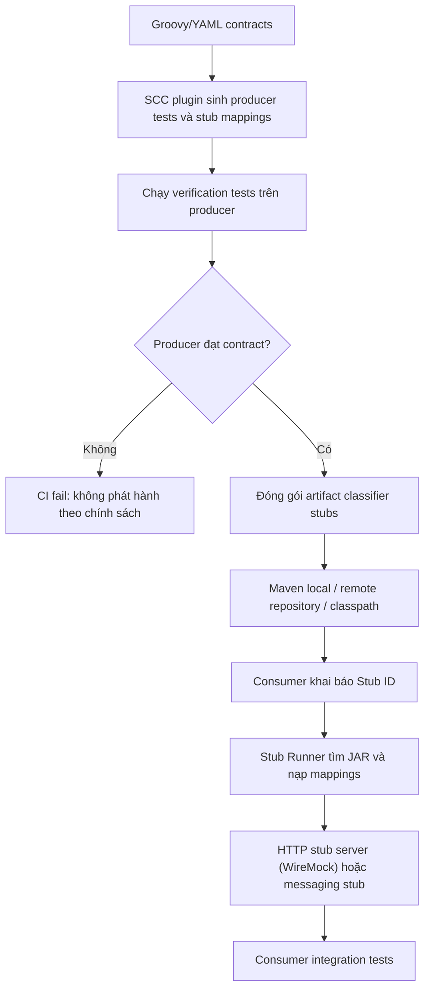
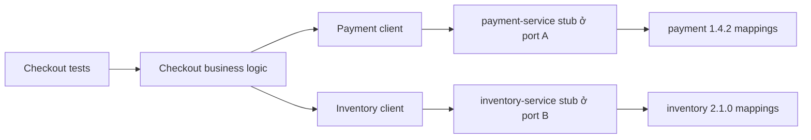
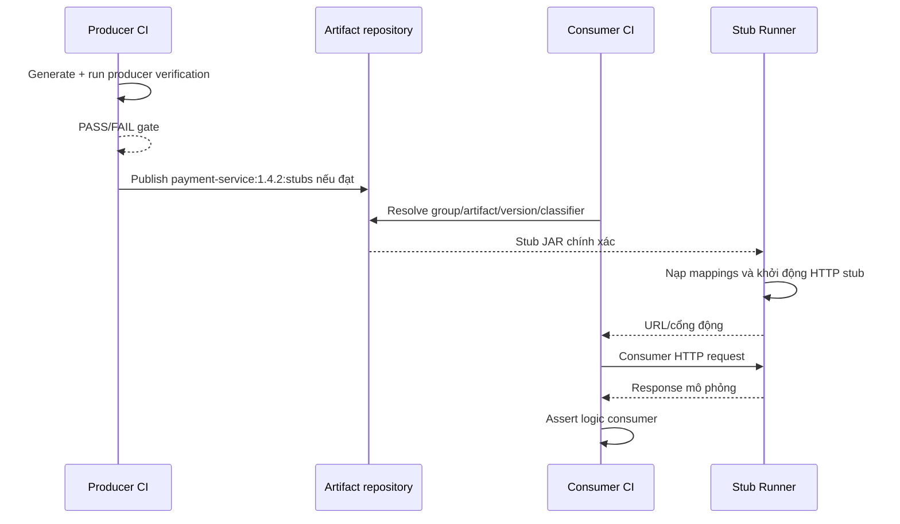

# Khai báo stub ID và tọa độ artifact

## 1. Stub Runner cần biết chạy “bản mô phỏng của ai”

Trong kiến trúc microservices, **producer** cung cấp một API HTTP hoặc phát thông điệp, còn **consumer** gọi API/nhận message đó. **Spring Cloud Contract (SCC)** giúp hai nhóm thỏa thuận hành vi bằng **Groovy/YAML DSL**. Từ hợp đồng, producer có thể sinh **verification tests** và **stub artifact**; phía consumer dùng **Stub Runner** để tải, khởi động và sử dụng các stub trong kiểm thử. CI có thể dựa vào kết quả này để phát hiện sớm những thay đổi API không tương thích.

Giả sử `checkout-service` (consumer) gọi `payment-service` (producer). Khi kiểm thử checkout, nhóm không nhất thiết muốn khởi động payment service thật, database của payment hay môi trường thanh toán. Thay vào đó, Stub Runner có thể khởi chạy một HTTP stub (thường sử dụng WireMock) với request/response được tạo từ hợp đồng.

Tuy nhiên, Stub Runner phải được chỉ rõ:

- **Artifact nào** chứa stub của producer cần mô phỏng?
- **Version nào** của artifact đó?
- **Classifier nào** phân biệt stub JAR với ứng dụng JAR?
- Nếu dùng HTTP, **cổng nào** dành cho stub server?
- Artifact được lấy từ **classpath**, **Maven local repository** hay **artifact repository từ xa**?

Những câu hỏi này được giải quyết bằng **stub ID** (còn gọi là **Ivy notation ID** trong tài liệu SCC) kết hợp với cấu hình chế độ tải stub.

**Mục tiêu bài học:** đọc và viết chính xác tọa độ `groupId:artifactId:version:classifier:port`; phân biệt tọa độ Maven artifact và địa chỉ HTTP stub; cấu hình `@AutoConfigureStubRunner` hoặc `application-test.yml`; xử lý cổng động, phiên bản và classifier; đồng thời tích hợp việc phát hành/tải stub vào CI theo đúng ranh giới bằng chứng.

> **Nguyên tắc:** Stub ID định danh **gói mô phỏng cần nạp**, không định danh trực tiếp URL của producer đang chạy, không phải tên controller và cũng không tự bảo đảm implementation producer hiện tại tuân thủ hợp đồng.

## 2. Từ contract của producer tới stub artifact của consumer

Một chuỗi xử lý điển hình:



Có ba loại đối tượng phải phân biệt:

| Đối tượng | Ví dụ | Vai trò |
|---|---|---|
| **Source contract** | `src/test/resources/contracts/payment-created.yml` | Mô tả request/response hoặc input/outputMessage |
| **Producer application artifact** | `payment-service-1.4.2.jar` | Chương trình ứng dụng producer thực |
| **Stub artifact** | `payment-service-1.4.2-stubs.jar` | Các mapping/contract mà Stub Runner có thể nạp |

Đừng lấy ứng dụng JAR thông thường rồi coi nó đương nhiên là stub JAR. Hai artifact có thể cùng `groupId`, `artifactId` và `version` nhưng có **classifier** khác nhau.

Ngoài HTTP, Stub Runner còn hỗ trợ các tích hợp **messaging**, trong đó hành vi khởi động/kích hoạt stub có thể khác HTTP WireMock. Tuy nhiên, nguyên tắc chọn đúng artifact và version vẫn quan trọng.

### 2.1. Vì sao tên service chưa đủ?

Trong một tổ chức có thể có:

- `com.acme.billing:payment-service`
- `com.acme.sandbox:payment-service`

Hai artifact cùng `artifactId = payment-service` nhưng khác **groupId**. Nếu chỉ gọi “payment-service” mà không xác định tọa độ, nhóm có thể nạp nhầm gói của sản phẩm/môi trường khác.

**Trong CI và tài liệu hợp đồng**, ưu tiên **tọa độ đầy đủ** để người khác biết chính xác producer nào và phiên bản nào đang được kiểm thử.

## 3. Cú pháp Stub Runner ID: năm thành phần

Theo tài liệu Spring Cloud Contract Stub Runner, dạng đầy đủ là:

```text
groupId:artifactId:version:classifier:port
```

Ví dụ:

```text
com.acme.billing:payment-service:1.4.2:stubs:18080
```

| Thành phần | Giá trị ví dụ | Ý nghĩa | Có thể bỏ qua? |
|---|---|---|---|
| `groupId` | `com.acme.billing` | Nhóm Maven của producer | Nên khai báo đầy đủ để tránh mơ hồ |
| `artifactId` | `payment-service` | Tên Maven artifact được producer phát hành | Thành phần cốt lõi |
| `version` | `1.4.2` | Artifact version được chọn | **Có**; khi bỏ qua có thể được hiểu là `+` |
| `classifier` | `stubs` | Phân loại stub artifact, khác main JAR | **Có**; mặc định là `stubs` |
| `port` | `18080` | Cổng HTTP stub server được khởi động | **Có**; sẽ chọn một cổng động |

**Lưu ý:** `port` thuộc **stub server**, không phải cổng HTTP của producer đang chạy. `version` thuộc **stub artifact**; nó cũng không phải version của thư viện `spring-cloud-starter-contract-stub-runner`.

### 3.1. Các cách viết thường gặp

```text
# Đầy đủ: rõ nhóm, artifact, version, classifier, port
com.acme.billing:payment-service:1.4.2:stubs:18080

# Giữ version và classifier, dùng cổng động
com.acme.billing:payment-service:1.4.2:stubs

# Không ghi classifier và port: dùng classifier mặc định
com.acme.billing:payment-service:1.4.2

# Không chốt version: chọn version mới nhất có thể phân giải
com.acme.billing:payment-service

# Ghi version động '+' nhưng vẫn chỉ rõ classifier/port
com.acme.billing:payment-service:+:stubs:18080

# Dùng classifier tùy chỉnh do producer thực sự phát hành
com.acme.billing:payment-service:1.4.2:consumer-stubs:18080
```

Tài liệu Stub Runner nêu **`version`, `classifier` và `port` là tùy chọn**. Khi không ghi version, hệ thống có thể dùng `+` để phân giải bản mới nhất. Khi không ghi classifier, mặc định là `stubs`. Khi không ghi port, Stub Runner chọn cổng động trong dải cấu hình.

**Đừng áp dụng ví dụ classifier tùy chỉnh `consumer-stubs` nếu producer chưa thực sự đóng gói artifact cùng classifier đó.** Tọa độ nhìn hợp lệ nhưng không có file tương ứng vẫn dẫn đến lỗi không tìm thấy stubs.

### 3.2. Stub ID khác Maven GAV như thế nào?

Maven thường định danh dependency bằng **GAV**: `groupId:artifactId:version`. Stub Runner mở rộng cách khai báo bằng `classifier` và **`port`**:

```text
Maven dependency identity:
  com.acme.billing:payment-service:1.4.2:stubs
                                           ^ classifier

Stub Runner runtime ID:
  com.acme.billing:payment-service:1.4.2:stubs:18080
                                                 ^ HTTP stub port
```

**Port không bao giờ là thành phần của Maven artifact được lưu trong repository.** Maven repository không có artifact “payment-service phiên bản 18080”; cổng chỉ là cách chạy HTTP stub tại thời điểm test.

### 3.3. Đừng nhầm dấu hai chấm trong URL và ID

```text
Stub ID: com.acme.billing:payment-service:1.4.2:stubs:18080
HTTP URL: http://localhost:18080/api/payments/PAY-42
```

Hai chuỗi phục vụ hai giai đoạn khác nhau: ID giúp **tải/khởi động** stub; URL giúp **consumer gửi HTTP request** tới stub đã khởi động.

## 4. Stub artifact được đóng gói và tìm thấy thế nào?

Ví dụ producer có Maven coordinates:

```xml
<groupId>com.acme.billing</groupId>
<artifactId>payment-service</artifactId>
<version>1.4.2</version>
```

Khi plugin/build phù hợp sinh và gắn stub JAR với classifier mặc định, artifact thường có tên:

```text
payment-service-1.4.2-stubs.jar
```

Trong Maven local repository, đường dẫn có thể là:

```text
~/.m2/repository/com/acme/billing/payment-service/1.4.2/
    payment-service-1.4.2.jar
    payment-service-1.4.2.pom
    payment-service-1.4.2-stubs.jar
```

**Đây là đường dẫn minh họa** khi local repository dùng layout Maven mặc định. Build thực tế phải được cấu hình để **sinh và phát hành stub artifact**; chỉ có POM khai báo `groupId`/`artifactId` không tự bảo đảm file `-stubs.jar` được tạo.

Thông thường, stub JAR chứa những **WireMock mappings** và/hoặc contract definitions được đặt theo cấu trúc mà Stub Runner nhận diện. Đối với chế độ classpath, cấu trúc bên trong JAR và tên nhóm/artifact đặc biệt quan trọng.

### 4.1. Phát hành artifact đúng thời điểm

Ở producer, luồng có ích là:

1. Viết contract theo yêu cầu consumer.
2. SCC plugin sinh producer verification tests và stub definitions.
3. **Chạy producer tests** trên commit/build hiện tại.
4. Khi đạt CI gate, đóng gói và `install` (để thử local) hoặc `deploy` (để chia sẻ qua repository) stub artifact tương ứng.
5. Consumer chỉ định **đúng tọa độ** trong Stub Runner.

Nếu producer **bỏ qua contract tests** rồi phát hành `-stubs.jar`, consumer vẫn có thể test xanh với stub nhưng không có bằng chứng producer implementation đang đáp ứng contract. Quy tắc phát hành cần do nhóm thiết kế và được CI thực thi, không nên chỉ dựa vào việc file JAR tồn tại.

## 5. Ba cách lấy stub: `CLASSPATH`, `LOCAL`, `REMOTE`

`stubsMode` chỉ định nguồn mà Stub Runner dùng để tìm definitions.

| Chế độ | Stub được lấy từ đâu? | Phù hợp với | Điều phải kiểm tra |
|---|---|---|---|
| **`CLASSPATH`** | Stub definitions đã có trên test classpath | Test đóng gói cùng các stub JAR, môi trường không cần download | JAR và đường dẫn bên trong đúng cấu trúc |
| **`LOCAL`** | Maven local repository, thường là `~/.m2` | Phát triển local, producer/consumer trên cùng máy | Đã `install` đúng version/classifier chưa? |
| **`REMOTE`** | Artifact repository từ xa, ví dụ Nexus/Artifactory | CI đa repository, nhóm làm việc độc lập | URL repository, credentials, version và quyền đọc |

Theo tài liệu Spring Cloud Contract, **`CLASSPATH` là chế độ mặc định** nếu không cấu hình. Vì vậy, ví dụ chỉ có `@AutoConfigureStubRunner(ids="...")` **không tự động có nghĩa sẽ tải từ Maven local hoặc remote**.

### 5.1. Chế độ LOCAL: dùng artifact đã cài trong `.m2`

```java
@AutoConfigureStubRunner(
    ids = "com.acme.billing:payment-service:1.4.2:stubs",
    stubsMode = StubRunnerProperties.StubsMode.LOCAL
)
```

Quy trình:

1. Producer build đã tạo và **install** artifact `payment-service-1.4.2-stubs.jar` trong Maven local repo.
2. Consumer test chạy với Stub Runner `LOCAL`.
3. Stub Runner tìm đúng GAV/classifier, nạp mappings và khởi động stub.
4. Consumer gọi URL của stub và kiểm tra logic client.

Nếu trên máy chỉ có `payment-service-1.4.1-stubs.jar`, ID yêu cầu `1.4.2` sẽ không được đáp ứng chỉ vì `artifactId` giống nhau.

### 5.2. Chế độ REMOTE: lấy từ artifact repository

```java
@AutoConfigureStubRunner(
    ids = "com.acme.billing:payment-service:1.4.2:stubs",
    stubsMode = StubRunnerProperties.StubsMode.REMOTE,
    repositoryRoot = "https://repo.example.org/repository/maven-releases/"
)
```

Đây là **URL ví dụ**, cần thay bằng repository thật và thông tin truy cập được cấu hình an toàn. Stub Runner phải có quyền tải artifact `groupId/artifactId/version/classifier` đã phát hành.

Đối với CI, đây thường là cách phù hợp khi producer và consumer có pipeline/repository riêng. Hãy quản lý **thông tin đăng nhập bằng biến môi trường hoặc secret manager**, không ghi password/token cố định vào tài liệu hay source code.

### 5.3. Chế độ CLASSPATH: stub có sẵn trong test dependencies

Maven dependency minh họa:

```xml
<dependency>
    <groupId>com.acme.billing</groupId>
    <artifactId>payment-service</artifactId>
    <version>1.4.2</version>
    <classifier>stubs</classifier>
    <scope>test</scope>
</dependency>
```

Và annotation:

```java
@AutoConfigureStubRunner(
    ids = "com.acme.billing:payment-service:1.4.2:stubs",
    stubsMode = StubRunnerProperties.StubsMode.CLASSPATH
)
```

Khác với `LOCAL`, ở đây test classpath **phải có JAR** chứa mapping/contract theo layout mà Stub Runner classpath scanning hỗ trợ. Tài liệu SCC hướng dẫn cách đóng gói stubs dưới những đường dẫn dạng `META-INF/<group>/<artifact>/<version>/...`. Nếu producer đóng gói JAR sai cấu trúc, dependency có thể tải thành công nhưng Stub Runner không tìm được mapping.

Chỉ thêm stub artifact vào dependencies **không tự bảo đảm** consumer HTTP client trỏ đúng stub server. Cần cấu hình URL/cổng của client được kiểm thử.

### 5.4. LOCAL và REMOTE không phải một tham số `repositoryRoot`

`stubsMode` quyết định cơ chế tìm stub. `repositoryRoot` chỉ định **nguồn repository** khi dùng cơ chế cần location từ xa hoặc giao thức repository thích hợp. Không đặt `repositoryRoot` tới Nexus rồi để mặc định `CLASSPATH` mà mong Stub Runner tự chuyển sang tải qua mạng.

Các phiên bản SCC còn hỗ trợ nguồn chuyên biệt như `stubs://` hoặc custom downloader. Đây là **cơ chế khác** cần cấu hình riêng, không làm thay đổi bản chất `groupId:artifactId:version:classifier` của các artifact Maven thông thường.

## 6. Khai báo `@AutoConfigureStubRunner` trong consumer test

Giả sử consumer là `checkout-service`, còn producer phát hành stub từ `payment-service`. Dependency cần thiết ở consumer:

```xml
<dependency>
    <groupId>org.springframework.cloud</groupId>
    <artifactId>spring-cloud-starter-contract-stub-runner</artifactId>
    <scope>test</scope>
</dependency>
```

Đây là **test dependency**. Nó khác `spring-cloud-starter-contract-verifier` vốn phục vụ producer verification tests. Dự án phải chọn phiên bản Boot/Cloud/SCC tương thích và có các dependency HTTP/JUnit phù hợp.

JUnit 5 + Spring Boot ví dụ:

```java
@SpringBootTest
@AutoConfigureStubRunner(
    ids = "com.acme.billing:payment-service:1.4.2:stubs",
    stubsMode = StubRunnerProperties.StubsMode.LOCAL
)
class CheckoutConsumerContractTest {

    @StubRunnerPort("com.acme.billing:payment-service")
    int paymentStubPort;

    @Test
    void checkoutCanReadPaymentResponse() throws Exception {
        String url = "http://localhost:" + paymentStubPort
            + "/api/payments/PAY-42";

        HttpClient client = HttpClient.newHttpClient();
        HttpRequest request = HttpRequest.newBuilder(
            URI.create(url)).GET().build();
        HttpResponse<String> response = client.send(
            request, HttpResponse.BodyHandlers.ofString());

        assertEquals(200, response.statusCode());
        // Cần thêm assertion JSON/DTO hoặc state của checkout
        // theo giao diện và contract mà consumer thực sự dùng.
    }
}
```

**Các imports và dữ liệu dự án đã lược bỏ** để tập trung vào cấu hình Stub Runner. Ví dụ giả định stub JAR có mapping `GET /api/payments/PAY-42` trả HTTP `200`; nếu không có, test sẽ thất bại, không phải lỗi cú pháp ID.

Quan trọng hơn, đây chỉ là **test kết nối minh họa**. Trong consumer test thật, hãy gọi **CheckoutService/HTTP client thật của consumer** được cấu hình trỏ tới stub, rồi assert hành vi (ví dụ checkout chuyển trạng thái đúng). Nếu tự tạo `HttpClient` riêng bỏ qua code consumer, bài test không chứng minh luồng consumer thật xử lý response được.

### 6.1. Một annotation với nhiều producer stub

```java
@AutoConfigureStubRunner(
    ids = {
        "com.acme.billing:payment-service:1.4.2:stubs",
        "com.acme.catalog:inventory-service:2.1.0:stubs"
    },
    stubsMode = StubRunnerProperties.StubsMode.REMOTE,
    repositoryRoot = "https://repo.example.org/repository/maven-releases/"
)
```

Stub Runner có thể khởi chạy **nhiều stub server** để mô phỏng các cộng tác viên. Mỗi artifact ID phải khớp một producer đã đóng gói và phát hành stub. Không được mặc định hai service cùng dùng một cổng. Khi dùng cổng động, hãy lấy URL/cổng **theo từng artifact**.

## 7. Khai báo bằng `application-test.yml`

Thay vì ghi ID trong annotation, có thể đưa cấu hình vào Spring properties của môi trường test:

```yaml
spring:
  cloud:
    contract:
      stubrunner:
        stubs-mode: REMOTE
        repository-root: "https://repo.example.org/repository/maven-releases/"
        ids:
          - "com.acme.billing:payment-service:1.4.2:stubs"
          - "com.acme.catalog:inventory-service:2.1.0:stubs"
        min-port: 10000
        max-port: 15000
```

Trong test Spring, bật cấu hình Stub Runner bằng annotation phù hợp, ví dụ `@AutoConfigureStubRunner`, rồi để properties cung cấp ID và nguồn artifact nếu phiên bản/cấu hình hỗ trợ. Tránh khai báo ID và mode **mâu thuẫn** giữa annotation, environment variables và profile.

Bảng tên cấu hình:

| Thuộc tính | Chức năng |
|---|---|
| `spring.cloud.contract.stubrunner.ids` | Danh sách Ivy notation Stub IDs |
| `spring.cloud.contract.stubrunner.stubs-mode` | `CLASSPATH`, `LOCAL`, `REMOTE` |
| `spring.cloud.contract.stubrunner.repository-root` | Nguồn repository/giao thức tải stub |
| `spring.cloud.contract.stubrunner.classifier` | Classifier mặc định, thường `stubs` |
| `spring.cloud.contract.stubrunner.min-port` | Biên dưới dải cổng WireMock động |
| `spring.cloud.contract.stubrunner.max-port` | Biên trên dải cổng WireMock động |
| `spring.cloud.contract.stubrunner.username/password` | Xác thực repository khi cần, cấp qua secrets |
| `spring.cloud.contract.stubrunner.fail-on-no-stubs` | Kiểm soát việc fail khi không tìm được stubs |

**Dấu hai chấm trong stub ID:** nên đặt chuỗi trong dấu nháy ở YAML, nhất là khi copy/cấu hình qua công cụ khác. Với dải cổng, phải bảo đảm có cổng khả dụng; một cổng cố định dùng chung trong nhiều CI jobs dễ gây xung đột.

Một ví dụ LOCAL dành cho developer:

```yaml
spring:
  cloud:
    contract:
      stubrunner:
        stubs-mode: LOCAL
        ids:
          - "com.acme.billing:payment-service:1.4.2:stubs"
```

Cấu hình LOCAL chỉ đọc local artifact, không đồng nghĩa việc consumer được phép sử dụng artifact chưa qua producer verification. Hãy giữ quy tắc build/install hoặc cache của môi trường local rõ ràng.

## 8. Port động: cách consumer tìm đúng stub URL

Khi stub ID **không chỉ định port**, Stub Runner chọn cổng khả dụng trong khoảng đã cấu hình. Việc này giảm xung đột khi nhiều test/project chạy song song, nhưng consumer không thể giả định cổng luôn là `8080` hoặc `10000`.

### 8.1. `@StubRunnerPort`

```java
@StubRunnerPort("com.acme.billing:payment-service")
int paymentStubPort;

@StubRunnerPort("com.acme.catalog:inventory-service")
int inventoryStubPort;
```

Có thể dùng chỉ `artifactId` nếu không gây mơ hồ, ví dụ `@StubRunnerPort("payment-service")`. Khi nhiều nhóm Maven có cùng artifact ID, chọn `groupId:artifactId` để phân biệt rõ.

**Không đưa port của stub A vào HTTP client của service B.** Nếu checkout gọi payment và inventory, mỗi client phải được cấu hình đúng host/port của stub tương ứng.

### 8.2. `StubFinder` để tìm URL theo ID

Tài liệu SCC cung cấp `StubFinder` để tra cứu stub đã khởi động:

```java
@Autowired
StubFinder stubFinder;

@Test
void canFindPaymentStub() {
    URL url = stubFinder.findStubUrl(
        "com.acme.billing", "payment-service");

    assertNotNull(url);
    // URL là endpoint của stub đã chạy,
    // không phải URL producer production.
}
```

`StubFinder.findStubUrl(groupId, artifactId)` hữu ích khi cần cả scheme/host/port hoặc khi test quản lý nhiều collaborators. Nếu không tìm được artifact đang chạy, việc tra cứu có thể ném `StubNotFoundException`. Đừng bắt exception rồi lặng lẽ dùng URL production làm fallback.

### 8.3. Spring Environment property

Stub Runner còn đăng ký các properties dành cho cổng, ví dụ:

```text
spring.cloud.contract.stubrunner.runningstubs.payment-service.port
spring.cloud.contract.stubrunner.runningstubs.com.acme.billing.payment-service.port
```

Các tên trên có thể được dùng trong cấu hình test để truyền port cho HTTP client. Hãy kiểm tra đúng artifact ID và tên property mà phiên bản đang dùng tạo ra; đặc biệt khi tên group/artifact có dấu gạch nối hoặc cùng artifact ở nhiều group.

**Khi nào không nên cố định port?** Trong CI song song, cổng `18080` cố định có thể đã được chiếm. Cổng động với `@StubRunnerPort` hoặc `StubFinder` thường ổn định hơn. Cố định cổng chỉ khi test/hạ tầng thực sự cần và đã kiểm soát xung đột.

## 9. Cách đọc lỗi: artifact, Stub Runner hay HTTP mapping?

Không phải mọi test `404` hoặc `Connection refused` đều xuất phát từ lỗi Stub ID.

| Triệu chứng | Tầng có thể lỗi | Cách kiểm tra đầu tiên |
|---|---|---|
| Artifact không tìm thấy | `groupId`/`artifactId`/`version` sai hoặc chưa publish | Đối chiếu tọa độ producer và repository |
| Tải về main JAR nhưng không có stubs | Thiếu/nhầm `classifier` | Tìm file `-stubs.jar` và nội dung mappings |
| `LOCAL` không thấy artifact | Producer chưa `install` vào repo local được sử dụng | Xem local Maven repo/settings |
| `CLASSPATH` không thấy mappings | Stub JAR chưa ở test classpath hoặc layout sai | Xem dependency và cấu trúc bên trong JAR |
| `REMOTE` trả 401/403 | Sai credentials/quyền repo | Xem secret injection, auth repository |
| `REMOTE` trả 404 | Artifact/version không có trong repo | Kiểm tra URL repository và metadata |
| `Connection refused` | Cổng stub sai hoặc stub server chưa chạy | Log Stub Runner, `@StubRunnerPort`, dải cổng |
| HTTP stub trả `404` | Request không khớp WireMock mapping | Kiểm tra method, path, headers, body matchers |
| Consumer vẫn gọi production | HTTP client chưa được cấu hình trỏ tới stub | Kiểm tra injected base URL/service discovery |
| Hai stub dùng chung port | Cấu hình cố định gây xung đột | Dùng cổng động/đổi port |
| Stub test xanh nhưng producer mới sai | Stub version cũ | Chạy producer verification và khóa đúng version |
| Không có mappings nhưng CI xanh | Test không assert, config cho phép bỏ qua no stubs | Kiểm tra `fail-on-no-stubs` và test report |

Để debug HTTP mapping, có thể xem các mapping đã đăng ký trên WireMock stub server qua admin API tương ứng. **Chỉ dùng cổng stub test đã cấp**, không kết nối nhầm WireMock phục vụ một suite khác.

**Nhớ phân biệt:**

- **Lỗi phân giải artifact:** chưa nạp được gói stubs.
- **Lỗi khởi chạy stub:** gói có nhưng HTTP stub không bind được hoặc cấu hình sai.
- **Lỗi request matching:** stub hoạt động nhưng request consumer không khớp contract.
- **Lỗi consumer logic:** stub trả response đúng nhưng application xử lý sai.
- **Lỗi producer compatibility:** chỉ được kiểm tra đáng tin cậy bằng producer verification/integration test trên đúng mã producer.

## 10. Chọn version stub: cố định hay “mới nhất”?

**Version trong stub ID là phiên bản của producer stub artifact**, không phải version ứng dụng consumer, không phải port và không phải version của thư viện Stub Runner.

### 10.1. Pin version khi cần kiểm thử tái lập

```text
com.acme.billing:payment-service:1.4.2:stubs
```

Lợi ích của version cụ thể:

- Developer và CI cùng chạy với một artifact đã định.
- Khi test đỏ, có thể xác định contract/stub đã thay đổi ở version nào.
- Release gate có bằng chứng gắn với đúng producer version.
- Dễ kiểm tra consumer version cũ còn tương thích với phiên bản producer mới hay không.

**Cảnh báo về SNAPSHOT:** Một artifact `1.4.2-SNAPSHOT` có thể được publish lại với nội dung khác; pin tên version chưa đủ nếu repository không bảo đảm tính bất biến. Với release, ưu tiên artifact version bất biến và lưu commit/checksum nếu cần audit.

### 10.2. Dùng dấu `+` khi muốn theo dõi bản mới nhất

```text
com.acme.billing:payment-service:+:stubs
```

Trong SCC Stub Runner, `+` biểu diễn lựa chọn phiên bản mới nhất có thể phân giải từ nguồn artifact. Nếu repository được cập nhật, **cùng một commit consumer có thể chạy với các stub khác nhau ở hai lần CI**.

Đây có thể là lựa chọn hữu ích cho **forward-compatibility job** nhằm phát hiện sớm producer thay đổi; tuy nhiên:

- Đừng coi `+` tự bảo đảm tương thích ngược.
- Ghi log **version thực tế đã tải**.
- Không thay thế release gate dùng version cố định nếu yêu cầu tái lập.
- Khi test đỏ, đối chiếu version artifact mới nhất và mã producer tương ứng thay vì tự nới lỏng contract.

### 10.3. Version range và ma trận tương thích

SCC có khả năng phân giải các **version ranges** được hỗ trợ bởi cơ chế artifact resolver. Không nên áp dụng cú pháp range tùy ý mà chưa kiểm tra tài liệu/version/repository.

Một cách minh bạch hơn để kiểm tra nhiều phiên bản là khai báo **ma trận CI**:

| Consumer build | Payment stub | Điều cần ghi |
|---|---|---|
| `checkout 3.0` | `payment 1.4.1` | PASS/FAIL |
| `checkout 3.0` | `payment 1.4.2` | PASS/FAIL |
| `checkout 3.0` | `payment 1.5.0` | PASS/FAIL |

Mỗi tổ hợp được kiểm tra riêng. PASS với `1.4.2` không suy ra PASS với `1.5.0`.

## 11. Classifier: tại sao thường phải là `stubs`?

Classifier phân biệt các biến thể của cùng Maven artifact:

```text
Main application:
  com.acme.billing:payment-service:1.4.2
  => payment-service-1.4.2.jar

Stub artifact:
  com.acme.billing:payment-service:1.4.2:stubs
  => payment-service-1.4.2-stubs.jar
```

Nếu nhà phát triển chỉ publish main JAR, nhưng consumer yêu cầu classifier `stubs`, resolver sẽ không tìm được artifact chính xác. Không đổi classifier thành rỗng hoặc bỏ cơ chế kiểm tra chỉ để test qua bước download.

### 11.1. Bỏ qua classifier không giống classifier rỗng

```text
com.acme.billing:payment-service:1.4.2
```

Cú pháp trên dùng **classifier mặc định** (`stubs` theo tài liệu SCC).

Trong khi:

```text
com.acme.billing:payment-service:1.4.2:
```

Dấu hai chấm sau version có thể được dùng để chỉ **classifier rỗng**; việc này không tự biến application JAR thành stub JAR. Chỉ sử dụng khi bạn có artifact đúng cấu trúc mà cơ chế tìm stub hỗ trợ.

### 11.2. Classifier tùy chỉnh

```text
com.acme.billing:payment-service:1.4.2:partner-stubs:18080
```

Chỉ dùng nếu producer thực sự xuất bản `payment-service-1.4.2-partner-stubs.jar` (hoặc artifact tương ứng). Classifier phải được phối hợp giữa build producer và consumer. Nếu muốn dành stub riêng cho từng consumer, SCC còn có cơ chế **stubs per consumer**; cần thiết kế và kiểm tra trên đúng phiên bản plugin thay vì đặt tên classifier tùy ý.

## 12. Nhiều producer và nhiều cổng: quản lý từng cộng tác viên

Ví dụ `checkout-service` gọi hai dịch vụ:

```text
com.acme.billing:payment-service:1.4.2:stubs
com.acme.catalog:inventory-service:2.1.0:stubs
```



Không được giả định cổng A và B giống nhau. Với cổng động, dùng `@StubRunnerPort("groupId:artifactId")` hoặc `StubFinder` để cấu hình từng HTTP client.

### 12.1. Artifact ID khác service discovery ID

Trong một dự án có thể có:

```text
Maven artifactId: payment-contracts
Spring application name: payment-api
Service discovery name: payment-service
```

Chúng **không nhất thiết trùng nhau**. Stub ID dùng **Maven coordinates**; URL mà consumer HTTP client gọi phụ thuộc cấu hình client/discovery. Nếu dùng Spring Cloud integration với service IDs, có cấu hình `ids-to-service-ids` để ánh xạ stub artifacts khi cần. Hãy kiểm tra rằng client thật của consumer trỏ đúng stub, không chỉ có một WireMock server đang chạy.

### 12.2. Cùng producer, nhiều versions

Nếu muốn thử consumer với version `1.4.2` và `1.5.0`, thường dễ xác minh hơn bằng **hai CI jobs hoặc hai test profiles**. Đừng đưa hai stub version của cùng producer vào một test chung mà không có cách chắc chắn để điều khiển client gọi đúng version/cổng.

## 13. Repository từ xa, quyền truy cập và cache

Với mode `REMOTE`, ví dụ cấu hình:

```yaml
spring:
  cloud:
    contract:
      stubrunner:
        stubs-mode: REMOTE
        repository-root: "https://repo.example.org/repository/maven-releases/"
        ids:
          - "com.acme.billing:payment-service:1.4.2:stubs"
```

Đây là **URL minh họa**. `repository-root` là nguồn artifact Maven mà resolver truy cập, **không phải HTTP URL của producer**. `ids` xác định chính xác gói được chọn trong repository đó.

**Quy tắc bảo mật và tái lập:**

- Cấp credentials từ secret manager, biến môi trường hoặc Maven settings phù hợp; không commit mật khẩu/token.
- Nếu quyền repository thiếu, để test fail với lỗi phân giải rõ ràng; không âm thầm fallback sang production.
- Khi CI dùng proxy/mirror/cache, lưu version/source thực tế đã phân giải.
- Tránh ghi đè artifact release cùng version; cache có thể khiến hai máy chạy hai nội dung khác nhau.
- Nếu cần chạy offline, chuẩn bị `CLASSPATH` hoặc local cache có version cụ thể, không tùy tiện nạp bản cũ.

Một project có thể đọc thông tin đăng nhập qua các properties `spring.cloud.contract.stubrunner.username` và `password`; hãy cấu hình binding với môi trường secret thực tế, không nhúng giá trị nhạy cảm trong YAML bài học.

## 14. Stub ID và messaging

Stub Runner cũng có thể dùng **message contracts**; artifact coordinates vẫn xác định producer và version.

Ví dụ contract message:

```yaml
description: "Sự kiện thanh toán hoàn tất"
label: payment_paid
input:
  triggeredBy: emitPaymentPaid()
outputMessage:
  sentTo: payments.events
  headers:
    eventType: PAYMENT_PAID
  body:
    paymentId: "PAY-42"
    state: "PAID"
```

Consumer có thể dùng `StubTrigger.trigger("payment_paid")` với adapter messaging thích hợp để kích hoạt thông điệp mô phỏng.

Tuy nhiên, **port cuối của Stub ID là cổng HTTP stub server**, không phải cổng của Kafka hay JMS broker. Một số tích hợp Stub Runner với messaging (ví dụ JMS) có thể cần broker test đang chạy. Thành công của message stub test không tự chứng minh producer đã gửi đúng lên broker production; khi cần routing, ack/retry, DLQ và idempotency phải có broker integration tests bổ sung.

## 15. Thực hành tổng hợp: từ contract đến Stub Runner

Giả sử producer `payment-service` có tọa độ Maven:

```text
groupId    = com.acme.billing
artifactId = payment-service
version    = 1.4.2
```

Consumer `checkout-service` cần contract HTTP:

```yaml
name: payment_found
description: "Tra cứu thanh toán đã hoàn tất"
request:
  method: GET
  url: /api/payments/PAY-42
response:
  status: 200
  headers:
    Content-Type: application/json
  body:
    paymentId: "PAY-42"
    state: "CAPTURED"
    amount: 150000
    currency: "VND"
```

### Bước 1 — Producer xác minh và publish

Producer phải cấu hình SCC plugin, sinh **và chạy** verification tests với fixture phù hợp. Khi test đạt, build phát hành artifact classifier `stubs`:

```text
com.acme.billing:payment-service:1.4.2:stubs
→ payment-service-1.4.2-stubs.jar
```

Trên máy phát triển, gói có thể được `install` vào Maven local repository; trên CI, gói có thể được `deploy` lên repository từ xa. Chỉ thấy stub JAR tồn tại không chứng minh generated producer tests đã chạy; cần xem build log/test report.

### Bước 2 — Consumer chọn nguồn artifact

Nếu thử local:

```java
@AutoConfigureStubRunner(
    ids = "com.acme.billing:payment-service:1.4.2:stubs",
    stubsMode = StubRunnerProperties.StubsMode.LOCAL
)
```

Nếu CI dùng repository nội bộ:

```java
@AutoConfigureStubRunner(
    ids = "com.acme.billing:payment-service:1.4.2:stubs",
    stubsMode = StubRunnerProperties.StubsMode.REMOTE,
    repositoryRoot = "https://repo.example.org/repository/maven-releases/"
)
```

Mode phải khớp **nơi artifact được lưu**. Nếu chỉ có trên repository từ xa, `LOCAL` không thể tự tìm ra bản đó khi máy không có artifact trong local Maven repo.

### Bước 3 — Consumer lấy URL stub

```java
@StubRunnerPort("com.acme.billing:payment-service")
int paymentPort;
```

Vì không có port trong ID, Stub Runner dùng một cổng động. Hãy truyền cổng/URL này cho **payment HTTP client trong CheckoutService** đang được kiểm thử. Không chỉ tạo một HTTP client riêng trong test rồi bỏ qua code thật của consumer.

### Bước 4 — Consumer kiểm tra hành vi

Bài test nên xác minh:

1. CheckoutService kích hoạt request `GET /api/payments/PAY-42`.
2. HTTP client của ứng dụng nhận và giải mã `paymentId`, `state`, `amount` đúng kiểu.
3. Kết quả nghiệp vụ checkout phản ánh thanh toán đã hoàn tất.
4. Những nhánh `404`, `409` hoặc lỗi được hỗ trợ có test riêng nếu consumer phụ thuộc.
5. Không có kết nối bất ngờ tới producer thật/production khi chạy test.

**Bằng chứng:** test này xác minh consumer ứng xử với stub. Producer hiện tại tuân thủ contract hay không phải được xác minh bằng generated producer tests trên đúng build.

## 16. Artifact, version, môi trường và URL là những thứ khác nhau

Một sai lầm thường gặp:

> “Consumer gọi `http://localhost:18080` thành công, vậy payment-service `1.4.2` đang chạy đúng ở staging.”

Không thể kết luận như vậy. `localhost:18080` có thể chỉ là WireMock stub.

| Câu hỏi | Bằng chứng cần xem |
|---|---|
| Stub thuộc producer nào? | `groupId/artifactId` đã phân giải |
| Stub ứng với phiên bản nào? | Version artifact, commit/build metadata |
| Có chọn đúng classifier không? | File `-stubs.jar` và mappings bên trong |
| Consumer đang gọi URL nào? | Host/port của stub được khởi động |
| Producer implementation có đúng contract không? | Generated producer verification tests |
| Môi trường staging/production hoạt động ra sao? | Integration/deployment/observability tests riêng |

Khai báo đúng stub ID tạo điều kiện cho **bằng chứng đúng phiên bản**, chứ không phải phép kiểm tra production tự động.

## 17. Tổ chức CI để producer và consumer dùng đúng artifact



### 17.1. Producer CI

- Đọc Groovy/YAML DSL và sinh verification tests.
- Chuẩn bị test context/fixtures, **thực thi** generated tests.
- Để contract mismatch làm build fail; không skip chỉ để có artifact.
- Đóng gói stub mappings/classifier đúng quy ước.
- Publish artifact version rõ ràng, gắn commit/contract revision.

### 17.2. Consumer CI

- Pin stub ID/version cho release gate.
- Chọn `CLASSPATH`, `LOCAL` hoặc `REMOTE` tương ứng với nguồn artifact.
- Nạp mappings và khởi động Stub Runner; không coi Spring context khởi động là đủ.
- Đọc port bằng `@StubRunnerPort` hoặc URL bằng `StubFinder`.
- Cấu hình HTTP client **thật của consumer** trỏ tới stub.
- Assert các nhánh nghiệp vụ quan trọng và fail khi artifact/stub/mapping thiếu.
- Ghi resolved version, test report và thông tin artifact vào log phù hợp.

### 17.3. Job “latest” và job release có mục tiêu khác nhau

Job dùng version cụ thể phục vụ tính **tái lập**. Job dùng `+` giúp kiểm tra nhanh phiên bản producer mới nhất để phát hiện thay đổi tương thích. Nên có hai loại báo cáo riêng, thay vì dùng một job `+` không ghi resolved version làm điều kiện phát hành.

## 18. Chẩn đoán từng lớp trước khi sửa contract

### A. Artifact đã được phân giải chưa?

Kiểm tra `groupId`, `artifactId`, `version`, `classifier`, mode, repository/credentials và layout stub JAR. Nếu tải thất bại, **chưa cần debug request matcher**.

### B. Stub server đã khởi động chưa?

Kiểm tra log Stub Runner, cổng động và kết quả `StubFinder`. `Connection refused` là lỗi kết nối/khởi chạy, chưa có HTTP response để so sánh contract.

### C. Request có khớp mapping không?

Kiểm tra method, URL, headers, query và body. HTTP `404` từ WireMock có thể do **không tìm được mapping phù hợp**, không nhất thiết là `404` nghiệp vụ producer quy định.

### D. Consumer đã sử dụng đúng client và xử lý response?

Consumer test nên gọi code checkout thật và kiểm tra kết quả. Nếu test tạo HTTP request riêng bỏ qua app, đó chủ yếu là kiểm thử mapping, không phải tương thích consumer.

### E. Producer build hiện tại còn tuân thủ contract?

Consumer test với stub không thay thế generated producer verification. Mismatch mới ở producer phải được tìm bởi producer tests trên đúng mã và contract version.

**Khi debug:** log stub coordinates, resolved version, stub URL và tên test, nhưng không in credentials, token hay dữ liệu nhạy cảm.

## 19. Bài tập: khai báo hai collaborators

**Bối cảnh:** `order-orchestrator` cần mô phỏng hai producer; cả hai artifact đã được publish lên repository test nội bộ:

| Producer | Stub artifact | Chức năng |
|---|---|---|
| `payment-service` | `com.acme.billing:payment-service:2.3.1:stubs` | Trả kết quả thanh toán |
| `inventory-service` | `com.acme.catalog:inventory-service:4.0.0:stubs` | Trả kết quả giữ hàng |

Repository minh họa: `https://repo.example.org/repository/maven-releases/`.

### 19.1. Nhiệm vụ

1. Viết hai Stub IDs đầy đủ với cổng cố định `18081` và `18082`.
2. Viết hai IDs **không có port** để Stub Runner chọn cổng động.
3. Viết `@AutoConfigureStubRunner` dùng `REMOTE` với đúng hai artifact.
4. Viết `application-test.yml` với `stubs-mode`, `repository-root` và danh sách `ids`.
5. Nêu cách lấy cổng động của từng artifact bằng `@StubRunnerPort` hoặc `StubFinder`.
6. Giải thích vì sao `payment-service-2.3.1.jar` không thay thế `payment-service-2.3.1-stubs.jar`.
7. Nếu đổi `2.3.1` thành `+`, nêu hai rủi ro về CI và khả năng tương thích.
8. Khi repository trả lỗi không tìm thấy artifact mà HTTP client chưa chạy, cần sửa tầng nào?
9. Đề xuất CI gate gồm producer verification, publish stub và consumer test report có version.

### 19.2. Gợi ý IDs

```text
# Port cố định:
com.acme.billing:payment-service:2.3.1:stubs:18081
com.acme.catalog:inventory-service:4.0.0:stubs:18082

# Port động:
com.acme.billing:payment-service:2.3.1:stubs
com.acme.catalog:inventory-service:4.0.0:stubs
```

### 19.3. Gợi ý annotation

```java
@AutoConfigureStubRunner(
    ids = {
        "com.acme.billing:payment-service:2.3.1:stubs",
        "com.acme.catalog:inventory-service:4.0.0:stubs"
    },
    stubsMode = StubRunnerProperties.StubsMode.REMOTE,
    repositoryRoot = "https://repo.example.org/repository/maven-releases/"
)
```

### 19.4. Gợi ý YAML

```yaml
spring:
  cloud:
    contract:
      stubrunner:
        stubs-mode: REMOTE
        repository-root: "https://repo.example.org/repository/maven-releases/"
        ids:
          - "com.acme.billing:payment-service:2.3.1:stubs"
          - "com.acme.catalog:inventory-service:4.0.0:stubs"
```

### 19.5. Tiêu chí tự kiểm

- Stub IDs khớp đúng tọa độ producer **đã publish**.
- Không nhầm cổng stub với port producer, artifact version hay repo URL.
- Mode `REMOTE` được bật; không vô tình để mặc định `CLASSPATH`.
- Mỗi client gọi đúng stub URL/artifact.
- Thiếu artifact/stub làm test fail, không âm thầm gọi production.
- CI pin version cho release, ghi resolved version khi dùng `+`.
- Producer verification và consumer tests đều chạy và báo cáo riêng.

## 20. Checklist trước khi merge

- [ ] Stub ID đúng dạng `groupId:artifactId:version:classifier:port`.
- [ ] `groupId`/`artifactId` khớp Maven coordinates producer công bố.
- [ ] `version` được chọn có chủ đích; release gate ưu tiên pin version.
- [ ] `classifier` khớp artifact chứa stubs, thường là `stubs`.
- [ ] Nếu port động, consumer lấy đúng port qua Stub Runner.
- [ ] Không nhầm port của hai collaborators, hoặc port stub với producer.
- [ ] `stubsMode` khớp nguồn `CLASSPATH`/`LOCAL`/`REMOTE`.
- [ ] Với `CLASSPATH`, artifact có trên test classpath và đúng layout.
- [ ] Với `LOCAL`, artifact đã được install đúng local Maven repo.
- [ ] Với `REMOTE`, repository root và credentials/quyền đã được xác minh.
- [ ] Secrets không bị commit hoặc ghi vào log.
- [ ] Generated producer verification tests đã thực thi cho artifact phát hành.
- [ ] Stub Runner đã tìm được mappings, không chỉ khởi động Spring context.
- [ ] Consumer tests gọi HTTP client thật của ứng dụng trỏ tới stub.
- [ ] Consumer asserts cho nhánh success/error thực sự phụ thuộc.
- [ ] Artifact/contract/stub/test report có version và traceability.
- [ ] Messaging stub có integration test broker khi semantics giao nhận quan trọng.
- [ ] CI fail rõ ràng khi artifact, stub hoặc mapping bắt buộc không tồn tại.

## 21. Ghi nhớ và tài liệu tham khảo

**Stub ID nối artifact của producer và môi trường kiểm thử consumer.** Dạng đầy đủ:

```text
groupId:artifactId:version:classifier:port
```

`version`, `classifier` và `port` có thể bỏ qua nhưng phải hiểu mặc định: classifier thường là `stubs`, version không khai báo có thể dẫn tới `+`, port không khai báo sẽ được chọn động. `CLASSPATH`, `LOCAL`, `REMOTE` quyết định **lấy artifact ở đâu**; `@AutoConfigureStubRunner` hoặc Spring properties quyết định **chọn stub nào**; `@StubRunnerPort` và `StubFinder` giúp consumer biết **stub đang chạy ở đâu**.

Khi producer verification, publish stub, Stub Runner và consumer test gắn đúng tọa độ/version, nhóm có chuỗi bằng chứng tương thích rõ ràng. Nhưng stub chạy được **không chứng minh producer hiện tại tuân thủ contract** nếu generated verification tests chưa chạy trên đúng build.

**Tài liệu chính thức của Spring Cloud Contract:**

- [Stub Runner — Common Properties và cú pháp IDs](https://docs.spring.io/spring-cloud-contract/reference/project-features-stubrunner/stub-runner-common.html).
- [Stub Runner — Core, CLASSPATH/LOCAL/REMOTE và mappings](https://docs.spring.io/spring-cloud-contract/reference/project-features-stubrunner/stub-runner-core.html).
- [Stub Runner — JUnit, StubFinder, @StubRunnerPort và Spring properties](https://docs.spring.io/spring-cloud-contract/reference/project-features-stubrunner/stub-runner-junit.html).
- [Stub Runner — Configuration Properties](https://docs.spring.io/spring-cloud-contract/reference/configprops.html).
- [Stub Runner — Nguồn stub dùng stubs:// protocol](https://docs.spring.io/spring-cloud-contract/reference/project-features-stubrunner/stub-runner-stubs-protocol.html).


