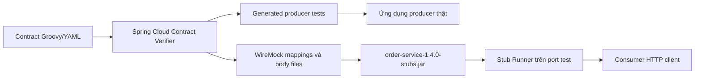
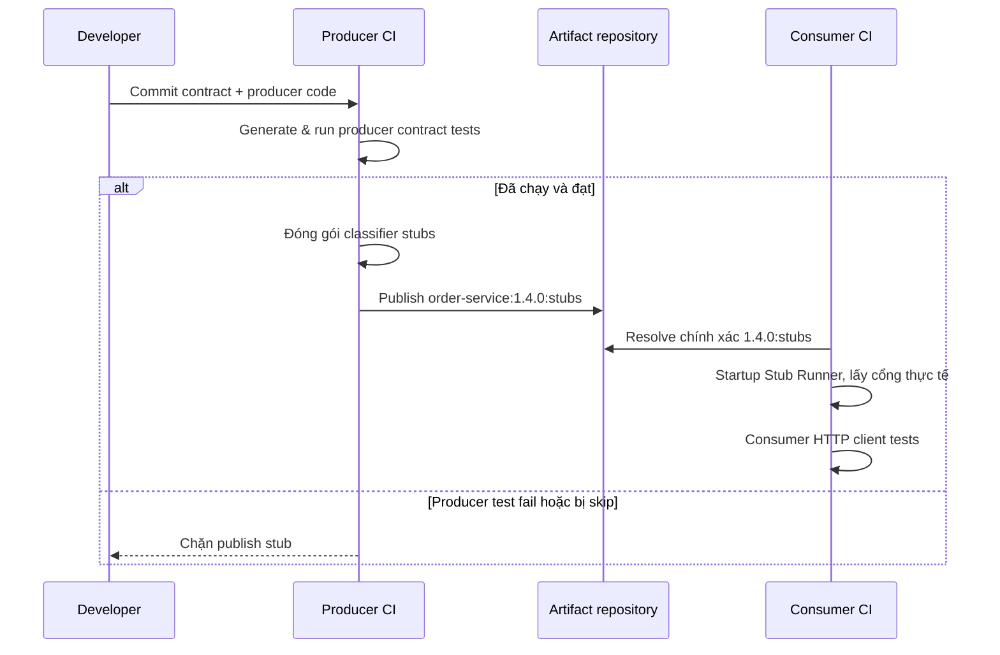

# Phiên bản, classifier và cổng trong cấu hình stub

## 1. Vì sao ba giá trị này quyết định kết quả consumer test?

Trong **Spring Cloud Contract**, producer và consumer thống nhất hành vi HTTP hoặc thông điệp bằng **Groovy DSL** hoặc **YAML DSL**. Verifier sinh kiểm thử phía producer và có thể tạo stub. Producer đóng gói stub vào artifact, còn **Stub Runner** tải và phục vụ artifact đó cho consumer test. CI dùng cả **producer contract tests** lẫn **consumer stub tests** để phát hiện thay đổi API không tương thích.

Giả sử ứng dụng `checkout-service` gọi API của `order-service`. Đội producer vừa phát hành stub phiên bản `1.4.0`, nhưng consumer đang chạy test với `1.3.0`. Cả hai bản đều chứa mapping `GET /api/orders/42`, song body lỗi ở bản mới có thêm `code` hoặc đổi kiểu trường `quantity`. Consumer test có thể vẫn **xanh với stub cũ** dù consumer không tương thích với API mới.

Một sai sót khác: consumer chỉ tải JAR không có classifier `stubs`, hoặc cố kết nối `localhost:8080` trong khi Stub Runner đang mở WireMock trên một cổng khác. Khi đó test có thể báo không tìm thấy artifact, không kết nối được hoặc nhận phản hồi từ **sai dịch vụ**.

Ba thông số cần hiểu chính xác là:

1. **Version:** chọn **bản hợp đồng** nào sẽ được kiểm thử.
2. **Classifier:** chọn **loại artifact** nào, thường là JAR chứa stub thay vì JAR chạy ứng dụng.
3. **Port:** chọn **địa chỉ HTTP của stub server** mà consumer thực sự gọi.

Sau bài này, bạn có thể đọc chuỗi định danh của Stub Runner, chọn version có thể tái lập, phân biệt classifier, cấu hình cổng cố định/động, kiểm tra artifact được resolve và tích hợp với consumer test/CI.

## 2. Tọa độ stub: `group:artifact:version:classifier:port`

Một dạng định danh thường gặp của Spring Cloud Contract Stub Runner:

```text
com.example:order-service:1.4.0:stubs:8090
|_________|_____________|_____|_____|____|
   group     artifact    version classifier port
```

Đọc từ trái sang phải:

| Phần | Giá trị minh họa | Ý nghĩa |
|---|---|---|
| `group` | `com.example` | Maven groupId hoặc tổ chức phát hành artifact |
| `artifact` | `order-service` | Tên module/service producer phát hành stub |
| `version` | `1.4.0` | Phiên bản artifact cần lấy |
| `classifier` | `stubs` | Biến thể JAR chứa hợp đồng/stub |
| `port` | `8090` | Cổng mà Stub Runner yêu cầu WireMock bind vào |

Trong một số cấu hình, phần port có thể **được bỏ trống** để Stub Runner cấp cổng tự do; khi đó cần lấy cổng thực tế sau khi server khởi động, không tự đoán. Các biến thể cú pháp và giá trị mặc định cần kiểm tra theo phiên bản thư viện đang dùng. Trong bài, các ví dụ dùng **đầy đủ năm phần** khi cần cổng cố định; ví dụ cổng động sẽ được giải thích riêng.

**Đừng đảo thứ tự classifier và port**:

```text
# Đúng: classifier=stubs, port=8090
com.example:order-service:1.4.0:stubs:8090

# Sai ý nghĩa: "8090" ở vị trí classifier
com.example:order-service:1.4.0:8090:stubs
```

Tên nhóm và artifact phải khớp **metadata của stub artifact**, không chỉ là tên container Docker, application name hoặc host HTTP của producer. Consumer không thể resolve một JAR từ Maven repository nếu coordinates không khớp nơi nó được publish.

## 3. Phân biệt artifact ứng dụng và artifact stub

Một bản phát hành `order-service` có thể có nhiều artifact:

```text
com.example:order-service:1.4.0
    ├── order-service-1.4.0.jar
    └── order-service-1.4.0-stubs.jar
```

| Artifact | Mục đích | Consumer test dùng để làm gì? |
|---|---|---|
| `order-service-1.4.0.jar` | Ứng dụng/library producer | Thường **không** phải thứ Stub Runner cần cho mô phỏng HTTP |
| `order-service-1.4.0-stubs.jar` | WireMock mappings và các tài nguyên stub | Stub Runner đọc và khởi động HTTP stubs |
| `order-service-1.4.0.pom` | Metadata dependency/publication | Giúp repository resolver xác định tọa độ artifact |

Trong Maven, classifier là phần phân biệt **artifact phụ** của cùng `groupId:artifactId:version`. Với Spring Cloud Contract, quy ước thông dụng là classifier **`stubs`**. Không thay `stubs` bằng `stub` hoặc bỏ classifier chỉ vì tên file gần giống.

### 3.1. Dữ liệu bên trong `-stubs.jar`

Với HTTP, artifact có thể chứa WireMock mappings và response body files. Một layout minh họa:

```text
order-service-1.4.0-stubs.jar
└── META-INF/
    └── com.example/
        └── order-service/
            └── 1.4.0/
                ├── mappings/
                │   ├── get-order-42.json
                │   └── get-order-9999.json
                ├── __files/
                │   └── orders/
                │       └── order-42.json
                └── contracts/
                    └── ...
```

Đây là **sơ đồ giải thích**, không phải yêu cầu mọi plugin/version xuất chính xác cây thư mục đó. Một số mappings có `body` hoặc `jsonBody` inline và không cần `__files`. Trước khi kết luận artifact thiếu dữ liệu, hãy xem mapping và nội dung JAR thực tế.

Để **kiểm tra** một artifact đã build, có thể dùng:

```bash
jar tf target/order-service-1.4.0-stubs.jar
```

Lệnh trên chỉ là ví dụ cho một dự án Maven có artifact ở đường dẫn đó; nó **không được thực thi trong bài học này**. Với Gradle, đường dẫn thường bắt đầu bằng `build/libs/`, nhưng output cụ thể phụ thuộc cấu hình plugin.

### 3.2. Kết nối giữa contract, stub và producer verification



**Stub JAR sinh thành công không chứng minh producer test đã chạy và đạt.** Một pipeline đáng tin phải chạy generated producer tests, đọc kết quả test, rồi mới publish stub version mới.

## 4. Phiên bản cố định: nền tảng cho test tái lập

### 4.1. Vì sao nên pin version trong CI chính?

So sánh hai cấu hình:

```text
# Bản cố định:
com.example:order-service:1.4.0:stubs:8090

# Bản được chọn động trong các cấu hình Stub Runner hỗ trợ:
com.example:order-service:+:stubs:8090
```

Với `1.4.0`, consumer CI có thể tái chạy trên **đúng hợp đồng đã chọn**, miễn artifact của version này không bị ghi đè và repository/cache được kiểm soát.

Ký hiệu `+` được dùng trong các ví dụ Stub Runner để yêu cầu **resolve một phiên bản phù hợp theo cơ chế của resolver**, thường là bản mới nhất khả dụng trong phạm vi cấu hình. Đó **không phải cam kết tuyệt đối** rằng mọi máy đều nhận đúng cùng một bản: repository, snapshots, metadata và cache có thể khác nhau. Cần kiểm tra phiên bản thực sự được resolve.

| Cách chọn | Ưu điểm | Rủi ro | Dùng khi nào? |
|---|---|---|---|
| **`1.4.0` cố định** | Dễ tái lập, dễ so sánh report | Cần chủ động nâng version | Pipeline consumer chính, release gate |
| **`+` động** | Dễ phát hiện thay đổi mới khi artifact vừa xuất bản | Kết quả khác theo thời điểm/cache/repo | Job canary hoặc compatibility check chủ động |
| **`1.5.0-SNAPSHOT`** | Dùng trong quá trình phát triển trước release | Snapshot có thể được cập nhật, không bất biến | Tích hợp thử nghiệm có kiểm soát |
| **Bản release bất biến** | Có thể audit và rollback | Cần chiến lược phát hành | Những hệ thống muốn truy vết build chính xác |

Nếu test dùng `+` hôm nay resolve `1.4.0`, tuần sau resolve `1.5.0`, hai lần chạy đã kiểm tra **hai hợp đồng khác nhau**. Khi debug, phải ghi lại resolved version thay vì chỉ báo “Stub Runner startup passed”.

### 4.2. `-SNAPSHOT` không tương đương bản phát hành bất biến

Maven snapshot thường được publish nhiều lần dưới cùng version logic, ví dụ `1.5.0-SNAPSHOT`. Repository resolver có thể dùng metadata/timestamped snapshot và cache cục bộ. Nếu producer sửa contract mà giữ cùng snapshot version, consumer test có thể nhận nội dung khác nhau tùy thời điểm và chính sách cập nhật.

Để giảm rủi ro:

- Dùng **release version không bị ghi đè** cho kiểm thử phát hành chính thức.
- Với snapshot, ghi lại commit/build ID và artifact checksum hoặc version thực tế được tải.
- Chủ động quản lý chính sách cập nhật dependency/cache trong CI.
- Nếu một run cần tái lập tuyệt đối, tránh cấu hình “lấy mới nhất” không có bằng chứng resolved artifact.

### 4.3. Version code và version contract có luôn phải giống nhau?

Trong quy trình thông dụng, `-stubs.jar` được xuất bản cùng coordinates/version với module producer. Nhưng mức tương thích giữa **API contract** và **phiên bản ứng dụng được deploy** vẫn phải được quản lý: một stub version `1.4.0` không bảo đảm môi trường staging/prod đang chạy đúng build tương ứng. CI/CD cần liên kết artifact, commit và release deployment.

**Không suy ra Semantic Versioning tự động.** Version `1.4.1` không tự bảo đảm chỉ chứa thay đổi tương thích; consumer vẫn cần chạy contract tests với version thực sự sẽ dùng.

## 5. Classifier: vì sao thiếu `stubs` dễ dẫn đến sai artifact?

### 5.1. Một ví dụ lỗi coordinates

Consumer cấu hình:

```text
com.example:order-service:1.4.0
```

trong khi producer chỉ attach stub archive dưới classifier `stubs`:

```text
com.example:order-service:1.4.0:stubs
```

Khi resolver nhận tọa độ không đầy đủ hoặc classifier sai, tùy API/mode/defaults, nó có thể không tìm được stub archive mong muốn, thử một artifact khác hoặc báo lỗi. **Đừng đoán rằng phần classifier được tự suy ra theo mọi cú pháp**, đặc biệt khi đội đã tùy chỉnh cách publish.

### 5.2. Kiểm tra Maven repository local

Với Maven local repository thông dụng, sau khi producer `mvn install` và artifact stub được attach:

```text
~/.m2/repository/com/example/order-service/1.4.0/
├── order-service-1.4.0.pom
├── order-service-1.4.0.jar
└── order-service-1.4.0-stubs.jar
```

Đường dẫn và tên file chỉ mang tính minh họa. Không phải mọi producer module tạo executable JAR; và nếu plugin chưa cấu hình phát hành stub, có thể **không có** `-stubs.jar` dù build ứng dụng thành công.

### 5.3. Publisher và consumer phải thống nhất coordinates

| Giá trị | Bên producer | Bên consumer |
|---|---|---|
| `groupId` | Công bố `com.example` | Dùng `com.example` |
| `artifactId` | Công bố `order-service` | Dùng `order-service` |
| `version` | Publish `1.4.0` | Resolve `1.4.0` |
| `classifier` | Attach `stubs` | Yêu cầu `stubs` |
| Repository | Maven local hoặc remote có artifact | Stub Runner biết nơi tìm artifact |

**Port không phải metadata được publish trong JAR.** Port được chọn khi consumer test **khởi động** stub server. Vì vậy, cùng JAR có thể được chạy ở `8090` trên máy này và `9123` trên máy khác mà vẫn là một version/classifier.

## 6. Cổng cố định: dễ hiểu nhưng dễ xung đột

Ví dụ cấu hình Stub Runner với cổng `8090`:

```java
import org.springframework.boot.test.context.SpringBootTest;
import org.springframework.cloud.contract.stubrunner.StubRunnerProperties;
import org.springframework.cloud.contract.stubrunner.spring.AutoConfigureStubRunner;
import org.springframework.cloud.contract.stubrunner.spring.StubRunnerPort;
import org.junit.jupiter.api.Test;

@SpringBootTest
@AutoConfigureStubRunner(
    ids = "com.example:order-service:1.4.0:stubs:8090",
    stubsMode = StubRunnerProperties.StubsMode.LOCAL
)
class OrderStubFixedPortTest {

    @StubRunnerPort("com.example:order-service")
    int actualStubPort;

    @Test
    void portShouldBeAvailable() {
        // Xác nhận giá trị port lấy từ Stub Runner
        // rồi dùng HTTP client của consumer để gọi API.
        // Không coi chỉ có port là đủ chứng minh hành vi client.
    }
}
```

Ví dụ trên dùng **Spring Boot test + annotation của Stub Runner** và giả định stub archive `1.4.0` đã được cài vào Maven local repository. `@StubRunnerPort` lấy cổng của stub đang chạy để test có thể cấu hình client.

**Cần phân biệt ba cổng:**

| Cổng | Ai sử dụng? | Có giống nhau không? |
|---|---|---|
| Producer HTTP port | Ứng dụng `order-service` thật, ví dụ `8080` | **Không cần** giống stub |
| Stub Runner WireMock port | Stub server, ví dụ `8090` | Được chọn tại consumer test |
| Consumer application port | `checkout-service` nếu chạy embedded server | Có thể khác cả hai |

Nếu consumer test gọi nhầm `localhost:8080`, nó có thể kết nối producer thật, một tiến trình cũ hoặc không có server nào. Khi đó test không còn kiểm chứng đúng stub artifact mà bạn nghĩ đang sử dụng.

### 6.1. Nhược điểm của cổng cố định

- Hai bộ test cùng khởi động WireMock trên `8090` có thể tranh cổng.
- CI chạy song song nhiều module/job trên cùng máy có thể thất bại ngẫu nhiên.
- Máy developer có dịch vụ khác đang sử dụng port đó.
- Cổng hardcode vào application config có thể vô tình bị mang sang môi trường ngoài test.

Dùng cổng cố định khi môi trường kiểm thử được **điều phối độc quyền**, ví dụ một test container/runner có namespace mạng riêng hoặc nhóm test nhỏ chạy tuần tự. Nếu nhiều test chạy song song, **cổng động** thường phù hợp hơn.

## 7. Cổng động: lấy số cổng thực tế từ Stub Runner

Với Stub Runner, có thể không chỉ định port tường minh để runtime cấp cổng còn trống (cách diễn đạt chi tiết phụ thuộc phiên bản). Ví dụ:

```java
import java.net.URI;
import org.junit.jupiter.api.Test;
import org.springframework.boot.test.context.SpringBootTest;
import org.springframework.cloud.contract.stubrunner.StubRunnerProperties;
import org.springframework.cloud.contract.stubrunner.spring.AutoConfigureStubRunner;
import org.springframework.cloud.contract.stubrunner.spring.StubRunnerPort;

import static org.assertj.core.api.Assertions.assertThat;

@SpringBootTest
@AutoConfigureStubRunner(
    ids = "com.example:order-service:1.4.0:stubs",
    stubsMode = StubRunnerProperties.StubsMode.LOCAL
)
class OrderStubDynamicPortTest {

    @StubRunnerPort("com.example:order-service")
    int stubPort;

    @Test
    void consumerShouldParsePaidOrder() {
        URI stubBaseUrl = URI.create("http://localhost:" + stubPort);

        // OrderClient là HTTP client thật của dự án consumer.
        // Ví dụ giả định có constructor nhận base URL.
        OrderClient client = new OrderClient(stubBaseUrl);
        OrderDto result = client.findById(42L);

        assertThat(result.id()).isEqualTo(42L);
        assertThat(result.state()).isEqualTo("PAID");
        assertThat(result.currency()).isEqualTo("VND");
    }
}
```

**Giới hạn của ví dụ:** `OrderClient` và `OrderDto` là các class **ứng dụng minh họa** và cần được định nghĩa trong dự án; đoạn test không thể chạy độc lập chỉ bằng Spring Cloud Contract. Consumer cần có stub mapping `GET /api/orders/42` trả body như đã thống nhất.

Điểm quan trọng là **test lấy cổng sau khi Stub Runner khởi động**. Không ghi `8090` cố định trong HTTP client trong khi cấu hình Stub Runner lại chọn port động.

### 7.1. Lấy cổng qua `StubFinder` khi có nhiều stub

Trong những ứng dụng cần thao tác với nhiều stub, Spring Cloud Contract cung cấp cơ chế tìm stub URL như `StubFinder` (API chi tiết tùy phiên bản):

```java
// Minh họa cách dùng StubFinder; kiểu/import theo bản thư viện.
@Autowired
StubFinder stubFinder;

void configureClient() {
    URL stubUrl = stubFinder.findStubUrl("com.example", "order-service");
    // Chuyển URL này thành base URL cho HTTP client của consumer.
}
```

Một số version có overload hoặc kiểu trả về khác; hãy kiểm tra API được dùng trong dự án. Về thiết kế, **tra cứu theo group/artifact đáng tin hơn giả định thứ tự** những stub được khởi động.

### 7.2. Khi nào cổng động vẫn có lỗi?

- Test vẫn nối vào URL cố định thay vì cổng được inject.
- Consumer HTTP client được khởi tạo trước khi test biết cổng và không cập nhật base URL.
- Stub không resolve/không startup nên field port chưa có giá trị hợp lệ.
- Nhiều producer stub dùng chung một biến URL/config key.
- HTTP client dùng HTTPS hoặc hostname khác trong khi stub WireMock đang mở HTTP ở localhost.

Cần kiểm tra log startup và request thực tế. Không chuyển mọi test sang cổng cố định chỉ để tránh sửa phần cấu hình client; điều đó làm test khó chạy song song và che giấu việc kết nối nhầm địa chỉ.

## 8. Cấu hình bằng YAML/properties thay vì annotation

Trong ứng dụng Spring Boot test có cấu hình Stub Runner, bạn có thể tách coordinates khỏi Java bằng các property phù hợp:

```yaml
stubrunner:
  stubs-mode: LOCAL
  ids:
    - com.example:order-service:1.4.0:stubs:8090
```

Hoặc minh họa cấu hình properties:

```properties
stubrunner.stubs-mode=LOCAL
stubrunner.ids=com.example:order-service:1.4.0:stubs:8090
```

**Lưu ý:** property chỉ có hiệu lực khi Stub Runner test infrastructure thực sự được kích hoạt, ví dụ qua `@AutoConfigureStubRunner`, và cách binding property tương thích với version đang dùng. Đừng nghĩ đặt một YAML dưới `src/test/resources` tự động khởi động WireMock nếu không có bootstrap phù hợp.

Nên đặt các thông số này trong **test profile** hoặc cấu hình CI, không đưa địa chỉ localhost của stub vào cấu hình production.

### 8.1. Dùng placeholders cho version có chủ đích

Trong CI có thể truyền version cần kiểm tra từ dependency catalog, pipeline variable hoặc release manifest. Điều quan trọng không phải tên biến, mà là:

1. **Có một giá trị resolved version rõ ràng** cho mỗi build.
2. Report ghi lại version đó.
3. Consumer CI dùng đúng version sẽ được triển khai/tương thích.
4. Không âm thầm chuyển sang `+` khi không resolve được một version cố định.

Nếu áp dụng placeholder trong YAML, phải chắc rằng framework property binding và môi trường build thực sự mở rộng placeholder đó; không tự coi chuỗi có ký tự placeholder là một tọa độ Maven hợp lệ.

## 9. Stub Runner tìm artifact ở đâu? LOCAL, REMOTE, CLASSPATH

Stub Runner hỗ trợ các cách tìm tài nguyên stub, thường được mô tả bằng chế độ `LOCAL`, `REMOTE` và `CLASSPATH`:

| Chế độ | Nguồn stubs | Tình huống dùng | Điểm cần lưu ý |
|---|---|---|---|
| **LOCAL** | Maven local repository trên máy chạy test | Producer vừa cài `-stubs.jar` để thử nhanh | Artifact có thể thiếu hoặc cũ trên máy CI |
| **REMOTE** | Artifact repository từ xa, ví dụ Maven-compatible repository | CI của nhiều nhóm, dùng stub đã publish | Credentials, URL repo, version và cache |
| **CLASSPATH** | Stub resources có sẵn trên test classpath theo cấu hình | Bài test đóng kèm resource/stub dependency | Không mặc nhiên tự tải artifact từ Maven remote |

### 9.1. LOCAL

Kịch bản:

```text
Producer:
  build contract tests
  attach -stubs.jar
  install vào Maven local repository

Consumer:
  @AutoConfigureStubRunner(..., stubsMode = LOCAL)
  -> resolve artifact ở local repository
  -> khởi động WireMock
```

Nếu consumer test thất bại vì `Could not find artifact`, cần kiểm tra **JAR có thực sự được install với classifier `stubs`** không. Việc file nằm trong `target/` chưa đủ để `LOCAL` tìm thấy nếu nó chưa được cài vào repository và không có cấu hình resolver khác.

### 9.2. REMOTE

Với REMOTE, cần cấu hình URL repository và xác thực phù hợp. Ví dụ annotation minh họa:

```java
@AutoConfigureStubRunner(
    ids = "com.example:order-service:1.4.0:stubs",
    stubsMode = StubRunnerProperties.StubsMode.REMOTE,
    repositoryRoot = "https://repo.example.org/maven-releases"
)
class OrderClientAgainstPublishedStubsTest {
    // Consumer client tests.
}
```

URL `repo.example.org` chỉ là **địa chỉ ví dụ**, không phải repository thật. Credentials không được hardcode trong code/contract; dùng cấu hình bảo mật của môi trường CI hoặc cơ chế xác thực repository được hỗ trợ. Với repo chứa snapshots, đường dẫn/policy có thể khác releases.

### 9.3. CLASSPATH

`CLASSPATH` có ý nghĩa khi stub resources đã hiện diện trong test classpath theo một bố cục mà Stub Runner nhận diện được. Nó không phải lựa chọn thay thế cho REMOTE chỉ bằng cách đổi một enum; phải bảo đảm classpath **thực sự chứa mappings/body files** phù hợp.

**Tránh cấu hình hỗn hợp mơ hồ:** nếu dự án sử dụng nhiều nơi lưu artifact, ghi rõ nguồn nào được phép dùng trong mỗi pipeline. Một test chỉ pass vì local repository vô tình còn bản cũ là một tín hiệu không đáng tin.

## 10. Kết hợp version, classifier và port: ma trận cấu hình

| Tình huống | Coordinates minh họa | Kỳ vọng |
|---|---|---|
| CI ổn định, cổng cố định | `com.example:order-service:1.4.0:stubs:8090` | Lấy đúng bản, chạy trên 8090 nếu rảnh |
| CI ổn định, cổng động | `com.example:order-service:1.4.0:stubs` | Lấy đúng bản, lấy cổng thực tế từ Stub Runner |
| Kiểm tra tương thích với bản mới | `com.example:order-service:+:stubs` | Version resolve động, phải log resolved artifact |
| Phát triển snapshot | `com.example:order-service:1.5.0-SNAPSHOT:stubs` | Dùng snapshot theo cache/repository policy |
| Sai classifier | `com.example:order-service:1.4.0:jar:8090` | Không phải stub classifier theo quy ước |
| Sai version | `com.example:order-service:9.9.9:stubs:8090` | Thường không tìm thấy artifact nếu bản đó không có |
| Trùng port | Hai stub cùng chỉ định `8090` | Có nguy cơ bind failure hoặc test sai server |

Một chuỗi tọa độ đúng **chưa đủ**: repo phải chứa artifact đó, các mappings trong JAR phải hợp lệ, test runner phải startup stub, client phải gọi đúng port và response phải đúng kịch bản.

## 11. Nhiều producer stubs trong một consumer test

`checkout-service` có thể cần `order-service` và `payment-service` cùng lúc:

```java
@SpringBootTest
@AutoConfigureStubRunner(
    ids = {
        "com.example:order-service:1.4.0:stubs",
        "com.example:payment-service:2.2.1:stubs"
    },
    stubsMode = StubRunnerProperties.StubsMode.LOCAL
)
class CheckoutWithMultipleStubsTest {

    @StubRunnerPort("com.example:order-service")
    int orderPort;

    @StubRunnerPort("com.example:payment-service")
    int paymentPort;

    // Test phải cấu hình từng HTTP client bằng đúng cổng.
}
```

**Lưu ý về vận hành:**

- Mỗi stub có server/port riêng nếu cấu hình theo kiểu đó; **không lấy cổng của order-service để gọi payment-service**.
- Tránh cấp cùng một cổng cố định cho hai stubs trong một tiến trình.
- Nếu một service đổi version, phải ghi lại **ma trận version** đang thử, ví dụ `order 1.4.0 + payment 2.2.1`.
- Nếu consumer test có nhiều nhánh gọi tuần tự, kiểm tra request journal/scenario state của từng stub để không ảnh hưởng chéo.
- Không “chọn latest cho tất cả” trong pipeline phát hành mà không có một snapshot các version đã resolve.

## 12. Một test thực tế: stub trả đúng JSON, consumer xử lý đúng

Giả sử producer đã publish contract:

```http
GET /api/orders/42
Accept: application/json
```

Phản hồi mẫu:

```json
{"id":42,"state":"PAID","currency":"VND"}
```

Consumer test nên dùng **HTTP client thật của consumer**, không chỉ gọi trực tiếp WireMock rồi kiểm tra WireMock trả `200`.

Ví dụ ở cổng động, dự án có DTO `OrderDto` và client `OrderClient`:

```java
@StubRunnerPort("com.example:order-service")
int stubPort;

@Test
void shouldProcessPaidOrder() {
    OrderClient client = new OrderClient(
        URI.create("http://localhost:" + stubPort));

    OrderDto order = client.findById(42L);

    assertThat(order.id()).isEqualTo(42L);
    assertThat(order.state()).isEqualTo("PAID");
    assertThat(checkoutDecision.forOrder(order))
        .isEqualTo(CheckoutDecision.ALLOW_RECEIPT);
}
```

Đây là **đoạn method minh họa**, phụ thuộc DTO/client/`checkoutDecision` do dự án cung cấp; nó không phải một test class đầy đủ có thể copy chạy ngay. Điểm cốt lõi là assert **hành vi consumer** dựa trên dữ liệu do stub cung cấp.

### 12.1. Vì sao chỉ assert HTTP `404` là chưa đủ?

Nếu consumer gọi nhầm path `/api/order/42`, WireMock có thể trả `404` vì **không khớp mapping nào**. Trường hợp đó khác với contract nghiệp vụ `GET /api/orders/9999` trả `404` cùng body:

```json
{"code":"ORDER_NOT_FOUND","message":"Order does not exist"}
```

Khi test nhánh lỗi, phải assert `code`/body mà consumer thực sự dùng. Nếu không, unmatched-stub 404 có thể khiến consumer test báo đạt dù client gọi sai endpoint.

## 13. Luồng đóng gói và phát hành an toàn trên CI



**Một quy trình tối thiểu:**

1. Producer cập nhật Groovy/YAML contracts theo API đã thống nhất.
2. CI producer **sinh, biên dịch, phát hiện, thực thi và chạy đạt** generated producer tests; không chấp nhận chỉ có file test sinh ra hoặc build chạy với `skipTests`.
3. Đóng gói `-stubs.jar` và xác minh mappings/body files tồn tại, đúng classifier.
4. Publish artifact có version rõ ràng, tốt nhất không ghi đè release version.
5. Consumer CI chọn version/classifier muốn thử; ưu tiên **pin version** trong pipeline chính.
6. Stub Runner resolve đúng artifact, mở server và thông báo cổng.
7. Client consumer gọi **đúng host/port stub** và assert JSON/business behavior.
8. Khi có thay đổi không tương thích, chặn merge/release hoặc cập nhật consumer có phối hợp trước khi chuyển phiên bản.

### 13.1. Ghi lại thông tin tối thiểu trong log/test report

```text
Stub group        : com.example
Stub artifact     : order-service
Requested version : 1.4.0
Resolved version  : 1.4.0
Classifier        : stubs
Stubs mode        : REMOTE
Repository        : <repo của tổ chức, không ghi secret>
Stub base URL     : http://localhost:<port thực tế>
Artifact checksum : <giá trị do CI tính nếu có>
```

Các dòng trong khối trên là **mẫu dữ liệu cần quan sát**, không phải output chuẩn được mọi phiên bản Stub Runner tự động in. Có thể lấy từ dependency resolution logs, metadata artifact và cấu hình test, rồi lưu cùng build ID/report. **Không log mật khẩu hoặc access token** của repository.

## 14. Chẩn đoán: sai version, classifier hay port?

| Triệu chứng | Nguyên nhân ưu tiên | Cách kiểm tra |
|---|---|---|
| `Could not resolve artifact` | Sai group/artifact/version/classifier hoặc repo | Kiểm tra coordinates và artifact tồn tại |
| Stub Runner startup được nhưng mappings cũ | Resolve version cũ hoặc cache snapshot | Xem resolved version/JAR, không chỉ requested version |
| Có application JAR nhưng không có stub JAR | Producer chưa attach/publish classifier `stubs` | Kiểm tra build publication và repository |
| `Connection refused` ở `localhost:8090` | Stub không mở port đó hoặc startup fail | Xem port thực tế, startup logs |
| CI fail ngẫu nhiên vì bind port | Nhiều test cùng chiếm cổng cố định | Chuyển sang port động hoặc cô lập runner |
| Consumer nhận 404 từ stub | Method/path/query/header không khớp mapping | Kiểm tra request thực tế và JAR mapping |
| Consumer nhận response từ service khác | Client base URL trỏ sai port | Lấy port theo đúng group/artifact |
| LOCAL chạy xanh, REMOTE không thấy JAR | Chưa deploy/credentials/repo URL sai | Kiểm tra artifact đã publish, quyền đọc |
| REMOTE lúc xanh lúc đỏ trên snapshot | Metadata/cache thay đổi | Pin release hoặc log checksum/timestamp |
| Thêm một stub mới làm test cũ hỏng | Trùng port hoặc config client dùng chung | Tách StubRunnerPort và client config |
| `+` resolve ngoài dự kiến | Repo/cached metadata chứa bản khác | Ghi resolved version, dùng pin version cho gate |
| Stub có JSON đúng, producer thật sai | Producer verification chưa chạy | Chạy generated producer tests ở producer CI |

### 14.1. Trình tự điều tra hiệu quả

1. **Coordinates:** producer nào, group/artifact nào, version/classifier nào?
2. **Source:** `LOCAL`, `REMOTE` hay `CLASSPATH`? Có đúng repository/classpath không?
3. **Artifact:** JAR được resolve có thực sự chứa mappings/body files của kịch bản không?
4. **Server:** WireMock instance nào khởi động, trên port nào?
5. **Request:** HTTP client đã gửi method/path/query/header/body nào?
6. **Response:** trạng thái, content type và body thực tế có đúng contract không?
7. **Provenance:** producer verification và consumer tests có chạy với cùng dòng contract/version không?

Khi thiếu bằng chứng, đừng sửa URL, matcher hoặc pin ngẫu nhiên một port khác chỉ để làm xanh test: có thể đang che giấu artifact/version không đúng.

## 15. Bài thực hành: cố định version, kiểm soát classifier, bỏ phụ thuộc port

**Bối cảnh:** `checkout-service` phụ thuộc `order-service`. Producer phát hành stub `1.4.0` với `GET /api/orders/42` trả `state=PAID`. Consumer test hiện dùng `+` và cổng cố định `8090`, đôi khi nhận bản cũ và đôi khi fail vì cổng bị chiếm.

**Yêu cầu bài tập:** chuyển consumer test sang một build tái lập được, dùng version `1.4.0`, classifier `stubs` và port động; đồng thời có cách kiểm tra artifact thực tế.

**Thực hiện:**

1. Xác minh producer đã chạy generated contract tests và phát hành `com.example:order-service:1.4.0:stubs`.
2. Kiểm tra JAR có WireMock mapping cho `GET /api/orders/42`, response status `200` và JSON `id=42`, `state=PAID`, `currency=VND`.
3. Đổi `ids` từ `com.example:order-service:+:stubs:8090` thành `com.example:order-service:1.4.0:stubs`.
4. Dùng `@StubRunnerPort("com.example:order-service")` hoặc cơ chế tìm URL tương đương lấy **port thực**.
5. Cấu hình HTTP client consumer dùng `http://localhost:<port thực>`, không dùng `8080` của producer thật và không hardcode `8090`.
6. Chạy consumer test gọi `GET /api/orders/42`, assert DTO chứa `state=PAID` và logic checkout tương ứng.
7. Trong môi trường test, cố ý đổi path gọi thành `/api/order/42`; test phải phát hiện **request sai**, không coi HTTP `404` do unmatched mapping là kết quả mong đợi.
8. Chạy suite song song trong môi trường hỗ trợ để xác minh không có xung đột port cố định.
9. Chạy lại trên CI với `REMOTE` và repository nội bộ; kiểm tra resolved coordinates đúng `1.4.0:stubs`.
10. Tạo một job kiểm tra bản mới bằng `+` (nếu quy trình muốn có canary), **tách khỏi gate dùng version cố định**, ghi version được resolve trước khi đánh giá tương thích.

### 15.1. Câu hỏi tự đánh giá

| Câu hỏi | Đáp án |
|---|---|
| `com.example:order-service:1.4.0:stubs:8090` có bao nhiêu thành phần? | **Năm**: group, artifact, version, classifier, port |
| Port có được đóng vào JAR khi producer publish không? | **Không**; port được chọn lúc chạy Stub Runner |
| Vì sao classifier `stubs` quan trọng? | Nó xác định stub artifact thay vì artifact ứng dụng khác |
| `+` có bảo đảm CI ngày mai dùng đúng version hôm nay không? | **Không**; phải log resolved version hoặc pin chính xác |
| `-SNAPSHOT` có phải artifact bất biến không? | **Không** theo quy ước thông dụng; cần quản lý metadata/cache |
| Có được hardcode `8090` khi Stub Runner chọn port động không? | **Không**; phải lấy port/URL thực tế |
| Stub trả `404` chứng minh producer trả lỗi nghiệp vụ `404` không? | **Không**; có thể là không khớp mapping |
| Consumer stub tests pass có thay thế producer verification không? | **Không**; cần generated producer tests |
| Nên lấy port theo thứ tự danh sách các stubs không? | **Không**; tra cứu theo group/artifact |

## 16. Checklist review cấu hình Stub Runner

- [ ] Đã xác nhận đúng `groupId` và `artifactId` của **producer stub artifact**.
- [ ] Version dùng trong consumer CI chính là **bản có chủ đích**, ưu tiên cố định để tái lập.
- [ ] Nếu dùng `+` hoặc `SNAPSHOT`, có log resolved version, cache policy và quy tắc đánh giá tương thích.
- [ ] Classifier đúng `stubs` hoặc classifier đặc thù được producer công bố.
- [ ] Gói artifact thực sự có mappings/body files; không nhầm JAR ứng dụng với stub JAR.
- [ ] `LOCAL`, `REMOTE` hoặc `CLASSPATH` khớp nơi tài nguyên stub nằm.
- [ ] REMOTE có URL repository và cơ chế xác thực an toàn; không hardcode secrets.
- [ ] Không có hai stub servers cùng chiếm một fixed port trong cùng môi trường.
- [ ] Với cổng động, HTTP client nhận **port thực tế** từ `@StubRunnerPort`/StubFinder.
- [ ] Khi có nhiều stubs, mỗi client được nối tới đúng group/artifact, không dựa vào thứ tự hoặc port đoán trước.
- [ ] Consumer test dùng client nghiệp vụ thật và assert response/body/error schema quan trọng.
- [ ] Phân biệt business `404` với unmatched-mapping `404` của WireMock.
- [ ] Producer CI đã sinh, biên dịch, thực thi và chạy đạt generated contract tests trước khi publish stub.
- [ ] CI lưu report, version/classifier/port đã resolve, chặn khi artifact sai hoặc test thất bại.

**Ghi nhớ:** **Version** xác định *hợp đồng nào*, **classifier** xác định *artifact nào* và **port** xác định *stub server nào đang nhận request*. Chọn đúng cả ba giá trị, kiểm tra artifact thực sự được resolve và chạy cả producer verification lẫn consumer tests với Stub Runner mới tạo được một quy trình phát hiện API không tương thích đáng tin cậy.
