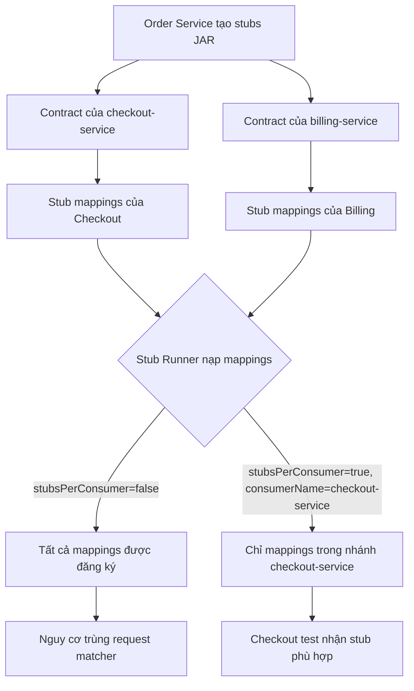
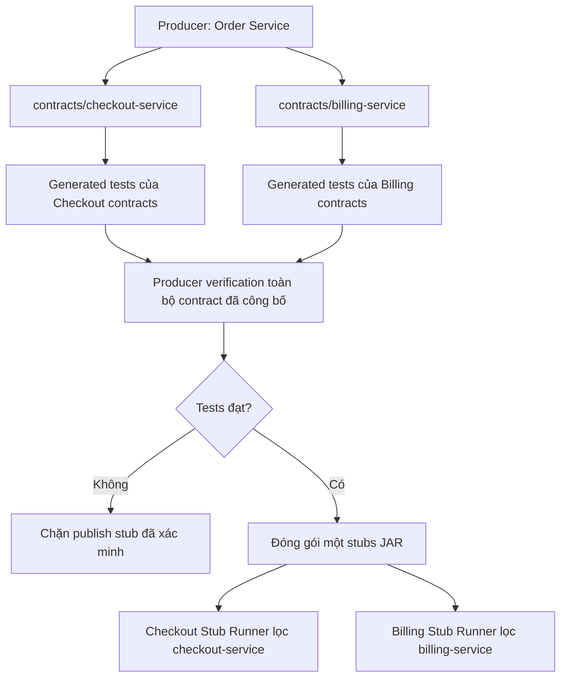
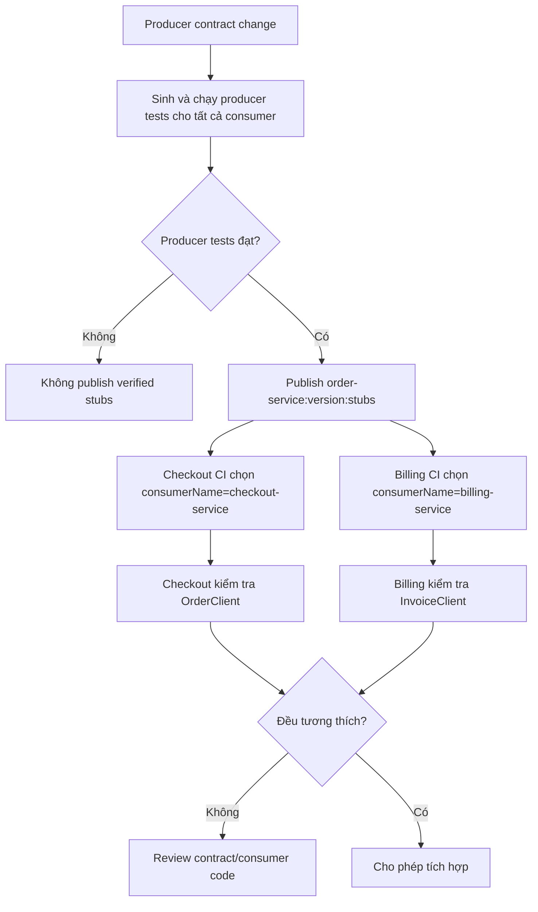

# Chọn stub theo consumer name và cấu trúc hợp đồng

Khi một producer phục vụ nhiều consumer, không phải consumer nào cũng sử dụng cùng một phần của API. **Checkout Service** quan tâm đơn hàng đã thanh toán hay chưa, còn **Billing Service** quan tâm tổng tiền và đơn vị tiền tệ. Nếu cùng một endpoint được mô tả bằng hai hợp đồng phục vụ hai consumer, việc nạp **toàn bộ HTTP mappings** vào cùng một WireMock stub server có thể gây trùng điều kiện request hoặc khiến consumer test dùng response không phù hợp.

**Spring Cloud Contract Stub Runner** cung cấp cơ chế **`stubsPerConsumer`** (*stubs per consumer*) để chỉ đăng ký những stub thuộc consumer có tên đã chọn. Trên producer, nhóm sắp xếp hợp đồng thành các thư mục con mang **consumer name**; khi đóng gói, cấu trúc tương ứng được giữ trong stubs artifact. Trên consumer, Stub Runner tải artifact của producer như bình thường, nhưng lọc mappings theo **`spring.application.name`** hoặc **`consumerName`** được chỉ định.

Bài này thuộc chương **Stub Runner** của lộ trình **SPRING_CLOUD_CONTRACT**. Sau khi học, bạn có thể tổ chức hợp đồng **Groovy/YAML DSL** cho nhiều consumer, cấu hình `stubsPerConsumer` và `consumerName`, phân biệt **tên producer** với **tên consumer**, kiểm tra stubs JAR và mappings được nạp, và tích hợp cơ chế chọn stub vào CI để phát hiện thay đổi API không tương thích.

## 1. Vấn đề: một producer, nhiều consumer, một endpoint

Giả sử **Order Service** cung cấp:

```http
GET /api/orders/ORDER-42
Accept: application/json
```

Implementation thực của producer trả:

```json
{
  "id": "ORDER-42",
  "status": "PAID",
  "totalAmount": 125000,
  "currency": "VND"
}
```

Hai consumer sử dụng những phần khác nhau:

| Consumer | Phần response cần dùng | Lý do |
|---|---|---|
| **checkout-service** | `id`, `status` | Checkout quyết định đơn có thể tiếp tục thanh toán hay không |
| **billing-service** | `id`, `totalAmount`, `currency` | Billing tạo thông tin hóa đơn |

Hai nhóm có thể thỏa thuận **hai contract riêng cho cùng method và path**:

```text
GET /api/orders/ORDER-42
  - checkout-service: response mẫu {id, status}
  - billing-service:  response mẫu {id, totalAmount, currency}
```

Điều này **không có nghĩa producer được trả hai response khác nhau tùy tên ứng dụng gọi**. Implementation vẫn phải đáp ứng các cam kết mà hai consumer cần, thường bằng một response chứa đủ những trường được dùng. Còn trong **consumer tests**, stub riêng có thể chỉ trả tập trường mà consumer đó mong đợi, để kiểm tra sự phụ thuộc thực sự của nó.

Nếu Stub Runner nạp cả hai mappings vào **một WireMock server** với request matcher giống hệt nhau, một request có thể khớp cả hai. WireMock không tự biết lời gọi tới từ Checkout hay Billing chỉ bằng tên ứng dụng đang chạy test. Kết quả chọn mapping có thể không đúng điều một consumer test muốn.

**`stubsPerConsumer` giải quyết việc chọn mapping ở thời điểm nạp stub theo consumer**, không thay đổi semantics của API production.

### 1.1. Hai cấu hình được so sánh



Với cơ chế chọn consumer được bật, một bộ stubs JAR có thể **phục vụ nhiều consumer nhưng mỗi consumer chỉ đăng ký phần tương ứng**.

## 2. Ba tên thường bị nhầm lẫn

Các tên sau có vai trò **hoàn toàn khác nhau**:

| Khái niệm | Ví dụ | Được dùng để làm gì? |
|---|---|---|
| **Tên producer/artifactId** | `order-service` | Stub Runner tìm và tải stubs JAR của producer |
| **Tên consumer** | `checkout-service` | `stubsPerConsumer` lọc mappings trong thư mục consumer |
| **Tên contract** | `checkout_get_paid_order_200` | Định danh kịch bản để sinh test/mapping và debug |
| **Tên ứng dụng Spring** | `spring.application.name=checkout-service` | Nguồn mặc định để Stub Runner nhận diện consumer khi bật lọc |
| **Tên stub server/host/cổng** | `localhost:8085` | Địa chỉ mà client test kết nối |
| **Version stubs artifact** | `1.4.0` | Chọn bộ hợp đồng/response mẫu của một producer build |

Ví dụ với Stub Runner:

```text
com.example:order-service:1.4.0:stubs:8085
```

Chuỗi này dùng để tìm **stubs artifact của `order-service`**, không nói consumer nào đang dùng nó. Để lọc sang `checkout-service` cần thêm lựa chọn consumer name và bật `stubsPerConsumer`.

**Phân biệt trọng tâm:**

- `ids` trả lời: **“Tải stub của producer nào, phiên bản nào, phục vụ cổng nào?”**
- `consumerName` trả lời: **“Trong stubs đã tải, đăng ký hợp đồng dành cho consumer nào?”**
- `name` trong từng contract trả lời: **“Đây là kịch bản kiểm thử nào?”**

Không dùng một trường thay cho trường còn lại.

## 3. Bật lọc hay không bật lọc tạo khác biệt gì?

Trong tài liệu cấu hình Spring Cloud Contract Stub Runner, thuộc tính `stubs-per-consumer` có giá trị mặc định là **`false`**. Khi `false`, Stub Runner không thực hiện lựa chọn theo consumer name, nên về nguyên tắc có thể đăng ký tất cả mappings từ stubs artifact được tải.

Khi `true`, Stub Runner xét đường dẫn của stub/mapping: những stub thuộc nhánh thư mục mang tên consumer được chọn mới được đăng ký. Tên consumer mặc định được lấy từ **`spring.application.name`**, hoặc có thể được ghi đè bằng **`spring.cloud.contract.stubrunner.consumer-name`** hay thuộc tính `consumerName` của `@AutoConfigureStubRunner` trong các phiên bản hỗ trợ.

| Cấu hình | Kết quả mong đợi |
|---|---|
| `stubsPerConsumer=false` | Không lọc mappings theo tên consumer |
| `stubsPerConsumer=true` và tên là `checkout-service` | Chỉ đăng ký mapping thuộc nhánh `checkout-service` |
| `stubsPerConsumer=true` và tên là `billing-service` | Chỉ đăng ký mapping thuộc nhánh `billing-service` |
| `stubsPerConsumer=true` nhưng tên không có trong artifact | Có thể không đăng ký mapping mong muốn; cần xem log và chế độ fail khi không có stub |
| `consumerName` được đặt nhưng không bật `stubsPerConsumer` | Không nên kỳ vọng lọc được thực hiện chỉ nhờ khai báo tên |

Đây là tính năng **lọc mapping khi khởi động Stub Runner**, không phải cơ chế xác thực, phân quyền hoặc routing request trong production. Nó cũng **không tạo một stubs JAR riêng cho mỗi consumer** nếu build của producer không được cấu hình để làm việc đó.

### 3.1. Điều kiện lọc nằm ở đường dẫn

Tài liệu Spring Cloud Contract mô tả việc lọc dựa trên **nhánh thư mục chứa tên consumer trong path của stub**. Vì vậy cách tổ chức thư mục hợp đồng ở producer **có ý nghĩa** với việc Stub Runner đăng ký những mapping nào.

Không chỉ ghi tên consumer trong `description` của contract; tính năng này không chọn mapping dựa trên mô tả bằng ngôn ngữ tự nhiên.

## 4. Tổ chức thư mục hợp đồng ở producer

Một cấu trúc dễ hiểu cho Order Service:

```text
order-service/
└── src/
    └── test/
        └── resources/
            └── contracts/
                ├── checkout-service/
                │   └── orders/
                │       ├── get_paid_order_200.groovy
                │       └── get_missing_order_404.yml
                └── billing-service/
                    └── orders/
                        ├── get_invoice_data_200.groovy
                        └── get_missing_invoice_data_404.yml
```

Những lưu ý:

1. `contracts` là thư mục nguồn phổ biến; **đường dẫn thực tế** còn phụ thuộc cấu hình plugin Maven/Gradle.
2. `checkout-service` và `billing-service` là **tên thư mục phân nhóm hợp đồng theo consumer**.
3. Có thể tạo các thư mục con `orders` hoặc `invoice` bên dưới để chia theo API hoặc tính năng; chúng không thay thế consumer name.
4. Groovy và YAML là hai cách viết DSL được plugin hỗ trợ theo phiên bản; có thể cùng tồn tại nếu các contract **không tạo kịch bản trùng vô ý**.
5. Nhất quán chính tả, chữ hoa/thường và dấu gạch nối giữa **thư mục**, `spring.application.name` và `consumerName`.

Tên thư mục không cần giống `artifactId` producer. Trong ví dụ, **`order-service` là producer** còn **`checkout-service` là consumer**.

### 4.1. Vì sao phải chọn tên thư mục ổn định?

Giả sử producer đổi:

```text
contracts/checkout-service/...
```

thành:

```text
contracts/checkout/...
```

nhưng consumer vẫn chạy với `consumerName=checkout-service`. Khi đó bộ lọc có thể **không chọn được mappings** nào dành cho Checkout. Đây là lỗi cấu trúc artifact/cấu hình, không nhất thiết là lỗi API.

Khi đổi tên service, cần xem tên ứng dụng Spring, thư mục contract, cấu hình Stub Runner và CI cùng lúc. Có thể chọn `consumerName` tường minh để ổn định tên lọc ngay cả khi `spring.application.name` của consumer khác tên thư mục, nhưng phải tài liệu hóa sự ánh xạ.

### 4.2. Có nên đặt contract dùng chung ngoài thư mục consumer?

Ví dụ:

```text
contracts/
├── common/
│   └── health_check.groovy
├── checkout-service/
└── billing-service/
```

Khi bật lọc theo consumer, **không nên giả định** contract trong `common` sẽ tự động được tải cho mọi consumer. Theo mô hình lọc dựa trên đường dẫn chứa tên consumer, một mapping dưới `common` có thể bị loại vì path không chứa `checkout-service` hay `billing-service`.

Nếu nhiều consumer cần cùng một contract:

- Đặt hợp đồng tương ứng ở từng nhánh consumer một cách có chủ đích; hoặc
- Dùng quy tắc tổ chức/generation riêng đã được **đúng phiên bản plugin** hỗ trợ; hoặc
- Kiểm tra mapping được đăng ký thực tế để xác nhận quy tắc chia sẻ.

Tránh copy không kiểm soát khiến hai hợp đồng giống nhau bị lệch khi một bên được sửa. Có thể sử dụng quá trình sinh từ nguồn thống nhất ở build pipeline, nhưng không để consumer tests phụ thuộc một quy tắc `common` chưa được kiểm chứng.

## 5. Hai hợp đồng cho cùng endpoint: ví dụ Groovy DSL

Để thấy tác dụng của `stubsPerConsumer`, ta viết hai contract cho **cùng request** nhưng response mẫu khác nhau ở phần dữ liệu được consumer sử dụng.

### 5.1. Contract của Checkout

Đường dẫn:

```text
src/test/resources/contracts/checkout-service/orders/get_paid_order_200.groovy
```

Nội dung:

```groovy
import org.springframework.cloud.contract.spec.Contract

Contract.make {
    name 'checkout_get_paid_order_200'
    description 'Checkout cần biết đơn đã thanh toán hay chưa'

    request {
        method GET()
        url '/api/orders/ORDER-42'
        headers {
            header 'Accept', 'application/json'
        }
    }

    response {
        status OK()
        headers {
            contentType(applicationJson())
        }
        body(
            id: 'ORDER-42',
            status: 'PAID'
        )
    }
}
```

Consumer Checkout chỉ yêu cầu `id` và `status`. Stub mẫu có thể chứa ít dữ liệu hơn implementation thật, miễn đó là cách kiểm thử client đã được hai nhóm chấp thuận.

### 5.2. Contract của Billing

Đường dẫn:

```text
src/test/resources/contracts/billing-service/orders/get_invoice_data_200.groovy
```

Nội dung:

```groovy
import org.springframework.cloud.contract.spec.Contract

Contract.make {
    name 'billing_get_invoice_data_200'
    description 'Billing cần tổng tiền và đơn vị tiền tệ'

    request {
        method GET()
        url '/api/orders/ORDER-42'
        headers {
            header 'Accept', 'application/json'
        }
    }

    response {
        status OK()
        headers {
            contentType(applicationJson())
        }
        body(
            id: 'ORDER-42',
            totalAmount: 125000,
            currency: 'VND'
        )
    }
}
```

**Cả hai contract có cùng request matcher.** Nếu đăng ký đồng thời cả hai WireMock mappings trong cùng stub server, có khả năng xảy ra **xung đột lựa chọn mapping**. Khi một consumer dùng `stubsPerConsumer=true`, chỉ nhánh liên quan được nạp, nên trường hợp xung đột giữa **hai consumer khác nhau** được giải quyết ở bước chọn mapping.

**Nhưng lọc theo consumer không sửa được xung đột trong cùng một nhánh.** Nếu `checkout-service` có hai contract cùng method/path/header/body nhưng response `200` và `404` khác nhau, cả hai mappings vẫn cùng được chọn; cần phân biệt request bằng path, query, header, body matcher hoặc thiết kế stateful scenario đúng cách.

### 5.3. Producer thực phải đáp ứng những gì?

Producer có thể trả body chung:

```json
{
  "id": "ORDER-42",
  "status": "PAID",
  "totalAmount": 125000,
  "currency": "VND"
}
```

Điều này **có thể** đáp ứng hai contract nếu generated producer assertions kiểm tra các trường đã mô tả và cho phép trường bổ sung. Tuy nhiên, hành vi so khớp JSON/extra properties phải được **xác minh từ generated tests của phiên bản Contract Verifier đang dùng**.

Không nên tuyên bố một producer hoàn toàn đúng chỉ vì hai stub mappings chạy được. Producer verification cần chạy cả hai contract trên implementation, với fixture `ORDER-42` và kỳ vọng thống nhất.

## 6. YAML DSL cho một nhánh consumer

Ví dụ một contract riêng cho kịch bản `404` của Checkout:

```text
src/test/resources/contracts/checkout-service/orders/get_missing_order_404.yml
```

```yaml
name: checkout_get_missing_order_404
description: Checkout xử lý trường hợp không có đơn hàng
request:
  method: GET
  url: /api/orders/ORDER-MISSING
  headers:
    Accept: application/json
response:
  status: 404
  headers:
    Content-Type: application/json
  body:
    code: ORDER_NOT_FOUND
    message: Order not found
```

Điểm quan trọng:

- Cấu trúc **consumer directory** nằm ở **vị trí file YAML**, không cần thêm một thuộc tính YAML giả như `consumerName: checkout-service`.
- Request có path `ORDER-MISSING` nên khác với request `ORDER-42` của contract thành công.
- Producer test fixture phải bảo đảm `ORDER-MISSING` thực sự không tồn tại.
- `404` trong contract có **body lỗi nghiệp vụ**; cần phân biệt với `404` mặc định của WireMock khi request không khớp mapping.
- Tên YAML `name` dùng để định danh bài kiểm thử và stub file, **không thay thế** tên thư mục consumer.

Tùy phiên bản và cấu hình plugin, file `.yml` và `.yaml` có thể được nhận diện khác nhau; kiểm tra generated tests/mappings thay vì chỉ nhìn YAML có cú pháp hợp lệ.

## 7. Từ thư mục contract đến stubs artifact

Spring Cloud Contract plugin của producer đọc DSL, sinh **producer contract tests** và **stub mappings**. Khi đóng gói stubs JAR, đường dẫn thư mục dưới `contracts` thường được **phản ánh tương ứng** dưới `mappings`.

Một sơ đồ **minh họa**:

```text
order-service-1.4.0-stubs.jar
└── META-INF/
    └── com.example/
        └── order-service/
            └── 1.4.0/
                ├── contracts/
                │   ├── checkout-service/
                │   │   └── orders/
                │   │       ├── get_paid_order_200.groovy
                │   │       └── get_missing_order_404.yml
                │   └── billing-service/
                │       └── orders/
                │           └── get_invoice_data_200.groovy
                └── mappings/
                    ├── checkout-service/
                    │   └── orders/
                    │       ├── checkout_get_paid_order_200.json
                    │       └── checkout_get_missing_order_404.json
                    └── billing-service/
                        └── orders/
                            └── billing_get_invoice_data_200.json
```

**Đây không phải bảo đảm path byte-for-byte của mọi plugin**. Artifact metadata và file layout có thể khác theo Spring Cloud Contract version, Maven/Gradle configuration, định dạng DSL và cách đặt tên. Điều cần kiểm tra là **nhánh consumer vẫn được giữ để Stub Runner có thể lọc**.

### 7.1. Một stubs JAR, nhiều consumer

Producer có thể publish **một** artifact:

```text
groupId    = com.example
artifactId = order-service
version    = 1.4.0
classifier = stubs
extension  = jar
```

Về mặt file:

```text
order-service-1.4.0-stubs.jar
```

**Không nhất thiết** publish:

```text
order-service-1.4.0-checkout-stubs.jar
order-service-1.4.0-billing-stubs.jar
```

`stubsPerConsumer` là cơ chế **lọc nội dung khi chạy** trên một artifact có cấu trúc thư mục phù hợp; nó không tự tạo hai classifier mới.

### 7.2. Kiểm tra JAR bằng lệnh phổ biến

Trong dự án của người học, sau khi build thành công có thể dùng:

```bash
jar tf target/order-service-1.4.0-stubs.jar
```

Với Gradle, file thường ở `build/libs/`; thay đường dẫn phù hợp. Hãy tìm các entry chứa:

```text
contracts/checkout-service/
mappings/checkout-service/
contracts/billing-service/
mappings/billing-service/
```

Nếu chỉ có thư mục `contracts` mà không có `mappings`, hoặc ngược lại, cần xem **build plugin, mode generate hoặc cấu trúc artifact** trước khi kết luận lọc theo consumer sẽ hoạt động. Với HTTP stubs đã được đóng gói như WireMock mappings, Stub Runner cần có định nghĩa mapping phù hợp, trừ khi sử dụng cơ chế runtime generation được hỗ trợ.

## 8. Consumer name được xác định như thế nào?

Với `stubsPerConsumer=true`, Stub Runner cần **một consumer name** để chọn nhánh.

Các cách phổ biến:

| Nguồn tên | Ví dụ | Khi nào dùng |
|---|---|---|
| `spring.application.name` | `checkout-service` | Khi tên ứng dụng khớp thư mục hợp đồng |
| `spring.cloud.contract.stubrunner.consumer-name` | `checkout-service` | Khi muốn ghi đè hoặc cố định tên lọc |
| `@AutoConfigureStubRunner(consumerName=...)` | `consumerName="checkout-service"` | Khi muốn khai báo tường minh ngay trên test class |

Đây là **các cách cung cấp tên cho cùng một chức năng lọc**, không phải ba bộ lọc phải bật đồng thời. Khi đã dùng thuộc tính ghi đè tường minh, cần tránh đồng thời cấu hình các giá trị mâu thuẫn ở annotation và properties vì kết quả ưu tiên có thể phụ thuộc cơ chế binding/version.

### 8.1. Cấu hình dựa trên tên ứng dụng

Khi Checkout có:

```yaml
spring:
  application:
    name: checkout-service
  cloud:
    contract:
      stubrunner:
        stubs-per-consumer: true
        ids: com.example:order-service:1.4.0:stubs:8085
        stubs-mode: LOCAL
```

Stub Runner có thể lấy `checkout-service` từ `spring.application.name`, nếu ứng dụng test bật Stub Runner auto-configuration và phiên bản hỗ trợ các properties này.

`LOCAL` giả định stubs JAR đã tồn tại trong Maven local repository. Đừng đặt cấu hình test Stub Runner như một yêu cầu runtime production nếu production không sử dụng stubs.

### 8.2. Cấu hình với `consumer-name` tường minh

Giả sử ứng dụng Spring hiện được đặt tên `checkout-api`, nhưng hợp đồng của producer vẫn nằm trong thư mục `checkout-service`:

```yaml
spring:
  application:
    name: checkout-api
  cloud:
    contract:
      stubrunner:
        stubs-per-consumer: true
        consumer-name: checkout-service
        ids: com.example:order-service:1.4.0:stubs:8085
        stubs-mode: LOCAL
```

Như vậy, tên dùng để **lọc mappings** là `checkout-service`, không nhất thiết là `checkout-api`.

**Chú ý:** các property dạng relaxed binding được trình bày theo cách viết phổ biến trong Spring Boot; một số bản tài liệu cũ còn có dạng `stubrunner.consumer-name` hoặc `stubrunner.stubs-per-consumer` không có tiền tố. Khi cấu hình thực tế, ưu tiên **configuration properties và annotation của phiên bản đang dùng**, sau đó xác minh mapping được nạp.

## 9. Ví dụ `@AutoConfigureStubRunner` cho Checkout

Một cách rõ ràng để bật chọn stub theo consumer là khai báo ngay trên test class:

```java
import org.junit.jupiter.api.Test;
import org.springframework.boot.test.context.SpringBootTest;
import org.springframework.cloud.contract.stubrunner.spring.AutoConfigureStubRunner;
import org.springframework.cloud.contract.stubrunner.spring.StubRunnerProperties;

@SpringBootTest(properties = {
    "spring.application.name=checkout-service",
    "clients.order.base-url=http://localhost:8085"
})
@AutoConfigureStubRunner(
    ids = "com.example:order-service:1.4.0:stubs:8085",
    stubsMode = StubRunnerProperties.StubsMode.LOCAL,
    stubsPerConsumer = true
)
class CheckoutOrderClientContractTest {

    @Test
    void shouldUseCheckoutSpecificStub() {
        // Inject client thực của Checkout và gọi:
        // GET /api/orders/ORDER-42.
        // Kiểm tra id=ORDER-42 và status=PAID.
    }
}
```

Đây là **ví dụ cấu hình và cấu trúc**, không phải một JUnit test chạy nguyên xi: dự án cần class `OrderClient` thật, dependency Spring Boot Test, Spring Cloud Contract Stub Runner và phương thức test có assertion. `clients.order.base-url` là **property minh họa của Checkout**, không phải property Stub Runner tự tạo.

Các điều kiện:

1. Artifact `com.example:order-service:1.4.0:stubs` đã được cài trong Maven local repository.
2. Spring TestContext chạy được và Stub Runner khởi tạo WireMock stub server.
3. Cổng `8085` còn trống; khi chạy CI song song nên cân nhắc cổng động.
4. Checkout client lấy base URL trong test profile và thực sự gọi stub server.
5. Mapping thuộc `checkout-service` đã được đăng ký; mapping của `billing-service` không cần đăng ký.

### 9.1. Ghi đè tên bằng annotation

Nếu tên ứng dụng không khớp thư mục hợp đồng:

```java
@AutoConfigureStubRunner(
    ids = "com.example:order-service:1.4.0:stubs:8085",
    stubsMode = StubRunnerProperties.StubsMode.LOCAL,
    stubsPerConsumer = true,
    consumerName = "checkout-service"
)
```

Cấu hình này giúp thể hiện ý định **dùng nhánh checkout-service** một cách tường minh. Hãy kiểm tra phiên bản plugin hỗ trợ thuộc tính `consumerName` của annotation và tránh có hai nguồn tên khác nhau cùng được cấu hình không rõ quyền ưu tiên.

### 9.2. Billing dùng cùng artifact nhưng chọn nhánh khác

Trên test của Billing:

```java
@SpringBootTest(properties = "spring.application.name=billing-service")
@AutoConfigureStubRunner(
    ids = "com.example:order-service:1.4.0:stubs:8085",
    stubsMode = StubRunnerProperties.StubsMode.LOCAL,
    stubsPerConsumer = true
)
class BillingOrderClientContractTest {
    // Client Billing cần totalAmount và currency.
}
```

Điểm khác duy nhất về **artifact** là **không có khác biệt**: hai consumer cùng tải `order-service:1.4.0:stubs`. Nhưng consumer name khiến Stub Runner **chọn bộ mappings khác nhau**.

Không chạy **hai test context độc lập cùng dùng port 8085** một cách đồng thời nếu chúng có thể khởi động hai Stub Runner instances. Khi cần chạy song song, sử dụng cổng động và cấu hình client theo cổng đã khởi động hoặc cách integration được phiên bản Stub Runner hỗ trợ.

## 10. Cơ chế chọn mapping và những giới hạn quan trọng

Cần hiểu thứ tự:

1. Stub Runner **tải artifact của producer** theo tọa độ `ids` và chế độ `LOCAL`/`REMOTE`/`CLASSPATH`.
2. Stub Runner **tìm hợp đồng/mappings** trong archive theo layout được hỗ trợ.
3. Nếu bật `stubsPerConsumer`, nó **lọc mappings theo tên consumer trong đường dẫn**.
4. Sau khi được chọn, những mappings này được **đăng ký** vào HTTP stub server.
5. Khi consumer gửi HTTP request, **WireMock so khớp request** với các mappings đã đăng ký.
6. WireMock trả response của mapping phù hợp; nếu không khớp, có thể trả response mặc định `404`.

`stubsPerConsumer` **không phải**:

- Một cơ chế tự nhận dạng consumer qua HTTP header tại thời điểm request.
- Cơ chế xác thực danh tính của ứng dụng gọi.
- Công cụ thay đổi behavior của producer thật dựa trên `spring.application.name`.
- Bộ lọc để chỉ tải những artifact đúng tên consumer; `ids` vẫn là producer artifact.
- Cách giải quyết hai mappings có request matcher trùng nhau **trong cùng một nhánh consumer**.
- Bảo đảm mọi contract ngoài thư mục consumer sẽ được chia sẻ tự động.
- Bằng chứng producer implementation đúng khi generated producer tests chưa chạy.

Đây là **bộ lọc đăng ký stub definitions cho môi trường test**, không phải chức năng business routing ở production.

### 10.1. Hai consumer khác nhau chưa chắc dùng hai phiên bản API

`checkout-service` và `billing-service` có thể cùng sử dụng **API v1** của Order Service nhưng cần các trường khác nhau. Thư mục per-consumer không mặc nhiên tạo hai API versions, hay cho phép producer thay đổi schema bất kỳ mà không ảnh hưởng.

Nếu cần API v2, phải quản lý versioning/migration theo cơ chế riêng: path/header/schema version và version của producer artifact. **Tên consumer không thay thế API version.**

### 10.2. Lọc mapping không thay thế matcher

Giả sử trong nhánh Checkout có:

```text
GET /api/orders/ORDER-42       -> 200 PAID
GET /api/orders/ORDER-MISSING  -> 404 ORDER_NOT_FOUND
```

Hai request khác path nên dễ phân biệt.

Nhưng nếu viết:

```text
GET /api/orders/ORDER-42 -> 200 PAID
GET /api/orders/ORDER-42 -> 409 ORDER_LOCKED
```

mà không có header, query, body hay stateful condition phân biệt, hai mappings vẫn có thể cùng khớp sau khi lọc. Muốn mô phỏng trạng thái thực, cần thiết kế kịch bản có request khác nhau hoặc stateful WireMock scenario được cấu hình/reset đúng cách theo phiên bản; không dựa vào thứ tự test chạy.

## 11. Producer verification có cần chạy tất cả contract không?

**Có, nếu chúng là các hợp đồng được producer công bố và đã được chọn để verify trong build.** Dùng per-consumer stubs không có nghĩa producer chỉ cần đáp ứng hợp đồng của consumer đang chạy test.

Trong producer Order Service:

- Contract của Checkout yêu cầu `id` và `status`.
- Contract của Billing yêu cầu `id`, `totalAmount`, `currency`.
- Producer phải đáp ứng những yêu cầu đó ở **các kịch bản được cam kết**.
- Generated producer tests cần được sinh và thực thi trên implementation.
- Stubs artifact nên được phát hành như **đã xác minh** chỉ sau khi producer verification đạt.

Một producer build có thể chạy các kiểm thử hợp đồng cho cả hai nhánh, trong khi Checkout Stub Runner chỉ nạp **mappings Checkout**, Billing Stub Runner chỉ nạp **mappings Billing**.



**Lưu ý:** nếu producer tổ chức source hợp đồng ở một Git/contracts repository bên ngoài thay vì `src/test/resources/contracts`, logic phân nhóm theo consumer vẫn cần được bảo toàn trong artifact/layout mà Stub Runner hiểu. Không suy từ vị trí Git rằng plugin sẽ tự phát hiện mọi consumer: phải kiểm tra cấu hình contracts directory và output build.

## 12. Kiểm tra mappings thực tế thay vì đoán

Một cấu hình có thể trông đúng nhưng vẫn không đăng ký mapping nào, vì thư mục, tên hoặc artifact sai.

### 12.1. Kiểm tra trước khi khởi động Stub Runner

Trên producer, sau khi build/package:

```bash
jar tf target/order-service-1.4.0-stubs.jar
```

Tìm các đường dẫn liên quan đến:

```text
mappings/checkout-service/
mappings/billing-service/
contracts/checkout-service/
contracts/billing-service/
```

Nếu thiếu nhánh Checkout, lỗi có thể ở **nguồn contract, cấu hình generator hoặc quá trình đóng gói**. Đổi `consumerName` ở consumer test sẽ không làm xuất hiện mapping chưa hề được đóng gói.

### 12.2. Kiểm tra sau khi Stub Runner khởi động

Khi dùng WireMock, endpoint quản trị HTTP **thường** có thể cho biết những mappings đã đăng ký:

```http
GET http://localhost:8085/__admin/mappings
```

Chỉ dùng endpoint này trong **test environment** khi WireMock server cho phép truy cập. Dữ liệu JSON trả về phụ thuộc phiên bản WireMock; ý chính là **xác minh danh sách request matchers đang hoạt động**.

Với `consumerName=checkout-service`, kỳ vọng:

- Có mapping cho `GET /api/orders/ORDER-42` của Checkout với `status=PAID`.
- Có mapping cho `GET /api/orders/ORDER-MISSING` của Checkout, nếu đã định nghĩa và đóng gói.
- **Không** có mapping dành riêng cho Billing nếu bộ lọc hoạt động đúng.
- Không có hai mapping cùng khớp một request mà cho response khác nhau trong cùng nhánh.

Trong một số bản, thuộc tính `spring.cloud.contract.stubrunner.mappings-output-folder` cho phép dump mapping đã nạp để điều tra. Phải xem tài liệu và xác minh dữ liệu được tạo theo đúng version; không nên thay đổi folder cấu hình tùy tiện ở CI khi không được phép ghi.

### 12.3. Dùng cả test dương tính và âm tính

Không chỉ kiểm tra rằng `GET /api/orders/ORDER-42` trả `200`. Nên có test:

1. **Dương tính:** request thuộc Checkout nhận đúng fields Checkout cần.
2. **Âm tính:** request chỉ thuộc Billing **không** được chọn trong mode Checkout, nếu có một path riêng để phân biệt.
3. **Đổi tên:** dùng một tên consumer cố ý sai và xem test có thất bại rõ ràng không.
4. **Kiểm tra mapping count/identity:** danh sách mappings sau startup khớp những contract dự kiến.
5. **Regression:** khi thêm contract cho consumer khác, consumer hiện tại không bị ảnh hưởng ngoài ý định.

Nếu hai consumer cùng dùng **một endpoint**, việc gửi request đó rồi thấy `200` chưa đủ để biết mapping nào được nạp; hãy xem **response body** và **WireMock mapping registry**.

## 13. Lỗi `404` mặc định không phải hợp đồng `404`

Khi một request không khớp bất kỳ mapping nào trong Stub Runner/WireMock, server thường có thể trả `404` mặc định. Điều này khác với response `404` nghiệp vụ:

```json
{
  "code": "ORDER_NOT_FOUND",
  "message": "Order not found"
}
```

Ví dụ Checkout gọi nhầm:

```http
GET /api/orders/ORDER-42
Accept: text/plain
```

Nếu mapping yêu cầu `Accept: application/json`, request có thể không khớp và nhận `404` mặc định. Test chỉ assert HTTP status `404` sẽ dễ **xanh sai**, mặc dù không hề chạy kịch bản `ORDER-MISSING`.

Vì vậy khi kiểm thử `404` nghiệp vụ, phải kiểm tra thêm **body/header và mã lỗi** từ contract. Khi điều tra không có stub, kiểm tra **URL, method, headers, request body, cổng** và số mappings thực sự được chọn.

## 14. Stub Runner trong Maven/Gradle và CI

Để consumer test chạy được, cần **stubs artifact có cấu trúc đúng**.

### 14.1. Phía producer

Trong producer sử dụng Maven Wrapper, quy trình mẫu:

```bash
./mvnw clean verify
./mvnw install
```

Việc chạy các pha phụ thuộc plugin/configuration của dự án. Một lệnh `./mvnw clean install` cũng thường thực hiện lifecycle cần thiết và cài main/stubs artifacts, nếu plugin gắn đúng goal. **Không mặc định** build xanh nghĩa producer tests đã chạy hoặc stub classifier được attach: phải kiểm tra test report và danh sách artifacts.

Với Gradle:

```bash
./gradlew clean build
./gradlew publishToMavenLocal
```

`publishToMavenLocal` cần `maven-publish` cùng publication đính kèm stubs artifact. Kiểm tra task graph, classifier và archive; không tự coi Gradle plugin sẽ publish stubs nếu chưa cấu hình.

### 14.2. Phía consumer

Consumer cần:

1. Dependency **Spring Cloud Contract Stub Runner** và Spring Boot Test phù hợp.
2. Test configuration bật Stub Runner.
3. `ids` trỏ tới **producer artifact có classifier `stubs`**.
4. `stubsPerConsumer=true`.
5. `consumerName` hoặc `spring.application.name` trùng nhánh contract.
6. Client thật hướng tới địa chỉ/port stub server.
7. Assertions xác minh consumer sử dụng đúng response.
8. Artifact version đã ghim để tái hiện test.

Một pipeline có thể chọn version stubs đã được producer build và publish trong cùng chuỗi CI. Nếu mỗi lần consumer tự lấy “latest”, test có thể dùng mapping mới mà source code consumer chưa tương thích, hoặc khó truy vết vì snapshot bị overwrite.

### 14.3. CI khi có nhiều consumer



**Không nhất thiết** mọi consumer cùng chạy trên một job; nhưng mỗi consumer cần dùng **đúng artifact/version** và **đúng consumer name**, không trộn các mappings.

## 15. Tương thích ngược và contract per consumer

Per-consumer contracts có một lợi ích khác: **biết consumer nào phụ thuộc phần nào của API**.

Ví dụ producer muốn bỏ trường `currency` khỏi response Order Service:

- Contract Checkout không yêu cầu `currency`.
- Contract Billing yêu cầu `currency`.
- Khi producer đổi implementation, **generated producer test của Billing** có thể thất bại nếu contract bảo vệ trường đó đúng cách.
- Nhóm biết cần trao đổi với Billing trước khi loại bỏ `currency`.

Đây là cách dùng contract giúp phát hiện một thay đổi có thể phá vỡ consumer cụ thể.

### 15.1. Không phải mọi thay đổi đều cần tách per-consumer

Nếu nhiều consumer dùng đúng một giao diện và không có vấn đề mapping trùng, một bộ contract chung có thể dễ duy trì hơn. `stubsPerConsumer` hữu ích khi:

- Các consumer dùng các phần API khác nhau.
- Nhóm muốn phân tách các kỳ vọng theo owner.
- Một request có nhiều stub responses mẫu phục vụ những consumer khác nhau.
- Cần tránh nạp những mappings không liên quan vào mỗi consumer test.
- Muốn quan sát tác động thay đổi API theo nhóm tiêu thụ.

Nhưng nó cũng tạo chi phí:

- Phải duy trì tên thư mục và consumer identity.
- Có thể lặp contract nếu nhiều consumer cần hành vi giống nhau.
- Có thể nhầm hợp đồng riêng là response riêng của production.
- Khi một consumer đổi tên, cần cập nhật cấu trúc và cấu hình.
- Cần kiểm tra rằng filters không bỏ sót hợp đồng dùng chung quan trọng.

Chọn chiến lược theo **quy mô và cấu trúc phụ thuộc của hệ thống**, không bật chỉ vì có tùy chọn.

## 16. Những sai lầm thường gặp

| Sai lầm | Tác hại | Cách khắc phục |
|---|---|---|
| Dùng `ids` là `checkout-service` thay vì `order-service` | Không tải đúng producer artifact | `ids` phải trỏ tới producer GAV/classifier |
| Đặt `consumerName=order-service` | Không tìm nhánh consumer phù hợp | Dùng `checkout-service` hoặc `billing-service` |
| Bật `consumerName` nhưng quên `stubsPerConsumer=true` | Có thể vẫn nạp tất cả mappings | Bật bộ lọc và kiểm tra mappings |
| `spring.application.name` khác tên thư mục | Không chọn đúng mappings | Ghi đè `consumerName` hoặc thống nhất tên |
| Đặt tên consumer trong `description` thay vì thư mục | Không ảnh hưởng bộ lọc path | Tổ chức đúng cấu trúc contracts/mappings |
| Nhầm `common` tự được chia sẻ | Thiếu mapping trong consumer mode | Kiểm chứng hoặc nhân bản có kiểm soát |
| Tải main JAR thay vì classifier `stubs` | Stub Runner không tìm thấy mappings | Kiểm tra tọa độ và JAR content |
| Hai mappings trùng request trong cùng nhánh | Response lựa chọn mơ hồ | Sửa matcher/request hoặc scenario |
| Test chỉ assert status `404` | Có thể chấp nhận `404` do unmatched request | Kiểm tra body lỗi nghiệp vụ |
| Stubs artifact có hợp đồng nhưng thiếu mappings | Runtime không phục vụ HTTP response mong muốn | Kiểm tra generate/packaging/version |
| Dùng fixed port trong CI song song | Port conflict | Dùng cổng động và cấu hình client test |
| Producer không chạy generated tests | Stub có thể không phản ánh implementation | Chặn publish nếu verification chưa đạt |
| Consumer dùng version `+` hoặc latest không kiểm soát | Kết quả khó tái lập | Ghim version/commit |
| Sửa thư mục consumer nhưng không rebuild artifact | Test vẫn lấy mappings cũ | Sinh lại/publish stubs có version mới |
| Dùng per-consumer mode để coi như phân quyền runtime | Hiểu sai bảo mật | Security được thực thi ở producer thật |

### 16.1. Quy trình chẩn đoán có thứ tự

Nếu Checkout không nhận đúng response:

1. Xác nhận producer `order-service` đã build/publish stubs JAR đúng version.
2. Xem trong JAR có `mappings/checkout-service` không.
3. Xác nhận `ids` trỏ tới `com.example:order-service:version:stubs`.
4. Xác nhận `stubsPerConsumer=true` đang thực sự có hiệu lực.
5. Kiểm tra consumer name hiệu lực: `spring.application.name` hay override.
6. Mở mappings đang đăng ký trong WireMock/Stub Runner.
7. Kiểm tra request từ client: path, method, headers, body.
8. Phân biệt response từ mapping với unmatched `404`.
9. Chạy consumer test qua **client thật**.
10. Nếu lỗi do contract/implementation, quay về producer verification trước khi publish bản stub tiếp theo.

Cách này phân loại đúng **artifact**, **lọc per consumer**, **matching request**, **consumer client** và **producer behavior**; tránh sửa nhầm code nghiệp vụ khi nguyên nhân là chọn sai stubs JAR.

## 17. Bài thực hành: một Order Service, hai consumer

Đề bài: Order Service phục vụ Checkout và Billing. Hai consumer cùng gọi `GET /api/orders/ORDER-42` nhưng sử dụng các trường response khác nhau.

### Giai đoạn A — tổ chức nguồn contract

1. Tạo thư mục `contracts/checkout-service/orders`.
2. Tạo thư mục `contracts/billing-service/orders`.
3. Viết Groovy DSL cho Checkout trả dữ liệu `id/status`.
4. Viết Groovy DSL cho Billing trả dữ liệu `id/totalAmount/currency`.
5. Thêm YAML contract riêng cho Checkout với path `ORDER-MISSING` trả `404 ORDER_NOT_FOUND`.
6. Bảo đảm không có hai tên contract trùng nhau và không dùng cùng một contract hai lần do trùng định dạng Groovy/YAML.

### Giai đoạn B — producer verification

1. Seed `ORDER-42` với `PAID`, `125000` và `VND`.
2. Bảo đảm `ORDER-MISSING` không tồn tại.
3. Sinh producer contract tests; kiểm tra có test ở **cả hai consumer directories**.
4. Chạy generated tests trên Order Service thật.
5. Thử bỏ `currency` khỏi producer response; xác nhận contract Billing phát hiện thay đổi nếu assertion đã bảo vệ trường.
6. Khôi phục implementation và kiểm tra tests đạt.

### Giai đoạn C — tạo và kiểm tra stubs JAR

1. Đóng gói `order-service-1.4.0-stubs.jar` hoặc version thật trong build.
2. Dùng `jar tf` tìm hai nhánh `contracts` và `mappings` của consumer.
3. Cài artifact vào local Maven repository hoặc publish lên repository test.
4. Xác nhận GAV/classifier/version của artifact đúng với test consumer.

### Giai đoạn D — chạy Checkout Stub Runner

1. Cấu hình `stubsPerConsumer=true`.
2. Đặt `spring.application.name=checkout-service` hoặc `consumerName=checkout-service`.
3. Khởi động Stub Runner với artifact Order Service.
4. Kiểm tra danh sách WireMock mappings đang đăng ký chỉ thuộc Checkout.
5. Gọi OrderClient của Checkout và assert `status=PAID`.
6. Gọi `ORDER-MISSING` và assert `404` cùng `code=ORDER_NOT_FOUND`.

### Giai đoạn E — chạy Billing Stub Runner

1. Dùng **cùng artifact** Order Service, nhưng đặt `consumerName=billing-service`.
2. Kiểm tra mapping Billing có mặt, mappings Checkout không được đăng ký trong môi trường Billing.
3. Gọi InvoiceClient và assert `totalAmount=125000`, `currency=VND`.
4. Chạy consumer tests riêng, rồi trên CI theo thứ tự tùy ý hoặc song song với cổng khác nhau.

### Giai đoạn F — thử các lỗi cấu hình

1. Tắt `stubsPerConsumer` và xem những mappings nào cùng được nạp.
2. Đặt consumer name sai; kiểm tra test fail rõ thay vì tự kết luận producer API trả lỗi.
3. Đổi `order-service` thành `checkout-service` trong `ids`; nhận diện lỗi không tìm được producer artifact.
4. Tạo hai mappings trùng request trong **cùng** nhánh Checkout; tìm cách phân biệt request trước khi đưa vào CI.
5. Dùng version stub cũ rồi version mới; ghi lại sự khác biệt để chứng minh vì sao cần ghim version.

**Tiêu chí hoàn thành:** hai consumer dùng **một stubs JAR đúng version** nhưng đăng ký những mappings phù hợp với tên riêng; producer verification kiểm tra toàn bộ hợp đồng đã công bố, còn consumer tests qua Stub Runner phát hiện lỗi tương thích mà không bị ảnh hưởng bởi nhánh hợp đồng của nhau.

## 18. Checklist đưa stubs per consumer vào CI

- [ ] Consumer directory có tên ổn định, khớp với tên chọn trong Stub Runner.
- [ ] Contract Groovy/YAML đặt đúng nguồn theo cấu hình plugin.
- [ ] Các contract có `name` duy nhất và matcher không trùng vô ý trong cùng nhánh.
- [ ] Generated producer tests tồn tại và chạy cho các consumer đã công bố.
- [ ] Stubs JAR có classifier `stubs` và version truy vết được.
- [ ] Archive giữ nhánh `contracts/<consumer>` và `mappings/<consumer>` hoặc layout đúng phiên bản.
- [ ] `ids` trỏ tới **producer artifact**, không phải consumer artifact.
- [ ] `stubsPerConsumer=true` có hiệu lực trong test.
- [ ] `consumerName` hiệu lực khớp directory, kể cả khi `spring.application.name` khác.
- [ ] Mappings thực tế sau khởi động Stub Runner được kiểm tra.
- [ ] Consumer dùng HTTP client thật, assertions kiểm tra cả success và error body.
- [ ] Stub ports/DB/cache được cô lập giữa các CI jobs.
- [ ] Stub artifact được publish **sau producer verification**, không chỉ sau generate.
- [ ] Không dùng dữ liệu/tokens production trong contract/stub.
- [ ] Release artifact không bị ghi đè cùng một version.

Checklist này giúp tách rõ **cấu hình và thao tác kỹ thuật** với vòng Content QA và quyết định phát hành sản phẩm.

## 19. Câu hỏi tự kiểm tra

1. **`stubsPerConsumer` dùng để làm gì?** Lọc các stub mappings được đăng ký dựa trên tên consumer trong đường dẫn hợp đồng/mapping.
2. **Tên producer và consumer khác nhau thế nào?** Producer quyết định artifact `ids` cần tải; consumer name quyết định nhánh mapping được chọn.
3. **Nếu `spring.application.name=checkout-service`, thư mục tương ứng nên tên gì?** Thường là `checkout-service`, trừ khi cấu hình `consumerName` ghi đè có chủ đích.
4. **`stubsPerConsumer` mặc định bật hay tắt?** Mặc định tắt (`false`) theo tài liệu Stub Runner.
5. **Chỉ đặt `consumerName` mà không bật `stubsPerConsumer` có đảm bảo lọc không?** Không. Cần bật bộ lọc.
6. **Cùng một stubs JAR có thể phục vụ Checkout và Billing không?** Có, nếu artifact giữ các nhánh contract/mapping tương ứng.
7. **Bật `stubsPerConsumer` có tạo hai stubs JAR riêng không?** Không. Đây là cơ chế lọc lúc đăng ký stub, không phải packaging classifier mới.
8. **Tại sao hai contract cùng method/path nhưng response khác nhau có thể gây vấn đề khi nạp chung?** WireMock có thể có hai mapping cùng khớp một request và chọn response không mong muốn.
9. **Lọc theo consumer có sửa được hai mappings trùng trong cùng nhánh không?** Không. Phải sửa matcher hoặc thiết kế kịch bản.
10. **Contract `description` chứa tên consumer có đủ để lọc không?** Không. Bộ lọc dựa trên cấu trúc đường dẫn.
11. **Thư mục `common` có tự động được nạp cho mọi consumer không?** Không nên giả định; phải xác minh theo cơ chế của phiên bản.
12. **Vì sao cần kiểm tra `jar tf` trước khi debug client?** Để bảo đảm artifact có mapping và đúng thư mục.
13. **`ids=com.example:order-service:1.4.0:stubs:8085` chọn consumer chưa?** Chưa; nó chọn producer artifact/classifier/version/port.
14. **Khi Stub Runner trả `404`, có chắc đó là `ORDER_NOT_FOUND` không?** Không. Có thể request không khớp mapping nào.
15. **Tại sao phải xem `/__admin/mappings` trong test environment?** Để biết mapping nào thực sự đã đăng ký, thay vì suy từ cấu hình.
16. **Producer verification cần chạy hợp đồng của cả hai consumer không?** Có, đối với những hợp đồng đã được công bố và chọn trong build producer.
17. **Consumer Stub Runner xanh có chứng minh producer implementation đúng không?** Chưa. Phải có generated producer tests thực thi trên producer thật.
18. **Điều gì xảy ra khi đổi tên thư mục `checkout-service` mà không đổi `consumerName`?** Bộ lọc có thể không tìm được mapping.
19. **Stubs version khác consumer name ở chỗ nào?** Version chọn phiên bản contract của producer, tên consumer chọn phần mappings trong artifact đó.
20. **Khi nào per-consumer contracts đáng sử dụng?** Khi nhiều consumer có kỳ vọng riêng, cần biết owner từng contract hoặc muốn tránh mapping trùng/không liên quan.

## 20. Tài liệu tham khảo và giới hạn phiên bản

Những chức năng được nhắc đến như `stubsPerConsumer`, `consumerName` và `@AutoConfigureStubRunner` có trong tài liệu Spring Cloud Contract. Tuy nhiên, **tên package, cấu trúc output, quy tắc cấu hình và version compatibility** cần được xác nhận theo phiên bản đang dùng trong dự án.

Các nguồn chính thức có ích:

- [Spring Cloud Contract — Consumer-Driven Contracts: Stubs Per Consumer](https://docs.spring.io/spring-cloud-contract/reference/project-features-stubrunner/stub-runner-stubs-per-consumer.html)
- [Spring Cloud Contract — Configuration Properties](https://docs.spring.io/spring-cloud-contract/reference/configprops.html)
- [Spring Cloud Contract — How to Use Git as Storage for Contracts and Stubs](https://docs.spring.io/spring-cloud-contract/reference/howto/how-to-use-git-as-storage.html)
- [Spring Cloud Contract — Reference](https://docs.spring.io/spring-cloud-contract/reference/)

Khi nâng cấp Spring Boot, Spring Cloud và Spring Cloud Contract, cần kiểm tra lại plugin, Stub Runner properties, JDK compatibility, build output và generated tests. **Không chỉ nhìn test có annotation rồi kết luận bộ lọc đang hoạt động**; hãy kiểm tra các mappings được đăng ký trên stub server thực tế.

## Kết luận

**Chọn stub theo consumer name** giúp một producer chia sẻ **một stubs artifact** cho nhiều consumer nhưng chỉ đăng ký **những mappings thuộc thư mục hợp đồng của consumer đang kiểm thử**. Cách làm đúng gồm: tổ chức `contracts/<consumer-name>/...` ở producer, bảo đảm cấu trúc được giữ trong `mappings` của stubs JAR, cấu hình `stubsPerConsumer=true` và một `consumerName` chính xác, đồng thời cho Stub Runner tải đúng producer GAV/classifier/version. Cơ chế này giảm xung đột stub giữa các consumer, nhưng **không thay thế request matching, producer contract verification hay kiểm thử tích hợp thực**. Khi generated producer tests, Stub Runner consumer tests và CI release gate cùng được tổ chức rõ ràng, nhóm có thể phát hiện thay đổi API không tương thích theo từng consumer mà vẫn giữ quá trình kiểm thử lặp lại được.
