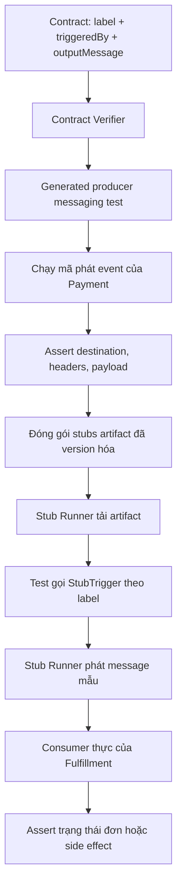
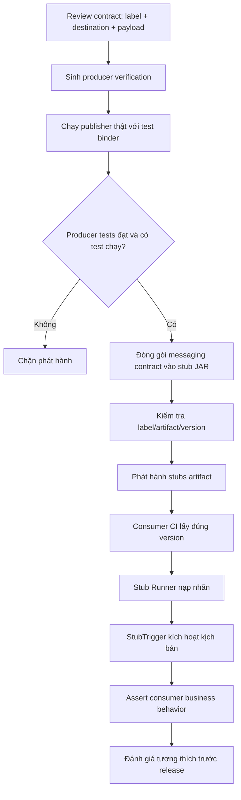

# Kích hoạt messaging stub theo nhãn

## 1. Vì sao cần kích hoạt thông điệp theo nhãn?

Giả sử hệ thống thương mại điện tử có hai microservice:

- `payment-service` là **producer**: sau khi capture thanh toán thành công, dịch vụ phát sự kiện `PaymentCaptured`.
- `fulfillment-service` là **consumer**: dịch vụ nhận sự kiện để đánh dấu đơn hàng đã thanh toán và bắt đầu quy trình giao hàng.

Trong môi trường thật, sự kiện có thể đi qua Kafka hoặc RabbitMQ. Nhưng để kiểm thử Fulfillment trong CI, nhóm không muốn khởi động toàn bộ Payment và tạo giao dịch thật chỉ để nhận một sự kiện mẫu.

Với **Spring Cloud Contract**, nhóm viết hợp đồng thông điệp bằng **Groovy DSL hoặc YAML DSL**, sinh kiểm thử xác minh producer, phát hành artifact chứa stub, rồi cho consumer sử dụng **Stub Runner**. Khác với HTTP stub — thường phản hồi khi có request phù hợp — một messaging stub **có thể cần được test chủ động yêu cầu phát sự kiện**.

Spring Cloud Contract giải quyết nhu cầu đó bằng **`label` của contract** và giao diện **`StubTrigger`**. Test consumer có thể gọi:

```java
stubTrigger.trigger("payment_captured_1001");
```

Stub Runner tìm messaging contract tương ứng, phát message mẫu đến destination được mô tả, rồi mã consumer thật nhận và xử lý nó. **Nhãn là tên định danh kịch bản cần kích hoạt**, không phải tên Kafka topic, không phải Spring Cloud Stream binding name và không phải nội dung của event.

### Mục tiêu bài học

Sau bài này, bạn có thể:

1. Viết messaging contract có `label`, `triggeredBy` và `outputMessage.sentTo`.
2. Phân biệt nhãn, stub artifact, destination, binding và loại sự kiện.
3. Cấu hình Stub Runner cùng Spring Cloud Stream test binder cho kiểm thử consumer.
4. Dùng các phương thức `trigger(label)`, `trigger(groupId:artifactId, label)`, `labels()` và `trigger()` đúng trường hợp.
5. Viết assertion trên **kết quả nghiệp vụ của consumer**, không chỉ giá trị boolean của trigger.
6. Xử lý nhãn trùng, mapping sai, artifact cũ, side effect và test bất đồng bộ trong CI.

## 2. Luồng producer verification và consumer stub test

Hai phía sử dụng **cùng ý nghĩa hợp đồng**, nhưng kiểm tra những việc khác nhau.



| Phía | Thành phần thật đang được kiểm thử | Thành phần được thay thế |
| --- | --- | --- |
| **Producer verification** | Code Payment tạo và phát sự kiện, mapping dữ liệu, destination và header theo setup test. | Broker bên ngoài có thể được thay bằng test binder/message verifier. |
| **Consumer test** | Consumer handler/functional bean, giải mã payload, validation, idempotency và quyết định nghiệp vụ của Fulfillment. | Payment thật được thay bằng messaging stub do Stub Runner kích hoạt. |

Nếu chỉ thấy `stubTrigger.trigger(...)` trả `true`, ta mới biết Stub Runner **đã có thể kích hoạt** kịch bản tương ứng; **chưa chứng minh Fulfillment đã đọc hoặc xử lý đúng**. Phải quan sát kết quả nghiệp vụ hoặc message đầu ra của consumer.

Tương tự, consumer test xanh với một stub **không chứng minh producer hiện tại đã phát thông điệp thật**. Phía Payment vẫn phải chạy generated producer tests trước khi công bố artifact.

## 3. Bốn tên thường bị nhầm

Ví dụ một sự kiện:

```json
{
  "eventId": "EVT-1001",
  "eventType": "PaymentCaptured",
  "paymentId": "PAY-1001",
  "orderId": "ORD-2001",
  "amount": 250000,
  "currency": "VND"
}
```

| Tên/giá trị | Loại | Ai sử dụng? |
| --- | --- | --- |
| `payment_captured_1001` | **Contract label** | Test gọi `StubTrigger.trigger(...)` để chọn kịch bản. |
| `com.example:payment-service:1.4.2:stubs` | **Stub artifact coordinates** | Stub Runner dùng để tìm và tải đúng gói. |
| `payments.captured` | **Messaging destination** | Publisher gửi message đến đây; consumer binding nhận từ đây. |
| `recordCapturedPayment-in-0` | **Spring Cloud Stream binding name** | Ánh xạ bean `recordCapturedPayment` đến destination. |
| `PaymentCaptured` | **Event type** | Consumer quyết định cách xử lý nghiệp vụ. |
| `EVT-1001` | **Event ID** | Consumer có thể dùng để phát hiện sự kiện bị gửi trùng. |

**Không dùng `payment_captured_1001` làm tên destination chỉ vì đó là label.** Nhãn là giao diện của bài test để yêu cầu phát message. Destination là phần giao tiếp giữa các dịch vụ, cần được định nghĩa và version hóa theo chính sách API/event của hệ thống.

Một label có thể mang ngữ nghĩa “sự kiện thanh toán PAY-1001 đã được capture”, nhưng **payload thực tế vẫn phải được kiểm tra**, vì việc đặt tên đúng không bảo đảm body đúng.

## 4. Groovy DSL: khai báo nhãn ở cấp contract

Đây là một messaging contract đầy đủ cho Payment:

```groovy
import org.springframework.cloud.contract.spec.Contract

Contract.make {
    name 'payment_captured_for_order_2001'
    description 'Phát sự kiện sau khi capture thanh toán thành công'
    label 'payment_captured_1001'

    input {
        triggeredBy('publishCapturedPayment()')
    }

    outputMessage {
        sentTo('payments.captured')
        body([
            eventId: 'EVT-1001',
            eventType: 'PaymentCaptured',
            paymentId: 'PAY-1001',
            orderId: 'ORD-2001',
            amount: 250000,
            currency: 'VND'
        ])
        headers {
            messagingContentType(applicationJson())
            header('eventType', 'PaymentCaptured')
        }
    }
}
```

Ý nghĩa từng thành phần:

1. **`label`** ở cấp contract: `payment_captured_1001` là nhãn để consumer test kích hoạt messaging stub.
2. **`input.triggeredBy(...)`**: ở phía **producer verification**, generated test gọi `publishCapturedPayment()` để yêu cầu ứng dụng Payment thực hiện hành vi phát event.
3. **`outputMessage.sentTo(...)`**: xác định destination `payments.captured` cần quan sát.
4. **`outputMessage.body`**: dữ liệu nghiệp vụ mà Fulfillment sẽ nhận từ stub.
5. **`outputMessage.headers`**: metadata cần cho chuyển đổi payload hoặc định tuyến theo hợp đồng.

**Điểm rất dễ nhầm:** `triggeredBy('publishCapturedPayment()')` **không phải** biểu thức mà consumer sẽ gọi qua `StubTrigger`. Ở phía producer, phương thức này phải tồn tại trong base test hoặc được tham chiếu hợp lệ để kích hoạt **mã producer thật**. Ở phía consumer, mã test gọi **label** `payment_captured_1001`.

### Producer base test cần làm gì?

Ví dụ phác thảo với Spring Cloud Stream:

```java
@SpringBootTest(classes = PaymentApplication.class)
@AutoConfigureMessageVerifier
@Import(TestChannelBinderConfiguration.class)
public abstract class PaymentMessagingContractBase {

    @Autowired
    PaymentEventPublisher publisher;

    public void publishCapturedPayment() {
        publisher.publishCaptured(
            new PaymentCaptured(
                "EVT-1001",
                "PaymentCaptured",
                "PAY-1001",
                "ORD-2001",
                250000L,
                "VND"
            )
        );
    }
}
```

Đây là **mã minh họa**, không phải class biên dịch độc lập. Dự án cần import annotation, DTO, publisher, test dependencies, base class mapping của Contract Verifier và bộ test binder phù hợp. Tùy phiên bản Spring Cloud Stream, việc kích hoạt test binder có thể dùng `@Import(TestChannelBinderConfiguration.class)`, `@ImportAutoConfiguration(...)` hoặc `@EnableTestBinder`; **chọn cơ chế đúng theo phiên bản dự án**. Generated producer test phải thực sự gọi publisher và kiểm tra message, không chỉ tạo JSON mẫu ngay trong test.

Nếu Spring Cloud Contract Verifier được cấu hình cho JUnit 5, hãy bảo đảm base test và engine JUnit Jupiter nhất quán. Việc có contract DSL và stub mẫu không thay việc cấu hình producer test framework.

## 5. YAML DSL: nhãn có cùng ý nghĩa

Hợp đồng tương đương bằng YAML:

```yaml
description: Phát sự kiện sau khi capture thanh toán thành công
name: payment_captured_for_order_2001
label: payment_captured_1001
input:
  triggeredBy: publishCapturedPayment()
outputMessage:
  sentTo: payments.captured
  body:
    eventId: EVT-1001
    eventType: PaymentCaptured
    paymentId: PAY-1001
    orderId: ORD-2001
    amount: 250000
    currency: VND
  headers:
    contentType: application/json
    eventType: PaymentCaptured
```

Nhãn ở YAML là trường top-level `label:`, **không** nằm bên trong `outputMessage.body`. Khi Stub Runner đọc contract trong artifact, nó tìm nhãn đã khai báo để cung cấp khả năng kích hoạt.

Groovy và YAML ở phần 4–5 là **hai cách biểu diễn cùng một tình huống**; không nên giữ cả hai thành hai contract riêng nếu mục tiêu chỉ có một stub. Các phiên bản Spring Cloud Contract khác nhau có thể chi tiết khác về converter/header, nên khi đổi DSL cần sinh lại tests/stubs và kiểm tra nhãn được nhận diện.

## 6. Đóng gói messaging contract trước khi kích hoạt

Đối với HTTP, một mapping WireMock JSON thường đủ để stub server đáp ứng request. Với messaging, **Stub Runner cần thông tin từ contract** để biết cách phát message theo nhãn và destination. Bởi vậy bản Groovy/YAML nguồn cần được đóng gói trong stub artifact theo layout mà phiên bản Stub Runner sử dụng.

Ví dụ một artifact:

```text
payment-service-1.4.2-stubs.jar
└── META-INF/
    └── com.example/
        └── payment-service/
            └── 1.4.2/
                ├── contracts/
                │   └── messaging/
                │       └── payment-captured.groovy
                └── mappings/
                    └── http/
                        └── get-paid-payment.json
```

Đây là **layout minh họa** tương ứng một cách đóng gói JAR thường gặp. Đường dẫn thực tế thay đổi theo plugin/version, artifact download mode và tổ chức nguồn; với các bố cục legacy còn có thư mục khác. Điều bắt buộc là **Stub Runner của consumer thật sự đọc được contract và nhãn**. Một artifact chỉ có WireMock HTTP mappings nhưng thiếu messaging contracts sẽ không thể cung cấp label mong muốn.

Tọa độ giả định:

```text
groupId     = com.example
artifactId  = payment-service
version     = 1.4.2
classifier  = stubs

Stub Runner ID:
com.example:payment-service:1.4.2:stubs
```

Sau producer verification, có thể kiểm tra gói trên máy build:

```bash
jar tf target/payment-service-1.4.2-stubs.jar
```

Đường dẫn chỉ đúng với ví dụ Maven và tên artifact tương ứng. **Không tự suy ra JAR đã đúng chỉ từ tên file**: cần đọc entry bên trong, xác minh `label` còn nguyên, producer test đã thực thi và artifact được tiêu thụ trong smoke test là **cùng version/byte** với artifact dự định công bố.

### Vì sao cần pin version?

Khi Checkout test bằng stub `1.4.2`, các message mẫu đến từ contract tương ứng phiên bản đó. Nếu dùng ký hiệu version động, cùng một commit consumer có thể nhận nội dung stub khác vào ngày hôm sau. Với CI cần tái hiện kết quả, hãy dùng phiên bản cụ thể hoặc khóa artifact theo policy tổ chức. Không xuất bản lại version release đã có chỉ để thay nội dung stub.

## 7. Spring Cloud Stream consumer: binding vào destination

Giả sử Fulfillment xử lý sự kiện bằng **mô hình functional** được Spring Cloud Stream khuyến nghị trong các dòng hiện đại:

```java
@Configuration
class FulfillmentStreamConfiguration {

    @Bean
    Consumer<PaymentCaptured> recordCapturedPayment(
            FulfillmentService service) {
        return event -> service.registerPaidOrder(
            event.eventId(),
            event.orderId(),
            event.paymentId()
        );
    }
}
```

Đây là mã minh họa; `PaymentCaptured` có thể là record/DTO của consumer, `FulfillmentService` cần có implementation và probe/fixture test thích hợp.

Với functional bean `recordCapturedPayment`, tên input binding mặc định:

```text
recordCapturedPayment-in-0
```

Cấu hình ánh xạ binding đó đến destination được contract ghi:

```yaml
spring:
  cloud:
    function:
      definition: recordCapturedPayment
    stream:
      bindings:
        recordCapturedPayment-in-0:
          destination: payments.captured
          content-type: application/json
```

Điểm cần nhớ:

- `recordCapturedPayment` là **tên function bean**.
- `recordCapturedPayment-in-0` là **binding name** do Spring Cloud Stream tạo theo quy tắc.
- `payments.captured` là **destination logic** ở cả hai phía, được binder ánh xạ đến cơ chế truyền thông điệp.
- `payment_captured_1001` chỉ là **label để Stub Runner kích hoạt message**, không phải một bean hoặc binding.

Nếu test producer dùng `sentTo('payments.captured')` nhưng consumer đang bind `payments.refunded`, việc kích hoạt label vẫn có thể thành công trong Stub Runner mà Fulfillment **không nhận được sự kiện**. Cần xác minh đúng nơi consumer lắng nghe.

### Vì sao cần test binder?

Trong consumer test, Spring Cloud Stream test binder giúp nhận/gửi message trong JVM mà không phải kết nối Kafka/RabbitMQ dùng chung. Phụ thuộc Maven ví dụ:

```xml
<dependency>
    <groupId>org.springframework.cloud</groupId>
    <artifactId>spring-cloud-stream-test-binder</artifactId>
    <scope>test</scope>
</dependency>
<dependency>
    <groupId>org.springframework.cloud</groupId>
    <artifactId>spring-cloud-starter-contract-stub-runner</artifactId>
    <scope>test</scope>
</dependency>
```

Đây là các dependency **phác thảo**: dự án còn cần Spring Cloud Stream, Spring Boot test, management BOM và các binder/serializer phù hợp. Không trộn `spring-cloud-stream-test-support` của hệ cũ với test binder mới một cách tùy tiện; phải theo compatibility matrix của Spring Boot, Spring Cloud Stream và Spring Cloud Contract đang sử dụng.

## 8. Consumer test: kích hoạt một label và kiểm tra kết quả nghiệp vụ

Ví dụ kiểm thử Spring Boot/JUnit 5:

```java
@SpringBootTest(
    classes = FulfillmentApplication.class,
    properties = {
        "spring.cloud.function.definition=recordCapturedPayment",
        "spring.cloud.stream.bindings.recordCapturedPayment-in-0.destination=payments.captured",
        "spring.cloud.stream.bindings.recordCapturedPayment-in-0.content-type=application/json"
    }
)
@Import(TestChannelBinderConfiguration.class)
@AutoConfigureStubRunner(
    ids = "com.example:payment-service:1.4.2:stubs",
    stubsMode = StubRunnerProperties.StubsMode.LOCAL
)
class FulfillmentMessagingStubTest {

    @Autowired
    StubTrigger stubTrigger;

    @Autowired
    FulfillmentProbe fulfillmentProbe;

    @Test
    void createsFulfillmentWhenPaymentCapturedStubIsTriggered() {
        boolean triggered = stubTrigger.trigger(
            "com.example:payment-service",
            "payment_captured_1001"
        );

        assertThat(triggered).isTrue();

        await().atMost(Duration.ofSeconds(5))
            .untilAsserted(() -> {
                assertThat(
                    fulfillmentProbe.hasProcessedEvent("EVT-1001")
                ).isTrue();
                assertThat(
                    fulfillmentProbe.hasOrder("ORD-2001")
                ).isTrue();
            });
    }
}
```

**Đây là ví dụ có chủ đích chưa đầy đủ boilerplate:** cần import `@Test`, `@Autowired`, `@SpringBootTest`, `@Import`, `@AutoConfigureStubRunner`, `StubRunnerProperties`, `StubTrigger`, `Duration`, AssertJ/Awaitility và các lớp của ứng dụng. `FulfillmentProbe` là một component test độc lập quan sát kết quả mà **FulfillmentService thật** tạo ra (ví dụ in-memory repository), không phải một mock tự đặt sẵn `true`. Chọn `TestChannelBinderConfiguration`/`@EnableTestBinder` theo phiên bản.

### Phân tích chính xác những gì test thực hiện

1. `@AutoConfigureStubRunner` tải stub artifact `com.example:payment-service:1.4.2:stubs` từ local Maven repository.
2. Stub Runner đọc messaging contract đã đóng gói, tìm `label 'payment_captured_1001'`.
3. Lệnh `trigger("com.example:payment-service", "payment_captured_1001")` chọn message của **đúng stub producer**.
4. Stub Runner phát body/header đã mô tả đến `payments.captured` qua tích hợp messaging được cấu hình.
5. Spring Cloud Stream chuyển message đến bean `recordCapturedPayment` của Fulfillment.
6. Handler dùng payload để cập nhật trạng thái nghiệp vụ.
7. Test đợi **có giới hạn** và xác minh event ID, order ID đã được xử lý.

**Giá trị `true` của trigger chỉ xác nhận thao tác kích hoạt đã được thực hiện theo API**, không xác nhận consumer xử lý xong, transaction đã commit hay message không bị gửi trùng. Assertion nghiệp vụ ở bước 7 mới kiểm tra hành vi consumer.

**Lưu ý artifact nguồn:** `StubsMode.LOCAL` yêu cầu stub JAR tương ứng đã được cài vào local Maven repository của môi trường test. Không dùng một artifact cũ tình cờ có sẵn rồi kết luận bản producer vừa build tương thích. Trong CI, có thể chuyển sang `REMOTE` với artifact repository và credentials được cấu hình rõ ràng.

## 9. Các cách gọi StubTrigger được hỗ trợ

Spring Cloud Contract cung cấp giao diện `org.springframework.cloud.contract.stubrunner.StubTrigger`. Tài liệu chính thức nêu các thao tác sau:

```java
// 1. Kích hoạt theo label (phù hợp khi nhãn là duy nhất).
boolean ok1 =
    stubTrigger.trigger("payment_captured_1001");

// 2. Kích hoạt theo danh tính stub và label.
boolean ok2 =
    stubTrigger.trigger(
        "com.example:payment-service",
        "payment_captured_1001"
    );

// 3. Có thể dùng chỉ artifactId theo API hỗ trợ.
boolean ok3 =
    stubTrigger.trigger(
        "payment-service",
        "payment_captured_1001"
    );

// 4. Kích hoạt tất cả sự kiện khả dụng.
boolean allTriggered =
    stubTrigger.trigger();

// 5. Liệt kê nhãn đã đăng ký theo artifact.
Map<String, Collection<String>> registered =
    stubTrigger.labels();
```

Đoạn này minh họa API trong **test scope**, giả định đã inject `StubTrigger` và import `Map/Collection`. Giá trị boolean cho biết trigger có chạy theo giao diện; **không nên dùng boolean thay cho assertion rằng consumer đã nhận message**.

### 9.1. Chỉ định label

```java
stubTrigger.trigger("payment_captured_1001");
```

Phù hợp khi test chỉ tải **một** producer stub hoặc toàn bộ stub artifact đều có các nhãn phân biệt rõ. Tên nhãn nên diễn đạt tình huống, không phụ thuộc vào vị trí source file.

### 9.2. Chỉ định producer và label

```java
stubTrigger.trigger(
    "com.example:payment-service",
    "payment_captured_1001"
);
```

Hữu ích khi cùng một consumer tải stub từ nhiều producer, hoặc nhiều producer có nhãn giống nhau. `groupId:artifactId` ở đây **không** phải `groupId:artifactId:version:classifier`; tài liệu nêu cặp group/artifact hoặc chỉ artifactId là cách chọn stub cho overload này. Version của stub đã được xác định ở cấu hình `ids`.

### 9.3. Liệt kê label trước khi kích hoạt

```java
Map<String, Collection<String>> available = stubTrigger.labels();

boolean hasExpectedLabel = available.values().stream()
    .anyMatch(labels -> labels.contains("payment_captured_1001"));

assertThat(hasExpectedLabel).isTrue();
```

`labels()` trả về ánh xạ **artifact notation → tập các label**. Có thể log các nhãn (không chứa payload bí mật) khi điều tra lỗi, nhưng không nên test dựa vào thứ tự duyệt `Map` hoặc `Collection`.

### 9.4. Kích hoạt tất cả nhãn

```java
stubTrigger.trigger();
```

Tác vụ này có thể hữu ích cho smoke test của một artifact chuyên biệt, nhưng **không nên dùng mặc định** trong consumer test độc lập. Nếu gói chứa `PaymentCaptured`, `PaymentRefunded` và `PaymentCaptureDeclined`, việc trigger tất cả có thể tạo các side effect trái ngược nhau, làm test khó giải thích và ảnh hưởng nhau. Hãy ưu tiên kích hoạt **một nhãn** tương ứng kịch bản đang assert.

## 10. Phân biệt trigger bằng nhãn với gửi message thủ công

Khi viết test Spring Cloud Stream, bạn có thể tự tạo message rồi gửi bằng `InputDestination.send(...)`:

```java
inputDestination.send(
    MessageBuilder.withPayload(
        json.getBytes(StandardCharsets.UTF_8)
    ).setHeader(
        MessageHeaders.CONTENT_TYPE,
        MimeTypeUtils.APPLICATION_JSON
    ).build(),
    "payments.captured"
);
```

Cách đó **hữu ích để unit/integration test consumer binding**, nhưng nó khác với `StubTrigger`:

| Tiêu chí | InputDestination gửi thủ công | StubTrigger theo label |
| --- | --- | --- |
| Nguồn payload | Test consumer tự viết JSON/header. | Contract đã được producer phát hành trong stub artifact. |
| Ràng buộc version producer | Không mặc định có. | Có, thông qua artifact/version Stub Runner tải. |
| Mục tiêu chính | Kiểm tra binding/handler với dữ liệu test cục bộ. | Kiểm tra consumer xử lý **thông điệp thuộc hợp đồng producer**. |
| Nguy cơ | Test consumer tự bịa payload khác producer. | Artifact cũ, label sai hoặc stub không được producer xác minh. |
| Cần producer chạy thật? | Không. | Không, nhưng producer verification cần chạy trước khi artifact được công bố. |

Hai phương án **bổ sung cho nhau**. Test binder cục bộ có thể kiểm tra các tình huống biến thể rất nhỏ hoặc edge case. Stub Runner theo nhãn giúp một consumer test gắn với **cam kết đã công bố** giữa các nhóm.

## 11. Bất đồng bộ: kiểm tra kết quả, không dùng sleep cố định

Messaging có thể được xử lý trên thread khác hoặc qua Reactor scheduler. Ngay sau khi `trigger(...)` trả về, consumer chưa chắc đã commit database hay cập nhật read model.

Không nên viết:

```java
stubTrigger.trigger("payment_captured_1001");
Thread.sleep(3000);
assertThat(repository.hasOrder("ORD-2001")).isTrue();
```

Vì ba giây có thể quá ngắn trong CI chậm hoặc quá dài khi ứng dụng xử lý nhanh. Cách tốt hơn là **chờ một điều kiện quan sát được với timeout rõ ràng**:

```java
assertThat(
    stubTrigger.trigger("payment_captured_1001")
).isTrue();

await().atMost(Duration.ofSeconds(5))
    .untilAsserted(() ->
        assertThat(
            fulfillmentRepository.hasOrder("ORD-2001")
        ).isTrue()
    );
```

Ví dụ cần Awaitility và repository test không phụ thuộc database dùng chung. Timeout là **giới hạn kiểm thử**, không phải cam kết rằng sự kiện luôn phải được xử lý trong đúng năm giây ở production. Chọn thời hạn phù hợp và ghi log/metrics đủ để chẩn đoán khi test không đạt.

Khi consumer xử lý event bằng transaction hoặc async workflow, nên assert **dấu hiệu hoàn tất nghiệp vụ** như trạng thái đơn, bản ghi kết quả hoặc output message; không chỉ kiểm tra một method của mock đã được gọi nếu yêu cầu là bảo vệ behavior của consumer.

## 12. Tránh test xanh giả do artifact, label và destination

### 12.1. Nhãn tồn tại nhưng thuộc artifact khác

Giả sử Fulfillment tải:

```text
com.example:payment-service:1.4.2:stubs
com.example:refund-service:2.1.0:stubs
```

Cả hai tình cờ có nhãn `payment_captured_1001`. Lệnh:

```java
stubTrigger.trigger("payment_captured_1001");
```

có thể không diễn đạt đủ ý định test khi nhãn không độc nhất. Nên chọn **producer cụ thể**:

```java
stubTrigger.trigger(
    "com.example:payment-service",
    "payment_captured_1001"
);
```

Và quy định naming convention rõ ràng cho nhãn, ví dụ `payment_captured_success_1001`, tránh phụ thuộc vào thứ tự loader hoặc dự đoán artifact nào được chọn.

### 12.2. Label đúng nhưng consumer không nhận

Khi `trigger(...)` trả thành công nhưng probe không thay đổi, kiểm tra:

1. Contract có `outputMessage.sentTo('payments.captured')` không?
2. Spring Cloud Stream consumer binding có `destination: payments.captured` không?
3. `spring.cloud.function.definition` có kích hoạt bean `recordCapturedPayment` không?
4. Có đúng **test binder/messaging integration** trên classpath và trong Spring TestContext không?
5. Header `contentType=application/json` có giúp converter chuyển payload sang DTO không?
6. Producer stub artifact có chứa label từ **đúng version** không?
7. Consumer xử lý thất bại vì validation, exception hay lỗi ghi fixture, trong khi trigger vẫn báo thành công?

Mỗi lỗi thuộc một lớp khác nhau; **đừng sửa bằng cách đổi tên label thành destination**.

### 12.3. Label bị thiếu trong JAR

Groovy contract được review có thể chứa `label 'payment_captured_1001'` nhưng artifact phát hành lại từ build cũ chưa có nhãn. Hãy:

- Liệt kê entry trong stub JAR.
- Xác nhận file contract Groovy/YAML chứa label đúng.
- Kiểm tra `stubTrigger.labels()` tại runtime consumer.
- So checksum của artifact đang chạy với artifact được sản xuất ở CI.
- Chạy lại producer verification và đóng gói từ cùng commit.

Nếu Spring Cloud Contract source DSL tồn tại nhưng build không tạo/publish đúng messaging contract, **đừng đánh dấu test thành công** chỉ vì HTTP mappings vẫn hoạt động.

## 13. Khi có nhiều messaging framework trên classpath

Stub Runner hỗ trợ một số tích hợp messaging như Spring Cloud Stream, Spring Integration, Spring JMS hoặc Apache Camel. Nếu cùng lúc nhiều công nghệ có mặt trên classpath, **cơ chế auto-configuration được chọn có thể khác ý định**.

Tài liệu Spring Cloud Contract mô tả những cờ cấu hình để tắt tích hợp không mong muốn, chẳng hạn:

```properties
spring.cloud.contract.stubrunner.stream.enabled=true
spring.cloud.contract.stubrunner.integration.enabled=false
```

Với ví dụ này, nhóm muốn sử dụng Spring Cloud Stream. Các thuộc tính trên có thể được dùng để điều chỉnh cơ chế tích hợp **nếu phiên bản đang sử dụng hỗ trợ tên property tương ứng**. Không copy cấu hình của phiên bản cũ mà không kiểm tra namespace: một số tài liệu legacy dùng dạng viết tắt `stubrunner.stream.enabled` hoặc `stubrunner.integration.enabled`.

Chỉ tắt phần thực sự không cần. Nếu bỏ Stream integration trong khi consumer chỉ có Spring Cloud Stream binding, Stub Runner có thể không đưa được message đến nơi mong muốn dù artifact và label đều đúng.

**Lưu ý quan trọng:** test binder giúp kiểm tra giao tiếp trong JVM, không phải Kafka/RabbitMQ thật. Khi cần xác minh partition, ack/nack, routing key, TLS, rebalance hoặc dead-letter queue, hãy có integration test riêng với broker test được cấp riêng, không tự suy ra từ việc `StubTrigger` thành công.

## 14. Kiểm thử các nhánh nghiệp vụ bằng nhiều label

Một producer thanh toán có thể công bố nhiều sự kiện:

| Label | Destination | Payload chính | Hành vi consumer cần kiểm tra |
| --- | --- | --- | --- |
| `payment_captured_1001` | `payments.captured` | `PAY-1001`, `ORD-2001`, `PAID` | Tạo yêu cầu giao hàng đúng đơn. |
| `payment_capture_declined_1002` | `payments.declined` | `PAY-1002`, `ORD-2002`, mã lỗi nghiệp vụ | Không giao hàng, lưu lý do từ chối. |
| `payment_refunded_1003` | `payments.refunded` | `PAY-1003`, `ORD-2003`, `REFUNDED` | Bắt đầu quy trình hoàn/trả nếu được thiết kế. |

Mỗi label nên có **contract riêng** hoặc một định nghĩa có thể truy vết riêng, với body/header mẫu có ý nghĩa. Không dùng một stub phát `PaymentCaptured` rồi kiểm tra mọi nhánh bằng cách sửa trực tiếp payload trong consumer test; khi đó bạn đã bỏ qua sự liên kết với hợp đồng được producer phát hành.

Một consumer test thường nên **kích hoạt một label tại một thời điểm** với fixture độc lập:

```java
@Test
void doesNotShipWhenPaymentIsDeclined() {
    assertThat(stubTrigger.trigger(
        "com.example:payment-service",
        "payment_capture_declined_1002"
    )).isTrue();

    await().atMost(Duration.ofSeconds(5))
        .untilAsserted(() -> {
            assertThat(
                fulfillmentProbe.hasOrder("ORD-2002")
            ).isFalse();
            assertThat(
                fulfillmentProbe.hasDecline("PAY-1002")
            ).isTrue();
        });
}
```

Giới hạn của ví dụ: assertion `hasOrder(...).isFalse()` ngay trong một vòng await **không tự chứng minh sự vắng mặt mãi mãi**; test còn cần một tín hiệu consumer đã xử lý event từ chối xong và policy đảm bảo không tạo đơn giao hàng sau đó. Ở đây `hasDecline("PAY-1002")` là dấu hiệu nhánh từ chối hoàn tất. Kiểm thử hành vi âm tính nên dựa vào **kết quả ổn định hoặc sự kiện hoàn tất**, không chỉ là “đến thời điểm kiểm tra vẫn chưa xảy ra”.

## 15. Gửi trùng một label và idempotency

Các broker thực tế có thể giao một event nhiều lần do retry hoặc redelivery. Nếu Fulfillment nhận lại `EVT-1001`, nó không được tạo hai yêu cầu giao hàng nếu hệ thống cam kết idempotent.

Với Stub Runner, bạn có thể kích hoạt **cùng label hai lần** để kiểm tra logic consumer:

```java
assertThat(
    stubTrigger.trigger("payment_captured_1001")
).isTrue();
assertThat(
    stubTrigger.trigger("payment_captured_1001")
).isTrue();

await().atMost(Duration.ofSeconds(5))
    .untilAsserted(() ->
        assertThat(
            fulfillmentProbe.shipmentCountFor("ORD-2001")
        ).isEqualTo(1)
    );
```

Đây là **một test hữu ích nhưng chưa đủ** nếu kiểm tra khi handler chưa hoàn tất cả hai lần xử lý. Hãy bảo đảm probe/test infrastructure biết đã xử lý **hai lần nhận** (hoặc đã ghi nhận lần nhận thứ hai là duplicate), rồi assert duy nhất một side effect. Có thể bổ sung một message counter hoặc test completion barrier có giới hạn thời gian.

**Contract schema** bảo vệ rằng `eventId` được phát đúng định dạng và các trường nghiệp vụ không đổi. **Idempotency** là logic consumer riêng, phải kiểm tra bổ sung. Stub Runner cũng không mô phỏng toàn bộ retry, partition hoặc acknowledgment của broker thật; cần broker integration test ở tầng phù hợp.

## 16. Kích hoạt nhãn khác với mô phỏng một sự cố broker

Sự kiện `PaymentCaptured` là **kết quả nghiệp vụ**. Việc kích hoạt label có nghĩa Stub Runner tạo một message có payload/destination đã thỏa thuận. Nó **không** tự mô phỏng:

- Kafka đang mất kết nối hoặc một partition không có leader.
- RabbitMQ từ chối publish hoặc message bị dead-letter.
- Consumer group rebalance hoặc offset commit thất bại.
- Message mất do producer crash giữa database commit và publish.
- Thứ tự sự kiện bị thay đổi khi gửi qua nhiều partition.

Những hành vi này cần fault injection, broker test hoặc end-to-end test riêng. Nếu bài test chỉ kiểm tra consumer đọc và xử lý payload, **test binder + Stub Runner** là lựa chọn nhanh và đủ tập trung cho mục tiêu contract. Nếu cần bảo đảm giao vận thật, sử dụng môi trường broker thử riêng, không coi việc trigger label là bằng chứng hạ tầng production hoạt động.

## 17. Chẩn đoán lỗi theo triệu chứng

| Triệu chứng | Nguyên nhân thường gặp | Cách kiểm tra và sửa |
| --- | --- | --- |
| `trigger(label)` trả `false` | Không có label, artifact sai version, không có messaging contract được nạp. | Kiểm tra `labels()`, artifact coordinates và nội dung JAR. |
| Label có nhưng không phát được | Messaging integration không được kích hoạt, thiếu test binder hoặc destination không resolve. | Kiểm tra auto-configuration, classpath, binding/destination và log. |
| Trigger thành công nhưng consumer không nhận | Consumer binding sai destination hoặc function không được kích hoạt. | Kiểm tra `spring.cloud.function.definition` và `*-in-0.destination`. |
| Consumer nhận body nhưng lỗi chuyển đổi | Thiếu Content-Type, DTO/schema khác kiểu hoặc serializer không tương thích. | Kiểm tra header, payload thực và message conversion. |
| Test lúc xanh lúc đỏ | Dùng `Thread.sleep`, fixture chung, event từ test khác còn tồn tại. | Awaitility có timeout, reset state và cô lập từng test. |
| Trigger nhãn của producer khác | Dùng label-only trong suite nạp nhiều stub có nhãn giống nhau. | Dùng overload `trigger("groupId:artifactId", "label")`. |
| Stub Runner chạy nhưng đọc event cũ | Local Maven cache hoặc artifact version không trùng build hiện tại. | Pin version, kiểm tra JAR/checksum và repository nguồn. |
| Producer test xanh, consumer test thất bại | Mismatch destination, headers, function binding hoặc business handler. | So contract, generated stub, cấu hình consumer và assertion. |
| Consumer test xanh nhưng producer không phát event thật | Consumer chỉ dùng stub hoặc producer tests bị skip. | Chạy Contract Verifier producer tests trên mã Payment. |
| Gọi `trigger()` làm nhiều bản ghi ngoài mong muốn | Phát mọi event đã đăng ký trong test context. | Trigger một nhãn duy nhất và reset fixture. |
| Test Kafka thật lại không kết nối Kafka | Test binder được auto-configure thay vì binder Kafka. | Tách integration test với broker thật và xác minh connection. |

### Một quy trình debug ngắn

1. **Xem stub inventory:** `stubTrigger.labels()` có nhãn mong đợi không?
2. **Xem danh tính artifact:** classpath/local/remote repository có đúng version `stubs` không?
3. **Kích hoạt có phạm vi:** dùng `trigger("com.example:payment-service", "payment_captured_1001")`.
4. **Xem destination:** hợp đồng gửi tới `payments.captured`, consumer binding có cùng destination?
5. **Xem content type/payload:** DTO parse thành công, event ID và order ID đúng?
6. **Xem kết quả handler:** có thay đổi nghiệp vụ hoặc event downstream mong muốn không?
7. **Xem thời gian và cô lập:** test có chờ completion, reset state và tránh broker dùng chung không?

Không nên chỉ sửa cho boolean `triggered=true` rồi bỏ qua lỗi của handler. Chính consumer mới là đối tượng kiểm thử của bước này.

## 18. Đưa kiểm thử theo nhãn vào CI

Pipeline đề xuất:



Ở producer CI:

1. Có messaging contract thuộc phạm vi build, `label` được duy trì ổn định.
2. Generated producer tests được sinh và **thực sự chạy**.
3. Test gọi mã producer phát event, xác minh `sentTo`, payload và headers.
4. Artifact stub được sinh từ **cùng commit/version contract** đã verify.
5. Gói không chứa label chưa được producer xác minh hoặc contract `inProgress` vô tình xuất bản như release chính thức.

Ở consumer CI:

1. Lấy stub có version xác định (LOCAL repo test cô lập hoặc REMOTE artifact repository).
2. Kiểm tra `labels()` và artifact identity trước khi trigger.
3. Kích hoạt **chỉ nhãn liên quan đến kịch bản**.
4. Kiểm tra consumer handler thật, schema, mã đơn/ID và kết quả nghiệp vụ.
5. Đưa mọi test bất đồng bộ về trạng thái xác định trước khi kết thúc.
6. Có integration test broker riêng cho các bảo đảm messaging quan trọng mà stub không thể kiểm tra.

**Không dùng version động** để “luôn có stub mới” nếu mục tiêu của job là xác nhận tính tương thích tại một commit/release cụ thể. Với release gate, phải đối chiếu source contract, producer verification và artifact Stub Runner đang nạp.

## 19. Bài thực hành: phát một sự kiện theo nhãn

Một `inventory-service` phát sự kiện `StockReserved` đến destination `stock.reserved` khi giữ hàng cho Checkout. Consumer `shipping-service` sử dụng sự kiện để tạo phiếu chuẩn bị hàng.

Sự kiện mẫu:

```json
{
  "eventId": "EVT-STOCK-1001",
  "eventType": "StockReserved",
  "orderId": "ORD-2001",
  "sku": "SKU-001",
  "quantity": 2,
  "warehouse": "HN01"
}
```

Hai nhóm thống nhất label:

```text
stock_reserved_1001
```

**Nhiệm vụ:**

1. Viết Groovy messaging contract có `label 'stock_reserved_1001'`, `input.triggeredBy('publishStockReserved()')` và `outputMessage.sentTo('stock.reserved')`. Body phải gồm event ID, order ID, SKU, số lượng và kho.
2. Viết bản YAML DSL tương đương, nhưng chỉ giữ **một định nghĩa** làm contract nguồn trong repository.
3. Viết base test producer có phương thức `publishStockReserved()` gọi mã publisher thật; cấu hình `@AutoConfigureMessageVerifier` và test binder cho Contract Verifier.
4. Đóng gói stub artifact giả định `com.example:inventory-service:2.3.0:stubs`; kiểm tra trong JAR có messaging contract và label, không chỉ HTTP mappings.
5. Viết bean `Consumer<StockReserved>` cho Shipping; cấu hình tên binding mặc định và destination `stock.reserved`.
6. Viết consumer test dùng `@AutoConfigureStubRunner`, inject `StubTrigger` và gọi `trigger("com.example:inventory-service", "stock_reserved_1001")`.
7. Sau khi trigger, dùng một probe/fixture quan sát **phiếu chuẩn bị hàng của `ORD-2001`**, không chỉ assert boolean `true`.
8. Thêm một stub khác có cùng label nhưng đến từ producer khác; giải thích tại sao dùng hai tham số khi trigger giúp tránh mơ hồ.
9. Thử đổi destination trong consumer thành `stock.cancelled` trong khi contract vẫn gửi `stock.reserved`. Test nào phải thất bại, và kết quả này nói gì về binding?
10. Trigger cùng event ID hai lần. Thiết kế kiểm tra idempotency để không tạo hai phiếu chuẩn bị hàng.
11. Đề xuất CI pipeline chạy producer verification → stub packaging → consumer Stub Runner test và một stage broker integration riêng.

**Gợi ý tự kiểm:** lời giải đúng phân biệt **label**, **destination**, **binding name**, **artifact version**, có producer test phát message thực theo contract và consumer test xác minh **kết quả nghiệp vụ sau trigger**.

## 20. Ghi nhớ

- **`label`** ở cấp contract định danh một kịch bản messaging stub; nó không phải destination hay loại sự kiện.
- Producer dùng `triggeredBy(...)` trong generated verification test để kích hoạt **mã phát sự kiện thật**. Consumer dùng `StubTrigger.trigger(label)` hoặc overload có `groupId:artifactId` để yêu cầu **stub** phát payload mẫu.
- `labels()` giúp kiểm tra nhãn đã nạp; `trigger()` kích hoạt tất cả nhãn nên cần dùng thận trọng.
- Artifact stub phải chứa **messaging contract đã được xác minh** và có version xác định; chỉ có HTTP mappings không đủ.
- Spring Cloud Stream functional binding phải trỏ đến **cùng destination** được `sentTo(...)` mô tả, với header/codec giải mã payload phù hợp.
- **Trigger thành công không đồng nghĩa consumer xử lý thành công**. Cần assertion nghiệp vụ và đồng bộ bất đồng bộ bằng cơ chế chờ có giới hạn.
- Stub Runner kiểm tra consumer trước payload đã công bố; producer verification và integration test broker vẫn cần thiết để đảm bảo hợp đồng và các đặc tính hạ tầng.

### Tài liệu tham khảo

- [Spring Cloud Contract — Messaging](https://docs.spring.io/spring-cloud-contract/reference/project-features-messaging.html): `label`, `triggeredBy`, `sentTo`, các overload của `StubTrigger` và `labels()`.
- [Spring Cloud Contract — Stub Runner](https://docs.spring.io/spring-cloud-contract/reference/project-features-stubrunner.html): tải artifact, chạy stub ở phía consumer.
- [Spring Cloud Contract — Stub Runner Core](https://docs.spring.io/spring-cloud-contract/reference/project-features-stubrunner/stub-runner-core.html): danh tính artifact, cấu hình Stub Runner và layout stub.
- [Spring Cloud Stream — Functional Binding Names](https://docs.spring.io/spring-cloud-stream/reference/spring-cloud-stream/functional-binding-names.html): tên binding `-in-0` và ánh xạ destination.
- [Spring Cloud Stream — Testing](https://docs.spring.io/spring-cloud-stream/reference/spring-cloud-stream/spring_integration_test_binder.html): test binder và cách kiểm thử consumer function.
