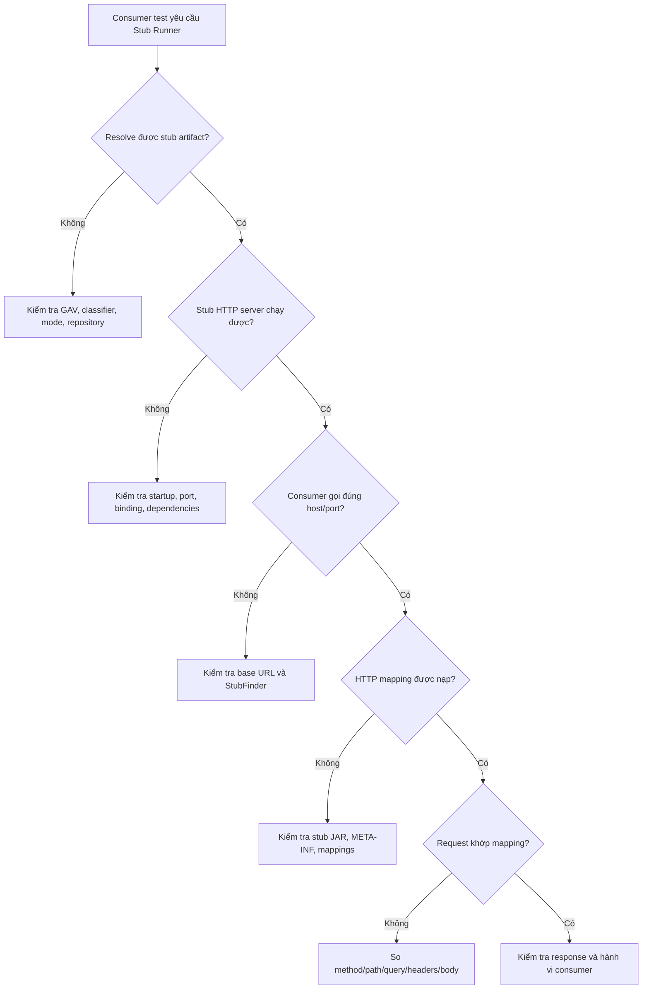
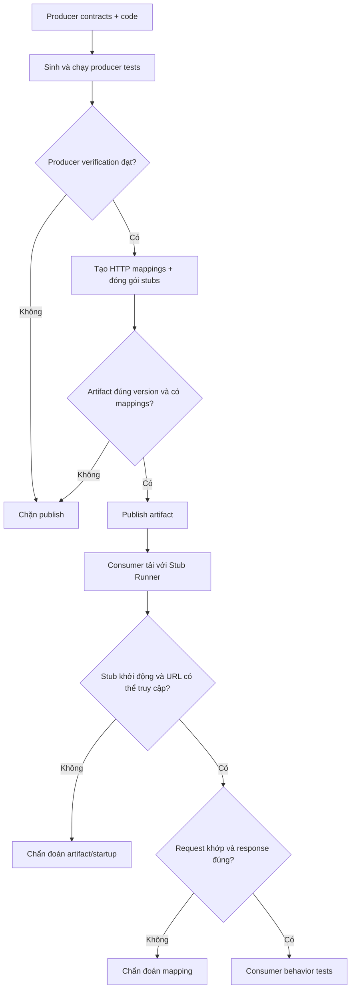

# Xử lý lỗi tải artifact, khởi động stub và không tìm thấy mapping

## 1. Vì sao Stub Runner không hoạt động dù hợp đồng đã được viết?

Trong module **SPRING_CLOUD_CONTRACT**, Spring Cloud Contract hỗ trợ kiểm thử hợp đồng giữa **producer** và **consumer** cho HTTP và thông điệp. Hợp đồng được mô tả qua **Groovy/YAML DSL**, dùng để sinh kiểm thử phía producer, chuyển đổi thành stub, đóng gói và phát hành artifact theo phiên bản. Consumer dùng **Stub Runner** tải artifact và chạy các kịch bản mô phỏng trong CI để phát hiện sớm thay đổi API không tương thích.

Ba lỗi dễ bị gọi chung là “Stub Runner bị hỏng” thực ra nằm ở những tầng khác nhau:

1. **Không tải được artifact**: Stub Runner không tìm thấy hoặc không truy cập được JAR chứa stub.
2. **Không khởi động được stub**: artifact có thể đã được tải nhưng WireMock server hoặc messaging integration không khởi tạo được.
3. **Stub chạy nhưng không tìm thấy mapping phù hợp**: request đã đến server, song không khớp điều kiện trong bất kỳ mapping HTTP nào được nạp.

Mỗi tầng cần cách khắc phục khác nhau. Nếu artifact không tồn tại, sửa regex request là vô ích. Nếu WireMock đã chạy và trả một response “not matched”, tăng timeout tải artifact cũng không giải quyết được. Nếu client gọi nhầm cổng, việc sửa hợp đồng có thể làm mất một cam kết đúng.

**Mục tiêu bài học:** chẩn đoán lỗi theo thứ tự từ nguồn artifact đến cổng stub, mapping và logic consumer; tìm bằng chứng ở từng tầng; sửa nguyên nhân gốc mà không vô tình làm hợp đồng lỏng đi.

Sau bài học, bạn sẽ biết cách:

- Đọc đúng tọa độ `groupId:artifactId:version:classifier:port` và chọn chế độ `CLASSPATH`, `LOCAL`, `REMOTE`.
- Kiểm tra nội dung JAR, phiên bản, classifier, `contracts` và `mappings`.
- Xác định stub chưa khởi động, lỗi bind cổng hay consumer gọi sai địa chỉ.
- Dùng HTTP request và endpoint quản trị WireMock (khi có) để tìm mapping không khớp.
- Phân biệt HTTP `404` do stub **không có mapping** với HTTP `404` nghiệp vụ.
- Xây dựng smoke test, consumer contract test và các kiểm tra CI giúp phát hiện lỗi sớm.

## 2. Sơ đồ chẩn đoán từ ngoài vào trong



### 2.1. Bảng xác định tầng lỗi

| Dấu hiệu đầu tiên | Nghi vấn chính | Bằng chứng cần tìm |
| --- | --- | --- |
| Build báo không resolve dependency, `artifact not found` | **Tầng tải artifact** | Tọa độ, mode, repository và nội dung Maven local |
| Lỗi kết nối repository, `401`/`403` từ kho artifact | **Tầng tải artifact** | URL repository, quyền và credentials |
| `Address already in use` khi khởi động | **Tầng startup** | Port đã có tiến trình khác sử dụng |
| Consumer nhận `Connection refused` | **Startup hoặc địa chỉ client** | Stub thực sự chạy chưa, cổng nào, host nào |
| Stub trả response “Request was not matched” | **Tầng matching** | WireMock đã nhận request nhưng chưa có mapping khớp |
| Stub trả `404` với body `ORDER_NOT_FOUND` | Có thể là **nhánh nghiệp vụ** | Kiểm tra đúng mapping của tình huống `404` |
| Stub trả `200` nhưng consumer parse lỗi | **Tầng response/consumer** | Content-Type, body, DTO/deserializer |
| Test chỉ fail trong CI | **Môi trường và tái lập** | Stub version, cache, port, network, parallel jobs |

Các thông điệp lỗi trong bảng là **mẫu thường gặp**, không cam kết nguyên văn log của mọi phiên bản Spring Cloud Contract hoặc WireMock.

## 3. Đọc đúng tọa độ stub artifact

Giả sử producer đã phát hành stub:

```text
com.example:orders-producer:1.4.2:stubs
```

Trong cấu hình Stub Runner, khi muốn dùng cổng cố định `8090`, một chuỗi ID thường có dạng:

```text
com.example:orders-producer:1.4.2:stubs:8090
```

| Thành phần | Giá trị | Ý nghĩa |
| --- | --- | --- |
| groupId | `com.example` | Nhóm artifact trong Maven repository |
| artifactId | `orders-producer` | Producer phát hành stub |
| version | `1.4.2` | Phiên bản stub cần nạp |
| classifier | `stubs` | Chỉ artifact chứa stub, khác JAR ứng dụng thông thường |
| port | `8090` | Cổng WireMock được yêu cầu khi cấu hình theo kiểu HTTP |

Đừng nhầm thứ tự `version`, `classifier` và `port`. Một consumer đang tìm `orders-producer:1.4.1` có thể không thấy hợp đồng vừa thêm trong bản `1.4.2`. Một tọa độ thiếu hoặc sai `stubs` có thể trỏ tới JAR ứng dụng không chứa HTTP mappings.

**Port không phải một phần của tọa độ artifact trên repository.** Nó là tham số chạy stub. Artifact có thể được dùng ở cổng khác trong môi trường khác; không phải phát hành lại JAR khi đổi cổng.

### 3.1. Tại sao không nên phụ thuộc `+` hoặc “latest” trong CI?

Một số cấu hình Stub Runner hỗ trợ biểu thức version động như `+`. Điều đó hữu ích khi thử nhanh một bản mới, nhưng làm consumer CI khó tái lập: cùng commit của consumer có thể hôm nay nạp `1.4.2` và ngày mai nạp `1.4.3`.

Với kiểm thử chặn phát hành, hãy **ghim phiên bản rõ ràng**. Có thể thêm job riêng chủ động cập nhật stub ứng viên để kiểm tra khả năng tương thích với producer mới.

### 3.2. Đường dẫn JAR trong Maven repository

Với tọa độ ví dụ, một file `LOCAL` thường nằm ở đường dẫn như:

```text
~/.m2/repository/com/example/orders-producer/1.4.2/
    orders-producer-1.4.2-stubs.jar
```

Lưu ý cách tổ chức repository Maven sử dụng `groupId` tách bởi dấu chấm thành các cấp thư mục `com/example`. Đây **không nhất thiết giống** bố cục `META-INF/com.example/...` ở **bên trong JAR**. Trộn hai cách tổ chức này là nguyên nhân phổ biến khi tìm thủ công.

## 4. Chọn đúng chế độ tải stub

Stub Runner hỗ trợ những nguồn stub phổ biến:

| Chế độ | Nguồn dữ liệu | Khi dùng | Lỗi thường gặp |
| --- | --- | --- | --- |
| `CLASSPATH` | Stub được đặt trên test classpath | Kiểm thử dự án có dependency stub sẵn | Artifact chưa được thêm vào classpath hoặc thiếu `META-INF` |
| `LOCAL` | Maven repository cục bộ | Phát triển sau khi `install` stub artifact | File `-stubs.jar` chưa tồn tại tại version yêu cầu |
| `REMOTE` | Maven-compatible artifact repository | CI hoặc chia sẻ stub qua Nexus/Artifactory | Sai `repositoryRoot`, quyền, URL, TLS hoặc artifact chưa publish |

Ba mode này xác định **nơi lấy artifact**, không quyết định request nào khớp mapping. Sau khi tải đúng JAR, cả ba vẫn cần thư mục stub được đóng gói hợp lệ.

### 4.1. Ví dụ `LOCAL` trong Spring Boot test

```java
import org.junit.jupiter.api.Test;
import org.springframework.boot.test.context.SpringBootTest;
import org.springframework.cloud.contract.stubrunner.StubRunnerProperties;
import org.springframework.cloud.contract.stubrunner.spring.AutoConfigureStubRunner;

@SpringBootTest
@AutoConfigureStubRunner(
    ids = "com.example:orders-producer:1.4.2:stubs:8090",
    stubsMode = StubRunnerProperties.StubsMode.LOCAL
)
class OrdersConsumerContractTest {
    @Test
    void readsOrderFromStub() {
        // Gọi mã HTTP client thật của consumer hướng tới localhost:8090,
        // sau đó assert hành vi xử lý dữ liệu trả về.
    }
}
```

Đây là **khung cấu hình**, chưa phải test đầy đủ: consumer cần dependency Stub Runner, HTTP client được trỏ đúng base URL, assertion thực tế và file stub artifact đã được cài vào repository cục bộ.

### 4.2. Ví dụ `REMOTE`

```java
@AutoConfigureStubRunner(
    ids = "com.example:orders-producer:1.4.2:stubs:8090",
    stubsMode = StubRunnerProperties.StubsMode.REMOTE,
    repositoryRoot = "https://artifacts.example.test/repository/maven-releases"
)
```

Đây là đoạn annotation minh họa; URL trên không phải repository thực. Đừng đưa username/password trực tiếp vào source code hoặc log. Khi cần authentication, cấu hình secret của CI và resolver theo cách mà phiên bản Stub Runner đang dùng hỗ trợ.

**REMOTE có hai phụ thuộc riêng:** repository phải có thể truy cập được **và** artifact đúng version/classifier phải đã được publish. `HTTP 200` khi mở trang chủ của repository **không chứng minh** file JAR mong đợi tồn tại.

### 4.3. Ví dụ `CLASSPATH`

Nếu consumer đặt stub artifact lên test classpath và chọn `CLASSPATH`, Stub Runner sẽ quét các vị trí stub được hỗ trợ trong classpath. Nếu cấu hình classpath đúng nhưng JAR thiếu `mappings` hoặc các thư mục bị lồng sai bên trong, server vẫn có thể không nạp được endpoint.

Không nên đổi từ `LOCAL` sang `CLASSPATH` chỉ để vượt qua lỗi artifact chưa được publish mà không xác nhận test đang dùng đúng nguồn hợp đồng/phiên bản. Cách này có thể vô tình chạy trên một stub copy cũ trong consumer repository.

## 5. Tầng một: lỗi tải artifact

Khi startup báo không tìm thấy artifact, kiểm tra lần lượt:

1. **Đọc chính xác Stub Runner IDs**: groupId, artifactId, version và classifier.
2. **Xác nhận mode**: `LOCAL` không tự thay thế bằng repository từ xa; `REMOTE` cần URL repository hợp lệ.
3. **Xác nhận producer đã đóng gói stub**: không phải chỉ build JAR ứng dụng.
4. **Xác nhận publish/install**: artifact có ở đúng nơi consumer đang tìm.
5. **Kiểm tra phiên bản cache**: local Maven có thể giữ bản cũ, hoặc remote chưa đồng bộ.
6. **Phân biệt lỗi permission và lỗi không tồn tại**: `401`/`403` từ repository không chứng minh artifact không có.

### 5.1. Tạo artifact ở producer trước khi consumer sử dụng

Với Maven producer đã cấu hình `spring-cloud-contract-maven-plugin`:

```bash
# Producer: sinh và chạy tests theo lifecycle đã cấu hình.
./mvnw -B clean verify

# Producer: đưa artifact và stub JAR vào local Maven repository.
./mvnw -B install
```

Đây là lệnh **minh họa**, không thực thi trong bài. Plugin cần tạo và attach artifact `-stubs.jar` trong lifecycle; một bản build thành công nhưng cấu hình không tạo stub artifact vẫn chưa đủ.

Với Gradle producer:

```bash
./gradlew contractTest
./gradlew verifierStubsJar
./gradlew publishToMavenLocal
```

Cách publish classifier `stubs` phụ thuộc `publishing` và plugin Gradle. Cần kiểm tra `verifierStubsJar` thực sự được gắn vào publication trước khi cho rằng `publishToMavenLocal` sẽ cài nó. Không dùng lệnh bỏ qua producer tests để “khắc phục” một lỗi tải artifact.

### 5.2. Kiểm tra file artifact tại nơi tải

Ví dụ trên máy có JDK và Maven local repository mặc định:

```bash
jar tf "$HOME/.m2/repository/com/example/orders-producer/1.4.2/orders-producer-1.4.2-stubs.jar"
```

Nếu file không tồn tại, cần xác nhận `install`/`publish` thành công và tọa độ đã chọn. Nếu file tồn tại nhưng nội dung thiếu, vấn đề chuyển sang **packaging**, không còn thuần túy là vấn đề repository.

Trên Windows PowerShell, dùng đường dẫn thích hợp dưới `$HOME\.m2\repository` hoặc lấy đường dẫn thực từ Maven settings; lệnh `jar tf` có thể dùng với đường dẫn JAR được bao trong dấu nháy.

### 5.3. Phân biệt một số lỗi remote

| Biểu hiện | Nghi vấn | Hướng giải quyết |
| --- | --- | --- |
| Repository trả `404` khi tải artifact | Tọa độ/version/classifier sai hoặc chưa publish | Kiểm tra bản phát hành và đường dẫn Maven thật |
| Repository trả `401` | Thiếu hoặc sai thông tin đăng nhập | Kiểm tra credentials từ secret/CI settings |
| Repository trả `403` | Tài khoản không có quyền truy cập | Kiểm tra ACL và quyền của service account |
| DNS không phân giải được hostname | Sai host hoặc mạng/DNS | Kiểm tra URL, DNS, mạng CI |
| TLS handshake/certificate error | Chuỗi chứng chỉ, truststore, proxy | Sửa truststore/certificate hợp lệ, không tắt TLS verification tùy tiện |
| Download ngắt quãng hoặc timeout | Proxy, network, repository quá tải | Kiểm tra timeout/retry có giới hạn và sức khỏe repository |
| Local cache không có bản mới | Phiên bản động/SNAPSHOT hoặc metadata chưa cập nhật | Ghim release version và kiểm tra lại resolution |

Một lựa chọn nguy hiểm là dùng repository công khai hoặc bỏ qua xác thực chỉ để có artifact “cùng tên”. Stub là một phần của chuỗi cung ứng phần mềm; cần lấy từ **nguồn được tin cậy**, đúng version và có thể kiểm chứng nguồn gốc.

## 6. Tầng giữa: artifact tải thành công nhưng stub không khởi động

Sau khi resolve JAR, Stub Runner còn phải khởi tạo môi trường stub. Với HTTP, môi trường phổ biến là **WireMock**. Một số lỗi thuộc về **cổng**, **Spring context** và **dependency compatibility**:

| Dấu hiệu | Giải thích có thể | Cách xử lý |
| --- | --- | --- |
| `Address already in use` hoặc lỗi bind socket | Cổng `8090` đang được dùng | Giải phóng cổng hoặc chuyển sang cổng động |
| `Connection refused` khi consumer gọi | Không có server lắng nghe tại địa chỉ client dùng | Xem log startup và cổng thực tế |
| Bean/auto-configuration exception | Thiếu dependency hoặc các phiên bản Spring không tương thích | Xem stack trace đầu tiên và dependency tree của dự án |
| Stub server khởi tạo nhưng mappings rỗng | Artifact thiếu mappings, sai layout hoặc filter quét | Mở JAR và kiểm tra generated mappings |
| Chạy một test đạt, nhiều test song song lỗi | Dùng trùng cổng hoặc trạng thái server | Tách ports/contexts, tránh cố định cổng chung |
| Context không khởi tạo vì repository chưa sẵn | Lỗi tải artifact trước startup | Quay lại tầng tải artifact, không chỉnh HTTP client |

### 6.1. Cổng cố định và cổng động

Khai báo `:8090` trong Stub Runner ID buộc chạy trên cổng đó. Nó phù hợp khi ví dụ dễ đọc hoặc consumer client được cấu hình tĩnh, nhưng gây xung đột nếu nhiều suite cùng sử dụng cổng `8090`.

Nếu cấu hình cho phép server sử dụng cổng được cấp động (ví dụ không cố định port trong ID), nên **lấy cổng thực từ Stub Runner** thay vì hardcode một giá trị giả định. Spring Cloud Contract cung cấp `StubFinder` để truy vấn địa chỉ của stub đang chạy.

Điểm cần nhớ:

- **Cổng đã khai báo** không chắc là **cổng đã bind thành công** nếu startup thất bại.
- **Cổng của ứng dụng consumer** khác với **cổng của HTTP stub**.
- Nếu consumer chạy trong Docker/container khác, `localhost` chỉ tới chính container đó, không phải máy chủ Stub Runner ở container khác.
- Một vài triển khai/proxy có context path hoặc host mapping riêng; phải dùng **địa chỉ thực mà test có thể truy cập**.

### 6.2. Tìm địa chỉ stub đã khởi động bằng `StubFinder`

Trong một test đã có `@AutoConfigureStubRunner`:

```java
import org.junit.jupiter.api.Test;
import org.springframework.beans.factory.annotation.Autowired;
import org.springframework.boot.test.context.SpringBootTest;
import org.springframework.cloud.contract.stubrunner.StubFinder;
import org.springframework.cloud.contract.stubrunner.StubRunnerProperties;
import org.springframework.cloud.contract.stubrunner.spring.AutoConfigureStubRunner;

import static org.assertj.core.api.Assertions.assertThat;

@SpringBootTest
@AutoConfigureStubRunner(
    ids = "com.example:orders-producer:1.4.2:stubs",
    stubsMode = StubRunnerProperties.StubsMode.LOCAL
)
class StubAddressTest {
    @Autowired
    private StubFinder stubFinder;

    @Test
    void findsStartedStub() {
        Object stubUrl = stubFinder.findStubUrl("com.example", "orders-producer");
        assertThat(stubUrl).isNotNull();
        // Truyền địa chỉ này tới HTTP client trong consumer test.
    }
}
```

`StubFinder.findStubUrl` là API dùng để truy vấn stub được nạp, giúp tránh phụ thuộc cổng cố định. Đoạn mã dùng `Object` để tập trung vào kiểm tra địa chỉ; khi viết test thực tế, hãy dùng **kiểu trả về đúng của phiên bản thư viện** và cấu hình HTTP client của consumer theo địa chỉ nhận được.

**Giới hạn:** tìm được địa chỉ không có nghĩa một endpoint cụ thể đã có mapping hoặc request đã khớp. Nó chỉ chứng minh bạn đã đi qua bước tìm stub.

## 7. Cổng mở nhưng chưa chắc có HTTP mappings

Stub Runner có thể khởi động WireMock thành công với **không mapping nào**, hoặc chỉ nạp một số mapping từ artifact cũ. Khi đó, gọi:

```http
GET /api/orders/ord-1001 HTTP/1.1
Host: localhost:8090
```

có thể nhận HTTP `404` vì WireMock không tìm được request mapping tương ứng. Một số phiên bản trả diagnostic body giải thích request không được khớp; nội dung thực tế phụ thuộc WireMock version/config.

### 7.1. Nội dung thường cần thấy trong JAR

Giả sử artifact:

```text
com.example:orders-producer:1.4.2:stubs
```

Bố cục thường dùng:

```text
orders-producer-1.4.2-stubs.jar
└── META-INF/
    └── com.example/
        └── orders-producer/
            └── 1.4.2/
                ├── contracts/
                │   └── http/orders/
                │       ├── get_order_success.groovy
                │       └── get_order_not_found.groovy
                └── mappings/
                    └── http/orders/
                        ├── get_order_success.json
                        └── get_order_not_found.json
```

Tên file `get_order_success.json` và đường dẫn nhóm trong ví dụ là **minh họa**, không phải tên cứng mà mọi generator luôn tạo. Điều cần bảo đảm là Stub Runner có thể tìm thấy mappings HTTP ở vị trí được hỗ trợ và chúng mang đúng điều kiện request/response.

### 7.2. Vì sao chỉ có `contracts` là chưa đủ cho HTTP?

Contracts Groovy/YAML là **nguồn mô tả hành vi**. HTTP mappings JSON do converter tạo là định dạng WireMock có thể sử dụng để phục vụ request. Nếu một artifact chỉ có Groovy source mà thiếu HTTP mappings cần thiết, không nên giả định WireMock tự biên dịch chúng thành stub ở runtime.

Với **messaging contracts**, cách hoạt động khác: thông tin `label`, `outputMessage` và messaging integration có thể được dùng để phát message stub; không nhất thiết có một mapping HTTP WireMock JSON tương ứng mỗi hợp đồng message.

### 7.3. Kiểm tra bằng `jar tf`

```bash
jar tf target/orders-producer-1.4.2-stubs.jar
```

Khi xem danh sách:

1. Tìm `META-INF/.../contracts/...` và các file Groovy/YAML kỳ vọng.
2. Tìm `META-INF/.../mappings/...` và các file HTTP JSON mappings.
3. Xác nhận `groupId`, `artifactId` và `version` trên đường dẫn khớp với IDs.
4. Nếu mapping chứa body file ngoài, xác nhận **file body được tham chiếu cũng nằm trong artifact**.
5. Xác nhận artifact được consumer nạp chính là file vừa kiểm tra, không phải một bản cũ nằm trong cache.

**Không sửa mapping trực tiếp trong JAR** để làm test xanh. Sửa hợp đồng nguồn hoặc cấu hình convert/package, chạy producer verification và tạo artifact phiên bản phù hợp.

## 8. Tầng ba: mapping có nhưng request không khớp

Giả sử hợp đồng producer:

```groovy
import org.springframework.cloud.contract.spec.Contract

Contract.make {
    name 'get_order_success'
    request {
        method GET()
        url '/api/orders/ord-1001'
    }
    response {
        status 200
        headers {
            contentType(applicationJson())
        }
        body([
            id    : 'ord-1001',
            status: 'CREATED'
        ])
    }
}
```

Một mapping WireMock **tương đương về ý nghĩa** có thể là:

```json
{
  "request": {
    "method": "GET",
    "url": "/api/orders/ord-1001"
  },
  "response": {
    "status": 200,
    "headers": {
      "Content-Type": "application/json"
    },
    "jsonBody": {
      "id": "ord-1001",
      "status": "CREATED"
    }
  }
}
```

Đây là ví dụ WireMock JSON **để giải thích**, không khẳng định generated mapping của mọi phiên bản Spring Cloud Contract dùng chính xác `jsonBody` hay cùng tên file. Bây giờ xét các request:

| Request consumer gửi | Kết quả so với mapping minh họa |
| --- | --- |
| `GET /api/orders/ord-1001` | Khớp method và URL |
| `POST /api/orders/ord-1001` | Sai method |
| `GET /api/orders/ord-1002` | Sai URL |
| `GET /api/orders/ord-1001/` | Có dấu `/` cuối; không khớp URL chính xác |
| `GET /api/orders/ord-1001?lang=vi` | Có query string; nếu mapping dùng `url` chính xác, cần xem điều kiện match toàn URL |

Khi viết test, phải quan sát **request thật sau khi HTTP client đã xây dựng URL**, không chỉ xem chuỗi mà developer dự định gửi.

### 8.1. Phân biệt `url` và `urlPath`

Trong WireMock, một điều kiện URL đầy đủ có thể tính cả query string; một điều kiện chỉ dựa trên path không giống hệt. Nếu contract muốn cho phép query parameter, cần diễn đạt chúng bằng DSL phù hợp, thay vì tự giả định query sẽ được bỏ qua.

Nếu producer có API `GET /api/orders/ord-1001?includeItems=true`, người viết hợp đồng cần quyết định:

- Query parameter có bắt buộc để nhận đúng response không?
- Không có tham số thì producer trả nội dung khác hay cùng hành vi?
- Giá trị `true` là text hay boolean và được encode thế nào trên URL?

Đưa ra mapping chỉ khớp path trong khi nghiệp vụ phân biệt query có thể khiến stub trả sai nhánh.

## 9. Headers, query, body: những điều kiện thường bị bỏ sót

Một mapping không chỉ kiểm tra URL. Nó còn có thể ràng buộc header, query parameter, cookie và JSON request body. **Một trường sai là đủ làm cả request không khớp**, dù method/path đúng.

### 9.1. Header `Content-Type` và `Accept`

Hợp đồng `POST /api/orders` có thể yêu cầu:

```groovy
request {
    method POST()
    url '/api/orders'
    headers {
        contentType(applicationJson())
        header 'X-Request-Id': 'req-1234'
    }
    body([
        productId: 'SKU-001',
        quantity : 2
    ])
}
```

Client gửi body JSON nhưng quên header `Content-Type: application/json` có thể không khớp mapping, dù body trông giống hệt. Tương tự, nếu mapping yêu cầu `X-Request-Id` thì việc thiếu header gây no match.

`Content-Type` mô tả **body request**, còn `Accept` là ưu tiên định dạng **response** mà client chấp nhận. Không nên sửa mapping bằng cách thêm/bỏ `Accept` nếu API không công bố điều kiện đó; kiểm tra xem header nào thật sự có trong hợp đồng và request của client.

### 9.2. Độ chính xác của JSON body

Một hợp đồng chứa:

```groovy
body([
    productId: 'SKU-001',
    quantity : 2
])
```

Consumer có thể gửi:

```json
{
  "productId": "SKU-001",
  "quantity": "2"
}
```

Trường `quantity` giờ là **chuỗi** `"2"` chứ không phải số `2`; tùy matcher của mapping, request có thể không khớp. Cần đọc điều kiện JSON matcher được sinh: object comparison, JSONPath, regex hay biểu diễn JSON khác.

Một sai sót khác là consumer gửi thêm trường mới. Trong một số cách so khớp JSON, thêm thuộc tính có thể được dung thứ; trong cách khác, nó bị từ chối. **Không suy đoán mặc định “WireMock sẽ bỏ qua mọi trường lạ”**; hãy đọc mapping thực tế và kiểm tra version/semantics của matcher.

### 9.3. Cookie, Authorization và charset

Nếu hợp đồng có `Cookie`, `Authorization`, query parameter hoặc encoding cụ thể, những yếu tố đó cũng ảnh hưởng matching. Không chèn token thật vào stub artifact hay log CI. Với dữ liệu động, dùng matcher hợp lý và giá trị test giả; không thay bằng regex `.*` chỉ để không còn lỗi matching.

## 10. Dùng WireMock admin API để xem mappings

Với **HTTP Stub Runner chạy WireMock**, một số phiên bản/cấu hình cho phép truy cập WireMock admin API trên **cùng cổng stub**.

### 10.1. Liệt kê các mappings hiện có

```bash
curl -i http://localhost:8090/__admin/mappings
```

Khi được bật và truy cập được, endpoint này trả danh sách mappings mà server đã nạp. Tìm những điều kiện:

```text
request.method = GET
request.url = /api/orders/ord-1001
response.status = 200
```

Nếu danh sách rỗng, trở lại bước **kiểm tra artifact và convert**. Nếu có mapping nhưng request chưa khớp, chuyển sang so sánh request cụ thể.

### 10.2. Gửi request tối thiểu bằng curl

```bash
curl -i http://localhost:8090/api/orders/ord-1001
```

Nếu request curl khớp nhưng ứng dụng consumer không khớp, nghi vấn chính chuyển sang **HTTP client configuration**: khác base URL, thêm context path, query, header hoặc body.

Với request có body:

```bash
curl -i -X POST http://localhost:8090/api/orders \
  -H "Content-Type: application/json" \
  -H "X-Request-Id: req-1234" \
  -d '{"productId":"SKU-001","quantity":2}'
```

Lệnh nhiều dòng trên dùng cú pháp Bash. Trên Windows PowerShell, có thể dùng `curl.exe` với cách escape của shell hoặc `Invoke-WebRequest`; cần bảo đảm shell **không thay đổi nội dung JSON** khi gửi.

### 10.3. Xem request chưa khớp

Trong nhiều phiên bản WireMock, admin API có endpoint liệt kê những request không khớp:

```bash
curl -i http://localhost:8090/__admin/requests/unmatched
```

Nó hữu ích để đối chiếu request thật (method, URL, headers) với mappings đang có. Một số phiên bản WireMock còn hỗ trợ **near misses** hoặc chi tiết “closest stub” để chỉ ra điều kiện sai.

**Giới hạn:** admin API, request journal và near-miss reporting tùy phiên bản/cấu hình WireMock; khi bị tắt hoặc không mở ra ngoài, các lệnh này có thể trả lỗi dù stub vẫn đang phục vụ HTTP bình thường. Không bật endpoint quản trị công khai trên môi trường không tin cậy chỉ để gỡ lỗi.

## 11. `404` không tìm thấy mapping khác `404` nghiệp vụ

Đây là phân biệt quan trọng nhất khi chẩn đoán Stub Runner.

Giả sử producer công bố hai hợp đồng:

```text
GET /api/orders/ord-1001    -> 200 {id:"ord-1001",status:"CREATED"}
GET /api/orders/ord-missing -> 404 {code:"ORDER_NOT_FOUND"}
```

Nếu consumer gửi `GET /api/orders/ord-missing` và mapping `404` được nạp, stub trả response **nghiệp vụ**:

```http
HTTP/1.1 404 Not Found
Content-Type: application/json

{"code":"ORDER_NOT_FOUND"}
```

Nếu consumer gửi `GET /api/orders/ord-xyz` mà không có mapping nào khớp, WireMock có thể trả `404` kiểu **stub request not matched**. Hai kết quả cùng mã HTTP nhưng **khác ý nghĩa**.

| Tiêu chí | `404` do hợp đồng nghiệp vụ | `404` do WireMock không match |
| --- | --- | --- |
| Nguồn | `response.status 404` trong DSL | Stub server không tìm thấy mapping cho request |
| Có contract riêng? | Có | Không nhất thiết |
| Body | Theo schema lỗi, ví dụ `ORDER_NOT_FOUND` | Diagnostic/default body của WireMock tùy phiên bản |
| Consumer test nên assert | HTTP status **và** error code/body đúng cam kết | Test setup cần sửa, không mặc định đây là đúng nghiệp vụ |
| Sửa thế nào? | Sửa producer/contract khi hành vi đã đổi có chủ đích | Thêm hoặc sửa mapping/khớp request/đúng artifact |

**Không viết consumer test chỉ assert `statusCode == 404`** cho nhánh `ORDER_NOT_FOUND` nếu body/error code là một phần hợp đồng. Nó có thể đạt do WireMock không match, che mất việc stub artifact thiếu hợp đồng.

### 11.1. Cần hợp đồng riêng cho nhánh không tìm thấy

```groovy
import org.springframework.cloud.contract.spec.Contract

Contract.make {
    name 'get_order_not_found'
    request {
        method GET()
        url '/api/orders/ord-missing'
    }
    response {
        status 404
        headers {
            contentType(applicationJson())
        }
        body([code: 'ORDER_NOT_FOUND'])
    }
}
```

Hợp đồng này giúp Stub Runner trả **một nhánh lỗi được định nghĩa rõ**, và generated producer test kiểm chứng producer thực sự trả `404 ORDER_NOT_FOUND` khi ID không tồn tại trong fixture.

## 12. Nhận diện mapping chồng lấp và ưu tiên sai

Không phải mọi lỗi mapping đều làm WireMock trả `404`. Có khi **hai mappings đều khớp** nhưng một mapping quá rộng khiến stub trả `200` thay vì `404`.

Ví dụ:

```text
Mapping A:
  GET /api/orders/ord-1001 -> 200

Mapping B:
  GET /api/orders/.*       -> 200

Mapping C:
  GET /api/orders/ord-missing -> 404
```

Nếu Mapping B thật sự được sinh thành điều kiện regex chấp nhận mọi order ID, nó cũng có thể khớp `ord-missing`. Kết quả phụ thuộc cách WireMock sắp xếp/ưu tiên các mapping, nên không nên dựa vào một thứ tự ngẫu nhiên hoặc tên file.

**Hướng xử lý bền vững:**

1. Tìm mapping rộng hoặc regex vừa được thêm.
2. Xác định lớp request nào thực sự phải trả cùng một response.
3. Thu hẹp matcher hoặc bổ sung điều kiện header/body/query để các nhánh tách biệt.
4. Nếu phải dùng priority, khai báo rõ theo khả năng plugin/WireMock, rồi kiểm tra generated mapping; không dùng priority để che một DSL sai nghiệp vụ.
5. Chạy consumer tests cho cả nhánh thành công và thất bại sau khi sửa.

**Một thư mục khác nhau trong stub JAR không bảo đảm mapping khác nhau không chồng lấp.** WireMock quan tâm method/URL/headers/body và quy tắc matching, không coi `http/orders/success` là tiêu chí tách nhánh.

## 13. Spring Boot test: kiểm tra endpoint stub trước khi kiểm tra logic consumer

Khi khó chẩn đoán, tách thành **smoke test của stub server** và **consumer behavior test**.

### 13.1. Smoke test xác nhận mapping đang phục vụ

Ví dụ dùng JUnit 5, Java 11+ và HTTP client của JDK:

```java
import java.net.URI;
import java.net.http.HttpClient;
import java.net.http.HttpRequest;
import java.net.http.HttpResponse;
import org.junit.jupiter.api.Test;
import org.springframework.beans.factory.annotation.Autowired;
import org.springframework.boot.test.context.SpringBootTest;
import org.springframework.cloud.contract.stubrunner.StubFinder;
import org.springframework.cloud.contract.stubrunner.StubRunnerProperties;
import org.springframework.cloud.contract.stubrunner.spring.AutoConfigureStubRunner;

import static org.assertj.core.api.Assertions.assertThat;

@SpringBootTest
@AutoConfigureStubRunner(
    ids = "com.example:orders-producer:1.4.2:stubs",
    stubsMode = StubRunnerProperties.StubsMode.LOCAL
)
class OrdersStubSmokeTest {

    @Autowired
    StubFinder stubFinder;

    @Test
    void getOrderMappingIsAvailable() throws Exception {
        Object stubUrl = stubFinder.findStubUrl("com.example", "orders-producer");
        assertThat(stubUrl).isNotNull();

        String baseUrl = stubUrl.toString().replaceAll("/+$", "");
        HttpRequest request = HttpRequest.newBuilder(
            URI.create(baseUrl + "/api/orders/ord-1001")
        ).GET().build();

        HttpResponse<String> response = HttpClient.newHttpClient()
            .send(request, HttpResponse.BodyHandlers.ofString());

        assertThat(response.statusCode()).isEqualTo(200);
        assertThat(response.body()).contains("ord-1001");
        assertThat(response.body()).contains("CREATED");
    }
}
```

Đoạn ví dụ yêu cầu dependency Spring Cloud Contract Stub Runner và JUnit/AssertJ tương thích. `stubUrl` được đọc từ `StubFinder`, giúp test không hardcode port. Với dự án cụ thể, cần kiểm tra kiểu URL và hình thức trả về theo phiên bản `StubFinder` hiện dùng.

**Giới hạn smoke test:** nó xác nhận HTTP stub hoạt động và có mapping trả payload mẫu; nó **không tự kiểm tra logic consumer thật**. Vì vậy cần một bài test thứ hai gọi `OrdersClient` hoặc service của consumer với cấu hình base URL trỏ tới stub.

### 13.2. Consumer test phải gọi mã tiêu thụ thật

Một consumer có client `OrdersClient` và xử lý đơn hàng theo kết quả:

```java
// Đoạn minh họa nằm trong test đã cấu hình stub URL.
OrderView order = ordersClient.getOrder("ord-1001");

assertThat(order.id()).isEqualTo("ord-1001");
assertThat(order.status()).isEqualTo("CREATED");
```

`OrdersClient` và `OrderView` là **kiểu minh họa do ứng dụng định nghĩa**, không phải API của Spring Cloud Contract. Test phải cấu hình client lấy đúng Stub Runner URL; nếu nó vẫn gọi producer thật hoặc môi trường staging, kết quả sẽ không phải consumer contract test mà bạn dự định.

### 13.3. Chỉ sửa “port 8090” khi thật sự lỗi cổng

Nếu smoke test truy vấn StubFinder và gọi stub thành công, nhưng `ordersClient` vẫn `Connection refused`, kiểm tra **client base URL**. Nếu smoke test cũng không tìm thấy URL, quay lại startup/artifact. Nếu server trả response no match, kiểm tra mapping. Điều này thu hẹp nguyên nhân nhanh hơn đổi port ngẫu nhiên.

## 14. Messaging stubs: không tìm thấy label khác không tìm thấy HTTP mapping

Spring Cloud Contract cũng hỗ trợ hợp đồng thông điệp:

```groovy
import org.springframework.cloud.contract.spec.Contract

Contract.make {
    name 'order_created_event'
    label 'order_created'
    input {
        triggeredBy('publishOrderCreated()')
    }
    outputMessage {
        sentTo('orders.events')
        body([
            eventType: 'ORDER_CREATED',
            orderId  : 'ord-1001'
        ])
        headers {
            messagingContentType(applicationJson())
        }
    }
}
```

Một consumer messaging test có thể gọi:

```java
boolean triggered = stubTrigger.trigger("order_created");
assertThat(triggered).isTrue();
```

Điều kiện: Stub Runner phải được cấu hình với **messaging integration** tương ứng, label có trong artifact đúng version, và `stubTrigger` được inject từ Spring context hỗ trợ Stub Runner.

Các lỗi khác nhau:

| Dấu hiệu | Cần kiểm tra |
| --- | --- |
| `trigger("order_created")` trả `false` | Label không có trong stub được nạp hoặc chọn nhầm artifact |
| Trigger trả thành công nhưng consumer không nhận event | Binding, destination, transport, subscriber chưa sẵn sàng |
| Consumer nhận message nhưng parse lỗi | `contentType`, payload, headers và message converter |
| Consumer nhận event nhưng không cập nhật read model | Logic handler, test fixture hoặc xử lý bất đồng bộ |

**Đừng tìm một file `order_created.json` trong HTTP `mappings` rồi kết luận message contract thiếu.** Messaging stub không nhất thiết được biểu diễn như một WireMock HTTP mapping.

Đối với producer message tests, `triggeredBy('publishOrderCreated()')` là helper chạy hành vi producer thật; còn `StubTrigger.trigger("order_created")` là consumer test kích hoạt **mẫu message của stub**. Đây là hai hoạt động khác nhau.

## 15. Chẩn đoán khi CI lỗi còn máy phát triển chạy được

Một quy trình chạy cục bộ có thể vô tình dựa vào cache Maven, stub JAR đã cài từ lâu hoặc cổng chưa bị chiếm. Trong CI, môi trường mới khiến các giả định đó lộ ra.

| Tình huống | Cục bộ | CI | Cần làm gì? |
| --- | --- | --- | --- |
| `LOCAL` artifact chưa có | Máy dev đã `install` | Runner sạch không có JAR | Publish artifact và dùng `REMOTE`, hoặc cài rõ trong job |
| Dùng version động | Dev tải một version | CI resolve version khác | Ghim version |
| Cổng cố định `8090` | Chỉ chạy một test | Nhiều job chạy song song | Cổng động hoặc isolation |
| Credentials dùng từ máy dev | Có Maven settings cá nhân | CI thiếu quyền repository | Cấu hình service account/secret |
| Repository chậm | Download nhanh | Timeout trong mạng CI | Xem network/proxy, retry có giới hạn |
| JSON/header khác do client config | Profile dev phù hợp | Profile CI khác | Đồng bộ cấu hình test và log request |
| Timestamp hoặc random ID | Trùng fixture tình cờ | Mẫu khác | Dùng fixture cố định/matcher đúng |
| Cache chứa mappings cũ | Test chỉ endpoint cũ | CI dùng artifact mới | Kiểm tra tọa độ, version và nội dung JAR |

### 15.1. Ba nguyên tắc CI

1. **Reproducibility**: cùng commit consumer + cùng tọa độ stub + cùng cấu hình phải cho kết quả ổn định.
2. **Observability**: log nêu stub ID/version, mode, port thực tế và test nào không khớp.
3. **Isolation**: test không phụ thuộc dữ liệu cũ, cổng dùng chung hoặc artifact cache tùy hứng.

Nếu producer đổi response, cần producer verification trên bản mới và consumer tests với đúng stub version ứng viên. Nếu chỉ thay đổi `@AutoConfigureStubRunner` để dùng một bản stub cũ “cho test xanh”, bạn có thể bỏ qua thay đổi API không tương thích.

## 16. Quy trình kiểm tra trong CI: từ artifact đến consumer assertion



Một pipeline đáng tin nên giữ lại các bằng chứng:

- Producer commit và tọa độ stub `groupId:artifactId:version:stubs`.
- Số contracts được đọc; số generated tests thực sự chạy.
- Danh sách HTTP mappings và messaging contracts được đóng gói.
- Log tải artifact: mode, nguồn và version.
- Log WireMock startup: địa chỉ/cổng đã bind.
- Request/response của trường hợp không khớp (ẩn thông tin nhạy cảm).
- Kết quả kiểm thử consumer: assertion nào thất bại.

### 16.1. Không để “0 mappings” thành một build thành công giả

Giả sử pipeline tạo JAR có `mappings` rỗng vì plugin trỏ sai contracts root. Nếu chỉ kiểm tra sự tồn tại của JAR, build có thể được xem là thành công nhưng consumer không có stub nào để gọi.

Đặt điều kiện CI:

1. Các hợp đồng bắt buộc phải được tìm thấy và parse thành công.
2. Generated producer tests cho từng nhánh quan trọng phải **được thực thi**.
3. Artifact phải chứa các mappings của những endpoint HTTP quan trọng và hợp đồng message cần thiết.
4. Consumer smoke test phải gọi ít nhất một mapping quan trọng với đúng artifact.
5. Các consumer behavior tests phải kiểm tra cả nhánh thành công và thất bại.

Đếm số JSON mappings chỉ là một tín hiệu. Nếu có messaging contract hoặc một file chứa nhiều hợp đồng, số mapping không nhất thiết bằng số file nguồn. Hãy kiểm tra **hành vi** cần có.

## 17. Bài thực hành: sửa ba lỗi khác tầng

### 17.1. Bối cảnh

Producer `inventory-producer` phát hành:

```text
com.example:inventory-producer:2.1.0:stubs
```

Trong JAR kỳ vọng có:

```text
GET /api/products/SKU-001     -> 200
GET /api/products/SKU-MISSING -> 404 PRODUCT_NOT_FOUND
POST /api/reservations        -> 201 / 409 theo body và fixture
```

Consumer dùng Stub Runner để kiểm tra client tra sản phẩm và tạo reservation. Ba bài tập dưới đây là ba lỗi **độc lập**, không nên sửa chung bằng cách đổi expected HTTP status.

### 17.2. Lỗi A — Không tải được artifact

Consumer đang cấu hình:

```java
@AutoConfigureStubRunner(
    ids = "com.example:inventory-producer:2.0.0:stubs:8090",
    stubsMode = StubRunnerProperties.StubsMode.LOCAL
)
```

Nhưng local Maven chỉ chứa `2.1.0-stubs.jar`.

**Yêu cầu:**

1. Xác định vì sao Stub Runner không tìm thấy artifact.
2. Chỉnh ID sang version `2.1.0` hoặc cài đúng version mà consumer cần theo mục tiêu kiểm thử.
3. Xác nhận JAR tồn tại và mở nội dung bằng `jar tf`.
4. Giải thích tại sao không nên chuyển sang version `+` chỉ để test chạy.

**Gợi ý đáp án:** lỗi thuộc **tầng tải artifact**, không liên quan HTTP matcher. Sửa tọa độ/version và kiểm tra nguồn `LOCAL` trước.

### 17.3. Lỗi B — Stub không khởi động

Test A và test B chạy song song, đều cố bind `localhost:8090`.

**Yêu cầu:**

1. Xác định dấu hiệu `Address already in use`.
2. Bỏ yêu cầu cổng cố định ở suite phù hợp; sử dụng StubFinder để lấy địa chỉ thực.
3. Cấu hình consumer HTTP client sử dụng URL vừa tìm được.
4. Chạy lại hai test đồng thời và xác nhận không có xung đột port.

**Gợi ý đáp án:** lỗi thuộc **startup/port**, không nên sửa `GET /api/products/SKU-001` thành endpoint khác hoặc xóa contract.

### 17.4. Lỗi C — Có server nhưng request không khớp

Stub đã khởi động trên `8090` và có mapping:

```json
{
  "request": {
    "method": "POST",
    "url": "/api/reservations",
    "headers": {
      "Content-Type": {
        "equalTo": "application/json"
      }
    },
    "bodyPatterns": [
      {
        "equalToJson": "{\"productId\":\"SKU-001\",\"quantity\":2}"
      }
    ]
  },
  "response": {
    "status": 201,
    "headers": {
      "Content-Type": "application/json"
    },
    "jsonBody": {
      "reservationId": "res-1001"
    }
  }
}
```

Consumer lại gửi:

```http
POST /api/reservations HTTP/1.1
Content-Type: text/plain

{"productId":"SKU-001","quantity":"2"}
```

**Yêu cầu:**

1. Chỉ ra **hai khác biệt** so với mapping: content type và kiểu của `quantity`.
2. Sửa HTTP client gửi `Content-Type: application/json` và `quantity` ở dạng số `2`.
3. Kiểm tra request thực qua WireMock admin/request journal (nếu được bật).
4. Chạy lại smoke test và consumer test.
5. Giải thích vì sao không nên thay mapping thành regex `.*` chỉ để request được chấp nhận.

**Gợi ý đáp án:** lỗi thuộc **request matching**, không cần phát hành lại artifact nếu chính consumer đang gửi sai so với hợp đồng đã thống nhất.

### 17.5. Bài tập bổ sung — `404` nào mới là đúng?

Consumer gọi `GET /api/products/SKU-MISSING` và kỳ vọng:

```json
{"code":"PRODUCT_NOT_FOUND"}
```

Nếu chỉ thấy HTTP `404` nhưng body là diagnostic “Request was not matched”, hãy kiểm tra mapping `get_product_not_found` có thật và đúng URL. Một business `404` cần body/error code theo hợp đồng, không phải chỉ trùng mã HTTP.

### 17.6. Phiếu điều tra lỗi

| Câu hỏi | Kết quả cần ghi |
| --- | --- |
| Stub coordinate yêu cầu | Group, artifact, version, classifier |
| Stub mode | `CLASSPATH` / `LOCAL` / `REMOTE` |
| Artifact có resolve được? | Có/không, nguồn nào |
| JAR có `META-INF/.../mappings`? | Có/không, đường dẫn đúng? |
| Server đã bind thành công? | Host và port thực tế |
| Request thực mà client gửi | Method, URL, headers, body (đã loại secret) |
| Mapping kỳ vọng | File/matcher nào trong artifact |
| Response thực | HTTP status, Content-Type, body |
| Lỗi thuộc tầng | Tải artifact / startup / matching / consumer |
| Sửa ở đâu | Producer contract, packaging, Stub Runner config hay consumer client |
| Test sau sửa | Smoke test, nhánh lỗi, consumer behavior test |

## 18. Checklist chẩn đoán Stub Runner

- [ ] Tọa độ `groupId:artifactId:version:classifier` đúng bản producer cần kiểm tra.
- [ ] Không trộn `port` với version hoặc classifier trong Stub Runner ID.
- [ ] `CLASSPATH`, `LOCAL` hoặc `REMOTE` phù hợp nguồn artifact thực tế.
- [ ] Artifact đã được đóng gói và install/publish; không chỉ có JAR ứng dụng.
- [ ] Repository URL/credentials/TLS hợp lệ và lấy từ nguồn tin cậy.
- [ ] JAR có `META-INF/.../contracts` và **HTTP mappings** cần thiết.
- [ ] Stub Runner đã khởi động và bind thành công vào địa chỉ/cổng thực.
- [ ] Consumer client dùng đúng stub URL, không vô tình gọi producer staging.
- [ ] Cổng cố định không xung đột khi chạy nhiều test/song song.
- [ ] Đã so sánh method, URL/path, query, headers, cookies và JSON body với mapping.
- [ ] Không có regex quá rộng khiến nhánh thành công bắt nhầm nhánh lỗi.
- [ ] Phân biệt `404` nghiệp vụ và `404` do WireMock không có matching stub.
- [ ] Với messaging, kiểm tra `label`, messaging integration và destination, không chỉ HTTP mappings.
- [ ] Smoke test xác nhận server/mapping; consumer test xác nhận **hành vi client thật**.
- [ ] CI ghim phiên bản artifact, giữ log có ích, cô lập fixture và kiểm tra số test đã chạy.
- [ ] Không chỉnh lỏng hợp đồng hoặc bỏ qua producer verification chỉ để làm test xanh.

### Tài liệu tham khảo

- [Spring Cloud Contract — Stub Runner Core](https://docs.spring.io/spring-cloud-contract/reference/project-features-stubrunner/stub-runner-core.html): chạy Stub Runner, cách tìm stub, cấu hình mode và artifact.
- [Spring Cloud Contract — Stub Runner for JUnit](https://docs.spring.io/spring-cloud-contract/reference/project-features-stubrunner/stub-runner-junit.html): tích hợp Stub Runner trong kiểm thử.
- [Spring Cloud Contract — Maven Project](https://docs.spring.io/spring-cloud-contract/reference/maven-project.html): sinh test và đóng gói stub từ contracts.
- [WireMock — Request Matching](https://wiremock.org/docs/request-matching/): quy tắc method, URL, headers, query và body.
- [WireMock — Verifying / Request Journal](https://wiremock.org/docs/verifying/): quan sát request và truy tìm trường hợp không khớp.

**Ghi nhớ:** với Stub Runner, hãy đi theo thứ tự **artifact đã tải đúng chưa → stub đã khởi động chưa → mapping đã nạp chưa → request có khớp không → consumer đã xử lý đúng chưa**. Mỗi bước cần một bằng chứng cụ thể. Chẩn đoán đúng tầng giúp tránh sửa hợp đồng sai, bảo vệ các nhánh API quan trọng và giữ kiểm thử producer–consumer đáng tin cậy trong CI.
