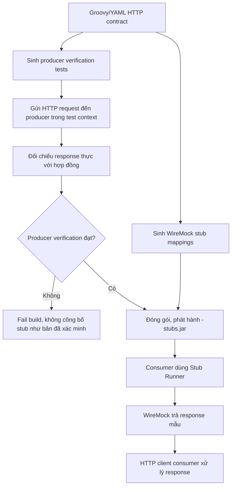
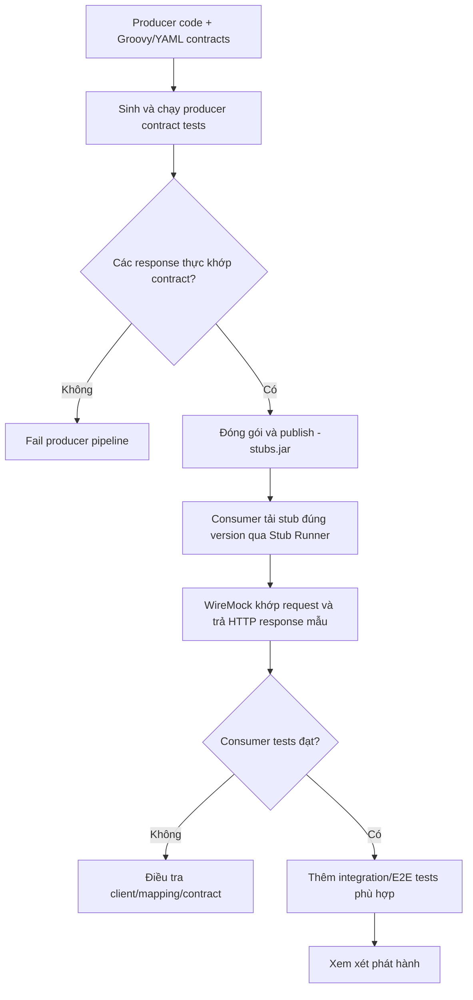

# WireMock trong Spring Cloud Contract và giới hạn trách nhiệm

## 1. Vì sao cần hiểu WireMock khi học Spring Cloud Contract?

Trong hệ thống nhiều dịch vụ, `Checkout Service` (consumer) thường gọi HTTP API của `Payment Service` (producer). Nếu môi trường kiểm thử Checkout luôn phải khởi động Payment Service thật, kết quả có thể phụ thuộc database, mạng, thông tin xác thực và trạng thái của dịch vụ khác. Một thay đổi nhỏ ở producer cũng có thể làm nhiều pipeline consumer thất bại trước khi xác định được nguyên nhân.

**WireMock** là công cụ mô phỏng **HTTP server**. Nó nhận request, kiểm tra request có khớp một **stub mapping** đã khai báo hay không, rồi trả response mẫu. Spring Cloud Contract có thể tạo các mapping WireMock từ hợp đồng Groovy/YAML DSL và dùng **Stub Runner** để chạy chúng cho consumer.

Tuy nhiên, **WireMock không thay thế Spring Cloud Contract Verifier**. Một HTTP stub trả `200 OK` không chứng minh Payment Service thật đang trả `200`; một stub nhận bearer token dạng chuỗi không chứng minh backend thật đã xác minh chữ ký token. Phân biệt đúng vai trò giúp dự án không bị hiện tượng **test xanh nhưng tích hợp thật vẫn hỏng**.

Sau bài này, bạn có thể:

1. Mô tả vai trò của WireMock, Contract Verifier và Stub Runner trong kiểm thử producer–consumer.
2. Viết hợp đồng HTTP Groovy/YAML rồi hình dung dạng stub mapping được sinh.
3. Hiểu cơ chế WireMock so khớp method, URL, query, header, body và trả status/headers/body.
4. Cấu hình consumer dùng stub artifact qua `@AutoConfigureStubRunner` và phân biệt với `@AutoConfigureWireMock`.
5. Nhận biết các giới hạn của WireMock đối với producer verification, security, messaging và hành vi nghiệp vụ.
6. Chẩn đoán request không khớp, mapping trùng, sai dữ liệu mẫu, sai version và các lỗi CI thường gặp.

## 2. Ba thành phần: Contract Verifier, Stub Runner và WireMock

Một hệ thống kiểm thử hợp đồng HTTP có ba công việc khác nhau:

| Thành phần | Nhiệm vụ chính | Đối tượng được kiểm tra |
| --- | --- | --- |
| **Spring Cloud Contract DSL** | Ghi thỏa thuận request/response bằng Groovy hoặc YAML | Định nghĩa kỳ vọng chung |
| **Spring Cloud Contract Verifier** | Sinh và thực thi test trên **producer thật** | Controller, filter, serialization và response thực |
| **Stub Runner + WireMock** | Nạp stub đã sinh, khởi động HTTP server mô phỏng | HTTP client và logic của **consumer** |

Quy trình hai phía:



**Ý nghĩa của hai kết quả PASS:**

- Producer test PASS: implementation producer đã đáp ứng **những tương tác và assertion thực sự được chạy**.
- Consumer test với WireMock PASS: consumer gửi request và xử lý những response mẫu tương ứng; chưa chắc producer bản mới nhất vẫn đáp ứng nếu stub đang cũ.

Hai hướng kiểm thử **bổ sung**, không thay thế nhau. Nếu generated producer tests bị bỏ qua, việc Stub Runner khởi động thành công **không** chứng minh hợp đồng đã được xác minh.

## 3. WireMock làm gì khi nhận một HTTP request?

WireMock thường làm việc với một hoặc nhiều **stub mappings**. Mỗi mapping gồm:

1. **Request pattern:** điều kiện để request được xem là phù hợp.
2. **Response definition:** phản hồi mà stub server cần trả về.
3. **Tùy chọn nâng cao:** độ ưu tiên, trạng thái scenario, độ trễ, lỗi kết nối hoặc response templating nếu được cấu hình.

Ví dụ ý tưởng:

```text
Request:
  method = GET
  url    = /api/payments/42

Response:
  status       = 200
  Content-Type = application/json
  body         = {"paymentId":42,"status":"PAID"}
```

Khi consumer thực gọi `GET /api/payments/42` tới WireMock, mapping phù hợp được chọn và trả JSON trên.

WireMock **không** tự đi tới database Payment Service, không chạy logic thanh toán, không biết người dùng đã thực trả tiền hay chưa và không tự áp chính sách phân quyền của producer. Nó chỉ thực hiện những điều đã được mô tả hoặc cấu hình trong stub server.

### 3.1. Các thành phần của request mà WireMock có thể so khớp

| Thành phần | Ví dụ | Rủi ro khi bỏ qua |
| --- | --- | --- |
| HTTP method | `GET` thay vì `POST` | Consumer gọi sai thao tác nhưng test vẫn nhận stub khác |
| URL path | `/api/payments/42` | Client gọi sai route |
| Query params | `?currency=VND` | Bỏ quên tham số lọc/phân trang |
| Headers | `Accept: application/json` | Media type hoặc version API khác |
| Request body | JSON `{"orderId":42}` | Sai cấu trúc, trường hoặc kiểu |
| Cookies | Session hoặc trạng thái thử nghiệm | Consumer không gửi thông tin cần thiết |
| Multipart parts | Metadata/file upload | Client gửi sai tên part hoặc nội dung |

Không phải mapping nào cũng kiểm tra tất cả các thành phần. **Chỉ những điều kiện có trong mapping mới tạo ràng buộc matching**. Nếu chỉ mô tả method và URL, request mang header không mong đợi vẫn có thể khớp.

## 4. Từ hợp đồng Spring Cloud Contract đến response mẫu

Ví dụ `Payment Service` cung cấp:

```http
GET /api/payments/42
Accept: application/json
```

Kỳ vọng:

```http
HTTP/1.1 200 OK
Content-Type: application/json

{"paymentId":42,"status":"PAID","receiptId":"RC-42"}
```

### 4.1. Groovy DSL

```groovy
import org.springframework.cloud.contract.spec.Contract

Contract.make {
    description 'Tra cuu thanh toan da hoan tat'

    request {
        method GET()
        url '/api/payments/42'
        headers {
            header('Accept', 'application/json')
        }
    }

    response {
        status OK()
        headers {
            contentType(applicationJson())
        }
        body(
            paymentId: 42,
            status: 'PAID',
            receiptId: 'RC-42'
        )
        bodyMatchers {
            jsonPath('$.receiptId', byRegex('RC-[0-9]+'))
        }
    }
}
```

Ở đây:

- `request` mô tả request consumer phải gửi.
- `response` mô tả response mẫu của stub và kỳ vọng producer phải đáp ứng.
- `bodyMatchers` cho phép producer thực trả một receipt ID khác mẫu nhưng **cùng định dạng**.

**Quan trọng:** `response.body.receiptId = 'RC-42'` là dữ liệu cụ thể stub có thể trả. Matcher `byRegex('RC-[0-9]+')` phục vụ **producer verification** cho actual response, không phải lệnh yêu cầu WireMock ngẫu nhiên tạo một receipt ID khác mỗi lần.

### 4.2. YAML DSL tương đương

```yaml
description: Tra cuu thanh toan da hoan tat
request:
  method: GET
  url: /api/payments/42
  headers:
    Accept: application/json
response:
  status: 200
  headers:
    Content-Type: application/json
  body:
    paymentId: 42
    status: PAID
    receiptId: RC-42
  matchers:
    body:
      - path: '$.receiptId'
        type: by_regex
        value: 'RC-[0-9]+'
```

Trong YAML, mẫu body đặt ở `response.body`, matcher đặt ở `response.matchers.body`. Hai định dạng DSL có cùng mục tiêu; cú pháp chi tiết và loại matcher phải được đối chiếu với **phiên bản Spring Cloud Contract đã ghim** trong project.

### 4.3. Vì sao không viết luôn WireMock mapping thay cho hợp đồng?

Có thể viết file JSON mapping cho WireMock bằng tay, nhưng chỉ làm vậy thì **chưa có một producer contract test được sinh tự động**. Nếu muốn cùng một nguồn mô tả vừa kiểm chứng producer vừa cung cấp stub cho consumer, hợp đồng Groovy/YAML của Spring Cloud Contract là cách tiếp cận phù hợp.

Một mapping WireMock thuần thường chỉ trả lời: “Nếu nhận request này thì trả gì?” Trong khi Spring Cloud Contract còn trả lời: “**Producer hiện tại có thật sự trả như đã cam kết không?**”

## 5. WireMock mapping sinh ra trông như thế nào?

WireMock đọc cấu hình mapping JSON để xác định request và response. Một mapping **viết tay nhằm minh họa ý nghĩa** của hợp đồng ở mục 4:

```json
{
  "request": {
    "method": "GET",
    "url": "/api/payments/42",
    "headers": {
      "Accept": {
        "equalTo": "application/json"
      }
    }
  },
  "response": {
    "status": 200,
    "headers": {
      "Content-Type": "application/json"
    },
    "jsonBody": {
      "paymentId": 42,
      "status": "PAID",
      "receiptId": "RC-42"
    }
  }
}
```

**Đây không phải cam kết về file mà Spring Cloud Contract sẽ sinh nguyên văn.** Tên file, cấu trúc `body`/`jsonBody`, cách biểu diễn request matcher và metadata có thể khác theo plugin/version. Khi cần chẩn đoán, phải **mở mapping thực tế trong stub artifact** hoặc xem diagnostic của WireMock.

### 5.1. Quy tắc matching khác định nghĩa response

Trong JSON mapping:

- `request.method = GET` là **điều kiện**.
- `request.url = /api/payments/42` là **điều kiện**.
- `headers.Accept.equalTo` là **điều kiện**.
- `response.status = 200` là **kết quả trả về**, không phải điều kiện matching.
- `response.jsonBody` là **dữ liệu mẫu** được gửi cho client.

Nếu Checkout gửi `POST` thay vì `GET`, mapping này không khớp; nếu gửi sai `Accept`, mapping cũng có thể không khớp. Nhưng không vì thế mà khẳng định Payment Service thật sẽ xử lý sai request y hệt WireMock; stub chỉ diễn đạt những quy tắc đã cấu hình.

## 6. Chọn matcher cho JSON: không phụ thuộc khoảng trắng trình bày

Consumer có thể gửi:

```json
{"orderId":42,"amount":125000}
```

hoặc:

```json
{
  "amount": 125000,
  "orderId": 42
}
```

Hai body này mang cùng dữ liệu JSON object dù xuống dòng và thứ tự key khác nhau. WireMock cung cấp nhiều kiểu request body matcher:

| Matcher WireMock | So sánh | Dùng khi |
| --- | --- | --- |
| `equalTo` | Chuỗi ký tự | Text cần khớp đúng cách viết |
| `equalToJson` | Cấu trúc JSON | JSON không cần đúng khoảng trắng |
| `matchesJsonPath` | Dữ liệu tại JSONPath | Chỉ cần kiểm tra những trường nhất định |
| `matches` | Regex trên chuỗi | Text body có định dạng linh hoạt |
| `binaryEqualTo` | Byte | Dữ liệu nhị phân cần khớp chính xác |

Ví dụ **body pattern của WireMock thuần**, không phải một khối DSL Spring Cloud Contract:

```json
{
  "request": {
    "method": "POST",
    "url": "/api/payments",
    "bodyPatterns": [
      {
        "matchesJsonPath": {
          "expression": "$.orderId",
          "equalTo": "42"
        }
      }
    ]
  },
  "response": {
    "status": 202
  }
}
```

Matcher trên tập trung vào trường `orderId`. Nếu client đổi định dạng khoảng trắng nhưng giữ nguyên giá trị, điều kiện có thể tiếp tục thỏa. Tuy nhiên, **chỉ kiểm tra một JSONPath không bảo đảm toàn bộ JSON schema đúng**. Nếu consumer bắt buộc gửi `amount` và `currency`, cần bổ sung matcher tương ứng.

### 6.1. Không nhầm khoảng trắng định dạng và khoảng trắng trong string

```json
{"message":"Payment approved"}
```

khác:

```json
{"message":"Payment  approved"}
```

Vì hai dấu cách bên trong giá trị chuỗi là **dữ liệu**, không phải cách pretty-print JSON. Khi thiết kế hợp đồng, không xóa toàn bộ whitespace khỏi raw body bằng regex rồi coi hai trường hợp tương đương; nên parse JSON và so sánh giá trị/thành phần cần bảo vệ.

### 6.2. Mảng, trường thừa và kiểu dữ liệu

`[1,2]` không mặc nhiên tương đương `[2,1]`. `42` (number) cũng khác `"42"` (string). WireMock có tùy chọn so sánh JSON cho phép nới thứ tự mảng hoặc chấp nhận extra fields, nhưng những lựa chọn đó **khác** với việc bỏ qua khoảng trắng và có thể che mất lỗi tương thích nếu bật quá rộng.

Nếu hợp đồng Spring Cloud Contract khai báo `request.bodyMatchers`, plugin có thể chuyển thành điều kiện JSONPath/regex trong WireMock mapping. Không sao chép nguyên cấu trúc `bodyPatterns` của WireMock vào `request.matchers` của YAML rồi giả định DSL nhận mọi thuộc tính WireMock.

## 7. Stub Runner khởi động WireMock cho consumer

Sau khi producer đã xác minh hợp đồng, build có thể phát hành artifact có classifier `stubs`, ví dụ:

```text
com.example:payment-service:1.0.0:stubs
```

Trong project Checkout Service, một test có thể dùng:

```java
import org.junit.jupiter.api.Test;
import org.springframework.boot.test.context.SpringBootTest;
import org.springframework.cloud.contract.stubrunner.spring.AutoConfigureStubRunner;
import org.springframework.cloud.contract.stubrunner.spring.StubRunnerProperties;

@SpringBootTest(properties = {
    "payment.client.base-url=http://localhost:8090"
})
@AutoConfigureStubRunner(
    ids = "com.example:payment-service:1.0.0:stubs:8090",
    stubsMode = StubRunnerProperties.StubsMode.LOCAL
)
class PaymentClientContractTest {

    @Test
    void checkoutReadsPaidStatus() {
        // Gọi PaymentClient thực sự được cấu hình đến localhost:8090.
        // Kiểm tra client giải mã status=PAID và receiptId=RC-42.
    }
}
```

Đây là **khung test minh họa**: cần stub artifact đã có trong Maven local repository, cấu hình HTTP client theo key thực tế của ứng dụng, dependency Stub Runner và assertion consumer. Nếu để phần thân test trống, test không mang ý nghĩa dù WireMock có khởi động.

Giải thích tọa độ:

| Thành phần | Giá trị trong ví dụ |
| --- | --- |
| Producer groupId | `com.example` |
| Producer artifactId | `payment-service` |
| Artifact version | `1.0.0` |
| Classifier | `stubs` |
| Port stub | `8090` |
| Stubs mode | `LOCAL` |

Port cố định dễ đọc nhưng có thể xung đột khi CI chạy song song. Với test thật, nên cân nhắc **port động**, sau đó lấy URL từ Stub Runner/StubFinder thay vì tự suy đoán port. Stub Runner còn hỗ trợ các cách tìm stub qua repository hoặc môi trường chạy khác, tùy cấu hình.

### 7.1. Phân biệt Stub Runner và WireMock độc lập

**WireMock độc lập** có thể chạy từ JSON mappings tự viết, không cần Spring Cloud Contract. **Stub Runner** bổ sung việc tìm/tải các artifact stub, khởi động stub server và tích hợp với Spring test context. HTTP stub engine phía dưới vẫn có thể là WireMock.

Do đó, khi đang học **Spring Cloud Contract**, quan sát cả:

- Hợp đồng Groovy/YAML của producer.
- Generated producer tests.
- Artifact `-stubs.jar` được phát hành.
- Các WireMock mappings được Stub Runner đăng ký.
- Hành vi HTTP client thật của consumer khi gọi server mô phỏng.

Không nên chỉ xem một file JSON mapping mà bỏ qua nguồn contract và khâu producer verification.

## 8. `@AutoConfigureWireMock` khác `@AutoConfigureStubRunner` ra sao?

Spring Cloud Contract còn có tích hợp WireMock giúp các Spring Boot tests khởi động WireMock trực tiếp. Nó thích hợp khi một dịch vụ **đang được test** cần giả lập **HTTP dependency ở phía ngoài**.

Ví dụ, Order Service phải gọi `Tax Service` để tính thuế. Ta muốn test logic Order Service nhưng không muốn gọi Tax Service thật:

```java
import org.springframework.boot.test.context.SpringBootTest;
import org.springframework.cloud.contract.wiremock.AutoConfigureWireMock;

@SpringBootTest
@AutoConfigureWireMock(port = 0)
class OrderTaxClientIntegrationTest {
    // Thiết lập stub Tax Service và gọi OrderService thật.
    // Port WireMock ngẫu nhiên được cung cấp qua wiremock.server.port.
}
```

Trong cấu hình ứng dụng test, cần hướng `TaxClient` đến:

```yaml
tax:
  client:
    base-url: "http://localhost:${wiremock.server.port}"
```

Ví dụ này giả định module có dependency `spring-cloud-contract-wiremock` và `TaxClient` đọc đúng property. **`@AutoConfigureWireMock` không tự nạp stub artifact của Tax Service nếu bạn chưa cấu hình mapping**.

| Công cụ/cấu hình | Cách sử dụng chính |
| --- | --- |
| `@AutoConfigureWireMock` | Tạo WireMock server cho một Spring test; test tự khai báo/nạp các mapping phù hợp |
| `@AutoConfigureStubRunner` | Tìm và nạp stub artifact của producer, chạy stub server trong consumer test |
| Spring Cloud Contract Verifier | Sinh test để xác minh **response thực của producer** theo contract |

Một producer test cũng có thể dùng WireMock để giả lập **dependency downstream** trong lúc kiểm chứng response thực của chính nó. Khi đó WireMock là test double cho dịch vụ khác, **không phải** đối tượng thay thế implementation producer đang cần xác minh.

## 9. Giới hạn trách nhiệm: WireMock làm được gì và không làm được gì?

### 9.1. Những việc WireMock làm tốt

- **Phản hồi HTTP có thể dự đoán:** status, headers, JSON/text/binary body.
- **Kiểm tra HTTP client:** method, URL, query, headers, payload và cách giải mã response.
- **Tạo kịch bản lỗi:** `404`, `429`, `500`, `503`, timeout/delay hoặc một số fault để test xử lý lỗi của client.
- **Chạy test độc lập:** không phải dựng cả producer và database của nó cho mọi consumer test.
- **Kiểm tra các biến thể request:** dựa trên regex, JSONPath, header hoặc matching theo trạng thái khi được cấu hình.

### 9.2. Những việc WireMock không tự chứng minh

| Yêu cầu | Tại sao WireMock không đủ? | Bổ sung phù hợp |
| --- | --- | --- |
| Producer hiện tại còn trả đúng API | Stub chỉ trả dữ liệu đã khai báo | Generated producer contract tests |
| Database transaction đúng | Stub không thực hiện persistence của producer | Repository/service integration tests |
| JWT, mTLS, IAM hoặc ACL đúng trong production | Stub chỉ match header/chuỗi, không tự tái tạo toàn bộ chính sách | Security integration và E2E tests |
| Gateway, DNS, load balancing, service discovery đúng | Stub chạy trong môi trường test đơn giản | Deployment/network integration tests |
| Consumer xử lý **mọi** response hợp lệ | Stub thường dùng một số dữ liệu mẫu | Consumer unit/property-based/negative tests |
| Schema evolution ở mọi phiên bản | Stub chỉ phản ánh những contract đã được đóng gói | Compatibility policy và test nhiều version |
| Broker Kafka/RabbitMQ vận hành đúng | WireMock chủ yếu mô phỏng HTTP | Message test binder, broker integration tests |
| Retry, backoff, circuit breaker và thực tế outage | WireMock mô phỏng được một số lỗi nhưng không tái hiện mọi điều kiện mạng | Resilience tests và fault injection có kiểm soát |
| Chính sách nghiệp vụ xuyên hệ thống | Stub không bảo đảm logic nhiều service nhất quán | Integration/E2E/business-flow tests |

**Điểm mấu chốt:** WireMock cung cấp một **bản mô phỏng hữu ích**, không phải “bản sao thu nhỏ” của producer thật. Mỗi khẳng định test chỉ có giá trị trong phạm vi **request patterns, response definitions và assertion** thực sự chạy.

## 10. Lưu ý riêng về security và danh tính người gọi

Nếu mapping WireMock có điều kiện:

```json
{
  "headers": {
    "Authorization": {
      "matches": "Bearer .+"
    }
  }
}
```

thì điều kiện trên chỉ kiểm tra header bắt đầu bằng chuỗi `Bearer ` với phần tiếp theo khác rỗng. Nó **không chứng minh** token đã được giải mã đúng, chữ ký hợp lệ, chưa hết hạn, đúng issuer/audience hoặc có scope phù hợp.

Do đó cần:

1. Consumer test kiểm tra HTTP client **có gửi credential/header theo giao diện thỏa thuận**.
2. Producer security tests chạy qua **SecurityFilterChain thật** với danh tính/quyền thử nghiệm.
3. Integration tests nếu cần xác minh IdP, gateway, mTLS hoặc broker authentication.

Không ghi token thật vào hợp đồng hoặc WireMock mappings trong repository. Nếu cần mẫu JWT, dùng token thử nghiệm và môi trường riêng.

### 10.1. Phản hồi `401` và `403` trong stub

WireMock có thể trả `401` hoặc `403` cho request mẫu để consumer kiểm tra xử lý lỗi. Tuy nhiên, **nếu một mapping `401` chỉ match URL mà không yêu cầu thiếu Authorization**, nó có thể khớp cả request hợp lệ và gây xung đột với mapping `200`.

Khi mô phỏng các nhánh authentication, phải kiểm tra mapping có **điều kiện khác biệt rõ ràng** và xem sự ưu tiên của WireMock. Stub không tự hiểu khái niệm “user chưa đăng nhập” nếu mapping chỉ mô tả URL.

## 11. Giới hạn với messaging: HTTP stub không phải broker

Spring Cloud Contract cũng hỗ trợ hợp đồng thông điệp:

```groovy
import org.springframework.cloud.contract.spec.Contract

Contract.make {
    label 'payment_completed'
    input {
        triggeredBy('completePaymentAndPublish()')
    }
    outputMessage {
        sentTo('payments.completed')
        body(
            eventType: 'PaymentCompleted',
            paymentId: 42
        )
    }
}
```

Đây là **messaging contract**, không phải HTTP request–response. Test producer cần message verifier/binder hoặc transport thích hợp; consumer có thể dùng Stub Runner và `StubTrigger` với framework messaging tương ứng.

**Không nên mong WireMock tự mô phỏng Kafka topic, RabbitMQ queue, acknowledgement, partition hoặc message ordering.** Những đặc tính đó cần Spring Cloud Stream test binder hoặc kiểm thử integration với broker thực theo yêu cầu.

Vì Spring Cloud Contract có cùng khái niệm `Stub Runner` cho cả HTTP và messaging, tên công cụ dễ tạo nhầm lẫn: **Stub Runner điều phối stub**, còn **WireMock chỉ là engine HTTP** trong phần việc tương ứng.

## 12. Response templating, delay và scenario: dùng đúng mức

WireMock có những khả năng hữu ích khi cần kiểm thử HTTP client, nhưng **không phải mọi khả năng đều có cú pháp một-một trong Spring Cloud Contract DSL**.

### 12.1. Response cố định và response động

Một mapping thông thường trả response cố định. Nếu muốn stub phản hồi một phần dữ liệu theo request, WireMock hỗ trợ **response templating** trong những cấu hình phù hợp. Spring Cloud Contract cũng có cách tham chiếu giá trị từ request sang response ở mức DSL cho một số tình huống.

Ví dụ nghiệp vụ `POST /api/receipts` yêu cầu response trả lại `orderId` từ request. Nếu chỉ trả một order ID cố định trong mọi test, client có thể không được kiểm tra quan hệ này. Hãy cân nhắc cơ chế templating khi quan hệ **request → response** là phần của giao diện.

**Không nhầm response templating với response matcher của producer.** Matcher như `byRegex` kiểm chứng giá trị response **thật** có phù hợp không; templating điều khiển giá trị **stub mô phỏng** trả ra.

### 12.2. Độ trễ và lỗi giả lập

Ví dụ WireMock mapping **tự viết** để trả lỗi tạm thời:

```json
{
  "request": {
    "method": "GET",
    "url": "/api/payments/42"
  },
  "response": {
    "status": 503,
    "fixedDelayMilliseconds": 400,
    "headers": {
      "Content-Type": "application/json"
    },
    "jsonBody": {
      "code": "TEMPORARILY_UNAVAILABLE"
    }
  }
}
```

Client có thể được kiểm tra về timeout, fallback và cách xử lý `503`. Tuy nhiên, cố tình thêm độ trễ vào consumer test **không** chứng minh chính sách retry/backoff sẽ hoạt động y hệt trong mọi tình huống mạng thật.

### 12.3. Scenario theo trạng thái

WireMock hỗ trợ **stateful scenarios** để trả response khác nhau qua nhiều lần gọi theo một chuỗi đã mô tả (ví dụ lần đầu `503`, lần sau `200`). Tính năng này hữu ích khi kiểm thử client có retry.

Nhưng scenario state cần được reset/cô lập giữa các test. Nếu một test trước đã chuyển trạng thái, test sau có thể nhận kết quả không mong đợi. Ngoài ra, việc Spring Cloud Contract có hỗ trợ sinh trực tiếp từng cấu trúc WireMock scenario hay không phải đối chiếu theo phiên bản DSL/plugin đang sử dụng.

## 13. Mapping chồng lấn và độ ưu tiên

Giả sử có hai stub:

```text
Mapping A: GET /api/payments/42 -> 200, PAID
Mapping B: GET /api/payments/42 -> 404, PAYMENT_NOT_FOUND
```

Nếu cả hai có cùng request pattern và không có điều kiện nào khác biệt, WireMock **không thể suy ra** response nào đúng theo nghiệp vụ. Cần:

- Phân biệt bằng request: ID, query, `Accept`, header version hoặc body.
- Tách tình huống theo một endpoint/ID khác khi phù hợp nghiệp vụ.
- Sử dụng priority/scenario chỉ khi đó là logic mô phỏng có chủ đích.
- Nếu mỗi consumer có nhóm hợp đồng khác nhau, cân nhắc `stubsPerConsumer` để không nạp toàn bộ mappings cùng lúc.

**Quan trọng:** Lọc stub theo consumer không cho phép producer thật đưa ra hai response mâu thuẫn cho cùng một HTTP request hoàn toàn giống nhau. Nếu API không có dấu hiệu phân biệt request mà hợp đồng cho hai consumer kỳ vọng khác nhau, phải giải quyết **mâu thuẫn hợp đồng**, không chỉ dựa vào WireMock.

## 14. Debug khi consumer không nhận response mong đợi

Các tình huống lỗi thường gặp:

| Triệu chứng | Khả năng gây lỗi | Hướng kiểm tra |
| --- | --- | --- |
| Không kết nối được stub | Stub server chưa chạy, sai host/port | Stub Runner logs, port được cấp, URL client |
| Nhận `404` không có body lỗi nghiệp vụ | Không mapping nào khớp | WireMock unmatched/near-miss requests |
| Response thuộc kịch bản khác | Mapping chồng lấn hoặc priority | Request patterns, mappings đã đăng ký |
| Trả body sai field | Stub artifact cũ hoặc contract mẫu sai | Version artifact, nội dung mapping |
| JSON parse fail | `Content-Type` hoặc body sai format | Actual stub response headers/body |
| Test chạy local nhưng CI fail | Port trùng, stub chưa có trên CI, repository/credentials sai | Stubs mode, publication, network/artifact repository |
| Consumer test xanh nhưng khi deploy vẫn hỏng | Producer thay đổi, contract verification bị skip hoặc giả lập thiếu trường hợp | Producer CI, compatibility, integration tests |
| `401` mapping bắt request hợp lệ | Thiếu điều kiện header/priority | Authorization request thực, mappings cạnh tranh |
| Stub của consumer khác xuất hiện | `stubsPerConsumer` hoặc `consumerName` sai | Artifact structure, consumer name thực |

### 14.1. Phân biệt WireMock “không match” với HTTP `404` đã thỏa thuận

Một stub có chủ đích:

```json
{
  "request": {
    "method": "GET",
    "url": "/api/payments/999"
  },
  "response": {
    "status": 404,
    "jsonBody": {
      "code": "PAYMENT_NOT_FOUND"
    }
  }
}
```

khác với **không có mapping** nào match request. WireMock có thể trả status `404` mặc định trong trường hợp không match; mã giống nhau nhưng ý nghĩa khác. Xem body, headers và diagnostic logs để phân biệt.

Trong môi trường test, WireMock có **Admin API** để xem request journal, unmatched requests và mappings khi được cấu hình. Khi debug, chỉ mở các endpoint quản trị trong phạm vi test đáng tin cậy, không công khai server stub có quyền chỉnh sửa mapping ra Internet.

### 14.2. Điều tra theo thứ tự nào?

1. **Xác nhận consumer đang gọi đâu:** URL, port, scheme và path; tránh vô tình gọi producer thật.
2. **Xác nhận stub artifact:** đúng group/artifact/version/classifier và có mappings.
3. **Xem actual request** mà client gửi, không chỉ request bạn định gửi.
4. **So với mapping** method, URL, query, headers, bodyPatterns.
5. **Xem mapping được chọn** và response definition.
6. **Kiểm tra response body/header** và cách consumer deserialize.
7. **Chạy lại producer verification** nếu nghi ngờ contract/stub khác behavior của producer hiện tại.

Không sửa contract chỉ để “cho WireMock trả đúng” nếu điều đó làm mất một nghĩa vụ producer đã cam kết với consumer.

## 15. Quy trình CI nên phân lớp thế nào?

Một pipeline Spring Cloud Contract có thể tách rõ:



Những kiểm soát có giá trị:

1. **Không phát hành stub như bản đã xác minh nếu producer tests fail.**
2. **Không chấp nhận pipeline xanh khi generated producer tests bị skip** hoặc không được sinh ra.
3. **Ghim artifact version** để consumer test có thể chạy lại với cùng dữ liệu mẫu.
4. **Xác minh số lượng mapping được nạp**, đặc biệt khi dùng `stubsPerConsumer`.
5. **Có test consumer cho lỗi quan trọng** như `404`, `429`, `503` hoặc timeout nếu client thực sự cần xử lý.
6. **Giữ security, broker, database và E2E tests riêng** cho những thuộc tính WireMock không thể chứng minh.
7. **Kiểm tra tương thích phiên bản** Spring Boot, Spring Cloud, Spring Cloud Contract plugin/dependencies, Stub Runner và WireMock do chúng sử dụng; không tự ép version WireMock khác vào classpath nếu chưa kiểm tra hỗ trợ.

WireMock làm consumer tests nhanh và độc lập hơn, nhưng không nên trở thành nơi duy nhất kiểm tra tích hợp giữa các dịch vụ.

## 16. Bài thực hành: phát hiện ranh giới của HTTP stub

Giả sử `Billing Service` dùng `Invoice Service` qua:

```http
GET /api/invoices/900
Accept: application/json
```

Producer contract mong đợi:

```json
{
  "invoiceId": 900,
  "state": "ISSUED",
  "total": 220000,
  "currency": "VND"
}
```

### 16.1. Yêu cầu

1. Viết hợp đồng Groovy hoặc YAML cho request trên, `200 OK`, `Content-Type: application/json` và các trường trong body.
2. Mô tả một WireMock mapping tương ứng bằng method, URL, header và response mẫu.
3. Nếu Billing gửi `GET /api/invoices/900` nhưng `Accept: text/plain`, chuyện gì xảy ra khi mapping yêu cầu `Accept: application/json`?
4. Nếu producer thật đổi `state` thành `invoiceStatus` nhưng stub artifact cũ vẫn trả `state`, producer test và consumer test có thể cho kết quả khác nhau thế nào?
5. Nếu WireMock trả `401` khi thiếu header `Authorization`, có thể kết luận JWT của Invoice Service đã được xác minh đúng không?
6. Nếu producer chỉ có API HTTP nhưng sau khi phát hành hóa đơn còn phải phát Kafka event `InvoiceIssued`, WireMock có đủ kiểm tra toàn bộ nghiệp vụ này không?

### 16.2. Gợi ý hợp đồng YAML

```yaml
description: Billing tra cuu hoa don
request:
  method: GET
  url: /api/invoices/900
  headers:
    Accept: application/json
response:
  status: 200
  headers:
    Content-Type: application/json
  body:
    invoiceId: 900
    state: ISSUED
    total: 220000
    currency: VND
```

### 16.3. Gợi ý giải thích

| Câu | Ý chính |
| --- | --- |
| 2 | Mapping WireMock có `request.method`, `request.url`, `request.headers.Accept`, và `response.status/headers/body` |
| 3 | Request không khớp mapping nếu header là điều kiện so sánh chính xác; cần kiểm tra diagnostic thay vì suy về producer thật |
| 4 | Consumer có thể xanh với stub cũ, producer verification trên code mới phải phát hiện thiếu trường `state` nếu hợp đồng còn yêu cầu |
| 5 | Không; WireMock chỉ match header, không tự xác minh chữ ký/issuer/expiry JWT |
| 6 | Không; cần messaging contract, message verifier/test binder và integration broker khi cần |

### 16.4. Kiểm tra âm tính

Hãy thử đổi `state` từ `ISSUED` sang `CANCELLED` trong implementation producer ở môi trường test và xác minh producer contract test **fail**. Đồng thời chạy consumer test với stub đã đóng gói để thấy nó có thể vẫn dùng mẫu `ISSUED`. Thử nghiệm giúp hiểu vì sao **hai phía cần kiểm chứng độc lập**.

## 17. Checklist trước khi kết luận tích hợp đã an toàn

- Đây là **producer verification** hay **consumer test sử dụng WireMock**? Đã gọi đúng tên mục tiêu?
- Groovy/YAML contract có mô tả các request/response mà consumer thực sự cần?
- Generated producer tests có chạy trên implementation thật và so sánh status/headers/body?
- Stub Runner đang nạp đúng `-stubs.jar`, đúng version và consumer group?
- WireMock mappings có đủ điều kiện method, URL, headers và body? Có mapping xung đột?
- Consumer test có gọi HTTP client thật và kiểm tra cách xử lý response, không chỉ khởi động stub?
- Có phân biệt `404` do matching thất bại với `404` nghiệp vụ được stub định nghĩa?
- Có tránh dùng WireMock như bằng chứng duy nhất cho security, database, Kafka hoặc retry của môi trường thật?
- CI có chặn publish stub khi producer verification fail và có integration/E2E tests cho những rủi ro ngoài phạm vi stub?

**Tài liệu chính thức để đối chiếu theo phiên bản:**

- [Spring Cloud Contract Reference](https://docs.spring.io/spring-cloud-contract/reference/).
- [Spring Cloud Contract — Stub Runner](https://docs.spring.io/spring-cloud-contract/reference/project-features-stubrunner.html).
- [WireMock — Stubbing](https://wiremock.org/docs/stubbing/).
- [WireMock — Request Matching](https://wiremock.org/docs/request-matching/).
- [WireMock — Response Templating](https://wiremock.org/docs/response-templating/).

**Ghi nhớ:** WireMock là **HTTP stub engine**, được Spring Cloud Contract sử dụng cùng Stub Runner để mô phỏng HTTP response cho consumer. **Contract Verifier** mới là thành phần sinh và chạy kiểm thử để xác minh producer thực sự đáp ứng hợp đồng. WireMock giúp kiểm thử client nhanh, có thể tái lập và mô phỏng một số lỗi HTTP, nhưng không thay thế kiểm thử implementation, xác thực thực tế, broker messaging, database hoặc các luồng nghiệp vụ xuyên hệ thống.
