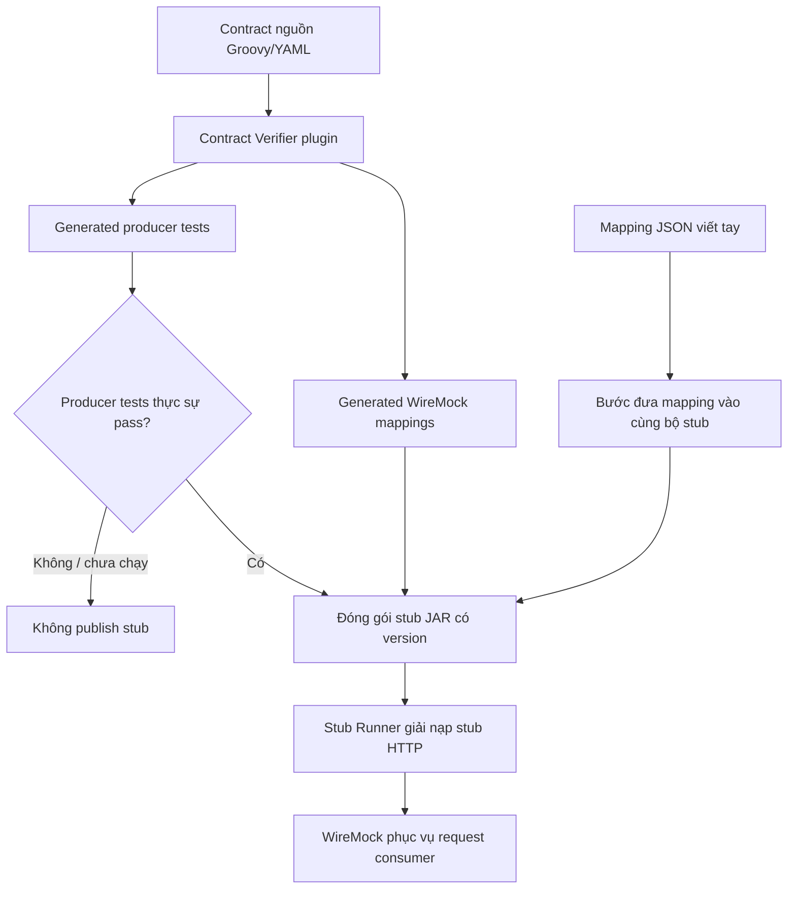
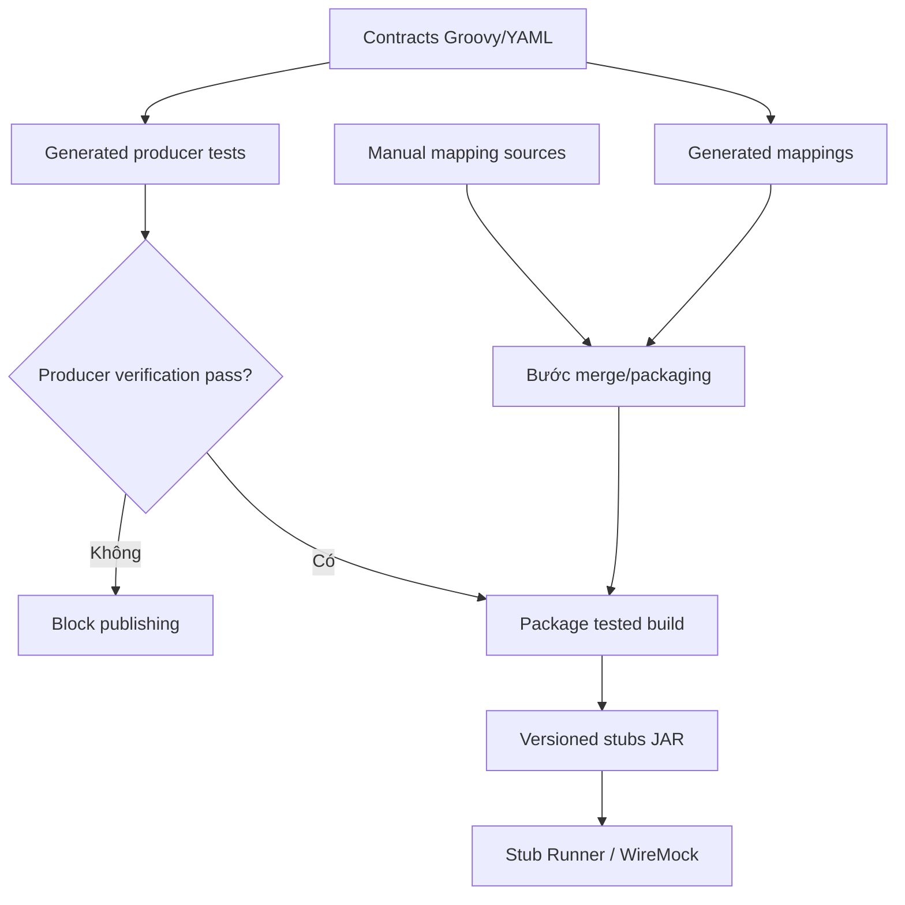
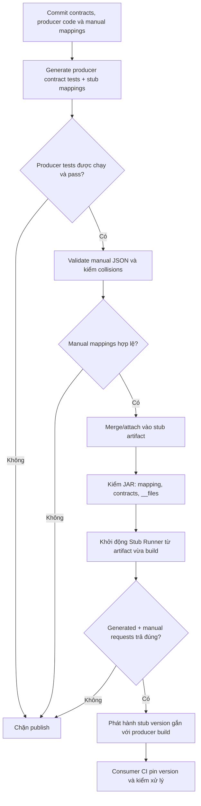

# Nạp mapping được sinh và mapping viết tay

Trong **Spring Cloud Contract**, một HTTP contract Groovy/YAML có thể được chuyển thành **WireMock stub mapping** để consumer gọi một API giả lập thay vì khởi chạy producer thật. Đôi khi bộ mapping được sinh chưa đủ cho nhu cầu kiểm thử: consumer cần giả lập timeout, lỗi từ dependency ngoài, một endpoint chưa có contract, hoặc một kịch bản nhiều bước có trạng thái. Khi đó nhóm có thể bổ sung **mapping viết tay**.

Vấn đề không nằm ở việc viết thêm JSON. Vấn đề là **làm sao cả mapping được sinh và mapping viết tay được nạp đúng vào WireMock**, cùng dùng một nguồn phiên bản có thể tái lập, không ghi đè nhau, không khiến test xanh giả và không tách rời những hợp đồng producer đã được xác minh.

Bài này thuộc chương **WireMock** của module **SPRING_CLOUD_CONTRACT**. Theo phạm vi module, ta sẽ liên hệ việc mô tả HTTP bằng Groovy/YAML DSL, sinh producer tests, tạo stub, dùng **Stub Runner** và tích hợp **CI** để phát hiện thay đổi API không tương thích. Nội dung tập trung vào HTTP stubs: messaging contracts có cơ chế transport/trigger riêng, không thể coi mọi message stub là một file WireMock HTTP mapping.

Sau bài học, bạn có thể:

- Phân biệt contract nguồn, mapping WireMock được sinh và mapping JSON viết tay.
- Hiểu các vị trí `mappings/`, `__files/` và cấu trúc `META-INF/.../mappings/` bên trong stub JAR.
- Nạp mapping từ file system, classpath, API Java hoặc artifact Stub Runner theo đúng cơ chế.
- Viết mapping JSON bổ sung với request matcher, response và body file.
- Phát hiện mapping chồng chéo và kiểm soát thứ tự ưu tiên bằng `priority`.
- Hiểu khác biệt giữa **file được đóng gói** và **file thực sự đã được WireMock nạp**.
- Xây quy trình build/CI đảm bảo các mapping phản ánh đúng contract được producer xác minh.

## 1. Khi nào cần hai nguồn mapping?

Giả sử `OrderService` là consumer và `InventoryService` là producer. Consumer gọi:

```http
POST /api/v1/reservations HTTP/1.1
Content-Type: application/json

{"sku":"SKU-001","quantity":2}
```

Producer cam kết:

```http
HTTP/1.1 201 Created
Content-Type: application/json

{"reservationId":"RES-701","status":"HELD"}
```

Contract Verifier có thể sinh một mapping HTTP đáp lại request này. Nhưng `OrderService` còn cần kiểm nhánh khác:

```http
GET /api/v1/reservations/RES-MISSING HTTP/1.1
Accept: application/json
```

với phản hồi `404`:

```json
{"code":"RESERVATION_NOT_FOUND"}
```

Nếu nhánh thứ hai chưa nằm trong tập contract chính thức, nhóm có thể dùng mapping viết tay để **mô phỏng tình huống phụ** trong một consumer test. Điều cần phân biệt:

| Nguồn | Mục đích | Được producer verification bảo vệ? |
| --- | --- | --- |
| **Contract Groovy/YAML** | Diễn đạt thỏa thuận producer–consumer | Có thể sinh test kiểm producer nếu pipeline cấu hình và chạy đúng |
| **Mapping sinh từ contract** | Stub nhận request và trả response mẫu | Liên kết với contract nguồn; chỉ đáng tin nếu producer verification thật sự pass |
| **Mapping JSON viết tay** | Mô phỏng thêm một tình huống, fault hoặc trạng thái thử nghiệm | **Không tự động**. Muốn bảo vệ cùng cam kết, cần contract hoặc test producer riêng |

Một mapping viết tay có thể hữu ích mà không nhất thiết trở thành contract. Tuy nhiên, nếu consumer **phụ thuộc lâu dài** vào `404 RESERVATION_NOT_FOUND`, nên đưa hành vi này thành contract được producer xác minh, thay vì để nó chỉ sống trong một mock phục vụ consumer.

## 2. Từ contract đến stub artifact: có bao nhiêu lớp?



Sơ đồ có một bước quan trọng: **“đưa mapping viết tay vào cùng bộ stub”**. Không phải cứ tạo file `somewhere/manual.json` là Contract Verifier sẽ tự tìm và chèn nó vào JAR. Cách lấy file tùy cấu hình plugin/version, Gradle/Maven và quy ước packaging. Phải xác minh artifact thực tế.

Ba sự kiện riêng cần kiểm:

1. **Đã tạo:** có JSON mapping trên đĩa hoặc trong output generator.
2. **Đã đóng gói:** mapping xuất hiện đúng vị trí trong stub JAR hoặc trong thư mục mà runtime sẽ đọc.
3. **Đã nạp:** WireMock server đang chạy có mapping đó trong danh sách active và request khớp trả đúng response.

Không được thay thế ba phép kiểm bằng câu “file tồn tại nên Stub Runner dùng được”.

## 3. WireMock mapping JSON gồm những gì?

Một mapping cơ bản mô tả **điều kiện request** và **response trả về**. Ví dụ cho endpoint không tìm thấy:

```json
{
  "name": "get-missing-reservation",
  "priority": 5,
  "request": {
    "method": "GET",
    "url": "/api/v1/reservations/RES-MISSING",
    "headers": {
      "Accept": {
        "contains": "application/json"
      }
    }
  },
  "response": {
    "status": 404,
    "headers": {
      "Content-Type": "application/json"
    },
    "jsonBody": {
      "code": "RESERVATION_NOT_FOUND"
    }
  }
}
```

Các trường chính:

| Trường | Vai trò |
| --- | --- |
| `name` | Tên dễ đọc để tìm mapping trong log hoặc admin API |
| `priority` | Ưu tiên khi nhiều mapping cùng khớp; **số nhỏ hơn ưu tiên cao hơn** |
| `request.method` | HTTP method, ví dụ `GET` hoặc `POST` |
| `request.url` | Match URL đầy đủ gồm path và query khi dùng dạng này |
| `request.urlPath` | Match path, tách query matcher khi cần |
| `request.headers` | Điều kiện header, ở đây `Accept` chứa `application/json` |
| `request.bodyPatterns` | Các điều kiện với body, ví dụ `equalToJson` hoặc `matchesJsonPath` |
| `response.status` | HTTP status giả lập |
| `response.headers` | Header trả cho consumer |
| `response.jsonBody` | JSON object được WireMock serialize thành body |

`jsonBody` là tiện ích tạo body JSON của WireMock. Có thể dùng `body` với chuỗi JSON, hoặc `bodyFileName` để nạp từ `__files`, tùy tình huống. Với `body` chứa JSON tự gõ, phải tự đảm bảo dấu nháy/escape đúng; với `jsonBody`, cần đảm bảo JSON type phản ánh thỏa thuận.

**Chú ý header `Accept`:** một số client mặc định gửi `*/*` hoặc không gửi header rõ ràng. Nếu mapping yêu cầu `Accept: application/json` mà consumer không gửi, mapping **không match** dù method và URL đúng. Chỉ ràng buộc header thật sự quan trọng với giao diện đã thống nhất.

## 4. Mapping do Spring Cloud Contract sinh ra

Contract nguồn giả định:

```groovy
import org.springframework.cloud.contract.spec.Contract

Contract.make {
    name 'create_reservation_success'
    description 'OrderService yêu cầu giữ hàng thành công'

    request {
        method 'POST'
        url '/api/v1/reservations'
        headers {
            contentType(applicationJson())
        }
        body([
            sku     : 'SKU-001',
            quantity: 2
        ])
    }

    response {
        status 201
        headers {
            contentType(applicationJson())
        }
        body([
            reservationId: $(consumer('RES-701'),
                             producer(regex('RES-[0-9]+'))),
            status       : 'HELD'
        ])
    }
}
```

Giải thích:

- Trong **generated producer test**, request dùng dữ liệu mẫu; producer thật được kiểm status `201` và ID khớp mẫu `RES-[0-9]+`.
- Trong **stub response**, `consumer('RES-701')` cung cấp ID cụ thể để consumer code xử lý tiếp.
- Khi generated producer test chưa chạy hoặc fail, việc tạo mapping vẫn chỉ là **mô phỏng theo một lời hứa**, không chứng minh producer đáp ứng.

JSON dưới đây minh họa **ý nghĩa tương đương** của mapping sinh ra; **không phải snapshot chính xác của plugin**:

```json
{
  "request": {
    "method": "POST",
    "url": "/api/v1/reservations",
    "headers": {
      "Content-Type": {
        "contains": "application/json"
      }
    },
    "bodyPatterns": [
      {
        "equalToJson": "{\"sku\":\"SKU-001\",\"quantity\":2}"
      }
    ]
  },
  "response": {
    "status": 201,
    "headers": {
      "Content-Type": "application/json"
    },
    "jsonBody": {
      "reservationId": "RES-701",
      "status": "HELD"
    }
  }
}
```

Tên mapping, biểu thức matcher (ví dụ `equalToJson`, `matchesJsonPath`), thứ tự trường và metadata do **plugin + WireMock version** quyết định. Vì thế phải xem **mapping được sinh thực tế** khi chẩn đoán sự khác nhau giữa contract và stub.

### Vì sao không sửa trực tiếp mapping được sinh?

Khi generator chạy lại, file được sinh có thể bị ghi đè. Quan trọng hơn, chỉnh mapping để consumer test xanh nhưng **không sửa contract/producer** sẽ phá vỡ tính nhất quán giữa hai phía.

Nếu response `201` được đổi thành `200`:

1. Xác định consumer có chấp nhận thay đổi không.
2. Nếu hợp đồng thay đổi, chỉnh Groovy/YAML contract có review.
3. Chỉnh producer implementation để đáp ứng hợp đồng mới.
4. Sinh lại producer test và stub; chạy verification.
5. Phát hành stub version mới nếu thay đổi được chấp nhận.

Mapping viết tay không nên được dùng để âm thầm **override một hợp đồng hiện hành**.

## 5. Cấu trúc thư mục mà WireMock đọc khi chạy trực tiếp

Với WireMock standalone hoặc `WireMockServer` được cấu hình dùng filesystem, một root điển hình:

```text
wiremock-root/
├── mappings/
│   ├── get-missing-reservation.json
│   ├── create-reservation-success.json
│   └── fallback-invalid-request.json
└── __files/
    ├── reservation-not-found.json
    └── reservation-created.json
```

- `mappings/*.json` chứa các stub definitions.
- `__files/*` chứa body nội dung ngoài, được tham chiếu qua `bodyFileName`.
- Các tên file là tùy chọn; sự phân giải mapping phụ thuộc **request matcher, priority và scenario state**, không phụ thuộc tên file theo thứ tự chữ cái.

**Phân biệt thư mục:** root này không tự tương đương `src/test/resources/contracts` của Spring Cloud Contract. Thư mục `contracts` chứa DSL nguồn; `mappings` là dữ liệu mà WireMock có thể nạp. Một file Groovy contract không thể được WireMock standalone đọc trực tiếp như JSON mapping.

## 6. Nạp mapping từ filesystem bằng WireMockServer

Ví dụ Java cho test chủ động sở hữu instance WireMock:

```java
import static com.github.tomakehurst.wiremock.core.WireMockConfiguration.options;

import com.github.tomakehurst.wiremock.WireMockServer;

WireMockServer server = new WireMockServer(
    options()
        .dynamicPort()
        .usingFilesUnderDirectory("src/test/resources/wiremock-root")
);

server.start();
try {
    System.out.println("WireMock port: " + server.port());
    // Chạy consumer HTTP client trỏ tới http://localhost:<port>.
} finally {
    server.stop();
}
```

Đây là **đoạn chương trình minh họa**, đặt trong method/test phù hợp và cần dependency WireMock tương thích. `usingFilesUnderDirectory(...)` cấu hình root; WireMock sẽ đọc các file mapping hợp lệ trong `mappings` lúc khởi động theo cơ chế file source tương ứng.

Điểm cần nhớ:

- Không đặt root ở một thư mục bất kỳ rồi hy vọng WireMock biết; phải truyền cấu hình root đúng.
- Path tương đối phụ thuộc working directory mà test runner sử dụng. Với multi-module Maven/Gradle, dùng đường dẫn ổn định dựa trên cấu hình module.
- Nếu sửa JSON **sau khi server đã chạy**, cần reload/reset hoặc gọi admin API theo cơ chế phiên bản; không mặc định hot reload liên tục.
- Dùng `dynamicPort()` để giảm xung đột cổng trên CI; lấy `server.port()` sau `start()`.
- Không để server từ test trước tiếp tục chạy và giữ request journal/scenario state chung.

### Nạp mapping khi dùng WireMock standalone

Nếu có WireMock standalone JAR tương thích với Java runtime, có thể chỉ định root:

```bash
java -jar wiremock-standalone.jar --port 8089 --root-dir ./wiremock-root
```

Lệnh chỉ minh họa cách chạy; tên JAR thực tế có thể có version trong filename. Đừng mở cổng này công khai trên môi trường production. Hãy kiểm thử bằng `curl` hoặc client HTTP từ máy test, với cổng do process khởi tạo.

### Nạp từ classpath

Khi test JAR có resources trong classpath, WireMock Java API có lựa chọn dùng filesystem/classpath resource root phù hợp (ví dụ cấu hình `usingFilesUnderClasspath(...)` ở các phiên bản hỗ trợ). Cấu trúc phải tương ứng:

```text
src/test/resources/
└── wiremock-root/
    ├── mappings/
    │   └── get-missing-reservation.json
    └── __files/
        └── reservation-not-found.json
```

Một cấu hình classpath khác **không thể tự lấy file filesystem ngoài classpath**. Nếu chạy test sau khi đóng gói resources, đường dẫn tương đối của `bodyFileName` vẫn được phân giải bên dưới root `__files` của file source đã chọn.

**Không nên nói “classpath đã có JAR stubs là WireMock tự nạp hết”.** Một WireMockServer Java độc lập không mặc định hiểu cấu trúc `META-INF/<group>/<artifact>/<version>/mappings` của Spring Cloud Contract. Stub Runner có cơ chế riêng để tìm stub artifact và chuẩn bị file source.

## 7. Dùng `bodyFileName` cho response viết tay

Với response lớn, lưu payload riêng giúp JSON mapping ngắn gọn và dễ review.

Tạo file mapping `mappings/get-missing-reservation.json`:

```json
{
  "name": "missing-reservation-from-file",
  "request": {
    "method": "GET",
    "url": "/api/v1/reservations/RES-MISSING"
  },
  "response": {
    "status": 404,
    "headers": {
      "Content-Type": "application/json"
    },
    "bodyFileName": "reservation-not-found.json"
  }
}
```

File `__files/reservation-not-found.json`:

```json
{
  "code": "RESERVATION_NOT_FOUND",
  "message": "Reservation does not exist"
}
```

Khi mapping khớp, WireMock đọc nội dung file theo root `__files` mà runtime đang dùng. Có vài lưu ý:

1. `bodyFileName` thường là **đường dẫn tương đối bên dưới `__files`**, không phải path bất kỳ trên hệ thống.
2. Khi đóng gói vào stub JAR, **phải đóng gói cả mapping và body file** đúng vị trí file source runtime có thể đọc.
3. Chỉ copy JSON mapping mà quên `__files` có thể dẫn đến response lỗi/không như mong muốn khi request khớp.
4. Đừng sửa file lớn chứa dữ liệu nhạy cảm rồi đưa vào stub artifact; dùng dữ liệu giả phục vụ test.
5. Nếu muốn sinh response động bằng response templating, cần bật/thiết lập extension và kiểm phiên bản WireMock; nó không phải tính năng mặc định bắt buộc mọi stub đều sử dụng.

## 8. Nạp mapping viết tay qua Java API

Ngoài JSON file, một bài test có thể đăng ký mapping trực tiếp vào server đang chạy:

```java
import static com.github.tomakehurst.wiremock.client.WireMock.*;

WireMockServer server = new WireMockServer(options().dynamicPort());
server.start();
try {
    server.stubFor(get(urlEqualTo("/api/v1/reservations/RES-MISSING"))
        .atPriority(1)
        .willReturn(aResponse()
            .withStatus(404)
            .withHeader("Content-Type", "application/json")
            .withBody("{\"code\":\"RESERVATION_NOT_FOUND\"}")));

    // Chạy client test, sau đó kiểm request/response.
} finally {
    server.stop();
}
```

Các builder như `get(...)`, `urlEqualTo(...)`, `atPriority(...)` và `aResponse()` mô tả mapping trực tiếp trong test Java. Ưu điểm là có thể gắn logic fixture hoặc bật một lỗi chỉ trong một kịch bản; nhược điểm là mapping **không tự có trong stub JAR** nếu nó chỉ sống trong mã consumer test.

Khi dùng Java API, import lớp `WireMockServer` và `options()` như ví dụ trước; các đoạn code được chia theo mục để giải thích, không phải hai chương trình độc lập có thể copy nguyên vào cùng một file.

### Khi nào nên dùng file JSON, khi nào dùng Java API?

| Cách nạp | Phù hợp khi | Lưu ý |
| --- | --- | --- |
| `mappings/*.json` | Cần mapping version-control, dùng lại nhiều test/runtime | Quản lý root, đóng gói và collision |
| `bodyFileName` + `__files` | Payload dài hoặc cần fixture riêng | Thiếu file sẽ làm response sai |
| `server.stubFor(...)` | Một test cần response/latency/fault riêng | Không tự publish vào stub artifact |
| Admin API `/__admin/mappings` | Cần thêm mapping vào instance test đang chạy | Giới hạn quyền truy cập, reset giữa test |
| Stub Runner với `*-stubs.jar` | Consumer test dùng hợp đồng đã publish có version | Cần đúng tọa độ artifact và mapping bên trong |

## 9. Stub Runner nạp mapping được sinh như thế nào?

Trong luồng Spring Cloud Contract thường dùng:

```text
Producer contracts (Groovy/YAML)
       |
       v
Contract Verifier / stub generation
       |
       v
inventory-service-1.4.2-stubs.jar
       |
       v
Stub Runner (resolve artifact)
       |
       v
WireMock runtime với những HTTP mappings trong artifact
       |
       v
Consumer gọi localhost:<stub-port>
```

Một stub artifact Spring Cloud Contract có thể mang cấu trúc gần như:

```text
META-INF/
  com.example/
    inventory-service/
      1.4.2/
        mappings/
          create_reservation_success.json
        contracts/
          create_reservation_success.groovy
```

Đây là **ví dụ bố cục thường gặp**, không phải cấu trúc file bất biến với mọi plugin version. Với messaging contract, `contracts` còn phục vụ trigger mechanism; WireMock xử lý **HTTP mappings**.

Ví dụ ở phía consumer:

```java
import org.springframework.boot.test.context.SpringBootTest;
import org.springframework.cloud.contract.stubrunner.spring.AutoConfigureStubRunner;
import org.springframework.cloud.contract.stubrunner.spring.StubRunnerProperties;

@SpringBootTest
@AutoConfigureStubRunner(
    ids = "com.example:inventory-service:1.4.2:stubs:8090",
    stubsMode = StubRunnerProperties.StubsMode.LOCAL
)
class ReservationConsumerTest {
    // Consumer test gọi client adapter của mình tới localhost:8090.
}
```

Ví dụ giả định artifact có sẵn trong Maven local, cổng `8090` được dùng được và dependency Stub Runner phù hợp. Trong CI dùng repository từ xa, phải cấu hình repository và credentials qua cơ chế phù hợp, đồng thời pin version (tránh `+`/`latest` tại gate release).

**Quan trọng:** `ids` mô tả stub artifact và cổng phục vụ. Nó không nói “hãy tự nạp thêm mọi JSON tại `src/test/resources/manual-mappings` của consumer”. Muốn mapping viết tay xuất hiện trong **cùng Stub Runner WireMock instance**, phải có **bước đưa mapping vào artifact** hoặc đăng ký bổ sung ở đúng runtime bằng API có kiểm soát.

## 10. Ba chiến lược kết hợp mapping sinh và mapping viết tay

Không nhất thiết mọi dự án đều phải dùng một cách. Điều cần xác định đầu tiên là **ai sở hữu mapping viết tay** và consumer có cần sử dụng nó như một phần của artifact phát hành hay chỉ trong một test cục bộ.

| Chiến lược | Đường nạp | Khi nào dùng | Điểm yếu |
| --- | --- | --- | --- |
| **A. Đóng gói chung** | Generated mappings + manual mappings → stub JAR → Stub Runner | Nhiều consumer cần cùng kịch bản phụ, yêu cầu tái lập theo version | Phải cấu hình bước merge/packaging, kiểm collision |
| **B. Đăng ký thêm vào runtime** | Stub Runner khởi động → WireMock Admin API tạo mapping tạm | Một consumer test cần fault hoặc phản hồi rất riêng | Mapping không tự có trong artifact; phải reset và quản lý quyền |
| **C. Hai WireMock instances** | Stub Runner cung cấp generated mappings; WireMock test riêng cung cấp manual | Tách rõ contract stubs và simulation phụ trợ | Consumer test phải chuyển base URL; không tự gom hai bộ vào một cổng |

**Chiến lược A** phù hợp khi mapping viết tay cần được phát hành như một phần của contract-stub distribution. **Chiến lược B** phù hợp để mô phỏng một sự cố có chủ đích, ví dụ timeout cho một test, nhưng không nên dùng để âm thầm sửa response của mapping đã được producer xác minh. **Chiến lược C** phù hợp khi muốn tránh thay đổi artifact producer và khi hai hệ phục vụ các tập request riêng biệt.

### Sơ đồ chiến lược A: đóng gói chung



**Ràng buộc:** mapping viết tay trong cùng artifact **không mặc nhiên được generated producer test xác minh**. Nếu nó là hành vi API chính thức consumer dựa vào, cần chuyển thành contract hoặc viết producer verification tương ứng trước release.

## 11. Đóng gói chung: quy tắc nguồn và đầu ra

Một cấu trúc **gợi ý cho nguồn mã**, không phải thư mục mặc định bắt buộc của plugin:

```text
inventory-service/
├── src/test/resources/contracts/
│   └── create-reservation-success.groovy
├── src/test/resources/manual-wiremock/
│   ├── mappings/
│   │   └── get-missing-reservation.json
│   └── __files/
│       └── reservation-not-found.json
└── target/ hoặc build/
    └── ... generated stub output ...
```

Trong repository:

- Commit Groovy/YAML contracts và các manual mapping **nguồn** có review.
- Không commit file generated chỉ vì chúng xuất hiện trong `target`/`build`.
- Tách tên và mục đích manual mapping để tránh người sửa nhầm nó thành một contract mới.
- Ghi rõ lý do mapping không nằm trong DSL, ví dụ giả lập lỗi mạng hoặc consumer-only behavior.

**Trong build**, phải có bước rõ ràng:

1. Sinh mapping từ contract vào khu vực output của plugin.
2. Đọc danh sách manual mappings và những `__files` đi kèm.
3. Kiểm tên file đích, request overlap và JSON hợp lệ.
4. Đưa các file vào **vị trí đúng trong stub artifact** trước khi đóng gói hoặc bằng extension build được kiểm soát.
5. Kiểm JAR cuối chứa **cả hai tập mapping** và các response body files tương ứng.
6. Nạp artifact cuối bằng Stub Runner để xác minh request có thể khớp cả hai loại.

Không có đường dẫn nguồn `src/test/resources/manual-wiremock` nào được Spring Cloud Contract mặc định bảo đảm tự nhận trong tất cả phiên bản. Với Maven/Gradle khác nhau, cần đọc **tài liệu plugin đúng phiên bản** và cấu hình bước copy/merge có input/output minh bạch. Cũng không được giả định rằng chạy một lệnh copy vào `target` **sau khi JAR đã tạo** sẽ làm artifact tự cập nhật.

### Lưu ý khi cùng tên file

Nếu generated mapping là `create-reservation-success.json` và manual mapping cũng dùng cùng tên tại cùng đích, bước merge có thể **ghi đè file** hoặc fail tùy cấu hình. Cả hai đều nguy hiểm nếu không được phát hiện.

Nên:

- Dùng tên ổn định, có tiền tố rõ cho manual mapping, ví dụ `manual-inventory-missing-reservation.json`.
- Có check phát hiện đích trùng trước khi tạo JAR.
- Không “cho phép overwrite để build xanh”.
- Sau merge, kiểm số lượng mapping thực tế và nội dung những mapping quan trọng.

**Tên file không giải quyết request overlap.** Hai mapping tên khác nhau vẫn có thể cùng khớp một request nếu method, URL, headers và body matchers giống hoặc giao nhau.

### Kiểm tra stub JAR

Với artifact ví dụ:

```bash
jar tf target/inventory-service-1.4.2-stubs.jar
```

Trong danh sách, tìm:

- Mapping được sinh từ `create-reservation-success.groovy`.
- Mapping viết tay `manual-inventory-missing-reservation.json`.
- `__files/reservation-not-found.json` nếu mapping dùng `bodyFileName`.
- Contract definitions để truy vết phiên bản producer (khi đóng gói theo quy ước plugin).

Chỉ thấy hai đường dẫn trong `jar tf` mới chứng minh **đã đóng gói**; còn phải **nạp artifact vào runtime** và gọi request kiểm kết quả. Một JAR có đủ file nhưng file source config hoặc mapping JSON sai vẫn không phục vụ được request.

## 12. Đăng ký mapping qua WireMock Admin API

Khi một WireMock server đang chạy tại `http://127.0.0.1:8090`, có thể truy vấn mappings active:

```bash
curl http://127.0.0.1:8090/__admin/mappings
```

Để thêm mapping viết tay cho **một test có kiểm soát**, WireMock hỗ trợ API tạo stub mapping:

```bash
# Chạy trong shell hỗ trợ curl; đường dẫn JSON là file test của bạn.
curl -X POST \
  -H "Content-Type: application/json" \
  --data-binary @manual-wiremock/mappings/get-missing-reservation.json \
  http://127.0.0.1:8090/__admin/mappings
```

Một số lưu ý:

- Cần nạp vào **đúng cổng WireMock của Stub Runner**, không phải cổng của producer thật hoặc instance khác.
- Admin API có thể bị tắt, giới hạn hoặc đổi endpoint trong cách triển khai cụ thể.
- Mapping được POST là **runtime state**, không tự ghi vào JAR đã publish.
- Nếu test sau dùng chung instance và không reset, mapping có thể còn tồn tại và làm kết quả phụ thuộc thứ tự.
- Không mở Admin API ra Internet hoặc dùng ngoài môi trường thử nghiệm được kiểm soát; endpoint này cho phép thay đổi stub behavior.

Nếu dùng Windows PowerShell 5.1, lệnh `curl` có thể là alias của `Invoke-WebRequest`, không nhận y nguyên cờ của curl CLI. Khi đó dùng `curl.exe` nếu đã cài hoặc `Invoke-RestMethod` với JSON body và header tương ứng.

### Runtime registration khác packaging

Giả sử consumer test A tạo mapping `GET /RES-MISSING → 404` qua Admin API rồi pass. Khi consumer test B chạy trong CI với một Stub Runner mới tải **cùng artifact** và không thực hiện bước POST, mapping đó **không có mặt**. Đây là kết quả đúng: runtime registration không thay đổi versioned stub artifact.

Vì vậy, với mapping là một phần của giao diện cần dùng lâu dài, đừng dựa vào “test trước sẽ POST mapping hộ”. Hãy đưa nguồn vào artifact hoặc thiết lập fixture registration **độc lập cho mỗi test suite**, và ghi rõ phạm vi bảo đảm.

## 13. Request matching quyết định mapping nào thắng

WireMock tìm những mapping thỏa request, sau đó áp dụng cơ chế chọn mapping. Hai yếu tố dễ gây hiểu nhầm:

1. **Specificity:** JSON matcher yêu cầu field nào, header nào, path hay full URL; một mapping có thể rộng hơn mong muốn.
2. **Priority:** mapping có `priority` **thấp hơn về số** được ưu tiên hơn mapping có số cao hơn. Trong nhiều phiên bản WireMock, priority mặc định là `5`; hãy xác minh trên runtime hiện tại khi cần chẩn đoán.

Ví dụ:

| Mapping | Request matcher | Priority | Response |
| --- | --- | --- | --- |
| Generated success | `POST /api/v1/reservations` với JSON `quantity=2` và `sku=SKU-001` | Mặc định hoặc do generator quyết định | `201 HELD` |
| Manual invalid input | `POST /api/v1/reservations` với JSON `quantity=0` | `1` | `400 INVALID_QUANTITY` |
| Manual fallback | Mọi `POST /api/v1/reservations` | `10` | `422 UNSUPPORTED_REQUEST` |

Hai mapping đầu **không cần chồng nhau** vì `quantity` khác. Mapping fallback cố ý rộng, nhưng phải có **priority thấp** (số cao) hơn những mapping chuyên biệt.

### Mapping viết tay cho input lỗi cụ thể

```json
{
  "name": "manual-invalid-quantity",
  "priority": 1,
  "request": {
    "method": "POST",
    "url": "/api/v1/reservations",
    "headers": {
      "Content-Type": {
        "contains": "application/json"
      }
    },
    "bodyPatterns": [
      {
        "equalToJson": "{\"sku\":\"SKU-001\",\"quantity\":0}"
      }
    ]
  },
  "response": {
    "status": 400,
    "headers": {
      "Content-Type": "application/json"
    },
    "jsonBody": {
      "code": "INVALID_QUANTITY"
    }
  }
}
```

Với mapping này, một request chứa `quantity: 0` và `sku: SKU-001` khớp; request có quantity `2` không khớp điều kiện body. `equalToJson` kiểm cấu trúc JSON theo tính chất matcher của WireMock; các tuỳ chọn như bỏ qua thứ tự mảng hoặc trường thừa chỉ nên bật khi thực sự là cam kết API.

### Mapping fallback ưu tiên thấp

```json
{
  "name": "manual-fallback-unknown-reservation-request",
  "priority": 10,
  "request": {
    "method": "POST",
    "url": "/api/v1/reservations"
  },
  "response": {
    "status": 422,
    "headers": {
      "Content-Type": "application/json"
    },
    "jsonBody": {
      "code": "UNSUPPORTED_REQUEST"
    }
  }
}
```

**Đây là mapping phục vụ consumer-only simulation.** Nó không có nghĩa producer thật cam kết `422` cho mọi request lạ. Nếu consumer thực sự dựa vào mã lỗi đó, cần mô tả bằng contract và kiểm producer. Ngoài ra, khi mapping được sinh có custom `priority`, không thể chỉ giả định fallback `10` sẽ luôn thua; **phải xem mapping active và test request mẫu**.

### Không có “thứ tự file là độ ưu tiên”

Không nên dựa vào:

- File `a.json` được nạp trước `b.json`.
- Mapping được sinh “luôn thắng” mapping viết tay.
- Mapping viết tay “luôn thắng” vì được POST sau.

Khi hai mapping cùng khớp ở cùng mức ưu tiên, kết quả có thể chịu ảnh hưởng bởi chi tiết thứ tự đăng ký. Thiết kế đáng tin cậy là **tránh overlap mâu thuẫn**, hoặc đặt ưu tiên tường minh và có test chứng minh mapping được chọn.

## 14. Matcher có vẻ khớp nhưng thực tế không khớp

Khi kết hợp hai tập, một vài khác biệt nhỏ gây ra 404 mặc định từ WireMock:

| Khác biệt | Ví dụ | Cách khắc phục |
| --- | --- | --- |
| Method | Mapping `POST`, consumer gọi `GET` | Kiểm HTTP client adapter |
| Path vs query | Mapping `url` gồm query khác với request thật | Dùng `urlPath` và matcher query nếu cần |
| Header | Mapping đòi `Accept: application/json`, client gửi `*/*` | Chỉ ràng buộc header cần thiết |
| JSON type | Contract mong `quantity: 2`, client gửi `"2"` | Sửa serialization phía consumer |
| Body matcher | Mapping `equalToJson` đúng literal nhưng body có field mới | Quyết định có cho phép extra fields không |
| Regex | Pattern quá hẹp hoặc quá rộng | Kiểm mẫu hợp lệ và không hợp lệ |
| Content-Type | Client gửi `application/json;charset=UTF-8` | Matcher nên phản ánh quy tắc media type đã thống nhất |
| Scenario state | Mapping yêu cầu `CONFIRMED` nhưng server vẫn ở `Started` | Khởi tạo chuỗi và reset scenario đúng |
| Port | Consumer gọi producer thật hoặc WireMock khác | Kiểm resolved stub URL/port |

**Đừng giải quyết mọi lỗi bằng matcher `.*`.** Nó có thể làm test xanh dù consumer gửi request sai cấu trúc; contract kiểm thử sẽ mất giá trị.

## 15. Stateful mapping: nạp đủ file chưa đủ, còn phải đúng state

Một mapping có thể chỉ hoạt động ở trạng thái scenario nhất định. Ví dụ `GET /reservations/RES-100` trả `HELD` lúc chưa xác nhận:

```json
{
  "scenarioName": "reservation-RES-100",
  "requiredScenarioState": "Started",
  "request": {
    "method": "GET",
    "url": "/api/v1/reservations/RES-100"
  },
  "response": {
    "status": 200,
    "headers": {
      "Content-Type": "application/json"
    },
    "jsonBody": {
      "reservationId": "RES-100",
      "status": "HELD"
    }
  }
}
```

Mapping chuyển state:

```json
{
  "scenarioName": "reservation-RES-100",
  "requiredScenarioState": "Started",
  "newScenarioState": "CONFIRMED",
  "request": {
    "method": "POST",
    "url": "/api/v1/reservations/RES-100/confirm"
  },
  "response": {
    "status": 200,
    "jsonBody": {
      "reservationId": "RES-100",
      "status": "CONFIRMED"
    }
  }
}
```

Và mapping GET sau xác nhận:

```json
{
  "scenarioName": "reservation-RES-100",
  "requiredScenarioState": "CONFIRMED",
  "request": {
    "method": "GET",
    "url": "/api/v1/reservations/RES-100"
  },
  "response": {
    "status": 200,
    "jsonBody": {
      "reservationId": "RES-100",
      "status": "CONFIRMED"
    }
  }
}
```

Chỉ khi **cả ba mappings được nạp vào cùng runtime** thì consumer mới kiểm được chuỗi `GET → POST confirm → GET`. Cũng phải reset scenario về `Started` trước mỗi test độc lập nếu test trước đã chuyển sang `CONFIRMED`.

**Giới hạn:** đây vẫn là trạng thái của **stub**, không phải database producer. Một generated contract test cho phản hồi `200` không tự xác minh logic chuyển trạng thái xuyên request, idempotency hoặc transaction của producer. Nếu consumer phụ thuộc, hãy bổ sung producer integration tests.

## 16. Quan sát mapping active thay vì chỉ nhìn file

Để trả lời câu hỏi “WireMock đang dùng mapping nào?”, cần quan sát **runtime**.

### Truy vấn Admin API

```bash
# Các lệnh dưới đây dành cho shell có curl CLI.
curl http://127.0.0.1:8090/__admin/mappings
curl http://127.0.0.1:8090/__admin/requests
```

`/__admin/mappings` cho biết những stub definitions active; `/__admin/requests` là nơi xem request journal, gồm những request mà server đã nhận. Trong bài test Java trực tiếp, có thể dùng API verification/request journal tương ứng.

Sau đó gửi các request thử:

```bash
curl -i -X POST http://127.0.0.1:8090/api/v1/reservations \
  -H "Content-Type: application/json" \
  -d '{"sku":"SKU-001","quantity":2}'

curl -i http://127.0.0.1:8090/api/v1/reservations/RES-MISSING
```

Kết quả kỳ vọng trong kịch bản mẫu:

- POST `quantity=2` nhận `201` với `status=HELD` từ mapping được sinh.
- GET `RES-MISSING` nhận `404` với `RESERVATION_NOT_FOUND` từ mapping viết tay.

Nếu một trong hai request không được đáp ứng, hãy kiểm mapping active, URL/port, headers/body request thật và response mapping. Với kết quả 404 mặc định của WireMock, đừng vội kết luận producer đã trả 404 nghiệp vụ; có thể **không mapping nào khớp**.

### Đếm mapping không đồng nghĩa đủ kịch bản

Giả sử JAR chứa 10 file JSON và Admin API hiển thị 10 mapping. Điều đó **không chứng minh** mọi contract đã có test producer hoặc mọi mapping hoạt động đúng. Cần chạy các request tiêu biểu, đặc biệt:

- Một request thành công từ generated mapping.
- Một request từ manual mapping.
- Một request **không nên match** với mapping thành công.
- Một request cố ý khớp nhiều mapping để kiểm ưu tiên.
- Một chuỗi request khi có WireMock Scenario.

Khi thêm mapping viết tay, các test này giúp phát hiện regressions mà việc chỉ liệt kê file không thấy được.

## 17. Reset mapping, request journal và scenario giữa các test

WireMock có trạng thái runtime gồm:

- Các stub mappings đang đăng ký.
- Request journal phục vụ verification/debug.
- Scenario states khi dùng stateful behavior.

Một số API reset có phạm vi khác nhau. Ví dụ Java `resetAll()`, reset mappings về defaults hoặc reset scenarios có thể không mang cùng ý nghĩa, tùy API và version WireMock. **Không dùng một lệnh reset bất kỳ rồi giả định nó chỉ xóa request history**; nó có thể xóa luôn mapping vừa đăng ký runtime.

Một kế hoạch test isolation tốt:

1. Khởi động server từ file source/artifact cố định cho mỗi test suite hoặc mỗi test khi cần.
2. Đăng ký runtime-only mappings trong phần setup của chính bài test sở hữu chúng.
3. Reset scenario state trước khi test chuỗi bắt đầu.
4. Xóa request journal khi cần assertion số request riêng biệt.
5. Nếu reset mappings, nạp lại generated/manual mappings đã chọn, hoặc tái khởi động runtime.
6. Khi test chạy song song, dùng instance/port riêng hoặc cơ chế cô lập state rõ ràng.

**Không để một test phụ thuộc vào việc test khác đã POST mapping qua Admin API.** Test chạy độc lập mới có ý nghĩa với CI và local reproduction.

## 18. Cổng CI phải kiểm cả producer verification và việc nạp mapping

Nếu phát hành một JAR vừa chứa generated mappings vừa chứa manual mappings, pipeline cần phân biệt:

| Lớp xác minh | Câu hỏi | Ví dụ |
| --- | --- | --- |
| **Contract source** | DSL có mô tả đúng API cần bảo vệ không? | `201 HELD` với request `quantity=2` |
| **Producer verification** | Generated tests có gọi mã producer thật và pass không? | Controller thật trả `201`, ID đúng định dạng |
| **Manual mapping validation** | File viết tay là JSON WireMock hợp lệ không? | Mapping `404` có method/URL/body đúng |
| **Packaging** | Stub JAR chứa đủ mapping nguồn và file response không? | Có generated mapping, manual mapping, `__files` |
| **Runtime loading** | Stub Runner thực sự nạp được cả hai tập không? | Admin API hiển thị mappings active |
| **Behavior smoke tests** | Request tiêu biểu được stub xử lý đúng không? | POST thành công và GET không tồn tại |
| **Consumer integration** | Consumer xử lý response như mong đợi không? | OrderService chuyển nhánh lỗi đúng |

**Quan trọng:** manual mapping validation **không thay thế producer verification**. Một JSON mapping viết tay cho `404` có thể pass validation và consumer test nhưng producer thật trả `200`. Nếu `404` là cam kết chính thức, phải có contract/test producer tương ứng.

### Một quy trình CI hợp lý



Một lệnh nền tảng cho producer Maven **đã được cấu hình đúng plugin**:

```bash
mvn -B -ntp clean verify
```

Đây chỉ là điểm bắt đầu. Trong CI còn phải kiểm:

1. Có contract test được sinh từ source DSL và test runner **thực thi** chúng.
2. Không có `skipTests`, exclude pattern hoặc sai JUnit version khiến test count bằng 0.
3. Generated mappings tương ứng với contract revision của cùng build.
4. Manual mappings được thêm **trước bước packaging cuối** bằng thao tác có kiểm tra đầu vào/đầu ra.
5. Artifact cuối được load trong **một Stub Runner mới**, không dựa vào WireMock đang chạy từ local developer trước đó.
6. Các request regression test pass; không có mapping manual vô tình shadowing generated.
7. Bản publish gắn đúng producer commit, contract revision và stub version, không ghi đè bản release đã phát hành.

Với Gradle, các nguyên tắc không đổi nhưng cần nối đúng tasks sinh test/stub, test runner, merge resources và publication. **Không copy tên task Maven sang Gradle** hoặc giả định plugin phiên bản nào cũng cùng quy ước output.

## 19. Script kiểm khói sau khi nạp stub

Giả sử một job CI đã khởi động đúng WireMock trên cổng `8090` từ JAR mới build. Một script shell tối giản có thể gửi request thử:

```bash
# Kiểm generated mapping: request thành công.
curl -fsS -i -X POST \
  http://127.0.0.1:8090/api/v1/reservations \
  -H "Content-Type: application/json" \
  --data '{"sku":"SKU-001","quantity":2}'

# Kiểm manual mapping: reservation không tồn tại.
curl -sS -i \
  http://127.0.0.1:8090/api/v1/reservations/RES-MISSING
```

**Mã trên chỉ gửi request và in kết quả**, chưa assert status/body tự động. Trong pipeline thực, cần:

- So sánh status của request đầu là `201` và body có `status = HELD`.
- So sánh status của request thứ hai là `404` và code `RESERVATION_NOT_FOUND`.
- Kiểm một request không nên khớp success mapping, ví dụ quantity `0`.
- Fail job khi kết quả không như kỳ vọng, thay vì chỉ ghi log để người đọc đoán.

Nếu sử dụng thư viện HTTP test ở consumer (RestAssured, WebTestClient hoặc client adapter ứng dụng), nên làm assertions ngay trong JUnit để có báo cáo và failure rõ. Với Windows PowerShell 5.1, cú pháp curl shell cần chuyển thành `curl.exe`/`Invoke-RestMethod` tương ứng.

### Chú ý lỗi HTTP do WireMock tạo, không phải producer

WireMock có thể trả `404` khi **không có mapping nào khớp**. Nếu chỉ assert status `404`, test cho `RES-MISSING` có thể xanh dù manual mapping chưa được nạp. Vì vậy hãy assert thêm **error code cụ thể**, media type hoặc một field đặc trưng.

Đây là một lý do quan trọng để kiểm **nội dung body và tên mapping active**, không chỉ status.

## 20. Tại sao không nên coi manual mapping như một bản vá producer?

Giả sử contract quy định:

```text
POST /api/v1/reservations
  -> 201 {"reservationId":"RES-701","status":"HELD"}
```

Nhưng producer thực tế đang trả:

```text
POST /api/v1/reservations
  -> 200 {"holdId":"RES-701","status":"PENDING"}
```

Một developer có thể viết manual WireMock mapping `201 HELD` để consumer test xanh. Điều này không giải quyết vấn đề tương thích:

- Consumer đang kiểm với stub “đúng như mong muốn”.
- Producer thật **chưa đáp ứng** những field/status được thỏa thuận.
- Nếu manual mapping shadow generated mapping, consumer test có thể không còn sử dụng mapping sinh từ contract.
- Nếu CI không chạy producer verification, sự sai lệch không bị phát hiện.

Hướng xử lý đúng:

1. Giữ contract nguồn làm điều khoản được review giữa hai phía.
2. Chạy generated producer tests và quan sát lỗi.
3. Sửa implementation producer hoặc thương lượng thay đổi contract.
4. Sinh lại mapping từ contract đã thống nhất.
5. Chỉ dùng manual mapping cho phạm vi mô phỏng riêng, có lý do và assertion độc lập.

Những trường hợp manual mapping **đặc biệt hợp lý** gồm: giả lập lỗi mạng, delayed response, service unavailable của một dependency khác, malformed payload để kiểm defensive parsing, hoặc kịch bản stateful phức tạp trong một bộ test consumer. Đó là các bài test **khả năng chịu lỗi của consumer**, không nên bị diễn giải thành producer đã hứa phát malformed payload hoặc timeout thường xuyên.

## 21. Phiên bản WireMock và plugin có thể ảnh hưởng cách nạp

Spring Cloud Contract tích hợp WireMock qua các phiên bản plugin và Stub Runner. Những thay đổi giữa các major versions WireMock có thể ảnh hưởng dependency, extension, request/response matching và API bổ sung.

Khi gặp tình huống “mapping chạy ở local WireMock standalone nhưng không chạy qua Stub Runner”, hãy kiểm:

| Thành phần | Điều cần xác nhận |
| --- | --- |
| Spring Cloud Contract version | Bản generator tạo mapping theo schema/tính năng nào |
| Stub Runner version | Đúng release train/phiên bản tương thích với artifact producer |
| WireMock runtime version | Có hỗ trợ các matcher/extension được dùng không |
| File root | Runtime có đọc đúng `mappings` và `__files` không |
| Response templating | Có bật extension nếu mapping sử dụng template không |
| Java/JUnit/Spring Boot | Test context và server có khởi tạo được không |
| Artifact coordinates | Stub Runner có resolve đúng version/classifier không |
| Test isolation | Mapping runtime-only hoặc scenario có bị reset/xóa không |

**Không nên tự động nâng một mình WireMock** trong khi Stub Runner đang phụ thuộc một phiên bản tương thích cụ thể. Tương tự, không sao chép mapping dùng một matcher/extension mới vào dự án cũ mà chưa kiểm runtime hỗ trợ.

Khi cần nâng phiên bản, chạy ít nhất:

1. Producer contract verification.
2. Bài test nạp generated mapping vào Stub Runner.
3. Bài test nạp/đăng ký manual mapping.
4. Bài test overlap/priority.
5. Test body file và scenario state nếu dùng.
6. Consumer test với chính artifact sẽ phát hành.

## 22. Quy tắc bảo mật và dữ liệu khi dùng WireMock

WireMock là công cụ test, nhưng cấu hình sai có thể tạo rủi ro:

- **Admin API** có thể thêm/xóa mappings và xem request journal. Không mở công khai; chỉ cho phép trong test network/trusted environment.
- **Request journal** có thể ghi headers, body, token test. Không gửi secret thật và không lưu log chứa dữ liệu nhạy cảm ngoài chính sách.
- **Response templating** hoặc custom extensions có thể mở rộng cách tạo output; chỉ bật phần cần thiết và dùng input đã kiểm soát.
- **Proxying/recording** (nếu sử dụng) có thể chuyển request tới hệ thống thật. Đừng trỏ nhầm vào production hoặc ghi lại dữ liệu người dùng thật.
- **Body files** phải dùng dữ liệu giả và không chứa credential, access token hoặc thông tin cá nhân.
- **Port** nên bind trong môi trường test cô lập; ưu tiên dynamic port để tránh va chạm CI.

Một manual mapping không nên đưa token thật vào `headers` hoặc `jsonBody`. Dữ liệu trong bài tập đều là hư cấu để tránh làm lộ thông tin khi artifact được chia sẻ giữa các nhóm.

## 23. Bảng lỗi thường gặp khi kết hợp hai bộ mapping

| Hiện tượng | Nguyên nhân hay gặp | Cách kiểm |
| --- | --- | --- |
| Generated mapping chạy nhưng manual mapping không | Manual file chưa được đóng gói hoặc chưa POST vào runtime | `jar tf` và `/__admin/mappings` |
| Manual mapping chạy khi standalone nhưng không qua Stub Runner | File root/artifact layout khác nhau | Kiểm đường nạp của Stub Runner và file source |
| Stub trả 404 nhưng JSON lỗi không xuất hiện | Không mapping nào match | Kiểm request journal và tên mapping active |
| Mapping trả sai body dù đúng URL | Một mapping khác có matcher/priority chồng | Liệt kê active mappings; gửi request phân biệt |
| Stub mapping thêm vào runtime mất sau test | Reset mappings hoặc khởi động server mới | Đăng ký trong setup hoặc đóng gói vào artifact |
| `bodyFileName` trả sai hoặc lỗi | Thiếu file `__files` trong package/root | Kiểm cả mapping và response file |
| Mapping nạp được nhưng request có query không khớp | Dùng `url` thay vì `urlPath`/query matcher | Kiểm URL thực mà client gửi |
| JSON request tưởng giống nhưng không match | Sai kiểu number/string hoặc field thừa | Xem body trong request journal |
| Scenario test chạy lần đầu pass, lần sau fail | Scenario chưa reset về `Started` | Reset state hoặc khởi tạo server riêng |
| Test CI chạy song song không ổn định | Dùng chung port, journal hoặc scenario | Dùng dynamic port và test isolation |
| Consumer test xanh nhưng producer thật sai | Chỉ có manual mapping, generated tests bị skip | Kiểm producer test report và contract |
| Stub JAR mang version đúng nhưng dữ liệu cũ | Cache/merge từ commit khác hoặc overwrite artifact | Kiểm SHA, build inputs và resolved version |
| Mapping dùng extension mới không khởi tạo được | WireMock/Stub Runner version khác | Kiểm dependency và compatibility |
| Admin API POST thành công nhưng test vẫn gọi URL khác | Sai port/base URL hoặc server khác | Kiểm resolved Stub Runner endpoint |

## 24. Checklist trước khi nạp hoặc phát hành mapping

- [ ] Đã xác định mapping nào được **sinh từ contract**, mapping nào **viết tay**.
- [ ] Contract nguồn Groovy/YAML được quản lý phiên bản và producer verification thực sự chạy.
- [ ] Manual mappings có lý do rõ ràng; không âm thầm sửa cam kết API chính thức.
- [ ] JSON mapping hợp lệ, method/path/headers/body matcher thể hiện đúng request.
- [ ] Với body file, `bodyFileName` trỏ đến file tồn tại trong root `__files`.
- [ ] Biết WireMock runtime nạp từ **filesystem**, **classpath**, **Java API**, **Admin API** hay **stub JAR**.
- [ ] Không suy rằng một thư mục manual bất kỳ tự được Spring Cloud Contract đóng gói.
- [ ] Đã xác minh bước merge không ghi đè file generated hoặc body file.
- [ ] Mappings không có request overlap mâu thuẫn; đã kiểm `priority` khi cần.
- [ ] Nếu dùng fallback, ưu tiên đủ thấp và không nuốt request chính thức.
- [ ] Nếu dùng scenario, có đủ mapping cho các state và reset trước test.
- [ ] Đã liệt kê nội dung artifact cuối và kiểm cả generated/manual mapping.
- [ ] Đã kiểm Admin API hoặc runtime introspection để biết mappings đang active.
- [ ] Có smoke tests gọi được một generated mapping và một manual mapping.
- [ ] Có negative test để phát hiện manual mapping quá rộng.
- [ ] Stub Runner dùng đúng version/classifier và không lệ thuộc local cache cũ.
- [ ] CI phát hiện generated tests bằng 0, test bị skip và producer verification fail.
- [ ] Không mở Admin API ra bên ngoài môi trường kiểm thử.
- [ ] Release stub bất biến và truy vết được tới producer commit/contract revision.

### Bài tập thực hành

Giả sử bạn phụ trách `OrderService` (consumer) cần dùng stub `InventoryService`. Producer và consumer đã thống nhất API:

```text
POST /api/v1/reservations
  Request: {"sku":"SKU-001","quantity":2}
  Response: 201 {"reservationId":"RES-701","status":"HELD"}

GET /api/v1/reservations/RES-MISSING
  Response: 404 {"code":"RESERVATION_NOT_FOUND"}
```

**Yêu cầu:**

1. Tạo một contract Groovy cho request `POST` thành công; dùng `consumer` sample cho `reservationId` và `producer` regex kiểm ID động.
2. Sinh producer contract tests và WireMock mapping trong một dự án Spring Cloud Contract đã cấu hình; kiểm **test thực sự chạy**.
3. Viết file JSON mapping `GET RES-MISSING → 404`; đặt tên rõ ràng và dùng `jsonBody`.
4. Dựng một `WireMockServer` đọc từ `wiremock-root/mappings`; bảo đảm generated mapping đã được đưa vào cùng root để thử song song với manual mapping.
5. Thay body 404 bằng `bodyFileName` và tạo `__files/reservation-not-found.json`; giải thích vì sao chỉ copy JSON mapping là chưa đủ.
6. Dùng `/__admin/mappings` để kiểm cả hai mappings active. Gọi request `POST` và `GET`, kiểm status **và** JSON body.
7. Thêm mapping `POST` invalid quantity `0` trả `400` và một mapping fallback ưu tiên thấp trả `422`. Gửi ba loại request để thấy mapping nào thắng.
8. Cố tình tạo một manual mapping có cùng method/URL/body với generated mapping nhưng trả `200`; quan sát overlap và sửa bằng cách bỏ override hoặc thiết kế lại điều kiện.
9. Dựng scenario `GET HELD → POST confirm → GET CONFIRMED`, reset trước khi test thứ hai chạy.
10. Đóng gói generated + manual mappings vào **một stub JAR** bằng cấu hình build được kiểm soát. Kiểm JAR có cả mappings lẫn `__files` tương ứng.
11. Khởi động Stub Runner từ JAR đó với version cố định; xác nhận cả hai mapping được phục vụ từ đúng runtime.
12. Thiết kế cổng CI phát hiện: producer test không chạy, manual JSON lỗi, JAR thiếu file, mapping shadowing, Stub Runner không nạp đúng artifact.
13. Giải thích trường hợp nào nên chuyển mapping viết tay thành một **producer-verified contract** thay vì giữ nó mãi ở consumer.

**Tiêu chí hoàn thành:** bạn có thể chỉ ra **mỗi mapping có nguồn từ đâu**, **được đóng gói vào đâu**, **WireMock instance nào đã nạp nó**, **request nào sẽ khớp mapping nào**, và **CI đã kiểm chứng producer thật hay chỉ kiểm hành vi giả lập**.

## Tài liệu tham khảo

- [WireMock — Stubbing](https://wiremock.org/docs/stubbing/): JSON mappings, ưu tiên, request/response stubs và Java API.
- [WireMock — Running as a Standalone Process](https://wiremock.org/docs/standalone/java-jar/): cấu hình thư mục root và chạy WireMock standalone.
- [WireMock — Request Matching](https://wiremock.org/docs/request-matching/): method, URL, headers và body matchers.
- [WireMock — Statefulness](https://wiremock.org/docs/stateful-behaviour/): scenario states, chuyển trạng thái và reset.
- [WireMock — Admin API](https://wiremock.org/docs/standalone/admin-api-reference/): truy vấn/tạo mappings và xem request journal.
- [Spring Cloud Contract — Reference](https://docs.spring.io/spring-cloud-contract/reference/): producer verification, stub generation, packaging và Stub Runner.
- [Spring Cloud Contract — HTTP Contracts](https://docs.spring.io/spring-cloud-contract/reference/project-features-contract/http.html): DSL của producer/consumer HTTP contracts.
