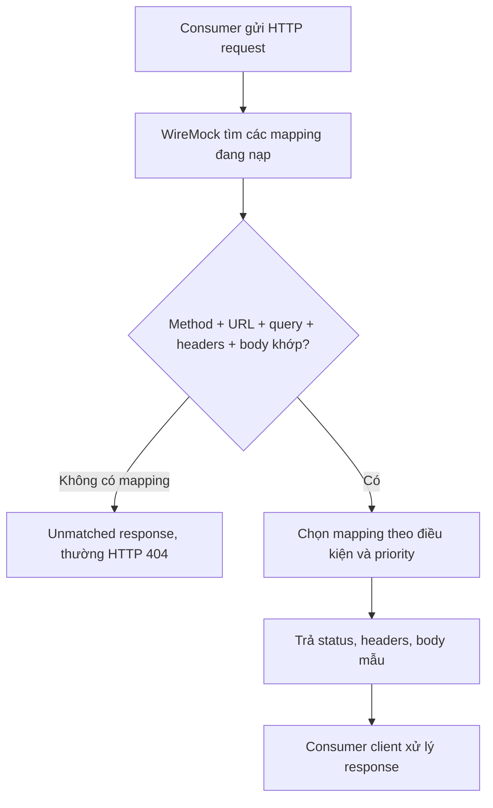
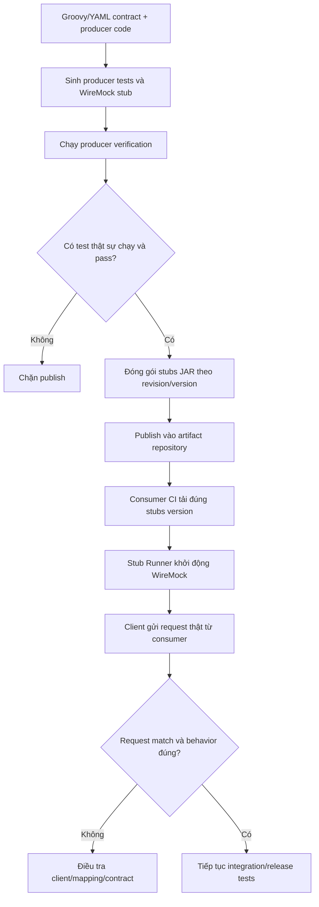

# So khớp method, URL, query, header và body

## 1. WireMock đang so khớp điều gì?

Trong **Spring Cloud Contract**, producer và consumer thống nhất những hành vi HTTP hoặc thông điệp mà các dịch vụ phải giữ. Từ hợp đồng **Groovy/YAML DSL**, Contract Verifier có thể sinh **producer tests** và **HTTP stubs**. Với HTTP, các stubs thường được phục vụ bằng **WireMock**; consumer dùng **Stub Runner** để gọi một server mô phỏng thay vì phải khởi động producer thật. Khi đưa vào CI, luồng này giúp phát hiện thay đổi API không tương thích.

Một HTTP stub có thể được đọc theo công thức:

> **Nếu request thỏa những điều kiện so khớp đã khai báo, WireMock trả response được cấu hình cho mapping đó.**

Ví dụ, producer `order-service` cam kết tạo đơn hàng khi consumer gọi:

```http
POST /api/orders?source=checkout HTTP/1.1
Content-Type: application/json
X-Request-Id: req-abc123

{"customerId":"cust-123","quantity":2}
```

Response mẫu:

```http
HTTP/1.1 201 Created
Content-Type: application/json

{"orderId":"ord-501","status":"CREATED"}
```

Một WireMock mapping có thể bảo vệ nhiều chiều cùng lúc: **HTTP method, path, query parameters, request headers và request body**. Nếu consumer gửi sai một điều kiện bắt buộc, mapping có thể không được chọn. Khi không có stub nào phù hợp, WireMock thường trả một **404 do unmatched request**, không phải mặc nhiên là lỗi `ORDER_NOT_FOUND` do nghiệp vụ producer quy định.

**Mục tiêu bài học:** viết và đọc đúng các điều kiện matching của WireMock; biểu diễn cùng ý định trong Spring Cloud Contract; phân biệt giá trị request phía producer và consumer; chẩn đoán stub không match; và xây kiểm thử tích cực/tiêu cực đáng tin cậy trong consumer CI.

## 2. Mô hình matching và sự khác nhau giữa contract với mapping

Một stub mapping thường có hai phần:

- `request`: các điều kiện để WireMock chọn mapping, chẳng hạn `method`, `urlPath`, `queryParameters`, `headers` và `bodyPatterns`.
- `response`: HTTP `status`, `headers`, `body` hoặc `jsonBody` mà mock server trả khi request match.



Khi một mapping khai báo **nhiều điều kiện**, chúng phải **đồng thời đúng** để mapping đó match. Nhưng **không khai báo điều kiện nào** không có nghĩa WireMock tự kiểm tra điều kiện ấy. Ví dụ mapping chỉ kiểm tra `urlPath` và `method` có thể chấp nhận nhiều body không liên quan nếu không có matcher body.

| Loại điều kiện | Ví dụ | Nếu không kiểm tra |
| --- | --- | --- |
| HTTP method | `POST` | `GET` có thể được chấp nhận nếu dùng `ANY` hoặc mapping rộng |
| URL/path | `/api/orders` | Một endpoint khác có thể kích hoạt nhầm |
| Query | `source=checkout` | Stub nhận cả source sai hoặc không có nếu không ràng buộc |
| Header | `Content-Type: application/json` | Stub chấp nhận request có media type khác |
| Body | `customerId` và `quantity` | Payload khác có thể kích hoạt response thành công |
| Scenario state | `Started`, `Created` | Không mô phỏng được chuỗi trạng thái nếu bài test cần |

**Spring Cloud Contract DSL là nguồn cam kết**, còn **WireMock mapping JSON** là dạng thực thi HTTP mock mà công cụ có thể sinh ra. Khi dùng Spring Cloud Contract làm nguồn chung, không nên sửa trực tiếp mapping đã sinh trong stubs JAR: thay đổi đó có thể biến mất sau build hoặc lệch khỏi producer verification.

## 3. So khớp HTTP method

WireMock thường dùng `request.method` để lựa chọn method:

```json
{
  "request": {
    "method": "GET",
    "urlPath": "/api/orders/42"
  },
  "response": {
    "status": 200,
    "jsonBody": {"orderId": 42, "status": "CONFIRMED"}
  }
}
```

Mapping này diễn đạt **GET** đúng path. `POST /api/orders/42` không phải cùng request. Với một API REST, cùng URL có thể hỗ trợ nhiều hành vi:

| Request | Ngữ nghĩa ví dụ | Mapping nên phân biệt |
| --- | --- | --- |
| `GET /api/orders/42` | Đọc đơn hàng | `method = GET` |
| `PATCH /api/orders/42` | Sửa một phần đơn hàng | `method = PATCH` |
| `DELETE /api/orders/42` | Hủy/xóa theo API contract | `method = DELETE` |
| `POST /api/orders` | Tạo đơn hàng mới | `method = POST` |

WireMock có thể hỗ trợ phương thức matching rộng như `ANY`, nhưng với hợp đồng mà consumer dựa trên một method cụ thể, **nên dùng method chính xác** để phát hiện request dùng sai động từ HTTP. Đừng tạo một mapping `ANY /api/orders/42` chỉ để các test không bị 404: nó có thể che lỗi client gửi nhầm `GET` thay `POST`.

### Một câu hỏi dễ bị bỏ qua

Khi consumer test nhận HTTP `404` từ WireMock sau lệnh `POST`, hãy kiểm tra **method trước khi kiểm tra dữ liệu**. Một stub `GET` trên cùng path không phải bằng chứng route `POST` đã được mô phỏng. Với method `HEAD` hoặc `OPTIONS`, phải xem đúng cách WireMock/runtime đang xử lý; không tự suy diễn rằng mapping `GET` cũng tương đương contract riêng của `HEAD`.

## 4. So khớp URL: toàn bộ URL request hay chỉ path?

WireMock phân biệt những kiểu URL matcher thường gặp:

| Trường trong WireMock | Phạm vi chính | Ví dụ |
| --- | --- | --- |
| `url` | Path **kèm query string** theo giá trị chính xác | `/api/orders?source=checkout` |
| `urlPattern` | Regex trên path và query string | `/api/orders\\?.*` |
| `urlPath` | Chỉ **path**, không gồm query | `/api/orders` |
| `urlPathPattern` | Regex trên **path** | `/api/orders/[0-9]+` |

Ví dụ matcher chỉ yêu cầu path:

```json
{
  "request": {
    "method": "GET",
    "urlPath": "/api/orders"
  },
  "response": {
    "status": 200,
    "jsonBody": {"items": []}
  }
}
```

Nếu consumer gửi `GET /api/orders?page=0`, path vẫn là `/api/orders`; mapping ở trên có thể match vì không khai báo ràng buộc query. Điều này có thể **chủ ý** khi endpoint cho phép các tham số tùy chọn, hoặc có thể là **lỗ hổng kiểm thử** nếu consumer bắt buộc gửi một query cụ thể.

### Chọn `urlPath` khi muốn kiểm tra query tách biệt

Ví dụ:

```json
{
  "request": {
    "method": "GET",
    "urlPath": "/api/orders",
    "queryParameters": {
      "status": {"equalTo": "CONFIRMED"},
      "page": {"equalTo": "0"}
    }
  },
  "response": {
    "status": 200,
    "jsonBody": {"items": []}
  }
}
```

Cấu hình này dễ hiểu hơn việc khóa toàn bộ chuỗi `?status=CONFIRMED&page=0` trong `url`: khi client gửi query ở thứ tự khác nhưng các giá trị tương đương, matcher tách riêng từng parameter có thể vẫn chấp nhận.

### Dùng regex path đúng lúc

Nếu consumer có thể truy vấn nhiều ID cùng định dạng, có thể dùng:

```json
{
  "request": {
    "method": "GET",
    "urlPathPattern": "/api/orders/[0-9]+"
  },
  "response": {
    "status": 200,
    "jsonBody": {"orderId": 42}
  }
}
```

Regex này diễn đạt **các path ID số**, nhưng response vẫn trả `orderId = 42` cho mọi ID được match! Nó là **một stub ví dụ**, không phải producer thật có database hoặc tự phản chiếu ID từ request. Nếu consumer cần kiểm tra quan hệ “path ID phải bằng response ID”, phải dùng request/response transformers phù hợp hoặc viết các kịch bản riêng, đồng thời có producer integration test bảo vệ tính đúng đắn.

**Lưu ý:** Regex `urlPattern` trên toàn path+query dễ nhạy cảm với thứ tự parameter và escape; để kiểm tra tham số truy vấn một cách có cấu trúc, ưu tiên `urlPath` + `queryParameters`.

## 5. So khớp query parameters

Query parameter nằm sau dấu `?` trong URL, ví dụ:

```http
GET /api/orders?status=CONFIRMED&page=0&size=20
```

Trong WireMock, `queryParameters` cho phép viết các điều kiện theo **tên tham số**, độc lập với thứ tự trên URL:

```json
{
  "request": {
    "method": "GET",
    "urlPath": "/api/orders",
    "queryParameters": {
      "status": {"equalTo": "CONFIRMED"},
      "page": {"matches": "[0-9]+"},
      "size": {"equalTo": "20"}
    }
  },
  "response": {
    "status": 200,
    "jsonBody": {"items": []}
  }
}
```

Ý nghĩa:

- `status` phải bằng chuỗi `CONFIRMED`.
- `page` phải có dạng số không âm theo regex `[0-9]+`. Đây chỉ là **kiểm tra định dạng**, không tự bảo đảm số nằm trong khoảng mà API cho phép.
- `size` phải bằng `20` trong kịch bản này.

| Request | Có thỏa các điều kiện trên? | Lý do |
| --- | --- | --- |
| `?status=CONFIRMED&page=0&size=20` | Có | Đủ ba điều kiện |
| `?size=20&page=1&status=CONFIRMED` | Có | Đổi thứ tự query không làm đổi từng giá trị |
| `?status=PENDING&page=0&size=20` | Không | `status` khác |
| `?status=CONFIRMED&page=abc&size=20` | Không | `page` không thỏa regex |
| `?status=CONFIRMED&size=20` | Không | Thiếu `page` bắt buộc |

**Không mặc định cấm các query parameter bổ sung** nếu mapping chỉ khai báo ba điều kiện này. WireMock thường không coi một tham số chưa được nhắc tới là lỗi. Nếu API yêu cầu từ chối query lạ, cần contract riêng cho hành vi lỗi hoặc kiểm thử validation ở producer thay vì nghĩ rằng `queryParameters` sẽ áp dụng danh sách allowlist tự động.

### Những bẫy về query

**1. Dạng chuỗi và số.** Query trên HTTP về bản chất là các chuỗi. `page=0` được matcher đọc là `"0"`, không phải JSON number. Đừng viết một body matcher số để thay cho quy tắc query.

**2. Thiếu và rỗng.** `?status=` không giống với hoàn toàn thiếu `status`. Nếu API phân biệt hai trường hợp, hãy tạo test phù hợp cho cả hai; không suy rằng mọi empty-value đều bị xử lý giống nhau.

**3. Tham số lặp.** `?tag=a&tag=b` có nhiều giá trị cho cùng tên. Nếu contract dựa vào danh sách tag, cần matcher hỗ trợ nhiều giá trị (theo version WireMock) hoặc test chuyên biệt; một điều kiện `equalTo: "a"` đơn lẻ chưa diễn đạt được tất cả ngữ nghĩa “đúng hai tag”.

**4. Encoding.** Khoảng trắng, dấu cộng, dấu `%` và ký tự Unicode trong query có thể được URL-encode. Khi debug, đối chiếu cả URL raw và cách HTTP client/WireMock giải mã giá trị. Đừng dùng regex trên chuỗi URL nguyên văn chỉ để khớp một cách mã hóa tình cờ.

**5. Điều kiện vắng mặt.** WireMock có kiểu matcher `absent` cho các thành phần được hỗ trợ ở các phiên bản tương ứng. Nếu kịch bản yêu cầu không có một parameter, phải khai báo **rõ điều kiện vắng mặt** theo cú pháp phiên bản đó; không tự coi việc bỏ trường ra khỏi mapping là quy tắc cấm gửi trường.

## 6. So khớp request headers

Headers giúp phân biệt nội dung JSON, phiên bản, correlation ID, xác thực và cơ chế điều phối request. Ví dụ:

```http
POST /api/orders HTTP/1.1
Content-Type: application/json; charset=UTF-8
Accept: application/json
X-Request-Id: req-abc123
```

Một cách khai báo WireMock:

```json
{
  "request": {
    "method": "POST",
    "urlPath": "/api/orders",
    "headers": {
      "Content-Type": {"contains": "application/json"},
      "Accept": {"equalTo": "application/json"},
      "X-Request-Id": {"matches": "req-[A-Za-z0-9-]+"}
    }
  },
  "response": {
    "status": 201
  }
}
```

| Matcher | Ví dụ | Cách hiểu |
| --- | --- | --- |
| `equalTo` | `Accept = application/json` | So khớp giá trị chính xác theo matcher |
| `contains` | `Content-Type` chứa `application/json` | So khớp chuỗi con |
| `matches` | `X-Request-Id` thỏa regex | So khớp mẫu chuỗi |
| `absent` | Header không tồn tại | Dùng khi **sự vắng mặt** có ý nghĩa |

**Header names không phân biệt chữ hoa/chữ thường theo HTTP**, nhưng **header values vẫn phải được đánh giá theo ngữ nghĩa của từng header**. Ví dụ một số media type hoặc token có quy tắc riêng; không nên mặc định mọi header value đều case-insensitive.

### Dùng `contains` cho Content-Type có an toàn?

`contains: "application/json"` tiện vì chấp nhận cả `application/json; charset=UTF-8`, nhưng có thể **quá rộng**: một chuỗi bất thường vẫn chứa `application/json`. Nếu consumer phụ thuộc chặt vào media type, hãy dùng matcher về media type hoặc regex đủ chính xác theo phiên bản, và tạo trường hợp phủ định. Ví dụ trong một hệ thống chỉ chấp nhận JSON, không nên để `Content-Type: application/json-and-text` match chỉ vì chứa chuỗi mong muốn.

### Không khóa header động vào ví dụ duy nhất

`X-Request-Id`, `traceparent` hoặc token tương quan có thể đổi mỗi lần gọi. Dùng regex/matcher định dạng khi consumer chỉ cần giá trị hợp lệ. Không đưa token thật vào mapping/fixture và không log `Authorization`, cookie hay bí mật từ test run. Nếu consumer cần kiểm tra `401`/`403`, những contract lỗi ấy phải được định nghĩa rõ ràng thay vì chỉ thêm một header mẫu ngẫu nhiên.

### Khi nào nên kiểm tra Accept?

`Accept` là **mong muốn về response media type** của client; `Content-Type` mô tả **media type của request body**. Một `GET` không có body có thể chỉ cần `Accept`; một `POST` JSON thường cần `Content-Type`. Nếu mock đòi cả hai một cách vô lý, consumer test có thể fail dù request API hợp lệ. Ràng buộc đúng những header producer/consumer thật sự đã thỏa thuận.

## 7. So khớp request body

Với `POST`/`PUT`/`PATCH`, body thường là điều kiện quan trọng để xác định kịch bản. Trong WireMock, `bodyPatterns` có nhiều kiểu matcher:

| Kiểu | Áp dụng | Điểm cần nhớ |
| --- | --- | --- |
| `equalTo` | Body text chính xác | Nhạy với khoảng trắng và thứ tự ký tự nếu không được normalize |
| `contains` | Body text chứa một chuỗi | Nhanh nhưng có nguy cơ quá rộng |
| `matches` | Regex cho body text | Không hiểu cấu trúc JSON; chú ý escape |
| `equalToJson` | Body JSON theo nội dung JSON | Có thể cấu hình bỏ qua thứ tự phần tử array hoặc field bổ sung |
| `matchesJsonPath` | JSON có path/điều kiện được chọn | Sự tồn tại của một path chưa đồng nghĩa toàn bộ object hợp lệ |
| `equalToXml` / XPath | Body XML | Dùng khi API dựa trên XML và tích hợp hỗ trợ |

### 7.1. So sánh JSON thay vì so sánh chuỗi thô

Hai body sau thường tương đương theo cấu trúc JSON object:

```json
{"customerId":"cust-123","quantity":2}
```

```json
{
  "quantity": 2,
  "customerId": "cust-123"
}
```

Matcher text `equalTo` có thể coi chúng khác nhau do khoảng trắng/thứ tự khóa. Matcher `equalToJson` thường phù hợp hơn khi consumer cần xác minh **cấu trúc và giá trị JSON**.

```json
{
  "bodyPatterns": [
    {
      "equalToJson": "{\"customerId\":\"cust-123\",\"quantity\":2}"
    }
  ]
}
```

Đây là **đoạn `bodyPatterns` bên trong `request`**, không phải một mapping HTTP hoàn chỉnh. WireMock xử lý JSON theo cấu trúc, nên khác thứ tự khóa object không nhất thiết làm fail.

### 7.2. Thứ tự mảng và trường JSON bổ sung

Với `equalToJson`, các option thường gặp:

```json
{
  "bodyPatterns": [
    {
      "equalToJson": "{\"customerId\":\"cust-123\",\"quantity\":2}",
      "ignoreArrayOrder": true,
      "ignoreExtraElements": true
    }
  ]
}
```

- `ignoreArrayOrder: true` cho phép bỏ qua thứ tự các phần tử array khi so JSON. **Không dùng** nếu thứ tự array là một phần contract.
- `ignoreExtraElements: true` cho phép JSON thực có những field/element thêm so với mẫu theo ngữ nghĩa matcher. **Không dùng** nếu API cần từ chối field không khai báo.

Hai option này là **lựa chọn về mức độ chặt của matching** chứ không phải mặc định chung cho mọi API. Nếu consumer chỉ cần `customerId` và `quantity`, có thể cho phép metadata bổ sung. Nếu consumer gửi request ký số hoặc có schema strict, việc bỏ qua phần bổ sung có thể che vi phạm.

### 7.3. JSONPath cho điều kiện trên field hoặc mảng

Khi chỉ cần bảo đảm một trường tồn tại, có thể dùng:

```json
{
  "bodyPatterns": [
    {"matchesJsonPath": "$.customerId"}
  ]
}
```

Nhưng matcher đó **không chứng minh `customerId` có format hợp lệ**, cũng không kiểm tra `quantity`. Nếu bài test cần giá trị chính xác, hãy dùng `equalToJson` hoặc matcher JSONPath nâng cao phù hợp phiên bản; nếu cần “mọi phần tử có số lượng dương”, thêm assertion/contract riêng để bảo vệ bất biến đó.

Ví dụ body gồm array:

```json
{
  "items": [
    {"sku": "SKU-101", "quantity": 2},
    {"sku": "SKU-102", "quantity": 1}
  ]
}
```

JSONPath `$.items[*].sku` tìm những `sku` **đang tồn tại**, nhưng không chứng minh mọi phần tử có `sku` hoặc `quantity > 0`. Với các điều kiện collection, cần so path, kích thước array và assertion trên từng phần tử nếu consumer phụ thuộc.

### 7.4. Body null, empty, form và binary

```http
POST /api/orders HTTP/1.1
Content-Type: application/json

{}
```

Body `{}` là một JSON object rỗng, khác body trống `""`, JSON `null` hoặc một request không có body. Khi API có validation, hãy mô tả chính xác lỗi `400`/`415` tương ứng.

WireMock có matcher phù hợp với text, JSON, XML, form, multipart hoặc binary tùy phiên bản/extension. Không áp dụng `equalToJson` cho `application/x-www-form-urlencoded`, raw protobuf hoặc multipart rồi mong parser tự suy ra schema. Chọn matcher theo **media type và dữ liệu consumer thực sự gửi**.

## 8. Một WireMock mapping kết hợp cả năm điều kiện

Ta quay về kịch bản `checkout-service` tạo đơn hàng. Một mapping HTTP hoàn chỉnh có thể lưu thành file `mappings/create-order.json` của một WireMock server dùng cho bài thực hành:

```json
{
  "name": "Create order from checkout",
  "priority": 1,
  "request": {
    "method": "POST",
    "urlPath": "/api/orders",
    "queryParameters": {
      "source": {"equalTo": "checkout"}
    },
    "headers": {
      "Content-Type": {"contains": "application/json"},
      "X-Request-Id": {"matches": "req-[A-Za-z0-9-]+"}
    },
    "bodyPatterns": [
      {
        "equalToJson": "{\"customerId\":\"cust-123\",\"quantity\":2}"
      }
    ]
  },
  "response": {
    "status": 201,
    "headers": {
      "Content-Type": "application/json",
      "Location": "/api/orders/ord-501"
    },
    "jsonBody": {
      "orderId": "ord-501",
      "status": "CREATED"
    }
  }
}
```

Đây là **WireMock mapping JSON dùng để giải thích cách chọn stub**; nó không phải file contract Groovy/YAML nguồn của Spring Cloud Contract. Với hệ thống sinh stub từ contract, phải xem mapping được sinh có tương đương các điều kiện mong đợi không. Không giữ một mapping viết tay với điều kiện khác mà gọi nó là bằng chứng producer đã cam kết.

### Phân tích điều kiện

| Điều kiện | Request phải làm gì? | Cách thay đổi khiến mapping không match |
| --- | --- | --- |
| `method = POST` | Gửi HTTP POST | Đổi sang GET |
| `urlPath = /api/orders` | Gọi đúng path | Gọi `/api/order` |
| `source = checkout` | Có query với giá trị chính xác | Gửi `source=mobile` |
| `Content-Type` chứa `application/json` | Gửi body JSON với header phù hợp | Gửi `text/plain` |
| `X-Request-Id` đúng regex | Gửi request ID có dạng `req-...` | Gửi `broken` hoặc thiếu header |
| `equalToJson` | Body có `customerId = cust-123` và `quantity = 2` | Thay `quantity` thành 0, đổi kiểu hoặc bỏ field |

Lưu ý `priority = 1` ở đây chỉ có ý nghĩa **khi có nhiều mapping cạnh tranh**. Nó không làm WireMock bỏ qua điều kiện request. Một mapping có priority cao vẫn phải match đủ các điều kiện mới được chọn.

### Thử bằng HTTP

Giả sử WireMock đã nạp mapping trên và nghe ở `http://localhost:8089`:

```bash
curl -i -X POST \
  'http://localhost:8089/api/orders?source=checkout' \
  -H 'Content-Type: application/json' \
  -H 'X-Request-Id: req-abc123' \
  -d '{"customerId":"cust-123","quantity":2}'
```

Kết quả kỳ vọng là HTTP `201` cùng body `orderId = ord-501`, `status = CREATED`. Trong một bài test consumer đúng nghĩa, hãy gọi qua **HTTP client của ứng dụng**, không chỉ `curl`.

Thử thay `X-Request-Id` thành `invalid` hoặc `quantity` thành `0`. Nếu không có mapping khác phù hợp, request sẽ trở thành unmatched và WireMock thường trả 404 mặc định. Đây là **phép thử chất lượng matcher**, không phải mô tả contract nghiệp vụ “quantity không hợp lệ trả 404”; API thật có thể phải trả `400` nếu validation không đạt.

## 9. Cùng mapping qua Java DSL của WireMock

WireMock còn hỗ trợ API Java để khai báo stub trong test. Ví dụ tương đương về ý định:

```java
import static com.github.tomakehurst.wiremock.client.WireMock.*;

// Đặt bên trong setup/test đã khởi động WireMock server.
stubFor(
    post(urlPathEqualTo("/api/orders"))
        .withQueryParam("source", equalTo("checkout"))
        .withHeader("Content-Type", containing("application/json"))
        .withHeader("X-Request-Id", matching("req-[A-Za-z0-9-]+"))
        .withRequestBody(
            equalToJson("{\"customerId\":\"cust-123\",\"quantity\":2}")
        )
        .willReturn(
            aResponse()
                .withStatus(201)
                .withHeader("Content-Type", "application/json")
                .withHeader("Location", "/api/orders/ord-501")
                .withBody("{\"orderId\":\"ord-501\",\"status\":\"CREATED\"}")
        )
);
```

API này thích hợp khi muốn tạo một WireMock server trực tiếp trong bài test mà **không dùng stubs artifact của producer**. Tuy vậy, trong luồng Spring Cloud Contract, nếu consumer liên tục viết lại mapping thủ công, sẽ có hai nguồn cam kết dễ lệch nhau.

**Quy tắc phân vai:**

- **Groovy/YAML Contract DSL:** nguồn cam kết được producer verification và stub generation cùng sử dụng.
- **WireMock JSON/Java DSL:** cách thực thi/mock request-response cho HTTP, có thể được sinh ra hoặc cấu hình trực tiếp cho test riêng.

Hai hệ thống cú pháp cùng mô tả request/response, nhưng **không thể copy một khối `bodyPatterns` của WireMock vào `bodyMatchers` của Spring Cloud Contract rồi giả định schema giống nhau**.

## 10. Diễn đạt yêu cầu matching bằng Spring Cloud Contract Groovy DSL

Với producer `order-service`, tệp nguồn `src/test/resources/contracts/orders/create-order.groovy` có thể khai báo:

```groovy
import org.springframework.cloud.contract.spec.Contract

Contract.make {
    description 'Tạo đơn hàng từ checkout'

    request {
        method POST()
        urlPath('/api/orders') {
            queryParameters {
                parameter 'source': 'checkout'
            }
        }
        headers {
            contentType(applicationJson())
            header(
                'X-Request-Id',
                $(consumer(regex('req-[A-Za-z0-9-]+')),
                  producer('req-abc123'))
            )
        }
        body([
            customerId: $(consumer(regex('cust-[0-9]{3}')),
                          producer('cust-123')),
            quantity: 2
        ])
    }

    response {
        status CREATED()
        headers {
            contentType(applicationJson())
        }
        body([
            orderId: $(consumer('ord-501'),
                       producer(regex('ord-[0-9]+'))),
            status: 'CREATED'
        ])
    }
}
```

Đây là minh họa Groovy DSL theo mô hình **giá trị hai phía** của Spring Cloud Contract. Với request:

| Phần request | **Stub consumer-side** dùng gì? | **Generated producer test** dùng gì? |
| --- | --- | --- |
| Method/path | `POST /api/orders` | Gửi `POST /api/orders` |
| Query `source` | Phải là `checkout` | Gửi `checkout` |
| Header `X-Request-Id` | Regex `req-[A-Za-z0-9-]+` | Gửi ví dụ `req-abc123` |
| Body `customerId` | Regex `cust-[0-9]{3}` | Gửi ví dụ `cust-123` |
| Body `quantity` | Giá trị `2` | Gửi `2` |

Trong **response**, stub trả `orderId = ord-501` làm mẫu cho consumer, còn producer verification có thể chấp nhận `ord-502`, `ord-999` nếu thỏa matcher `ord-[0-9]+`. `status` phải là `CREATED` trong kịch bản này.

**Không hiểu nhầm:** Một generated producer test chỉ gửi `cust-123` **không chứng minh** producer xử lý đúng mọi ID khách hàng khớp regex. Matcher `consumer(regex(...))` giúp stub chấp nhận nhiều request consumer hợp lệ; producer-side test được sinh dùng giá trị ví dụ phía `producer`. Những miền dữ liệu quan trọng cần có thêm test kịch bản/validation phù hợp.

### Tại sao không chỉ viết WireMock JSON?

Nếu developer sửa một mapping để stub trả `201` nhưng producer thật trả `200`, consumer test với WireMock có thể vẫn pass. Khi dùng nguồn Groovy contract chung và chạy producer verification trước khi xuất bản stubs JAR, pipeline có thêm cơ hội phát hiện sai khác HTTP status/body ở implementation thật.

## 11. Cùng kịch bản bằng YAML DSL

Spring Cloud Contract cũng hỗ trợ YAML DSL. Một bản diễn đạt tương ứng:

```yaml
description: Tạo đơn hàng từ checkout
request:
  method: POST
  urlPath: /api/orders
  queryParameters:
    source: checkout
  headers:
    Content-Type: application/json
    X-Request-Id: req-abc123
  body:
    customerId: "cust-123"
    quantity: 2
  matchers:
    headers:
      - key: X-Request-Id
        regex: 'req-[A-Za-z0-9-]+'
    body:
      - path: $.customerId
        type: by_regex
        value: 'cust-[0-9]{3}'
response:
  status: 201
  headers:
    Content-Type: application/json
  body:
    orderId: "ord-501"
    status: "CREATED"
  matchers:
    body:
      - path: $.orderId
        type: by_regex
        value: 'ord-[0-9]+'
```

Trong YAML, **giá trị body/header cụ thể** và **matcher** có thể được khai báo tách biệt:

- `request.body.customerId = cust-123`: ví dụ gửi trong generated producer test.
- `request.matchers.body`: điều kiện stub dùng để nhận `customerId` từ consumer.
- `response.body.orderId = ord-501`: giá trị stub trả.
- `response.matchers.body`: điều kiện generated producer test kiểm tra `orderId` thật.

**Lưu ý phiên bản:** Cấu trúc YAML, tên matcher header/body và khả năng xử lý query matcher thay đổi theo các bản Spring Cloud Contract. Hãy xem **schema và generated mappings/tests thực tế** của phiên bản dự án đang dùng; việc YAML parse thành công chưa đủ chứng minh WireMock matcher và producer assertion đã đúng. Không để cả bản Groovy và YAML trùng cùng kịch bản ở source root sau khi hoàn tất chuyển đổi.

## 12. Khi nhiều mapping đều có thể match: priority và độ đặc hiệu

Trong một stub server thường có hàng chục mapping. Một vấn đề khó phát hiện là **mapping quá rộng che mapping cụ thể**.

Giả sử có hai mapping cho cùng endpoint:

```json
{
  "priority": 10,
  "request": {
    "method": "POST",
    "urlPath": "/api/orders"
  },
  "response": {
    "status": 400,
    "jsonBody": {"code": "BAD_REQUEST"}
  }
}
```

Và:

```json
{
  "priority": 1,
  "request": {
    "method": "POST",
    "urlPath": "/api/orders",
    "queryParameters": {
      "source": {"equalTo": "checkout"}
    },
    "bodyPatterns": [
      {"equalToJson": "{\"customerId\":\"cust-123\",\"quantity\":2}"}
    ]
  },
  "response": {
    "status": 201,
    "jsonBody": {"orderId": "ord-501", "status": "CREATED"}
  }
}
```

Trong WireMock, **priority có số nhỏ hơn được ưu tiên cao hơn** khi nhiều mapping match cùng request. Ví dụ `1` được ưu tiên trước `10`. Với request hợp lệ thỏa mapping cụ thể, server trả `201`. Với request `POST /api/orders` không thỏa các điều kiện của mapping cụ thể nhưng vẫn match mapping rộng, server có thể trả `400`.

Đây chỉ là **fallback mô phỏng trong một lab**, không phải quy tắc validation tự động của producer. Một API thật có thể trả `401`, `415`, `422` hoặc response khác cho từng loại lỗi, nên đừng coi một mapping `BAD_REQUEST` rộng là đặc tả đầy đủ.

### Những nguyên tắc quản lý mapping chồng lấn

1. Ưu tiên request matcher **cụ thể** cho những kịch bản có behavior khác nhau.
2. Chỉ dùng fallback rộng khi test thực sự cần và response fallback phản ánh yêu cầu đã thống nhất.
3. Khi hai mapping cùng priority và có cùng điều kiện, **đừng dựa vào thứ tự nạp file** để suy ra kết quả ổn định.
4. Dùng đúng kịch bản `scenarioName`/`requiredScenarioState` nếu response phụ thuộc vào **request đã xảy ra trước đó**, không chỉ path.
5. Kiểm tra một request hợp lệ và một request sai để phát hiện mapping rộng vô tình match.

**Spring Cloud Contract có thể sinh nhiều WireMock mappings từ nhiều contract.** Nếu các contract khác nhau mô tả cùng `method + path + query + headers + body` nhưng response khác mà không có phân biệt trạng thái, consumer test có thể không xác định được stub nào sẽ trả. Nên thiết kế **request hoặc scenario phân biệt rõ**, không chữa bằng cách chọn priority tùy tiện nếu bản thân lời hứa API đang mâu thuẫn.

## 13. Debug unmatched request bằng công cụ quản trị WireMock

Trong lab, giả sử WireMock chạy trên `localhost:8089`. Các endpoint quản trị thường hữu ích:

```bash
# Xem những mapping đã được nạp
curl -s http://localhost:8089/__admin/mappings

# Xem những request chưa khớp mapping
curl -s http://localhost:8089/__admin/requests/unmatched
```

Nội dung response của API quản trị, danh sách request journal và cách hiển thị “near misses” phụ thuộc phiên bản và cấu hình WireMock. Một số runner/test setup có thể tắt journal hoặc hạn chế truy cập admin. Vì vậy hãy xác minh thực tế trước khi phụ thuộc vào các endpoint này.

### Quy trình điều tra một 404 bất ngờ

Giả sử consumer mong `201` nhưng nhận `404`. Đừng lập tức thêm mapping `POST /api/orders` rộng để làm test qua. Điều tra theo thứ tự:

1. **Server:** Stub Runner/WireMock đã khởi động đúng port chưa? Client có gọi đúng host/port không?
2. **Artifact:** Stubs JAR đúng group/artifact/version/classifier và chứa mapping này không?
3. **Method:** Consumer có gửi `POST` chứ không phải `GET`?
4. **Path:** Request có `/api/orders` hay thiếu prefix `/api`?
5. **Query:** Có `source=checkout` không? Có bị khác chữ hoa, khoảng trắng, encoding?
6. **Headers:** `Content-Type` và `X-Request-Id` có mặt, giá trị đúng không?
7. **Body:** JSON là object hay chuỗi JSON? `quantity` có phải number `2` không?
8. **Priority/state:** Có mapping khác nhận request trước, hoặc scenario đang ở trạng thái khác không?
9. **Response:** Nếu mapping đã match nhưng status vẫn không mong đợi, xem `response` của mapping và artifact version.

Ví dụ bảng điều tra:

| Actual request | Điều kiện kỳ vọng | Vấn đề |
| --- | --- | --- |
| `GET /api/orders?source=checkout` | `POST` | Sai method |
| `POST /orders?source=checkout` | `/api/orders` | Sai path |
| `POST /api/orders?source=mobile` | `source=checkout` | Sai query |
| `Content-Type: text/plain` | Chứa `application/json` | Sai header |
| `X-Request-Id: abc` | Regex `req-...` | Sai ID |
| `{"customerId":"cust-123","quantity":"2"}` | JSON có number `2` | Sai kiểu body |

**Cần phân biệt hai loại 404:**

- **404 nghiệp vụ**: mapping đã match và chủ động trả `404` với body như `{"code":"ORDER_NOT_FOUND"}`.
- **404 unmatched**: WireMock không tìm thấy mapping thích hợp và trả lỗi mặc định; body có thể là thông tin chẩn đoán thay vì JSON lỗi nghiệp vụ.

Nếu consumer phải phân nhánh theo `code`, hãy assert **cả status và body error code**, không chỉ status. Một test nhận 404 vì gọi sai URL nhưng vẫn pass là **false positive**.

### Khi nào dùng request journal?

Request journal đặc biệt hữu ích để so **request thực đã đến mock server** với **matcher trong mapping**, thay vì chỉ nhìn code HTTP client. Nhưng journal có thể chứa header xác thực, cookies, payload chứa dữ liệu riêng tư; chỉ bật và lưu trong môi trường test an toàn, xóa/ẩn dữ liệu nhạy cảm khi chia sẻ log.

## 14. Kiểm thử positive và negative cho từng tầng matching

Một mapping hoạt động đúng không chỉ khi một request “đẹp” trả `201`. Nó còn phải **không trả nhầm success** cho request không đáp ứng điều kiện mà hợp đồng yêu cầu.

| Trường hợp thử | Thay đổi từ request chuẩn | Mapping `Create order` mục 8 có nên match? |
| --- | --- | --- |
| Chuẩn | POST, path/query/header/body đúng | **Có** |
| Sai method | `GET` thay `POST` | **Không** |
| Sai path | `/api/order` thay `/api/orders` | **Không** |
| Sai query | `source=mobile` | **Không** |
| Thiếu query | Bỏ `source` | **Không** |
| Thêm query không ràng buộc | Có thêm `debug=true` | **Có thể có**, vì mapping không cấm query bổ sung |
| Sai header media type | `Content-Type: text/plain` | **Không** |
| Request ID đúng dạng khác mẫu | `req-xyz999` | **Có**, matcher regex cho phép |
| Request ID sai dạng | `X-Request-Id: xyz999` | **Không** |
| Đảo thứ tự khóa JSON | `quantity` đứng trước `customerId` | **Có**, nếu nội dung JSON tương đương |
| Thay số thành chuỗi | `quantity: "2"` | **Không** với `equalToJson` thông thường |
| Sai giá trị body | `quantity: 0` | **Không** |
| Bỏ field body | Không có `customerId` | **Không** |
| Thêm field body | `coupon: "X"` | Phụ thuộc matcher/`ignoreExtraElements` của mapping |

Nếu có **fallback mapping** ở cùng server, request không khớp mapping tạo đơn có thể vẫn nhận **một response hợp lệ từ mapping khác**. Vì vậy phép thử phủ định nên xác minh **không trả nhầm kết quả thành công của mapping cụ thể**, thay vì luôn assert WireMock phải trả `404`.

### Không kiểm thử chỉ bằng curl

`curl` hữu ích để debug, nhưng bài test consumer nên gọi qua **client thật của ứng dụng**: RestTemplate, WebClient, Feign hoặc HTTP client khác. Khi đó mới bảo vệ được cách client dựng URL, mã hóa query, đặt header, serialize request body và xử lý response.

Nếu chỉ viết JSON mapping và gọi `curl`, ta đang kiểm thử **WireMock mapping**, chưa xác minh consumer code đang gửi đúng request.

## 15. Gắn matching vào @AutoConfigureStubRunner ở consumer

Giả sử producer đã chạy verification và phát hành `order-service-1.5.0-stubs.jar`. Consumer Spring Boot có thể chạy:

```java
import org.junit.jupiter.api.Test;
import org.springframework.beans.factory.annotation.Autowired;
import org.springframework.boot.test.context.SpringBootTest;
import org.springframework.cloud.contract.stubrunner.StubRunnerProperties;
import org.springframework.cloud.contract.stubrunner.spring.AutoConfigureStubRunner;

import static org.assertj.core.api.Assertions.assertThat;

@SpringBootTest(properties =
    "clients.order.base-url=http://localhost:9090")
@AutoConfigureStubRunner(
    ids = "com.example:order-service:1.5.0:stubs:9090",
    stubsMode = StubRunnerProperties.StubsMode.LOCAL
)
class CheckoutOrderContractTest {

    @Autowired
    OrderClient orderClient;

    @Test
    void shouldCreateOrderUsingPublishedStub() {
        OrderDto order = orderClient.createOrder(
            "checkout", "req-abc123", "cust-123", 2);

        assertThat(order.orderId()).isEqualTo("ord-501");
        assertThat(order.status()).isEqualTo("CREATED");
    }
}
```

`OrderClient` và `OrderDto` là **các kiểu ứng dụng giả định**, cần được triển khai/đăng ký trong project. Bài test có ý nghĩa khi `createOrder` thật sự gửi `POST /api/orders?source=checkout`, `Content-Type` JSON, `X-Request-Id` đúng regex và request body phù hợp. Việc `@AutoConfigureStubRunner` tồn tại **không tự sửa HTTP client** để trỏ tới `9090`; property `clients.order.base-url` cũng chỉ là ví dụ do ứng dụng tự đặt.

Một lỗi thường gặp là Stub Runner khởi động thành công nhưng HTTP client vẫn trỏ tới `http://order-service:8080` vì đọc property ở profile khác. Khi đó test có thể gọi một dịch vụ thật hoặc thất bại vì không kết nối; không thể suy ra chất lượng mapping từ kết quả ấy.

### Chế độ tải stub và độ tin cậy của artifact

| `StubsMode` | Nguồn | Lưu ý |
| --- | --- | --- |
| `LOCAL` | Maven local repository | Stubs artifact phải được install trước; dễ bị stale |
| `REMOTE` | Artifact repository | Pin version, cấu hình repository và credentials an toàn |
| `CLASSPATH` | Stubs resources trên test classpath | Đúng cấu trúc theo version Stub Runner, tránh fixture cũ |

Nếu nhóm dùng port động thay `9090`, HTTP client phải nhận **port thực tế** từ Stub Runner bằng API/integration phù hợp. Không được giả định tên server stub, cổng và base URL tự đồng bộ nếu test không cấu hình điều đó.

## 16. Đừng nhầm stub matching với producer verification

Trong Spring Cloud Contract, có hai loại điều kiện cần phân biệt:

1. **Consumer-side request matching:** WireMock phải chấp nhận những request hợp lệ mà consumer gửi theo contract.
2. **Producer-side assertion:** Generated test phải xác minh producer thật trả đúng status/header/body khi nhận dữ liệu request mẫu.

Với hợp đồng `create-order.groovy` ở mục 10:

```text
Stub:
  POST /api/orders?source=checkout
  X-Request-Id: req-abc123, req-xyz999, ...
  customerId: cust-123, cust-456, ... (theo regex)
  quantity: 2
  → trả 201, orderId=ord-501, status=CREATED

Generated producer test:
  gửi X-Request-Id=req-abc123
  gửi customerId=cust-123, quantity=2
  → kiểm tra producer thật trả 201, status=CREATED,
    orderId khớp ord-[0-9]+
```

Đây là **hai cách dùng cùng contract**, không phải hai hệ thống tự kiểm tra nhau:

- Nếu producer đổi `201` thành `200`, generated producer test cần fail.
- Nếu consumer đổi `source=checkout` thành `source=mobile`, WireMock stub cụ thể cần không match.
- Nếu producer sinh `ord-999` hợp lệ, generated producer test nên pass; stub vẫn có thể trả `ord-501` làm ví dụ ổn định.
- Nếu consumer gửi `customerId=cust-999`, stub regex có thể match; generated producer test **không tự chứng minh** producer thực sự xử lý ID ấy.

**Giới hạn của contract test:** Nó bảo vệ các tình huống/điều kiện đã định nghĩa, không tự xác minh mọi luật nghiệp vụ. Ví dụ một producer trả tổng tiền sai cho đơn nhiều mặt hàng vẫn có thể pass contract chỉ kiểm tra schema; cần thêm assertion nghiệp vụ và integration tests thích hợp.

### Generated stub có thể khác mapping ví dụ

WireMock mapping ở mục 8 là **một cách viết tay có điều kiện body chính xác**; Groovy contract ở mục 10 lại cho phép `customerId` match regex trên phía consumer. Vì vậy **không được coi chúng là mapping giống hệt nhau**. Chúng cùng minh họa năm tầng matching, nhưng phạm vi request chấp nhận khác:

| Tệp minh họa | `customerId` được phép trong stub |
| --- | --- |
| WireMock JSON mục 8 | `cust-123` (theo `equalToJson` ví dụ) |
| Contract Groovy mục 10 | Những giá trị khớp `cust-[0-9]{3}` nếu generated mapping phản ánh matcher đúng |

Đây là lý do quan trọng để **đọc mapping được sinh thực tế** thay vì giả định công cụ sẽ sinh đúng từng dòng như ví dụ hướng dẫn. Khi chuyển Groovy sang YAML, hãy xác nhận cả producer assertion và điều kiện WireMock request matching giữ đúng ngữ nghĩa.

## 17. CI: bảo vệ cả kiểm thử producer lẫn request consumer

Một pipeline đáng tin cậy nên chia hai cổng:



### Producer stage

Ví dụ với producer Maven đã cấu hình Contract Verifier plugin và base class:

```bash
./mvnw -B clean verify
```

Kiểm tra:

- Các contract được phát hiện đúng từ source root/bộ lọc.
- Generated producer tests được sinh, biên dịch, **thực sự chạy** và pass.
- Những matcher quan trọng cho response được áp dụng đúng trong generated assertions.
- Stubs artifact chứa mapping/response của contract được xác minh.
- Publication gắn với **version/revision xác định**; không publish một JAR không còn tương ứng với source.

**Build xanh với 0 contract tests không phải là bằng chứng tương thích.** Nếu `verify` không chạy generated tests do plugin task chưa được gắn vào lifecycle, phải sửa cấu hình build/test. Với Gradle, cần kiểm tra task names và `check`/`build` thực tế theo phiên bản plugin, không tự suy từ tên lệnh.

### Consumer stage

CI consumer nên:

1. Tải **đúng stubs artifact** theo tọa độ đã thỏa thuận.
2. Khởi động Stub Runner/WireMock theo chế độ LOCAL/REMOTE/CLASSPATH được cấu hình.
3. Xác nhận HTTP client trỏ đúng port và base path của mock server.
4. Chạy ít nhất một request **positive** cho mỗi kịch bản consumer dùng.
5. Chạy các request **negative** có ý nghĩa: sai query, thiếu header, sai kiểu JSON, sai method/path.
6. Kiểm tra **logic consumer**: parse, mapping DTO, xử lý response lỗi, retry nếu có.
7. Ghi lại stub version, số test, mapping quan trọng và chẩn đoán đã ẩn thông tin nhạy cảm.

Negative tests cần phản ánh **API contract**, không chỉ kỳ vọng “WireMock luôn trả 404”. Nếu producer thật trả `400 VALIDATION_ERROR` cho `quantity=0`, hãy có contract/mapping riêng cho kịch bản lỗi ấy. Một unmatched 404 chỉ chứng minh **mapping thành công không bị chọn**, không phải producer validation đúng.

### Một số bất biến cần kiểm thử ngoài WireMock

| Điều cần bảo vệ | WireMock HTTP stub có tự chứng minh không? | Kiểm thử phù hợp |
| --- | --- | --- |
| Producer serialize JSON đúng schema hiện tại | **Không** | Generated producer tests |
| Consumer xây request đúng method/query/header/body | **Có** nếu mapping đủ chặt | Consumer tests qua HTTP client thật |
| Producer lưu đơn hàng vào DB | **Không** | Producer integration tests |
| Không tạo đơn trùng khi retry POST | **Không** | Idempotency/concurrency tests |
| Security/gateway hoạt động đúng | Không nếu stub bỏ qua chúng | Security/integration/E2E tests |
| Dịch vụ phản ứng đúng khi mất mạng | Không từ stub tĩnh | Fault-injection/resilience tests |
| Response theo trạng thái nghiệp vụ qua nhiều request | Chỉ nếu có scenario/fake có trạng thái | Stateful tests và producer integration |

## 18. Bài thực hành: bảo vệ request tạo đơn từ checkout

### Bối cảnh

`checkout-service` gọi `order-service` để tạo đơn hàng. Contract quy định:

| Thành phần | Cam kết |
| --- | --- |
| Method | `POST` |
| URL path | `/api/orders` |
| Query | `source=checkout` |
| Headers | `Content-Type: application/json`, `X-Request-Id` có dạng `req-...` |
| JSON body | `customerId` theo `cust-[0-9]{3}`, `quantity = 2` trong kịch bản |
| Response | `201`, `orderId` theo `ord-[0-9]+`, `status = CREATED` |

**Bài thực hành nên được thực hiện trong một môi trường test riêng với WireMock**, không dùng mock server công khai. Nếu sử dụng Stub Runner, chỉ chọn artifact đã được producer verification xác minh.

### Phần A — Viết matching bằng WireMock JSON

1. Tạo một mapping như mục 8, có `method`, `urlPath`, `queryParameters`, `headers` và `bodyPatterns`.
2. Thử `curl` hợp lệ; xác nhận WireMock trả `201` cùng JSON tạo đơn.
3. Thử đổi `quantity` thành chuỗi, thay `source=mobile` và bỏ `X-Request-Id`.
4. Xác nhận những request sai **không match mapping thành công**; kiểm tra `/__admin/requests/unmatched` nếu journal bật.
5. Chọn `equalToJson` hay `matchesJsonPath` cho body và giải thích vì sao chọn kiểu ấy.

### Phần B — Viết nguồn Spring Cloud Contract

1. Chuyển ý định sang Groovy DSL như mục 10 hoặc YAML DSL như mục 11.
2. Đặt matcher `consumer` cho các giá trị **request biến động** như `customerId` và `X-Request-Id`; cung cấp ví dụ producer-side hợp lệ.
3. Trong response, dùng ví dụ `orderId = ord-501` cho stub và matcher producer-side `ord-[0-9]+`.
4. Chạy producer verification; cố tình đổi `status` thành `FAILED` hoặc status HTTP thành `200` để xem generated test phát hiện.
5. Đọc mapping do plugin sinh và so với mapping WireMock viết tay. Ghi nhận **những khác biệt có chủ ý** về độ rộng của matcher.

### Phần C — Kiểm tra consumer bằng Stub Runner

1. Publish/install stubs JAR của producer, chọn version cụ thể trong `ids`.
2. Khởi động `@AutoConfigureStubRunner` trong consumer test.
3. Cấu hình HTTP client thật của consumer trỏ tới server stub.
4. Gọi tạo đơn với ID `cust-123`, `req-abc123` và xác minh response được xử lý.
5. Gọi lại với một ID khác khớp regex, ví dụ `cust-987`; xác nhận generated stub **có thực sự** chấp nhận như mong đợi.
6. Thử sai query/header/body. Nếu test bỗng nhận `201` khi sai điều kiện, xem mapping có bị thiếu matcher hoặc bị mapping quá rộng che không.

### Phần D — Gỡ lỗi một ca thất bại

Tình huống: Consumer gửi:

```http
POST /api/orders?source=checkout HTTP/1.1
Content-Type: application/json
X-Request-Id: req-xyz999

{"customerId":"cust-987","quantity":2}
```

Stub do Groovy contract ở mục 10 **dự kiến** chấp nhận request này vì `customerId` và `X-Request-Id` khớp regex. Tuy nhiên, WireMock JSON viết tay ở mục 8 **dự kiến không match** vì body matcher khóa `cust-123`.

**Câu hỏi:** Đây có nhất thiết là lỗi WireMock hay producer không? **Không.** Hai mapping có điều kiện matching khác nhau. Muốn kiểm chứng hợp đồng `cust-[0-9]{3}`, hãy dùng mapping **được sinh đúng từ contract** và xem generator có giữ regex hay không. Nếu mục tiêu chỉ là mock một input duy nhất, mapping viết tay có thể phù hợp nhưng không thay thế được contract rộng hơn.

### Ma trận kết quả mong đợi

| Thử nghiệm | Kết quả |
| --- | --- |
| POST đúng tất cả điều kiện | Stub thành công trả `201` |
| POST thiếu `source` | Không match mapping thành công |
| POST có `quantity` dạng chuỗi | Không match nếu matcher ràng buộc JSON number |
| POST có request ID sai dạng | Không match nếu regex được sinh đúng |
| POST có `customerId = cust-987` | Match với contract regex phù hợp; không match với mapping `equalToJson` khóa `cust-123` |
| Producer đổi `status` sang `FAILED` | Generated producer test phải fail trong kịch bản này |
| Consumer chỉ assert `201` và không đọc body | Chưa đủ để chứng minh client xử lý response đúng |
| CI nạp stubs JAR cũ không cùng contract | Cần báo lỗi quản lý artifact/version, không tuyên bố API mới đã tương thích |

## 19. Checklist rà soát WireMock request matching

- [ ] Method được ràng buộc đúng, không dùng `ANY` nếu consumer cần hành vi theo method.
- [ ] Đã chọn `url`/`urlPattern` hoặc `urlPath`/`urlPathPattern` theo mục đích.
- [ ] Query parameters quan trọng được match tách biệt, không lệ thuộc thứ tự chuỗi URL.
- [ ] Có kiểm thử cho query thiếu, rỗng, lặp hoặc encoding nếu API phụ thuộc.
- [ ] Header `Accept`/`Content-Type` và custom headers được kiểm tra đúng ngữ nghĩa.
- [ ] Các header động được match theo format, không khóa token/ID mẫu bất hợp lý.
- [ ] Body dùng matcher đúng media type; JSON dùng cấu trúc/kiểu thay vì chuỗi thô khi thích hợp.
- [ ] `ignoreArrayOrder` và `ignoreExtraElements` chỉ được nới khi contract cho phép.
- [ ] JSONPath kiểm tra đúng path/điều kiện; không nhầm tồn tại một field với mọi phần tử hợp lệ.
- [ ] Mapping cạnh tranh có request phân biệt rõ hoặc priority/scenario được cấu hình có chủ đích.
- [ ] Đã xác minh 404 nghiệp vụ khác 404 unmatched; consumer assertions kiểm tra cả mã lỗi khi cần.
- [ ] Đã thử cả request hợp lệ và sai method/path/query/header/body.
- [ ] Contract Groovy/YAML là nguồn chung; mapping sinh ra và producer assertions được đọc/kiểm tra.
- [ ] Stub Runner tải đúng stubs artifact, version và client gọi đúng host/port.
- [ ] Generated producer tests được chạy trước publication; CI không chấp nhận 0 test ngoài ý muốn.
- [ ] Những bất biến DB, security, retry, idempotency và hệ phân tán có kiểm thử bổ sung phù hợp.

**Ghi nhớ:** WireMock chọn stub bằng cách so khớp những điều kiện HTTP được khai báo. **Method, URL/path, query, headers và body** đều có thể quyết định một request match hay không. Hãy ràng buộc vừa đủ để phát hiện client gửi sai, nhưng tránh khóa những dữ liệu động mà producer được phép thay đổi. Khi dùng Spring Cloud Contract, cần đối chiếu **contract nguồn → generated producer tests → generated WireMock mappings → consumer Stub Runner tests**. Nhờ vậy, việc so khớp request trở thành một lớp bảo vệ tương thích API có thể kiểm chứng, thay vì chỉ là một mock trả JSON cố định.
