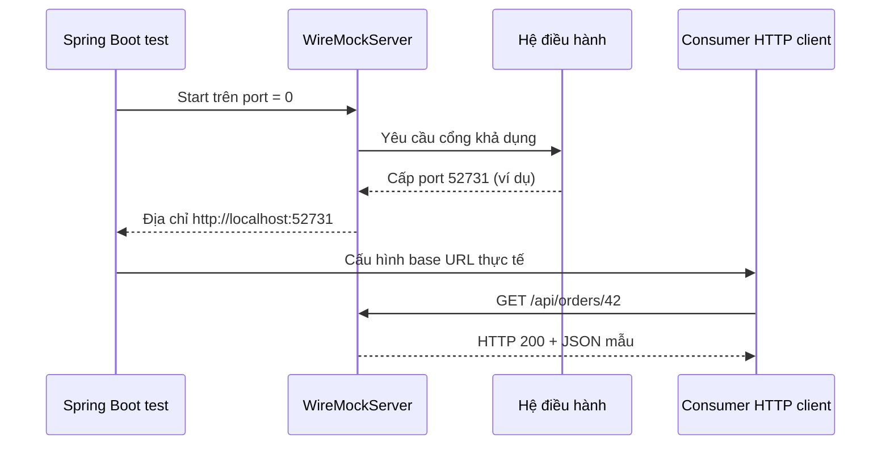
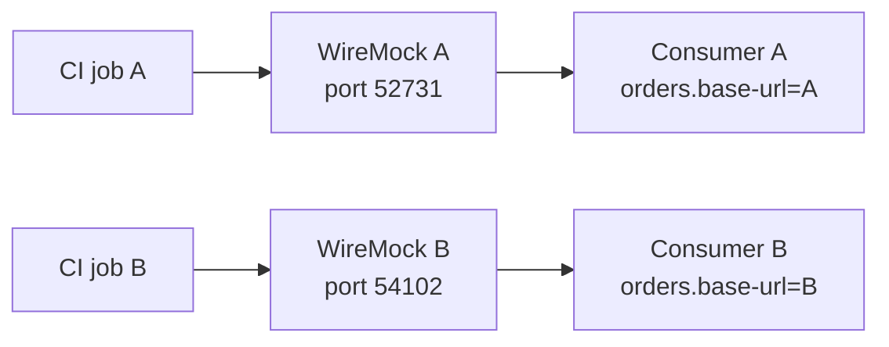
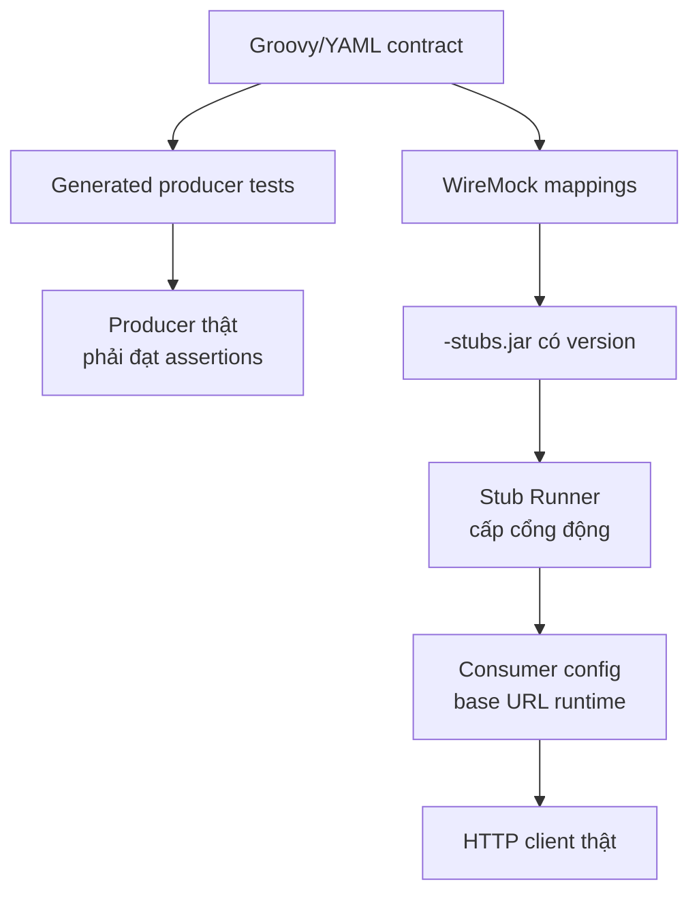

# Cổng ngẫu nhiên và truyền địa chỉ vào cấu hình consumer

## 1. Vì sao WireMock nên dùng cổng ngẫu nhiên trong kiểm thử?

Trong **Spring Cloud Contract**, các nhóm mô tả hành vi HTTP hoặc thông điệp giữa **producer** và **consumer** bằng Groovy/YAML DSL. Producer chạy generated contract tests để chứng minh API thật phù hợp hợp đồng; các stub được phát hành cho **Stub Runner** hoặc WireMock để consumer kiểm tra HTTP client và logic của mình. Khi chạy nhiều consumer tests trên máy cá nhân hoặc CI, việc **cố định cổng stub** là một nguyên nhân gây lỗi khó tái hiện.

Ví dụ `checkout-service` cần gọi `order-service`:

```text
Consumer HTTP client  →  http://localhost:8080/api/orders/42
```

Nếu một ứng dụng khác đang chiếm cổng `8080`, WireMock không thể khởi động ở đó. Ngược lại, nếu Stub Runner khởi động WireMock ở `52731` nhưng consumer client vẫn gọi `8080`, test sẽ kết nối **sai tiến trình**, hoặc báo `Connection refused`. Kết quả kiểm thử khi ấy không còn chứng minh consumer tương thích với stub đã chọn.

Cách giải quyết là **để hệ điều hành chọn cổng còn trống**, rồi **truyền đúng địa chỉ thực tế của WireMock vào cấu hình consumer trước khi client được khởi tạo**.

Sau bài này, bạn có thể:

1. Giải thích ý nghĩa của `port = 0` hoặc cấu hình `dynamicPort()`.
2. Dùng `@AutoConfigureWireMock(port = 0)` cùng property `wiremock.server.port` trong Spring Boot test.
3. Cấu hình một HTTP client thật của consumer bằng **base URL do test cung cấp**, thay vì hardcode.
4. Áp dụng `@DynamicPropertySource` khi chủ động quản lý `WireMockServer`.
5. Lấy cổng thực tế khi dùng **Stub Runner** và phân biệt các cơ chế khởi động stub.
6. Chẩn đoán lỗi sai host/port, thứ tự khởi tạo, test song song và CI.

## 2. Cổng `0`, cổng thực tế và base URL

Khi một server mở socket trên cổng `0`, **hệ điều hành cấp một cổng khả dụng tại thời điểm bind**. Sau khi server đã khởi động, cổng thực tế thường là số dương như `52731`; **cổng `0` không phải đích để HTTP client kết nối**.



| Thành phần | Ví dụ | Ý nghĩa |
|---|---|---|
| Cổng yêu cầu khi khởi động | `0` | Để hệ điều hành tự chọn; không dùng làm URL |
| Cổng thực tế sau bind | `52731` | Giá trị runtime, mỗi lần test có thể khác |
| Host của stub server | `localhost` | Đúng khi client và stub nằm trong cùng môi trường mạng |
| Scheme | `http` | Phải khớp giao thức mà WireMock server thực sự mở |
| Base URL | `http://localhost:52731` | Nguồn cấu hình nên cung cấp cho HTTP client |
| Endpoint | `/api/orders/42` | Client ghép với base URL để gửi request |

**Port không phải URL.** Consumer cần **scheme + host + port**, đôi khi có cả base path. Nếu test chạy trong Docker, `localhost` ở bên trong container **không nhất thiết trỏ tới tiến trình WireMock ở máy host hoặc container khác**. Địa chỉ phải phù hợp với **góc nhìn mạng của chính consumer đang chạy**.

### 2.1. Ba cổng dễ bị nhầm

| Cổng | Thuộc về | Không nên dùng để... |
|---|---|---|
| `server.port` hoặc `@LocalServerPort` | Server HTTP của **ứng dụng được test**, nếu test mở cổng | Thay thế cổng WireMock của service bên ngoài |
| `wiremock.server.port` | WireMock được `@AutoConfigureWireMock` quản lý | Tự suy đoán cổng của producer thật |
| Port do **Stub Runner** cấp | WireMock instance nạp artifact `-stubs.jar` | Kết nối client khác nếu có nhiều stub |

Ví dụ, `@SpringBootTest(webEnvironment = RANDOM_PORT)` làm **ứng dụng consumer** mở một cổng ngẫu nhiên. Điều này **không tự làm WireMock mở cổng ngẫu nhiên**, và cũng không tự cập nhật địa chỉ upstream mà consumer dùng.

## 3. Cách đơn giản với Spring Cloud Contract WireMock

Với Spring Boot test có module **Spring Cloud Contract WireMock** tương thích, có thể dùng:

```java
@SpringBootTest
@AutoConfigureWireMock(port = 0)
class OrderClientContractTest {
    // WireMock khởi động trên một cổng khả dụng.
}
```

Annotation `@AutoConfigureWireMock` thuộc `org.springframework.cloud.contract.wiremock.AutoConfigureWireMock`. Cần test dependency phù hợp, chẳng hạn:

```xml
<dependency>
    <groupId>org.springframework.cloud</groupId>
    <artifactId>spring-cloud-contract-wiremock</artifactId>
    <scope>test</scope>
</dependency>
```

Đây là **đoạn dependency Maven**, không phải POM hoàn chỉnh. Phiên bản thư viện phải tương thích với Spring Boot/Spring Cloud của dự án và có thể được quản lý bởi dependency management/BOM.

Khi `port = 0`, Spring Cloud Contract WireMock khởi động server rồi công bố **cổng đã chọn** thông qua property thường dùng là `wiremock.server.port`. Test có thể tham chiếu property đó để cấu hình địa chỉ service bên ngoài.

**Điều không tự xảy ra:** chỉ có annotation `@AutoConfigureWireMock(port = 0)` **không tự khiến một HTTP client đang hardcode `http://localhost:8080` đổi sang đúng cổng**. Phải truyền địa chỉ vào cấu hình client của consumer.

## 4. Truyền base URL vào cấu hình consumer trước khi tạo client

Giả sử consumer có property ứng dụng `clients.orders.base-url`, và HTTP client đọc property đó từ Spring Environment:

```yaml
# Ví dụ cấu hình runtime của consumer.
clients:
  orders:
    base-url: https://orders.example.internal
```

Trong production, giá trị trỏ đến dịch vụ thật qua DNS/service discovery/gateway thích hợp. **Trong test**, cần ghi đè để trỏ tới WireMock, không sửa production URL và không hardcode cổng.

### 4.1. Một HTTP client thực sự đọc property

Ví dụ dùng `RestClient` (Spring Framework 6.1+). Những đoạn Java dưới đây minh họa các thành phần của ứng dụng:

```java
package com.example.checkout.client;

public record OrderDto(long id, String state, String currency) {}
```

```java
package com.example.checkout.client;

import org.springframework.beans.factory.annotation.Value;
import org.springframework.stereotype.Component;
import org.springframework.web.client.RestClient;

@Component
public class OrderClient {
    private final RestClient restClient;

    public OrderClient(
            RestClient.Builder builder,
            @Value("${clients.orders.base-url}") String baseUrl) {
        this.restClient = builder.baseUrl(baseUrl).build();
    }

    public OrderDto findById(long id) {
        return restClient.get()
                .uri("/api/orders/{id}", id)
                .retrieve()
                .body(OrderDto.class);
    }
}
```

Khi Spring tạo bean `OrderClient`, giá trị `clients.orders.base-url` được đọc **một lần** để tạo `RestClient`. Vì vậy, muốn test dùng WireMock, property phải có giá trị đúng **trước giai đoạn tạo bean**. Việc chỉ lấy cổng trong `@BeforeEach` rồi thay một biến Java khác có thể đã **quá muộn** đối với client khởi tạo sẵn trong application context.

### 4.2. Test sử dụng placeholder `wiremock.server.port`

Một cấu hình phù hợp là truyền property vào Spring test context từ đầu:

```java
package com.example.checkout;

import com.example.checkout.client.OrderClient;
import com.example.checkout.client.OrderDto;
import com.github.tomakehurst.wiremock.WireMockServer;
import org.junit.jupiter.api.BeforeEach;
import org.junit.jupiter.api.Test;
import org.springframework.beans.factory.annotation.Autowired;
import org.springframework.boot.test.context.SpringBootTest;
import org.springframework.cloud.contract.wiremock.AutoConfigureWireMock;
import org.springframework.test.context.TestPropertySource;

import static com.github.tomakehurst.wiremock.client.WireMock.*;
import static org.assertj.core.api.Assertions.assertThat;

@SpringBootTest
@AutoConfigureWireMock(port = 0)
@TestPropertySource(properties = {
    "clients.orders.base-url=http://localhost:${wiremock.server.port}"
})
class OrderClientContractTest {

    @Autowired
    private WireMockServer wireMockServer;

    @Autowired
    private OrderClient orderClient;

    @BeforeEach
    void resetStub() {
        wireMockServer.resetAll();
    }

    @Test
    void shouldReadPaidOrderFromDynamicPort() {
        wireMockServer.stubFor(get(urlEqualTo("/api/orders/42"))
            .willReturn(okJson(
                "{\"id\":42,\"state\":\"PAID\",\"currency\":\"VND\"}")));

        OrderDto order = orderClient.findById(42L);

        assertThat(order.id()).isEqualTo(42L);
        assertThat(order.state()).isEqualTo("PAID");
        assertThat(order.currency()).isEqualTo("VND");

        wireMockServer.verify(
            1, getRequestedFor(urlEqualTo("/api/orders/42")));
    }
}
```

**Luồng của test:**

1. `@AutoConfigureWireMock(port = 0)` yêu cầu WireMock bind một cổng khả dụng.
2. Property `wiremock.server.port` chứa **cổng đã chọn**.
3. `@TestPropertySource` đặt `clients.orders.base-url` thành `http://localhost:<cổng thực tế>` bằng placeholder của Spring.
4. Spring tạo `OrderClient` với base URL đã được ghi đè.
5. Test đăng ký stub trả JSON cho `GET /api/orders/42`.
6. **HTTP client thật của consumer** gửi request đến WireMock; test kiểm tra DTO đã deserialize và xác nhận request mà stub nhận.

**Lưu ý:** mã ví dụ giả định ứng dụng consumer có `OrderClient` ở package được Spring quét, có `RestClient.Builder` trong context và đã cài dependency cần thiết. Test cần import đúng phiên bản WireMock mà Spring Cloud Contract tích hợp. `okJson(...)` là tiện ích WireMock ở những phiên bản hỗ trợ; nếu khác phiên bản, dùng `aResponse().withStatus(200).withHeader("Content-Type","application/json").withBody(...)` để mô tả tương đương.

### 4.3. Vì sao không dùng `@Value` trên field port rồi sửa cấu hình quá muộn?

Đây là cách **dễ thất bại** nếu HTTP client đã được khởi tạo:

```java
@Value("${wiremock.server.port}")
int port;

@BeforeEach
void setup() {
    // Việc tự gán một biến khác ở đây không nhất thiết
    // cập nhật base URL đã chốt bên trong OrderClient bean.
    someLocalUrl = "http://localhost:" + port;
}
```

`@BeforeEach` chạy **sau khi** application context đã được tạo. Nếu bạn cần ghi đè property mà bean sử dụng lúc khởi tạo, hãy làm trong quá trình **chuẩn bị context** bằng placeholder như trên, `@DynamicPropertySource` hoặc cơ chế test configuration phù hợp.

## 5. Dùng `@DynamicPropertySource` khi tự quản lý `WireMockServer`

Nếu không dùng `@AutoConfigureWireMock`, bạn có thể chủ động tạo một `WireMockServer`, để nó mở cổng ngẫu nhiên, rồi đăng ký **base URL động** với Spring qua `@DynamicPropertySource`.

### 5.1. Ví dụ self-managed server

```java
package com.example.checkout;

import com.example.checkout.client.OrderClient;
import com.github.tomakehurst.wiremock.WireMockServer;
import org.junit.jupiter.api.AfterAll;
import org.junit.jupiter.api.BeforeEach;
import org.junit.jupiter.api.Test;
import org.springframework.beans.factory.annotation.Autowired;
import org.springframework.boot.test.context.SpringBootTest;
import org.springframework.test.context.DynamicPropertyRegistry;
import org.springframework.test.context.DynamicPropertySource;

import static com.github.tomakehurst.wiremock.client.WireMock.*;
import static com.github.tomakehurst.wiremock.core.WireMockConfiguration.wireMockConfig;
import static org.assertj.core.api.Assertions.assertThat;

@SpringBootTest
class OrderClientDynamicPropertyTest {

    private static final WireMockServer WIREMOCK =
        new WireMockServer(wireMockConfig().dynamicPort());

    static {
        // Start trước khi Spring resolve property và tạo OrderClient.
        WIREMOCK.start();
    }

    @DynamicPropertySource
    static void orderServiceProperties(DynamicPropertyRegistry registry) {
        registry.add("clients.orders.base-url", WIREMOCK::baseUrl);
    }

    @Autowired
    OrderClient orderClient;

    @BeforeEach
    void resetStub() {
        WIREMOCK.resetAll();
    }

    @Test
    void shouldUseTheServerThatActuallyStarted() {
        WIREMOCK.stubFor(get(urlEqualTo("/api/orders/42"))
            .willReturn(okJson(
                "{\"id\":42,\"state\":\"PAID\",\"currency\":\"VND\"}")));

        assertThat(orderClient.findById(42L).state()).isEqualTo("PAID");
        WIREMOCK.verify(
            1, getRequestedFor(urlEqualTo("/api/orders/42")));
    }

    @AfterAll
    static void stopServer() {
        WIREMOCK.stop();
    }
}
```

Đây là **phương án thay thế**, không phải đoạn phải kết hợp thêm với `@AutoConfigureWireMock`. Nếu bật cả hai trong cùng test mà không có ý định rõ ràng, bạn có thể vô tình khởi động **hai server khác nhau** và gán client vào sai địa chỉ.

### 5.2. Tại sao phải start trước khi đăng ký property?

`@DynamicPropertySource` đăng ký một supplier để Spring lấy giá trị dynamic property. Ở ví dụ này, `WIREMOCK.start()` chạy khi class được khởi tạo, trước khi Spring cần dựng bean client; vì vậy `WIREMOCK.baseUrl()` có địa chỉ hợp lệ.

Một anti-pattern:

```java
@DynamicPropertySource
static void configure(DynamicPropertyRegistry registry) {
    registry.add("clients.orders.base-url",
        () -> "http://localhost:" + wireMockServer.port());
}

@BeforeEach
void startServer() {
    wireMockServer.start();
}
```

Nếu Spring resolve `clients.orders.base-url` **trước** `@BeforeEach`, server chưa bind cổng, nên giá trị có thể không hợp lệ. Cần tổ chức lifecycle **trước context** hoặc dùng `@AutoConfigureWireMock` vốn quản lý việc bind và expose property.

### 5.3. Chú ý Spring Test context cache

Spring có thể **cache application context giữa nhiều test class**. Nếu context giữ `OrderClient` đã khởi tạo với URL của một server bị dừng ở `@AfterAll`, class khác tái sử dụng bean đó có thể gọi tới **cổng chết**. Khi chia sẻ base test, hãy quản lý vòng đời server cùng phạm vi context, dùng cấu hình test khác biệt khi cần hoặc đánh dấu context cần tạo lại theo cơ chế phù hợp. Không gắn `@DirtiesContext` tràn lan nếu có thể dùng resource lifecycle sạch hơn.

Trong CI chạy song song, mỗi test class/server nên có resource độc lập; port ngẫu nhiên giảm **xung đột bind port**, nhưng **không tự cô lập** database, request journal hay singleton bean.

## 6. Phân biệt WireMock trực tiếp với Stub Runner

Đến đây có hai cách tạo stub HTTP:

| Cách | Ai cung cấp mapping? | Cách khởi động | Địa chỉ runtime |
|---|---|---|---|
| **WireMock trực tiếp** | Test tự đăng ký mapping hoặc load file | `@AutoConfigureWireMock(port=0)` hoặc `WireMockServer` | `wiremock.server.port`, `WireMockServer.baseUrl()` |
| **Stub Runner** | Artifact `-stubs.jar` sinh từ Spring Cloud Contract | `@AutoConfigureStubRunner(ids=...)` hoặc cơ chế phù hợp | `@StubRunnerPort` / `StubFinder` và runtime metadata |

Đây là điểm quan trọng trong module Spring Cloud Contract:

- WireMock trực tiếp hữu ích khi test cần mô phỏng HTTP dependency cụ thể và chủ động định nghĩa response.
- Stub Runner hữu ích khi muốn consumer test dùng **hợp đồng do producer đã phát hành**, tránh tự tạo một mapping có thể lệch khỏi producer contract.
- **Cổng động** là nhu cầu chung của cả hai, nhưng **cách lấy cổng khác nhau**.

Không dùng `wiremock.server.port` của `@AutoConfigureWireMock` để suy ra cổng của một stub **được Stub Runner khởi động**. Nếu cả hai cơ chế cùng tồn tại, có thể có nhiều WireMock server, mỗi server sở hữu một cổng riêng.

## 7. Stub Runner: lấy cổng của artifact đúng producer

Ví dụ producer phát hành:

```text
groupId    = com.example
artifactId = order-service
version    = 1.4.0
classifier = stubs
```

Consumer test dùng:

```java
import org.junit.jupiter.api.Test;
import org.springframework.boot.test.context.SpringBootTest;
import org.springframework.cloud.contract.stubrunner.StubRunnerProperties;
import org.springframework.cloud.contract.stubrunner.spring.AutoConfigureStubRunner;
import org.springframework.cloud.contract.stubrunner.spring.StubRunnerPort;

import static org.assertj.core.api.Assertions.assertThat;

@SpringBootTest
@AutoConfigureStubRunner(
    ids = "com.example:order-service:1.4.0:stubs",
    stubsMode = StubRunnerProperties.StubsMode.LOCAL
)
class CheckoutWithPublishedStubTest {

    @StubRunnerPort("com.example:order-service")
    int orderStubPort;

    @Test
    void shouldUsePublishedContractStub() {
        // OrderClient/OrderDto là các kiểu do dự án consumer cung cấp.
        OrderClient client = new OrderClient(
            "http://localhost:" + orderStubPort);
        OrderDto result = client.findById(42L);
        assertThat(result.state()).isEqualTo("PAID");
    }
}
```

Đây là **mẫu minh họa ý tưởng**: `OrderClient(String baseUrl)` phải là constructor có thật trong dự án (hoặc dùng factory tương đương). Nếu client chỉ được tạo bằng DI khi Spring context khởi tạo, **không thể tự động thay URL của bean ấy** chỉ bằng việc inject `@StubRunnerPort` vào field test sau đó.

### 7.1. Truyền cổng Stub Runner vào client do Spring quản lý

Với các phiên bản Stub Runner công bố port vào Spring Environment, có thể sử dụng property runtime dạng:

```properties
stubrunner.runningstubs.order-service.port=<port của order-service stub>
```

Sau khi kiểm tra **tên property mà phiên bản Stub Runner thật sự expose và thời điểm nó được đăng ký**, consumer có thể map property đó sang `clients.orders.base-url` bằng placeholder hoặc cấu hình test thích hợp. Ví dụ về **ý định cấu hình**:

```yaml
clients:
  orders:
    base-url: http://localhost:${stubrunner.runningstubs.order-service.port}
```

Không coi ví dụ này là bảo đảm về **mọi phiên bản và mọi cách startup**. Nếu property chưa tồn tại trước khi client bean được tạo, test sẽ lỗi placeholder hoặc kết nối sai. Khi đó, dùng cơ chế đăng ký property sớm mà tích hợp Stub Runner hỗ trợ, hoặc **tạo client với cổng thật tại thời điểm test**. Tránh đặt một số port cố định chỉ để né việc xác minh lifecycle.

### 7.2. Tra cứu URL khi có nhiều producer stubs

Stub Runner cũng có cơ chế tìm stub, chẳng hạn `StubFinder`, để test xác định URL theo group/artifact thay vì dựa vào vị trí thứ nhất/thứ hai trong danh sách:

```java
// Minh họa cách tra cứu; import và overload theo phiên bản dự án.
@Autowired
StubFinder stubFinder;

void configureConsumer() {
    URL orderBaseUrl = stubFinder.findStubUrl(
        "com.example", "order-service");
    // Sử dụng URL thực tế cho OrderClient.
}
```

**Không đoán** WireMock đầu tiên trong test là `order-service` nếu consumer còn dùng `payment-service` hoặc `inventory-service`. Mỗi client phải nhận URL của đúng stub. Stub Finder và annotation port là hai cách tra cứu tùy ngữ cảnh, không nhất thiết phải dùng cả hai.

## 8. Cổng ngẫu nhiên giúp CI chạy song song, nhưng chưa đủ



So với hai test cố dùng `8080`, cổng động giúp giảm đáng kể xung đột bind port. Tuy nhiên:

- Hai test vẫn có thể dùng **chung database**, cache hoặc message broker.
- Một Spring singleton HTTP client có thể giữ base URL của **test trước** nếu context bị tái sử dụng không phù hợp.
- WireMock request journal/mapping có thể giữ lịch sử giữa test methods.
- Stub Runner có thể dùng một server chung cho nhiều test trong cùng context; một test reset mapping có thể ảnh hưởng test khác đang chạy.
- Khi chạy trong Docker/Kubernetes, `localhost` giữa các container **không trỏ tới nhau**; phải sử dụng hostname/dịch vụ có thể truy cập từ nơi chạy consumer.

**Port ngẫu nhiên không thay thế test isolation.** Khi cần chạy song song, nên bảo đảm stub server, dữ liệu và consumer client thuộc cùng một phạm vi test hoặc được đồng bộ có chủ đích.

### 8.1. Quản lý request journal và mappings

Nếu bạn đăng ký stub động:

```java
@BeforeEach
void clearWireMockState() {
    wireMockServer.resetAll();
}
```

`resetAll()` thường xóa cả mappings và request history; điều này phù hợp khi **mỗi test tự đăng ký toàn bộ mapping nó cần**, nhưng có thể làm mất mappings được load sẵn hoặc đang được test khác dùng. Khi muốn chỉ xóa request journal, dùng cơ chế reset request tương ứng, không xóa mappings một cách vô ý.

Đối với Stub Runner nạp mapping từ artifact, **đừng gọi reset-all tràn lan** nếu không có bước nạp lại mappings. Nếu reset làm mất mapping đã load, những test sau có thể nhận `404` do không có stub nào khớp.

## 9. Nhận biết lỗi sai địa chỉ và lỗi hợp đồng

| Triệu chứng | Nguyên nhân ưu tiên | Cách xác minh |
|---|---|---|
| `Address already in use` | Đang yêu cầu cổng cố định bị chiếm | Dùng port `0` hoặc cô lập test |
| `Connection refused` | Client gọi cổng sai hoặc WireMock chưa start | Kiểm tra base URL và `server.port()` thực tế |
| Gọi `localhost:0` | Lấy cổng yêu cầu, không lấy cổng đã bind | Dùng `wiremock.server.port` hoặc `server.baseUrl()` |
| Test gọi producer thật thay vì stub | Base URL test không ghi đè production URL | Kiểm tra Spring property sources và client constructor |
| HTTP `404` từ WireMock | Không có mapping phù hợp hoặc đường dẫn client sai | Xem request journal/mappings |
| HTTP `404` có error body | Có thể là stub mô phỏng business not-found | Assert `code`/error schema để phân biệt |
| Khởi động được server nhưng client vẫn `8080` | Client bean tạo trước lúc đổi property | Truyền URL trước context initialization |
| `Could not resolve placeholder` | Property dynamic chưa được đăng ký hoặc sai tên | Kiểm tra lifecycle và key thực tế |
| Test riêng pass, cả suite fail | Context cache hoặc reset mapping/journal gây ảnh hưởng chéo | Kiểm tra lifecycle/server scope |
| Test local pass, container CI fail | `localhost` khác namespace mạng | Dùng hostname/network alias đúng góc nhìn consumer |
| Có nhiều stubs nhưng client gọi nhầm service | Lấy port bằng thứ tự hoặc cấu hình chung | Tra cứu theo group/artifact |
| Stub Runner khởi động nhưng không có mapping | Artifact/version/classifier sai hoặc bị reset | Kiểm tra `-stubs.jar` và mapping loader |

### 9.1. Một trình tự chẩn đoán hiệu quả

1. **Server nào đang chạy?** — `@AutoConfigureWireMock`, tự tạo `WireMockServer` hay Stub Runner?
2. **Server đó đã bind cổng nào?** — Lấy từ property, `WireMockServer.port()` hoặc `@StubRunnerPort`.
3. **Consumer nhìn thấy URL nào?** — Kiểm tra property thực tế và HTTP client instance.
4. **Consumer ở đâu trong mạng?** — Cùng JVM/máy/container hay khác host?
5. **Request gửi đi là gì?** — Method, path, query, header, body.
6. **Mapping có khớp không?** — Xem WireMock request journal và unmatched requests.
7. **Stub artifact có đúng phiên bản không?** — Khi dùng Stub Runner, đối chiếu group/artifact/version/classifier.
8. **Producer có đạt hợp đồng không?** — Xem generated producer test reports nếu nghi ngờ stub và API thật lệch nhau.

Đừng sửa matcher theo kiểu “bỏ hết header/URL để nhận mọi request” trước khi chắc rằng consumer đã **gọi đúng server**.

## 10. Những lựa chọn thay thế và bẫy lifecycle

### 10.1. `@AutoConfigureWireMock(port = 0)` không giống `@SpringBootTest(RANDOM_PORT)`

```java
@SpringBootTest(
    webEnvironment = SpringBootTest.WebEnvironment.RANDOM_PORT)
@AutoConfigureWireMock(port = 0)
class CheckoutHttpIntegrationTest {
}
```

Ví dụ này có thể chạy **hai HTTP server**: ứng dụng consumer trên một random port và WireMock stub trên một random port khác. `@LocalServerPort` (nếu sử dụng) nhận port của **ứng dụng**, còn `wiremock.server.port` nhận port của **WireMock**.

### 10.2. JUnit 5 WireMock extension và thời điểm khởi động

WireMock có JUnit Jupiter extension hỗ trợ cổng ngẫu nhiên. Tuy nhiên, nếu extension chỉ được start vào lifecycle của JUnit **sau khi Spring cần dựng application context**, thì việc dùng `extension.getPort()` trong `@DynamicPropertySource` có thể quá muộn. Trước khi kết hợp hai framework lifecycle, phải xác minh thứ tự khởi động.

Phương án `WireMockServer` start sớm ở mục 5 giúp loại trừ lỗi thứ tự đó. Với dự án đã dùng Spring Cloud Contract WireMock, cách dùng `@AutoConfigureWireMock(port=0)` cùng placeholder thường đơn giản hơn.

### 10.3. Tại sao không “tự tìm cổng còn trống rồi khởi động WireMock trên cổng ấy”?

Cách làm:

```text
1. Mở socket tìm một cổng trống.
2. Đóng socket.
3. Yêu cầu WireMock mở đúng số cổng vừa tìm.
```

có **race condition**: giữa bước 2 và 3, tiến trình khác có thể chiếm cổng. Hãy để WireMock bind trực tiếp cổng `0` và lấy cổng thực tế **sau khi bind thành công**.

### 10.4. Cổng HTTP và HTTPS

Nếu consumer yêu cầu HTTPS, không thể chỉ thay port và tiếp tục dùng `http://`. Cần cấu hình WireMock HTTPS listener, TLS/certificate trust của client và truyền **scheme/host/port** đúng. Ưu tiên lấy **base URL đầy đủ** từ server khi API hỗ trợ; không nên hardcode scheme sai.

## 11. Kết hợp với Spring Cloud Contract producer verification

Khi dùng Stub Runner, nguồn stub thường là hợp đồng Groovy/YAML của producer:

```groovy
import org.springframework.cloud.contract.spec.Contract

Contract.make {
    description 'Lấy đơn hàng đã thanh toán'

    request {
        method GET()
        url '/api/orders/42'
    }

    response {
        status OK()
        headers {
            contentType(applicationJson())
        }
        body(id: 42, state: 'PAID', currency: 'VND')
    }
}
```

Hợp đồng này được Verifier dùng để sinh **producer test** và **stub mapping**. Cách consumer cấp port động **không thay đổi nội dung hợp đồng**; nó chỉ xác định consumer gửi request đến đâu khi kiểm thử.



**Đừng đánh đồng:** WireMock ở cổng ngẫu nhiên trả JSON `PAID` thành công không chứng minh producer thật trả `PAID`. Nếu generated producer tests bị skip hoặc không chạy, CI vẫn có thể xanh với stub cũ. Cần xác minh cả producer test report và consumer test report.

## 12. CI: dùng cổng động và version stub có thể truy vết

Một pipeline ổn định nên thực hiện:

1. Producer cập nhật contract và code, chạy generated contract tests với fixture có thể tái lập.
2. Chỉ khi producer tests **đã thực thi và đạt**, đóng gói và publish `-stubs.jar` có version/classifier rõ ràng.
3. Consumer CI resolve đúng stub artifact cần thử; không mặc định ký hiệu version động luôn dẫn đến cùng artifact giữa các lần chạy.
4. Stub Runner hoặc WireMock khởi động với **cổng động** khi môi trường có thể chạy song song.
5. Test đưa **base URL runtime** vào client configuration, không sử dụng port hardcode.
6. Consumer test gọi client thật và assert dữ liệu/nhánh lỗi mà ứng dụng dựa vào.
7. CI lưu test reports, resolved stub coordinates và thông tin kết nối **không nhạy cảm** để debug khi test thất bại.

### 12.1. Ví dụ nhật ký cần quan sát

```text
Stub type         : Stub Runner (HTTP/WireMock)
Producer artifact : com.example:order-service:1.4.0:stubs
Bind request      : random port
Resolved stub URL : http://localhost:<cổng thực tế>
Client property   : clients.orders.base-url
Consumer endpoint : GET /api/orders/42
Producer tests    : executed and passed
Consumer tests    : executed and passed
```

Đây là **mẫu nội dung log nên có**, không phải định dạng log mặc định của Spring Cloud Contract. Không đưa access token, cookie xác thực hoặc secrets của artifact repository vào log.

## 13. Bài thực hành: loại bỏ phụ thuộc vào cổng `8080`

**Bối cảnh:** `checkout-service` có một `OrderClient` đang được cấu hình `http://localhost:8080` trong test. Khi chạy trên CI song song với dự án khác, test lúc xanh lúc đỏ. Nhóm muốn chuyển sang WireMock random port, giữ việc kiểm tra body JSON và sau đó dùng stub artifact của producer.

**Yêu cầu:** consumer test phải lấy đúng base URL runtime và không gọi producer thật. Kịch bản `GET /api/orders/42` cần trả `200` và JSON có `state=PAID`, `currency=VND`.

### 13.1. Bước thực hành

1. Kiểm tra consumer client đang đọc base URL từ đâu; nếu đang hardcode `http://localhost:8080`, chuyển sang một Spring property như `clients.orders.base-url`.
2. Thêm test dependency `spring-cloud-contract-wiremock` tương thích với dự án.
3. Dùng `@AutoConfigureWireMock(port = 0)` và ánh xạ `clients.orders.base-url` bằng placeholder `${wiremock.server.port}` ở test configuration.
4. Đăng ký WireMock mapping cho `GET /api/orders/42`; trả JSON có `id` dạng number, `state=PAID`, `currency=VND`.
5. Dùng **OrderClient thật do Spring inject** để gọi endpoint và assert DTO đã deserialize.
6. Kiểm tra WireMock nhận đúng một request ở path mong đợi; thay vì assert chỉ có status `200`.
7. Chạy test hai lần và quan sát cổng có thể khác nhau giữa các lần chạy nhưng kết quả vẫn đúng. **Không yêu cầu cổng phải khác**: OS vẫn có thể chọn lại một số cổng.
8. Chạy song song trong môi trường đã cô lập để kiểm tra không còn lỗi `Address already in use` do cổng stub cố định.
9. Chuyển sang `@AutoConfigureStubRunner` với artifact `com.example:order-service:1.4.0:stubs`, lấy port bằng `@StubRunnerPort` hoặc cơ chế đăng ký URL runtime phù hợp.
10. Xác nhận consumer test dùng **stub đã được producer publish** và generated producer tests của version đó có báo cáo đã chạy/đạt.

### 13.2. Tình huống thử lỗi có chủ đích

| Thao tác | Điều nên quan sát |
|---|---|
| Giữ HTTP client ở `localhost:8080` khi WireMock ở cổng ngẫu nhiên | Test fail hoặc kết nối sai; cần kiểm tra client base URL |
| Dùng placeholder `${server.port}` thay vì `${wiremock.server.port}` | Client có thể gọi nhầm ứng dụng thay vì WireMock |
| Đăng ký mapping `/api/order/42` nhưng client gọi `/api/orders/42` | Unmatched request, thường là stub `404` |
| Không reset request journal giữa test methods | Assertion số request có thể bị ảnh hưởng bởi test trước |
| Dừng WireMock nhưng giữ cached Spring client/context | Kết nối tới cổng đã đóng ở lần test sau |
| Dùng `@StubRunnerPort` của payment-service cho OrderClient | Consumer gọi nhầm stub và nhận response sai |
| Chạy trong hai container, vẫn dùng `localhost` | Không kết nối được nếu WireMock ở container khác |

### 13.3. Câu hỏi tự kiểm tra

| Câu hỏi | Trả lời |
|---|---|
| `port = 0` có nghĩa client nên gọi cổng 0 không? | **Không**; OS cấp một cổng thực tế sau bind |
| `@SpringBootTest(RANDOM_PORT)` có tự đổi cổng WireMock không? | **Không**; đó là cổng của ứng dụng |
| Khi dùng `@AutoConfigureWireMock(port=0)`, property port là gì? | Thông thường `wiremock.server.port` |
| Vì sao `@BeforeEach` đôi khi quá muộn để đổi client URL? | Bean HTTP client có thể đã được Spring tạo trước đó |
| `@DynamicPropertySource` có ích khi nào? | Khi cần đăng ký base URL runtime trước lúc context dựng bean |
| `@StubRunnerPort` có thể thay cho `wiremock.server.port` ở mọi ngữ cảnh không? | **Không**; thuộc hai cơ chế khởi động khác nhau |
| Cổng động có loại bỏ ảnh hưởng chéo của database/broker không? | **Không**; chỉ giải quyết một phần xung đột mạng |
| Consumer test với stub pass có thay producer verification không? | **Không**; phải chạy cả hai phía |

## 14. Checklist review cấu hình random port

- [ ] WireMock dùng `port = 0` hoặc `dynamicPort()` thay vì fixed port nếu cần chạy song song.
- [ ] Đã phân biệt cổng **ứng dụng consumer**, cổng **producer thật** và cổng **WireMock/Stub Runner**.
- [ ] Consumer HTTP client đọc base URL từ cấu hình, không hardcode `localhost:8080` trong code production.
- [ ] Base URL được truyền từ **cổng thực tế sau bind**, với đúng scheme và host theo môi trường mạng.
- [ ] Property được đăng ký **trước khi** Spring khởi tạo client bean sử dụng nó.
- [ ] Khi dùng `@AutoConfigureWireMock(port=0)`, placeholder `wiremock.server.port` được resolve đúng.
- [ ] Khi tự tạo WireMockServer, `@DynamicPropertySource` cung cấp `baseUrl()` của server đã start.
- [ ] Không khởi động vô tình hai WireMock servers và trỏ client sang nhầm server.
- [ ] Khi dùng Stub Runner, lấy port/URL theo đúng artifact groupId/artifactId và version/classifier.
- [ ] Request journal/mappings được reset đúng phạm vi, không xóa stubs của test khác.
- [ ] Có biện pháp chống lỗi context cache, lifecycle và tranh chấp khi test song song.
- [ ] Consumer test gọi HTTP client thật, assert dữ liệu/response nghiệp vụ và phân biệt unmatched `404`.
- [ ] CI lưu report, kiểm chứng producer generated tests đã chạy/đạt và consumer test dùng đúng stub version.

**Ghi nhớ:** Cổng ngẫu nhiên là **giá trị runtime**, không phải một hằng số cấu hình. Quy trình đúng là **khởi động WireMock → lấy địa chỉ thực tế → đưa địa chỉ vào cấu hình consumer trước khi tạo client → chạy assertion qua HTTP client thật**. Khi kết hợp với Spring Cloud Contract, Stub Runner và CI, cách này giúp kiểm thử tương thích chạy ổn định mà không phụ thuộc một cổng cố định trên máy phát triển hay build server.
