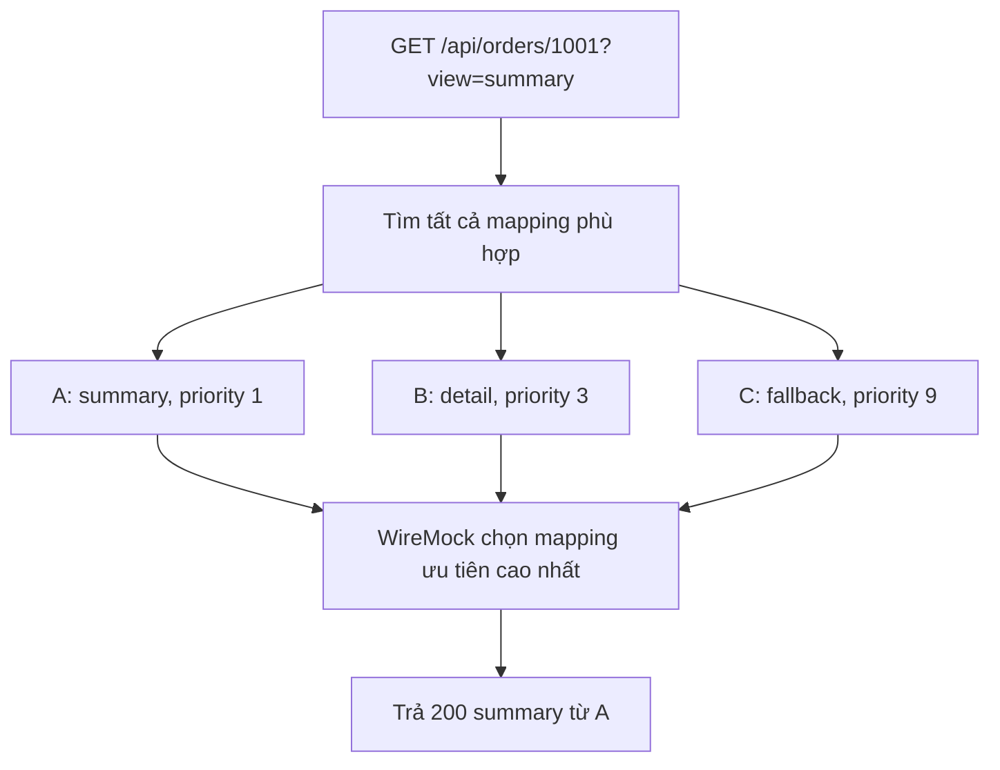
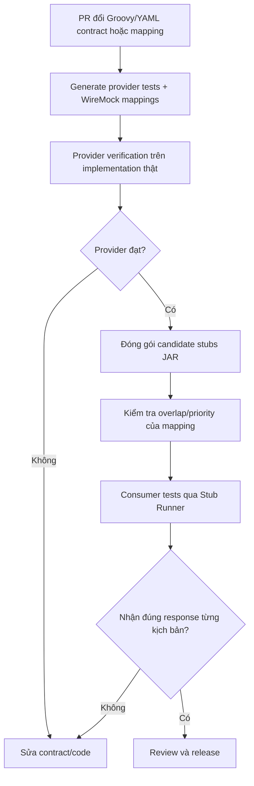

# Kiểm soát độ ưu tiên khi nhiều mapping cùng khớp trong WireMock

Khi kiểm thử consumer với **Spring Cloud Contract (SCC)**, producer viết hợp đồng bằng **Groovy/YAML DSL**, sinh provider verification tests và phát hành **stubs JAR**. Ở phía consumer, **Stub Runner** có thể khởi chạy **WireMock** để trả các response HTTP theo mapping được sinh từ hợp đồng. Cách làm này giúp consumer thử API mà không cần khởi động producer thật.

Một vấn đề thực tế xuất hiện khi **nhiều WireMock stub mapping cùng khớp một request**. Ví dụ cùng request `GET /api/orders/1001?view=summary` có thể khớp cả mapping tổng quát cho một đơn hàng, mapping riêng cho chế độ summary và mapping fallback cho mọi ID. Nếu không kiểm soát, consumer có thể nhận **response không thuộc kịch bản mong muốn**, dù mỗi mapping riêng lẻ đều có vẻ hợp lệ.

Bài thuộc chương **WireMock**, với chủ đề **Kiểm soát độ ưu tiên khi nhiều mapping cùng khớp**, hướng dẫn quy tắc chọn mapping, cách khai báo `priority` trong JSON và Java DSL, cách phát hiện sự chồng lấp khi dùng Spring Cloud Contract/Stub Runner, và chiến lược kiểm chứng trong CI. Ví dụ xuyên suốt dùng `order-producer` và `checkout-consumer`.

## 1. Tình huống mở đầu: một request, ba mapping

Giả sử consumer gửi:

```http
GET /api/orders/1001?view=summary HTTP/1.1
Accept: application/json
```

Có ba stub được nạp vào cùng một WireMock server:

| Mapping | Điều kiện match | Response được khai báo |
| --- | --- | --- |
| **A — Summary** | `GET`, path `/api/orders/1001`, query `view=summary` | 200, JSON summary |
| **B — Chi tiết đơn hàng** | `GET`, path `/api/orders/1001` | 200, JSON đầy đủ |
| **C — Fallback không tìm thấy** | `GET`, path khớp `/api/orders/[0-9]+` | 404, JSON `ORDER_NOT_FOUND` |

**Cả A, B và C đều có thể match cùng một request.** Lý do: B không khai báo điều kiện cho query `view` nên vẫn match khi query đó hiện diện; C match mọi đường dẫn đơn hàng có ID dạng chữ số, bao gồm `1001`. WireMock cần quyết định mapping nào được dùng để trả response.

Nếu chọn A, consumer nhận dữ liệu summary như thiết kế. Nếu chọn B, consumer nhận body đầy đủ. Nếu chọn C, consumer bất ngờ nhận 404. Do đó **“mapping match” và “mapping được chọn để trả response” là hai sự kiện khác nhau**.



Giải pháp trực tiếp là **đặt mức ưu tiên khác nhau cho các mapping đang chồng lấp**, đồng thời giữ điều kiện request đủ cụ thể.

## 2. Hai bước của WireMock: xác định khớp và chọn mapping

Khi request tới WireMock, cần phân biệt:

1. **Request matching:** mapping có phù hợp request về method, URL, query, headers, cookies, body hoặc điều kiện state không?
2. **Mapping selection:** nếu nhiều mapping phù hợp, mapping nào có quyền phục vụ response?

Một mapping có điều kiện **cụ thể hơn** thường biểu đạt đúng nghiệp vụ hơn, nhưng **WireMock không được hiểu như một trình suy luận rằng mapping “cụ thể nhất” luôn thắng**. Khi muốn kết quả xác định, bạn phải khai báo **priority**.

Ví dụ:

```text
Request: GET /api/orders/1001?view=summary

A: method GET + urlPath /api/orders/1001 + view=summary  -> MATCH
B: method GET + urlPath /api/orders/1001                 -> MATCH
C: method GET + urlPathPattern /api/orders/[0-9]+         -> MATCH

Chọn:
  A priority = 1
  B priority = 3
  C priority = 9

Kết quả: A
```

**Cần nhớ:** Không khai báo điều kiện cho một header hay query parameter **không đồng nghĩa yêu cầu nó phải vắng mặt**. Mapping B không có điều kiện `view` sẽ vẫn phù hợp cả request có `view=summary`, trừ khi mapping còn điều kiện khác loại trừ nó.

### 2.1. Query parameter và URL path là hai phần khác nhau

WireMock có nhiều kiểu matcher URL. Hai cách thường gặp:

- `urlEqualTo("/api/orders/1001?view=summary")`: so khớp URL theo giá trị đã khai báo, có thể khiến test quá cứng về cấu trúc query.
- `urlPathEqualTo("/api/orders/1001")` kết hợp `withQueryParam("view", equalTo("summary"))`: tách path và query để mô tả ý định rõ hơn.

Nếu cần test query, ưu tiên biểu diễn bằng **path matcher + query matcher** khi dùng Java DSL, và kiểm tra JSON mapping được sinh từ Spring Cloud Contract. Không cố dựa vào thứ tự của các tham số query trong một chuỗi URL nếu API không cam kết thứ tự đó.

### 2.2. Matching không đồng nghĩa business validation

Một mapping chỉ ràng buộc `id` bằng regex không chứng minh ID có trong database. WireMock trả kết quả theo stub đã có, **không chạy repository hoặc controller thật của producer**. Consumer test chỉ đang kiểm tra giao diện đã được mô phỏng.

## 3. Quy tắc priority: số càng nhỏ, ưu tiên càng cao

Trong WireMock, `priority` là **giá trị số nguyên biểu thị thứ tự ưu tiên của stub mapping**:

| Priority | Ý nghĩa tương đối | Ví dụ |
| --- | --- | --- |
| `1` | Ưu tiên cao nhất trong các ví dụ | Kịch bản đặc biệt, match rất hẹp |
| `2`–`4` | Ưu tiên cao hơn mặc định | Mapping cụ thể theo query/header/body |
| `5` | **Mức mặc định** nếu mapping không khai báo priority | Nhiều stub do công cụ sinh ra |
| `6`–`9` | Ưu tiên thấp hơn mặc định | Mapping tổng quát |
| `10` | Mức thấp trong ví dụ | Fallback/catch-all |

Quy tắc cốt lõi:

**`priority: 1` được chọn trước `priority: 3`; `priority: 3` được chọn trước `priority: 9`, nếu tất cả đều phù hợp request.**

Không được hiểu priority như “độ ưu tiên càng lớn càng cao”, cũng không được hiểu đây là thứ tự thời gian request. Priority **chọn mapping cho một request**, không biến nhiều response thành chuỗi tự động.

Nếu một mapping không ghi `priority`, mức mặc định trong WireMock là **5**. Đây là điểm quan trọng khi **mappings sinh tự động từ Spring Cloud Contract** và **mappings viết tay** được nạp chung.

### 3.1. Khi các mapping có cùng priority

Nếu nhiều mapping cùng match và có cùng mức ưu tiên, **đừng dựa vào thứ tự file, tên file hoặc thứ tự nạp** để bảo đảm phản hồi mong muốn. WireMock có cơ chế lựa chọn giữa các mapping cùng mức (trong một số tình huống thứ tự đăng ký có tác động), nhưng phụ thuộc vào chi tiết đó khiến test dễ thay đổi khi build/plugin/suite thay đổi.

Ví dụ dễ gây lỗi:

```text
A: GET /api/orders/1001?view=summary -> 200 summary, priority 5
B: GET /api/orders/1001              -> 200 detail,  priority 5
C: GET /api/orders/[0-9]+            -> 404,         priority 5
```

**Cách sửa đáng tin:** đặt priority khác nhau theo chính sách, hoặc **làm điều kiện match loại trừ nhau** để mỗi request chỉ thuộc đúng một kịch bản. Phương án thứ hai có thể tốt hơn nếu request không thực sự nên có nhiều cách hiểu.

### 3.2. Priority không sửa được mapping sai

Nếu mapping summary có `priority: 1` nhưng path sai `/api/order/1001` (thiếu `s`), nó **không match** request `/api/orders/1001`. WireMock có thể chọn mapping B hoặc C. Priority chỉ phát huy tác dụng **sau khi mapping đã match**.

Đừng tăng ưu tiên rồi bỏ qua việc kiểm tra method, path, query, header, cookie và body của mapping.

## 4. Ví dụ đầy đủ bằng JSON mapping: summary → detail → fallback

WireMock có thể nạp các mapping JSON; ví dụ sau dành cho một server mô phỏng API đơn hàng. Các file trong code block được trình bày **độc lập để dễ đọc**, không phải tệp cần tạo ngoài bài Markdown.

### 4.1. Mapping A: trường hợp summary có priority 1

```json
{
  "name": "get-order-summary",
  "priority": 1,
  "request": {
    "method": "GET",
    "urlPath": "/api/orders/1001",
    "queryParameters": {
      "view": { "equalTo": "summary" }
    }
  },
  "response": {
    "status": 200,
    "headers": {
      "Content-Type": "application/json"
    },
    "jsonBody": {
      "id": 1001,
      "status": "CREATED",
      "view": "summary"
    }
  }
}
```

Điều kiện `urlPath` chỉ xét path, còn `queryParameters.view` kiểm tra query riêng. Mapping A **không đòi hỏi request thiếu các query khác**; nếu contract cần cấm query thừa, hãy thêm kiểm thử ứng dụng hoặc cấu hình matcher phù hợp.

### 4.2. Mapping B: dữ liệu chi tiết, priority 3

```json
{
  "name": "get-order-detail",
  "priority": 3,
  "request": {
    "method": "GET",
    "urlPath": "/api/orders/1001"
  },
  "response": {
    "status": 200,
    "headers": {
      "Content-Type": "application/json"
    },
    "jsonBody": {
      "id": 1001,
      "status": "CREATED",
      "currency": "VND",
      "totalMinor": 125000,
      "view": "detail"
    }
  }
}
```

B không đặt điều kiện `view`. Vì vậy:

- Request không có query `view` → B có thể match.
- Request có `view=summary` → B cũng có thể match, nhưng **A được ưu tiên**.
- Request có `view=unknown` → B vẫn có thể match và trả detail. Nếu API phải từ chối giá trị này, cần contract/test cho giá trị query không hợp lệ.

### 4.3. Mapping C: fallback 404, priority 9

```json
{
  "name": "get-order-not-found",
  "priority": 9,
  "request": {
    "method": "GET",
    "urlPathPattern": "/api/orders/[0-9]+"
  },
  "response": {
    "status": 404,
    "headers": {
      "Content-Type": "application/json"
    },
    "jsonBody": {
      "code": "ORDER_NOT_FOUND",
      "message": "Order does not exist"
    }
  }
}
```

C match GET theo đường dẫn đơn hàng có ID số nhưng ưu tiên thấp hơn A và B. Nó hoạt động như fallback cho những ID **chưa có stub cụ thể** trong ví dụ.

**Cảnh báo quan trọng:** một mapping fallback như vậy trả 404 do **bộ stub thiếu mapping**, chưa chắc là hành vi của producer thật đối với mọi ID đó. Nếu không kiểm soát, fallback có thể **che tình trạng thiếu contract** bằng một response “hợp lệ” nhưng không có nguồn gốc từ producer. Chỉ dùng khi 404 tổng quát thực sự là kịch bản đã được thỏa thuận, và có test chỉ rõ request nào phải được xử lý bởi mapping cụ thể.

### 4.4. Bảng kết quả của bộ ba mapping

| Request | Những mapping match | Mapping được chọn | Response |
| --- | --- | --- | --- |
| `GET /api/orders/1001?view=summary` | A, B, C | A, priority 1 | 200 summary |
| `GET /api/orders/1001` | B, C | B, priority 3 | 200 detail |
| `GET /api/orders/2002` | C | C, priority 9 | 404 |
| `POST /api/orders/1001` | Không có | Không có stub phù hợp | WireMock unmatched response |
| `GET /api/orders/abc` | Không có | Không có stub phù hợp | WireMock unmatched response |

Hai dòng cuối khác với **mapping fallback 404**: khi không mapping nào match, WireMock cũng thường trả 404 mặc định, nhưng body và request journal cho thấy đó là **unmatched request**, không phải một contract 404 đã được chọn.

## 5. Cùng ý tưởng bằng Java WireMock DSL

Nếu muốn kiểm soát priority trong một bài test WireMock thuần, có thể đăng ký mappings bằng Java DSL:

```java
import static com.github.tomakehurst.wiremock.client.WireMock.*;

wireMockServer.stubFor(
    get(urlPathEqualTo("/api/orders/1001"))
        .withQueryParam("view", equalTo("summary"))
        .atPriority(1)
        .willReturn(okJson(
            "{\"id\":1001,\"status\":\"CREATED\",\"view\":\"summary\"}"
        ))
);

wireMockServer.stubFor(
    get(urlPathEqualTo("/api/orders/1001"))
        .atPriority(3)
        .willReturn(okJson(
            "{\"id\":1001,\"status\":\"CREATED\",\"view\":\"detail\"}"
        ))
);

wireMockServer.stubFor(
    get(urlPathMatching("/api/orders/[0-9]+"))
        .atPriority(9)
        .willReturn(
            aResponse()
                .withStatus(404)
                .withHeader("Content-Type", "application/json")
                .withBody("{\"code\":\"ORDER_NOT_FOUND\"}")
        )
);
```

Giả định trong đoạn code:

- `wireMockServer` là một instance `WireMockServer` đã được khởi động.
- `get`, `urlPathEqualTo`, `withQueryParam`, `equalTo`, `atPriority` và `willReturn` là các thành phần WireMock Java DSL.
- `okJson(...)` tạo response JSON thành công.
- `urlPathMatching` dùng regex cho **path**; không phải request body.
- Mỗi mapping được đăng ký trên **cùng một server**, nhờ vậy chúng có thể cạnh tranh khi request tới.

### 5.1. JSON và Java DSL đều kiểm soát cùng khái niệm

| JSON mapping | Java DSL | Ý nghĩa |
| --- | --- | --- |
| `"priority": 1` | `.atPriority(1)` | Đặt ưu tiên |
| `"method": "GET"` | `get(...)` | So khớp HTTP method |
| `"urlPath": "/api/orders/1001"` | `urlPathEqualTo(...)` | So khớp path chính xác |
| `"urlPathPattern": "...regex..."` | `urlPathMatching(...)` | So khớp path regex |
| `"queryParameters": { ... }` | `.withQueryParam(...)` | So khớp query |
| `"response": {"status": 404}` | `aResponse().withStatus(404)` | Trả status |

Dùng JSON khi cần đóng gói mappings vào artifact; dùng Java DSL khi cần cấu hình WireMock programmatically trong một test. **Không mặc định JSON và Java registration phải chạy đồng thời**: nếu tạo hai bộ mappings giống nhau mà không tách môi trường, bạn có thể lại gây xung đột.

## 6. Ưu tiên không thay thế thiết kế matcher chặt chẽ

Số priority giúp chọn giữa các mapping đã match, nhưng vẫn cần **tạo điều kiện match đúng ý định**.

### 6.1. Path quá rộng

Ví dụ nguy hiểm:

```json
{
  "name": "catch-all-api",
  "priority": 1,
  "request": {
    "method": "ANY",
    "urlPattern": ".*"
  },
  "response": {
    "status": 200,
    "body": "OK"
  }
}
```

Về mặt ý tưởng, mapping này match rất nhiều request và lại có **ưu tiên cao nhất**. Nó có thể che mọi mapping cụ thể khác. Đây là ví dụ **phản mẫu (anti-pattern)**, không phải cách nên cấu hình production-like contract tests.

Nếu thực sự cần một catch-all cho mục đích chẩn đoán, ưu tiên thấp hơn (ví dụ 10), cho response rõ là fallback, và kiểm tra request journal để biết request nào không có mapping chuyên biệt.

### 6.2. Path matcher cụ thể nhưng body không được ràng buộc

Với `POST /api/orders`, hai request này có thể có ý nghĩa khác nhau:

```json
{"externalRef":"EXT-100001","quantity":2}
```

```json
{"externalRef":"EXT-100001","quantity":0}
```

Nếu mapping 201 chỉ match `POST` và `/api/orders`, cả hai request có thể nhận success 201. Đặt `priority: 1` cho mapping đó **không giải quyết việc request body sai vẫn match**.

Hãy thêm request body matcher phù hợp hoặc tách riêng hợp đồng cho lỗi validation. Priority chỉ kiểm soát **lựa chọn mapping**, không phải một cơ chế validation nghiệp vụ tự động.

### 6.3. Header không được khai báo thường không phải điều kiện vắng mặt

Nếu mapping chi tiết không khai báo `Authorization`, không có nghĩa mapping chỉ match khi request thiếu header. Tương tự, không có query matcher `view` không có nghĩa request phải không có query.

Để test an toàn API, viết các kịch bản và matcher có chủ đích; đừng chỉ dựa vào “ưu tiên đúng” để ngụ ý điều kiện mà mapping chưa hề mô tả.

## 7. Overlap theo query: trường hợp đặc biệt và tổng quát

Giả sử API tìm kiếm đơn hàng:

```text
GET /api/orders?status=CREATED
GET /api/orders?status=CREATED&limit=10
GET /api/orders?status=PAID
```

Bộ mapping tổng quát `GET /api/orders` sẽ match cả ba nếu chỉ ràng buộc path. Mapping chuyên biệt cho `status=CREATED` và `limit=10` có thể cần ưu tiên cao hơn.

Ví dụ:

| Mapping | Điều kiện | Priority |
| --- | --- | --- |
| Danh sách CREATED giới hạn 10 | `status=CREATED`, `limit=10` | 1 |
| Danh sách CREATED mặc định | `status=CREATED` | 3 |
| Danh sách tổng quát | Chỉ `GET /api/orders` | 8 |

Một request `GET /api/orders?status=CREATED&limit=10` match cả ba, nhưng mapping đầu được chọn. Request `status=PAID` chỉ match mapping tổng quát.

**Câu hỏi review quan trọng:** `status=UNKNOWN` có được phép nhận danh sách tổng quát hay phải trả 400? Nếu phải trả 400, thêm điều kiện hoặc kịch bản lỗi riêng. Priority không tự phát hiện giá trị query sai.

### 7.1. Tránh encode mọi query vào một regex URL lớn

Một regex như `/api/orders.*` có thể vô tình match cả `/api/orders/1001` hoặc những path khác. Nếu chỉ muốn danh sách đơn hàng, nên match chính xác **path `/api/orders`** và khai báo query riêng.

### 7.2. Default response có thể làm test xanh sai

Nếu mapping tổng quát trả `200 []` cho mọi query, một consumer vô tình gửi sai `status` vẫn có thể nhận dữ liệu rỗng và test không fail. Với contract testing, việc **không match và gây lỗi rõ ràng** đôi khi có giá trị hơn một fallback “thân thiện”.

## 8. Overlap theo header: Accept, version và tenant

Một API có thể chọn response theo header `Accept` hoặc `X-Api-Version`.

Ví dụ:

```text
GET /api/orders/1001
Accept: application/json
X-Api-Version: v1
```

Các mapping có thể là:

| Mapping | Header matcher | Priority |
| --- | --- | --- |
| Dành cho API v2 | `X-Api-Version: v2` | 1 |
| Dành cho API v1 | `X-Api-Version: v1` | 2 |
| Bản mặc định | Không ràng buộc version | 8 |

Nếu mapping v1/v2 được khai báo đầy đủ, request có `X-Api-Version: v1` nên chọn mapping v1. Nếu dùng một mapping “bản mặc định” priority 1, nó có thể che toàn bộ mapping có version.

**Không dùng header có thể giả mạo làm bằng chứng phân quyền.** Một mapping WireMock kiểm tra chuỗi `X-Tenant-Id` chỉ giúp consumer test việc gửi header; nó không kiểm chứng Spring Security, JWT hoặc tenant authorization của producer thật. Những việc đó cần test producer có security filter/authorization logic hoặc integration test đúng tầng.

### 8.1. Phân biệt exact và pattern header

- Exact matcher hợp lý cho version cố định như `v1`.
- Regex có ích với `X-Correlation-Id` động nếu API có quy tắc định dạng.
- Media type `Accept` có thể có nhiều giá trị/quality parameter; nếu consumer cần content negotiation, hãy chọn matcher phản ánh cam kết, không đơn giản coi mọi chuỗi chứa `json` là hợp lệ.

Nếu một header là phần bắt buộc của API, consumer test cần assert mapping thực sự từ chối request thiếu/sai header. Priority của mapping khác có thể che việc này nếu còn một stub quá rộng.

## 9. Overlap theo JSON body: lỗi validation và success

Với `POST /api/orders`, mapping thành công có thể match mọi request body chứa `externalRef`, trong khi mapping lỗi chỉ nhắm vào `quantity=0`.

Ý định:

```text
POST /api/orders
Body {"externalRef":"EXT-100001","quantity":0}

Mapping INVALID_QUANTITY:
  body quantity == 0
  priority 1
  response 400

Mapping CREATE_ORDER:
  body có externalRef và quantity
  priority 5
  response 201
```

Với request trên, hai mapping có thể match; mapping lỗi phải được chọn nếu lỗi validation là hành vi đã cam kết.

Ví dụ JSON mapping lỗi sử dụng `equalToJson`:

```json
{
  "name": "post-order-invalid-quantity",
  "priority": 1,
  "request": {
    "method": "POST",
    "urlPath": "/api/orders",
    "headers": {
      "Content-Type": {
        "contains": "application/json"
      }
    },
    "bodyPatterns": [
      {
        "equalToJson": "{\"quantity\":0}",
        "ignoreExtraElements": true
      }
    ]
  },
  "response": {
    "status": 400,
    "headers": {
      "Content-Type": "application/json"
    },
    "jsonBody": {
      "code": "INVALID_QUANTITY"
    }
  }
}
```

Mapping này minh họa **request body matching**: `ignoreExtraElements: true` cho phép JSON có thêm các trường ngoài `quantity`, nên payload có `externalRef` vẫn match. Nếu producer yêu cầu những field khác hoặc có giới hạn số lượng, cần test/contract tương ứng. Một mapping JSON đơn lẻ **không thay thế validation của ứng dụng**.

**Lưu ý về nguồn contract:** nếu chỉ tạo mapping bằng tay phía consumer mà producer không có contract tương ứng, bạn đã tách khỏi nguồn hợp đồng chung. Với những lỗi thuộc API public, nên mô tả chúng bằng Groovy/YAML contract và dùng kiểm thử producer xác minh status/body thật; priority/overlay chỉ giải quyết cách stub được chọn.

## 10. Fallback: tiện để debug nhưng dễ che lỗi giao tiếp

Một mapping tổng quát có thể hữu ích khi nhiều endpoint thuộc cùng bộ stub, nhưng hãy cân nhắc:

| Loại fallback | Lợi ích | Rủi ro |
| --- | --- | --- |
| 404 cho ID khác fixture | Kịch bản “không tìm thấy” dễ mô phỏng | Che việc thiếu mapping cho ID hợp lệ |
| 503 cho mọi API chưa sẵn sàng | Mô phỏng dependency lỗi | Che method/path sai thực ra không có contract |
| 200 với body rỗng | Giúp một số test không bị exception | **Dễ tạo false positive nhất** |
| Response chẩn đoán có marker | Biết mình đã rơi vào fallback | Vẫn phải bảo đảm test không chấp nhận nhầm |

Nếu không có mapping phù hợp, WireMock thường trả HTTP 404 mặc định. Một fallback tùy chỉnh cũng có thể trả 404. Để phân biệt:

- Đọc **request journal** và mapping được chọn.
- Thêm một header chẩn đoán riêng cho fallback trong bộ test, ví dụ `X-Stub-Source: fallback`, nếu không ảnh hưởng contract consumer.
- Bảo đảm test quan trọng assert body/metadata đặc trưng, không chỉ `status=404`.
- Không để fallback che những lỗi path, method, header hoặc body mà consumer cần phát hiện.

### 10.1. Marker không phải interface public

Header `X-Stub-Source` có thể hữu ích trong bộ stub test nhưng **không nhất thiết thuộc API của producer**. Nếu sử dụng chỉ để debug, đừng đưa nó vào contract public và đừng khiến consumer runtime phụ thuộc vào marker đó.

## 11. Liên hệ trực tiếp với Groovy/YAML Contract DSL

WireMock priority thuộc **tầng thực thi stub mapping**. Trong khi đó, Spring Cloud Contract Groovy/YAML DSL chủ yếu mô tả **hành vi giao tiếp của producer**.

Một contract Groovy cho summary:

```groovy
import org.springframework.cloud.contract.spec.Contract

Contract.make {
    description 'GET đơn hàng dạng summary'

    request {
        method GET()
        urlPath('/api/orders/1001') {
            queryParameters {
                parameter 'view': 'summary'
            }
        }
    }

    response {
        status OK()
        headers {
            contentType(applicationJson())
        }
        body(
            id: 1001,
            status: 'CREATED',
            view: 'summary'
        )
    }
}
```

Một contract YAML tương đương:

```yaml
description: "GET đơn hàng dạng summary"
request:
  method: GET
  urlPath: /api/orders/1001
  queryParameters:
    view: summary
response:
  status: 200
  headers:
    Content-Type: application/json
  body:
    id: 1001
    status: CREATED
    view: summary
```

Cấu trúc DSL cần được xác minh với **phiên bản Spring Cloud Contract đang dùng**, đặc biệt khi sinh mapping URL/query. Khi build, bạn cần mở WireMock JSON mapping để xem nó có ràng buộc `view=summary` đúng không.

### 11.1. Không giả định contract DSL có cùng trường priority với WireMock

Không được tự thêm `priority: 1` vào một YAML contract chỉ vì mapping JSON WireMock có trường đó, rồi kết luận Verifier chắc chắn sẽ sinh ra mapping có priority 1. **Schema Spring Cloud Contract và schema WireMock là hai thứ khác nhau**. Một số phiên bản/tùy chọn có thể hỗ trợ cách tùy biến cụ thể, nhưng cần kiểm tra bằng generated output.

Một cách làm an toàn:

1. Viết contract để các kịch bản **ít chồng lấp nhất có thể**, dùng method/path/query/header/body đúng nghĩa.
2. Sinh WireMock mappings từ contract bằng phiên bản plugin của dự án.
3. Đọc mappings được sinh, đặc biệt `request` và `priority`.
4. Nếu thật sự cần explicit priority, sử dụng cách **tùy chỉnh mappings hoặc WireMock server được phiên bản build hỗ trợ**.
5. Đưa một test kiểm tra thứ tự chọn mapping vào CI.
6. Đảm bảo stub artifact phát hành cuối cùng chứa chính những mapping đã được kiểm chứng.

**Không sửa tay một file trong thư mục generated output rồi hy vọng bản sửa vẫn còn sau `mvn clean`.** Mọi tùy chỉnh cần có nguồn versioned/reproducible theo cơ chế build của dự án.

### 11.2. Dùng contract khác đầu vào khi có thể

Nếu hai tình huống cần response khác nhau, cố gắng để chúng có **request conditions phân biệt**. Ví dụ:

| Contract | Request | Response |
| --- | --- | --- |
| Đọc summary | `GET /api/orders/1001?view=summary` | 200 summary |
| Đọc detail | `GET /api/orders/1001?view=detail` | 200 detail |
| ID không tồn tại | `GET /api/orders/9999` | 404 error |

Ở đây detail cũng yêu cầu `view=detail` nên điều kiện query rõ ràng hơn bản không có `view`. Tuy nhiên, nếu API công khai vẫn cho phép GET không query để lấy detail, cần giữ kịch bản mặc định và kiểm tra priority/overlap cho cả ba request thật. **Không đổi giao diện public chỉ để làm stub dễ chọn**.

## 12. Stub Runner có giải quyết xung đột priority không?

Stub Runner là công cụ resolve và khởi chạy **các stub mappings**. Với HTTP, WireMock là nơi thực thi request matching/priority. Stub Runner **không tự suy luận nội dung nghiệp vụ** để quyết định một mapping tổng quát nên có priority thấp hơn mapping chuyên biệt.

Khi consumer test dùng:

```java
import org.springframework.boot.test.context.SpringBootTest;
import org.springframework.cloud.contract.stubrunner.spring.AutoConfigureStubRunner;
import org.springframework.cloud.contract.stubrunner.spring.StubRunnerProperties;

@SpringBootTest
@AutoConfigureStubRunner(
    ids = "com.example:order-producer:1.0.0:stubs:8085",
    stubsMode = StubRunnerProperties.StubsMode.LOCAL
)
class OrderConsumerTest {
    // Client của consumer phải trỏ đến port 8085.
}
```

thì WireMock phục vụ các mappings được nạp từ stubs artifact hoặc cấu hình bổ sung.

**Nếu stubs JAR chứa hai mappings cùng match và không có priority phân biệt**, consumer có thể nhận response không như kịch bản mong đợi. Việc test khởi động Stub Runner thành công **không chứng minh mappings không chồng lấp**.

### 12.1. Khi nào cần tùy chỉnh mapping trực tiếp?

Có thể cần khi:

- Hợp đồng diễn đạt được request/response nhưng công cụ sinh ra mappings trùng điều kiện.
- Cần fallback có priority thấp với mapping chuyên biệt có priority cao.
- Consumer integration test bổ sung WireMock scenario tạm thời không thuộc contract public.
- Một dự án cần override mapping rõ ràng để kiểm tra nhánh lỗi hoặc tương thích.

Các lựa chọn là **mapping JSON được quản lý trong source và đóng gói đúng vào stubs artifact**, hoặc đăng ký mapping riêng ở server/test theo API WireMock mà framework cho phép. Việc đóng gói/override cần đối chiếu với phiên bản Spring Cloud Contract/Stub Runner và build plugin; không có một đường dẫn file duy nhất được bảo đảm cho mọi cấu hình.

Đừng để overlay test che việc producer thiếu contract. Với behavior thuộc API công khai, hãy đưa yêu cầu đó về **nguồn hợp đồng của producer** và kiểm chứng producer thật.

### 12.2. Không dùng một server cho mappings của nhiều producer một cách tùy tiện

Nếu cùng WireMock server nhận mappings của `order-producer` và `inventory-producer` đều có `GET /api/items/1001`, có thể xảy ra collision ngay cả khi mỗi artifact riêng lẻ đúng. Cách tốt hơn thường là **mỗi producer có stub server/port và base URL riêng**, cùng artifact version được pin.

## 13. Priority và WireMock scenarios là hai khái niệm khác nhau

Một số consumer tests cần kịch bản nhiều bước:

```text
Lần 1: GET /api/orders/1001 -> 503
Lần 2: GET /api/orders/1001 -> 200
```

**Chỉ đặt priority 1 cho 503 và priority 2 cho 200 sẽ không tạo ra chuỗi này.** Khi request giống nhau, mapping 503 priority cao tiếp tục được chọn mọi lần. Để phục vụ theo trạng thái, dùng **WireMock scenarios** hoặc test double có trạng thái.

Ví dụ Java DSL:

```java
import static com.github.tomakehurst.wiremock.client.WireMock.*;
import com.github.tomakehurst.wiremock.stubbing.Scenario;

wireMockServer.stubFor(
    get(urlEqualTo("/api/orders/1001"))
        .inScenario("recovering-order-api")
        .whenScenarioStateIs(Scenario.STARTED)
        .atPriority(1)
        .willReturn(
            aResponse()
                .withStatus(503)
                .withHeader("Retry-After", "1"))
        .willSetStateTo("AVAILABLE")
);

wireMockServer.stubFor(
    get(urlEqualTo("/api/orders/1001"))
        .inScenario("recovering-order-api")
        .whenScenarioStateIs("AVAILABLE")
        .atPriority(1)
        .willReturn(okJson(
            "{\"id\":1001,\"status\":\"CREATED\"}"
        ))
);
```

Hai mapping có thể cùng priority vì **trạng thái scenario loại trừ nhau**: ở `STARTED` chỉ mapping đầu hoạt động; ở `AVAILABLE` chỉ mapping sau hoạt động.

Tuy nhiên nếu đồng thời có một mapping tổng quát `GET /api/orders/1001` khác cũng match, **priority vẫn quyết định giữa những mapping đang đủ điều kiện tại thời điểm đó**. Vì vậy:

- Scenario giải quyết **trình tự qua nhiều lần gọi**.
- Priority giải quyết **xung đột giữa các mapping phù hợp ở một thời điểm**.
- Reset scenario state giữa các test để tránh test phụ thuộc thứ tự chạy.
- Dùng test retry riêng để kiểm tra số attempts, backoff, timeout và điều kiện dừng của consumer; scenario chỉ cung cấp các response theo thứ tự.

## 14. Quan sát mapping được chọn bằng WireMock Admin API

Khi kết quả stub bất ngờ, đừng suy đoán WireMock đã dùng mapping nào. Hãy quan sát trực tiếp server test.

Ví dụ với WireMock đang chạy ở cổng 8085:

```bash
curl -s http://localhost:8085/__admin/mappings
```

API trên có thể liệt kê các mapping đang đăng ký, bao gồm ID, name, request conditions và priority. Để kiểm tra request đã đi qua:

```bash
curl -s http://localhost:8085/__admin/requests
```

Để xem những request **không match mapping nào**:

```bash
curl -s http://localhost:8085/__admin/requests/unmatched
```

Các endpoint này là **WireMock Admin API**; cách bật/giới hạn quyền truy cập có thể khác tùy WireMock mode, phiên bản và cấu hình Stub Runner. Chỉ dùng trong test environment phù hợp, không mở rộng admin API công khai thiếu kiểm soát.

### 14.1. Điều cần xem khi debug

| Dữ kiện | Ý nghĩa |
| --- | --- |
| `request.method` | Có match đúng GET/POST không |
| `urlPath` / `urlPathPattern` | Path chính xác hay regex quá rộng |
| `queryParameters` | Có điều kiện query thiếu hoặc thừa không |
| `headers` | Header có được ràng buộc như contract yêu cầu không |
| `bodyPatterns` | JSONPath/equalToJson có match body thật không |
| `priority` | Mapping được chọn có thứ tự đúng không |
| Mapping ID/name | Dùng để truy vết file/source contract |
| Request journal | Biết request nào đến stub và mapping nào phục vụ |
| Unmatched requests | Phân biệt không match với fallback trả 404 |
| Scenario state | Trạng thái hiện tại có khiến mapping không eligible không |

Nếu WireMock trả 404, **đừng lập tức kết luận producer đã trả 404**. Hãy phân biệt: 404 do contract error mapping; 404 do fallback; hay 404 mặc định vì request hoàn toàn unmatched.

### 14.2. Near misses: request gần khớp nhưng chưa đủ

WireMock có khả năng chẩn đoán những request gần match một stub, hỗ trợ tìm khác biệt nhỏ như thiếu header, query khác, path sai hoặc body không đạt. Dùng request journal/near-miss diagnostics theo API và thư viện WireMock phù hợp với phiên bản dự án. Không chỉ tăng priority để sửa một request thật ra **không match**.

## 15. Viết một bài test thực sự chứng minh priority

Mã sau minh họa JUnit 5 và WireMock server độc lập, dùng Java HTTP client chuẩn để gửi request. Đây là **test cho thuật toán lựa chọn mapping**, không phải generated provider test của SCC.

```java
import static com.github.tomakehurst.wiremock.client.WireMock.*;
import static org.junit.jupiter.api.Assertions.assertEquals;

import com.github.tomakehurst.wiremock.WireMockServer;
import java.net.URI;
import java.net.http.HttpClient;
import java.net.http.HttpRequest;
import java.net.http.HttpResponse;
import org.junit.jupiter.api.AfterEach;
import org.junit.jupiter.api.BeforeEach;
import org.junit.jupiter.api.Test;

class WireMockPriorityTest {

    private WireMockServer server;
    private final HttpClient httpClient = HttpClient.newHttpClient();

    @BeforeEach
    void setUp() {
        server = new WireMockServer(0); // dynamic port
        server.start();

        server.stubFor(get(urlPathEqualTo("/api/orders/1001"))
            .withQueryParam("view", equalTo("summary"))
            .atPriority(1)
            .willReturn(okJson(
                "{\"view\":\"summary\",\"id\":1001}")));

        server.stubFor(get(urlPathEqualTo("/api/orders/1001"))
            .atPriority(3)
            .willReturn(okJson(
                "{\"view\":\"detail\",\"id\":1001}")));

        server.stubFor(get(urlPathMatching("/api/orders/[0-9]+"))
            .atPriority(9)
            .willReturn(aResponse()
                .withStatus(404)
                .withBody("ORDER_NOT_FOUND")));
    }

    @AfterEach
    void tearDown() {
        if (server != null) {
            server.stop();
        }
    }

    private HttpResponse<String> get(String path) throws Exception {
        HttpRequest request = HttpRequest.newBuilder()
            .uri(URI.create("http://localhost:"
                + server.port() + path))
            .GET()
            .build();

        return httpClient.send(
            request, HttpResponse.BodyHandlers.ofString());
    }

    @Test
    void summaryWinsOverDetailAndFallback() throws Exception {
        var response = get("/api/orders/1001?view=summary");
        assertEquals(200, response.statusCode());
        assertEquals(
            true, response.body().contains("\"view\":\"summary\""));
    }

    @Test
    void detailWinsOverFallback() throws Exception {
        var response = get("/api/orders/1001");
        assertEquals(200, response.statusCode());
        assertEquals(
            true, response.body().contains("\"view\":\"detail\""));
    }

    @Test
    void unmatchedIdUsesFallback() throws Exception {
        var response = get("/api/orders/2002");
        assertEquals(404, response.statusCode());
        assertEquals("ORDER_NOT_FOUND", response.body());
    }
}
```

Ở ví dụ trên:

- `new WireMockServer(0)` minh họa dùng cổng động; một lựa chọn khác là cấu hình bằng `options().dynamicPort()` trong WireMock version tương ứng.
- Hai mapping cho `/api/orders/1001` cố tình chồng lấp.
- Test kiểm tra response body để biết **mapping nào đã thắng**, thay vì chỉ assert HTTP 200.
- Fallback 404 được kiểm tra riêng.

Trong dự án thật, có thể dùng `assertTrue(...)` thay cho `assertEquals(true, ...)` để code diễn đạt tự nhiên hơn. Quan trọng là test có assertion xác minh **đúng nhánh được chọn**.

### 15.1. Không dừng ở một test summary

Bộ test tối thiểu nên có:

| Input | Assertion cần có |
| --- | --- |
| Summary | 200, field `view=summary` |
| Không query | 200, field `view=detail` |
| ID không có mapping cụ thể | 404 fallback (nếu đó là contract thật) |
| Sai HTTP method | Không vô tình nhận success 200 |
| Sai header bắt buộc | Không vô tình nhận mapping thành công |
| Query không hỗ trợ | Bị từ chối hoặc xử lý đúng chính sách public |
| Request body không hợp lệ | Không rơi vào mapping 201 tổng quát |
| Mapping bị thêm vào | Existing priority tests không đổi kết quả |

Nếu chỉ assert `statusCode=200`, hai mapping success khác nhau có thể bị chọn nhầm mà test không nhận ra.

## 16. Tạo chính sách priority có thể review

Trong một codebase lớn, nên thống nhất nguyên tắc ưu tiên theo **mức cụ thể của tình huống**, không tùy tiện để mỗi người đặt số theo cảm giác.

Ví dụ quy ước nội bộ **chỉ để minh họa**:

| Priority | Nhóm mapping | Ý định |
| --- | --- | --- |
| 1 | Kịch bản đặc biệt có nhiều điều kiện | Một response khác biệt rõ theo query/header/body |
| 3 | Kịch bản resource cụ thể | GET một ID xác định |
| 5 | Kịch bản thông thường, không xung đột | Để mặc định khi không cần override |
| 8 | Mapping tổng quát được phép | Phục vụ một tập request rộng |
| 9–10 | Fallback có kiểm soát | Chỉ khi nghiệp vụ/test cần |

Không cần áp dụng một thang này cho mọi tổ chức. Đặc biệt, **priority cao không đồng nghĩa logic nghiệp vụ quan trọng hơn**; nó chỉ có nghĩa **khi nhiều mapping cùng match, mapping đó sẽ được chọn**.

### 16.1. Tối ưu tốt nhất thường là giảm chồng lấp

Nếu có thể thiết kế A và B để mỗi request chỉ match một mapping, bạn giảm sự phụ thuộc vào priority. Ví dụ hai kịch bản có header/version hoặc query phân biệt rõ ràng có thể không cần priority khác nhau.

Tuy nhiên nếu API thật quy định **default behavior** khi query vắng mặt nhưng cũng hỗ trợ query đặc biệt, overlap giữa mapping tổng quát và mapping riêng là chuyện dễ hiểu. Khi đó priority là công cụ đúng, miễn có test cho cả hai trường hợp.

### 16.2. Không để priority trở thành bản vá che lỗi contract

Một bản sửa chỉ thay `priority: 1` để test pass cần được review:

- Mapping ưu tiên cao có thật sự mô tả một kịch bản public hợp lệ?
- Request conditions đã đủ cụ thể chưa?
- Mapping tổng quát có phản hồi sai cho input không hợp lệ không?
- Generated provider tests có chứng minh producer thật đáp ứng cùng kịch bản?
- Stubs JAR cuối cùng có chứa mapping đã sửa không?
- Consumer test đã xác minh đúng response cụ thể thay vì chỉ một status chung chưa?

## 17. Những lỗi thường gặp

| Lỗi | Hậu quả | Cách xử lý |
| --- | --- | --- |
| Nghĩ `priority: 10` cao hơn 1 | Fallback có thể được chọn không như ý | Nhớ **số nhỏ được ưu tiên cao** |
| Không khai báo priority cho mappings chồng lấp | Kết quả phụ thuộc cách đăng ký/selection | Dùng mức khác nhau hoặc matcher loại trừ |
| Mapping catch-all đặt `priority: 1` | Che mapping chuyên biệt | Đưa xuống mức thấp và test âm |
| Hiểu mapping cụ thể luôn thắng | WireMock không tự suy đoán nghiệp vụ | Khai báo priority rõ ràng |
| Chỉ dùng `urlPattern: .*` | Match quá nhiều đường dẫn | Dùng `urlPath`/`urlPathPattern` có giới hạn |
| Không khai báo query nhưng tưởng query phải vắng | Mapping detail match cả summary | Thêm query matcher/priority |
| Không ràng buộc request body | POST sai dữ liệu vẫn nhận 201 | `equalToJson`, JSONPath và test lỗi |
| Hai mapping giống hệt nhau | Nguồn response mơ hồ | Xóa trùng hoặc phân biệt điều kiện |
| Chỉ assert status code | Không phát hiện response 200 sai kịch bản | Assert field đặc trưng |
| Bỏ qua generated mappings | Contract và WireMock output có thể khác | Đọc mapping sau build |
| Sửa file sinh ra rồi chạy clean | Bản sửa mất | Lưu thay đổi trong source/build reproducible |
| Dùng stubs JAR cũ | Priority/contract mới không được kiểm thử | Pin artifact candidate |
| Nhầm fallback 404 với unmatched 404 | Chẩn đoán sai lỗi | Dùng request journal và mapping ID |
| Dùng priority để giả lập retry sequence | 503 luôn thắng ở mọi lần | Dùng WireMock scenario |
| Test phụ thuộc order giữa các test | Flaky khi CI chạy song song | Reset server/scenario và isolation |

Một dấu hiệu nên xem xét ngay: consumer test chỉ fail khi thêm một contract mới “không liên quan”. Điều đó có thể do contract mới sinh mapping rộng hơn và **che** mapping cũ. Trước khi nới matcher hoặc cập nhật expected body, hãy so sánh **tập mappings cùng match request**.

## 18. Tích hợp kiểm tra priority vào CI của Spring Cloud Contract

Chuỗi kiểm chứng đề xuất:



Với Maven và plugin đã cấu hình:

```bash
mvn clean verify
```

Lệnh này **chỉ có nghĩa là cổng contract được kiểm tra** nếu generated provider tests thật sự được sinh và chạy. Nó **không tự bảo đảm** bạn đã có test dò mapping chồng lấp hay consumer tests qua Stub Runner. Cần kết nối các nhóm kiểm thử đó vào pipeline.

### 18.1. Bộ thử lỗi có chủ đích

| Thay đổi trong mapping/contract | Bài test nên fail |
| --- | --- |
| Đổi priority A từ 1 thành 10 | Summary không còn được chọn đúng |
| Đổi priority C từ 9 thành 1 | ID đã biết có thể nhận fallback 404 |
| Bỏ query matcher của A | Request không phải summary có thể nhận summary |
| Đổi path A thành `/api/order/1001` | Summary test không match A |
| Thêm catch-all priority 1 | Các test cụ thể bị che |
| Bỏ điều kiện body cho POST 201 | Request sai quantity có thể nhận success |
| Consumer dùng URL/port sai | Stub mapping không nhận request hoặc test fail |
| Consumer vẫn resolve stubs JAR cũ | Kiểm tra artifact/version trong CI báo sai |
| Provider implementation đổi response nhưng stubs không đổi | Generated provider test phát hiện |

Điều quan trọng là **có test đánh vào xung đột thực sự**, không chỉ kiểm tra từng mapping khi đứng một mình.

### 18.2. Kiểm tra candidate artifact thay vì mapping trên máy cá nhân

Nếu bạn sửa priority trong WireMock server chỉ ở test local nhưng artifact phát hành vẫn là bản cũ, consumer CI vẫn có thể fail. Vì vậy cần:

1. Sinh mappings theo build version đã pin.
2. Ghi nhận nguồn mọi overlay tùy chỉnh.
3. Đóng gói artifact cùng mappings cuối cùng.
4. Chạy consumer test với chính artifact candidate ấy.
5. Ghi lại ID/version/commit nguồn của artifact cho việc truy vết.

## 19. Bài thực hành có thể tự kiểm chứng

Chuẩn bị một dự án consumer test dùng WireMock hoặc Stub Runner và một producer Spring Cloud Contract để phát hành stubs. Thực hiện theo từng bước:

1. **Ba mappings:** Tạo A (summary), B (detail), C (fallback) như phần 4. Đặt priority lần lượt `1`, `3`, `9`.
2. **Kiểm tra summary:** Gọi `GET /api/orders/1001?view=summary`; assert body có `view=summary`.
3. **Kiểm tra detail:** Gọi `GET /api/orders/1001`; assert body có `view=detail`.
4. **Kiểm tra fallback:** Gọi `GET /api/orders/2002`; assert 404 và `ORDER_NOT_FOUND`.
5. **Cùng priority:** Xóa các trường `priority` để cả ba dùng mặc định 5; quan sát request có thể nhận response khác và giải thích vì sao không nên phụ thuộc thứ tự đăng ký.
6. **Ưu tiên ngược:** Đặt fallback priority 1 và chạy lại test; xác nhận test summary/detail phát hiện response sai.
7. **Query sai:** Gọi `view=unknown`, xác định API thật muốn trả detail hay lỗi 400; sửa điều kiện và test theo quyết định đó.
8. **POST overlap:** Tạo mapping 400 cho `quantity=0` và mapping 201 tổng quát. Kiểm tra 400 được chọn khi body invalid.
9. **Admin API:** Dùng `/__admin/mappings` và `/__admin/requests` để xác định mapping đã phục vụ từng request.
10. **Groovy/YAML SCC:** Viết contract summary và detail; sinh mappings rồi đối chiếu với các mapping viết tay. Không giả định field priority trong Contract DSL giống schema WireMock.
11. **Stub Runner:** Đóng gói candidate stubs JAR và chạy consumer HTTP client thật bằng `@AutoConfigureStubRunner`; xác minh chọn đúng response.
12. **Scenario:** Tạo chuỗi `503 → 200` và giải thích vì sao chỉ đổi priority không tạo được retry sequence.
13. **CI:** Thêm test cho mapping overlap, artifact version và response markers. Cố ý thêm một catch-all ưu tiên cao để bảo đảm pipeline báo lỗi.

Bảng tự đánh giá:

| Năng lực | Bằng chứng |
| --- | --- |
| Hiểu selection | Phân biệt request match và mapping được chọn |
| Nhớ quy tắc | `priority=1` thắng 3 và 9; mặc định là 5 |
| Dùng WireMock JSON/Java DSL | Viết được `priority` / `atPriority` |
| Phân tích overlap | Tìm được những mapping cùng match method/path/query/body |
| Dùng Stub Runner đúng | Kiểm tra mapping trong artifact candidate |
| Không che lỗi | Fallback thấp ưu tiên và có assertions riêng |
| Debug | Dùng Admin API/request journal phân biệt fallback/unmatched |
| Scenario | Phân biệt chọn mapping với trình tự retry nhiều lần |
| CI | Breaking change ở priority khiến test fail có ý nghĩa |

## 20. Kết luận: ưu tiên là công cụ, tính rõ ràng của hợp đồng là mục tiêu

Khi nhiều WireMock mapping cùng match một request, **priority giúp chọn phản hồi theo thứ tự rõ ràng**: **số nhỏ có ưu tiên cao hơn**, còn mapping không khai báo priority thường nhận **giá trị mặc định 5**. Một chiến lược phổ biến là mapping **rất cụ thể** ở mức 1–3, mapping tổng quát ở mức thấp hơn và fallback ở mức 9–10.

Nhưng priority không thay thế việc thiết kế matcher chính xác hoặc kiểm tra producer thật. Với **Spring Cloud Contract**, hãy dùng **Groovy/YAML DSL** để ghi hành vi API công khai, xác minh producer bằng generated tests, xem **WireMock mappings sinh ra**, bảo đảm artifact stubs chứa tùy chỉnh có nguồn gốc rõ ràng và chạy **consumer tests bằng Stub Runner** với candidate version.

**Nguyên tắc cuối cùng:** thay vì hỏi “làm sao để WireMock luôn trả một response”, hãy hỏi “mỗi request hợp lệ phải nhận response nào, những mapping nào cùng match, và CI có phát hiện khi thứ tự chọn bị thay đổi không?”. Khi trả lời được ba câu ấy bằng contract và bài test cụ thể, bộ stub mới thực sự giúp phát hiện sớm thay đổi API không tương thích.
