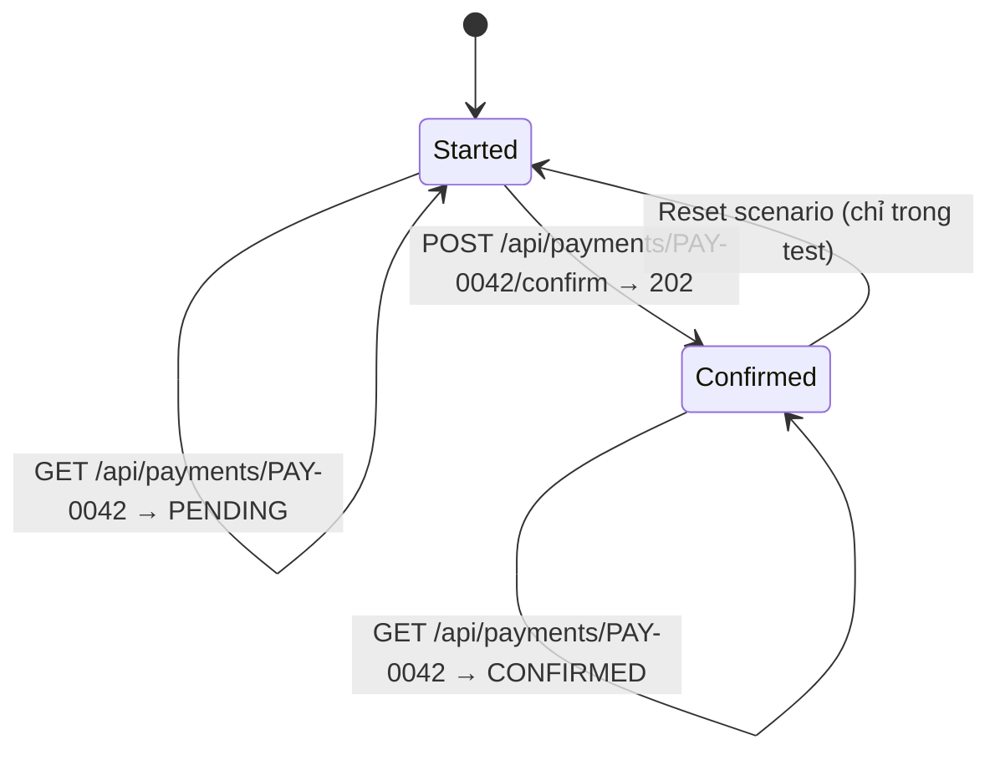
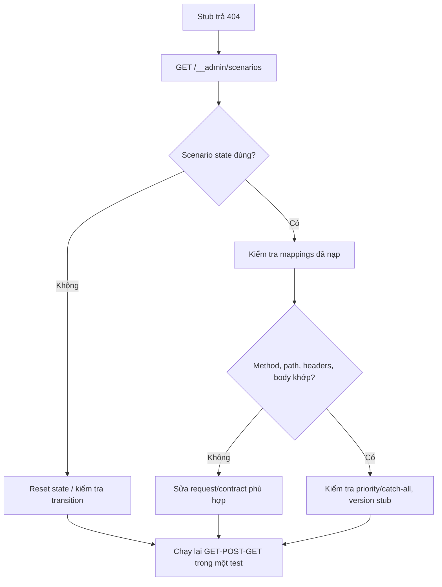
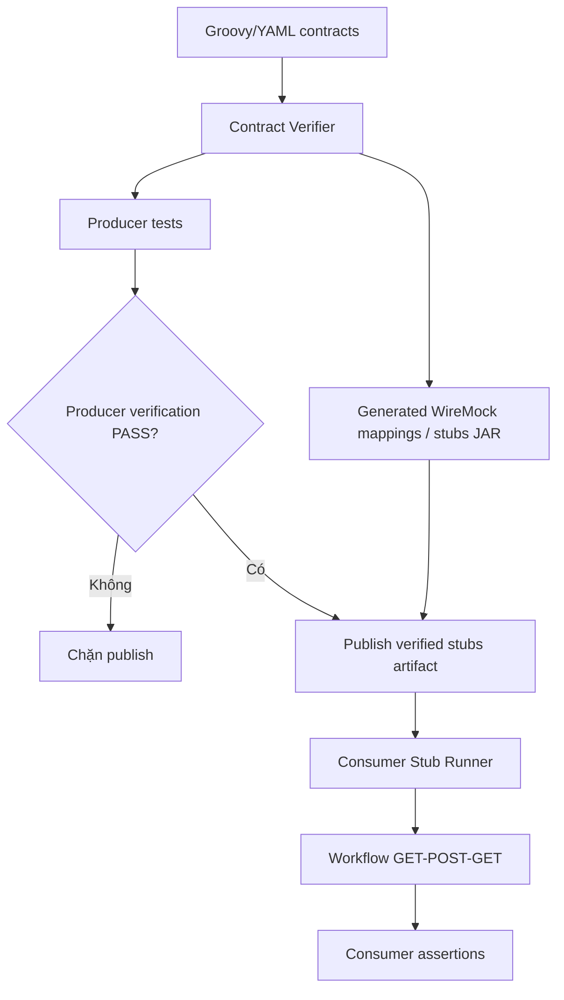
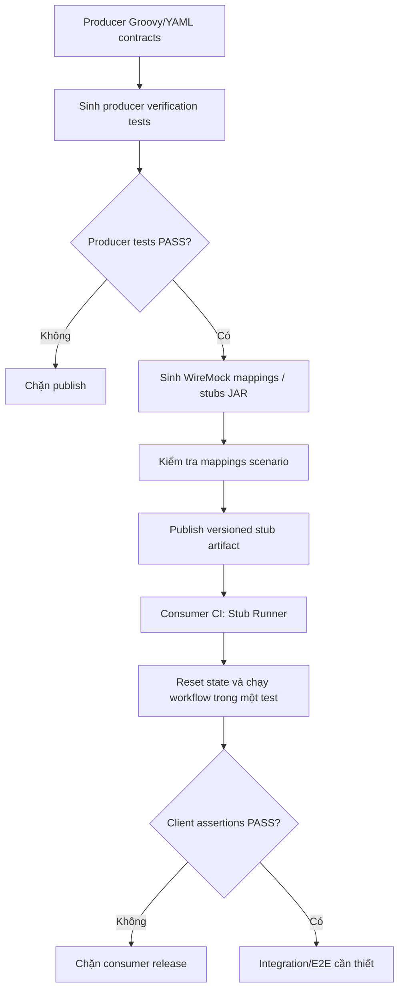

# Scenario và trạng thái trong stub

> **Chương:** WireMock  
> **Module:** Spring Cloud Contract (`SPRING_CLOUD_CONTRACT`) — học kiểm thử hợp đồng giữa producer và consumer, mô tả hành vi HTTP/message bằng Groovy hoặc YAML DSL, sinh test phía cung cấp, phát hành stubs, dùng Stub Runner và tích hợp CI để phát hiện thay đổi API không tương thích.

## Mục tiêu học tập

Sau bài này, bạn có thể:

1. Giải thích **WireMock Scenario** là một máy trạng thái cho stub HTTP và phân biệt trạng thái của stub với trạng thái nghiệp vụ thật ở producer.
2. Dùng chính xác `scenarioName`, `requiredScenarioState` và `newScenarioState` để mô tả response thay đổi theo chuỗi request.
3. Mô phỏng luồng **PENDING → CONFIRMED** của một giao dịch bằng JSON mappings và Java DSL.
4. Hiểu `Scenario.STARTED` trong Java tương ứng với chuỗi `"Started"` trong mapping JSON; kiểm tra, đặt lại và thiết lập trạng thái qua WireMock Admin API.
5. Tổ chức các contract **có thứ tự** trong Spring Cloud Contract bằng cách đặt tên file `1_...`, `2_...`, `3_...` trong cùng thư mục scenario.
6. Biết vì sao Spring Cloud Contract **khuyến nghị contract tests độc lập trạng thái**, và khi nào mô phỏng workflow stateful ở phía consumer vẫn có giá trị.
7. Cô lập trạng thái giữa test cases, tránh va chạm khi chạy song song, kiểm tra mappings và xử lý 404 khi stub ở sai state.
8. Đưa producer verification, phát hành stub và consumer Stub Runner tests vào CI mà không biến scenario thành bằng chứng giả về tính nhất quán của hệ thống production.

## 1. Vì sao một request giống nhau lại cần response khác nhau?

Một **stub stateless** thường trả cùng response cho cùng một request. Nhưng một số hành trình thực tế có các bước nối tiếp:

1. Consumer xem trạng thái thanh toán: `PENDING`.
2. Consumer gửi lệnh xác nhận.
3. Consumer xem lại trạng thái thanh toán: `CONFIRMED`.

Điểm đáng chú ý: cả bước 1 và bước 3 đều dùng cùng HTTP request:

```http
GET /api/payments/PAY-0042 HTTP/1.1
Accept: application/json
```

Nhưng hai response có giá trị khác nhau ở `status`:

```json
{
  "paymentId": "PAY-0042",
  "status": "PENDING"
}
```

và:

```json
{
  "paymentId": "PAY-0042",
  "status": "CONFIRMED"
}
```

Nếu tạo **hai stub mappings stateless** cho đúng cùng method/path, WireMock phải chọn một mapping theo quy tắc matching và priority, chứ không tự biết khi nào response nào có ý nghĩa. Kết quả thường không mô phỏng đúng hành trình mà consumer cần.

**WireMock Scenario** giải quyết bằng cách lưu **một trạng thái hiện tại** cho một scenario và chỉ cho mapping khớp khi trạng thái yêu cầu trùng với trạng thái đang giữ. Sau khi mapping được phục vụ, nó có thể chuyển sang trạng thái mới.



Trạng thái `Started` và `Confirmed` ở sơ đồ là **trạng thái nội bộ của stub**. Chúng không phải bản ghi trong database của producer, không tạo transaction thật và không đảm bảo một thanh toán production đã được xác nhận.

## 2. Ba khái niệm tạo nên Scenario

WireMock mô tả một scenario bằng các thuộc tính sau trong stub mapping:

| Thuộc tính | Ý nghĩa | Ví dụ |
| --- | --- | --- |
| `scenarioName` | Tên máy trạng thái dùng chung cho các mapping thuộc cùng workflow | `payment-confirmation` |
| `requiredScenarioState` | Mapping chỉ được dùng khi scenario đang ở state này | `Started` hoặc `Confirmed` |
| `newScenarioState` | State được ghi nhận **sau khi mapping được phục vụ** | `Confirmed` |

Bắt đầu với một scenario mới, WireMock dùng **trạng thái mặc định `Started`**. Trong Java DSL, hằng tương ứng là `Scenario.STARTED`.

**Chú ý chính tả và chữ hoa/thường:** `"Started"` (JSON) là giá trị chuẩn; không thay tùy tiện bằng `"STARTED"` trong mapping. Các state do bạn đặt tên như `Confirmed`, `Step1` hoặc `PaymentCaptured` là string và phải nhất quán ở mọi mapping.

### 2.1. Các trạng thái không nhất thiết là trạng thái nghiệp vụ

Ví dụ dùng `Confirmed` cho cả business status lẫn scenario state để dễ học. Nhưng bạn cũng có thể gọi scenario state là `"AfterConfirmationRequest"`. WireMock không hiểu quy tắc nghiệp vụ trong tên; nó chỉ so **chuỗi trạng thái**.

Vì vậy không nhầm:

- `response.jsonBody.status = "CONFIRMED"`: **dữ liệu HTTP mà consumer nhận**.
- `newScenarioState = "Confirmed"`: **trạng thái nội bộ dùng để chọn mapping tiếp theo**.

Thay đổi response body **không tự** thay đổi scenario state nếu mapping không khai báo `newScenarioState`. Ngược lại, một mapping có thể chuyển state dù response không chứa trường `status`.

### 2.2. Khi nào mapping không chuyển trạng thái?

Một mapping có `scenarioName` và `requiredScenarioState` nhưng **không** có `newScenarioState` có thể được phục vụ nhiều lần trong cùng state. Đây là cách mô tả thao tác đọc:

```text
Started + GET payment status -> 200 PENDING -> vẫn Started
```

Nếu muốn chuyển state, mapping tương ứng phải có `newScenarioState` hoặc test dùng Admin API để đặt state có chủ đích.

## 3. Mô phỏng thanh toán bằng ba WireMock JSON mappings

Ta sẽ tạo ba mappings ở **một WireMock server dành riêng cho test**. Các mapping này cùng `scenarioName: payment-confirmation`, vì chúng là các bước của một máy trạng thái.

Thư mục giả định khi chạy WireMock standalone:

```text
wiremock/
├── mappings/
│   ├── payment-01-pending.json
│   ├── payment-02-confirm.json
│   └── payment-03-confirmed.json
└── __files/
```

Đây là cấu trúc của **WireMock mappings**, khác với cấu trúc `src/test/resources/contracts` dùng cho Spring Cloud Contract DSL. Mappings có thể được tạo thủ công như phần này hoặc được sinh từ contract (xem mục 10).

### 3.1. Mapping A — đọc trạng thái ban đầu

File `mappings/payment-01-pending.json`:

```json
{
  "name": "payment-pending",
  "scenarioName": "payment-confirmation",
  "requiredScenarioState": "Started",
  "request": {
    "method": "GET",
    "url": "/api/payments/PAY-0042",
    "headers": {
      "Accept": {
        "contains": "application/json"
      }
    }
  },
  "response": {
    "status": 200,
    "headers": {
      "Content-Type": "application/json"
    },
    "jsonBody": {
      "paymentId": "PAY-0042",
      "status": "PENDING"
    }
  }
}
```

Tại state `Started`, consumer gọi GET sẽ nhận `200` với `PENDING`. Mapping **không** có `newScenarioState` nên việc đọc trạng thái không làm workflow tiến lên.

### 3.2. Mapping B — xác nhận và chuyển state

File `mappings/payment-02-confirm.json`:

```json
{
  "name": "payment-confirm",
  "scenarioName": "payment-confirmation",
  "requiredScenarioState": "Started",
  "newScenarioState": "Confirmed",
  "request": {
    "method": "POST",
    "url": "/api/payments/PAY-0042/confirm"
  },
  "response": {
    "status": 202,
    "headers": {
      "Content-Type": "application/json"
    },
    "jsonBody": {
      "paymentId": "PAY-0042",
      "status": "PROCESSING"
    }
  }
}
```

Khi POST khớp trong state `Started`, WireMock trả `202` và chuyển scenario sang `Confirmed`. Việc trả `PROCESSING` ở response xác nhận trong ví dụ là **một lựa chọn của API mẫu**, nhằm minh họa consumer có thể được yêu cầu đọc lại để biết trạng thái cuối.

**Không suy ra** `202 Accepted` trong HTTP tự làm state chuyển: đó là `newScenarioState` của mapping, không phải ý nghĩa tự động của status code.

### 3.3. Mapping C — đọc trạng thái sau xác nhận

File `mappings/payment-03-confirmed.json`:

```json
{
  "name": "payment-confirmed",
  "scenarioName": "payment-confirmation",
  "requiredScenarioState": "Confirmed",
  "request": {
    "method": "GET",
    "url": "/api/payments/PAY-0042",
    "headers": {
      "Accept": {
        "contains": "application/json"
      }
    }
  },
  "response": {
    "status": 200,
    "headers": {
      "Content-Type": "application/json"
    },
    "jsonBody": {
      "paymentId": "PAY-0042",
      "status": "CONFIRMED"
    }
  }
}
```

Bây giờ cùng request GET ở mục 3.1 trả `CONFIRMED` thay vì `PENDING`, do state đã chuyển. Mapping này cũng **không có** `newScenarioState` nên những lần GET tiếp theo vẫn trả `CONFIRMED`.

### 3.4. Tổng kết logic matching

| State trước request | Request | Mapping | HTTP response | State sau |
| --- | --- | --- | --- | --- |
| `Started` | GET `/api/payments/PAY-0042` | A | 200, `PENDING` | `Started` |
| `Started` | POST `/api/payments/PAY-0042/confirm` | B | 202, `PROCESSING` | `Confirmed` |
| `Confirmed` | GET `/api/payments/PAY-0042` | C | 200, `CONFIRMED` | `Confirmed` |
| `Confirmed` | POST `/api/payments/PAY-0042/confirm` | *Không có mapping trong bộ ba* | Thường là 404 unmatched | `Confirmed` |
| Sau reset | GET `/api/payments/PAY-0042` | A | 200, `PENDING` | `Started` |

Dòng POST lặp lại cho thấy bộ ba chỉ mô tả **một lần xác nhận**. Nếu consumer cần retry POST và API cam kết idempotency, bạn phải định nghĩa hành vi tương ứng. WireMock **không tự** biết POST lần hai nên trả thành công, 409 hay 404.

## 4. Thử workflow bằng HTTP

Khởi động một WireMock standalone/server trong môi trường test, có thư mục `mappings` như mục 3. Giả sử nó đang nghe ở `http://localhost:8089`. **Cổng này chỉ là ví dụ**, không phải cổng mặc định bắt buộc.

### 4.1. Reset và đọc lần đầu

```bash
curl -X POST http://localhost:8089/__admin/scenarios/reset

curl -i \
  -H "Accept: application/json" \
  http://localhost:8089/api/payments/PAY-0042
```

Kỳ vọng: `200`, body `status: PENDING`.

### 4.2. Xác nhận giao dịch

```bash
curl -i -X POST \
  http://localhost:8089/api/payments/PAY-0042/confirm
```

Kỳ vọng: `202` với body `status: PROCESSING`.

### 4.3. Đọc lại cùng URL

```bash
curl -i \
  -H "Accept: application/json" \
  http://localhost:8089/api/payments/PAY-0042
```

Kỳ vọng: `200`, body `status: CONFIRMED`.

### 4.4. Điều gì xảy ra khi thứ tự sai?

Nếu test **bỏ qua POST** và cố đòi `CONFIRMED` ngay, mapping C không đủ điều kiện state và mapping A sẽ trả `PENDING`. Test consumer phải **FAIL** vì workflow chưa được thực hiện đúng.

Nếu gọi POST sau khi scenario đã chuyển `Confirmed`, bộ mapping ví dụ không khớp POST đó. WireMock có thể trả `404` do unmatched request. Không nhầm **404 của mock server vì thiếu mapping** với **quy tắc API thật phải trả 404** cho lệnh xác nhận lặp.

## 5. Kiểm tra và đặt lại state bằng Admin API

WireMock cung cấp Admin API để xem và thay đổi scenario state. Với server **chỉ dùng cho test**:

### 5.1. Xem trạng thái tất cả scenarios

```http
GET /__admin/scenarios HTTP/1.1
Host: localhost:8089
```

Một response minh họa:

```json
{
  "scenarios": [
    {
      "id": "payment-confirmation",
      "name": "payment-confirmation",
      "state": "Confirmed",
      "possibleStates": ["Started", "Confirmed"]
    }
  ]
}
```

Dùng:

```bash
curl http://localhost:8089/__admin/scenarios
```

Giá trị trong response là **state của stub**, không phải bảng thanh toán trong database producer. Khi debug test, hãy kiểm tra `state` ngay sau POST để biết transition có xảy ra hay không.

### 5.2. Reset tất cả về Started

```bash
curl -X POST http://localhost:8089/__admin/scenarios/reset
```

Lệnh này **chỉ reset scenario state**, giữ nguyên mappings; nó phù hợp khi cần chạy lại workflow từ đầu mà không xóa stubs đã nạp.

### 5.3. Đặt state của một scenario cụ thể

```bash
curl -X PUT \
  -H "Content-Type: application/json" \
  --data '{"state":"Confirmed"}' \
  http://localhost:8089/__admin/scenarios/payment-confirmation/state
```

Đây là thao tác **test setup/debug**. Nó hữu ích để kiểm tra riêng handler của consumer khi payment đã `Confirmed`, nhưng nếu test cần chứng minh consumer **đã thực hiện POST xác nhận**, việc tự đẩy state sẽ bỏ qua bước quan trọng đó.

Để reset **chỉ một scenario** về `Started`, WireMock cũng hỗ trợ `PUT /__admin/scenarios/{scenarioName}/state` với body rỗng, theo tài liệu của phiên bản đang dùng. Với tên scenario có dấu cách/ký tự đặc biệt, cần URL-encode phần tên.

### 5.4. Reset scenario khác reset cả server

| Lệnh/API | Ý định | Hệ quả |
| --- | --- | --- |
| `POST /__admin/scenarios/reset` | Chỉ reset scenario states | Mappings vẫn có |
| `PUT /__admin/scenarios/{name}/state` | Đặt/reset một scenario | Không xóa toàn bộ mappings |
| `POST /__admin/reset` | Reset WireMock server đầy đủ | Có thể xóa mappings runtime và request log |
| `POST /__admin/mappings/reset` | Nạp lại mappings mặc định theo backing store | Không dùng chỉ để làm lại state machine |
| `GET /__admin/scenarios` | Quan sát | Không thay đổi state |

**Không gọi `/__admin/reset` trong lúc Stub Runner đang phục vụ mappings được tải từ stub JAR rồi mặc định mapping sẽ còn nguyên**. Nếu mục tiêu chỉ là reset state giữa các test, dùng API chuyên cho scenario.

**An toàn:** Admin API có thể sửa hoặc xóa cấu hình mock. Chỉ gọi vào WireMock instance thuộc quyền sở hữu của test; đừng expose nó ra mạng không tin cậy hoặc chạy lệnh reset trên môi trường dùng chung.

## 6. Viết scenario bằng Java DSL

WireMock có Java DSL tương đương các field JSON:

| JSON mapping | Java DSL |
| --- | --- |
| `scenarioName` | `.inScenario("payment-confirmation")` |
| `requiredScenarioState` | `.whenScenarioStateIs(...)` |
| `newScenarioState` | `.willSetStateTo(...)` |
| `request` | `get(urlEqualTo(...))`, `post(...)` |
| `response` | `.willReturn(aResponse()...)` |
| `priority` | `.atPriority(1)` khi cần giải quyết overlapping mappings |

Một ví dụ khởi động WireMock qua JUnit Jupiter và đăng ký ba mappings:

```java
package com.example.checkout;

import com.github.tomakehurst.wiremock.junit5.WireMockExtension;
import com.github.tomakehurst.wiremock.stubbing.Scenario;
import org.junit.jupiter.api.BeforeEach;
import org.junit.jupiter.api.Test;
import org.junit.jupiter.api.extension.RegisterExtension;

import java.net.URI;
import java.net.http.HttpClient;
import java.net.http.HttpRequest;
import java.net.http.HttpResponse;

import static com.github.tomakehurst.wiremock.client.WireMock.*;
import static com.github.tomakehurst.wiremock.core.WireMockConfiguration.wireMockConfig;
import static org.junit.jupiter.api.Assertions.*;

class PaymentWorkflowTest {

    private static final String SCENARIO = "payment-confirmation";

    @RegisterExtension
    static WireMockExtension wm = WireMockExtension.newInstance()
        .options(wireMockConfig().dynamicPort())
        .build();

    @BeforeEach
    void registerMappings() {
        // JUnit extension mặc định reset mappings và request log trước mỗi test.
        // Đăng ký lại tại đây để mỗi test có state độc lập.
        wm.stubFor(get(urlEqualTo("/api/payments/PAY-0042"))
            .withHeader("Accept", containing("application/json"))
            .inScenario(SCENARIO)
            .whenScenarioStateIs(Scenario.STARTED)
            .willReturn(aResponse()
                .withStatus(200)
                .withHeader("Content-Type", "application/json")
                .withBody("""
                    {"paymentId":"PAY-0042","status":"PENDING"}
                    """)));

        wm.stubFor(post(urlEqualTo("/api/payments/PAY-0042/confirm"))
            .inScenario(SCENARIO)
            .whenScenarioStateIs(Scenario.STARTED)
            .willSetStateTo("Confirmed")
            .willReturn(aResponse()
                .withStatus(202)
                .withHeader("Content-Type", "application/json")
                .withBody("""
                    {"paymentId":"PAY-0042","status":"PROCESSING"}
                    """)));

        wm.stubFor(get(urlEqualTo("/api/payments/PAY-0042"))
            .withHeader("Accept", containing("application/json"))
            .inScenario(SCENARIO)
            .whenScenarioStateIs("Confirmed")
            .willReturn(aResponse()
                .withStatus(200)
                .withHeader("Content-Type", "application/json")
                .withBody("""
                    {"paymentId":"PAY-0042","status":"CONFIRMED"}
                    """)));
    }

    @Test
    void getPostGetTraVeTrangThaiTheoThuTu() throws Exception {
        HttpClient client = HttpClient.newHttpClient();
        URI getUri = URI.create(wm.getRuntimeInfo().getHttpBaseUrl()
            + "/api/payments/PAY-0042");
        URI confirmUri = URI.create(wm.getRuntimeInfo().getHttpBaseUrl()
            + "/api/payments/PAY-0042/confirm");

        HttpRequest get = HttpRequest.newBuilder(getUri)
            .header("Accept", "application/json").GET().build();
        HttpRequest confirm = HttpRequest.newBuilder(confirmUri)
            .POST(HttpRequest.BodyPublishers.noBody()).build();

        HttpResponse<String> before = client.send(
            get, HttpResponse.BodyHandlers.ofString());
        assertEquals(200, before.statusCode());
        assertTrue(before.body().contains("\"PENDING\""));

        HttpResponse<String> accepted = client.send(
            confirm, HttpResponse.BodyHandlers.ofString());
        assertEquals(202, accepted.statusCode());

        HttpResponse<String> after = client.send(
            get, HttpResponse.BodyHandlers.ofString());
        assertEquals(200, after.statusCode());
        assertTrue(after.body().contains("\"CONFIRMED\""));
    }
}
```

**Giới hạn ví dụ:** test sử dụng `String.contains` để minh họa flow; trong dự án thật hãy parse JSON/DTO rồi assertion đúng kiểu, field và nghiệp vụ. Các imports/DSL ở đây theo WireMock Java hiện đại và Java 17+; phải dùng các phiên bản JUnit/WireMock tương thích. Đoạn này là **WireMock test độc lập**, chưa dùng Stub Runner.

### 6.1. Không gọi static WireMock DSL nhầm server

Khi dùng `WireMockExtension` với nhiều server, nên đăng ký qua **`wm.stubFor(...)`** như ví dụ. Nếu dùng static `stubFor(...)`, phải cấu hình static DSL trỏ đến đúng server; sai port có thể khiến mapping được gửi nhầm hoặc request tới server không tồn tại.

### 6.2. State có được tự reset giữa test không?

Theo tài liệu WireMock JUnit Jupiter, extension mặc định **reset stubs và request log trước từng test method**; do đó bài ví dụ đăng ký mapping lại trong `@BeforeEach`. Nếu đổi cấu hình thành `resetOnEachTest(false)` (ở các phiên bản hỗ trợ), trạng thái có thể tồn qua test; cần chủ động reset hoặc cô lập.

Không nên đặt các phần workflow vào **ba `@Test` riêng biệt** rồi dựa vào thứ tự JUnit: test độc lập có thể chạy theo thứ tự khác hoặc song song. Một `@Test` nên thực hiện **trọn chuỗi GET → POST → GET** nếu mục tiêu là kiểm tra trình tự.

## 7. Cùng URL, hai response: vì sao state quan trọng hơn thứ tự đăng ký?

Nếu bạn có hai mappings:

```json
{
  "request": {"method": "GET", "url": "/api/payments/PAY-0042"},
  "response": {"status": 200, "jsonBody": {"status": "PENDING"}}
}
```

và:

```json
{
  "request": {"method": "GET", "url": "/api/payments/PAY-0042"},
  "response": {"status": 200, "jsonBody": {"status": "CONFIRMED"}}
}
```

thì chúng **đều** match cùng request. Không có `requiredScenarioState`, WireMock không biết response nào phải dùng trước và sau POST. Việc stub được thêm gần nhất hoặc priority sẽ quyết định mapping thắng, chứ không biến chúng thành workflow.

Các điều kiện scenario giúp khắc phục:

```text
GET + Started   → PENDING
POST + Started  → PROCESSING, chuyển Confirmed
GET + Confirmed → CONFIRMED
```

### 7.1. Priority không thay thế scenario

WireMock có `priority` số nguyên; **số nhỏ hơn được ưu tiên cao hơn**. Ví dụ:

```json
{
  "priority": 1,
  "request": {
    "method": "GET",
    "url": "/api/payments/PAY-0042"
  },
  "response": {
    "status": 200,
    "jsonBody": {"status": "PENDING"}
  }
}
```

Mapping này sẽ có thể được ưu tiên khi có nhiều mapping cùng match, nhưng nó **không tự chuyển sang CONFIRMED** sau POST. Dùng priority để xử lý **overlap/catch-all** có chủ đích, dùng scenario để xử lý **trạng thái theo tương tác**.

Một catch-all mapping quá rộng có thể che lỗi scenario khi request không khớp state mong muốn. Trong suite có scenario, hãy kiểm tra các mappings fallback và priority để không biến request sai thứ tự thành một response giả có vẻ hợp lệ.

## 8. Những lỗi 404 đặc trưng của scenario

Khi consumer nhận `404` từ WireMock, đừng lập tức sửa contract sang 404. WireMock có thể trả 404 vì **không mapping nào khớp**; nguyên nhân thường là:

1. Đã chuyển sang `Confirmed` nhưng client lại POST lần nữa khi mapping POST chỉ cho `Started`.
2. Client gọi GET sau POST nhưng mapping GET `Confirmed` chưa được nạp.
3. `requiredScenarioState` viết `"STARTED"` trong khi WireMock đang giữ `"Started"`.
4. Có hai mappings mang `scenarioName` khác nhau do lỗi chính tả.
5. JSON body, headers, URL/query hoặc HTTP method của request không khớp.
6. Test trước đã để state `Confirmed` và không reset.
7. Một catch-all mapping hoặc mapping ưu tiên khác được thêm vào làm kết quả khó hiểu.

### 8.1. Quy trình điều tra 404



Dùng API quản trị WireMock dành riêng cho test và xem **request journal/unmatched request details** khi có quyền. So yêu cầu thực với mapping sau khi sinh từ Spring Cloud Contract; đừng chỉ so với file DSL nguồn, vì stub mapping là thứ được WireMock thực sự thực thi.

## 9. Đặt lại trạng thái để các test không ảnh hưởng nhau

Scenario state nằm trong **WireMock server instance**. Khi nhiều test hoặc consumer cùng gọi một instance, các mapping chung scenario name có thể chia sẻ state.

Tình huống rò rỉ:

```text
Test A: POST confirm → state = Confirmed
Test A: hoàn thành
Test B: GET mong PENDING → nhận CONFIRMED
```

Nguyên tắc thiết kế:

- **Trước mỗi workflow test:** reset scenario về `Started`, nếu test có quyền độc quyền trên stub server.
- **Sau workflow test:** đảm bảo không còn tác vụ bất đồng bộ cũ có thể gửi thêm request.
- **Giữa test cases chạy song song:** ưu tiên **WireMock server instance riêng** hoặc scenario name riêng với mappings tương ứng.
- **Nếu dùng Stub Runner static/server chung:** tránh reset cùng lúc khi test khác đang chạy; điều phối test chạy tuần tự hoặc cấp server riêng.
- **Với timeout hoặc retry:** chỉ kết thúc case sau khi các request liên quan đã được kiểm tra hoặc dừng đúng cách.

Một reset toàn server khi nhiều test cùng dùng có thể làm test khác mất state giữa workflow. Khi chỉ một scenario cần reset, ưu tiên thao tác **theo tên** thay vì reset tất cả.

### 9.1. State theo tên scenario, không theo từng người dùng

Một sai lầm phổ biến là giả định mỗi `paymentId` hoặc mỗi consumer có state riêng. Trong WireMock Scenario chuẩn, **state được quản lý theo scenario name trên server**.

Nếu hai consumer cùng thao tác `payment-confirmation` trên một instance, một consumer có thể chuyển state cho consumer kia. WireMock không tự tạo state machine độc lập theo path parameter hoặc header `X-User-Id`.

Khi cần mô phỏng nhiều phiên độc lập, hãy cân nhắc:

- Mỗi test một WireMock instance.
- Sinh mappings/`scenarioName` riêng theo test fixture.
- Dùng tiện ích stateful mock nâng cao hoặc test service có state riêng nếu yêu cầu quá phức tạp.
- Tránh biến một scenario duy nhất thành một database giả có nhiều payment IDs mà nó không thể phân biệt state đúng.

### 9.2. Khi nào cần kiểm tra không có request dư?

Một workflow có thể PASS qua GET–POST–GET nhưng client gửi **POST xác nhận hai lần** do retry sai. Nếu nghiệp vụ yêu cầu chỉ một lần, bổ sung verification trên request journal:

```java
wm.verify(1, postRequestedFor(
    urlEqualTo("/api/payments/PAY-0042/confirm")
));
```

Đây là kiểm tra **số lần gọi stub HTTP**, không tự chứng minh producer production bảo đảm exactly-once processing. Nó hữu ích để kiểm tra consumer không gửi request thừa trong một test case đã cô lập.

## 10. Spring Cloud Contract tạo stateful contracts như thế nào?

Đây là phần nối WireMock vào **Spring Cloud Contract**. Tài liệu Spring Cloud Contract 5.0.3 có mục **Stateful Contracts**, dùng **quy ước thư mục + file có số thứ tự và dấu gạch dưới**.

Ví dụ:

```text
src/test/resources/contracts/
  payment-confirmation/
    1_getPending.yml
    2_confirm.yml
    3_getConfirmed.yml
```

Bộ contract trong thư mục `payment-confirmation` được đọc theo thứ tự tên. Spring Cloud Contract có thể sinh **WireMock scenario mapping** với:

- Tên scenario theo tên thư mục, chẳng hạn `payment-confirmation`.
- Bước đầu ở `Started`.
- Những bước sau ở state trung gian, tài liệu Spring Cloud Contract minh họa tên như `Step1` và `Step2`.

**Hai điều đặc biệt quan trọng:**

1. Đây là **quy ước của Spring Cloud Contract**, không phải trường `scenarioName` trong YAML Contract DSL gốc. Bạn không cần tự nhét `requiredScenarioState` vào YAML DSL rồi giả định schema hiểu nó.
2. Spring Cloud Contract **không khuyến khích producer contract tests stateful** vì test có thể phụ thuộc thứ tự và trạng thái. Giá trị thường thấy nhất là mô phỏng **cùng endpoint trả response khác nhau** cho consumer workflow.

### 10.1. Ba YAML contract theo thứ tự

File `1_getPending.yml`:

```yaml
name: payment_pending
request:
  method: GET
  url: /api/payments/PAY-0042
  headers:
    Accept: application/json
response:
  status: 200
  headers:
    Content-Type: application/json
  body:
    paymentId: PAY-0042
    status: PENDING
```

File `2_confirm.yml`:

```yaml
name: payment_confirmation_accepted
request:
  method: POST
  url: /api/payments/PAY-0042/confirm
response:
  status: 202
  headers:
    Content-Type: application/json
  body:
    paymentId: PAY-0042
    status: PROCESSING
```

File `3_getConfirmed.yml`:

```yaml
name: payment_confirmed
request:
  method: GET
  url: /api/payments/PAY-0042
  headers:
    Accept: application/json
response:
  status: 200
  headers:
    Content-Type: application/json
  body:
    paymentId: PAY-0042
    status: CONFIRMED
```

Các đoạn trên **là ba file tách biệt**, không nối thành một YAML document và cũng không cần thêm `scenarioName`, `requiredScenarioState` hay `newScenarioState` vào YAML Contract DSL. Spring Cloud Contract xử lý quy ước stateful khi tạo stubs.

### 10.2. Điểm khác giữa mapping viết tay và mapping được sinh

Trong mapping JSON viết tay ở mục 3, ta chủ động định nghĩa:

- GET `Started` **không chuyển state**.
- POST `Started` chuyển sang `Confirmed`.
- GET `Confirmed` giữ state.

Trong quy ước **các file có thứ tự** của Spring Cloud Contract, generator có thể tạo transition **sau từng bước** dựa vào thứ tự `1_`, `2_`, `3_`. Chẳng hạn bước GET đầu có thể chuyển sang `Step1`, bước POST yêu cầu `Step1` và chuyển `Step2`.

**Đó không hoàn toàn giống** ba mapping viết tay! Với workflow sinh từ các file đánh số, hãy kiểm tra các JSON mappings đầu ra thực tế để biết transition và yêu cầu thứ tự chính xác. Nếu consumer phải được phép **GET trạng thái PENDING nhiều lần** trước POST, quy ước "mỗi request tiến một bước" có thể không phù hợp.

Khi cần giữ GET đọc lặp không làm chuyển state, bạn có thể:

- Viết mapping WireMock chi tiết riêng cho consumer test.
- Thiết kế contract hoặc test khác để workflow đơn giản hơn.
- Kiểm tra cơ chế hỗ trợ bổ sung của phiên bản Spring Cloud Contract/WireMock thực tế trước khi mở rộng custom converter.

**Không giả định** việc có `1_...`, `2_...`, `3_...` đảm bảo mọi luật idempotency và retry của API được mô phỏng chính xác.

### 10.3. Cùng quy ước áp dụng với Groovy DSL

Ví dụ cây contract:

```text
src/test/resources/contracts/
  checkout-flow/
    1_login.groovy
    2_viewCart.groovy
    3_logout.groovy
```

Một file Groovy mẫu trong chuỗi:

```groovy
org.springframework.cloud.contract.spec.Contract.make {
    name 'login_success'
    request {
        method 'POST'
        url '/api/session/login'
        headers {
            contentType(applicationJson())
        }
        body(username: 'demo', password: 'not-a-real-password')
    }
    response {
        status 200
        headers {
            contentType(applicationJson())
        }
        body(status: 'AUTHENTICATED')
    }
}
```

Đoạn Groovy là **ví dụ riêng về một bước** để thấy quy ước tên file không phụ thuộc ngôn ngữ DSL; không ghép vào scenario thanh toán ở trên. Thông tin `password` là dữ liệu giả dùng để dạy cách viết DSL, không nên lưu thông tin đăng nhập thật trong contract.

## 11. Kiểm thử producer và consumer bảo vệ những gì?

Spring Cloud Contract có hai luồng:



### 11.1. Producer verification

Producer tests sinh từ contract chủ yếu kiểm tra **triển khai API thật** với các request và response đã cam kết. Chẳng hạn:

- GET tình huống PENDING trả `200` và `status: PENDING`.
- POST confirm trả `202` với body mong đợi.
- GET tình huống CONFIRMED trả `200` và `status: CONFIRMED`.

Để kiểm tra **GET confirmed** trên producer, base test cần chuẩn bị **fixture ở trạng thái confirmed** hoặc integration setup tương ứng. **Đừng trông chờ test GET tự chạy sau test POST**: test frameworks có thể chạy method khác thứ tự, song song hoặc reset database giữa mỗi test.

Một contract stateful dùng để tạo stubs **không tự thay thế** producer integration test xác minh chuyển trạng thái thật trong database, transaction và consistency.

### 11.2. Consumer workflow với Stub Runner

Consumer lấy stubs JAR đã được producer kiểm chứng và Stub Runner khởi chạy WireMock. Tại đó, scenario mô phỏng response đổi theo trình tự request.

Test có thể:

1. Lấy URL stub qua `StubFinder` hoặc `StubRunnerExtension`.
2. Reset scenario state **trong server test-owned**.
3. Dùng **HTTP client thật của consumer** gọi GET, POST, GET.
4. Assert status và dữ liệu sau từng bước.
5. Kiểm tra số lần gọi confirm nếu có điều kiện chống duplicate.
6. Kết thúc test mà không làm state rò sang test sau.

Nếu consumer dùng stubs version cũ, test PASS **không chứng minh** producer version mới vẫn hoạt động tương thích. Producer CI phải xác minh và phát hành artifact đúng version trước.

### 11.3. Scenario không phải contract cho cơ sở dữ liệu thật

Một workflow test dùng scenario có thể kiểm tra rằng:

- Client gửi các request đúng thứ tự.
- Client đọc/giải mã response theo từng bước.
- Client không xác nhận trùng nếu test bổ sung verification.
- Client chuyển giao diện hoặc state cục bộ đúng khi payment từ PENDING sang CONFIRMED.

Nhưng nó **không** kiểm tra:

- Producer đã commit transaction vào database.
- Lệnh POST thực sự xác nhận thanh toán trong hệ thống thứ ba.
- Nhiều request đồng thời có đảm bảo nhất quán.
- Lỗi timeout và retry sau network partition.
- Cách xử lý message broker, ledger hoặc audit record production.

Muốn bảo vệ những điều ấy, cần integration/E2E tests hoặc component tests của producer với hạ tầng phù hợp.

## 12. Stub Runner, mappings và trạng thái

Với producer có stub artifact:

```text
com.example:payment-service:1.0.0:stubs
```

Consumer test dùng Spring Boot có thể cấu hình:

```java
@SpringBootTest(properties = {
    "payments.base-url=http://localhost:8090"
})
@AutoConfigureStubRunner(
    ids = "com.example:payment-service:1.0.0:stubs:8090",
    stubsMode = StubRunnerProperties.StubsMode.LOCAL
)
class PaymentClientContractTest {
    // Autowire client thật; chạy các bước GET-POST-GET trong một test.
}
```

Đây là **cấu hình minh họa**. Trong project thật, cần import/dependency, `PaymentClient` và cấu hình `payments.base-url` do ứng dụng tự định nghĩa. `LOCAL` chỉ tìm thấy artifact đã cài vào local Maven repository.

**Không hard-code 8090** nếu không cần cổng cố định. Có thể để Stub Runner chọn port, lấy URL qua `StubFinder` hoặc `StubRunnerExtension.findStubUrl(...)` và truyền vào HTTP client để tránh xung đột CI.

### 12.1. Khi cần reset state cho một server do Stub Runner quản lý

Có thể dùng WireMock Admin API bằng một HTTP client riêng sau khi lấy được **base URL của stub test-owned**:

```http
POST /__admin/scenarios/reset HTTP/1.1
Host: localhost:{stubPort}
```

Không reset nếu nhiều test chạy chung server và đang ở giữa các bước. Cũng không dùng reset API để "sửa" một producer implementation sai; Admin API chỉ tác động stub.

### 12.2. Xem generated mappings trước khi viết assertion

Khi dùng quy ước Spring Cloud Contract `1_`, `2_`, `3_`, hãy mở mappings do plugin sinh trong artifact `stubs` hoặc thư mục output theo cấu hình. Cần tìm:

```json
{
  "scenarioName": "payment-confirmation",
  "requiredScenarioState": "Started",
  "newScenarioState": "Step1"
}
```

Đây là **fragment minh họa** của mapping, không phải file JSON hoàn chỉnh. Tên state thực tế do generator tạo phải được xác minh thay vì sao chép fragment này và giả định mọi phiên bản dùng đúng `Step1` trong mọi tình huống.

Nếu thiếu `scenarioName` hoặc các trường state ở output, có thể generator đã không nhận diện scenario do đường dẫn/naming không đúng. Đọc **mappings thật**, log plugin và version của Spring Cloud Contract.

## 13. Thiết kế scenario có idempotency và retry

Nhu cầu thường gặp: consumer có thể gửi lại POST confirm do timeout. API thật có thể quy định rằng POST lần hai vẫn trả `200` với trạng thái `CONFIRMED`, hoặc `409`. Bộ ba mapping ở mục 3 không nói điều đó.

Ví dụ bổ sung một mapping **cho state Confirmed**:

```json
{
  "name": "payment-confirm-retry",
  "scenarioName": "payment-confirmation",
  "requiredScenarioState": "Confirmed",
  "request": {
    "method": "POST",
    "url": "/api/payments/PAY-0042/confirm"
  },
  "response": {
    "status": 200,
    "headers": {
      "Content-Type": "application/json"
    },
    "jsonBody": {
      "paymentId": "PAY-0042",
      "status": "CONFIRMED"
    }
  }
}
```

Mapping này **không chuyển state**. Nó chỉ đúng nếu **API thật cam kết xử lý retry theo cách đó**. Nếu API phải trả 409 hay yêu cầu `Idempotency-Key`, mapping cần mô tả đúng hành vi thực.

### 13.1. Không dùng scenario để che lỗi retry vô hạn

Consumer có thể gửi POST lặp 10 lần; một mapping retry luôn trả 200 làm test có vẻ xanh. Nếu nghiệp vụ yêu cầu tối đa 1 lần retry hoặc backoff, cần kiểm tra request journal, retry policy và trạng thái client. Scenario mô phỏng endpoint; nó không thay việc kiểm tra chiến lược retry.

### 13.2. Phân biệt delay, fault injection và state

WireMock còn mô phỏng delay, timeout hoặc fault. Chúng khác cơ chế scenario:

| Khả năng | Dùng để kiểm thử | Có lưu state theo workflow không? |
| --- | --- | --- |
| `fixedDelayMilliseconds` hoặc fault | Client chịu được response chậm/kết nối lỗi | **Không tự động** |
| Request matching | Client gửi header/body đúng | **Không** |
| Stub priority | Chọn mapping khi overlap | **Không** |
| Scenario state | Cùng request nhận response khác theo bước | **Có** |
| Request journal verification | Đếm/kiểm tra request đã gửi | Ghi lịch sử request, **không thay scenario state** |

Có thể kết hợp chúng, nhưng nên giữ mỗi kịch bản nhỏ và giải thích rõ điều gì đang được bảo vệ.

## 14. Trạng thái chia sẻ và các race khó thấy

### 14.1. Chạy song song

Nếu hai consumer tests sử dụng cùng WireMock instance và scenario name:

```text
Test A: GET → PENDING
Test B: POST → state Confirmed
Test A: GET → CONFIRMED (dù A chưa POST)
```

Test A có thể PASS giả hoặc FAIL tùy assertion. Reset trước test không giải quyết được race khi hai test vẫn **cùng dùng máy trạng thái**.

**Cách an toàn nhất:** một WireMock/Stub Runner server **riêng cho từng test case** cần stateful workflow, hoặc chạy những test dùng chung scenario theo thứ tự tuần tự với cơ chế khóa tài nguyên.

### 14.2. Một scenario cho nhiều payment IDs

Nếu bạn định nghĩa URL regex `/api/payments/.*` nhưng cùng một `scenarioName`, request confirm cho `PAY-0001` có thể chuyển state khiến GET `PAY-0002` trả trạng thái confirmed — vì state là **theo scenario**, không phải theo payment ID.

Do đó:

- Tránh dùng `urlPattern` quá rộng cho nhiều entity trong cùng một state machine.
- Có thể dựng mapping/scenario riêng theo fixture.
- Khi cần mô phỏng nhiều entity có lifecycle độc lập, cân nhắc fake service với state map hoặc WireMock extensions có state model phong phú hơn.
- Không sử dụng kết quả từ một scenario đơn giản để khẳng định ứng dụng thật đảm bảo isolation giữa các tenant/entity.

### 14.3. Tác vụ nền và chuyển state đến muộn

Một consumer thực hiện async POST sau khi test đã reset state có thể làm workflow mới chuyển `Confirmed` ngoài mong muốn. Test nên chờ completion/stop task của client trước teardown và không giữ background retries từ kịch bản cũ.

`Thread.sleep(...)` tùy ý thường làm suite chậm mà vẫn flaky; dùng future, timeout có giới hạn hoặc tín hiệu trạng thái quan sát được.

## 15. Chiến lược kiểm thử: khi nào dùng scenario, khi nào không?

| Trường hợp | Có nên dùng WireMock scenario? | Lý do |
| --- | --- | --- |
| GET một resource luôn trả fixture cố định | **Không cần** | Stateless mapping đơn giản hơn |
| Client GET rồi POST rồi GET, cần thấy state thay đổi | **Có** | Test orchestration của consumer |
| Client phải poll vài lần PENDING rồi thấy CONFIRMED | **Có, nếu bước/transition được định nghĩa rõ** | Mô phỏng eventual consistency |
| Kiểm tra producer lưu payment bền vững | **Không đủ** | Cần integration/database test |
| Hai clients đồng thời đổi state trên nhiều payment IDs | **Cẩn trọng** | Scenario state không phân vùng theo entity |
| Kiểm tra mã HTTP và JSON body của một endpoint | **Thường không cần** | Producer contract test stateless là đủ |
| Retry theo mã 503, sau đó 200 | **Có thể** | Một scenario 2 bước hữu ích, nhưng phải xác minh retry policy |
| Consumer đọc event từ Kafka/RabbitMQ | **Không dùng HTTP scenario làm bằng chứng** | Messaging contract/broker test riêng |

Spring Cloud Contract chính thức **không khuyến khích stateful contracts** làm mô hình kiểm thử mặc định. Sự phụ thuộc thứ tự khiến test producer dễ không ổn định. Sử dụng chúng có chủ đích cho những workflow của consumer mà một stub stateless không thể diễn đạt.

## 16. Đưa workflow vào CI và giữ khả năng tái lập

Một pipeline đề xuất:



### 16.1. Producer side

```bash
mvn clean verify
```

Với Spring Cloud Contract Maven plugin cấu hình đúng, lệnh này sinh/chạy producer tests. Cần đọc test report để biết **generated tests thật sự chạy**, không chỉ sinh file Java. Chỉ phát hành stubs sau khi verification đạt:

```bash
mvn clean install
```

Nếu CI tách máy, publish stub JAR lên Maven-compatible repository hoặc truyền artifact sang job consumer. **Không coi stub JAR phát hành với test bị skip là bằng chứng producer tuân thủ contract**.

### 16.2. Consumer side

Một quality gate phù hợp cần:

- Dùng **version cụ thể** của `payment-service:...:stubs`.
- Khởi tạo scenario ở `Started` **trước workflow**.
- Thực hiện các request theo đúng trình tự trong **một test**.
- Kiểm tra HTTP status, body và những bất biến nghiệp vụ.
- Xác minh request count khi nghiệp vụ yêu cầu không gửi trùng.
- Không cho hai test cùng tranh một scenario server.
- Khi FAIL, lưu log request/mapping và trạng thái từ `/__admin/scenarios` để debug.
- Sau test, dừng asynchronous retries/listeners và trả tài nguyên về trạng thái sạch.

**Một test xanh với stub cũ không chứng minh producer hiện hành vẫn giữ hợp đồng.** Cần liên kết version stub với commit/build producer đã được verification.

## 17. Các lỗi phổ biến và cách khắc phục

| Triệu chứng | Nguyên nhân | Khắc phục |
| --- | --- | --- |
| GET luôn trả PENDING | POST không match mapping chuyển state | Kiểm tra path/method/body và `newScenarioState` |
| GET luôn trả CONFIRMED | Scenario chưa reset, mapping không có state guard | Reset đúng scenario và kiểm tra `requiredScenarioState` |
| POST lần thứ hai trả 404 | Không có mapping POST cho state Confirmed | Xác định contract retry, thêm mapping nếu thực sự được cam kết |
| Mapping không match lúc bắt đầu | Viết `STARTED` thay vì `Started` | Dùng đúng case / `Scenario.STARTED` |
| Hai response giống request nhưng chọn sai | Overlapping mappings, priority hoặc state thiếu | Thêm điều kiện scenario, kiểm tra priority |
| Reset làm mất stubs | Gọi `/__admin/reset` thay vì reset scenarios | Dùng `/__admin/scenarios/reset` |
| Test riêng xanh, cả suite đỏ | State chia sẻ giữa test | Reset/cô lập server và không chạy song song trên cùng scenario |
| Bật JUnit parallel gây flaky | Hai test cùng chuyển một state machine | WireMock instance riêng hoặc khóa tài nguyên |
| SCC không sinh scenario | Tên file không bắt đầu bằng `1_`, `2_`, `3_` hoặc sai thư mục | Kiểm tra quy ước path và generated mappings |
| Producer verification test phụ thuộc test trước | Dùng stateful contract mà không setup fixture riêng | Tách test stateless hoặc chuẩn bị state trong base test |
| Consumer test xanh nhưng DB producer hỏng | WireMock chỉ trả canned responses | Thêm producer integration test |
| Không tìm thấy WireMock mappings trên CI | Stub JAR thiếu/wrong version | Kiểm tra plugin, artifact coordinates và CI repository |
| Test polling mãi | Scenario thiếu đường sang state cuối | Đặt transition rõ và timeout có giới hạn |
| Client GET sai payment vẫn nhận CONFIRMED | URL matcher quá rộng, state theo scenario toàn cục | Cô lập theo payment fixture hoặc dùng fake service |

## 18. Bài tập thực hành

**Bài 1 — Đọc trạng thái.** Từ mapping A, B, C ở mục 3, hãy điền bảng state trước/sau cho GET, POST, GET. Vì sao GET thứ hai trả response khác dù URL giống hệt GET đầu?

**Bài 2 — Sửa sai chữ hoa.** Một mapping đặt `requiredScenarioState: "STARTED"`. Sau reset, request đầu không khớp. Giải thích nguyên nhân và sửa theo giá trị chuẩn.

**Bài 3 — Lỗi 404 sau xác nhận.** Consumer gửi POST confirm hai lần. Với ba mapping hiện tại, lần POST thứ hai nhận gì? Nếu API cam kết idempotent retry, hãy tạo một mapping bổ sung cho state `Confirmed` mà không chuyển state nữa.

**Bài 4 — Viết Java DSL.** Chuyển ba mappings JSON sang ba `wm.stubFor(...)` trong `@BeforeEach` của một JUnit 5 test có `WireMockExtension`. Chạy `GET → POST → GET` trong một `@Test`.

**Bài 5 — Reset an toàn.** Trình bày sự khác nhau giữa `POST /__admin/scenarios/reset`, `PUT /__admin/scenarios/payment-confirmation/state`, `POST /__admin/reset` và `POST /__admin/mappings/reset`. Lệnh nào phù hợp để chạy lại workflow trên cùng mappings?

**Bài 6 — SCC naming.** Tạo ba YAML contract `1_getPending.yml`, `2_confirm.yml`, `3_getConfirmed.yml` trong một thư mục. Mở generated WireMock mappings và chỉ ra `scenarioName`, `requiredScenarioState` và `newScenarioState` thực tế. Vì sao không nên mặc định GET đầu giữ state như mapping viết tay?

**Bài 7 — Producer verification.** Giả sử generator tạo ba producer tests từ bộ contract có thứ tự. Bạn có nên yêu cầu JUnit chạy `1`, `2`, `3` theo thứ tự để kiểm tra producer không? Đề xuất cách setup database/fixture giúp test độc lập và một integration test riêng để kiểm tra transition thật.

**Bài 8 — Parallel tests.** Hai test cùng dùng `payment-confirmation` trên một WireMock server. Vẽ một interleaving khiến Test A nhận response sai. Đề xuất giải pháp cho một CI chạy nhiều test song song.

**Bài 9 — Kiểm tra request dư.** Consumer phải gửi confirm đúng một lần. Viết verification WireMock cho số lần POST và giải thích vì sao GET–POST–GET thành công chưa đủ chứng minh không có retry thừa.

**Bài 10 — CI.** Thiết kế pipeline producer→stubs→consumer có cổng xác minh generated tests, kiểm tra mappings scenario, pin version stub, reset trước workflow và kiểm thử tích hợp production state.

### Gợi ý đáp án

1. Started/GET→Started, Started/POST→Confirmed, Confirmed/GET→Confirmed.
2. Dùng `"Started"` trong JSON hoặc `Scenario.STARTED` trong Java.
3. Mapping POST chỉ yêu cầu Started, nên POST ở Confirmed không khớp; thêm mapping retry phù hợp API nếu được cam kết.
4. `.inScenario`, `.whenScenarioStateIs` và `.willSetStateTo` điều khiển máy trạng thái; dùng cổng động.
5. Reset scenarios giữ mappings; reset toàn server có thể xóa mappings/request log; reset mappings không phải thao tác chủ đích để đưa scenario về ban đầu.
6. SCC dùng thứ tự file để tạo các state StepN; kiểm tra output thay vì suy đoán.
7. Không dựa vào thứ tự generated tests. Chuẩn bị fixture độc lập và thêm một integration test cho workflow thật.
8. Dùng WireMock instance/test riêng hoặc tài nguyên được khóa; reset đơn thuần không ngăn race.
9. `wm.verify(1, postRequestedFor(urlEqualTo(...)))` trong test đã cô lập.
10. Producer tests PASS → publish versioned stubs → consumer test đúng scenario → integration/E2E bổ sung.

## 19. Ghi nhớ

**WireMock Scenario là một máy trạng thái của stub HTTP**, cho phép cùng request trả response khác nhau tùy chuỗi tương tác. Ba yếu tố cốt lõi là `scenarioName`, `requiredScenarioState` và `newScenarioState`. State đầu tiên là `Started`; có thể quan sát, đặt và reset qua WireMock Admin API. Khi có nhiều mappings trùng method/path, **scenario state** giải quyết thứ tự, còn **priority** chỉ giải quyết cạnh tranh giữa các mapping đang khớp.

Trong **Spring Cloud Contract**, có thể tạo stateful stubs bằng cách đặt **các file Groovy/YAML có số thứ tự** trong một thư mục scenario. Tuy nhiên, SCC khuyến nghị producer contract tests **stateless** và tự cô lập; không suy ra thứ tự chạy JUnit từ thứ tự tên file. Consumer dùng Stub Runner để kiểm tra workflow GET–POST–GET trên **stubs có version**; test phải reset state, tránh dùng chung scenario khi chạy song song và assert logic client thực sự.

Một scenario chạy đúng không có nghĩa producer đã lưu transaction hoặc broker hoạt động. Để phát hiện API breaking changes, cần **producer verification trước khi phát hành stub**, **consumer tests trên Stub Runner**, và **integration/E2E tests** cho trạng thái thật, concurrency, retry và persistence.

## Tài liệu tham khảo

- [WireMock — Stateful Behaviour](https://wiremock.org/docs/stateful-behaviour/) — `scenarioName`, `requiredScenarioState`, `newScenarioState`, `Started` và Admin API.
- [WireMock — Stubbing](https://wiremock.org/docs/stubbing/) — JSON mappings, priority, reset và unmatched responses.
- [WireMock — JUnit 5 Jupiter](https://wiremock.org/docs/junit-jupiter/) — `WireMockExtension`, cổng động và vòng đời reset.
- [WireMock — Request Matching](https://wiremock.org/docs/request-matching/) — path, headers, body matchers.
- [Spring Cloud Contract 5.x — Contract DSL / Stateful Contracts](https://docs.spring.io/spring-cloud-contract/reference/project-features-contract.html) — quy ước `1_...`, `2_...`, `3_...` và cảnh báo producer tests phụ thuộc trạng thái.
- [Spring Cloud Contract — Stub Runner Core](https://docs.spring.io/spring-cloud-contract/reference/project-features-stubrunner/stub-runner-core.html) — sử dụng HTTP stubs ở consumer.
- [Spring Cloud Contract — Maven Project](https://docs.spring.io/spring-cloud-contract/reference/maven-project.html) — sinh producer verification tests và đóng gói stubs.
