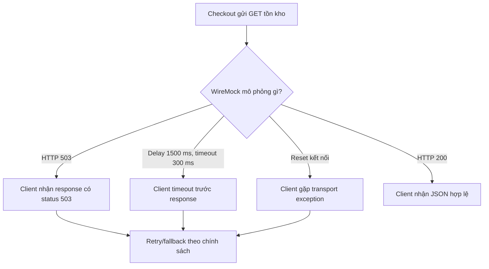

# Giả lập độ trễ, mã lỗi và kết nối gặp sự cố

Khi các microservices gọi nhau qua HTTP, lỗi không chỉ đến từ việc thay đổi **schema API**. Một producer có thể phản hồi chậm, trả `503 Service Unavailable`, giới hạn tốc độ bằng `429 Too Many Requests` hoặc ngắt kết nối trước khi gửi response. Nếu consumer chỉ được kiểm thử với `200 OK` và JSON hợp lệ, nhóm khó phát hiện lỗi trong **timeout, retry, circuit breaker, fallback và quản lý side effect**.

**WireMock** cho phép tạo một HTTP stub server có thể điều khiển các dạng hành vi này. Trong lộ trình **SPRING_CLOUD_CONTRACT**, nhóm dùng **Groovy/YAML DSL** để mô tả hợp đồng giữa **producer** và **consumer**, sinh producer tests và đóng gói stubs cho **Stub Runner**. WireMock giúp consumer kiểm tra những trường hợp lỗi bên cạnh luồng bình thường, nhưng cần phân biệt **hợp đồng HTTP do producer cam kết** với **tình huống lỗi hạ tầng được giả lập để kiểm tra khả năng chịu lỗi**.

Bài học thuộc chương **WireMock**, có chủ đề **Giả lập độ trễ, mã lỗi và kết nối gặp sự cố**. Mục tiêu là thực hành JSON mappings và Java DSL của WireMock, xác định đúng loại lỗi mà client nhận, thiết kế test có thể lặp lại, và đưa các kịch bản vào CI mà không nhầm WireMock với một công cụ mô phỏng mọi sự cố mạng.

## 1. Ba loại thất bại phải kiểm tra khác nhau

Giả sử **Checkout Service** gọi **Inventory Service** để đọc tồn kho:

```http
GET /api/inventory/SKU-42
Accept: application/json
```

Một response bình thường:

```http
HTTP/1.1 200 OK
Content-Type: application/json

{"sku":"SKU-42","available":true,"quantity":5}
```

Trong thực tế, consumer có thể gặp:

| Nhóm | Ví dụ | Có response HTTP hoàn chỉnh? | Điều cần xác minh |
|---|---|---|---|
| **Độ trễ** | Server chờ 1.500 ms mới trả `200` | Có nếu client đợi đủ lâu; không nếu timeout trước | Deadline, timeout, cancellation |
| **Mã lỗi HTTP** | `404`, `429`, `500`, `503`, `504` | **Có**, kèm status/headers/body | Error mapping, retry theo policy, fallback |
| **Lỗi kết nối** | TCP reset, response rỗng hoặc bị hỏng | Thường **không** | Xử lý transport exception và giới hạn retry |
| **Không kết nối được** | Không có listener, DNS lỗi, TLS handshake thất bại | Không | Connect timeout/refused, fail-fast và fallback |

**Điểm cốt lõi:** HTTP `504 Gateway Timeout` là **một response từ gateway/server**, trong khi client tự hết thời gian chờ có thể ném exception **mà không hề nhận `504`**. TCP reset cũng không tương đương với `503`.

### 1.1. Sơ đồ kết quả consumer nhìn thấy



Một bộ test resilience tốt kiểm tra từng nhánh với **cơ chế quan sát thích hợp**, không cố dùng chung assertion cho mọi tình huống.

## 2. Ranh giới giữa Spring Cloud Contract và WireMock

Có hai loại bằng chứng khác nhau:

- **Producer verification:** Spring Cloud Contract Verifier đọc Groovy/YAML DSL, sinh tests và chạy chúng trên **Inventory implementation thật**. Nếu contract quy định `404` hoặc `503` và body cụ thể, producer test có thể bảo vệ kỳ vọng đó với fixture thích hợp.
- **Consumer verification:** **Stub Runner** nạp các mappings từ stubs artifact, hoặc consumer test tự khởi động **WireMockServer**, để Checkout gọi API giả lập. Điều này xác minh **Checkout client** và các nhánh xử lý lỗi.

WireMock có thể tạo response/fault do test định nghĩa, không chứng minh producer thật đã từng phát ra cùng lỗi đó. Vì vậy không nên thay thế producer contract verification bằng một vài consumer WireMock tests.

| Nguồn stub | Dùng để làm gì | Lưu ý |
|---|---|---|
| Generated mapping từ Spring Cloud Contract | Consumer kiểm tra tương tác đã được thỏa thuận | Phải xác nhận producer tests chạy thật |
| WireMock JSON mapping tùy biến | Giả lập lỗi HTTP, delay hoặc fault cụ thể | Không mặc định trở thành một producer contract |
| WireMock Java DSL trong JUnit | Setup/reset tình huống riêng từng test | Chủ động quản lý server và request journal |
| Stub Runner | Tải artifact `stubs` của producer và phục vụ mapping | Không chạy controller/database của producer |

### 2.1. Không dùng DSL chưa được phiên bản hỗ trợ

Một số phiên bản Spring Cloud Contract DSL có khả năng mô tả **response delay**, nhưng **không nên giả định** mọi tính năng WireMock như `fault`, `delayDistribution`, `chunkedDribbleDelay` hoặc stateful scenario đều có cú pháp Groovy/YAML Contract DSL tương ứng.

Với những lỗi hạ tầng chưa có DSL hỗ trợ, nên viết **WireMock mapping riêng** hoặc Java DSL trong consumer resilience tests; khi cần đóng gói mapping vào stubs artifact, phải kiểm tra cơ chế packaging của plugin đang dùng.

## 3. Giả lập mã lỗi HTTP bằng JSON mapping

WireMock JSON mapping có hai phần chính: điều kiện `request` và định nghĩa `response`.

Ví dụ `503 Service Unavailable`:

```json
{
  "request": {
    "method": "GET",
    "url": "/api/inventory/SKU-42"
  },
  "response": {
    "status": 503,
    "headers": {
      "Content-Type": "application/json",
      "Retry-After": "1"
    },
    "jsonBody": {
      "code": "INVENTORY_TEMPORARILY_UNAVAILABLE",
      "message": "Please retry later"
    }
  }
}
```

Ở đây Checkout nhận **response HTTP hợp lệ**. `Retry-After: 1` dùng cú pháp số giây; client có thể dùng giá trị đó trong policy retry nhưng WireMock **không tự điều khiển hành vi retry** của client.

Ví dụ Java DSL tương đương, với `server` là một instance `WireMockServer` đã được khởi động:

```java
import static com.github.tomakehurst.wiremock.client.WireMock.*;

server.stubFor(
    get(urlEqualTo("/api/inventory/SKU-42"))
        .willReturn(aResponse()
            .withStatus(503)
            .withHeader("Content-Type", "application/json")
            .withHeader("Retry-After", "1")
            .withBody(
                "{\"code\":\"INVENTORY_TEMPORARILY_UNAVAILABLE\"}"
            ))
);
```

### 3.1. Chọn mã lỗi theo đúng giao thức

| Status | Ý nghĩa thường gặp | Hành vi client nên xem xét |
|---|---|---|
| `400 Bad Request` | Dữ liệu request sai | Không retry mù một request không đổi |
| `401 Unauthorized` | Chưa xác thực hoặc token không hợp lệ | Luồng auth/token phù hợp |
| `403 Forbidden` | Đã xác thực nhưng không đủ quyền | Hiển thị/từ chối theo chính sách |
| `404 Not Found` | Tài nguyên không tồn tại | Phân biệt lỗi nghiệp vụ và mapping không khớp |
| `409 Conflict` | Xung đột trạng thái tài nguyên | Xử lý nghiệp vụ; không mặc định retry |
| `429 Too Many Requests` | Bị rate limit | `Retry-After` và retry budget |
| `500 Internal Server Error` | Lỗi server tổng quát | Retry chỉ khi policy cho phép |
| `502 Bad Gateway` | Gateway nhận lỗi upstream | Xem chính sách proxy/retry |
| `503 Service Unavailable` | Dịch vụ tạm không phục vụ | Retry/fallback có giới hạn |
| `504 Gateway Timeout` | Gateway timeout khi chờ upstream | Có response HTTP; khác timeout tự phát ở client |

Một số lỗi có thể cần **error body có cấu trúc** để consumer đọc `code` và `message`. Nếu contract công bố `code=SKU_NOT_FOUND`, phải assert cả `code`, không chỉ status `404`.

### 3.2. Ví dụ `404` nghiệp vụ

```json
{
  "request": {
    "method": "GET",
    "url": "/api/inventory/SKU-MISSING"
  },
  "response": {
    "status": 404,
    "headers": {"Content-Type": "application/json"},
    "jsonBody": {"code": "SKU_NOT_FOUND"}
  }
}
```

Nếu một request **không khớp mapping nào**, WireMock cũng có thể trả `404` mặc định. Đó **không phải** lỗi nghiệp vụ `SKU_NOT_FOUND` của producer. Khi consumer test kiểm tra `404`, phải đối chiếu body/header mong đợi và kiểm tra request matcher.

## 4. Giả lập độ trễ cố định

Dùng thuộc tính `fixedDelayMilliseconds` trong JSON mapping:

```json
{
  "request": {
    "method": "GET",
    "url": "/api/inventory/SKU-42"
  },
  "response": {
    "status": 200,
    "headers": {"Content-Type": "application/json"},
    "jsonBody": {
      "sku": "SKU-42",
      "available": true,
      "quantity": 5
    },
    "fixedDelayMilliseconds": 1500
  }
}
```

Server **chờ khoảng 1.500 ms** trước khi gửi response. Nó **không** tự chuyển response thành `504`. Nếu client chỉ đợi tối đa `300 ms`, request có thể thất bại ở phía client vì **timeout**.

Java DSL:

```java
server.stubFor(
    get(urlEqualTo("/api/inventory/SKU-42"))
        .willReturn(aResponse()
            .withStatus(200)
            .withHeader("Content-Type", "application/json")
            .withBody("{\"sku\":\"SKU-42\",\"quantity\":5}")
            .withFixedDelay(1500))
);
```

### 4.1. Tại sao dùng fixed delay thay vì random delay?

Giả sử client timeout ở `500 ms` và stub delay `505 ms`. Độ dao động scheduling trên máy CI có thể khiến kết quả lúc thành công lúc timeout. Một khoảng cách rõ như **1.500 ms so với 300 ms** làm test dễ tái hiện hơn.

| Tham số | Cấu hình bài tập |
|---|---|
| WireMock delay | 1.500 ms |
| Request timeout client | 300 ms |
| Kỳ vọng | Client timeout/fallback |
| Tránh assert | Tổng thời gian test **chính xác 300 ms** |

Một số bản WireMock còn có **delay distribution** và **chunked dribble delay** để gửi response dần theo các chunk. Những khả năng này hữu ích để khảo sát resilience nhưng có thể làm test thiếu tính quyết định. Với CI hợp đồng, ưu tiên độ trễ cố định; khi dùng các phương thức nâng cao, xác minh JSON schema/Java API theo **WireMock version** dự án đã ghim.

### 4.2. Delay không đồng nghĩa với tải lớn

Một response chậm do fixed delay không chứng minh server đang chịu CPU/memory load, nghẽn DB hoặc network congestion thật. WireMock chỉ kiểm soát thời điểm response. Nếu cần kiểm tra giới hạn throughput, head-of-line blocking hay queue saturation, phải bổ sung performance/chaos tests phù hợp.

## 5. Mô phỏng sự cố kết nối bằng `fault`

WireMock có thể tạo một số **network faults** ở mức HTTP stub server. Ví dụ mapping reset kết nối:

```json
{
  "request": {
    "method": "GET",
    "url": "/api/inventory/SKU-42"
  },
  "response": {
    "fault": "CONNECTION_RESET_BY_PEER"
  }
}
```

Khác với `503`, trường hợp này thường **không trả một response HTTP hoàn chỉnh**. Client có thể nhận một exception do tầng transport phát hiện, thay vì object response có `statusCode`.

Java DSL:

```java
import com.github.tomakehurst.wiremock.http.Fault;

server.stubFor(
    get(urlEqualTo("/api/inventory/SKU-42"))
        .willReturn(aResponse()
            .withFault(Fault.CONNECTION_RESET_BY_PEER))
);
```

### 5.1. Những fault có thể gặp

| Fault | Ý nghĩa mô phỏng | Điều cần kiểm tra |
|---|---|---|
| `EMPTY_RESPONSE` | Đóng kết nối mà không gửi response hợp lệ | Client không coi là `200`/JSON rỗng |
| `CONNECTION_RESET_BY_PEER` | Reset kết nối khi phục vụ request | Nhánh transport exception/retry policy |
| `MALFORMED_RESPONSE_CHUNK` | Gửi response chunk không hợp lệ | Client phát hiện lỗi framing/parse |
| `RANDOM_DATA_THEN_CLOSE` | Gửi dữ liệu không hợp lệ rồi đóng kết nối | Không deserialize thành dữ liệu nghiệp vụ |

Tên fault và chi tiết thực thi phụ thuộc phiên bản WireMock, HTTP client và transport. Không assert cố định thông báo `"Connection reset by peer"` nếu test chạy trên nhiều JDK/OS. Hãy kiểm tra **loại lỗi được client quy đổi** và outcome nghiệp vụ.

### 5.2. WireMock không phải trình giả lập mạng đầy đủ

WireMock fault **không chứng minh** hành vi dưới các sự cố như:

- DNS không phân giải tên miền.
- TLS certificate không hợp lệ hoặc handshake lỗi.
- Firewall chặn gói tin vô thời hạn.
- Network partition giữa vùng địa lý hoặc cluster.
- Packet loss, latency jitter hoặc TCP congestion ở cấp hệ điều hành.
- Load balancer/proxy với nhiều tầng timeout và retry.

Với những mục tiêu này, nên sử dụng network fault proxy, môi trường tích hợp hoặc chaos engineering phù hợp. WireMock chủ yếu dùng để kiểm tra **client xử lý những response/transport anomalies đã cấu hình**.

## 6. Phân biệt các loại timeout

Các HTTP clients có thể có nhiều deadline độc lập:

| Timeout | Phạm vi | Tình huống mô phỏng |
|---|---|---|
| **Connect timeout** | Chờ thiết lập kết nối | Server không truy cập được hoặc network fault tool |
| **Response/read timeout** | Chờ server gửi dữ liệu | WireMock `fixedDelayMilliseconds` |
| **Per-request timeout** | Tổng thời gian một HTTP request | Client request deadline + delay |
| **Total operation deadline** | Gồm retries, backoff và downstream calls | Kiểm tra ở tầng business/service |
| **Gateway timeout** | Gateway đã chờ upstream quá lâu | WireMock trả HTTP `504` để mô phỏng response gateway |

Nếu Checkout dùng Spring `WebClient`, một HTTP status lỗi có thể đi qua `onStatus(...)` hoặc `WebClientResponseException` tùy API gọi. Timeout/reset có thể đi qua nhánh exception khác. Với `RestTemplate`, OpenFeign hay Java `HttpClient`, loại exception cụ thể còn khác.

Không viết mọi test với cùng một `catch (HttpStatusException)` nếu tình huống có thể **không có response status nào**.

## 7. Spring Cloud Contract DSL cho lỗi HTTP được producer cam kết

Khi producer thực sự công bố response `503` cho một trường hợp cụ thể, có thể diễn đạt bằng Groovy DSL:

```groovy
import org.springframework.cloud.contract.spec.Contract

Contract.make {
    name 'checkout_get_inventory_unavailable_503'

    request {
        method GET()
        url '/api/inventory/SKU-UNAVAILABLE'
        headers {
            header 'Accept', 'application/json'
        }
    }

    response {
        status 503
        headers {
            contentType(applicationJson())
            header 'Retry-After', '1'
        }
        body(
            code: 'INVENTORY_TEMPORARILY_UNAVAILABLE'
        )
    }
}
```

YAML DSL tương đương:

```yaml
name: checkout_get_inventory_unavailable_503
request:
  method: GET
  url: /api/inventory/SKU-UNAVAILABLE
  headers:
    Accept: application/json
response:
  status: 503
  headers:
    Content-Type: application/json
    Retry-After: '1'
  body:
    code: INVENTORY_TEMPORARILY_UNAVAILABLE
```

**Chỉ dùng một DSL nguồn** cho cùng kịch bản trong bộ hợp đồng producer. Generated producer test cần chạy trên implementation thật với fixture khiến `SKU-UNAVAILABLE` trả `503` đúng như đã thỏa thuận. Nếu Inventory không có hành vi đó, không nên viết một producer contract `503` giả để phục vụ resilience test; hãy dùng một **WireMock mapping riêng**.

### 7.1. Delay/fault chưa chắc là DSL được hỗ trợ

Một số bản Spring Cloud Contract có mô tả độ trễ response trong DSL, nhưng **không mặc định** có `fault: CONNECTION_RESET_BY_PEER` trong YAML Contract DSL hoặc các matcher dành cho WireMock fault.

Khi cần mô phỏng TCP reset:

1. Dùng WireMock JSON mapping hoặc Java DSL ở consumer test.
2. Nếu cần đưa mapping vào stubs JAR, xác minh build plugin thu thập và đóng gói custom mapping đúng đường dẫn.
3. Xem mapping được Stub Runner nạp **thực tế**.
4. Tránh tình trạng generated mapping và custom fault mapping có cùng request matcher nhưng response trái nhau.
5. Gắn nhãn bài test là **resilience test**, không coi nó là bằng chứng producer có thể tự gây reset kết nối.

## 8. Ví dụ JUnit đầy đủ với `WireMockServer` trên cổng động

Đoạn test sau chứng minh sự khác nhau giữa **nhận response `503`** và **request timeout**. Nó sử dụng Java `HttpClient` để ví dụ gọn và có thể thực thi khi project có JDK 11+, JUnit Jupiter và WireMock Core tương thích.

```java
import com.github.tomakehurst.wiremock.WireMockServer;
import org.junit.jupiter.api.AfterAll;
import org.junit.jupiter.api.BeforeAll;
import org.junit.jupiter.api.BeforeEach;
import org.junit.jupiter.api.Test;

import java.net.URI;
import java.net.http.HttpClient;
import java.net.http.HttpRequest;
import java.net.http.HttpResponse;
import java.net.http.HttpTimeoutException;
import java.time.Duration;

import static com.github.tomakehurst.wiremock.client.WireMock.*;
import static com.github.tomakehurst.wiremock.core.WireMockConfiguration.*;
import static org.junit.jupiter.api.Assertions.*;

class InventoryWireMockTest {

    private static WireMockServer server;
    private static HttpClient client;

    @BeforeAll
    static void start() {
        server = new WireMockServer(wireMockConfig().dynamicPort());
        server.start();
        client = HttpClient.newBuilder()
            .connectTimeout(Duration.ofSeconds(2))
            .build();
    }

    @AfterAll
    static void stop() {
        if (server != null) server.stop();
    }

    @BeforeEach
    void reset() {
        server.resetAll();
    }

    private HttpRequest request(Duration timeout) {
        return HttpRequest.newBuilder()
            .uri(URI.create(server.baseUrl() + "/api/inventory/SKU-42"))
            .timeout(timeout)
            .GET()
            .build();
    }

    @Test
    void receivesServiceUnavailable() throws Exception {
        server.stubFor(
            get(urlEqualTo("/api/inventory/SKU-42"))
                .willReturn(aResponse()
                    .withStatus(503)
                    .withHeader("Content-Type", "application/json")
                    .withHeader("Retry-After", "1")
                    .withBody("{\"code\":\"TEMPORARILY_UNAVAILABLE\"}"))
        );

        HttpResponse<String> response = client.send(
            request(Duration.ofSeconds(3)),
            HttpResponse.BodyHandlers.ofString()
        );

        assertEquals(503, response.statusCode());
        assertTrue(response.body().contains("TEMPORARILY_UNAVAILABLE"));
        assertEquals("1",
            response.headers().firstValue("Retry-After").orElse(null));
    }

    @Test
    void timesOutBeforeSlowResponse() {
        server.stubFor(
            get(urlEqualTo("/api/inventory/SKU-42"))
                .willReturn(aResponse()
                    .withStatus(200)
                    .withBody("{\"sku\":\"SKU-42\",\"quantity\":5}")
                    .withFixedDelay(1500))
        );

        assertThrows(HttpTimeoutException.class, () ->
            client.send(
                request(Duration.ofMillis(300)),
                HttpResponse.BodyHandlers.ofString()
            )
        );
    }
}
```

**Giới hạn ví dụ:** đoạn này kiểm tra Java `HttpClient` dùng trong test, **không tự chứng minh InventoryClient thật của Checkout hoạt động đúng**. Để kiểm tra consumer, hãy tạo hoặc inject **chính HTTP client/adapter mà Checkout sử dụng**, trỏ base URL vào `server.baseUrl()` rồi assert retry/fallback và cách trả lỗi ở tầng ứng dụng.

### 8.1. Vì sao phải reset?

`server.resetAll()` thường xóa mappings, request journal và scenario state của WireMock server trong phạm vi reset toàn bộ. Mỗi test sau đó **đăng ký lại mapping** của kịch bản mình. Điều này giúp test chạy riêng hay cả suite không phụ thuộc các mapping trước đó.

Nếu dùng Stub Runner đã nạp mappings từ stubs JAR, **không nên gọi reset-all lên server đó** rồi cho rằng mappings vẫn tồn tại. Cần reset theo API/lifecycle thích hợp hoặc sử dụng WireMockServer riêng cho resilience tests.

### 8.2. Dùng cổng động

`wireMockConfig().dynamicPort()` giúp tránh trùng cổng khi nhiều CI jobs chạy trên cùng máy. Với consumer client dùng dependency injection, phải cấu hình base URL **sau khi biết port WireMock thực sự sử dụng** hoặc dùng cách Spring Test hỗ trợ đưa port vào properties.

Không hard-code `localhost:8080` trong test song song và không vô tình gửi HTTP request tới producer production.

## 9. Test connection reset ở phía consumer

Trong một test mới, đăng ký:

```java
import com.github.tomakehurst.wiremock.http.Fault;

server.stubFor(
    get(urlEqualTo("/api/inventory/SKU-42"))
        .willReturn(aResponse()
            .withFault(Fault.CONNECTION_RESET_BY_PEER))
);
```

Khi gọi qua InventoryClient thật, test cần xác minh:

1. Lỗi được nhận diện là **transport failure** (hoặc được adapter quy đổi đúng).
2. Không đọc status/body từ một HTTP response **không tồn tại**.
3. Retry chỉ xảy ra khi policy và HTTP method cho phép.
4. Fallback không che mất lỗi nghiệp vụ quan trọng.
5. Tổng thời gian thực thi có giới hạn.
6. Logging không làm lộ token, cookie hoặc thông tin cá nhân.

Đừng cố assert đúng một exception message cụ thể trên mọi JDK/OS/HTTP stack. Nếu client bọc lỗi thành exception nghiệp vụ riêng, hãy kiểm tra kiểu và nội dung **được API nội bộ Checkout công bố**, còn nguyên nhân gốc có thể được kiểm tra linh hoạt hơn.

### 9.1. Connection refused khác connection reset

- **Reset**: peer ngắt kết nối bất thường. WireMock có thể phát một fault tương ứng.
- **Refused**: không có tiến trình nhận kết nối ở endpoint, thường không có HTTP server để mapping một response.

Muốn kiểm thử refused, dùng endpoint test được bảo đảm không có listener hoặc một proxy fault injection điều khiển kết nối. Không giả định một cổng số cố định luôn trống trên mọi máy CI.

## 10. Dùng WireMock scenario: lỗi một lần rồi phục hồi

Một client có thể retry `GET` sau `503` rồi thành công. WireMock **stateful scenarios** cho phép mô tả response của lần gọi đầu khác lần tiếp theo.

```java
import static com.github.tomakehurst.wiremock.stubbing.Scenario.STARTED;

server.stubFor(
    get(urlEqualTo("/api/inventory/SKU-42"))
        .inScenario("inventory-transient-failure")
        .whenScenarioStateIs(STARTED)
        .willReturn(aResponse().withStatus(503))
        .willSetStateTo("RECOVERED")
);

server.stubFor(
    get(urlEqualTo("/api/inventory/SKU-42"))
        .inScenario("inventory-transient-failure")
        .whenScenarioStateIs("RECOVERED")
        .willReturn(aResponse()
            .withStatus(200)
            .withHeader("Content-Type", "application/json")
            .withBody("{\"sku\":\"SKU-42\",\"quantity\":5}"))
);
```

Một kịch bản consumer đúng:

1. Checkout gọi Inventory lần đầu → nhận `503`.
2. Client thực hiện policy retry/backoff.
3. Lần thứ hai → nhận `200`.
4. Client hoàn tất và không gọi lần thứ ba.
5. Test assert kết quả cuối cùng và số attempts.

Kiểm tra request journal:

```java
server.verify(
    2,
    getRequestedFor(urlEqualTo("/api/inventory/SKU-42"))
);
```

**WireMock không tự retry.** Nó chỉ phản hồi theo trạng thái scenario; retry phải do **client hoặc resilience layer** thực hiện. Test dùng `verify(2)` sẽ phát hiện trường hợp client không retry hoặc retry quá số lần mong đợi.

### 10.1. Reset scenario giữa các bài test

Một scenario có `STARTED` và `RECOVERED`. Nếu test B dùng cùng server và trạng thái không reset sau test A, lần gọi đầu của B có thể nhận `200` ngay.

Một số bản WireMock hỗ trợ **reset scenario state** nhưng giữ mappings; `resetAll()` rộng hơn và có thể xóa các definitions. Khi cần kiểm tra nhiều test stateful, hãy thiết kế lifecycle rõ ràng:

- Server riêng theo test/suite.
- Reset state vào thời điểm xác định.
- Đăng ký lại mappings sau reset toàn bộ.
- Không để hai test parallel cùng sửa một scenario chung.

## 11. Retry policy, idempotency và rủi ro tạo side effect trùng

Retry không phải lúc nào cũng đúng.

| Tình huống | Có nên retry? | Ghi chú |
|---|---|---|
| `GET` trả `503` tạm thời | Có thể | Có giới hạn attempts và deadline |
| `GET` bị connection reset | Có thể | Theo chính sách client |
| `400` do request không hợp lệ | Thường không | Retry nguyên dữ liệu khó giải quyết |
| `401` do token sai | Không retry mù | Xử lý xác thực |
| `429` | Có thể | Tôn trọng `Retry-After` theo policy |
| `POST` tạo đơn bị mất response | **Rất cẩn trọng** | Server có thể đã tạo đơn |
| Lỗi validation mang ý nghĩa nghiệp vụ | Thường không | Cần sửa input hoặc hướng người dùng |

Ví dụ một `POST /api/orders` có thể **đã ghi DB** nhưng kết nối bị reset trước khi client đọc `201`. Retry không có idempotency có thể tạo đơn hàng thứ hai.

Với request ghi dữ liệu, cần thỏa thuận và kiểm thử:

- `Idempotency-Key` hoặc cơ chế dedup.
- Cách producer lưu và nhận diện request lặp.
- Timeout/retry budget.
- Side effects sau khi retry.
- Error/fallback có thể truy vết mà không làm mất giao dịch.

Một WireMock scenario trả `503` rồi `200` **không chứng minh** DB của producer thật xử lý idempotency đúng; cần integration test chuyên biệt.

## 12. Deadline tổng, backoff và circuit breaker

Một test resilience không chỉ kiểm tra status cuối:

| Tiêu chí | Câu hỏi |
|---|---|
| **Retryable status** | Chỉ retry `503/429` hoặc nhóm được chỉ định? |
| **Max attempts** | Có dừng sau số lần thử cho phép? |
| **Backoff** | Có chờ hợp lý giữa các lần gọi không? |
| **Jitter** | Có cần tránh các client retry đồng loạt không? |
| **Request timeout** | Mỗi attempt có deadline không? |
| **Total deadline** | Bao gồm cả retry và backoff có vượt SLA không? |
| **Circuit breaker** | Khi lỗi liên tục, client có ngừng gọi upstream theo policy? |
| **Fallback** | Có trả kết quả/exception an toàn cho nghiệp vụ? |
| **Observability** | Có metric/log/trace phân loại `503`, timeout và reset? |

Đừng assert thời gian thực chính xác ở mức mili giây. Scheduling và tải máy CI khác nhau. Khi cần kiểm tra backoff hoặc circuit breaker state, có thể test riêng với **virtual scheduler/test clock** hoặc công cụ phù hợp của thư viện resilience, rồi dùng WireMock integration test để chứng minh client có gửi đúng số request.

## 13. Dùng WireMock với Spring Boot test

Một số phiên bản Spring Cloud Contract có tích hợp annotation `@AutoConfigureWireMock`. Ví dụ cấu trúc:

```java
import org.springframework.boot.test.context.SpringBootTest;
import org.springframework.cloud.contract.wiremock.AutoConfigureWireMock;

@SpringBootTest
@AutoConfigureWireMock(port = 0)
class CheckoutWireMockIntegrationTest {
    // Stub server được tạo với port động.
    // Cấu hình InventoryClient đến port của WireMock.
}
```

Trong những bản hỗ trợ, port được chọn thường có trong property `wiremock.server.port`. Một test property ứng dụng có thể tham chiếu tên này để tạo base URL cho InventoryClient.

**Quan trọng:**

- `@AutoConfigureWireMock` có lifecycle và cách tìm JSON mappings riêng.
- **Stub Runner** tải stubs artifact từ repository/classpath và có lifecycle riêng.
- Không giả định hai công cụ dùng chung một server hoặc một port khi thêm cả hai vào test.
- Khi cần fault/delay cụ thể cho một test, WireMockServer riêng với setup/reset rõ thường dễ kiểm soát hơn.

### 13.1. Các JSON mappings viết tay

Một bố cục consumer test có thể là:

```text
checkout-service/
└── src/test/
    ├── java/
    │   └── .../InventoryResilienceTest.java
    └── resources/
        └── wiremock/
            └── mappings/
                ├── inventory_503.json
                ├── slow_inventory.json
                └── reset_connection.json
```

Đường dẫn trên là ví dụ tổ chức resource **của project**, không bảo đảm `@AutoConfigureWireMock` tự tìm mọi file đó. Cần cấu hình `stubs`/classpath path đúng phiên bản hoặc dùng Java DSL đăng ký trực tiếp.

**Không nạp đồng thời** ba mapping cùng khớp `GET /api/inventory/SKU-42` trong một test không có scenario/priority phân biệt. Test cần biết rõ request sẽ nhận response nào.

## 14. Tránh mapping chồng lấn và `404` giả

Ví dụ ba mapping cùng request:

```text
GET /api/inventory/SKU-42 -> 200
GET /api/inventory/SKU-42 -> 503
GET /api/inventory/SKU-42 -> CONNECTION_RESET_BY_PEER
```

Nếu được đăng ký cùng lúc với điều kiện request giống nhau, WireMock có thể chọn một mapping khác kỳ vọng. WireMock có **priority** (giá trị số nhỏ hơn thường có ưu tiên cao hơn) và **scenarios**, nhưng với test độc lập cách đơn giản hơn là:

1. Reset server.
2. Đăng ký đúng **một mapping** cho kịch bản.
3. Gửi request qua client thật.
4. Kiểm tra outcome và request journal.

Khi cần nhiều mappings đồng thời, phân biệt bằng method/path/query/header/body hoặc scenario state có chủ đích.

### 14.1. Matcher quá rộng

Một mapping có `urlPattern` khớp mọi `/api/inventory/.*` có thể vô tình trả response cho SKU sai. Một consumer test vẫn xanh dù InventoryClient gửi sai path.

Hãy match đúng method/path và những headers liên quan. Với authentication contract, cần kiểm tra header cần thiết nhưng không chứa **token production** trong test resources.

### 14.2. `404` từ WireMock chưa chắc do API thật

Khi WireMock trả `404`, cần kiểm tra:

- Đúng server và port chưa?
- Stub mapping đã được nạp?
- Method/path/query/header/body matchers có khớp request?
- Đây là `404` mặc định vì unmatched request hay `404` với body `SKU_NOT_FOUND`?
- Có đang gọi nhầm stub server được khởi tạo bởi Stub Runner?

Không sửa controller của producer khi lỗi nằm ở việc client test gửi sai URL vào một WireMock server.

## 15. Kiểm tra request journal và bảo mật dữ liệu

WireMock ghi nhận các request để hỗ trợ verification. Với retry test:

```java
server.verify(
    2,
    getRequestedFor(urlEqualTo("/api/inventory/SKU-42"))
);
```

Việc đếm request giúp khẳng định số attempts, nhưng request journal có thể chứa header `Authorization`, cookies hoặc payload nhạy cảm.

Thực hành tốt:

- Dùng dữ liệu fixture giả.
- Không commit token, password, private key hoặc PII thật vào mappings.
- Không dump nguyên request journal chứa secrets lên CI log.
- Xóa journal giữa các tests trước khi đếm requests.
- Dùng correlation ID riêng khi test nhiều request song song.
- Chỉ log metadata cần thiết: status, attempt count, timeout classification, contract name.

## 16. Tại sao test WireMock có thể flaky?

| Nguyên nhân | Biểu hiện | Hướng xử lý |
|---|---|---|
| Fixed delay quá gần timeout | Lúc thành công lúc timeout | Tăng khoảng cách |
| Không reset mappings | Fault từ test A ảnh hưởng test B | Reset và đăng ký lại |
| Scenario state còn sót | Lần đầu đã trả `200` | Reset state/scenario |
| Journal còn requests cũ | `verify(2)` thành `verify(4)` | Reset request journal |
| Port cố định bị chiếm | Server không khởi động hoặc gọi nhầm | Dynamic port |
| HTTP client dùng connection pool cũ | Test dùng connection bất thường | Quản lý lifecycle client/pool |
| Retry/background task còn chạy | Request của test trước đến muộn | Chờ completion, hủy đúng cách |
| Stub Runner lấy artifact cũ | Response không khớp source mới | Ghim và kiểm tra version/cache |
| Test chạy song song trên cùng server | Mappings/state bị test khác sửa | Server riêng hoặc đồng bộ phù hợp |
| JSON mapping không được nạp | Mọi request `404` | Kiểm tra resource path và logs |

Không dùng `Thread.sleep` mù để thay thế chờ theo điều kiện. Retry đến khi test xanh cũng không giải quyết nguyên nhân test không lặp lại được.

## 17. Thực hành: Checkout chịu được Inventory lỗi

Bối cảnh: Checkout có HTTP client gọi `GET /api/inventory/SKU-42`. Chính sách thử nghiệm:

- `200`: parse `sku/quantity`.
- `404`: phân biệt `SKU_NOT_FOUND`.
- `429`: tôn trọng quy tắc rate limit đã công bố.
- `503`: retry tổng cộng tối đa hai attempts rồi fallback.
- Response timeout: request không chờ vô hạn.
- Connection reset: xử lý như lỗi transport, không giả định có status.

### Giai đoạn A — chuẩn bị test

1. Khởi động `WireMockServer` trên dynamic port.
2. Trỏ **InventoryClient thật** của Checkout đến `server.baseUrl()`.
3. Reset mappings, scenarios và journal trước từng test.
4. Xác minh client không gọi Inventory production.

### Giai đoạn B — HTTP status

1. Tạo mapping `200` và kiểm tra parse thành công.
2. Tạo `404 SKU_NOT_FOUND`, kiểm tra error mapping.
3. Tạo `429` với `Retry-After`, kiểm tra rate-limit policy.
4. Tạo `503 INVENTORY_TEMPORARILY_UNAVAILABLE`, kiểm tra retry/fallback.
5. Tạo `504` rồi so sánh với client request timeout.

### Giai đoạn C — độ trễ

1. Đăng ký `withFixedDelay(1500)` với response `200`.
2. Đặt timeout client khoảng `300 ms` trong test.
3. Kiểm tra client timeout, fallback/cancellation đúng.
4. Nới timeout đủ dài để xác nhận nhận được response `200`.
5. Không assert thời gian thực chính xác từng mili giây.

### Giai đoạn D — transport fault

1. Dùng `Fault.CONNECTION_RESET_BY_PEER`.
2. Gọi qua InventoryClient thật.
3. Assert client không cố đọc JSON body không tồn tại.
4. Kiểm tra retry budget và phân loại lỗi.
5. Kiểm tra log không lộ secret.

### Giai đoạn E — retry rồi phục hồi

1. Tạo scenario lần đầu `503`, lần hai `200`.
2. Gọi từ tầng Checkout một lần.
3. Kiểm tra kết quả cuối thành công.
4. Dùng `verify(2, ...)` đếm HTTP attempts.
5. Reset scenario trước bài test khác.

### Giai đoạn F — Spring Cloud Contract và CI

1. Giữ hợp đồng Groovy/YAML chính thức cho status, headers và body mà Inventory **thực sự cam kết**.
2. Chạy generated producer contract tests trên Inventory thật.
3. Đóng gói và publish stubs artifact đã verified.
4. Checkout dùng Stub Runner với đúng artifact/version cho các consumer contract tests.
5. Chạy thêm nhóm WireMock resilience tests kiểm tra delay/fault.
6. Đưa reports, test timeout, retry count và artifact provenance vào CI.

**Tiêu chí hoàn thành:** Checkout phân biệt đúng HTTP error, timeout và transport failure; retry không vượt giới hạn; tests chạy lặp lại được; producer verification và consumer Stub Runner tests vẫn kiểm tra hợp đồng thật.

## 18. Checklist trước khi đưa vào CI

- [ ] Version WireMock, Spring Cloud Contract, Boot và HTTP client tương thích.
- [ ] Test dùng dynamic port hoặc có cơ chế chống trùng port.
- [ ] Consumer test sử dụng **client thật**.
- [ ] Mỗi fault/delay mapping được chọn đúng request.
- [ ] Test `503`/`429` kiểm tra status/headers/body, không nhầm với exception.
- [ ] Delay lớn hơn deadline đủ rõ, không cần đo chính xác từng mili giây.
- [ ] Connection reset không bị kiểm tra như HTTP `500`.
- [ ] Stateful scenarios được reset.
- [ ] Request journal được reset trước `verify(...)`.
- [ ] Retry attempts, fallback và total deadline được kiểm tra.
- [ ] POST/side-effect requests có giải pháp idempotency nếu có retry.
- [ ] Không có token thật/PII trong mappings hay logs.
- [ ] Stub Runner dùng artifact/version hợp lệ.
- [ ] Generated producer tests **thực sự chạy** trước publish.
- [ ] Network faults ngoài khả năng WireMock có integration tests riêng.

## 19. Những ngộ nhận phổ biến

**“`504` nghĩa là client đã timeout.”** Không. `504` là HTTP response của gateway; client timeout thường là exception không có HTTP response.

**“`503` giống connection reset.”** Không. Với `503` client đọc status/body; với reset client có thể không nhận response.

**“WireMock tự retry một request khi trả `503`.”** Không. Retry phải do client thực hiện; WireMock chỉ phục vụ response.

**“Dùng fixed delay 500 ms và timeout 500 ms là test chính xác.”** Không. Điều kiện quá sát ngưỡng dễ flaky do scheduling.

**“Một mapping JSON có `fault` cũng là Spring Cloud Contract YAML DSL.”** Không. Hai định dạng/schema khác nhau; chỉ dùng tính năng mà đúng phiên bản hỗ trợ.

**“`resetAll` chỉ reset số request.”** Không nên giả định. Reset toàn bộ có thể xóa cả mappings/scenarios, vì vậy phải đăng ký lại.

**“Stub Runner test xanh chứng minh producer thật chịu được lỗi mạng.”** Không. Stub mô phỏng; producer verification và integration/network testing có phạm vi khác.

**“Retry mọi POST sẽ an toàn.”** Không. Nếu side effect đã xảy ra trước khi kết nối hỏng, retry có thể gây duplicate.

**“Một test dùng Java HttpClient minh họa chứng minh Checkout client hoạt động đúng.”** Không. Cần kiểm tra actual consumer adapter.

## 20. Câu hỏi tự kiểm tra

1. **Ba nhóm sự cố trong bài là gì?** Độ trễ, HTTP error status và lỗi transport/kết nối.
2. **`fixedDelayMilliseconds` và `withFixedDelay` khác gì?** Một là JSON mapping, một là Java DSL, cùng mục đích thêm độ trễ.
3. **WireMock fixed delay có tự sinh `504` không?** Không.
4. **HTTP `503` có status/body không?** Có, theo response định nghĩa.
5. **Connection reset có đảm bảo client đọc được status không?** Không.
6. **`Retry-After: 1` diễn đạt gì?** Khoảng thời gian gợi ý một giây trước khi thử lại, nếu client dùng chính sách đó.
7. **Vì sao timeout test cần độ trễ lớn hơn deadline rõ rệt?** Để tránh flaky.
8. **WireMock có mô phỏng hoàn chỉnh DNS/TLS/packet loss không?** Không.
9. **`Fault.CONNECTION_RESET_BY_PEER` kiểm tra gì?** Phản ứng client trước kết nối bị reset.
10. **Stateful scenario có thể mô phỏng gì?** Lần gọi đầu `503`, lần sau `200`.
11. **Ai thực hiện retry?** Client hoặc resilience layer, không phải WireMock.
12. **`server.verify(2, ...)` giúp gì?** Kiểm tra số request thực tế.
13. **Tại sao phải reset scenario giữa các tests?** Để bài sau không thừa hưởng state `RECOVERED`.
14. **`404` mặc định của WireMock khác `SKU_NOT_FOUND` thế nào?** Một bên do unmatched request; bên kia là body lỗi nghiệp vụ theo mapping.
15. **Vì sao không tự thêm `fault` vào YAML Contract DSL?** Chưa chắc phiên bản Contract Verifier hỗ trợ.
16. **Spring Cloud Contract producer tests cần chạy trên gì?** Implementation thật của producer cùng fixture phù hợp.
17. **Stub Runner có chạy Inventory Service thật không?** Không; nó phục vụ stubs.
18. **Vì sao retry POST có nguy cơ?** Side effect có thể đã xảy ra trước khi mất response.
19. **Khi nào cần network chaos test ngoài WireMock?** Khi kiểm tra DNS, TLS, packet loss hoặc network partition.
20. **Bộ CI tốt nên có những nhóm test nào?** Producer contract verification, consumer Stub Runner tests, WireMock resilience tests và integration tests khi cần.

## 21. Tài liệu tham khảo theo phiên bản

Khi áp dụng ví dụ, hãy xác minh APIs của **WireMock 2/3** và tích hợp **Spring Cloud Contract** dự án đang dùng. Schema mappings, cách setup server, annotation và cách nạp custom mappings có thể khác giữa các bản.

- [WireMock — Simulating Latency](https://wiremock.org/docs/simulating-latency/)
- [WireMock — Simulating Faults](https://wiremock.org/docs/simulating-faults/)
- [WireMock — Stateful Behaviour](https://wiremock.org/docs/stateful-behaviour/)
- [WireMock — Stubbing](https://wiremock.org/docs/stubbing/)
- [Spring Cloud Contract — Reference](https://docs.spring.io/spring-cloud-contract/reference/)

Các trang này là điểm xuất phát để đối chiếu cú pháp của **version đã ghim**, không thay thế việc xem generated producer tests, WireMock mappings và test reports.

## Kết luận

**WireMock giúp chủ động kiểm tra ba kiểu thất bại quan trọng khi consumer gọi API: HTTP status lỗi, response chậm và kết nối bị hỏng.** Mỗi kiểu đòi cách assert khác: `503` là một response hợp lệ, fixed delay có thể khiến **client timeout**, còn TCP reset có thể tạo **transport exception mà không có HTTP status**. JSON mappings, Java DSL, stateful scenarios, dynamic ports và request journal giúp xây dựng các bài test có thể tái lập để kiểm chứng retry, fallback và timeout budget.

Trong **Spring Cloud Contract**, hãy giữ Groovy/YAML contracts cho **những cam kết API thực sự được producer đáp ứng**, trong khi fault/delay chưa được DSL hỗ trợ hoặc mang tính hạ tầng nên được kiểm tra bằng **WireMock resilience tests** riêng. Khi generated producer tests, consumer tests qua **Stub Runner** và CI release gate đều chạy đúng phạm vi, nhóm có thể phát hiện thay đổi API không tương thích và lỗi xử lý sự cố của client mà không nhầm một stub giả lập với hệ thống mạng thực.
