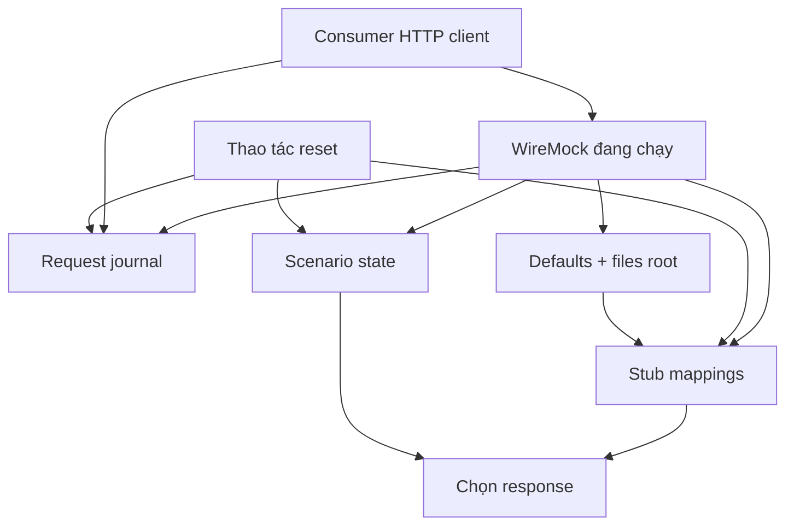
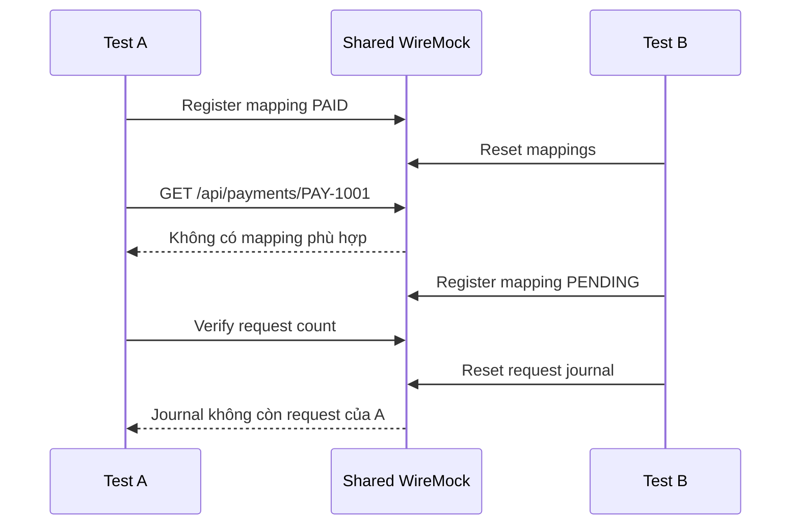
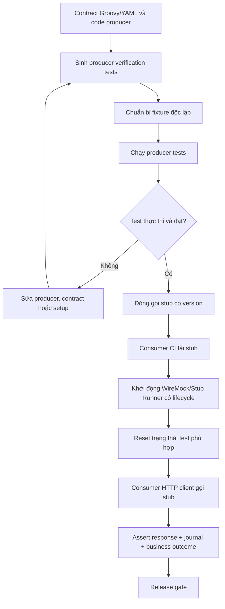

# Reset mapping, request journal và vòng đời giữa các test

## 1. Vấn đề: một test xanh có thể làm test tiếp theo thất bại

Giả sử `checkout-service` dùng HTTP client gọi `payment-service`. Trong kiểm thử tích hợp, nhóm dùng **WireMock** thay cho Payment thật để trả dữ liệu thanh toán giả định. Test thứ nhất thêm một stub cho `GET /api/payments/PAY-1001` với trạng thái `PAID`; test thứ hai muốn cùng URL trả `PENDING`. Nếu cả hai test sử dụng chung một WireMock server nhưng không dọn trạng thái, test thứ hai có thể nhận dữ liệu của test trước, hoặc ghi nhận sai số request do **request journal** còn giữ các lần gọi cũ.

Vấn đề càng khó phát hiện khi chạy song song: cùng một HTTP client có thể gọi đúng server nhưng response thay đổi theo thứ tự đăng ký mapping, còn câu lệnh xác minh “đã gửi đúng một POST” có thể đếm cả request của test khác.

Trong **Spring Cloud Contract**, hợp đồng HTTP hoặc thông điệp được viết bằng **Groovy/YAML DSL**, Verifier sinh test kiểm tra producer, các stub được đóng gói để consumer chạy qua **Stub Runner** và CI dùng cả hai phía để phát hiện thay đổi API không tương thích. WireMock là thành phần thường được dùng để mô phỏng HTTP phía consumer hoặc một phụ thuộc outbound của producer. Vì vậy, quản lý **trạng thái và vòng đời WireMock** là điều kiện để kiểm thử hợp đồng đáng tin cậy.

Trong bài này, ta sẽ:

- Phân biệt **stub mappings**, **request journal**, **scenario state**, **file-based default mappings** và **vòng đời server**.
- Chọn thao tác reset đúng mức: chỉ dọn request, chỉ dọn mappings, nạp lại defaults hoặc reset toàn bộ.
- Tổ chức các test bằng **WireMock JUnit Jupiter extension** và **`@AutoConfigureWireMock`** của Spring Cloud Contract.
- Xác minh request mà không bị nhiễu từ test khác.
- Tránh xóa mappings do Stub Runner nạp, chạy sai cổng hoặc tạo trạng thái chung trong CI.

**Nguyên tắc chính:** reset không phải “một lệnh dọn sạch mọi thứ rồi hy vọng test chạy”. Cần biết **đang xóa trạng thái nào**, **trạng thái nào phải còn nguyên** và **ai chịu trách nhiệm tạo lại dữ liệu trước test**.

## 2. Bốn loại trạng thái cần quản lý

| Thành phần | Chứa gì? | Nếu bị giữ lại giữa test |
| --- | --- | --- |
| **Stub mappings** | Quy tắc khớp method, URL, headers/body và response tương ứng. | Test sau nhận nhầm response, mapping cũ che mapping mới. |
| **Request journal** | Bản ghi những request WireMock đã nhận, bao gồm request không khớp stub. | `verify(1, ...)` đếm cả request của test trước; có thể lộ dữ liệu test trong log. |
| **Scenario state** | Trạng thái của các luồng có bước, ví dụ `Started → PAID`. | Test sau bắt đầu ở bước hai thay vì bước đầu. |
| **Default/file mappings và file body** | Mappings nạp từ `mappings/`, tùy chọn `stubs=...`, file `__files`. | Reset sai cách làm biến mất stub nền, hoặc file body không còn đúng. |

Ngoài ra có **vòng đời process/server**: khởi động, bind cổng, cấu hình client, đóng server. Dừng server sẽ giải phóng tài nguyên, nhưng một test đã thất bại vì journal cũ không nhất thiết được “sửa” bằng cách đổi sang port cố định khác.

### Sơ đồ trạng thái



Mũi tên cuối không có nghĩa một lệnh reset bất kỳ đều tự tải lại tất cả file defaults. **Lựa chọn reset và cơ chế loader quyết định điều đó**, đặc biệt khi Spring Cloud Contract nạp thêm stubs từ annotation.

## 3. Những thao tác reset khác nhau như thế nào?

WireMock cung cấp Java DSL và Admin HTTP API. Trong bảng sau, `WireMock` là lớp DSL tĩnh được cấu hình tới **đúng instance server**; khi chạy nhiều server, tránh gọi tĩnh khi chưa xác định đúng host/port.

| Mục đích | Java API phổ biến | Admin HTTP API | Kết quả cần hiểu |
| --- | --- | --- | --- |
| **Chỉ dọn request journal** | `WireMock.resetAllRequests()` | `DELETE /__admin/requests` | Giữ mappings; các assertion sau đó chỉ thấy request mới. |
| **Xóa các mappings hiện tại** | Dùng API quản lý mappings theo phiên bản. | `DELETE /__admin/mappings` | Xóa mappings, **không dùng để dọn request log**. |
| **Đưa mappings về mặc định** | `WireMock.resetToDefault()` hoặc API tương đương được phiên bản hỗ trợ. | `POST /__admin/mappings/reset` | Bỏ mapping runtime, nạp lại nhóm mappings mà **WireMock coi là default**. |
| **Reset toàn bộ WireMock** | `WireMock.reset()` | `POST /__admin/reset` | Đưa mappings về trạng thái mặc định và xóa request journal. |
| **Reset trạng thái scenarios** | `WireMock.resetAllScenarios()` | `POST /__admin/scenarios/reset` | Các scenario quay về trạng thái khởi đầu, mappings vẫn có thể được giữ. |
| **Reset một scenario** | `WireMock.resetScenario("name")` | `PUT /__admin/scenarios/name/state` theo API hỗ trợ. | Chỉ scenario đã chọn quay về `Started`. |

Các thao tác này **không hoán đổi hoàn toàn cho nhau**. Chẳng hạn:

- Muốn kiểm tra “client gọi API đúng hai lần trong **test hiện tại**”, nhưng vẫn cần mappings đã load: **reset journal**, không xóa mappings.
- Muốn mỗi test tự đăng ký mappings độc lập: **reset mappings** hoặc dùng JUnit extension tự reset trước test.
- Muốn quay lại mappings có sẵn trên filesystem: **reset về default**, không chỉ xóa toàn bộ.
- Muốn chạy lại scenario từ đầu: **reset scenario state**, không chỉ xóa request journal.

Tài liệu WireMock xác nhận `POST /__admin/reset` thực hiện reset mappings và journal; tài liệu còn có thao tác riêng cho requests, mappings và scenarios. Tuy vậy, với **mappings được Spring Cloud Contract nạp từ `@AutoConfigureWireMock(stubs=...)`**, việc nạp lại defaults có một ngoại lệ quan trọng được giải thích ở phần 10.

### Ví dụ với Admin API

Giả sử WireMock đang chạy **riêng cho môi trường test** ở `http://localhost:8089`:

```bash
# Xóa request journal, vẫn giữ mappings:
curl -X DELETE http://localhost:8089/__admin/requests

# Xóa mappings; dùng thận trọng nếu đang chạy Stub Runner:
curl -X DELETE http://localhost:8089/__admin/mappings

# Khôi phục default mappings theo WireMock loader:
curl -X POST http://localhost:8089/__admin/mappings/reset

# Reset toàn bộ mappings và journal:
curl -X POST http://localhost:8089/__admin/reset

# Reset riêng trạng thái scenarios:
curl -X POST http://localhost:8089/__admin/scenarios/reset
```

Đây là **các lệnh minh họa độc lập**, không phải một script yêu cầu chạy liên tiếp cả năm lệnh. Mỗi lệnh có mục đích khác nhau; nếu chạy tất cả không suy nghĩ, bạn có thể xóa những mappings đang cần cho test. **Chỉ gọi Admin API của server kiểm thử do bạn sở hữu**, không thực hiện trên shared stub server mà các nhóm khác đang dùng.

## 4. Ví dụ lỗi do journal không được reset

Ta muốn xác nhận Checkout gọi Payment đúng **một lần** khi đơn hàng được duyệt.

Test A:

```text
1. Stub: POST /api/payments/PAY-1001/capture -> 200
2. Checkout gọi POST một lần
3. Journal: [POST /api/payments/PAY-1001/capture]
4. verify(1, ...) -> PASS
```

Test B chạy trên cùng server, không dọn journal:

```text
1. Stub vẫn được giữ
2. Checkout gọi POST thêm một lần
3. Journal: [POST (test A), POST (test B)]
4. verify(1, ...) -> FAIL dù logic của B chỉ gửi một request
```

Nếu một test khác chỉ assert “ít nhất một lần đã gọi”, nó có thể **xanh giả** dù code của chính test đó không gọi API.

Giải pháp khi muốn giữ mapping:

```java
// Đã cấu hình WireMock DSL đến đúng server test.
WireMock.resetAllRequests();

// Thực thi hành vi cần kiểm tra trong test hiện tại.
checkoutService.capturePayment("PAY-1001");

// Chỉ request phát sinh SAU bước reset mới được đếm.
WireMock.verify(1,
    postRequestedFor(
        urlEqualTo("/api/payments/PAY-1001/capture")
    )
);
```

Ví dụ cần import WireMock DSL đúng phiên bản, đối tượng `checkoutService` và HTTP client được cấu hình tới server. **Nếu test chạy song song trên cùng WireMock instance**, reset journal của test A cũng xóa request mà test B đang chuẩn bị verify. Trong tình huống đó, phải dùng server riêng, cô lập process hoặc không chạy song song những test chia sẻ journal.

## 5. Viết một mapping rõ ràng để dễ dọn dẹp

Ví dụ Payment API trả dữ liệu:

```http
GET /api/payments/PAY-1001 HTTP/1.1
Accept: application/json
```

Phản hồi:

```json
{
  "paymentId": "PAY-1001",
  "orderId": "ORD-2001",
  "status": "PAID",
  "amount": 250000,
  "currency": "VND"
}
```

WireMock Java DSL:

```java
stubFor(
    get(urlEqualTo("/api/payments/PAY-1001"))
        .willReturn(
            okJson("""
                {"paymentId":"PAY-1001","orderId":"ORD-2001",
                 "status":"PAID","amount":250000,"currency":"VND"}
                """)
        )
);
```

`stubFor(...)` đăng ký mapping trên một WireMock instance. Nếu test sau có cùng URL nhưng muốn trả `PENDING`, **đừng chỉ thêm mapping thứ hai rồi trông chờ WireMock sẽ chọn theo thứ tự bạn dự đoán**. Độ ưu tiên, độ cụ thể của matcher và thứ tự đăng ký có thể làm hành vi khó hiểu; cách an toàn là reset mapping, rồi đăng ký **chỉ những stub cần thiết cho test đó**.

Một mapping WireMock JSON tương ứng, minh họa:

```json
{
  "request": {
    "method": "GET",
    "urlPath": "/api/payments/PAY-1001"
  },
  "response": {
    "status": 200,
    "headers": {"Content-Type": "application/json"},
    "jsonBody": {
      "paymentId": "PAY-1001",
      "orderId": "ORD-2001",
      "status": "PAID",
      "amount": 250000,
      "currency": "VND"
    }
  }
}
```

Trong hệ sinh thái Spring Cloud Contract, mapping có thể được **sinh từ Groovy/YAML DSL** và đóng gói vào stubs JAR. Khi test consumer, nên dùng artifact stub đã được producer verification xác minh; không thay mọi contract bằng mapping viết tay rồi cho rằng provider đã qua contract test.

## 6. Vòng đời của WireMock khi dùng JUnit Jupiter

WireMock cung cấp JUnit 5 extension, không bắt buộc chạy Spring Boot. Một test điển hình:

```java
import com.github.tomakehurst.wiremock.junit5.WireMockTest;
import com.github.tomakehurst.wiremock.junit5.WireMockRuntimeInfo;

import static com.github.tomakehurst.wiremock.client.WireMock.*;
import org.junit.jupiter.api.Test;

@WireMockTest
class CheckoutPaymentClientTest {

    @Test
    void readsPaymentWithTheRightId(WireMockRuntimeInfo wm) {
        stubFor(get(urlEqualTo("/api/payments/PAY-1001"))
            .willReturn(okJson("""
                {"paymentId":"PAY-1001","status":"PAID"}
                """)));

        String baseUrl = "http://localhost:" + wm.getHttpPort();
        PaymentClient client = new PaymentClient(baseUrl);

        PaymentView response = client.getPayment("PAY-1001");

        assertThat(response.paymentId()).isEqualTo("PAY-1001");
        assertThat(response.status()).isEqualTo("PAID");
        verify(1, getRequestedFor(
            urlEqualTo("/api/payments/PAY-1001")
        ));
    }
}
```

`PaymentClient`, `PaymentView` và các AssertJ imports là ví dụ thuộc mã ứng dụng, cần điều chỉnh khi triển khai. Điểm chính là `@WireMockTest` tạo một WireMock instance ở **cổng ngẫu nhiên** và cấu hình DSL tĩnh để đăng ký stub/verify. Test không có lý do ghi cứng `8080`.

### JUnit Jupiter extension reset vào lúc nào?

Theo tài liệu WireMock JUnit Jupiter:

- Dạng **declarative `@WireMockTest`** khởi động server trước test method đầu tiên trong class và dừng sau method cuối; **stub mappings và request journal được reset trước mỗi test method**.
- Dạng **programmatic `@RegisterExtension static WireMockExtension`** cũng khởi động server cho class, và mặc định reset trước từng test method.
- Nếu extension field **không static**, instance server có thể được khởi động/dừng cho **từng test method** thay vì dùng chung cả class.
- Từ WireMock **3.13.0**, builder programmatic có `resetOnEachTest(false)` để thay đổi mặc định; chỉ tắt khi bạn có chiến lược cô lập riêng rõ ràng.

Vì vậy, với `@WireMockTest` mặc định, **không cần thêm `WireMock.reset()` ở đầu mọi test**. Việc tự reset sau khi extension đã nạp mappings cần thiết có thể khiến test mất dữ liệu. Nếu test cố ý cần giữ một scenario xuyên nhiều method, đó là một test design dễ phụ thuộc thứ tự; nên mô tả các bước trong **một test method** và có cleanup rõ ràng.

### Programmatic extension: kiểm soát server

```java
@RegisterExtension
static WireMockExtension wm = WireMockExtension.newInstance()
    .options(wireMockConfig().dynamicPort())
    .build();
```

Đoạn rút gọn cần imports của WireMock extension/config và JUnit. Dùng `wm.getRuntimeInfo().getHttpPort()` để cấu hình client; có thể dùng **instance DSL** để tránh DSL tĩnh trỏ nhầm server khi nhiều instance chạy. Khi dùng static extension như trên, mặc định **vẫn reset giữa các test methods**.

## 7. Reset trước test hay sau test?

Hai chiến lược có mục đích khác nhau:

| Chiến lược | Điểm mạnh | Rủi ro/giới hạn |
| --- | --- | --- |
| **Reset trước mỗi test** | Mỗi test biết trạng thái đầu vào sạch, không phụ thuộc test trước có cleanup chạy hay không. | Nếu reset sau khi framework đã nạp defaults thì có thể xóa mappings cần dùng. |
| **Reset sau mỗi test** | Giảm việc để lại trạng thái cho bài kế tiếp. | Nếu test bị hủy/không chạy teardown hoặc có công việc async chưa hoàn tất, cleanup có thể không đạt mục tiêu. |
| **Server riêng mỗi test** | Cô lập mappings, journal, scenario và cổng. | Chi phí tạo/dừng server nhiều hơn. |
| **Server dùng chung + restore defaults** | Tiết kiệm thời gian startup và giữ bộ stub nền. | Phải hiểu defaults được nạp như thế nào, đặc biệt với SCC `@AutoConfigureWireMock`. |

**Khuyến nghị:** chọn một người quản lý lifecycle duy nhất — JUnit extension, Spring TestExecutionListener hoặc fixture/test resource tự quản — để tránh reset chồng chéo. Với test song song, **cô lập instance** thường rõ ràng hơn việc dùng một reset global.

Một test bất đồng bộ có thể tiếp tục gọi WireMock sau khi test method trả về. Nếu teardown xóa journal ngay lúc đó, test khác sẽ thấy request phát sinh “sau reset” mà không thuộc mình. Vì thế reset chỉ giải quyết được một phần: cần bảo đảm **tác vụ async đã kết thúc và tài nguyên không còn chia sẻ**.

## 8. Request journal dùng để xác minh và chẩn đoán

Journal lưu những request mà server nhận, kể cả request không khớp mapping. Nó giúp trả lời:

- Client đã gửi request chưa?
- Gửi **bao nhiêu lần**? Có retry ngoài ý muốn không?
- URL, query parameters, headers và body có đúng contract không?
- Vì sao server báo “no matching stub”?

Ví dụ kiểm tra POST:

```java
verify(1, postRequestedFor(
    urlEqualTo("/api/payments/PAY-1001/capture"))
    .withHeader(
        "Idempotency-Key", equalTo("CAP-ORD-2001-01"))
    .withRequestBody(
        matchingJsonPath("$.currency", equalTo("VND")))
);
```

Đối với capture thanh toán, **số lần gọi** quan trọng vì lặp request có thể gây side effect nếu producer không hỗ trợ idempotency. Nhưng Verify chỉ chính xác khi journal chưa chứa request từ test khác.

### Kiểm tra từ Admin API

```http
GET /__admin/requests HTTP/1.1
Host: localhost:8089
```

Một số endpoint hữu ích:

| Admin endpoint | Mục đích |
| --- | --- |
| `GET /__admin/requests` | Liệt kê request journal. |
| `GET /__admin/requests/unmatched` | Xem request không khớp stub. |
| `DELETE /__admin/requests` | Xóa journal, không xóa mappings. |
| `GET /__admin/mappings` | Xem mappings hiện đăng ký. |
| `GET /__admin/scenarios` | Kiểm tra state của từng scenario. |

Admin API là **bề mặt quản trị WireMock**, chỉ dùng cho test server được kiểm soát. Không bật/đưa nó ra mạng công cộng; journal có thể chứa token mẫu, payload giả lập hoặc dữ liệu nhạy cảm nếu test viết thiếu an toàn.

### Tại sao “không có request trong journal” chưa đủ?

Nếu request journal bị tắt bằng `disableRequestJournal()` hoặc `--no-request-journal`, các API verify dựa trên journal sẽ không hoạt động như bình thường và có thể báo lỗi. Tương tự, cấu hình giới hạn số bản ghi có thể xóa những request cũ khi đạt ngưỡng, khiến số đếm thiếu. Với integration/contract tests cần xác minh số request, **giữ journal bật** và reset có kiểm soát.

Khi test performance/load kéo dài, vô hiệu hóa journal có thể giảm áp lực bộ nhớ; nhưng đó là bài test khác mục tiêu. Đừng tắt journal để “sửa” một test verification bị thất bại.

## 9. Stateful scenarios: reset journal không làm quay lại bước đầu

WireMock hỗ trợ **scenarios** để mô phỏng API có trạng thái. Giả sử thanh toán ban đầu `PENDING`, sau một request test trở thành `PAID`.

```java
import static com.github.tomakehurst.wiremock.stubbing.Scenario.STARTED;

stubFor(get(urlEqualTo("/api/payments/PAY-1001"))
    .inScenario("payment-status")
    .whenScenarioStateIs(STARTED)
    .willReturn(okJson(
        "{\"paymentId\":\"PAY-1001\",\"status\":\"PENDING\"}"))
    .willSetStateTo("CAPTURED"));

stubFor(get(urlEqualTo("/api/payments/PAY-1001"))
    .inScenario("payment-status")
    .whenScenarioStateIs("CAPTURED")
    .willReturn(okJson(
        "{\"paymentId\":\"PAY-1001\",\"status\":\"PAID\"}")));
```

Hai lần gọi cùng URL trong **một test** có thể nhận:

```text
Lần 1: PENDING -> Scenario chuyển sang CAPTURED
Lần 2: PAID    -> Scenario vẫn CAPTURED
```

Nếu sau lần 2 bạn chỉ gọi `resetAllRequests()`, journal trống nhưng **scenario có thể vẫn ở CAPTURED**. Test tiếp theo tưởng đang ở `Started` lại nhận ngay `PAID`.

Khôi phục trạng thái scenario:

```java
WireMock.resetAllScenarios();
// Hoặc chỉ một scenario: WireMock.resetScenario("payment-status");
```

API HTTP tương ứng:

```bash
curl -X POST http://localhost:8089/__admin/scenarios/reset
```

Trong phần kiểm thử nhiều bước, nên thực hiện chuỗi **PENDING → PAID** trong cùng một method, rồi reset scenario có chủ đích nếu server còn được dùng. Không dựa vào thứ tự chạy của các `@Test` để đưa trạng thái từ test trước sang test sau.

**Chú ý:** reset toàn bộ mappings cũng có thể làm mất định nghĩa scenario; sau đó phải đăng ký lại hai mapping. Chọn mức reset theo điều bạn thực sự muốn giữ.

## 10. Spring Cloud Contract: `@AutoConfigureWireMock` có lifecycle riêng

Khi kiểm thử một Spring Boot ứng dụng có HTTP client gọi một phụ thuộc ngoài, Spring Cloud Contract có tiện ích:

```java
@SpringBootTest
@AutoConfigureWireMock(port = 0)
class CheckoutPaymentIntegrationTest {
    // ...
}
```

`port = 0` yêu cầu **WireMock server chọn cổng ngẫu nhiên**; Spring test environment có thuộc tính `wiremock.server.port` để code test cấu hình client. Đừng nhầm cổng này với `@LocalServerPort` của **Spring Boot application** khi web environment chạy RANDOM_PORT.

### Lifecycle mặc định khác JUnit Jupiter extension

Theo tài liệu Spring Cloud Contract:

- `@AutoConfigureWireMock` thêm cấu hình/bean vào **Spring TestContext**, mà context có thể được **cache giữa các test methods và cả test classes tương thích**.
- Server được framework reset **sau mỗi test class** theo cơ chế listener.
- Nếu cần reset mappings **sau mỗi test method**, có thuộc tính:

```properties
wiremock.reset-mappings-after-each-test=true
```

Không được áp quy tắc “JUnit Jupiter `@WireMockTest` luôn reset trước từng method” lên `@AutoConfigureWireMock`. Chúng dùng **lifecycle manager khác nhau**. Thuộc tính trên có tên nhắc rõ **reset mappings**; nếu test kiểm tra request journal hoặc scenario state nhạy cảm, phải xác nhận và quản lý các trạng thái đó phù hợp với phiên bản integration đang chạy.

### Ví dụ Spring Boot integration test

```java
@SpringBootTest(properties = {
    "wiremock.reset-mappings-after-each-test=true"
})
@AutoConfigureWireMock(port = 0)
class CheckoutPaymentIntegrationTest {

    @Autowired
    Environment environment;

    @Autowired
    PaymentGatewayClient gatewayClient;

    @BeforeEach
    void prepareStub() {
        String baseUrl = "http://localhost:"
            + environment.getRequiredProperty("wiremock.server.port");

        gatewayClient.setBaseUrl(baseUrl);

        stubFor(get(urlEqualTo("/api/payments/PAY-1001"))
            .willReturn(okJson(
                "{\"paymentId\":\"PAY-1001\",\"status\":\"PAID\"}")));
    }

    @Test
    void readsCapturedPayment() {
        PaymentView payment =
            gatewayClient.getPayment("PAY-1001");

        assertThat(payment.status()).isEqualTo("PAID");
        verify(1, getRequestedFor(
            urlEqualTo("/api/payments/PAY-1001")));
    }
}
```

Đoạn này là **mã ứng dụng minh họa**, cần import JUnit 5, Spring Boot Test, `@AutoConfigureWireMock`, `Environment`, WireMock DSL, DTO, AssertJ và HTTP client thật. `PaymentGatewayClient.setBaseUrl(...)` là một phương thức giả định của ví dụ; nếu HTTP client của dự án lấy URL từ configuration properties ở lúc khởi tạo bean, hãy **đưa `wiremock.server.port` vào cơ chế cấu hình thích hợp** thay vì sửa bean sau khi startup.

Trong test cần nhiều mappings được nạp tự động, không gọi `WireMock.reset()` ở `@BeforeEach` nếu điều đó xóa cả file stubs mà test dựa vào. **Hãy để listener và cấu hình reset chịu trách nhiệm**, hoặc đưa ra fixture setup có thể nạp lại hoàn toàn.

## 11. Ngoại lệ: stubs nạp qua `stubs=...` không phải default mappings

Spring Cloud Contract cho phép nạp mappings từ classpath/file system:

```java
@AutoConfigureWireMock(
    port = 0,
    stubs = "classpath:/payment-wiremock-stubs"
)
```

Điểm tinh vi theo tài liệu chính thức:

> Những mappings nạp từ thuộc tính `stubs` **không được coi là default mappings** theo ngữ nghĩa reset mặc định của WireMock.

Do đó, việc gọi `WireMock.resetToDefaultMappings()` hoặc thao tác reset-to-default tương ứng **không đảm bảo** sẽ phục hồi các file từ `stubs=...`. Spring Cloud Contract cung cấp `WireMockTestExecutionListener` để **đăng ký lại cả các mappings từ `stubs`**, khi reset sau class hoặc sau method nếu bật `wiremock.reset-mappings-after-each-test=true`.

Phân biệt:

| Nguồn mapping | Ai nạp? | Sau reset-to-default thuần của WireMock |
| --- | --- | --- |
| File mappings tại file root mặc định của WireMock | WireMock loader | Có thể được nạp lại như defaults. |
| Mapping thêm bằng `stubFor(...)` lúc test chạy | Test code | Thường **không** tự khôi phục; test phải đăng ký lại. |
| Mapping từ `@AutoConfigureWireMock(stubs="...")` | Spring Cloud Contract test integration | **Không** xem là default mapping; dùng listener hoặc nạp lại đúng cách. |
| HTTP mappings trong artifact `stubs.jar` của Stub Runner | Stub Runner | Phụ thuộc loader/runtime; không giả định reset-to-default sẽ tự khôi phục. |

Đây là lý do câu “cứ gọi `resetToDefault()` giữa các test” có thể làm một suite đột nhiên báo `404 No matching stub`. Hãy kiểm tra danh sách mappings sau reset hoặc thực hiện một request smoke đơn giản để chắc những mappings cần dùng vẫn tồn tại.

## 12. Stub Runner không phải WireMock server tự quản

Trong Spring Cloud Contract, một consumer test có thể dùng:

```java
@AutoConfigureStubRunner(
    ids = "com.example:payment-service:1.4.2:stubs",
    stubsMode = StubRunnerProperties.StubsMode.LOCAL
)
```

Stub Runner tải stubs artifact được producer publish, dựng HTTP stub runtime và đăng ký những mappings trong artifact. Nó có thể dùng WireMock dưới lớp. **Nhưng khi dùng Stub Runner, Stub Runner chịu trách nhiệm nạp mapping**; không nên tự tiện gọi endpoint `DELETE /__admin/mappings` của server đó để “dọn test” rồi mong các mapping từ JAR tự quay lại.

Để cô lập consumer tests dùng Stub Runner:

1. Pin version artifact, ví dụ `1.4.2`; không dùng “latest” trong test cần tái hiện.
2. Khởi tạo test context hoặc stub runner theo lifecycle được framework hỗ trợ.
3. Mỗi test chuẩn bị trạng thái ứng dụng consumer độc lập.
4. Nếu cần kiểm tra call counts từ WireMock của Stub Runner, xác định **đúng server tương ứng producer** và cách reset journal riêng, thay vì reset tất cả mappings.
5. Nếu cần biến thể response mà artifact không cung cấp, xem lại **contract và kịch bản** hoặc dùng WireMock server tự quản cho unit/integration test khác — đừng ghi đè stub chính thức rồi vẫn gọi đó là “test theo producer contract”.
6. Với test song song, cần server instance/namespace riêng hoặc điều phối truy cập rõ ràng.

Đây là sự khác biệt giữa **WireMock như test double tự cấu hình** và **WireMock do Stub Runner quản lý để phục vụ consumer-driven contracts**.

## 13. Contract Verifier producer test khác với test gọi WireMock

Một contract HTTP:

```groovy
import org.springframework.cloud.contract.spec.Contract

Contract.make {
    name 'get_paid_payment'

    request {
        method 'GET'
        urlPath '/api/payments/PAY-1001'
    }

    response {
        status 200
        headers {
            contentType(applicationJson())
        }
        body([
            paymentId: 'PAY-1001',
            status: 'PAID',
            currency: 'VND'
        ])
    }
}
```

Spring Cloud Contract Verifier sinh **producer verification test** gửi request vào endpoint producer đã thiết lập đúng test mode và assert response. Nếu test producer phụ thuộc vào HTTP bank gateway, nó có thể dùng WireMock mô phỏng **outbound bank call**, nhưng request HTTP ở contract vẫn phải được xử lý bởi **code producer**.

| Test | Đối tượng thật cần chạy | WireMock mô phỏng gì? |
| --- | --- | --- |
| Producer verification | Controller/service Payment tạo HTTP response đã cam kết. | Tùy nhu cầu: bank gateway hoặc API ngoài mà producer gọi. |
| Consumer stub test | HTTP client và logic Checkout. | Payment HTTP response từ artifact stub. |
| WireMock unit/integration test độc lập | Một HTTP client/adapter cụ thể. | Dependency HTTP theo fixture do test tự viết. |

Không được chỉ đăng ký WireMock trả `PAID` rồi gọi cùng WireMock để kết luận producer đã tuân thủ contract. Điều đó mới kiểm tra **WireMock mapping**, chưa kiểm tra implementation của Payment.

### YAML DSL tương đương

```yaml
name: get_paid_payment
request:
  method: GET
  urlPath: /api/payments/PAY-1001
response:
  status: 200
  headers:
    Content-Type: application/json
  body:
    paymentId: PAY-1001
    status: PAID
    currency: VND
```

Groovy/YAML là hai cách biểu diễn của cùng tình huống, **không cần lưu cả hai như hai contract riêng** nếu không có mục đích rõ ràng. Reset state của WireMock trong test consumer **không thay đổi nội dung contract nguồn hoặc generated producer tests**.

## 14. Khi nào nên giữ journal nhưng thay mapping?

Có một số bài test cần quan sát toàn bộ request xuyên qua nhiều bước, ví dụ:

```text
1. Client GET /api/payments/PAY-1001  -> nhận PENDING
2. Client POST /api/payments/PAY-1001/capture -> nhận 200
3. Client GET /api/payments/PAY-1001  -> nhận PAID
4. Verify số lần GET/POST và thứ tự logic của cả quy trình
```

Nếu xóa journal ngay giữa bước 2 và 3, bạn mất bằng chứng về request ở đầu quy trình. Thay vì reset journal, hãy giữ nguyên journal **trong toàn bộ một test method**. Có thể dùng scenario state cho hai phản hồi GET khác nhau, hoặc cập nhật mapping có chủ đích nếu mock đang mô phỏng một hệ thống được phép đổi trạng thái.

Khi quy trình kết thúc, test xác minh số lần gọi, rồi **framework reset trước test tiếp theo**. Không chia quy trình này thành ba test methods dựa vào thứ tự JUnit và shared state.

### Không dùng journal như kho dữ liệu nghiệp vụ

Journal cho biết **request đã đến WireMock**, không xác nhận giao dịch đã được ngân hàng thật xử lý, database đã commit hoặc event đã phát. Với một thao tác POST có side effect, cần assert trạng thái/logic consumer và các điều kiện idempotency riêng. Journal là công cụ hỗ trợ xác minh tương tác, không thay thế business outcome.

## 15. Chạy song song: reset global có thể phá test khác

Giả sử hai test methods chạy song song trong một JVM, cùng dùng WireMock tại cổng `8089`:



Mọi đoạn code riêng lẻ có vẻ hợp lý nhưng suite vẫn flaky vì **reset ảnh hưởng trạng thái toàn server**.

### Các chiến lược cô lập

| Phương án | Khi phù hợp | Lưu ý |
| --- | --- | --- |
| **Một WireMock server cho mỗi test method** | Nhiều test song song, mappings khác nhau. | Đảm bảo client lấy đúng port của instance. |
| **Một server mỗi class, reset trước mỗi method** | Các test trong class chạy tuần tự. | Không bật parallel methods cùng chia sẻ server nếu có reset global. |
| **Một Spring context dùng chung, test chạy tuần tự** | Chi phí startup lớn, test integration chậm. | Listener reset và fixture phải được quản lý rõ. |
| **Một server theo process CI riêng** | Job song song được tách JVM/container. | Mỗi process có filesystem/port và journal độc lập. |
| **Mapping metadata và xóa có chọn lọc** | Không thể dừng server hoặc nhiều nhóm cùng dùng test server. | Phức tạp; journal/scenario vẫn phải cô lập. Không khuyến nghị cho contract gate cơ bản. |

**Đừng dùng cổng cố định như một cách “ổn định môi trường”.** Cổng ngẫu nhiên làm giảm xung đột khi nhiều process chạy cùng host; cần inject đúng base URL vào HTTP client. Với nhiều WireMock instances trong cùng JVM, hạn chế DSL tĩnh `WireMock.configureFor(...)` dùng chung nếu test chạy song song; dùng instance DSL hoặc test resource được gắn với từng test.

## 16. Request journal và thông tin nhạy cảm

WireMock request journal có thể lưu headers và bodies. Trong kiểm thử thanh toán, chúng có thể chứa:

- Authorization hoặc API key giả lập.
- Mã đơn, mã thanh toán, thông tin khách hàng nếu fixture vô tình dùng dữ liệu thật.
- Body POST/PUT chứa số tiền, dữ liệu định danh hoặc token.

Đừng bật logging toàn bộ journal ở CI rồi xuất làm public artifact. Chỉ dùng fixture **giả lập**, redact dữ liệu nhạy cảm và giới hạn thời gian lưu log. Nếu một test cần chỉ đếm request, không nhất thiết in toàn bộ body trong báo cáo. Với test load chạy lâu có thể giới hạn kích thước journal, nhưng hãy nhớ điều đó có thể làm sai assertions dựa trên toàn bộ lịch sử request.

Các test hợp đồng có thể chạy ở CI theo pull request của nhiều nhóm; **làm sạch journal** còn giúp tránh để lại dữ liệu của suite khác khi server sống lâu. Tuy nhiên, xóa request log **không thay thế quyền truy cập an toàn** đối với server Admin API.

## 17. Chiến lược kiểm thử xác định trong CI

Một pipeline Spring Cloud Contract điển hình:



Một checklist vận hành:

1. Có nguồn contract, generated producer tests và **số test được thực thi lớn hơn 0**; không coi chỉ tạo JAR là producer verification đạt.
2. Consumer lấy stub đúng `groupId:artifactId:version:stubs`, không dùng artifact cache cũ mà không kiểm tra.
3. Mỗi test biết **ai sở hữu WireMock lifecycle**: Jupiter extension, Spring Cloud Contract listener hay Stub Runner.
4. Mappings của test được nạp **trước khi HTTP request chạy** và không bị reset nhầm.
5. Journal bắt đầu sạch ở thời điểm test cần đếm request; scenario ở trạng thái khởi đầu phù hợp.
6. Test bất đồng bộ phải hoàn tất trước khi cleanup hoặc chuyển sang test tiếp theo.
7. Các test chạy song song không chia sẻ một WireMock server có thao tác reset global.
8. Nếu dùng `@AutoConfigureWireMock(stubs=...)`, kiểm tra mappings sau reset để chắc listener đã đăng ký lại file stubs.
9. Không phơi Admin API hoặc journal chứa dữ liệu nhạy cảm.
10. Khi test thất bại, lưu có chọn lọc danh sách unmatched requests và mappings để chẩn đoán, không chỉnh stub cho xanh bằng mọi giá.

### Điều kiện chặn phát hành

- Producer verification chưa chạy hoặc có test hợp đồng thất bại.
- Consumer test dùng artifact không phải phiên bản đang được review.
- Journal/fixture chung khiến test có thể xanh giả hoặc đỏ giả tùy thứ tự chạy.
- Stub mappings bị reset mất nhưng suite vẫn báo thành công vì không thực hiện HTTP request thật.
- Test chỉ xác nhận server WireMock tự trả JSON mà không xác minh consumer hoặc producer chịu trách nhiệm.

## 18. Những triệu chứng và cách xử lý

| Triệu chứng | Nguyên nhân có thể | Hành động |
| --- | --- | --- |
| Test một mình xanh, chạy cả suite đỏ | Mapping hoặc journal của test trước còn tồn tại. | Kiểm tra reset scope, chạy với thứ tự đảo, cô lập instance. |
| `verify(1, ...)` báo 2 lần | Journal chứa request cũ hoặc client có retry thật. | Reset journal trước kịch bản, kiểm tra retry policy. |
| Request nhận response từ fixture khác | Hai mappings cạnh tranh hoặc scenario state chưa reset. | Xóa/restore mappings và reset scenario khi cần. |
| Sau reset mọi request trả 404 | Mapping của test bị xóa, `stubs=...` không tự về defaults. | Kiểm tra listener hoặc đăng ký lại mappings. |
| `@WireMockTest` tự mất stubs giữa test methods | Extension reset mặc định trước mỗi method. | Đăng ký fixture trong mỗi method/`@BeforeEach` phù hợp. |
| `@AutoConfigureWireMock` giữ mappings qua test methods | Spring context được cache, reset sau class mặc định. | Bật `wiremock.reset-mappings-after-each-test=true` khi cần. |
| Stub Runner đột nhiên không còn API mapping | Test gọi reset mappings lên server Stub Runner quản lý. | Không xóa mappings; khởi tạo lại runtime đúng cách. |
| Admin request journal rỗng dù đã gọi HTTP | Client trỏ sai server/port, journal tắt hoặc bị reset. | Kiểm tra base URL, instance và cấu hình journal. |
| Test chạy song song ngẫu nhiên fail | Reset global từ test khác hoặc DSL tĩnh trỏ nhầm server. | Server riêng/process riêng; dùng instance DSL. |
| Scenario luôn trả bước cuối | State chưa trở lại `Started`. | Reset scenario state hoặc tạo server mới. |
| CI chậm do khởi động WireMock mỗi lần | Server theo method quá nhiều. | Cân nhắc reuse theo class nhưng giữ reset/cô lập rõ ràng. |
| Có dữ liệu token trong log request | Journal được dump thiếu kiểm soát. | Dùng dữ liệu giả, redact và bảo vệ artifact log. |

## 19. Bài tập thực hành: hai test không được ảnh hưởng nhau

Bạn xây dựng `checkout-service` tích hợp `payment-service`. Các endpoint trong bài:

```text
GET  /api/payments/PAY-1001
POST /api/payments/PAY-1001/capture
```

Kịch bản A cần stub GET trả `PAID`. Kịch bản B cần stub GET trả `PENDING` và POST capture trả `200`. Consumer phải gọi POST đúng một lần, có header `Idempotency-Key: CAP-ORD-2001-01`.

**Nhiệm vụ:**

1. Viết test JUnit 5 sử dụng `@WireMockTest` ở cổng ngẫu nhiên cho kịch bản A. Đăng ký stub trong test, gọi HTTP client thật, assert status/body và `verify(1, getRequestedFor(...))`.
2. Viết test thứ hai cho kịch bản B cùng class. Giải thích vì sao mặc định JUnit Jupiter extension reset mappings/journal trước từng method giúp hai test độc lập.
3. Nếu dùng `@AutoConfigureWireMock(port=0)` trong Spring Boot, thêm `wiremock.reset-mappings-after-each-test=true` và giải thích sự khác nhau về lifecycle với JUnit extension.
4. Dùng `GET /__admin/requests` và `DELETE /__admin/requests` để kiểm tra journal trước/sau reset. Chứng minh mappings vẫn còn.
5. Thử `POST /__admin/reset`, sau đó gọi GET. Hành vi nào thay đổi? Cần làm gì để mappings runtime hoạt động lại?
6. Tạo scenario có hai trạng thái: `PENDING` ở `Started`, `PAID` ở bước hai. Sau khi gọi lần đầu, thử chỉ reset journal và giải thích tại sao response có thể vẫn là `PAID`.
7. Reset riêng scenario bằng `POST /__admin/scenarios/reset` rồi chạy lại quy trình; xác nhận thứ tự trạng thái như fixture.
8. Cấu hình `@AutoConfigureWireMock(stubs="classpath:/payment-wiremock-stubs")`. Vì sao `resetToDefaultMappings()` thuần không bảo đảm khôi phục các mapping này? Cơ chế nào của Spring Cloud Contract giúp tải lại?
9. Chạy hai test song song dùng chung server và minh họa lỗi khi một test reset journal giữa lúc test kia verify. Đề xuất cách cô lập mà không dùng cổng cố định.
10. Viết contract Groovy hoặc YAML cho GET trạng thái `PAID`; mô tả vai trò producer verification và Stub Runner so với việc tự viết WireMock mapping.
11. Thiết kế checklist CI bảo đảm test nào cũng khởi đầu từ trạng thái xác định và kiểm tra có generated producer tests thực thi.

**Tự đánh giá:** một lời giải đúng phân biệt **mappings**, **request journal**, **scenario state**, **default stubs** và **server lifecycle**; không dùng “reset hết” cho mọi trường hợp, đồng thời không nhầm việc test WireMock với việc producer đã tuân thủ hợp đồng.

## 20. Ghi nhớ

- **Stub mappings** quyết định WireMock sẽ trả response nào; **request journal** lưu những request đã nhận; **scenario state** giữ trạng thái giữa các bước.
- `DELETE /__admin/requests` chỉ dọn journal; `DELETE /__admin/mappings` xóa mappings; `POST /__admin/mappings/reset` phục hồi defaults theo loader; `POST /__admin/reset` reset mappings và journal.
- Với scenario có trạng thái, dùng `resetAllScenarios()` hoặc `POST /__admin/scenarios/reset` khi muốn chạy lại từ bước đầu.
- **JUnit Jupiter `@WireMockTest` mặc định reset mappings và journal trước mỗi method**; server thường sống trong vòng đời class.
- **Spring Cloud Contract `@AutoConfigureWireMock` dùng Spring TestContext được cache**, mặc định reset sau class; đặt `wiremock.reset-mappings-after-each-test=true` khi cần reset giữa methods.
- Mappings nạp từ `@AutoConfigureWireMock(stubs=...)` **không được WireMock coi là default mappings**; Spring Cloud Contract listener có cơ chế đăng ký lại.
- Khi dùng **Stub Runner**, tránh reset/xóa mappings thuộc runtime nó quản lý; để runner chịu trách nhiệm nạp stub từ artifact đúng version.
- Trong CI, mỗi test phải biết rõ lifecycle, reset đúng mức, không dùng journal chung khi test song song, và xác minh **consumer behavior cùng producer contract** ở hai phía tương ứng.

### Tài liệu tham khảo

- [WireMock — Stubbing and Reset](https://wiremock.org/docs/stubbing/): reset mappings, request log và default mappings.
- [WireMock — Verifying](https://wiremock.org/docs/verifying/): request journal, verification và reset requests.
- [WireMock — Stateful Behaviour](https://wiremock.org/docs/stateful-behaviour/): scenario, reset scenarios và trạng thái khởi đầu.
- [WireMock — JUnit Jupiter](https://wiremock.org/docs/junit-jupiter/): `@WireMockTest`, extension lifecycle và reset trước mỗi method.
- [WireMock — Configuration](https://wiremock.org/docs/configuration/): request journal và cấu hình server.
- [Spring Cloud Contract — WireMock](https://docs.spring.io/spring-cloud-contract/reference/project-features-wiremock.html): `@AutoConfigureWireMock`, `wiremock.reset-mappings-after-each-test`, default stubs và test listener.
- [Spring Cloud Contract — Stub Runner](https://docs.spring.io/spring-cloud-contract/reference/project-features-stubrunner.html): runtime tải artifact mappings và consumer tests.
