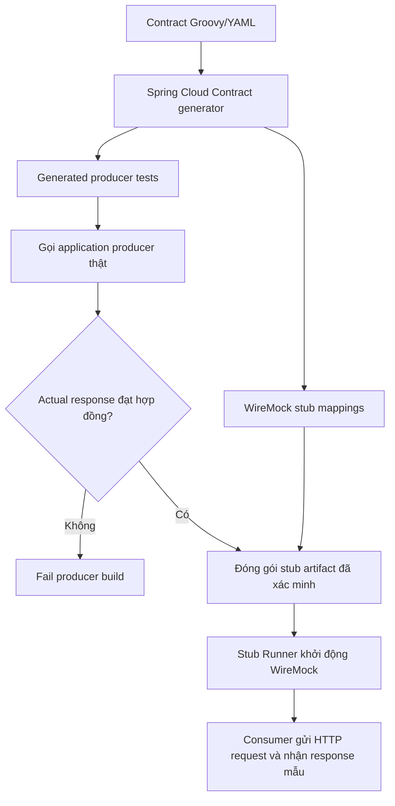
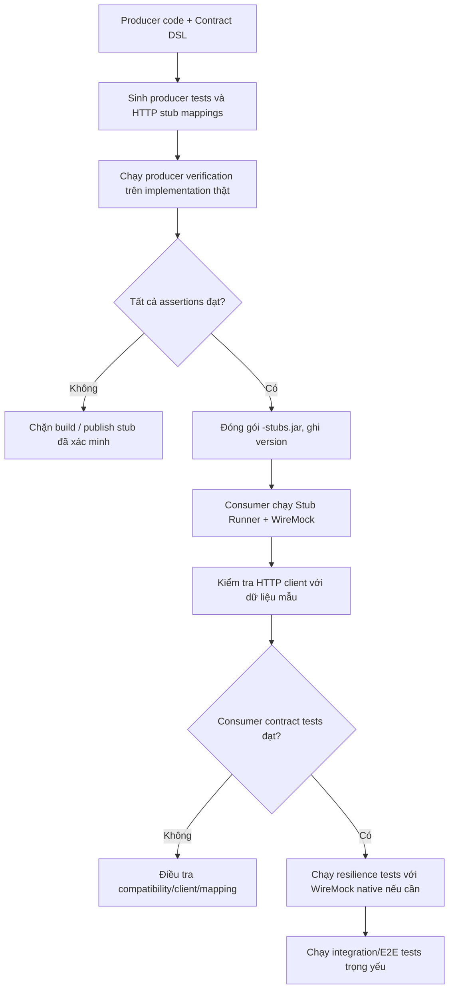

# Phân biệt khả năng của WireMock với khả năng DSL sinh stub

## 1. Bài toán: WireMock làm được, nhưng hợp đồng có diễn đạt được không?

Trong hệ thống nhiều dịch vụ, `Checkout Service` gọi HTTP API của `Payment Service` để kiểm tra trạng thái thanh toán. Nhóm Checkout muốn chạy kiểm thử mà không cần khởi động Payment Service, nên dùng **Spring Cloud Contract** để tạo stub và **Stub Runner** để chạy stub HTTP qua **WireMock**.

Nhu cầu ban đầu khá đơn giản: gọi `GET /api/payments/42`, trả `200 OK` cùng JSON:

```json
{
  "paymentId": 42,
  "status": "PAID",
  "receiptId": "RC-42"
}
```

Sau đó nhóm consumer đặt câu hỏi:

- Có thể chấp nhận `paymentId` khác bằng regex hay JSONPath không?
- Có thể trả `503` trong lần gọi đầu và `200` trong lần gọi thứ hai không?
- Có thể giả lập mất kết nối, trả response chậm hoặc proxy request tới server khác không?
- Có thể dùng dữ liệu của request để tạo response động không?
- Có thể ghi lại request thật rồi tạo stub từ bản ghi không?
- Có thể nhét mọi thuộc tính cấu hình WireMock vào hợp đồng Groovy/YAML không?

**Câu trả lời không đồng nhất cho mọi câu hỏi.** WireMock là một HTTP mocking engine có nhiều tính năng runtime; **Spring Cloud Contract DSL** là ngôn ngữ định nghĩa giao diện được dùng để **sinh producer tests và stub mappings**. Công cụ sinh stub không mặc nhiên công bố toàn bộ API cấu hình WireMock dưới dạng thuộc tính DSL tương đương từng dòng.

Chủ đề này thuộc chương **WireMock** của module `SPRING_CLOUD_CONTRACT`. Sau bài học, bạn sẽ:

1. Phân biệt năng lực của WireMock, năng lực diễn đạt của Groovy/YAML DSL và năng lực của plugin sinh stub.
2. Nhận biết trường hợp có thể viết contract duy nhất, trường hợp cần matcher hoặc cấu hình WireMock riêng.
3. Hiểu producer verification khác consumer test chạy HTTP stub.
4. Đánh giá các tính năng nâng cao như priority, scenario, delay, fault, proxy, recording và templating.
5. Quyết định cách tổ chức CI để không đánh đồng stub mô phỏng với bằng chứng tương thích API thật.

## 2. Tách ba lớp: hợp đồng, sinh mã và thực thi stub

Có ba lớp cần xem riêng:

| Lớp | Vai trò | Ví dụ |
| --- | --- | --- |
| **Spring Cloud Contract Groovy/YAML DSL** | Mô tả tương tác và kỳ vọng chung giữa producer–consumer | `request`, `response`, `bodyMatchers`, `matchers` |
| **Spring Cloud Contract Verifier / Stub generator** | Đọc DSL để sinh **producer test** và **stub mappings** | Generated JUnit test; WireMock mapping JSON |
| **WireMock runtime** | Nhận HTTP request, chọn mapping khớp và trả response | Request matching, stateful scenarios, delays, faults |



Đừng đảo ngược trách nhiệm:

- WireMock không tự chạy code của `Payment Service` để chứng minh `receiptId` do producer thật sinh đúng định dạng.
- Spring Cloud Contract DSL không tự động biến **mọi** tùy chọn WireMock native thành một từ khóa trong Groovy/YAML.
- Stub Runner không tự tạo ra logic nghiệp vụ; nó điều phối việc tải/nạp artifact stub và chạy server giả lập phù hợp.

**Quy tắc quan trọng:** Một tính năng **có trong WireMock** chưa chắc có cách diễn đạt trực tiếp bằng **DSL của phiên bản Spring Cloud Contract đang dùng**. Ngược lại, một biểu thức DSL như `byRegex` trong response có thể chủ yếu phục vụ **producer assertion**, chứ không phải yêu cầu WireMock sinh dữ liệu ngẫu nhiên theo regex.

## 3. Bảng so sánh khả năng theo mục đích

Đây là bảng định hướng thiết kế, **không phải danh sách cam kết API cố định cho mọi phiên bản**:

| Mục tiêu | Groovy/YAML Contract DSL | WireMock native | Cần lưu ý |
| --- | --- | --- | --- |
| Method, URL, query, header | Mô tả trực tiếp trong `request` | Request patterns | Kiểm tra mapping được sinh |
| Response status/header/body | Mô tả trực tiếp trong `response` | Response definition | Stub trả dữ liệu mẫu |
| Regex hoặc kiểu dữ liệu của trường | Matchers của DSL | Regex/JSONPath patterns | Hướng request/response khác nhau |
| JSON object, array, nested fields | DSL hỗ trợ cấu trúc body | JSON equality/JSONPath | Kiểu, array order, extra fields cần rõ ràng |
| Đưa giá trị request sang response | DSL hỗ trợ một số cơ chế dữ liệu động, tùy trường hợp | Response templating | Không phải matcher `byRegex` |
| Trả response sau một khoảng trễ | Phụ thuộc khả năng/cú pháp từng bản hoặc cách cấu hình bổ sung | Fixed/random delay | Phải kiểm tra generated mapping |
| Trả lỗi kết nối thay vì HTTP response | Không nên mặc định có DSL một-một | Fault simulation | Thường là test resilience riêng |
| Lần gọi đầu `503`, lần sau `200` | Không nên mặc định có DSL một-một | Stateful scenarios | Cần reset state và cô lập test |
| Mapping priority | Có thể cần cơ chế metadata/extension hoặc mapping riêng tùy bản | Priority của mapping | Không dùng priority để che contract mâu thuẫn |
| Chuyển tiếp request tới upstream | Không phải nghĩa vụ contract HTTP thông thường | Proxying | Có thể phụ thuộc mạng/upstream |
| Ghi request/response rồi sinh mapping | Không phải bước bắt buộc của contract generation | Recording/snapshotting | Dữ liệu ghi lại cần rà soát |
| Webhook hoặc transformer mở rộng | Không mặc nhiên có từ khóa DSL tương ứng | Extension API của WireMock | Kiểm tra hỗ trợ extension và version |
| Xác minh producer thật | Có: Verifier sinh test từ DSL | Không, nếu chỉ chạy HTTP stub | Producer test phải chạy riêng |
| Messaging topic/broker | Messaging DSL và verifier/binder chuyên biệt | HTTP WireMock không thay broker | Không dùng HTTP stub để chứng minh Kafka/RabbitMQ |

Để quyết định một tính năng có **được chuyển qua stub generator hay không**, phải kiểm tra đúng bộ ba: **DSL version → generator output → WireMock runtime version**. Một tính năng có trong WireMock 3.x nhưng dự án đang chạy phiên bản WireMock khác hoặc generator chưa sử dụng nó thì không thể mặc nhiên coi là sẵn có.

## 4. Ví dụ chuẩn: một hợp đồng tạo hai loại kiểm thử

Giả sử producer `Payment Service` có API `POST /api/payments`:

```http
POST /api/payments
Content-Type: application/json

{"orderId":42,"amount":125000,"currency":"VND"}
```

Phản hồi mong đợi:

```http
HTTP/1.1 201 Created
Content-Type: application/json

{"paymentId":900,"status":"CREATED","receiptId":"RC-900"}
```

### 4.1. Spring Cloud Contract Groovy DSL

```groovy
import org.springframework.cloud.contract.spec.Contract

Contract.make {
    description 'Tao thanh toan tu don hang'

    request {
        method POST()
        url '/api/payments'
        headers {
            contentType(applicationJson())
        }
        body(
            orderId: 42,
            amount: 125000,
            currency: 'VND'
        )
        bodyMatchers {
            jsonPath('$.orderId', byType())
            jsonPath('$.currency', byEquality())
        }
    }

    response {
        status CREATED()
        headers {
            contentType(applicationJson())
        }
        body(
            paymentId: 900,
            status: 'CREATED',
            receiptId: 'RC-900'
        )
        bodyMatchers {
            jsonPath('$.paymentId', byType())
            jsonPath('$.status', byEquality())
            jsonPath('$.receiptId', byRegex('RC-[0-9]+'))
        }
    }
}
```

Hai khối `bodyMatchers` phục vụ **hai phía khác nhau**:

- `request.bodyMatchers` thường giúp **stub** so khớp request đến từ consumer. Ví dụ `orderId` là một số, không bắt buộc luôn là `42` nếu matcher nới ràng buộc đó.
- `response.bodyMatchers` giúp **producer verification** kiểm tra actual response. Ví dụ producer có thể sinh `receiptId="RC-18372"` thay vì `RC-900`, miễn thỏa định dạng.

Phần `response.body` vẫn có các **giá trị cụ thể** để WireMock trả cho consumer. `byRegex('RC-[0-9]+')` không khiến WireMock tự sinh một `receiptId` bất kỳ.

### 4.2. YAML DSL cùng ý nghĩa

```yaml
description: Tao thanh toan tu don hang
request:
  method: POST
  url: /api/payments
  headers:
    Content-Type: application/json
  body:
    orderId: 42
    amount: 125000
    currency: VND
  matchers:
    body:
      - path: '$.orderId'
        type: by_type
      - path: '$.currency'
        type: by_equality
response:
  status: 201
  headers:
    Content-Type: application/json
  body:
    paymentId: 900
    status: CREATED
    receiptId: RC-900
  matchers:
    body:
      - path: '$.paymentId'
        type: by_type
      - path: '$.status'
        type: by_equality
      - path: '$.receiptId'
        type: by_regex
        value: 'RC-[0-9]+'
```

Đây là YAML của **Spring Cloud Contract**, không phải cấu hình JSON của WireMock. Khối `request.matchers.body` và `response.matchers.body` là khái niệm thuộc DSL của Contract Verifier.

### 4.3. Producer verification thực hiện gì?

Generated producer test dùng request cụ thể của hợp đồng để gọi API thật, rồi đối chiếu:

| Thuộc tính response | Kỳ vọng test |
| --- | --- |
| HTTP status | `201` |
| Content-Type | `application/json` |
| `paymentId` | Kiểu dữ liệu phù hợp với mẫu `900` |
| `status` | Chính xác `CREATED` |
| `receiptId` | Khớp regex `RC-[0-9]+` |

Điều kiện `paymentId` theo kiểu **không** bảo đảm ID lớn hơn 0 nếu chỉ kiểm tra kiểu. Nếu consumer phụ thuộc miền giá trị, cần matcher hoặc assertion nghiệp vụ chặt hơn.

## 5. WireMock mapping native cho tình huống tương tự

Đây là **mapping WireMock tự viết**, minh họa về mặt ngữ nghĩa và **không cam kết generator sẽ tạo nguyên văn**:

```json
{
  "request": {
    "method": "POST",
    "urlPath": "/api/payments",
    "headers": {
      "Content-Type": {
        "contains": "application/json"
      }
    },
    "bodyPatterns": [
      {
        "matchesJsonPath": {
          "expression": "$.orderId",
          "matches": "[0-9]+"
        }
      },
      {
        "matchesJsonPath": {
          "expression": "$.currency",
          "equalTo": "VND"
        }
      }
    ]
  },
  "response": {
    "status": 201,
    "headers": {
      "Content-Type": "application/json"
    },
    "jsonBody": {
      "paymentId": 900,
      "status": "CREATED",
      "receiptId": "RC-900"
    }
  }
}
```

**Giải nghĩa cấu trúc WireMock:**

- `request.method`, `request.urlPath`, `request.headers`, `bodyPatterns` là **điều kiện để stub lựa chọn mapping**.
- `response.status`, `response.headers`, `response.jsonBody` là **phản hồi mẫu**.
- Một request JSON khác cách pretty print vẫn có thể phù hợp JSONPath matching.
- WireMock không biết `Payment Service` thật đã sinh `receiptId` gì; mapping trên chỉ trả `RC-900`.

Không chép nguyên `request.bodyPatterns` hay `response.jsonBody` vào hợp đồng YAML rồi kỳ vọng Spring Cloud Contract tự hiểu. Đây là **hai schema khác nhau**.

### 5.1. Vì sao cần mở mapping thực tế được sinh?

Từ một DSL, generator có thể chọn các matcher, biểu diễn body và metadata khác nhau theo version/plugin. Bởi vậy nếu consumer test không match:

1. Xem source contract đang được build dùng.
2. Xác nhận producer build đã sinh stub mappings.
3. Mở đúng mapping nằm trong artifact `-stubs.jar`.
4. Đọc request patterns thực tế của mapping đó.
5. Đối chiếu HTTP request thật của client và mapping đang được WireMock nạp.

Đừng sửa contract chỉ để dự đoán một mapping JSON mà chưa kiểm tra **generated output**.

## 6. WireMock request matchers và Contract DSL matchers không đồng nghĩa

WireMock native hỗ trợ nhiều chiến lược matching:

| WireMock native | Mục đích | DSL Spring Cloud Contract gần nhất |
| --- | --- | --- |
| `equalTo` | So sánh text/field chính xác | Giá trị cụ thể, `byEquality` theo ngữ cảnh |
| `matches` | Regex với chuỗi | `regex`, `byRegex` theo phía |
| `equalToJson` | So sánh JSON có cấu trúc | `body` dạng object/list và matcher JSON tương ứng |
| `matchesJsonPath` | Chọn giá trị trong body JSON | `jsonPath` / `matchers.body` |
| `matchesXPath`, `equalToXml` | So khớp XML | XML body, XPath matcher khi DSL/version hỗ trợ |
| `binaryEqualTo` | So khớp bytes | Binary/file body theo hỗ trợ DSL |
| Header/cookie/query patterns | So khớp các thành phần request | Các khối header, query, cookie trong `request` |

Cột cuối cho biết **khái niệm tương ứng**, không phải lời khẳng định DSL có cùng tên, có cùng default hoặc cho phép mọi tổ hợp WireMock matcher.

### 6.1. Hai phía consumer/producer tạo nên khác biệt

Ví dụ một trường `receiptId` trong **response** Groovy:

```groovy
receiptId: $(consumer('RC-900'),
             producer(regex('RC-[0-9]+')))
```

- Consumer-side `RC-900`: stub trả chuỗi đó.
- Producer-side regex: generated producer test kiểm tra **actual** response.

Ngược lại, trong **request**:

```groovy
orderId: $(consumer(regex('[0-9]+')), producer(42))
```

- Consumer-side regex: giúp stub nhận các request hợp lệ.
- Producer-side `42`: test producer cần dữ liệu request cụ thể.

**Matcher của DSL có ý nghĩa theo phía và hướng giao tiếp.** Một regex nằm trong response không tự động trở thành WireMock request matcher, và một regex nằm trong request không tự động buộc producer test phải gọi API bằng chuỗi regex.

### 6.2. JSON whitespace, mảng và kiểu dữ liệu

```json
{"orderId":42,"currency":"VND"}
```

và:

```json
{
  "currency": "VND",
  "orderId": 42
}
```

là cùng JSON object về mặt nội dung, nhưng:

- `42` (number) khác `"42"` (string).
- `"A B"` khác `"A  B"` nếu whitespace nằm trong giá trị chuỗi.
- `[1,2]` có thể khác `[2,1]` khi thứ tự mảng mang ý nghĩa.
- Có chấp nhận trường thừa hay không là **một lựa chọn khác** với bỏ qua whitespace.

Khi hợp đồng có JSONPath riêng, matcher có thể chỉ bảo vệ những trường được chỉ ra. Cần xem các assertion còn lại do generator sinh và cách WireMock xử lý body JSON đầy đủ; không tự coi mọi `jsonPath` tương đương “kiểm tra toàn bộ schema”.

## 7. Khả năng nâng cao của WireMock: không mặc định có DSL 1–1

Ngoài các mapping HTTP thông thường, WireMock có những tính năng hữu ích để **kiểm thử khả năng chịu lỗi, tính trạng thái hoặc mô phỏng hệ thống downstream**.

### 7.1. Ưu tiên mapping (priority)

Khi nhiều mapping cùng match một request, WireMock có thể dùng `priority` để ưu tiên mapping cụ thể. Ví dụ một pattern rộng cho mọi `/api/payments/.*` và một pattern chính xác cho `/api/payments/42`.

```json
{
  "priority": 1,
  "request": {
    "method": "GET",
    "url": "/api/payments/42"
  },
  "response": {
    "status": 200,
    "jsonBody": {"paymentId": 42, "status": "PAID"}
  }
}
```

Ví dụ là **một mapping WireMock native**, không phải contract YAML. Trong WireMock, số priority nhỏ hơn nghĩa là độ ưu tiên cao hơn.

**Ranh giới trách nhiệm:** Priority giúp stub server quyết định mapping khi có chồng lấn; nó không xác định được API producer thật phải xử lý mâu thuẫn nghiệp vụ thế nào. Nếu hai contract cùng một request giống hệt nhưng yêu cầu hai response khác nhau, phải làm rõ **ngữ nghĩa API** trước, thay vì chỉ chọn một mapping bằng priority.

### 7.2. Stateful scenarios: lần đầu `503`, lần sau `200`

WireMock có thể thay đổi response theo trạng thái scenario. Hai mapping sau phối hợp để kiểm thử client retry:

**Mapping thứ nhất – trạng thái khởi đầu:**

```json
{
  "scenarioName": "payment-retry",
  "requiredScenarioState": "Started",
  "newScenarioState": "Recovered",
  "request": {
    "method": "GET",
    "url": "/api/payments/42"
  },
  "response": {
    "status": 503,
    "jsonBody": {"code": "SERVICE_UNAVAILABLE"}
  }
}
```

**Mapping thứ hai – sau khi chuyển trạng thái:**

```json
{
  "scenarioName": "payment-retry",
  "requiredScenarioState": "Recovered",
  "request": {
    "method": "GET",
    "url": "/api/payments/42"
  },
  "response": {
    "status": 200,
    "jsonBody": {"paymentId": 42, "status": "PAID"}
  }
}
```

Đây là **hai file mapping WireMock native riêng biệt** dùng chung `scenarioName`; không ghép hai object JSON cạnh nhau thành một file JSON. WireMock chỉ chọn mapping thứ nhất khi scenario ở trạng thái `Started`, rồi chuyển sang `Recovered`; lần sau mapping thứ hai có thể khớp.

Các lưu ý khi kiểm thử:

- State của scenario có thể sống qua nhiều request và gây ảnh hưởng lẫn nhau nếu test không reset.
- Nếu nhiều test chạy song song cùng server/scenario, kết quả có thể không ổn định.
- Contract DSL có thể có cơ chế mở rộng tùy phiên bản, nhưng **không được mặc nhiên suy** rằng khai báo hai hợp đồng có hai response sẽ tự sinh scenario có trạng thái.
- Producer verification của hai contract tĩnh **không đồng nghĩa** đã kiểm tra retry/backoff của consumer.

### 7.3. Fixed delay, random delay và fault injection

WireMock native có thể cấu hình độ trễ trước khi trả response:

```json
{
  "request": {
    "method": "GET",
    "url": "/api/payments/slow"
  },
  "response": {
    "status": 200,
    "fixedDelayMilliseconds": 500,
    "jsonBody": {"status": "PAID"}
  }
}
```

Điều này hữu ích khi test client timeout. Một số phiên bản WireMock còn hỗ trợ phân bố độ trễ và fault mô phỏng mất kết nối, ví dụ:

```json
{
  "request": {
    "method": "GET",
    "url": "/api/payments/broken"
  },
  "response": {
    "fault": "CONNECTION_RESET_BY_PEER"
  }
}
```

**Phân biệt:** `503` là **HTTP response** có status; connection reset là **sự cố kết nối**, có thể khiến HTTP client ném exception trước khi có response. Chúng phải được kiểm thử theo hai nhánh xử lý khác nhau.

Các thuộc tính WireMock `fixedDelayMilliseconds` và `fault` ở trên không phải các key được phép sao chép tùy ý vào `response` của Spring Cloud Contract YAML. Nếu DSL/version có hỗ trợ delay hoặc extension tương ứng, hãy dùng đúng cú pháp tài liệu; nếu không, giữ cấu hình WireMock native trong **test resilience riêng**.

### 7.4. Proxying và recording

WireMock native còn có thể chuyển tiếp request tới upstream hoặc ghi lại những tương tác để xây mapping. Đây là khả năng tiện cho **khám phá/gỡ lỗi** khi dịch vụ bên ngoài chưa có contract.

Tuy vậy, dùng proxy/recording có rủi ro:

- Kết quả test phụ thuộc upstream thực, khiến test không còn cô lập.
- Bản ghi có thể chứa **token, cookie, PII hoặc dữ liệu nhạy cảm**; cần loại bỏ và rà soát.
- Mapping ghi lại có thể phản ánh trạng thái tức thời, chứ không phải giao diện ổn định đã được producer–consumer thỏa thuận.
- Bản ghi tự động **không tự sinh producer verification** để bảo đảm implementation vẫn đáp ứng.

Nên dùng recording để **lấy dữ liệu tham khảo có kiểm soát**, sau đó review/chuẩn hóa thành hợp đồng Groovy/YAML nếu mục tiêu là kiểm thử hợp đồng. Không phát hành một tập mapping recorded thô như bằng chứng API đã được cam kết.

### 7.5. Extension, webhook và transformer

WireMock có cơ chế mở rộng, ví dụ response transformer hoặc webhook trong những bản/cấu hình hỗ trợ. Một số plugin có khả năng mở rộng stub mapping bằng metadata, transformer hoặc cơ chế tùy chỉnh theo phiên bản.

**Nguyên tắc an toàn:** Đừng suy ra từ việc WireMock runtime có extension rằng Spring Cloud Contract sẽ tự quản lý lifecycle extension, chuyển toàn bộ DSL sang extension hoặc làm producer test tương đương. Muốn dùng extension cần xác minh:

1. Version WireMock runtime thực tế trong Stub Runner.
2. Cách đăng ký extension trong test context/server.
3. Cách đưa metadata/cấu hình tới mapping sau khi generator chạy.
4. Cách reset state và cô lập test.
5. Cách producer verification tiếp tục kiểm tra giao diện đã cam kết.

## 8. Response templating khác với matcher producer

Một producer API có thể cần echo `orderId` trong response. Nếu stub luôn trả `orderId=42`, consumer test có thể không kiểm tra được quan hệ giữa request và response khi gửi ID khác.

WireMock native hỗ trợ **response templating** (Handlebars) trong cấu hình phù hợp, ví dụ minh họa:

```json
{
  "request": {
    "method": "GET",
    "urlPathPattern": "/api/orders/[0-9]+"
  },
  "response": {
    "status": 200,
    "headers": {
      "Content-Type": "application/json"
    },
    "body": "{\"orderId\":{{request.pathSegments.[2]}},\"status\":\"CREATED\"}",
    "transformers": ["response-template"]
  }
}
```

Đây là **mapping WireMock native minh họa Handlebars**, cần WireMock đã bật extension templating tương ứng. Cách truy cập path segments và hỗ trợ transform phụ thuộc version WireMock; cần kiểm tra output thực trước khi đưa vào CI.

Spring Cloud Contract có cơ chế tham chiếu **giá trị từ request** trong Groovy DSL, chẳng hạn family `fromRequest()`, cho một số tình huống sinh phản hồi động. Nhưng:

- Không thể thay mọi `fromRequest` bằng `byRegex`, vì matcher không sinh response.
- Không phải mọi helper Handlebars native đều có cách viết tương ứng trong DSL.
- JSON body cần được serialize đúng; không chèn chuỗi do user nhập vào JSON mà thiếu escaping.
- Cần kiểm tra **mapping được sinh và request thực được thử**, thay vì suy rằng biểu thức DSL đã thể hiện đầy đủ mọi chi tiết templating.

**Phân biệt ba mục tiêu:**

| Mục tiêu | Công cụ/khái niệm chính |
| --- | --- |
| Cho producer trả ID thực khác mẫu nhưng đúng format | `response.bodyMatchers` / producer matcher |
| Cho stub trả một giá trị mẫu ổn định | `response.body` cụ thể |
| Cho stub trả dữ liệu thay đổi theo request | Cơ chế tham chiếu request/response templating được hỗ trợ |

## 9. Nên dùng DSL hay mapping WireMock native?

Một tiêu chí lựa chọn hữu ích:

**Chọn DSL khi yêu cầu là giao diện mà producer và consumer cùng cam kết.** Ví dụ method, URL, request schema, HTTP status, header và response body. Contract cần được Verifier kiểm chứng ở producer và Stub Runner dùng ở consumer.

**Chọn cấu hình WireMock native hoặc một test bổ sung** khi nhu cầu là mô phỏng một điều kiện hạ tầng/khả năng chịu lỗi chỉ phục vụ một consumer test, ví dụ kết nối reset, proxy, recording, stateful retry scenario phức tạp.

**Chọn cách kết hợp có chủ đích** khi cùng một dự án cần cả hai:

- Giữ những nghĩa vụ API chung ở Groovy/YAML Contract DSL.
- Đặt fault/scenario/recorded mapping trong phạm vi test resilience riêng.
- Nếu phải tùy biến stub artifact, kiểm tra generator, packaging và nạp extension trên phiên bản thực.
- Tài liệu hóa phần nào là **contract requirement** và phần nào là **test fixture**.

### 9.1. Ma trận quyết định

| Nhu cầu | Điểm xuất phát đề xuất | Vì sao? |
| --- | --- | --- |
| GET trả `200`, JSON body đúng | Spring Cloud Contract DSL | Cần kiểm chứng cả producer lẫn consumer |
| POST có JSONPath matcher | Spring Cloud Contract DSL | Bảo vệ định dạng và giá trị đầu vào |
| Receipt ID sinh động ở producer | Response matcher của DSL | Giảm ràng buộc giá trị cố định |
| Echo order ID từ request | Cơ chế giá trị động của DSL nếu hỗ trợ | Cần kiểm tra stub và producer có cùng ngữ nghĩa |
| Lần đầu `503`, lần sau `200` | WireMock native scenario hoặc extension có xác minh | Đây là hành vi của stub theo trạng thái, không mặc nhiên là hai contract tĩnh |
| Mất kết nối TCP giả lập | WireMock fault test riêng | Không có HTTP status để assertion như thông thường |
| Ghi lại upstream request | WireMock recording với kiểm soát dữ liệu | Dữ liệu recorded chưa phải hợp đồng đã được duyệt |
| Broker phát sự kiện `PaymentCompleted` | Messaging DSL + message verifier/binder | WireMock HTTP không phải Kafka/RabbitMQ |
| Xác minh JWT signature thật | Security/integration test ở producer | Stub match header không xác minh chữ ký |

## 10. Stub Runner so với WireMock trực tiếp

### 10.1. Dùng Stub Runner trong consumer contract test

Sau khi producer phát hành artifact `com.example:payment-service:1.0.0:stubs`, consumer có thể dùng:

```java
import org.junit.jupiter.api.Test;
import org.springframework.boot.test.context.SpringBootTest;
import org.springframework.cloud.contract.stubrunner.spring.AutoConfigureStubRunner;
import org.springframework.cloud.contract.stubrunner.spring.StubRunnerProperties;

@SpringBootTest(properties = {
    "payment.client.base-url=http://localhost:8090"
})
@AutoConfigureStubRunner(
    ids = "com.example:payment-service:1.0.0:stubs:8090",
    stubsMode = StubRunnerProperties.StubsMode.LOCAL
)
class CheckoutPaymentClientContractTest {

    @Test
    void checkoutHandlesCreatedPayment() {
        // Gọi PaymentClient thật đến WireMock trên port 8090.
        // Kiểm tra mapping DTO và logic ứng dụng khi nhận 201.
    }
}
```

Đây là **bộ khung**; test thật phải cấu hình HTTP client và assertion, không để nội dung method chỉ có comment. Stub artifact phải được cài vào Maven local repository nếu dùng `LOCAL`, hoặc chọn chế độ repository phù hợp trên CI.

Stub Runner xử lý **tìm/tải artifact**, khởi động stub server và nạp mapping; WireMock runtime mới thực hiện **HTTP request matching và phản hồi**.

### 10.2. Dùng WireMock trực tiếp cho test resilience

Khi chỉ muốn kiểm thử `PaymentClient` trước lỗi `503`/reset kết nối, có thể khởi động WireMock trực tiếp và đăng ký mapping riêng. Tùy phiên bản Spring Cloud Contract/WireMock của project, một lựa chọn là `@AutoConfigureWireMock(port = 0)`:

```java
import org.springframework.boot.test.context.SpringBootTest;
import org.springframework.cloud.contract.wiremock.AutoConfigureWireMock;

@SpringBootTest
@AutoConfigureWireMock(port = 0)
class PaymentClientResilienceTest {
    // Dùng WireMock Java API hoặc mapping files để mô phỏng fault.
    // WireMock port động có thể truy xuất qua wiremock.server.port.
}
```

Đoạn trên không tự tải `-stubs.jar` từ artifact producer. Nếu test nạp mapping native trực tiếp, **producer verification không tự được sinh** từ mapping đó. Phải tách bạch mục đích: contract compatibility test hay resilience/integration test của HTTP client.

### 10.3. Mã phụ thuộc vào version thực tế

Các gói thư viện của Spring Cloud Contract, WireMock và Spring Boot có thể thay đổi theo release train. Nên:

1. Ghim phiên bản Spring Boot và Spring Cloud BOM tương thích.
2. Chọn phiên bản Spring Cloud Contract Maven/Gradle plugin tương ứng.
3. Xác minh WireMock version thực tế mà Stub Runner hoặc `spring-cloud-contract-wiremock` đưa vào classpath.
4. Kiểm tra cú pháp DSL, `@AutoConfigureStubRunner`, `@AutoConfigureWireMock` và cách cấu hình extension đúng phiên bản.

Không tự ép một bản WireMock mới hơn chỉ để dùng một feature native nếu chưa kiểm tra tương thích với stub generator và Boot test classpath.

## 11. Giới hạn bảo mật: WireMock match header không kiểm chứng danh tính

Giả sử mapping WireMock:

```json
{
  "request": {
    "method": "GET",
    "url": "/api/payments/42",
    "headers": {
      "Authorization": {
        "matches": "Bearer .+"
      }
    }
  },
  "response": {
    "status": 200
  }
}
```

Mapping chỉ xác minh rằng header có chuỗi bắt đầu `Bearer ` và tiếp theo là ký tự khác rỗng. Nó **không** chứng minh token hợp lệ, đúng issuer/audience, chưa hết hạn hoặc có authority phù hợp.

Cần phối hợp:

- **Consumer test với stub:** xác minh HTTP client có gửi header và xử lý các status `200`, `401`, `403` mà giao diện đã cam kết.
- **Producer security integration/contract tests:** xác minh request đi qua SecurityFilterChain thật và quyền được kiểm tra đúng.
- **E2E test:** kiểm tra gateway, mTLS, IdP hoặc hạ tầng xác thực theo nhu cầu.

Không lưu token production, password thật hay PII trong hợp đồng, mapping native hoặc bản recording. Nếu cần demo bearer token, dùng giá trị thử nghiệm không thể truy cập tài nguyên production.

## 12. Giới hạn messaging: WireMock chỉ mô phỏng HTTP

Spring Cloud Contract còn có messaging DSL, ví dụ:

```groovy
import org.springframework.cloud.contract.spec.Contract

Contract.make {
    label 'payment_completed'
    input {
        triggeredBy('completePaymentAndPublish()')
    }
    outputMessage {
        sentTo('payments.completed')
        body(
            eventType: 'PaymentCompleted',
            paymentId: 42
        )
    }
}
```

Đây là một **message contract**. Để xác minh, producer cần message verifier/transport phù hợp (ví dụ Spring Cloud Stream test binder hoặc integration tương ứng); consumer cần message stub/trigger có cấu hình thích hợp.

**WireMock HTTP không tự tạo Kafka topic, RabbitMQ queue, bảo đảm acknowledgement, ordering, retry hay exactly-once delivery.** Dù Stub Runner có thể tham gia cả HTTP và messaging, **WireMock không thay thế message broker**. Phải chọn đúng lớp kiểm thử.

## 13. Nạp thêm mapping native vào Stub Runner: thận trọng với packaging

Một số dự án muốn dùng cùng một stub server vừa cho contract mappings được sinh, vừa cho các mapping native riêng. Điều này có thể khả thi tùy cơ chế packaging và cách khởi tạo WireMock, nhưng không tự động xảy ra chỉ vì bạn đặt một file JSON ở đâu đó trong repository.

Hãy phân biệt ba nguồn:

1. **Groovy/YAML contracts:** generator sinh producer tests và stub mappings.
2. **WireMock native mappings tự viết:** chỉ mang ý nghĩa HTTP stub nếu server nạp chúng; không tự sinh producer tests.
3. **Stub artifact `-stubs.jar`:** chứa những mapping/contract được build đóng gói theo cấu hình và phiên bản plugin.

Để kết hợp có kiểm soát:

- Kiểm tra đường dẫn mapping trong artifact và cấu hình resource loader của Stub Runner.
- Không để mapping native mới ghi đè mapping được sinh một cách im lặng.
- Ghi rõ mapping nào thuộc contract, mapping nào phục vụ resilience/negative test.
- Nếu có stateful scenario/extension, cấu hình cách reset và lifecycle.
- Không coi native mapping được đóng gói cùng JAR là producer behavior đã được Verifier xác minh.

**Không tự chỉnh sửa generated mapping bên trong thư mục output rồi coi đó là nguồn chân lý.** Nó sẽ bị ghi đè trong lần build tiếp theo. Hãy sửa nguồn DSL/cấu hình generator hoặc giữ mapping native trong nguồn test riêng có cơ chế nạp rõ ràng.

## 14. Khắc phục sự cố: feature có trên WireMock nhưng test không hoạt động

| Triệu chứng | Nguyên nhân có thể | Cách kiểm tra |
| --- | --- | --- |
| Thêm `fault` vào Contract YAML nhưng parse fail | Cấu trúc native không phải schema DSL | Dùng cú pháp DSL được hỗ trợ hoặc test WireMock riêng |
| WireMock runtime hỗ trợ templating nhưng response không render | Chưa bật transformer, syntax helper không tương thích | Kiểm tra runtime extension, mapping được nạp |
| Scenario luôn trả `200` hoặc `503` | State còn từ test trước hoặc có mapping chồng lấn | Xem request journal, reset scenarios |
| `@AutoConfigureStubRunner` không nạp mapping tự viết | File chưa nằm trong artifact hoặc loader không đọc | Kiểm tra `-stubs.jar` và startup logs |
| Consumer nhận `404` từ stub | Request không match hoặc stub chủ đích trả `404` | Phân biệt unmatched request với response nghiệp vụ |
| Body JSON khác kỳ vọng | Stub mẫu khác producer actual hoặc artifact cũ | Kiểm tra contract, artifact version và generated mapping |
| Producer test xanh nhưng lỗi timeout consumer | Producer test chưa mô tả điều kiện lỗi mạng | Có resilience test riêng cho delay/fault |
| Priority giải quyết được stub conflict nhưng API vẫn sai | Hai contract mô tả behavior mâu thuẫn | Review request conditions/API version |
| Test local xanh, CI fail | Port trùng, artifact thiếu, clock/state khác | Dùng port động, cô lập state, ghim version |
| Security test xanh khi gửi token giả | WireMock chỉ match header chuỗi | Chạy producer security integration test |

### 14.1. Quy trình điều tra tối thiểu

1. **Xác định đang chạy thứ gì:** generated producer test, Stub Runner consumer test hay WireMock native integration test?
2. **Xác minh version:** Spring Cloud Contract plugin, runtime WireMock, dependencies liên quan.
3. **Đọc nguồn gốc mapping:** Contract Groovy/YAML, mapping native tự viết hay mapping recorded?
4. **Đọc generated mapping đã nạp:** method, URL, bodyPatterns, response, transformers, priority, scenario state.
5. **So sánh actual request** của HTTP client với request pattern, không chỉ dựa vào request dự định gửi.
6. **Kiểm tra state và extension:** reset scenario/request journal, xác nhận transformer được đăng ký.
7. **Chạy producer verification** khi nghi ngờ stub và implementation hiện tại không còn tương thích.

Đối với WireMock server trong test, Admin API có thể hữu ích để xem mappings, request journal và unmatched requests. Không mở các endpoint quản trị có khả năng sửa mapping ra mạng công cộng; chỉ dùng trong môi trường kiểm thử đáng tin cậy.

## 15. Quy trình CI: hai bộ test không nên gộp làm một

Một pipeline có thể tách rõ:



Lưu ý về CI:

- **Generated producer tests phải thật sự chạy**, không chỉ được sinh ra.
- **Stub artifact chỉ được coi đã xác minh** sau khi producer verification đạt.
- **Consumer phải dùng đúng artifact version** và gọi client thật thay vì chỉ kiểm tra WireMock server khởi động.
- **Native fault/scenario tests** phải cô lập state, port, timeouts và cleanup để tránh flaky test.
- **Không ép mọi fault vào contract DSL** nếu không phải nghĩa vụ giao diện chung giữa producer–consumer.
- **Không coi pass của WireMock native tests là bằng chứng producer implementation đúng**; hai mục tiêu khác nhau.
- **Ghi nhận compatibility change** khi thay status, headers, field bắt buộc hoặc URL.

## 16. Bài thực hành: phân loại yêu cầu theo công cụ

Giả sử `Inventory Service` cung cấp `GET /api/stock/sku-1`. Consumer `Order Service` cần biết tồn kho:

```json
{
  "sku": "sku-1",
  "available": 12
}
```

Nhóm kiểm thử đưa ra sáu yêu cầu:

1. `GET /api/stock/sku-1` phải trả `200`, body JSON có `sku` và `available`.
2. Client gửi `Accept: application/json` và giải mã trường `available`.
3. Khi upstream phản hồi chậm 800 ms, client phải timeout/fallback đúng.
4. Khi gọi hai lần, stub trả `503` rồi `200` để kiểm tra retry.
5. Producer phải từ chối JWT giả bằng `401` với security filter thật.
6. Inventory còn phát Kafka event `StockReserved` khi có yêu cầu giữ hàng.

### 16.1. Phân loại cách kiểm thử

| Yêu cầu | Công cụ nên dùng chính | Giải thích |
| --- | --- | --- |
| 1 | Spring Cloud Contract Groovy/YAML + producer verification | Bảo vệ HTTP behavior chung |
| 2 | Stub Runner/WireMock consumer test | Bảo vệ client request và DTO mapping |
| 3 | WireMock native delay/fault test | Bảo vệ resilience của client, không cần coi delay là nghĩa vụ API |
| 4 | WireMock stateful scenario | Kiểm tra stateful retry behavior của client |
| 5 | Spring Security/producer integration test, có thể thêm contract `401` | WireMock không giải mã/xác minh JWT thật |
| 6 | Messaging DSL + message verifier/binder + broker test khi cần | HTTP WireMock không mô phỏng Kafka |

### 16.2. Bài tập tự viết hợp đồng YAML

Hãy hoàn thiện contract này và giải thích nó có thể sinh những gì:

```yaml
description: Lay ton kho cua mot ma hang
request:
  method: GET
  url: /api/stock/sku-1
  headers:
    Accept: application/json
response:
  status: 200
  headers:
    Content-Type: application/json
  body:
    sku: sku-1
    available: 12
  matchers:
    body:
      - path: '$.sku'
        type: by_equality
      - path: '$.available'
        type: by_type
```

**Gợi ý trả lời:** DSL có thể sinh producer test kiểm tra HTTP `200`, media type, `sku` và kiểu của `available`, đồng thời sinh HTTP stub mapping để consumer nhận body mẫu. Nó **không tự sinh** một stateful retry scenario `503 → 200`, không tự reset WireMock giữa test và không tự khởi động Kafka.

### 16.3. Ba câu hỏi phản biện

1. Nếu WireMock có tính năng proxy nhưng stub artifact của producer không chứa config proxy, có thể kết luận Stub Runner sẽ proxy không? **Không**; runtime capability không đồng nghĩa mapping đã bật nó.
2. Nếu một response matcher regex trong DSL cho phép `available` là số bất kỳ, WireMock có ngẫu nhiên trả số bất kỳ không? **Không**; response stub dùng dữ liệu mẫu hoặc templating đã định nghĩa.
3. Nếu consumer test với WireMock pass sau khi producer bỏ trường `available`, pipeline có an toàn không? **Chưa**; phải chạy producer verification với hợp đồng phù hợp trên implementation hiện tại.

## 17. Checklist trước khi chọn cách tạo stub

- Mục tiêu là **cam kết giao diện** hay **mô phỏng fault/resilience** của client?
- Đã phân biệt Contract DSL, stub generator và WireMock runtime?
- Đã xác minh feature cụ thể được DSL/plugin **phiên bản đang dùng** hỗ trợ thay vì chỉ thấy nó trong docs WireMock?
- Nếu có matcher, đã xác định nó phục vụ **stub request matching** hay **producer response assertion**?
- Nếu dùng templating, đã kiểm tra escaping, response mẫu, extension và generated mapping?
- Nếu dùng stateful scenario, đã cấu hình reset/cleanup và tránh ảnh hưởng test song song?
- Nếu dùng mapping native, đã ghi rõ nó **không tự sinh producer test**?
- Stub Runner có nạp đúng mapping, artifact version, transformer và priority không?
- Producer verification có chạy thật và chỉ publish stub sau khi đạt?
- Đã giữ các security, messaging, broker và E2E tests cần thiết ngoài phạm vi HTTP stub?

**Tài liệu tham khảo để đối chiếu theo phiên bản:**

- [Spring Cloud Contract — Reference](https://docs.spring.io/spring-cloud-contract/reference/).
- [Spring Cloud Contract — Contract DSL và dynamic properties](https://docs.spring.io/spring-cloud-contract/reference/project-features-contract/dsl-dynamic-properties.html).
- [Spring Cloud Contract — Stub Runner](https://docs.spring.io/spring-cloud-contract/reference/project-features-stubrunner.html).
- [WireMock — Stubbing](https://wiremock.org/docs/stubbing/).
- [WireMock — Request Matching](https://wiremock.org/docs/request-matching/).
- [WireMock — Stateful Behaviour](https://wiremock.org/docs/stateful-behaviour/).
- [WireMock — Response Templating](https://wiremock.org/docs/response-templating/).

**Ghi nhớ:** **WireMock là HTTP stub engine có nhiều tính năng runtime**; **Spring Cloud Contract DSL là ngôn ngữ định nghĩa hợp đồng**, còn **generator** quyết định những gì chuyển thành producer tests và stub mappings. Không phải mọi option WireMock có cú pháp DSL 1–1 và không phải mọi matcher DSL đều tác động đến response stub. Hãy dùng DSL cho những nghĩa vụ API cần xác minh ở cả producer và consumer; dùng WireMock native có chủ đích cho tình huống mô phỏng nâng cao; kiểm tra generated artifacts, chạy đủ producer verification và consumer tests trước khi tin rằng tích hợp đã tương thích.
